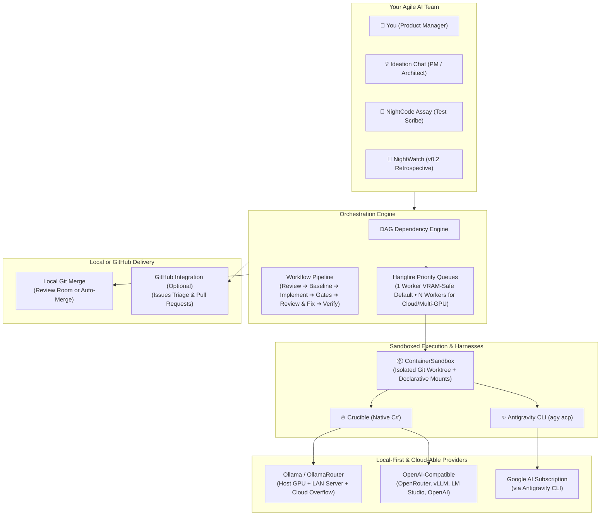

# 🌙 NightCode**Forge**

> Your autonomous AI engineering team — local-first, cloud-able, and sandboxed by default.

[](https://dotnet.microsoft.com/)
[](LICENSE)
[](docs/ARCHITECTURE.md)
[](docs/CRUCIBLE.md)
[](docs/PLAN.md)

---

## 🎯 Project Overview

🌙 **NightCodeForge** is an asynchronous developer queue and multi-agent orchestrator built for software engineering workflows—combining **deterministic** build/test gates with **autonomous AI agents** running in isolated containers.

Stop micro-managing and babysitting coding agents. Define your goals, let agents work autonomously in their own Git worktrees and sandboxes while you keep coding on your repository, and review or auto-merge their work when it's ready.

---

## 🧭 Key Pillars

### 1. Local-First, and Cloud-Able
Run 100% on your own hardware, scale to the cloud when you want, or mix both per workflow stage:
* **Local AI Made Easy *(v0.1.0 Setup Wizard)*:** No guesswork picking quantizations or context sizes—the OOBE setup wizard (via OllamaRouter integration) inspects your GPU/VRAM, benchmarks candidate models on your hardware, and automatically recommends and configures the best models for each role.
* **Ollama & [OllamaRouter](https://github.com/jetelain/OllamaRouter):** Run models locally on your workstation GPU and/or a dedicated LAN GPU server, with optional **Cloud Overflow** when you need extra capacity or zero-VRAM diagnostics.
* **Any OpenAI-Compatible Provider:** Connect to **OpenRouter**, vLLM, LM Studio, DeepSeek, or OpenAI endpoints (with API keys stored securely in your OS keyring via `Pmad.KeySharp`).
* **Google AI Subscription via Antigravity CLI:** First-class **Antigravity (`agy acp`)** integration via the Agent Client Protocol (ACP) so you can use your Google AI subscription directly inside NightCodeForge.

### 2. Air-Gapped or GitHub-Integrated
* **100% Local & Air-Gapped Capable:** Workflows, task backlog, markdown mirroring (`docs/tasks/`), code review (`Review Room`), and Git management (`CliWrap` + isolated worktrees) all run locally on your machine. The web dashboard is hardened for offline/air-gapped use with zero external runtime dependencies.
* **Optional GitHub Integration:** Connect via GitHub App Device Flow to intake and triage GitHub issues automatically, push branches and open Pull Requests (`MergeMode.ExternalPullRequest`), and sync PR-merge closures bi-directionally.

### 3. No More Agent Micro-Management
* **Workflow-Guided, Containerized Autonomy:** Tasks progress through structured deterministic + agent stages (Task Review → Baseline → Implementation → Quality Gates → Code Review & Fixes → Verification) inside ephemeral `ContainerSandbox` environments.
* **Keep Working on Your Repo:** Agents execute in isolated Git worktrees (`~/.nightcodeforge/wks/{id}/task-{id}`), leaving your main working directory untouched.
* **Flexible Delivery (`MergeMode`):** Review diffs side-by-side in the **Review Room** (`ManualReviewRequired`), deliver via **GitHub Pull Request** (`ExternalPullRequest`), or let passing commits **auto-squash & merge** (`Automatic`).
* **Non-Blocking Context Switching:** When an agent needs clarification via `ask`, NightCodeForge snapshots its memory, commits a Git WIP checkpoint, and immediately frees the worker for the next task. Once you answer in the **Inbox**, the task resumes with `llm-urgent` priority.
* **VRAM-Safe by Default, Scalable to N Workers:** Defaults to `WorkerCount = 1` to prevent VRAM thrashing on single-GPU setups, and scales to `N` concurrent workers (`MaxConcurrentInferenceTasks`) for cloud APIs or multi-GPU fleets.

### 4. Your New Agile Development Team
* **You — Product Manager:** Set goals, prioritize the backlog, answer high-level questions in the Inbox, and approve final deliverables.
* **Ideation Chat — Project Manager / Architect:** Explore your codebase interactively, refine specs, and propose structured tasks with DAG dependencies.
* **[NightCode Assay](https://github.com/jetelain/NightCodeAssay) — Test Scribe *(Companion App)*:** Exploratory testing companion that discovers your active LLM configuration and hands off structured test reports and bug tasks directly into NightCodeForge.
* **Crucible & Antigravity — The Developers:** **Crucible** (native C# harness built on `Microsoft.Extensions.AI`) and **Antigravity** (`agy acp`) implement features, run builds/tests, and apply code review fixes.
* **NightWatch — Retrospective & Reliability *(Planned `v0.2`)*:** Autonomous monitoring, in-flight environment recovery, and idle-GPU deep transcript/workspace analysis to propose self-improvement tasks (`12.34A/B/C`, `12.35B`).

### 5. Security & Guardrails
* **Container Isolation (Available Now):** Agents run in `ContainerSandbox` (Docker/Podman on ext4) with explicit, declarative mount tables—no unrestricted access to your host filesystem. Untrusted external issue triage runs under `RestrictedReadOnly` (`:ro` mount, `--network none`, `--read-only`, `--cap-drop=ALL`).
* **OS Keyring Secret Storage (Available Now):** API keys and GitHub tokens are stored in your OS keyring via `Pmad.KeySharp`.
* **Strict Network Egress Filtering *(Planned `v0.2`)*:** Envoy egress proxy sidecar + `iptables` redirection for strict domain-level allowlisting (`12.21A/B`).
* **DevSkim & DiffGuard Integration *(Planned `v0.2`)*:** Static SAST scanning (`DevSkim`, `12.7`) and AI-assisted diff security guardrails (`Pmad.AI.DiffGuard`, `12.28A/B`) to detect rogue agent behavior or unsafe changes and downgrade auto-merge to manual review.
* **Secure Web UI Access *(Planned `v0.2`)*:** User authentication and session protection for the Blazor Web UI and SignalR hubs (`12.43`) when accessed over LAN or Tailscale Serve.

---

## ✨ Additional Capabilities

* 🔗 **Task Dependency Graph (DAG):** Define prerequisite dependencies with automatic cycle detection; dependent tasks unlock automatically when prerequisites merge.
* 📁 **Markdown Task Mirroring (`docs/tasks/`):** Active tasks sync bidirectionally with date-prefixed Markdown files (`YYYY-MM-DD-<slug>.md`).
* 📜 **Native `AGENTS.md` & Modular Skills (`SKILL.md`):** Automatically injects repository conventions and stack-specific skills across harnesses.
* 📎 **Attachments & Multimodal Vision:** Attach specs, logs, or screenshots to tasks; agents can inspect images directly in-loop.
* 📱 **Mobile-Ready PWA & Tailscale Serve:** Monitor progress, answer Inbox questions, and review diffs from your phone or tablet.
* ⏱️ **Telemetry, Transcripts & Cost Tracking:** Live SignalR terminal streaming, turn-by-turn markdown transcripts (`docs/transcripts/`), token metrics, and estimated cost tracking.

---

## 🚀 Repository Onboarding: `ncf` CLI (`dotnet tool`)

Preparing an existing repository (.NET, Node.js, Python, Rust, Go) takes seconds with the `ncf` CLI:

```bash
# Install / build from source:
powershell -ExecutionPolicy Bypass -File .\install.ps1

# Or build and install CLI tool locally:
.\install-cli.ps1

# Or publish and install Web application locally:
.\publish.ps1

# In your target repository:
ncf init        # Deterministic preparation (idempotent)
ncf audit       # 5-pillar readiness scorecard (🟢 / 🟡 / 🔴)
```

### What `ncf init` Does Deterministically
1. **`.gitignore` Merge:** Safely merges NCF entries inside managed markers without clobbering user rules.
2. **`.editorconfig` Enforcement:** Ensures `root = true`, LF line endings, and UTF-8 charset to prevent phantom diffs.
3. **Stack Detection:** Identifies `.NET`, `Node.js`, `Python`, `Rust`, or `Go` via `CodeStackPresets`.
4. **Agent Skills Installation:** Installs packaged skills (`ncf-backlog`, `ncf-backlog-migrator`, `ncf-project-readiness`) into `.agents/skills/`.
5. **Configuration Bootstrap:** Writes `.nightcodeforge/config.json` with build/test/format commands and base branch.
6. **Baseline Format Pass:** Runs the stack formatter to guarantee a clean starting baseline.

---

## 🏗️ Architecture at a Glance



---

## 🛠️ Technology Stack

| Component | Technology | Rationale |
| :--- | :--- | :--- |
| **Framework** | .NET 10 / C# | High-performance backend, CLI, and reactive UI |
| **Web UI** | ASP.NET Core Blazor (Interactive Server) | Air-gapped hardened, low-latency developer dashboard |
| **Telemetry** | ASP.NET Core SignalR | Live terminal streaming and instant UI reactivity |
| **Background Queue** | Hangfire with SQLite storage | Priority queues (`WorkerCount = 1` default, configurable to `N`) |
| **Git Operations** | `CliWrap` | Native Git CLI execution on isolated worktrees |
| **AI Abstractions** | `Microsoft.Extensions.AI` & ACP | Crucible native C# harness + Antigravity (`agy acp`) |
| **Inference Gateway** | [OllamaRouter](https://github.com/jetelain/OllamaRouter) | Local GPU + LAN server routing with optional cloud overflow |
| **Database & Secrets** | EF Core (SQLite WAL) & `Pmad.KeySharp` | Zero-friction local persistence + OS keyring secret storage |

---

## 📚 Documentation Links

* 📐 **Forge System Architecture:** [docs/ARCHITECTURE.md](docs/ARCHITECTURE.md)
* 🔥 **Crucible Harness Specification:** [docs/CRUCIBLE.md](docs/CRUCIBLE.md)
* 🗺️ **Implementation Roadmap:** [docs/PLAN.md](docs/PLAN.md)
* 🚀 **Features & `v0.2` Backlog:** [docs/features/README.md](docs/features/README.md)
* ⚡ **Local LLM Optimizations:** [docs/LOCAL_LLM_OPTIMIZATIONS.md](docs/LOCAL_LLM_OPTIMIZATIONS.md)

---

## 📄 License

This project is licensed under the [MIT License](LICENSE).
