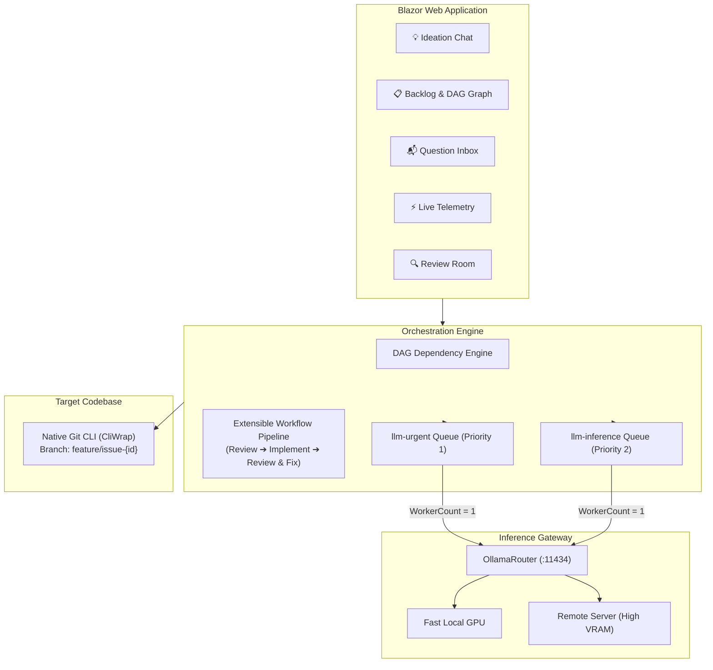

# ⚡ NightCodeForge

> **Asynchronous AI Orchestrator & Dev-Queue for Local Large Language Models**

---

## 🎯 Project Overview & Goals

**NightCodeForge** is an asynchronous developer queue and multi-agent orchestrator built specifically for software engineering workflows powered by **local LLMs**.

### The Problem: Single-GPU Contention & Idle Blocks
When running models locally (via Ollama, vLLM, llama-server, or local agent runtimes like Pi and OpenCode), hardware is strictly bounded by **available GPU VRAM**. On consumer or single-workstation setups, running multiple concurrent coding agents quickly results in severe VRAM thrashing, context truncation, or Out-Of-Memory (OOM) crashes. **Inference must run sequentially.**

At the same time, autonomous coding agents frequently encounter ambiguities:
* *"Should this configuration be stored in JSON or YAML?"*
* *"Is this public API change acceptable or should we maintain backward compatibility?"*

In conventional interactive tools, the agent pauses and **blocks the process** waiting for the human to answer. As a result, the GPU sits completely idle for hours—blocking all other pending work and wasting compute time.

### The Solution: Non-Blocking Context Switching
NightCodeForge eliminates idle GPU time through **automatic Git checkpointing and task context switching**:

1. **Autonomous Execution:** NightCodeForge dequeues an issue and launches a specialized multi-agent pipeline on an isolated Git branch (`feature/issue-{id}`).
2. **Instant Checkpoint on Human Interruption:** When any agent asks a question via `AskHumanQuestion`, the system:
   - Captures and serializes the agent's memory and chat history into persistent storage.
   - Executes a native Git WIP commit (`git add -A && git commit -m "WIP: ..." --no-verify`) to ensure zero untracked files are lost.
   - Terminates the background worker, immediately freeing the GPU.
3. **Queue Progression:** The single-worker GPU queue instantly picks up the next task in the backlog.
4. **Preemptive Resume:** When the developer answers the question via the web interface, the issue returns to the queue with **highest priority (`llm-urgent`)**. When the GPU is freed, the branch is checked out, the previous context is restored with the human answer injected, and execution resumes seamlessly.

---

## ✨ Key Features

* 🛡️ **Strict VRAM & Hardware Protection (`WorkerCount = 1`):** Dedicated inference queue guarantees sequential execution, preventing VRAM overflow across all projects.
* 📁 **Multi-Workspace Architecture:** Manage multiple independent local repositories. Each issue is tied to a workspace with its own Git working tree, base branch, and preferred model settings.
* 🔀 **Native Git CLI Context Switching:** Pure command-line interaction via `CliWrap` (strictly no `LibGit2Sharp` wrappers). Safe branch isolation, WIP commits, and squash-on-merge diffs.
* 🧩 **Extensible 3-Agent Workflow Pipeline:**
  1. **Issue Review Agent:** Pre-inspects the codebase, clarifies requirements, and prompts the human proactively *before* any coding begins.
  2. **Implementation Agent:** Modifies code, runs builds (`dotnet build`), executes unit tests, and iterates.
  3. **Code Review & Fixes Agent:** Inspects diffs, runs static checks, identifies gaps or regressions, and applies automated fixes.
* 🎭 **Agent Profiles per Stage:** Customize the intelligence for each workflow step. Assign a specialized profile combining **Harness** (`Crucible`, `PiRpc`, or `Acp`), **Model Name** (e.g. `deepseek-r1:32b` for deep review vs `qwen2.5-coder:32b` for fast coding), **Thinking Effort** (None, Low, Medium, High, or custom token budget), and harness-specific launch configurations.
* 📝 **Stage-Specific Bootstrap Prompts:** Every stage has its own tailored System Persona and Bootstrap Context injection:
  - *Stage 1 (Review):* Focuses on architectural ambiguities, injecting issue requirements, with strict instructions to prompt the human before coding.
  - *Stage 2 (Implementation):* Injects the approved technical plan and prior human Q&A, driving test-driven coding and compilation loops.
  - *Stage 3 (Review & Fixes):* Injects the live `git diff` against the base branch, running critical audit checklists and applying direct patches.
* 🛠️ **Model Context Protocol (MCP) & Modular Skills:**
  - **Native MCP Host:** Connect external MCP servers (e.g. SQLite, PostgreSQL, GitHub, custom CLIs) via `mcp_config.json`, leveraging Microsoft Agent Framework's native `Microsoft.Agents.Mcp` client.
  - **Modular Skills (`SKILL.md`):** Teach agents framework-specific best practices and project conventions on demand (`.agents/skills/`).
* 📜 **Native `AGENTS.md` Support:** Automatically loads repository instructions, architecture guidelines, and build/test commands from `AGENTS.md` or `.agents/AGENTS.md` and prepends them into every agent stage across all harnesses.
* 🔌 **Universal Agent Harness Abstraction:**
  - **Crucible (First-Class Native C#):** In-process via Microsoft Agent Framework & `Microsoft.Extensions.AI`.
  - **Pi JSON-RPC (First-Class):** Managed sub-process runner via stdio JSON-RPC.
  - **[Agent Client Protocol (ACP)](https://agentclientprotocol.com/) Compatible:** Plug any existing or future ACP-compliant coding agent (from Zed, JetBrains, or the open ACP Registry) without altering core code.
* ⏱️ **Fine-Grained Step Duration & Token Metrics:** Tracks exact elapsed execution time, prompt tokens, completion tokens, total tokens, and hardware target for every workflow stage.
* 📜 **Session Transcripts & Hybrid AI Diagnostics:** Automatically saves turn-by-turn markdown execution logs (`docs/transcripts/`) capturing model thoughts, tool calls, and compiler outputs. If a local model fails or gets stuck in a reasoning loop, a one-click **"Diagnose with AI"** feature evaluates the transcript using either **Cloud LLMs** (fast, zero local VRAM impact via OllamaRouter cloud models or cloud APIs) or **Local LLMs** (100% private & offline, queued sequentially) to pinpoint root causes and recommend prompt/skill fixes.
* 📁 **Markdown Issue Mirroring (`docs/issues/`):** Active non-resolved issues are automatically mirrored to the workspace filesystem as date-prefixed Markdown files with YAML frontmatter (`docs/issues/YYYY-MM-DD-<slug>.md`). Omitting the ID from the filename enables clean chronological sorting and avoids file renames when new files are dropped into the directory (the system simply injects the assigned `id` in-place). User edits to requirements, priority, or dependencies sync to the DB, while state and stage are protected by the orchestrator.
* 🔗 **Issue Dependency Graph (DAG):** Define prerequisite dependencies between issues with automatic cycle detection. An issue stays locked until all its dependencies are completed and merged.
* 💡 **Interactive Ideation & Codebase Discovery Chat:** Ask questions about your repository in real time. The read-only discovery agent analyzes the code and proposes structured issues with dependency links directly into the backlog.
* 🔀 **First-Class [OllamaRouter](https://github.com/jetelain/OllamaRouter) Integration:**
  - Works with native Ollama (`/api/chat`) and OpenAI-compatible (`/v1/chat/completions`) endpoints.
  - Automatically routes tasks to the best GPU: **Fast Local GPU** (when context fits VRAM), **Remote Server** (for large contexts or heavy models), or **Cloud Overflow**.
  - Dynamic model catalog discovery via `/api/tags`.
* 📬 **Human-in-the-Loop Inbox & Review Room:**
  - **Inbox:** Clean, consolidated dashboard of all blocked questions with quick text or multiple-choice answering.
  - **Monitoring:** Live token streaming, Git CLI logs, step duration gauges, and GPU routing telemetry via SignalR.
  - **Review Room:** Visual side-by-side Git diff viewer with one-click "Approve & Merge" or "Request Changes".

---

## 🏗️ Architecture at a Glance

---

## 🛠️ Technology Stack

| Component | Technology | Rationale |
| :--- | :--- | :--- |
| **Framework** | .NET 10 / C# | High-performance modern backend and reactive UI |
| **Web UI** | ASP.NET Core Blazor (Interactive Server) | Low-latency real-time developer dashboard |
| **Telemetry** | ASP.NET Core SignalR | Live terminal streaming and instant UI reactivity |
| **Background Queue** | Hangfire with SQLite storage | Reliable job scheduling with configurable worker limits (`WorkerCount = 1`) |
| **Git Operations** | `CliWrap` | Native CLI execution with robust stdout/stderr capture and cancellation |
| **AI Abstractions** | `Microsoft.Extensions.AI` | Unified client abstraction supporting Ollama and OpenAI-compatible endpoints |
| **Inference Gateway** | [OllamaRouter](https://github.com/jetelain/OllamaRouter) | Intelligent dynamic GPU selection (Local GPU vs Remote server vs Cloud) |
| **Database** | Entity Framework Core (SQLite WAL mode) | Zero-friction local deployment with full ACID guarantees |

---

## 📚 Documentation Links

* 📐 **System Architecture:** Detailed design specifications, state transitions, tool interfaces, and security rules in [docs/ARCHITECTURE.md](docs/ARCHITECTURE.md).
* 🗺️ **Implementation Roadmap:** Phased breakdown from solution scaffolding to full end-to-end testing in [docs/PLAN.md](docs/PLAN.md).

---

## 📄 License

This project is licensed under the [MIT License](LICENSE).
