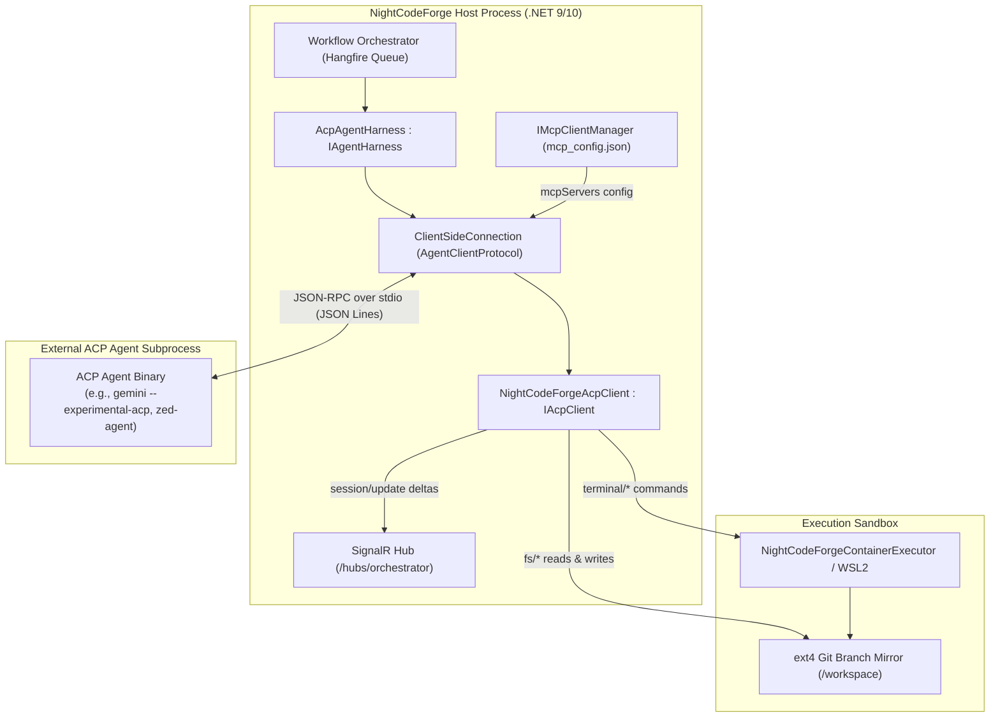
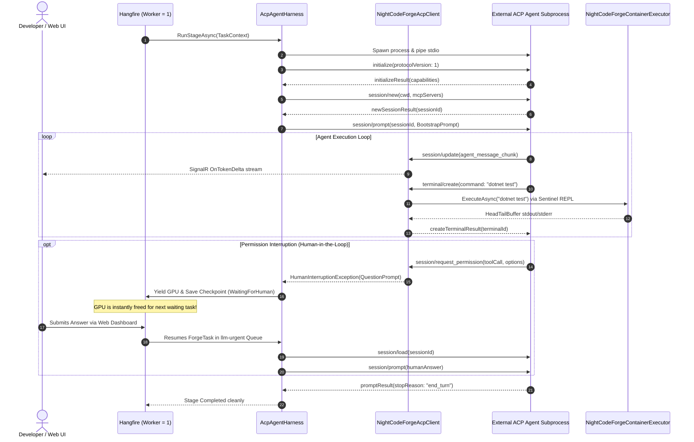

# 🔌 NightCodeForge - Agent Client Protocol (ACP) Specification & Modernization Guide

This document defines the architectural integration, protocol contract, and modernization strategy for the **Agent Client Protocol (ACP)** in NightCodeForge. ACP serves as NightCodeForge's **open-standard extensible harness**, enabling developers to plug external coding agents (Zed AI agents, JetBrains AI agents, Gemini CLI, Claude ACP prototypes, or custom binaries) into NightCodeForge's orchestrator, queue, and sandboxing infrastructure out-of-the-box.

---

## 1. Executive Summary & Value Proposition

While **Crucible** provides a native in-process C# engine (.NET 9/10 with Microsoft Agent Framework) and **Pi** provides a minimalist Node.js/Bun fallback, **ACP** provides a vendor-neutral, protocol-level adapter:

1. **Ecosystem Portability:** Any external AI agent implementing the [Agent Client Protocol](https://agentclientprotocol.com/) runs within NightCodeForge without custom adapter code.
2. **Sandboxed Tool Delegation:** Even though external ACP agents run as standalone executables, NightCodeForge acts as the **ACP Client**, intercepting file and terminal requests and executing them inside `NightCodeForgeContainerExecutor` (Docker Sentinel REPL) or WSL2.
3. **Queue & GPU Yielding:** Permission and prompt requests (`session/request_permission`) trigger NightCodeForge's non-blocking `WaitingForHuman` checkpointing, committing Git WIP and releasing the local GPU for the next waiting task.
4. **Modernization & Forking Plan:** NightCodeForge incorporates and modernizes the `acp-csharp` SDK (`C:\Users\Julien\source\repos\acp-csharp-main`), upgrading its JSON-RPC engine from ACP v1 to support ACP v2 negotiation while maintaining backward-compatibility with v1 agents.

---

## 2. ACP Protocol Topology in NightCodeForge

NightCodeForge operates as an **ACP Client Host**, managing the lifecycle of external ACP Agent subprocesses:



---

## 3. Protocol Evolution: ACP v1 vs. ACP v2

Based on the official specification repository (`C:\Users\Julien\source\repos\agent-client-protocol-main\docs\protocol`), ACP has evolved from v1 (stable baseline) to v2 (draft standard). NightCodeForge supports both via protocol negotiation.

### 3.1 Key Architectural Differences

| Feature | ACP v1 (Baseline) | ACP v2 (Modern Standard) | NightCodeForge Strategy |
| :--- | :--- | :--- | :--- |
| **Protocol Negotiation** | `"protocolVersion": 1` in `initialize` | `"protocolVersion": 2` in `initialize` | Client offers highest version; negotiates down to v1 if agent requires it. |
| **Tool Execution** | Client-side APIs: `fs/read_text_file`, `fs/write_text_file`, `terminal/*` | **Removed from Client**. Tools provided via **MCP over ACP** (`mcpServers`). | Supports both: implements v1 `fs/*` & `terminal/*`, while passing `mcpServers` during `session/new`. |
| **Session Lifecycle** | `session/new`, `session/load`, `session/set_mode` | `session/new`, `session/resume` (with `replayFrom`), `session/set_config_option` | Implements `session/load` for v1 and `session/resume` for v2 agents. |
| **Streaming Updates** | Granular notification events (`agent_message_chunk`, `tool_call`, `tool_call_update`) | **Upsert semantics by ID** (`messageId`, `toolCallId`), whole-message updates, `state_update` | `SessionNotification` handler unifies v1 chunks and v2 upserts into SignalR telemetry events. |
| **Authentication** | `authenticate` request | `auth/login` and `auth/logout` | Mapped via `IAcpAgent` extensions. |
| **Terminal Output** | Interactive client terminals (`terminal/create`, `terminal/wait_for_exit`) | Agent-owned display terminals (`terminal_update`, `terminal_output_chunk`) | v1 commands route to container sandbox; v2 display streams route to web terminal console. |

---

## 4. `acp-csharp` Modernization & Fork Strategy

The local checkout `C:\Users\Julien\source\repos\acp-csharp-main` provides a functional C# foundation (`AgentClientProtocol.csproj`) targeting `net10.0;net9.0;net8.0;netstandard2.1`.

### 4.1 Strengths of Current `acp-csharp`
* Clean separation between `IAcpClient` (methods called by agent) and `IAcpAgent` (methods called by client).
* Asynchronous `ClientSideConnection` and `AgentSideConnection` using `System.Text.Json` source generation (`AcpJsonSerializerContext.cs`).
* Existing implementations of `InitializeRequest`, `NewSessionRequest`, `PromptRequest`, `RequestPermissionRequest`, and terminal contracts.
* Fast compilation with zero warnings on .NET 9 and 10.

### 4.2 Required Modernizations for NightCodeForge
1. **Source Generation & Polymorphic JSON Resilience:**
   * Extend `AcpJsonSerializerContext` to support polymorphic deserialization of `SessionUpdate` variants without runtime reflection exceptions.
   * Add lenient parsing for unescaped newlines and markdown-wrapped JSON payloads emitted by local LLM-based ACP agents.
2. **ACP v2 Protocol Surface:**
   * Add `protocolVersion: 2` types (`SessionResumeRequest`, `SetConfigOptionRequest`, `StateUpdateSessionUpdate`).
   * Support `mcpServers` registration in `NewSessionRequest` to pass NightCodeForge's host MCP configuration directly into external agents.
3. **Execution Sandboxing Binding:**
   * Implement `IAcpClient.CreateTerminalAsync` and `WaitForTerminalExitAsync` by piping commands into `NightCodeForgeContainerExecutor` instead of the local Windows host.
4. **Integration Packaging:**
   * Integrate directly into `src/NightCodeForge.Agents/Acp/` or maintain as an internal submodule `src/external/AgentClientProtocol/`.

---

## 5. NightCodeForge `AcpAgentHarness` Implementation

NightCodeForge implements the unified `IAgentHarness` contract over ACP:

```csharp
public class AcpAgentHarness : IAgentHarness
{
    private readonly IExecutionEnvironment _executionEnv;
    private readonly IMcpClientManager _mcpManager;
    private readonly IHubContext<OrchestratorHub> _hubContext;
    private readonly ILogger<AcpAgentHarness> _logger;

    public string HarnessId => "acp";

    public async Task<AgentRunResult> RunStageAsync(
        AgentSessionContext context, 
        CancellationToken cancellationToken = default)
    {
        // 1. Resolve agent binary & arguments from AgentProfile configuration
        var (binaryPath, arguments) = ResolveAgentLaunchInfo(context.Profile);

        // 2. Launch external ACP agent process with redirected stdio
        using var process = new Process
        {
            StartInfo = new ProcessStartInfo
            {
                FileName = binaryPath,
                Arguments = arguments,
                WorkingDirectory = context.WorkspacePath,
                RedirectStandardInput = true,
                RedirectStandardOutput = true,
                UseShellExecute = false,
                CreateNoWindow = true
            }
        };

        process.Start();

        // 3. Instantiate ACP Client implementation bound to execution sandbox
        var acpClient = new NightCodeForgeAcpClient(
            context, 
            _executionEnv, 
            _hubContext, 
            _logger
        );

        // 4. Establish ACP connection over stdio
        using var connection = new ClientSideConnection(
            _ => acpClient, 
            process.StandardOutput, 
            process.StandardInput
        );

        connection.Open();

        // 5. Initialize & negotiate protocol (supports v2 with fallback to v1)
        var initResult = await connection.InitializeAsync(new InitializeRequest
        {
            ProtocolVersion = 1, // Negotiate v1 baseline (or 2 when supported)
            ClientCapabilities = new ClientCapabilities
            {
                Fs = new FileSystemCapability { ReadTextFile = true, WriteTextFile = true },
                Terminal = new TerminalCapability { Create = true, Output = true }
            }
        }, cancellationToken);

        // 6. Create or Resume Session
        string sessionId;
        if (context.SerializedStateJson is not null)
        {
            // Resume from checkpoint
            var resumeResult = await connection.LoadSessionAsync(new LoadSessionRequest
            {
                SessionId = context.SerializedStateJson
            }, cancellationToken);
            sessionId = resumeResult.SessionId;
        }
        else
        {
            // Start fresh session with active MCP servers
            var sessionResult = await connection.NewSessionAsync(new NewSessionRequest
            {
                Cwd = context.WorkspacePath,
                McpServers = await _mcpManager.GetAcpMcpServersAsync(context.WorkspaceId)
            }, cancellationToken);
            sessionId = sessionResult.SessionId;
        }

        // 7. Dispatch Stage Prompt
        try
        {
            var promptResult = await connection.PromptAsync(new PromptRequest
            {
                SessionId = sessionId,
                Prompt = [new TextContentBlock { Text = context.BootstrapPrompt }]
            }, cancellationToken);

            return new AgentRunResult(
                Status: AgentRunStatus.Completed,
                UpdatedState: sessionId,
                PendingQuestion: null,
                Summary: $"ACP agent completed with reason: {promptResult.StopReason}",
                Metrics: acpClient.GetMetrics(),
                Error: null
            );
        }
        catch (HumanInterruptionException interruption)
        {
            // Human-in-the-loop triggered via RequestPermissionAsync
            return new AgentRunResult(
                Status: AgentRunStatus.WaitingForHuman,
                UpdatedState: sessionId,
                PendingQuestion: interruption.QuestionPrompt,
                Summary: "ACP agent paused awaiting developer permission/clarification",
                Metrics: acpClient.GetMetrics(),
                Error: null
            );
        }
    }
}
```

---

## 6. Sandboxed Client Implementation (`NightCodeForgeAcpClient`)

`NightCodeForgeAcpClient` implements `IAcpClient`, intercepting agent requests and routing them to sandbox infrastructure:

### 6.1 Terminal Execution Inside Container Sandbox
```csharp
public async ValueTask<CreateTerminalResponse> CreateTerminalAsync(
    CreateTerminalRequest request, 
    CancellationToken cancellationToken = default)
{
    // ACP agent requested command execution (e.g. dotnet build, npm test, git status)
    var terminalId = Guid.NewGuid().ToString("N");

    // Route command directly to container sandbox via Sentinel REPL
    var result = await _executionEnv.ExecuteAsync(
        command: request.Command,
        workingDirectory: request.Cwd ?? "/workspace",
        timeoutSeconds: 300
    );

    // Cache output for terminal/output and terminal/wait_for_exit
    _activeTerminals[terminalId] = result;

    return new CreateTerminalResponse { TerminalId = terminalId };
}
```

### 6.2 Human Permission Interruption Mapping
When an external agent needs user input or tool confirmation, it invokes `session/request_permission`:
```csharp
public ValueTask<RequestPermissionResponse> RequestPermissionAsync(
    RequestPermissionRequest request, 
    CancellationToken cancellationToken = default)
{
    var options = request.Options.Select(o => o.Name).ToArray();
    var prompt = new QuestionPrompt(
        QuestionId: Guid.NewGuid().ToString("N"),
        Prompt: $"Agent requests permission: {request.ToolCall}",
        Options: options
    );

    // Throw HumanInterruptionException to suspend the Hangfire worker cleanly
    throw new HumanInterruptionException(prompt);
}
```

### 6.3 Real-Time SignalR Telemetry Streaming
```csharp
public async ValueTask SessionNotificationAsync(
    SessionNotification notification, 
    CancellationToken cancellationToken = default)
{
    switch (notification.Update)
    {
        case AgentMessageChunkSessionUpdate msgChunk when msgChunk.Content is TextContentBlock text:
            await _hubContext.Clients.Group(_taskId)
                .SendAsync("OnTokenDelta", text.Text, cancellationToken);
            break;

        case ToolCallSessionUpdate toolCall:
            await _hubContext.Clients.Group(_taskId)
                .SendAsync("OnToolExecuting", toolCall.Title, toolCall.Status.ToString(), cancellationToken);
            break;

        case ToolCallUpdateSessionUpdate toolUpdate:
            await _hubContext.Clients.Group(_taskId)
                .SendAsync("OnToolCompleted", toolUpdate.ToolCallId, toolUpdate.Status.ToString(), cancellationToken);
            break;
    }
}
```

---

## 7. Turn-by-Turn Lifecycle (Sequence Diagram)



---

## 8. Multi-Harness Comparison: Crucible vs. Pi vs. ACP

| Dimension | Crucible Harness (`CrucibleAgent`) | Pi Harness (`PiRpcAgentHarness`) | ACP Harness (`AcpAgentHarness`) |
| :--- | :--- | :--- | :--- |
| **Execution Model** | Native In-Process C# (.NET 9/10) | External Node.js/Bun Subprocess | Any External ACP-Compliant Binary |
| **Foundation** | Microsoft Agent Framework & `Microsoft.Extensions.AI` | Pi Agent Core (`@earendil-works/pi-agent-core`) | Agent Client Protocol (`AgentClientProtocol` C# SDK) |
| **Communication** | In-Memory Method Calls & Delegates | JSON-RPC over `stdio` (JSON Lines) | JSON-RPC over `stdio` or WebSocket |
| **Tool Execution** | Direct sandboxed tools (`read`, `edit`, `write`, `bash`) | Forwarded tools via RPC (`read`, `edit`, `write`, `bash`) | Intercepted client tools (`fs/*`, `terminal/*`) + host `mcpServers` |
| **Sandboxing** | `NightCodeForgeContainerExecutor` (Sentinel REPL) | Process-level sandbox or WSL execution | `NightCodeForgeContainerExecutor` via terminal interception |
| **Interruption Mechanism** | `HumanInterruptionException` + `AIAgent.SerializeSessionAsync` | `extension_ui_request` + session snapshot | `session/request_permission` + session snapshot |
| **Ecosystem Ecosystem** | NightCodeForge-native, high performance, zero process overhead | Pi reference models, fast prototyping | Universal compatibility with any ACP-compliant agent |

---

## 9. Local Source Code References

For exact file paths to the ACP specification, schema generators, and the `acp-csharp` implementation, refer directly to **[REFERENCES.md](REFERENCES.md)**.
