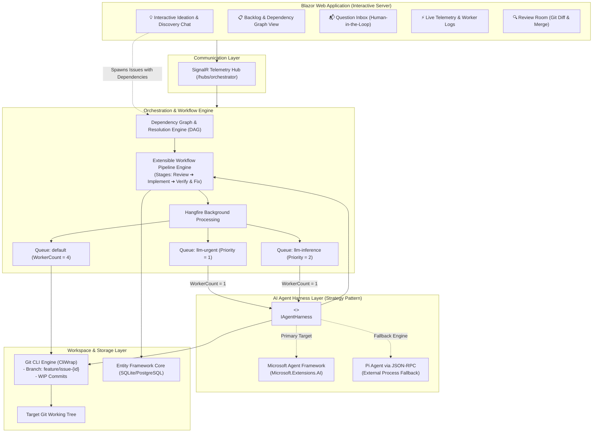
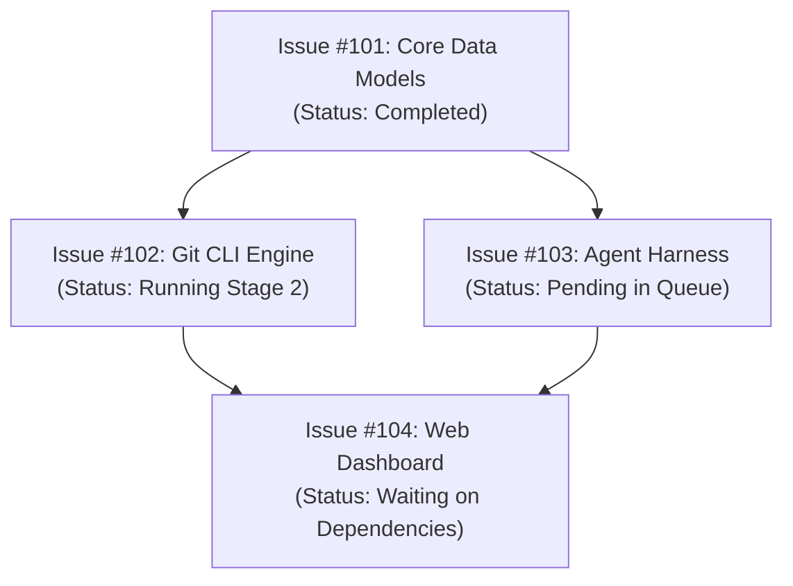
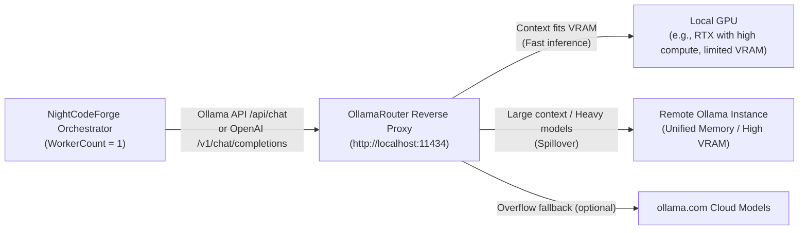
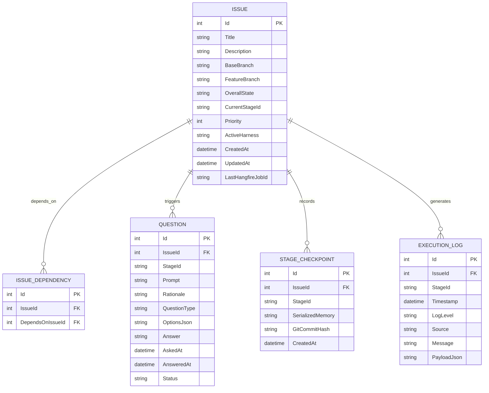

# 🏗️ NightCodeForge - System Architecture Document

## 1. Executive Summary & Problem Space

### 1.1 Context & Objectives
**NightCodeForge** is an Asynchronous AI Orchestrator ("Dev-Queue") designed specifically for software engineering workflows backed by **local Large Language Models (LLMs)**.

In local AI-assisted development (e.g., using Ollama, vLLM, llama-server, or local agent runtimes like Pi and OpenCode), the physical environment is bound by a strict hardware limitation: **a single dedicated GPU**.
Unlike elastic cloud APIs, local inference throughput cannot run multiple concurrent reasoning/coding tasks without severe VRAM thrashing, context truncation, or out-of-memory (OOM) crashes. Therefore, **LLM execution must strictly run sequentially (Concurrency = 1)**.

### 1.2 The Core Problem: Interactive Blocking vs. GPU Utilization
Standard autonomous coding agents operate in interactive synchronous loops:
1. Agent plans or inspects code.
2. Agent reaches an ambiguity (e.g., choice of library, business rule clarification, confirmation of breaking change).
3. Agent prompts the human and **blocks the process** waiting for input.
4. **Result:** The GPU sits idle for minutes or hours, blocking all other queued development tasks and wasting expensive compute resources.

### 1.3 The NightCodeForge Solution: Context-Switching Dev-Queue
NightCodeForge decouples task execution from human availability through **asynchronous checkpointing and workspace context switching**:
* When an agent needs human guidance, it invokes a specialized interruption tool (`AskHumanQuestion`).
* The orchestrator intercepts this call, captures the agent's memory/chat session into persistent storage, performs a Git WIP commit on the issue branch, and **terminates the worker task cleanly**.
* The single-worker GPU queue immediately picks up the next task in line.
* When the developer answers the pending question via the web interface, the issue transitions back to high-priority readiness. The orchestrator checks out the branch, restores the memory context with the human's answer, and resumes reasoning without loss of continuity.

---

## 2. High-Level Architectural Diagram



---

## 3. Extensible Multi-Agent Workflow Engine

Rather than binding to a rigid, hardcoded state machine library, NightCodeForge uses a **composable, stage-based Workflow Pipeline Engine**. Each issue progresses through a sequence of discrete, pluggable stages executed by dedicated specialized agents.

### 3.1 Default 3-Agent Workflow Stages


1. **Stage 1: Issue Review Agent (`IssueReviewStage`)**
   - **Mission:** Deeply inspect the codebase against the issue request *before* any implementation begins.
   - **Goals:** Detect ambiguities, uncover hidden constraints, identify impacted files, verify prerequisites, and proactively ask clarifying questions to avoid rework during coding.
   - **Output:** Approved Technical Specification & Execution Plan.
2. **Stage 2: Implementation Agent (`ImplementationStage`)**
   - **Mission:** Implement the code changes outlined in the approved plan.
   - **Goals:** Create/modify files, invoke workspace build tools (e.g. `dotnet build`), execute unit tests, and iterate until the code compiles and passes tests.
   - **Output:** Working implementation with initial commit history.
3. **Stage 3: Code Review and Fixes Agent (`CodeReviewAndFixStage`)**
   - **Mission:** Act as a critical reviewer and automated fixer.
   - **Goals:** Compare the `git diff` against the base branch, check coding standards, detect potential regression gaps, missing error handling, or performance traps, and make direct fixes.
   - **Output:** Polished, review-ready code diff.

### 3.2 Extensibility & Pipeline Abstraction
The workflow pipeline is defined via modular contracts, allowing project-specific custom pipelines (e.g., inserting a `SecurityAuditStage`, `DocumentationStage`, or custom CI validation stage):

```csharp
public interface IWorkflowStage
{
    string StageId { get; }
    string DisplayName { get; }
    int Order { get; }
    
    Task<StageExecutionResult> ExecuteAsync(
        StageExecutionContext context,
        IAgentHarness harness,
        Func<AgentTelemetryEvent, Task> onTelemetry,
        CancellationToken cancellationToken);
}

public interface IWorkflowPipeline
{
    string PipelineId { get; }
    IReadOnlyList<IWorkflowStage> Stages { get; }
    IWorkflowStage? GetNextStage(string currentStageId);
}
```

### 3.3 Stage Interruption & Universal Context Switching
At **any point** in **any stage**, an agent may invoke the `AskHumanQuestion` tool. When this occurs:
1. The stage returns `StageExecutionResult.WaitingForHuman(question)`.
2. The orchestrator records the question in the database and updates the issue state to `BlockedQuestion(stageId)`.
3. The orchestrator triggers a native Git WIP commit on `feature/issue-{id}`.
4. The Hangfire job completes, releasing the single GPU worker.
5. When the user submits the answer, the issue transitions back to `Pending` and is enqueued into `llm-urgent`. The active stage is resumed with the previous conversation memory and the newly supplied human answer.

---

## 4. Issue Dependency Management (DAG)

Complex features and refactoring tasks naturally break down into interdependent issues. NightCodeForge natively manages dependencies via a **Directed Acyclic Graph (DAG)**.

### 4.1 Dependency Rules & State Propagation
* An issue can declare one or more prerequisite issues (`DependsOnIssueIds`).
* **Execution Gate:** An issue with unsatisfied dependencies remains in status `WaitingOnDependencies` and **will not be enqueued** to Hangfire.
* **Cascade Activation:** When an issue reaches `Completed` state, the orchestrator evaluates all dependent issues. If all dependencies of a dependent issue are satisfied, its state automatically transitions to `Pending` and it enters the Hangfire queue.
* **Cycle Prevention:** When creating or modifying dependencies, the `DependencyResolutionEngine` performs topological sorting to detect and reject circular references (cycles).



---

## 5. Interactive Issue Discovery & Ideation Chat

To prevent vague or poorly scoped issues from entering the queue, NightCodeForge provides an **Interactive Ideation & Codebase Discovery Chat**:

```mermaid
sequenceDiagram
    autonumber
    actor User as Developer
    participant UI as Blazor Chat Interface
    participant Explorer as Discovery Agent (Read-Only)
    participant Git as Git Workspace
    participant Engine as Dependency & Issue Engine

    User->>UI: "How does our authentication handle JWT refresh tokens, and what's needed for OAuth2?"
    UI->>Explorer: Stream prompt + conversation context
    Explorer->>Git: Read relevant auth files & configuration
    Git-->>Explorer: File contents & symbols
    Explorer-->>UI: Explains architecture & highlights gaps
    User->>UI: "Great, let's create issues to implement OAuth2 support."
    Explorer->>UI: Proposes 2 structured issues with dependencies:<br>1. Issue A: Add OAuth2 client config & token model<br>2. Issue B: Add Google/GitHub provider handlers (Depends on A)
    User->>UI: Reviews, tweaks scope, and clicks "Create in Backlog"
    UI->>Engine: Registers Issue A & Issue B with dependency link
    Engine-->>UI: Issue A queued; Issue B waiting on A
```

### 5.1 Discovery Agent Capabilities
* **Read-Only Access:** Equipped with search, file-reading, and symbol exploration tools (`FindFiles`, `ReadFile`, `GrepSearch`, `ListTree`). Cannot modify working tree files.
* **Issue Extraction Tool:** Agent has a function tool `ProposeIssues(List<IssueProposalDto>)` allowing it to output structured titles, acceptance criteria, affected components, and recommended dependencies directly into the UI for developer approval.

---

## 6. Orchestration Engine & Queue Design

### 6.1 Queue Concurrency Architecture
The background job system uses **Hangfire** backed by persistent storage. Hangfire servers are separated into two distinct worker pools:

| Queue Name | Worker Count | Purpose | Constraints |
| :--- | :--- | :--- | :--- |
| `llm-urgent` | **1** (Shared pool) | Resumed issues that just received developer answers. | Highest priority for GPU inference. |
| `llm-inference` | **1** (Shared pool) | Normal queued issues awaiting execution. | Strictly sequential to protect VRAM. |
| `default` | **4** | Non-GPU background tasks: Git diff calculation, log cleanup, telemetry broadcasts. | Parallel execution allowed. |

> [!IMPORTANT]
> The `llm-urgent` and `llm-inference` queues share a dedicated Hangfire `BackgroundJobServer` configured with `WorkerCount = 1` and ordered queue processing:
> `Queues = new[] { "llm-urgent", "llm-inference" }`.
> This guarantees that:
> 1. At most **one** AI task runs on the GPU at any millisecond.
> 2. An answered issue in `llm-urgent` will preemptively be picked up before any new task in `llm-inference`.

---

## 7. Git Workspace & Context-Switching Subsystem

### 7.1 Strict CLI Requirement
Wrappers such as `LibGit2Sharp` are **strictly prohibited** due to unmanaged binary dependencies, memory leak risks in long-running servers, and poor support for modern Git features. All Git operations are executed via native command-line invocations using **`CliWrap`**.

### 7.2 Save Strategy: WIP Commits vs. Stash
To ensure zero data loss during context switches:
1. `git stash` is **not used** because untracked files, subdirectories, or unstaged renames can lead to merge conflicts on unstash or orphaned changes.
2. The orchestrator uses **WIP Commits**:
   ```bash
   git add -A
   git commit -m "WIP: [Issue #{id}][Stage: {stageName}] Awaiting human input: {QuestionSummary}" --no-verify
   ```
3. When the issue passes all stages and is approved in the Review Room, the orchestrator squashes the WIP commits into a clean, conventional commit before merging.

---

## 8. AI Harness Strategy Pattern (`IAgentHarness`)

### 8.1 Interface Contract
```csharp
public interface IAgentHarness
{
    string HarnessName { get; }
    
    Task<AgentRunResult> ExecuteSessionAsync(
        AgentSessionContext sessionContext,
        Func<AgentTelemetryEvent, Task> onTelemetry,
        CancellationToken cancellationToken);
}

public record AgentSessionContext(
    int IssueId,
    string StageId,
    string StageSystemPrompt,
    string TaskPrompt,
    string WorkingDirectory,
    string? SerializedState,
    IReadOnlyList<QuestionAnswerPair> PriorAnswers);

public record AgentRunResult(
    AgentRunStatus Status,
    string? UpdatedState,
    QuestionPrompt? PendingQuestion,
    string? Summary,
    Exception? Error);

public enum AgentRunStatus
{
    Completed,
    WaitingForHuman,
    Failed,
    Cancelled
}
```

### 8.2 Primary Local Inference Gateway: OllamaRouter Integration
NightCodeForge provides native, first-class support for **OllamaRouter** (`jetelain/OllamaRouter`) as its intelligent inference gateway.



#### Key Capabilities & Synergy:
1. **Dual Protocol Compatibility:** NightCodeForge interacts with OllamaRouter via standard Ollama native endpoints (`POST /api/chat`, `POST /api/generate`) or OpenAI-compatible endpoints (`POST /v1/chat/completions`).
2. **Automated Best-GPU Selection:** OllamaRouter inspects each prompt's token count, evaluates live VRAM via `nvidia-smi`, checks active memory residency via `/api/ps`, and automatically routes:
   - Small/fast reasoning turns to the high-performance local GPU.
   - Long-context reviews, broad codebase lookups, or large-parameter models to the remote high-VRAM server.
   - NightCodeForge's `WorkerCount = 1` constraint guarantees that the local GPU is never overloaded by concurrent background jobs, while OllamaRouter ensures each sequential job runs on the most capable hardware.
3. **Dynamic Model Discovery:** NightCodeForge queries OllamaRouter's unified `/api/tags` endpoint to automatically populate available local and remote models in the web dashboard.
4. **Telemetry & Target Transparency:** The monitoring dashboard can query `/monitor` or capture response headers to display whether the current inference step was processed by the **Local GPU**, **Remote Instance**, or **Cloud Overflow**.

### 8.3 Implementation A (Primary): Microsoft Agent Framework & `Microsoft.Extensions.AI`
* **Abstractions:** Built on `Microsoft.Extensions.AI.IChatClient` and the official Microsoft Agent Framework.
* **Compatibility:** Plugs directly into OllamaRouter, vanilla Ollama, LM Studio, vLLM, or any OpenAI-compatible server.
* **Tool Calling Capabilities:**
  * `ReadFile(path, startLine, endLine)`
  * `WriteFile(path, content)`
  * `ListDirectory(path)`
  * `RunCommand(command, workingDir)` (e.g. `dotnet build`, `dotnet test`)
  * `AskHumanQuestion(question, rationale, options)`
* **Interruption Mechanism:**
  When `AskHumanQuestion` is invoked:
  1. The tool handler records question details.
  2. The harness loop intercepts this, extracts the current `ChatHistory`, serializes it to JSON, and flags `AgentRunStatus.WaitingForHuman`.
  3. The Hangfire job runner commits WIP files, saves checkpoint data, and exits cleanly.

### 8.4 Implementation B (Fallback): Pi via JSON-RPC
* **Role:** External agent process runner communicating via standard input/output JSON-RPC or a local WebSocket.
* **Protocol Handling:** Listens for `ask_user` notification/request events over JSON-RPC. Upon detection, requests session suspension, captures session state token, and yields `WaitingForHuman`.

---

## 9. Data Storage & Schema Design



---

## 10. User Interface (Blazor Interactive Server)

### 10.1 Key Dashboard Modules
1. **Interactive Ideation & Codebase Discovery:**
   - Chat interface with the codebase exploration agent.
   - Natural language Q&A about architecture and requirements.
   - Interactive issue proposal cards with one-click creation into backlog.
2. **Backlog & Dependency DAG:**
   - Visual Kanban and dependency graph view showing issues and blocking links.
   - Status indicators: `Waiting on Dependencies`, `Pending`, `Running [Stage]`, `Blocked`, `Review`, `Completed`.
   - Manual priority adjustment and dependency linking.
3. **Monitoring & Terminal:**
   - Real-time streaming of active agent reasoning, tool invocations, compiler logs, and Git operations via SignalR.
   - Visual stage progression indicator (`Review ➔ Implement ➔ Fixes`).
4. **Inbox (Human-in-the-Loop):**
   - Central view for all pending questions across blocked issues.
   - Rich answer form supporting freeform text, code snippets, or multiple-choice options.
5. **Review Room:**
   - Visual side-by-side / unified `git diff` against base branch.
   - One-click "Approve & Merge" (squashing WIP commits) or "Request Changes".
