# 🏗️ NightCodeForge - System Architecture Document

## 1. Executive Summary & Problem Space

### 1.1 Context & Objectives
**NightCodeForge** is an Asynchronous AI Orchestrator ("Dev-Queue") designed specifically for software engineering workflows backed by **local Large Language Models (LLMs)**.

In local AI-assisted development (e.g., using OllamaRouter, Ollama, vLLM, llama-server, or local agent runtimes like Pi and OpenCode), the physical environment is bound by a strict hardware reality: **a single primary GPU bottleneck for heavy reasoning**.
As described in Section 2.1, NightCodeForge operates on a **dual-compute topology**: a local **Host GPU** (developer workstation) and a dedicated **Remote LAN GPU Server** (high-VRAM machine on the local network). Because ~95% of automated software engineering tasks require high VRAM (32B+ models and 32k/64k context windows) and are routed to the dedicated Remote LAN server, that server constitutes a shared single-worker bottleneck. Unlike elastic cloud APIs, running multiple concurrent background reasoning/coding tasks against that GPU causes severe VRAM thrashing, context truncation, or out-of-memory (OOM) crashes. Therefore, **background dev-queue execution must strictly run sequentially (Concurrency = 1)**.

### 1.2 The Core Problem: Interactive Blocking vs. GPU Utilization
Standard autonomous coding agents operate in interactive synchronous loops:
1. Agent plans or inspects code.
2. Agent reaches an ambiguity (e.g., choice of library, business rule clarification, confirmation of breaking change).
3. Agent prompts the human and **blocks the process** waiting for input.
4. **Result:** The GPU sits idle for minutes or hours, blocking all other queued development tasks and wasting expensive compute resources.

### 1.3 The NightCodeForge Solution: Context-Switching Dev-Queue
NightCodeForge decouples task execution from human availability through **asynchronous checkpointing and workspace context switching**:
* When an agent needs human guidance, it invokes a specialized interruption tool (`ask`).
* The orchestrator intercepts this call, captures the agent's memory/chat session into persistent storage, performs a Git WIP commit on the task branch, and **terminates the worker task cleanly**.
* The single-worker GPU queue immediately picks up the next task in line.
* When the developer answers the pending question via the web interface, the task transitions back to high-priority readiness. The orchestrator checks out the branch, restores the memory context with the human's answer, and resumes reasoning without loss of continuity.

---

## 2. High-Level Architectural Diagram

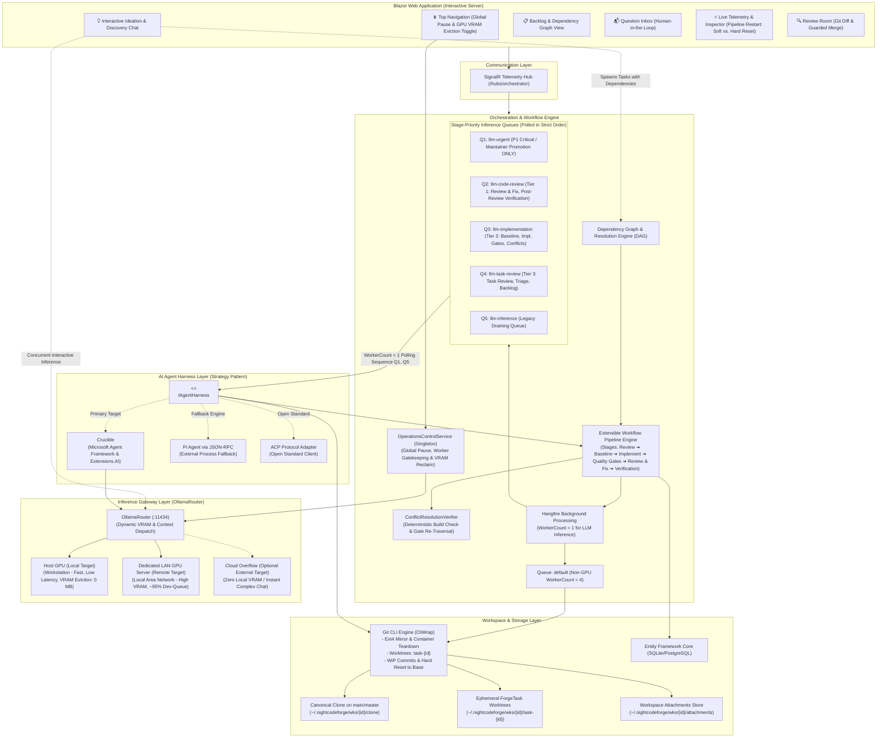

---

## 2.1 Inference Topology & Dual-Compute Hardware Model ([OllamaRouter](https://github.com/jetelain/OllamaRouter))

### 2.1.1 Target Classification: "Local" and "Remote" are Both Local/On-Premise Workloads
NightCodeForge integrates with [OllamaRouter](https://github.com/jetelain/OllamaRouter) as its unified reverse-proxy inference gateway. In this architecture, it is essential to understand the physical and operational semantics of the routing targets:

1. **Local Target (`Local`): Host GPU (Developer Workstation)**
   * **Physical Location:** The developer's primary machine running the NightCodeForge host process (e.g., an NVIDIA RTX 4070/4080/4090 laptop or desktop).
   * **Role:** Used whenever possible for fast, zero-latency inference when the model and context fit comfortably within host VRAM (typically 8–16 GB). Ideal for Stage 0 Untrusted Intake Triage, quick diff evaluations, or local interactive Ideation Chat. Can be reclaimed to 0 MB VRAM at any time via Global Operations Pause for gaming or 3D rendering.
2. **Remote Target (`Remote`): Dedicated Local Network Area (LAN) Server**
   * **Physical Location:** A dedicated compute node residing strictly on the **Local Area Network (LAN)** (e.g., a headless Linux workstation equipped with dual RTX 3090/4090s, RTX 6000 Ada, or 80GB VRAM).
   * **Role:** The primary inference workhorse for **~95% of automated software engineering workloads**. Provides the expansive VRAM necessary to load 32B/70B parameter models (e.g., `qwen2.5-coder:32b`, `deepseek-r1:32b`) and sustain 32k/64k token context windows without quantization degradation or out-of-memory (OOM) crashes.
3. **Strict Data-Privacy Invariant: Both Targets are On-Premise Workloads**
   * In traditional cloud vernacular, "remote" often connotes third-party public cloud services (AWS, Azure, GCP).
   * **In NightCodeForge & OllamaRouter, "Remote" explicitly means a Local Network Area server.**
   * Both `Local` and `Remote` targets reside behind the developer's physical/local network firewall. Zero tokens, source code fragments, or git diffs ever egress to the public internet when executing on either target. Both represent 100% private, sovereign, and air-gapped-capable infrastructure.
4. **Cloud Target (`Cloud` / Cloud Overflow): Optional External Fallback**
   * Only the `Cloud` target (e.g., `ollama.com` cloud models or external cloud API endpoints) communicates outside the local network perimeter.
   * This target is strictly opt-in and serves as an **overflow mechanism** for zero-local-VRAM operations (such as one-click AI transcript diagnostics) or when a developer wishes to run complex exploratory chats without waiting for local hardware.

---

### 2.1.2 The Single-GPU Dev-Queue Bottleneck Hypothesis
A foundational operational premise of NightCodeForge is that background dev-queue tasks in Hangfire (`llm-urgent`, `llm-code-review`, `llm-implementation`, `llm-task-review`, and legacy `llm-inference`) run with `WorkerCount = 1`.

Why this single-GPU hypothesis remains correct and necessary:
* **The 95% Routing Reality:** Modern software engineering tasks (analyzing entire project ASTs, multi-turn tool loops, generating complex unit tests, and comprehensive code reviews) require high parameter density and large context windows. Consequently, **OllamaRouter routes approximately 95% of background dev-queue workloads to the dedicated Remote LAN GPU server**.
* **Contention & Thrashing Prevention:** Because the Remote LAN server is effectively a single shared high-capacity GPU resource, running concurrent background jobs would force GPU memory contention, interleaved prompt cache evictions, or out-of-memory crashes.
* **Conclusion:** Modeling the background dev-queue as a single sequential worker (`WorkerCount = 1`) accurately matches the physical reality of the primary LAN GPU bottleneck, ensuring 100% deterministic job completion without race conditions or thrashing.

---

### 2.1.3 Interactive Ideation Concurrency & Dual-Compute Flexibility
While automated background tasks must execute sequentially through the single Hangfire worker, **Interactive Ideation & Codebase Discovery Chat (`IIdeationService`) runs on-demand within the Blazor UI session**.

This introduces a powerful **Dual-Compute Concurrency** capability:

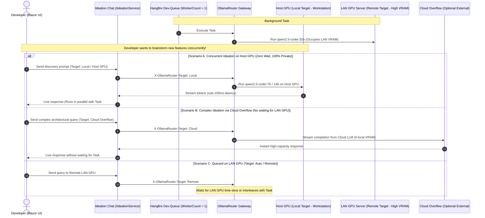

#### Key Operating Modes for Ideation:
1. **Host GPU Concurrency (Default Local Coexistence):**
   * The host workstation GPU is free while the background worker is executing on the LAN server.
   * Ideation can be pinned to `Local` (Host GPU) using a 7B or 14B model (e.g., `qwen2.5-coder:7b` or `deepseek-r1:14b`).
   * The developer enjoys instantaneous interactive discovery with zero queue delays and zero impact on the running dev-queue job.
2. **Optional Cloud Overflow for Complex Chats:**
   * If an ideation session demands a massive reasoning model (e.g., 70B+ or frontier thinking models) that exceeds Host GPU VRAM, and the Remote LAN GPU is currently occupied with a long-running dev-queue task, the developer can switch the Ideation routing target to **Cloud Overflow**.
   * This prevents the developer from being blocked, providing instant frontier intelligence without disturbing local VRAM or waiting for background tasks to finish.
3. **Auto / Sequential Queueing:**
   * If both tasks target the Remote LAN server, requests interleave or queue according to OllamaRouter's priority policies.

---

## 3. Extensible Multi-Agent Workflow Engine

Rather than binding to a rigid, hardcoded state machine library, NightCodeForge uses a **composable, stage-based Workflow Pipeline Engine**. Each task progresses through a sequence of discrete, pluggable stages executed by dedicated specialized agents and deterministic verification gates.

### 3.1 ForgeTask Creation, Origin Provenance & Intake Channels
Tasks enter NightCodeForge through four distinct authoring channels. Each created task is stamped with an explicit, immutable [TaskOrigin](file:///c:/Users/Julien/source/repos/jetelain/NightCodeForge/src/NightCodeForge.Core/Domain/TaskOrigin.cs) enum to ensure provenance tracking and strict portal query scoping:

1. **Dedicated Task Creation Page (`TaskOrigin.Manual`):**
   - The developer authors a task directly via the dedicated web interface at `/tasks/new` ([CreateTask.razor](file:///c:/Users/Julien/source/repos/jetelain/NightCodeForge/src/NightCodeForge.Web/Components/Pages/CreateTask.razor)).
   - Supports explicit specification of Title, Description, Target Base Branch, Priority (P1 Critical through P5 Low), Merge Mode, and optional dependency prerequisites.
   - Initialized with `Status = TaskOverallStatus.Suggested`, `Origin = TaskOrigin.Manual`, `HasExecutionRun = false`, and `MaxExecutedStageOrder = 0`.
2. **Untrusted External Intake & Sandboxed Triage (`TaskOrigin.UntrustedIntake`):**
   - External systems (GitHub issues, Jira tickets, webhooks) trigger an isolated triage pipeline.
   - Runs a dedicated **Triage Agent** on the base branch (`main` or `master`) in a `RestrictedReadOnly` sandbox (`:ro` workspace mount, `--network none`).
   - Deeply analyzes the request, validates reproducibility, and invokes `propose_tasks` if valid.
   - Proposed tasks are stamped with `Origin = TaskOrigin.UntrustedIntake` and enter the database in **`Suggested`** status.
   - **Portal Scoping:** The Untrusted Intake portal (`/triage`) strictly filters proposed backlog items by `Status == Suggested && Origin == TaskOrigin.UntrustedIntake`, isolating external triage proposals from internal human ideas.
3. **Interactive Ideation & Discovery Chat (`TaskOrigin.Ideation`):**
   - The developer converses with the codebase exploration agent (`IIdeationService`) to explore features, refactorings, or architecture questions.
   - Either the developer or the ideation agent creates tasks with dependencies via `propose_tasks`.
   - Created in **`Suggested`** status with `Origin = TaskOrigin.Ideation`.
4. **Markdown Task Synchronization & CLI Import (`TaskOrigin.Import`):**
   - The developer creates a new markdown specification directly in `<WorkspaceRoot>/docs/tasks/YYYY-MM-DD-<slug>.md` on their real workspace, or uses `ncf import`.
   - `TaskMarkdownSyncService` detects the file via `FileSystemWatcher`, allocates an ID, and injects frontmatter with initial `status: suggested` and `merge_mode: manual_review_required`.
   - Stamped with `Origin = TaskOrigin.Import`.

### 3.2 Maintainer Promotion, Rejection Lifecycle & Execution State Hygiene
A task remains dormant in `Suggested` until a maintainer performs a **single manual action** via the Web UI (Kanban board, Task Detail drawer, or dedicated detail page) or CLI:

* **Promote to Open:**
  - The maintainer specifies two mandatory properties in the same action:
    1. **`Priority`** (1 to 5, default = 1; P1 Critical to P5 Low).
    2. **`MergeMode`**:
       - `Automatic`: NightCodeForge will automatically squash and merge the verified branch to `baseBranch` once all quality checks pass.
       - `ManualReviewRequired`: Once verified, the task pauses at `Ready` so the maintainer can review diffs, test locally, and approve before merging.
  - State transitions to **`Open`**.
* **Maintainer Rejection Action Lifecycle (`TaskOverallStatus.Rejected`):**
  - Maintainers can explicitly reject any task from `Suggested` or `Open` (via `TaskDetailDrawer.razor`, `TaskDetail.razor`, or `KanbanCard.razor`).
  - Executed cleanly via `TaskOrchestrator.RejectTaskAsync(taskId, reason)`:
    1. **Execution Cancellation:** Cancels active tokens in `ITaskCancellationManager` to halt any running background operations.
    2. **DevQueue Eviction:** Purges and deletes any pending or queued Hangfire job (`_jobQueue.Delete(task.LastHangfireJobId)`).
    3. **State Mutation:** Sets `task.Status = TaskOverallStatus.Rejected`, `task.IsWaitingForHuman = false`, and purges transient conflict keys in `task.PipelineDataJson`.
    4. **Temporal Audit History:** Records an immutable snapshot in `TaskHistories` via `_taskRepository.UpdateWithHistoryAsync` attributed to `AuditActors.User` with the maintainer's rejection reason.
    5. **Dependency Store Update:** Propagates the rejected status through `ITaskDependencyStore` to prevent blocked child tasks from executing.
    6. **Sandbox Teardown:** Removes the ephemeral Git worktree (`_gitWorkspaceManager.RemoveWorktreeAsync`) and cleanly destroys the Docker sandbox container (`_environmentProvider.CleanupTaskContainerAsync`).
    7. **Markdown Archival:** Updates disk markdown frontmatter (`status: rejected`) via `TaskMarkdownSyncService`.
* **Execution State Hygiene & Stepper Truthfulness:**
  - `HasExecutionRun` (boolean) and `MaxExecutedStageOrder` (integer) decouple configured workflow stages from actual execution progress.
  - Open tasks that have not yet started execution (`HasExecutionRun == false`) or are blocked on prerequisite dependencies always reside in the "Open (Backlog)" column in `KanbanBoard.razor`, never appearing in "In-Flight".
  - The pipeline stepper (`PipelineStepper.razor`) checks active worker state and `HasExecutionRun`: idle/unstarted stages are rendered as clean pending steps without false, distracting "Running" spinner animations.
  - The Task Execution Inspector (`/inspector`) and Review Room (`/review`) strictly scope their selection lists to tasks meeting `HasExecutionRun == true`, ensuring maintainers only inspect or review tasks that have executed work.

### 3.3 Main Workflow Execution Engine
Once a task has `Status == TaskOverallStatus.Open` and **all its dependencies have `Status == TaskOverallStatus.Closed`**, it is enqueued to its initial stage queue (`llm-task-review` via `ITaskJobQueue.EnqueueStage`).

Rather than dispatching every individual stage as an isolated background job—which would cause the single worker slot to be relinquished between CPU and GPU steps, causing inter-stage interleaving, GPU starvation, and base branch drift—NightCodeForge executes tasks via **In-Process Stage Chaining** organized into **Atomic Execution Cohorts** (see Section 7.1.6):

* **Intake Phase (`StageQueueTier.TaskReview`, Tier 3):** Dispatched independently in `llm-task-review`. The architect agent analyzes specifications and clarifies ambiguities. If human input is required, the task invokes `ask` and pauses safely in `IsWaitingForHuman = true` without occupying downstream compute.
* **Cohort 1: Implementation Cohort (`StageQueueTier.Implementation`, Tier 2):** Chains **Stages 2 -> 3 -> 4 within a single Hangfire job turn**. If Stage 4 detects compiler or test regressions, an **in-job loopback** re-executes Stage 3 directly in-process without releasing the worker slot.
* **Cohort 2: Review & Delivery Cohort (`StageQueueTier.CodeReview`, Tier 1):** Chains **Stages 5 -> 6 and Gate 2 Delivery within a single Hangfire job turn**. Review edits are verified deterministically; if clean, Gate 2 performs immediate mergeability verification and automated delivery (squash-and-merge in `Automatic` mode, or transition to `Ready` in `ManualReviewRequired` mode).

```mermaid
flowchart TD
    Suggested(["Suggested (Intake)"]) -->|Maintainer Action: Promote| Open(["Open (Dependencies Pending)"])

    subgraph IntakePhase ["Intake Phase (Tier 3: 'llm-task-review') - Independent Turn"]
        S1["1. ForgeTask Review Stage\n(Agentic - Scope & Q&A)\n[Queue: llm-task-review]"]
        S1Ask{"Needs Clarification\n('ask' tool)?"}
        S1Wait["IsWaitingForHuman = true\n(Status preserved; GPU Freed Cleanly)"]
        S1Done["Status: Reviewed\n(Enrich task spec on disk)"]
    end

    subgraph Cohort1 ["Cohort 1: Implementation Cohort (Tier 2: 'llm-implementation') - SINGLE HANGFIRE JOB"]
        direction TB
        S2["2. Deterministic Pre-Implementation\n(Baseline Build / Test / Coverage)"]
        S3["3. Implementation Stage\n(Agentic - Code & Test Generation)"]
        S4["4. Deterministic Post-Implementation\n(Coverage Gate / Warning Ratchet)"]
        Gate4Check{"Stage 4 Passed\n(Exit Code 0)?"}
        Loopback3["In-Job Loopback to Stage 3\n(Inject Compiler Errors / Test Failures;\nRetry Budget in PipelineDataBag)"]
    end

    subgraph Cohort2 ["Cohort 2: Review & Delivery Cohort (Tier 1: 'llm-code-review') - SINGLE HANGFIRE JOB"]
        direction TB
        S5["5. Code Review Stage\n(Agentic - Audit & Direct Polish)"]
        S6["6. Deterministic Post-Review\n(Build & Test Verification of Review Edits)"]
        Gate2{"Gate 2: Pre-Review\nMergeability Check\nagainst baseBranch"}
        MergeGate{"task.MergeMode"}
        AutoMerge["Automated Delivery:\nImmediate Squash & Merge to baseBranch\nStatus = Closed | SquashCommitSha Persisted"]
        ManualWait["Status: Ready\n(Review Room Pending Maintainer Approval)"]
    end

    Open -->|All Dependencies Closed| S1
    S1 --> S1Ask
    S1Ask -- Yes --> S1Wait
    S1Ask -- No --> S1Done
    S1Wait -.->|Developer Answers in UI| ResumeIntake["Resume Intake Turn"]
    ResumeIntake -.-> S1

    S1Done -->|Enqueue Cohort 1 to llm-implementation| S2
    S2 -->|Chained In-Process| S3
    S3 -->|Chained In-Process| S4
    S4 --> Gate4Check
    Gate4Check -- Failed (Attempts < Max) --> Loopback3 --> S3
    Gate4Check -- Failed (Attempts >= Max) --> FailStage4["Status = Failed\n(Max Quality Gate Retries Exceeded)"]

    Gate4Check -- Success -->|Enqueue Cohort 2 to llm-code-review| S5
    S5 -->|Chained In-Process| S6
    S6 -->|Chained In-Process| Gate2
    Gate2 -.->|Merge Conflict Detected| ConflictResolution["Autonomous Conflict Resolution Turn\n[Queue: llm-implementation (Tier 2)]\n- Top-of-Prompt Header Mandate\n- Selective Staging Before Build\n- Deterministic Build Verification in Sandbox\n- Mandatory Downstream Gate Re-Traversal"]
    ConflictResolution --> S4

    Gate2 -->|Clean Merge| MergeGate
    MergeGate -->|Automatic| AutoMerge
    MergeGate -->|ManualReviewRequired| ManualWait
    ManualWait -->|Approved in UI| ManualMerge["Maintainer Triggers Merge"]

    AutoMerge --> Closed(["Status: Closed"])
    ManualMerge --> Closed
    Closed --> Cascade["Cascade Unblock Dependent Tasks\n(Ordered by Priority ASC, CreatedAt ASC)"]

    S3 -.->|ask| Blocked3["IsWaitingForHuman = true\n(GPU Freed Cleanly)"]
    S5 -.->|ask| Blocked5["IsWaitingForHuman = true\n(GPU Freed Cleanly)"]
    Blocked3 -.->|Developer Answers| ResumeC1["EnqueueStage(taskId, Implementation, priority)"]
    Blocked5 -.->|Developer Answers| ResumeC2["EnqueueStage(taskId, CodeReview, priority)"]
    ResumeC1 -.-> S3
    ResumeC2 -.-> S5
```

#### Main Workflow Stages:
1. **Stage 1: ForgeTask Review Agent (`TaskReviewStage`):**
   - **Queue Tier:** Tier 3 (`llm-task-review`).
   - **Mission:** Deeply inspect the codebase against the task request *before* coding begins. Detect ambiguities, uncover hidden constraints, identify impacted files, verify prerequisites, and formulate an approved technical plan.
   - **Transition:** On completion, updates `task.Status = TaskOverallStatus.Reviewed`.
2. **Stage 2: Deterministic Pre-Implementation (Cohort 1):**
   - **Queue Tier:** Tier 2 (`llm-implementation`).
   - **Mission:** Execute baseline compilation (`dotnet build`), run baseline test suite, and capture baseline coverage and warning metrics without consuming LLM tokens. Metrics are recorded in `PipelineDataBag`. Runs in-process on CPU and chains directly into Stage 3.
3. **Stage 3: Implementation Agent (Cohort 1):**
   - **Queue Tier:** Tier 2 (`llm-implementation`).
   - **Mission:** Implement the code changes outlined in the approved plan. Modify files, generate unit tests, iterate on compiler/test feedback inside the sandbox.
   - **Transition:** On completion, updates `task.Status = TaskOverallStatus.Implemented` and chains directly into Stage 4 in-process.
4. **Stage 4: Deterministic Post-Implementation Quality Gates (Cohort 1):**
   - **Queue Tier:** Tier 2 (`llm-implementation`).
   - **Mission:** Run `format,build,test-with-coverage,sast` via `CompositeDeterministicStage` (incorporating `DeterministicFormatStage`, `DeterministicBuildStage`, `DeterministicTestWithCoverageGate` [$\Delta \ge 0$], and `DeterministicSastStage`).
   - **In-Job Loopback:** If tests fail, coverage regresses, or build breaks, loops back directly to Stage 3 *in-process within the same job turn* with structured compiler and assertion diagnostics until the retry budget is exhausted. On success, enqueues Cohort 2 to `llm-code-review`.
5. **Stage 5: Code Review Agent (Cohort 2):**
   - **Queue Tier:** Tier 1 (`llm-code-review`).
   - **Mission:** Act as a critical reviewer and automated fixer. Inspect the noise-filtered `git diff -U2`, check coding conventions, detect subtle regressions, and apply direct minor polish patches. Chains directly into Stage 6 in-process.
6. **Stage 6: Deterministic Post-Review Verification (Cohort 2):**
   - **Queue Tier:** Tier 1 (`llm-code-review`).
   - **Mission:** Re-compiles and re-executes unit tests on the final changeset. If review patches introduced failures, loops back to Stage 5 (or Stage 3 if broader fixes are needed). On pass, immediately executes terminal Gate 2 delivery in the same job turn.
7. **Gate 2 Pre-Review Verification & Automated Delivery:**
   - **Terminal Gate 2 Logic:** Checks whether `feature/task-{id}` cleanly merges against latest `baseBranch`. If conflicts exist, initiates hardened conflict resolution (see Section 3.11). If `baseBranch` advanced during execution, re-verifies deterministic gates.
   - **Guarded Pending Review Contract:** Only tasks with `HasExecutionRun == true && Status == TaskOverallStatus.Ready` are treated as pending review (`TaskReviewService.IsPendingReview`). In-flight tasks in `Implemented` or `Reviewed` status are actively traversing downstream quality gates and cannot be merged prematurely.
   - Evaluates `task.MergeMode`:
     - **Automatic Mode:** NightCodeForge automatically squashes WIP commits into a conventional commit, merges into `baseBranch`, immediately persists `task.Status = TaskOverallStatus.Closed` and `task.SquashCommitSha`, and triggers cascade unblocking.
     - **Manual Review Required Mode:** ForgeTask transitions to `Ready`. The maintainer inspects the diff in the Review Room, runs manual tests, and clicks "Approve & Merge" $\rightarrow$ sets `task.Status = TaskOverallStatus.Closed`.
8. **Universal Human Interruption (`ask`):**
   - At any time during agentic stages (1, 3, or 5), an agent can invoke `ask` to request clarification.
   - **Strict Architectural Invariant:** Human interruption **never mutates `task.Status`**. The task's overall lifecycle milestone (`Open`, `Reviewed`, or `Implemented`) is preserved completely intact.
   - Instead, interruption state is captured via dedicated tracking fields:
     - `task.IsWaitingForHuman = true;`
     - `task.InterruptedStageId = stage.StageId;`
     - `task.InterruptedAgentProfileId = profile?.Id;`
     - `question.AgentProfileId = profile?.Id;`
   - The orchestrator creates a Git WIP checkpoint, records the question, and cleanly completes the Hangfire task, releasing the GPU worker immediately.
   - When the user answers the question in the UI:
     - `question.Status = QuestionStatus.Answered; question.Answer = answer;`
     - `task.IsWaitingForHuman = false;`
     - **Stage-Tier Preservation:** The task is re-enqueued using `_jobQueue.EnqueueStage(task.Id, currentStage.QueueTier, task.Priority)`. It strictly preserves the stage tier of the interrupted stage (`llm-task-review`, `llm-implementation`, or `llm-code-review`) and its persisted priority. Only if the task is P1 Critical does `EnqueueStage` route it to `llm-urgent`.
     - When dequeued, the orchestrator retrieves the original agent profile via `InterruptedAgentProfileId` and resumes the exact stage with the appropriate agent and injected answer context.

### 3.4 Agent Profiles: Specializing Intelligence per Stage
Each step in a workflow pipeline is associated with an **Agent Profile** (`AgentProfile`). Different stages of software development demand different model capabilities, reasoning depths, and tool permissions:

| Stage | Typical Profile Needs | Example Configuration |
| :--- | :--- | :--- |
| **0. Automated Triage** *(Untrusted Intake)* | Autonomous pre-analysis of external tasks/webhooks on canonical `main`/`master`, strictly read-only, indirect injection defense. | **Harness:** `Crucible` *(Exclusive - Pi/ACP unsupported)*<br>**Model:** `deepseek-r1:32b`<br>**Thinking Effort:** `Medium`<br>**Permitted Tools:** `["read", "propose_tasks"]`<br>**Security:** `RestrictedReadOnly` (`--network none`, `:ro`) |
| **Interactive Ideation** *(Discovery Chat)* | Open conversational exploration of codebase architecture, proposing PR-sized backlog tasks. | **Harness:** `Crucible`<br>**Model:** `qwen2.5-coder:32b`<br>**Mode:** `ReadOnly`<br>**Permitted Tools:** `["read", "bash", "web_search", "propose_tasks"]` |
| **1. Task Review** *(Agentic)* | High reasoning capability, deep codebase comprehension, proactively questioning edge cases and updating `docs/tasks/*.md`. | **Harness:** `Crucible` (or `PiRpc`)<br>**Model:** `deepseek-r1:32b`<br>**Thinking Effort:** `High`<br>**Permitted Tools:** `["read", "edit", "write", "bash", "web_search", "ask"]` |
| **2. Pre-Implementation Baseline** *(Deterministic)* | Pure CLI compilation and test execution on CPU (zero tokens). | *Deterministic Stage (No LLM Profile required)* |
| **3. Implementation** *(Agentic)* | Rapid tool execution, fast code generation, TDD iteration with compiler/test feedback. | **Harness:** `Crucible` (or `PiRpc`)<br>**Model:** `qwen2.5-coder:32b`<br>**Thinking Effort:** `Medium`<br>**Permitted Tools:** `["read", "edit", "write", "bash", "web_search", "ask"]` |
| **4. Post-Implementation Quality Gates** *(Deterministic)* | Automated format check, build verification, coverage regression gate, and DevSkim SAST scan. | *Deterministic Composite Stage (No LLM Profile required)* |
| **5. Code Review & Fixes** *(Agentic)* | Strict gap analysis against spec, diff review, minor polish edits, or `<request_changes>` rejection gate. | **Harness:** `Crucible` (or `Acp`)<br>**Model:** `qwen2.5-coder:32b`<br>**Thinking Effort:** `Medium`<br>**Permitted Tools:** `["read", "edit", "bash", "ask"]` |
| **6. Post-Review Verification** *(Deterministic)* | Final clean build and full test suite verification of review edits. | *Deterministic Composite Stage (No LLM Profile required)* |

#### Agent Profile Definition
```csharp
public class AgentProfile
{
    public const int DefaultMaxTurns = 500;

    public string Id { get; set; } = string.Empty;          // e.g. "triage-guard", "deep-analyst", "fast-coder", "acp-auditor"
    public int? WorkspaceId { get; set; }               // Nullable: global profile or workspace override
    public string Name { get; set; } = string.Empty;
    public string HarnessId { get; set; } = StandardHarnessIds.Crucible; // "crucible", "pi-rpc", or "acp"
    public string ModelName { get; set; } = string.Empty;    // e.g. "qwen2.5-coder:32b", "deepseek-r1:32b"
    public ThinkingEffort ThinkingEffort { get; set; } = ThinkingEffort.None;
    public int? ThinkingTokenBudget { get; set; }
    public double? Temperature { get; set; }
    public string? HarnessConfigurationJson { get; set; } // Harness-specific launch/runtime JSON options
    public LocalOptimizationFlags? OptimizationFlags { get; set; } // Opt-out optimization flags for A/B testing
    public IReadOnlyList<string>? PermittedTools { get; set; } // Whitelist: null = all stage tools; ["read", "propose_tasks"]
    public Dictionary<string, string>? StageDirectives { get; set; }
    public AgentMode Mode { get; set; } = AgentMode.Full;
    public SandboxSecurityTier SecurityTier { get; set; } = SandboxSecurityTier.Standard; // Standard vs RestrictedReadOnly
    public string? SystemPrompt { get; set; }
    public int? MaxTurns { get; set; } = DefaultMaxTurns;
    public bool AllowNoTests { get; set; }
    public int? ContextWindowTokens { get; set; }        // Token capacity for Pi-style compaction budgeting
    public OllamaRoutingTarget RoutingTarget { get; set; } = OllamaRoutingTarget.Auto; // Auto, Local, Remote, Cloud
}

public enum SandboxSecurityTier
{
    Standard = 0,          // Normal execution on feature branch; network permitted for restores
    RestrictedReadOnly = 1 // Untrusted external intake on main/master: :ro mount, --network none, --read-only, --cap-drop=ALL
}

public enum ThinkingEffort
{
    None = 0,
    Low = 1,
    Medium = 2,
    High = 3,
    CustomBudget = 4
}
```

### 3.5 Extensibility & Pipeline Abstraction
The workflow pipeline is defined via modular contracts. Stages can be **Agentic** (driven by LLMs with exclusive GPU scheduling) or **Deterministic** (driven by native commands, e.g., builds, tests, SAST, running on CPU with zero token usage):

```csharp
public enum WorkflowStageKind
{
    Agentic = 0,       // AI agent driven by LLM, consumes GPU worker, bound to AgentProfile
    Deterministic = 1  // Native command execution (build, test, SAST, linter), runs on CPU/sandbox, 0 GPU tokens
}

public interface IWorkflowStage
{
    string StageId { get; }
    string DisplayName { get; }
    int Order { get; }
    WorkflowStageKind StageKind { get; }
    StageQueueTier QueueTier { get; } // Stage-declared queue tier (TaskReview, Implementation, CodeReview)
    string? DefaultAgentProfileId { get; } // Null for deterministic stages
    
    Task<StageExecutionResult> ExecuteAsync(
        StageExecutionContext context,
        IExecutionEnvironment executionEnvironment,
        IAgentHarness? harness,
        AgentProfile? profile,
        Func<AgentTelemetryEvent, Task> onTelemetry,
        CancellationToken cancellationToken);
}

public interface IWorkflowPipeline
{
    string PipelineId { get; }
    IReadOnlyList<IWorkflowStage> Stages { get; }
    IWorkflowStage? GetNextStage(string currentStageId);
    IWorkflowStage? GetStage(string stageId);
}
```

### 3.6 Stage Bootstrap Prompts & Context Injection
To maximize reasoning effectiveness and ensure consistent agent behavior, each stage relies on a specialized **System Prompt** (defining persona, behavioral boundaries, and available tools) and a dynamic **Bootstrap Prompt** (seeding task-specific context and instructions):

```csharp
public class StagePromptTemplate
{
    public string SystemPrompt { get; set; } = default!;
    public string BootstrapPromptTemplate { get; set; } = default!;
}
```

#### Specialized Prompts for the 3 Default Stages:
1. **Stage 1 (ForgeTask Review):**
   - **System Persona:** Architectural Analyst & Requirements Investigator.
   - **Mission:** Scrutinize the codebase against the task description. Proactively uncover ambiguities, implicit assumptions, and architectural conflicts *before* any implementation begins.
   - **Injected Context:** `{{ForgeTask.Title}}`, `{{ForgeTask.Description}}`, repository structure, guidelines.
   - **Behavioral Directive:** "If any requirement or design decision is ambiguous or has multiple valid alternatives, invoke `ask` immediately to clarify. Do not guess."
2. **Stage 2 (Implementation):**
   - **System Persona:** Senior Software Engineer & TDD Practitioner.
   - **Mission:** Implement clean, robust code according to the approved plan. Run builds (`dotnet build`), run tests, and fix errors incrementally.
   - **Injected Context:** Approved technical plan from Stage 1, all resolved Q&A pairs from `{{PriorAnswers}}`, list of affected files.
   - **Behavioral Directive:** "Write working code and verify with build tools. If unexpected blockers or breaking changes arise, call `ask`."
3. **Stage 3 (Code Review and Fixes):**
   - **System Persona:** Critical Code Auditor & QA Specialist.
   - **Mission:** Review the full changeset against the base branch. Identify regressions, edge cases, missing unit tests, or lint violations, and make targeted fixes.
   - **Injected Context:** Target base branch (`{{BaseBranch}}`), complete `git diff` generated from Stage 2 (`{{GitDiff}}`), project coding standards.
   - **Behavioral Directive:** "Inspect the diff line-by-line. If you find bugs or gaps, use file editing tools to fix them directly. When confident, summarize findings."

### 3.7 Stage Interruption & Universal Context Switching
At **any point** in **any stage**, an agent may invoke the `ask` tool. When this occurs:
1. The stage returns `StageExecutionResult.WaitingForHuman(question)`.
2. The orchestrator records the question in the database, associates `question.AgentProfileId = profile?.Id`, flags `task.IsWaitingForHuman = true`, and preserves the original `task.InterruptedAgentProfileId = profile?.Id`. **Crucially, `task.Status` is never changed to `BlockedQuestion`**; the task retains its current lifecycle status (`Open`, `Reviewed`, or `Implemented`).
3. The orchestrator triggers a native Git WIP commit on `feature/task-{id}`.
4. The Hangfire job completes cleanly (`Succeeded`), releasing the single GPU worker immediately.
5. When the user submits the answer, `task.IsWaitingForHuman = false`, and the task is re-enqueued using `_jobQueue.EnqueueStage(task.Id, currentStage.QueueTier, task.Priority)`. It preserves the stage queue tier of the interrupted stage (`llm-task-review`, `llm-implementation`, or `llm-code-review`) and its persisted priority, routing to `llm-urgent` only if the task is P1 Critical. The active stage is resumed with the exact original agent profile (`InterruptedAgentProfileId`), the previous conversation memory checkpoint, and the newly supplied human answer context.

### 3.8 Review Room Iteration & Change Requests
If the developer inspects the diff in the Review Room and identifies tasks or wants adjustments before merging:
1. The developer clicks **"Request Changes"** and provides revision notes / feedback.
2. The orchestrator records the reviewer feedback.
3. The task transitions from `Review` back to **Stage 3 (`ImplementationStage`)**, with the reviewer feedback injected into the prompt context (`{{PriorAnswers}}` / `{{ReviewerFeedback}}`).
4. The task is enqueued using `_jobQueue.EnqueueStage(task.Id, targetStage.QueueTier, task.Priority)`, entering the Tier 2 `llm-implementation` queue (or `llm-urgent` if P1 Critical) so the Implementation Agent directly addresses the feedback on the existing feature branch.
5. **Mandatory Automated Regression Test Authoring Contract:**
   - Both the Review Agent prompt directives and human change-request loopback protocols strictly mandate automated test creation.
   - For every defect, missed requirement, or edge-case bug identified in the change request, the Implementation Agent is **strictly required to author a dedicated automated test (unit or integration test)** reproducing or covering the scenario *before* re-submitting.
   - Patching production code without authoring a corresponding test is forbidden; downstream deterministic gates enforce suite execution and coverage ratcheting.

### 3.9 Explicit Stage Boundary Handover Protocol (Zero-Memory Clean Handoff)
Carrying forward raw multi-turn conversation histories across stage boundaries causes massive token bloat, increases prompt evaluation latency on local LLMs, and leads to attention drift. NightCodeForge implements an **explicit zero-memory clean handoff**:

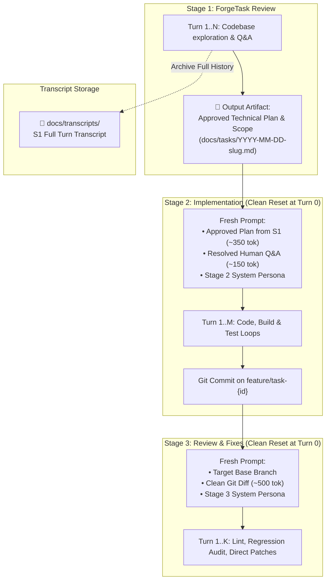

1. **Stage 1 $\rightarrow$ Stage 2 Handover:**
   - When `TaskReviewStage` finishes, its complete turn-by-turn chat history (10–20 turns) is archived to disk under `docs/transcripts/`.
   - `ImplementationStage` starts at **Turn 0 with an empty chat history**, receiving only the approved Technical Plan & Scope markdown artifact and the list of resolved Q&A pairs from `docs/tasks/`.
2. **Stage 2 $\rightarrow$ Stage 3 Handover:**
   - When `ImplementationStage` completes, all internal build attempts, compile errors, and test iterations are archived to disk.
   - `CodeReviewAndFixStage` starts at **Turn 0 with an empty chat history**, receiving only the base branch name, the clean `git diff` generated from the feature branch, and coding guidelines.
3. **Impact:** Eliminates 75%–85% of redundant prompt tokens, maintains high local LLM attention precision, and prevents cross-stage context pollution.

### 3.10 Deterministic Stages: Quality Gates & Agent Input Feeders

Workflows in NightCodeForge are not limited to purely agentic reasoning loops. A robust software engineering pipeline often requires **deterministic steps** (e.g., compilation, unit test suites, Static Application Security Testing [SAST], formatters, or linters) that execute predictable shell commands without AI intervention.

#### Architectural Advantages:
1. **Zero GPU & Token Overhead:** Deterministic stages execute directly in the workspace sandbox (`IExecutionEnvironment`), running on the host CPU or inside the sandbox container. They consume **0 LLM tokens**. When executed within an in-process pipeline cohort (see Section 7.1.6), they run on CPU in-process within the cohort's worker turn, guaranteeing instant continuation to subsequent stages with zero queue delay or branch drift.
2. **Deterministic Quality Gates & Outcome-Based Routing:**
   * **Forward Routing (Pass):** If builds, unit tests, and SAST scans pass cleanly, the deterministic stage packages a verified status (`ValidationStatus = Success`) and advances to the next stage (e.g. `CodeReviewAndFixStage`).
   * **Backward Feedback Loop (Fail):** If compilation fails or tests break, the deterministic step routes backward to the implementation agent (with a configurable loop counter, e.g. max 3 iterations, to prevent infinite loops) to request an immediate fix. If the loop counter expires, it pauses and alerts the human (`WaitingForHuman`).
3. **Structured Diagnostics Feeder (Smart Handover & Synthetic Priming):**
   * When configured as an **Input Feeder**, failing command outputs are parsed into structured artifacts rather than raw console noise.
   * *Example (Deterministic Compiler/Test Stage):* The stage extracts failing compiler diagnostics (`error CS\d+`) and failing test assertion stacks, saving them into `StageHandoverArtifacts.Diagnostics`.
   * **Crucible Synthetic Conversation Priming:** To prevent local LLMs from redundantly running `bash("dotnet build")` or `bash("dotnet test")` at the start of a turn, Crucible seeds the agent's chat history with a synthetic tool call/result pair mimicking that the agent already ran the test/build and received the exact deterministic results. The agent immediately moves to editing code.
4. **Built-in Deterministic Stage Implementations:**
   * **`DeterministicBuildStage`:** Executes project build (`dotnet build`, `npm run build`, `mvn compile`). Validates compile cleanliness.
   * **`DeterministicTestStage`:** Executes test runners (`dotnet test`, `pytest`, `jest`). Parses failing assertions and stack traces.
   * **`DeterministicSastStage`:** Runs security and static code analyzers (e.g. Roslyn Analyzers, Semgrep, Trivy, SonarScanner). Produces structured vulnerability/finding reports for automated remediation agents.
   * **`DeterministicFormatStage`:** Runs code formatters (e.g. `dotnet format`, `prettier --check`).

#### Pipeline Composition with Deterministic Steps & Feedback Loops:
```mermaid
flowchart LR
    S1["1. ForgeTask Review\n(Agentic LLM)"] --> S2["2. Implementation\n(Agentic LLM)"]
    S2 --> S3["3. Deterministic Build & Test\n(CPU Native / SAST Gate)"]
    S3 -->|Pass: Success Input| S4["4. Code Review & Fix\n(Agentic LLM)"]
    S3 -->|Fail: Parse Diagnostics & Loop Back| S2Fix["2b. Fix Errors\n(Agentic LLM with Synthetic Priming)"]
    S2Fix --> S3
    S3 -.->|Exceeds Max Retries (3)| Blocked["Blocked: Human Q&A"]
```

### 3.10.1 Persistent Pipeline Data Bag & Differential Quality Gates

Deterministic stages are not merely ephemeral shell runners; they serve as **persistent telemetry and baseline extractors**. NightCodeForge provides a thread-safe, serializable **Pipeline Data Bag** (`PipelineContext.DataBag`) that persists cross-stage data into `AppDbContext.Tasks.PipelineDataJson` and records per-stage snapshots in `STAGE_EXECUTION_RECORD.OutputDataJson`.

This architecture enables **differential quality gates**: capturing baseline repository metrics *before* code changes, and comparing them *after* implementation to prevent regressions, coverage erosion, or agent "cheating".

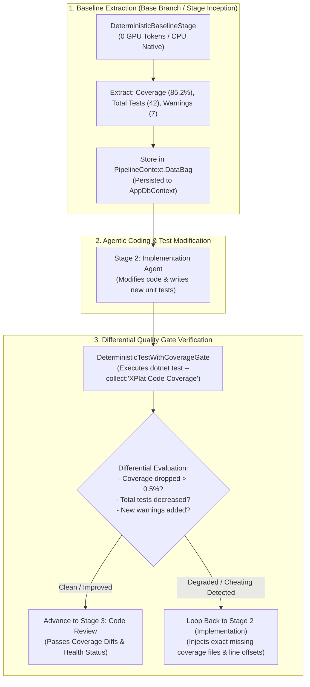

#### Core Differential Gates Supported:

1. **Test Coverage Degradation Gate (`DeterministicTestWithCoverageGate`):**
   * **Mechanism:** Executes coverage toolchain (`dotnet test --collect:"XPlat Code Coverage"` / Coverlet / Istanbul / lcov) and parses Cobertura XML or JSON coverage reports.
   * **Baseline:** Records `coverage.baseline.lineRate = 85.2%` and `coverage.baseline.branchRate = 78.4%`.
   * **Post-Implementation:** Computes `coverage.current.lineRate = 81.0%` ($\Delta = -4.2\%$).
   * **Enforcement:** If coverage drops beyond the configured tolerance (e.g. `allowedDrop = 0.0%`), the gate fails and synthesizes an actionable diagnostic:
     > *"❌ Coverage Degradation Detected: Line coverage dropped from 85.2% to 81.0% (-4.2%). Uncovered methods detected: `OrderService.CalculateTax()` (Lines 45-62) and `OrderService.ApplyDiscount()` (Lines 80-95). Please add unit tests covering these paths."*

2. **"No Cheating" Test Count Preservation Gate:**
   * **The Problem:** Local models occasionally "fix" a broken test suite by deleting or commenting out failing test assertions (`[Fact]` $\rightarrow$ `// [Fact]`) rather than fixing the underlying business logic.
   * **Enforcement:** The baseline stage records `tests.baseline.total = 42`. If post-implementation `tests.current.total < 42`, the gate fails immediately with a severe integrity violation error, rejecting the pull request.

3. **Compiler & Linter Warning Ratchet (`DeterministicWarningRatchetStage`):**
   * **The Problem:** Legacy repositories often contain dozens of preexisting compiler warnings. Enforcing `TreatWarningsAsErrors` globally breaks existing code, but allowing warnings permits agents to introduce fresh technical debt.
   * **Mechanism:** Captures `warnings.baseline = 14`. If the new build produces `warnings.current = 16`, the ratchet triggers a failure reporting only the **2 newly introduced warnings** (with file and line numbers) for remediation.

4. **Performance Benchmark & Binary Size Gates:**
   * Tracks execution benchmarks (via BenchmarkDotNet / pytest-benchmark) or compiled bundle sizes (`dist/bundle.js`, output `.dll` size), preventing stealthy performance regressions.

#### `PipelineDataBag` Data Contract:

```csharp
public class PipelineDataBag
{
    private readonly ConcurrentDictionary<string, JsonElement> _data = new();

    public void Set<T>(string key, T value)
    {
        var json = JsonSerializer.SerializeToElement(value);
        _data[key] = json;
    }

    public T? Get<T>(string key)
    {
        if (_data.TryGetValue(key, out var element))
        {
            return JsonSerializer.Deserialize<T>(element);
        }
        return default;
    }

    public bool TryGet<T>(string key, out T? value)
    {
        if (_data.TryGetValue(key, out var element))
        {
            value = JsonSerializer.Deserialize<T>(element);
            return true;
        }
        value = default;
        return false;
    }

    public string ToJson() => JsonSerializer.Serialize(_data);
    public static PipelineDataBag FromJson(string? json) => ...;
}
```

---

### 3.11 Hardened Autonomous Conflict Resolution & Downstream Gate Re-Traversal

When autonomous coding tasks execute against an active repository, the target base branch (`main` or `master`) continuously advances as maintainers push commits or other tasks squash-merge. If an in-flight branch drifts, merge conflicts can emerge during pre-review verification (**Gate 2**) or pre-merge validation (**Gate 3**).

#### 3.11.1 The Verification Blind Spot & Forensic Hardening
Earlier implementations suffered from a dangerous architectural vulnerability: after an agent edited conflicted files to remove conflict markers (`<<<<<<<`), the verifier checked only textual markers and Git unmerged index stages (`git ls-files -u`), immediately committing the merge without running project compilation. Consequently, non-compiling C# code was committed to the branch, bypassed downstream gates, and prematurely presented an "Approve & Merge" button in the Review Room.

NightCodeForge hardens this lifecycle through **deterministic compilation verification** and **mandatory downstream gate re-traversal**:

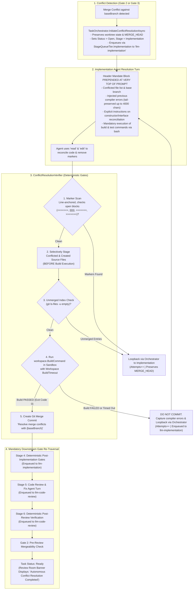

#### 3.11.2 The 5-Step Verification Sequence ([ConflictResolutionVerifier](file:///c:/Users/Julien/source/repos/jetelain/NightCodeForge/src/NightCodeForge.Core/Workflow/ConflictResolutionVerifier.cs))
Verification executes strictly inside the task's isolated container sandbox via [IExecutionEnvironmentProvider](file:///c:/Users/Julien/source/repos/jetelain/NightCodeForge/src/NightCodeForge.Core/Interfaces/IExecutionEnvironmentProvider.cs) under the workspace lock:

1. **Line-Anchored Conflict Marker Scan:**
   Scans every conflicted file. Verifies zero unclosed or malformed conflict blocks (`<<<<<<< `, `||||||| `, `>>>>>>> `). The separator `=======` is verified strictly *inside* an open conflict block; lone lines containing `=======` outside blocks (e.g. Markdown Setext headings or ASCII tables) are permitted to avoid false-positive failures.
2. **Selective Staging Before Build (Crucial Invariant):**
   Modifications to conflicted files (`git add -- {file}`), deletions (`git rm --ignore-unmatch -- {file}`), and newly created source files (`.cs`, `.ts`, `.json`) are staged **before running compilation**. This guarantees that compiler build outputs (`bin/`, `obj/`, intermediate binaries) generated during step 4 are never accidentally staged or committed into the repository.
3. **Unmerged Index Check:**
   Runs `git ls-files -u`. Ensures that Git's unmerged index is completely cleared.
4. **Deterministic Build Verification & Timeout:**
   Executes `workspace.BuildCommand` (e.g. `dotnet build`) inside the sandbox environment. If compilation fails or times out:
   * Truncates compiler errors to `ConflictResolutionConstants.MaxCompilerErrorsLength` (4,000 characters), keeping the informative tail.
   * **Does NOT create a Git commit.** The worktree remains in an uncommitted state with `MERGE_HEAD` intact so the agent can resume seamlessly.
   * Updates `PipelineDataBagKeys.CompilerErrors` and loops back to implementation.
5. **Atomic Git Merge Commit:**
   **Only if** steps 1–4 succeed with Exit Code 0, the verifier commits: `git commit --no-edit -m "Resolve merge conflicts with {baseBranch}"`.

#### 3.11.3 Multi-Tier Attempt Budgets & Escalation
To prevent infinite reasoning loops or runaway token consumption:
* `ConflictResolutionConstants.MaxConflictResolutionAttempts = 3`: Maximum consecutive build/marker loopbacks for a single conflict event.
* `ConflictResolutionConstants.MaxTotalConflictResolutionAttempts = 6`: Lifetime conflict resolution turn budget across the entire task run.
* `ConflictResolutionConstants.MaxLifetimeConflictDetections = 3`: Maximum distinct merge conflict events against an advancing `main`.
* If any budget is exceeded, the orchestrator escalates to human maintainers by setting `task.IsWaitingForHuman = true` with a detailed audit log.

#### 3.11.4 Mandatory Downstream Gate Re-Traversal
Once conflict resolution passes verification:
* The task **never jumps directly to `Ready` or the Review Room**.
* It must re-traverse all subsequent pipeline quality gates:
  1. **`PostImplementationGates`** (Tier 2 `llm-implementation`): Full deterministic test suite and differential coverage gates.
  2. **`CodeReviewAndFix`** (Tier 1 `llm-code-review`): Reviewer agent inspects the newly reconciled diff.
  3. **`PostReviewVerification`** (Tier 1 `llm-code-review`): Deterministic validation of review patches.
  4. **Gate 2**: Pre-review mergeability check confirms branch is still cleanly mergeable against latest `main`.
  5. **`TaskOverallStatus.Ready`**: The task reaches `Ready` only after all 4 downstream gates pass cleanly.

#### 3.11.5 The Three Conflict Touchpoints in the Task Lifecycle
To protect against code divergence and human review fatigue across long-running task workflows, NightCodeForge guards the repository across three discrete touchpoints:

1. **Touchpoint 1 — Start of Pre-Implementation Baseline (Stage 2):**
   - In Stage 1 (`task-review`), the architect agent reviews requirements and drafts the technical specification in `docs/tasks/task-{id}.md`. If clarification questions are raised via `ask`, the task may sit dormant for hours or days.
   - At the beginning of Stage 2, before establishing baseline test coverage or building the project, `GitWorkspaceManager.SyncFromBaseBranchAsync` synchronizes the task branch from `baseBranch`.
   - Because Stage 1 only touches `docs/tasks/task-{id}.md` (which is committed before synchronization), this synchronization is expected to be clean and guarantees that Stage 3 (`Implementation`) authors code against current upstream APIs. If a conflict occurs, `MergeConflictException` fails fast.
2. **Touchpoint 2 — Gate 2 Pre-Review Mergeability Check (`git merge-tree`):**
   - When a task completes Stage 6, it prepares to enter `TaskOverallStatus.Ready`.
   - Before presenting the task in the Review Room, the orchestrator executes a non-destructive read-only preview using the native Git engine:
     ```bash
     git merge-tree --write-tree --name-only <baseBranch> <featureBranch>
     ```
   - If clean, the task transitions to `Ready` and appears in `/review`.
   - If conflicts exist, the task avoids presenting conflicting diffs to human reviewers and immediately enters autonomous conflict resolution.
3. **Touchpoint 3 — Squash & Merge Validation & Atomic Rollback:**
   - At final merge time (whether manual maintainer click or `MergeMode.Automatic`), the canonical clone attempts `SquashAndMergeAsync`.
   - If `main` advanced in the milliseconds since review, Git raises a merge conflict.
   - The operation executes an **atomic rollback** (resetting the canonical clone back to clean `main`), catches `MergeConflictException`, and safely returns the task to autonomous conflict resolution without corrupting the canonical repository.

---

### 3.12 Pipeline Restart Strategies: Soft Resume vs. Hard Reset & Base Branch Rebase

In the **Task Execution Inspector** (`/inspector/{taskId}` via [TaskExecutionInspector.razor](file:///c:/Users/Julien/source/repos/jetelain/NightCodeForge/src/NightCodeForge.Web/Components/Monitoring/TaskExecutionInspector.razor)), developers can restart task execution from Stage 1 (`task-review`). Operators choose between two fundamentally distinct restart strategies via [RestartPipelineModal.razor](file:///c:/Users/Julien/source/repos/jetelain/NightCodeForge/src/NightCodeForge.Web/Components/Monitoring/RestartPipelineModal.razor):

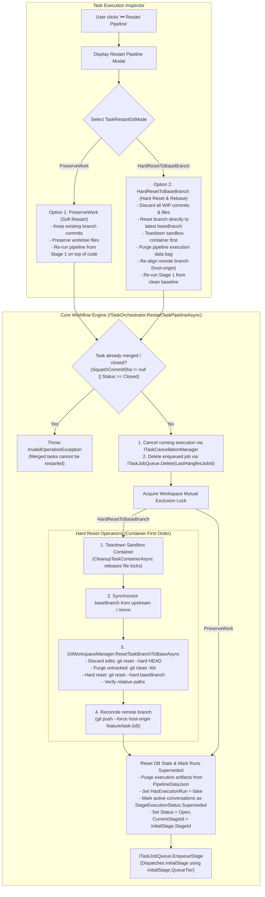

#### 3.12.1 The Two Restart Modes ([TaskRestartGitMode](file:///c:/Users/Julien/source/repos/jetelain/NightCodeForge/src/NightCodeForge.Core/Domain/TaskRestartGitMode.cs))

1. **Soft Restart (`TaskRestartGitMode.PreserveWork = 0`):**
   * **Use Case:** The operator wants to re-run pipeline stages on top of existing code (e.g. re-verifying quality gates with updated test configurations, retrying review with a different prompt/model profile, or continuing to iterate on authored code).
   * **Git Strategy:** Preserves existing feature branch commits and modified worktree files. Pipeline state resets to Stage 1, allowing downstream agents to inspect existing work.

2. **Hard Reset & Rebase (`TaskRestartGitMode.HardResetToBaseBranch = 1`):**
   * **Use Case:** The previous attempt produced broken code, architectural dead ends, or corrupt worktrees. The operator wants to restart the task **from scratch on a clean state directly aligned with the latest `main`**, exactly as if the task were being executed for the first time.
   * **Container-First Teardown Order:** The Docker sandbox container (`ncf-sandbox-{workspaceId}-task-{taskId}`) is torn down **first** via `CleanupTaskContainerAsync`. This releases open file handles, file-system locks, and volume mounts that would otherwise block `git clean -fdx` or file deletions on Windows/WSL mounts.
   * **Worktree Clean & Rebase:**
     ```bash
     git -C <worktreePath> reset --hard HEAD
     git -C <worktreePath> clean -fdx
     git -C <worktreePath> reset --hard <baseBranch>
     ```
   * **Relative Path Re-Verification:** Bidirectional relative path pointers (`.git` gitdir relative paths) are re-verified via `EnsureWorktreeRelativePathsAsync` to ensure container/WSL mount integrity.
   * **Remote Branch Reconciliation:** If `host-origin` is configured, force-pushes the reset branch (`git push --force host-origin feature/task-{id}`).
   * **Pipeline Bag & Conversation Hygiene:** Purges conflict metadata (`HasResolvedConflict`, `ConflictFiles`, `CompilerErrors`) from `PipelineDataJson`, marks existing stage conversations with `StageExecutionStatus.Superseded`, sets `HasExecutionRun = false`, and resets `Status = TaskOverallStatus.Open`.
   * **Protected Invariant:** Merged or closed tasks cannot be restarted (`SquashCommitSha != null || Status == TaskOverallStatus.Closed` throws `InvalidOperationException`).

---

## 4. ForgeTask Dependency Management (DAG)

Complex features and refactoring tasks naturally break down into interdependent tasks. NightCodeForge natively manages dependencies via a **Directed Acyclic Graph (DAG)**.

### 4.1 Dependency Rules & State Propagation
* A task can declare one or more prerequisite tasks (`DependsOnTaskIds`).
* **Execution Gate:** A task with `Status == TaskOverallStatus.Open` and unsatisfied dependencies (i.e. one or more prerequisites do not have `Status == TaskOverallStatus.Closed`) is marked as dependency-blocked in the UI and **will not be enqueued** to Hangfire until all dependencies are met.
* **Cascade Activation:** When a task reaches the terminal `TaskOverallStatus.Closed` state (squashed and merged into the base branch), the orchestrator triggers cascade unblocking (`ResolveCascadeUnblockedTasksAsync`). Dependent tasks whose prerequisites are now all `Closed` are sorted by priority (`Priority ASC`, i.e. P1 Critical before P2 before P3...), then `CreatedAt ASC`. Each unblocked task explicitly clears any lingering pause flag (`IsDeferredByPause = false`) and is enqueued via `ITaskJobQueue.EnqueueStage(unblockedTask.Id, initialStage.QueueTier, unblockedTask.Priority)` to its stage-designated Hangfire queue.
* **Cycle Prevention:** When creating or modifying dependencies, the `DependencyResolutionEngine` performs topological sorting to detect and reject circular references (cycles).

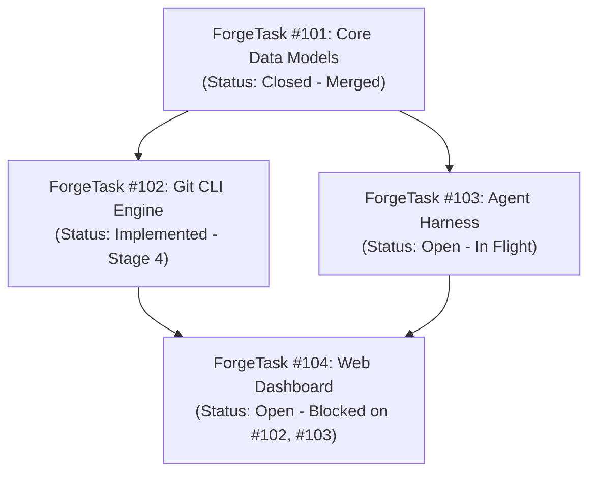

---

## 5. File-System ForgeTask Mirroring (`docs/tasks/`)

To provide optimal ergonomics for AI agents, developers, and Git workflows, active (non-resolved) tasks are mirrored directly in the workspace file system under **`docs/tasks/`** as structured Markdown documents with YAML frontmatter.

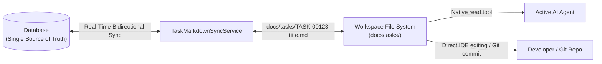

### 5.1 Why Markdown Files for Agents?
1. **Native Agent Accessibility:** Agents inside the workspace can read task specifications, requirements, and previous Q&A directly using basic file tools (`read`), without needing custom database query APIs or SDK dependencies.
2. **Developer & IDE Transparency:** Developers can review, search, and edit tasks directly in VS Code, Visual Studio, or Obsidian without leaving their editor.
3. **Version Control Integration:** Active task specifications live alongside the code on the task branch, preserving the exact requirements snapshot in Git history.

### 5.2 Document Naming & Frontmatter Schema

#### Naming Convention: Chronological Date Prefix (`YYYY-MM-DD-slug.md`)
To allow developers and agents to quickly sort tasks chronologically in their file explorer without having to rename files when IDs are assigned, files are named:
`docs/tasks/YYYY-MM-DD-<slug>.md` (e.g. `docs/tasks/2026-10-12-implement-oauth2-flow.md`).

* The database `id` is stored exclusively **inside the frontmatter**, not in the filename.
* Dropping a new file never requires a file rename when the system assigns an ID.
* **Slug Collision Resolution:** If multiple tasks created on the same date produce identical slugs, the sync service appends an incrementing numeric suffix (e.g. `YYYY-MM-DD-<slug>-2.md`, `YYYY-MM-DD-<slug>-3.md`).

```markdown
---
id: 123
title: Implement OAuth2 Authorization Flow
workspace: NightCodeForge
status: Open
waiting_for_human: true
interrupted_agent_profile: deep-analyst
current_stage: TaskReview
priority: 1
merge_mode: manual_review_required
base_branch: main
feature_branch: feature/task-123
depends_on: [101, 102]
agent_profile: deep-analyst
created_at: 2026-10-12T22:00:00Z
updated_at: 2026-10-12T22:05:00Z
---

# Implement OAuth2 Authorization Flow

## 📋 Requirements & Description
Implement authorization code flow with PKCE for local clients...

## ❓ Human Clarifications (Q&A)
### Question 1 (Asked during Stage: TaskReview on 2026-10-12 22:03:00)
**Prompt:** Should refresh token rotation be enforced on every token exchange?
**Answer:** Yes, rotate refresh tokens on every exchange and store revocations in SQLite.

## 📐 Technical Plan & Scope (Stage 1 Output)
- [ ] Add `OAuthClientOptions` configuration model.
- [ ] Implement `PkceTokenValidator` handler.
- [ ] Add integration tests in `NightCodeForge.Core.Tests`.
```

### 5.3 Bidirectional Synchronization & Field Protection Rules

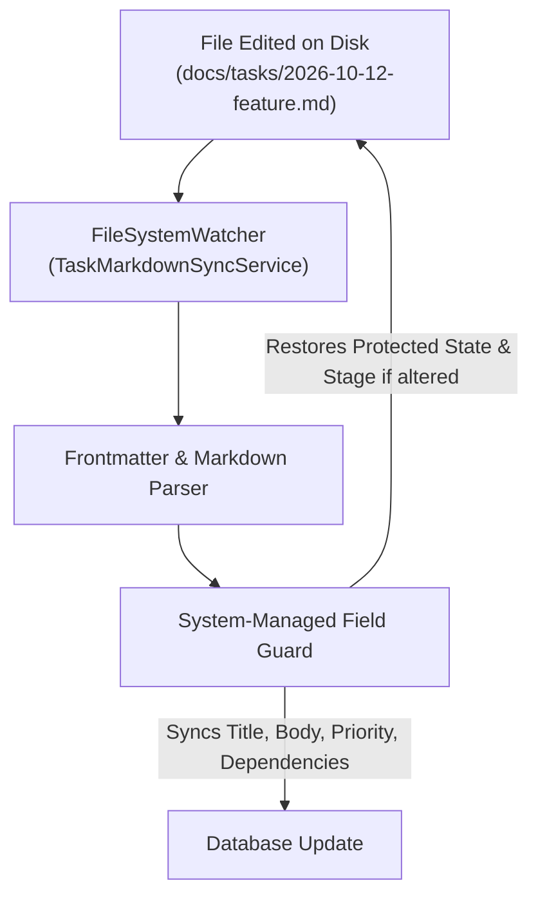

1. **System-Managed Fields (Protected):**
   * Fields like `id`, `status` (`overall_state`), `current_stage`, and `created_at` are strictly governed by the orchestrator engine and database.
   * If a user or agent modifies `status` or `current_stage` directly in the markdown file, the orchestrator rejects the state alteration and rewrites the authoritative database state back into the file's frontmatter.
2. **User/Agent Editable Fields (Synchronized to DB):**
   * Changes to `title`, markdown body (`description`, requirements, technical plan), `priority`, `agent_profile`, `base_branch`, and `depends_on` are automatically detected and saved into the database.
   * Dependency changes via `depends_on` are passed through DAG cycle checks before being committed.
3. **Drop-in Creation Without Renaming:**
   * When a developer or agent drops a new file (e.g. `docs/tasks/2026-10-13-add-dark-theme.md`) without an `id` field:
     1. The watcher detects the new file.
     2. A new `ForgeTask` entity is created in EF Core, allocating the next available `Id` (e.g. `124`).
     3. The sync service injects `id: 124` and `created_at` directly into the file's frontmatter **in-place**, without renaming the file.
4. **Resolution Archival / Cleanup:**
   * When a task reaches `Completed` (or `Cancelled`), the markdown file is removed from `docs/tasks/` (or archived to `docs/tasks/archive/`), ensuring that `docs/tasks/` contains only active and pending work.
5. **FileSystemWatcher Debouncing & Echo Loop Prevention:**
   * Operating systems and IDEs emit multiple rapid events per save (e.g. `Created` followed by multiple `Changed` events within 50ms) and may hold temporary locks during atomic saves.
   * `TaskMarkdownSyncService` applies a **300ms debounce window** to coalesce rapid I/O bursts.
   * To prevent infinite echo loops (where the system writing back protected frontmatter fields triggers the watcher to fire again), the service maintains an in-memory **write-suppression tracker**: whenever the orchestrator writes a file, it registers the computed hash and ignores the subsequent event.

---

## 6. Interactive ForgeTask Discovery & Ideation Chat

To prevent vague or poorly scoped tasks from entering the queue, NightCodeForge provides an **Interactive Ideation & Codebase Discovery Chat**:

```mermaid
sequenceDiagram
    autonumber
    actor User as Developer
    participant UI as Blazor Chat Interface
    participant Explorer as Discovery Agent (Read-Only)
    participant Git as Git Workspace
    participant Engine as Dependency & ForgeTask Engine

    User->>UI: "How does our authentication handle JWT refresh tokens, and what's needed for OAuth2?"
    UI->>Explorer: Stream prompt + conversation context
    Explorer->>Git: Read relevant auth files & configuration
    Git-->>Explorer: File contents & symbols
    Explorer-->>UI: Explains architecture & highlights gaps
    User->>UI: "Great, let's create tasks to implement OAuth2 support."
    Explorer->>UI: Proposes 2 structured tasks with dependencies:<br>1. ForgeTask A: Add OAuth2 client config & token model<br>2. ForgeTask B: Add Google/GitHub provider handlers (Depends on A)
    User->>UI: Reviews, tweaks scope, and clicks "Create in Backlog"
    UI->>Engine: Registers ForgeTask A & ForgeTask B with dependency link
    Engine-->>UI: ForgeTask A queued; ForgeTask B waiting on A
```

### 6.1 Discovery Agent Capabilities
* **Read-Only Access:** Equipped with search, file-reading, and code exploration tools (`bash` with ls/rg, `read`). Cannot modify working tree files.
* **ForgeTask Extraction Tool:** Agent has a function tool `propose_tasks(List<TaskProposalDto>)` allowing it to output structured titles, acceptance criteria, affected components, and recommended dependencies directly into the UI for developer approval.

### 6.2 Automated Untrusted ForgeTask Triage (`TriageProfile` & Security Sandbox)
NightCodeForge supports automated intake pre-analysis triggered by external webhooks (e.g. GitHub Tasks, GitLab Tasks, Jira):
* **Intake Trigger & Objective:** When a new external bug report or feature request arrives, NightCodeForge spawns an autonomous **Triage Stage** (`TriageStage`). The agent inspects the repository's default branch (`main` or `master`) directly (without creating or checking out a feature branch), verifies if the report is actionable, locates relevant source files, and suggests one or more structured backlog tasks via `propose_tasks` for human review.
* **Threat Model: Malicious External Content & Indirect Prompt Injections:**
  External tasks originate from unauthenticated or untrusted public users. Attackers can embed hidden prompt injections (e.g., instructions attempting to exfiltrate secrets, execute malicious shell scripts, or rewrite code).
* **Dual-Lock Defense Architecture:**

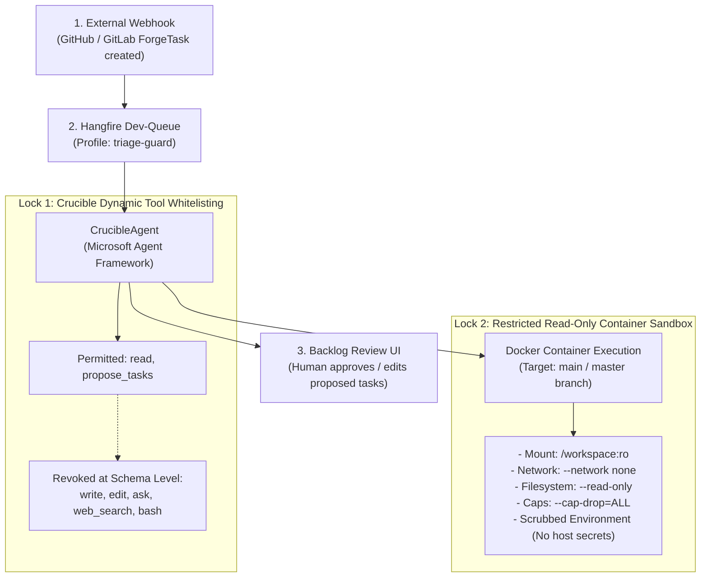

1. **Lock 1: In-Process Tool Restriction (Crucible Exclusive):**
   * Crucible dynamically binds *only* the read-only tools defined in `AgentProfile.PermittedTools`: `read` and `propose_tasks`.
   * `write` and `edit` are excluded entirely from the tool schema—the agent cannot modify files.
   * `ask` is excluded—an untrusted task cannot stall or block the human dev-queue.
   * `web_search` is excluded—eliminating outbound SSRF and exfiltration channels.
   * *Harness Exclusion:* **Pi and ACP harnesses cannot be used for triage** because their static tool engines advertise all capabilities (`write`, `edit`, `bash`) unconditionally.
2. **Lock 2: Restricted Read-Only Container Sandbox:**
   * Runs directly against the base branch (`main`/`master`) on ext4 mounted **read-only** (`:ro`).
   * **`--network none`:** Completely air-gapped network namespace. Even if an LLM is hijacked by an adversarial prompt injection, it cannot exfiltrate environment variables, source code, or internal tokens over the network.
   * **`--read-only` root filesystem:** Prevents writing malicious binaries or modifying system files.
   * **`--cap-drop=ALL` & `--security-opt no-new-privileges:true`:** Drops all Linux root privileges.
   * **Scrubbed Environment:** Host API keys, Git credentials, and database connection strings are strictly omitted from container environment variables.

---

## 7. Orchestration Engine & Queue Design

### 7.1 Stage-Priority Inference Queue Architecture

In local LLM orchestration backed by [OllamaRouter](https://github.com/jetelain/OllamaRouter), the dedicated Remote LAN GPU server constitutes a shared single-worker bottleneck (~95% of background dev-queue workloads). To eliminate VRAM thrashing and model contention, background dev-queue tasks run with **`WorkerCount = 1`**.

However, under a simple FIFO scheduling model, newly intake tasks starting `task-review` or `implementation` can queue ahead of tasks that are already 90% completed (`code-review-fix`). When nearly finished tasks are delayed:
1. The target base branch (`main`) continues to advance as other tasks merge or maintainers push changes.
2. The delayed task branch drifts from `main`, dramatically increasing the probability of Git merge conflicts.
3. Earlier stages like `task-review` frequently invoke the `ask` tool to resolve ambiguities, pausing in `IsWaitingForHuman = true`.

#### 7.1.1 The "Task as a Whole" Principle
NightCodeForge solves this priority inversion through the **"Task as a Whole"** strategy: tasks are scheduled by their **proximity to completion**, pushing downstream tasks through merge or review readiness first to keep `main` clean and minimize branch drift:

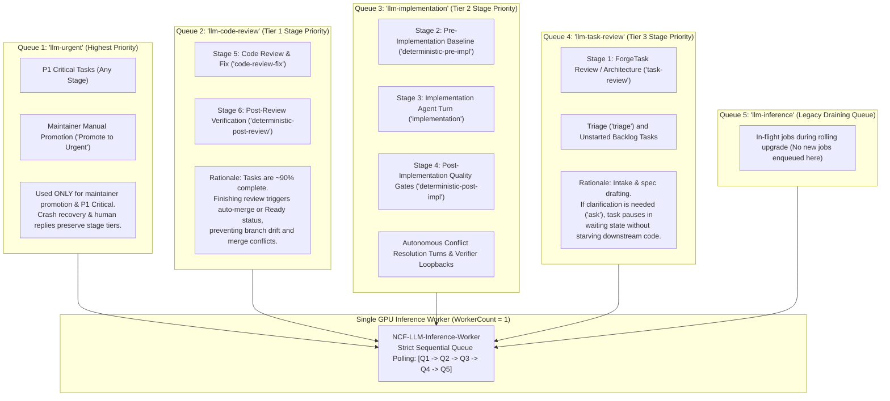

#### 7.1.2 Queue Polling Hierarchy & Server Configuration
In [HangfireConfigurationExtensions.cs](file:///c:/Users/Julien/source/repos/jetelain/NightCodeForge/src/NightCodeForge.Infrastructure/BackgroundJobs/HangfireConfigurationExtensions.cs), the single dedicated inference worker (`NCF-LLM-Inference-Worker`, `WorkerCount = 1`) polls queues in strict descending priority order:

| Queue Name | Worker Count | Priority Tier | Workload Scope & Purpose |
| :--- | :--- | :--- | :--- |
| `llm-urgent` | **1** (Shared pool) | **Priority 1 (Emergency)** | **P1 Critical Tasks** (any stage) and explicit maintainer manual promotion ("Promote to Urgent") ONLY. |
| `llm-code-review` | **1** (Shared pool) | **Priority 2 (Tier 1: Code Review)** | Tasks ready for **Code Review & Fix** (`code-review-fix`) and **Post-Review Verification** (`deterministic-post-review`). Pushing these through triggers automated merge or Ready status. |
| `llm-implementation` | **1** (Shared pool) | **Priority 3 (Tier 2: Implementation)** | Tasks ready for **Pre-Implementation Baseline**, **Implementation**, **Post-Implementation Quality Gates**, and **Autonomous Conflict Resolution** turns. |
| `llm-task-review` | **1** (Shared pool) | **Priority 4 (Tier 3: Task Review)** | Tasks ready for **ForgeTask Review** (`task-review`), **Triage** (`triage`), and unstarted backlog tasks. If clarification is needed, tasks pause without blocking downstream code. |
| `llm-inference` | **1** (Shared pool) | **Priority 5 (Legacy Draining)** | Legacy draining queue for in-flight jobs during rolling upgrades. Polled last; jobs are migrated to their correct tier queue at startup. No new jobs are ever enqueued here. |
| `default` | **4** | *Non-GPU Utility* | Non-GPU background tasks: Git diff generation, log cleanup, telemetry broadcasting, container image preparation. Parallel execution allowed. |

#### 7.1.3 Stage-Declared Queue Tiers (`StageQueueTier`)
Stages designate their own queue tier rather than relying on a hardcoded ID lookup:
* The `StageQueueTier` enum (`TaskReview`, `Implementation`, `CodeReview`) is defined in `Core` and persisted as a required property on [StageDefinition.cs](file:///c:/Users/Julien/source/repos/jetelain/NightCodeForge/src/NightCodeForge.Core/Domain/StageDefinition.cs).
* Exposed at runtime via `IWorkflowStage.QueueTier`. When constructing stage instances in [WorkflowStageFactory.cs](file:///c:/Users/Julien/source/repos/jetelain/NightCodeForge/src/NightCodeForge.Core/Workflow/WorkflowStageFactory.cs), `QueueTier` is populated directly from the definition.
* [StandardWorkflowDefinitions.cs](file:///c:/Users/Julien/source/repos/jetelain/NightCodeForge/src/NightCodeForge.Core/Domain/StandardWorkflowDefinitions.cs) maps:
  - `CodeReview`: `StandardStageIds.CodeReviewAndFix`, `StandardStageIds.PostReviewVerification`.
  - `Implementation`: `StandardStageIds.PreImplementationBaseline`, `StandardStageIds.Implementation`, `StandardStageIds.PostImplementationGates`.
  - `TaskReview`: `StandardStageIds.TaskReview`, `StandardStageIds.Triage`.

#### 7.1.4 `ITaskJobQueue` Stage Dispatch Contract
Under the Clean Break policy:
* Legacy `EnqueueInference(int taskId)` is completely removed.
* Dispatch is governed by:
  ```csharp
  string EnqueueStage(int taskId, StageQueueTier tier, int priority);
  ```
* **Dispatch Rules:**
  - If `priority == TaskPriority.Critical` (P1) $\rightarrow$ `HangfireQueues.LlmUrgent`. (P1 always overrides the stage tier).
  - Else `StageQueueTier.CodeReview` $\rightarrow$ `HangfireQueues.LlmCodeReview`.
  - Else `StageQueueTier.Implementation` $\rightarrow$ `HangfireQueues.LlmImplementation`.
  - Else `StageQueueTier.TaskReview` $\rightarrow$ `HangfireQueues.LlmTaskReview`.
* **Human Replies & Reboot Crash Recovery Dispatch:**
  When a developer submits answers to pending questions or when `StartupRecoveryService` recovers orphaned tasks after an OS crash, tasks **strictly preserve the stage tier system**. They call `_jobQueue.EnqueueStage(task.Id, targetStage.QueueTier, task.Priority)` using the blocked stage's tier and persisted priority. They are not dumped into `llm-urgent` unless already marked P1 Critical.

#### 7.1.5 DevQueue Priority Reordering & Starvation Observability
In [DevQueueService.cs](file:///c:/Users/Julien/source/repos/jetelain/NightCodeForge/src/NightCodeForge.Web/Services/DevQueueService.cs) and [DevQueueTable.razor](file:///c:/Users/Julien/source/repos/jetelain/NightCodeForge/src/NightCodeForge.Web/Components/DevQueue/DevQueueTable.razor):
* `GetSnapshotAsync` queries all active queues: `rawUrgent`, `rawCodeReview`, `rawImplementation`, `rawTaskReview`, `rawInference`, `rawDefault`, `rawProcessing`, `rawFailed`.
* `ReorderInferenceQueueByPriorityAsync`:
  - Inspects only jobs confirmed in the `Enqueued` state (`EnqueuedJobs`). If a job has already transitioned to `Processing` or `Scheduled`, it is skipped immediately to prevent worker race conditions.
  - Sorts waiting jobs by:
    1. Task Priority (`Priority ASC`, numerically lowest value first: P1 $\rightarrow$ P5).
    2. Original enqueue time ascending (FIFO aging within equal priority, preserved across re-enqueues via job parameters).
  - Misplaced jobs (where stage tier or priority changed, or legacy jobs) are verified deleted (`Delete` returns `true`) before calling `EnqueueStage`, atomically updating `ForgeTask.LastHangfireJobId` to guarantee no job executes twice.
* **Starvation Observability:** `DevQueueTable.razor` displays the age of the oldest waiting job per tier so operators can observe intake delays under heavy review/implementation bursts.

### 7.1.6 Pipeline Stage Chaining & Atomic Cohort Job Execution

NightCodeForge orchestrates autonomous software engineering tasks on a dedicated single-worker GPU inference queue (`WorkerCount = 1`) to eliminate model thrashing and GPU out-of-memory contention on local Ollama / OllamaRouter backends. In Section 7.1.1–7.1.5, tasks are scheduled using the stage-priority queue hierarchy (`llm-code-review` -> `llm-implementation` -> `llm-task-review`) under the **"Task as a Whole"** principle.

To ensure execution continuity, eliminate inter-stage interleaving, and minimize branch drift against an advancing `baseBranch`, NightCodeForge implements **In-Process Stage Chaining** organized into **Atomic Execution Cohorts**.

#### 7.1.6.1 The Inter-Stage Vulnerability & GPU Resource Starvation
In the standard software engineering pipeline, workflow stages alternate between GPU (Agentic LLM) and CPU (Deterministic) workloads:
* **Stage 1 (ForgeTask Review):** GPU / Agentic (`StageQueueTier.TaskReview`, Tier 3)
* **Stage 2 (Pre-Implementation Baseline):** CPU / Deterministic (`StageQueueTier.Implementation`, Tier 2)
* **Stage 3 (Implementation):** GPU / Agentic (`StageQueueTier.Implementation`, Tier 2)
* **Stage 4 (Post-Implementation Gates):** CPU / Deterministic (`StageQueueTier.Implementation`, Tier 2)
* **Stage 5 (Code Review & Fix):** GPU / Agentic (`StageQueueTier.CodeReview`, Tier 1)
* **Stage 6 (Post-Review Verification):** CPU / Deterministic (`StageQueueTier.CodeReview`, Tier 1)
* **Gate 2 & Delivery (Pre-Review Mergeability & Auto-Delivery):** CPU / Deterministic (terminal orchestrator logic)

If every stage were dispatched as an isolated Hangfire background job, completing Stage 3 (Implementation) would cause the worker to update the database, enqueue Stage 4 (`deterministic-post-impl`) into Hangfire, and exit the worker turn. Relinquishing the single worker slot introduces severe architectural vulnerabilities:
1. **Queue Interleaving & Long Stalls:** Any other queued job of equal or higher tier can seize the single worker slot and start a 15–30 minute LLM reasoning turn. The initial task, having merely finished writing code, is stranded waiting for its 45-second deterministic test suite to run.
2. **Accelerated Branch Drift & Merge Conflicts:** While the task is stranded between stages, the target base branch (`main`) continues to advance as maintainers commit code or other tasks complete. By the time the stranded task finally runs its tests, its branch has drifted, creating avoidable merge conflicts.
3. **Deadlock & Synchronization Fragility:** Conversely, having the worker sleep or poll waiting for a separately dispatched deterministic background job introduces fragile cross-process synchronization and deadlocks since CPU and GPU steps share the same queue infrastructure.

#### 7.1.6.2 Atomic Cohort Groupings & Boundary Contracts
Rather than introducing redundant domain concepts, cohort membership is unified directly through the existing [StageQueueTier](file:///c:/Users/Julien/source/repos/jetelain/NightCodeForge/src/NightCodeForge.Core/Domain/StageDefinition.cs) enum (`TaskReview`, `Implementation`, `CodeReview`).

A **cohort** consists of contiguous workflow stages sharing the same `QueueTier`. Cohort execution obeys the following contracts:
1. **Intake Phase (`StageQueueTier.TaskReview`, Tier 3):**
   * Encompasses `task-review` (and external `triage`).
   * **Isolation Rule:** Runs as an independent execution turn. Intake stages frequently interact with humans or external issue trackers and may pause for clarification (`ask` tool) without consuming downstream compute.
   * `IsSameCohort` explicitly excludes `TaskReview` from chaining into subsequent stages (`current.QueueTier == next.QueueTier && current.QueueTier != StageQueueTier.TaskReview`).
2. **Implementation Cohort (`StageQueueTier.Implementation`, Tier 2):**
   * Encompasses `deterministic-pre-impl` (Stage 2), `implementation` (Stage 3), and `deterministic-post-impl` (Stage 4).
   * **Atomic Invariant:** Executes sequentially within a **single Hangfire job turn**. Stage 4 immediately follows Stage 3 without relinquishing the worker slot. If Stage 4 detects compiler errors or failing tests, an **in-job loopback** re-executes Stage 3 directly in-process.
3. **Review & Delivery Cohort (`StageQueueTier.CodeReview`, Tier 1):**
   * Encompasses `code-review-fix` (Stage 5), `deterministic-post-review` (Stage 6), and terminal Gate 2 Pre-Review Verification & Delivery.
   * **Atomic Invariant:** Executes within a **single Hangfire job turn**. Code review edits, deterministic verification, and automated squash-and-merge occur in rapid succession, preventing branch drift at the finish line.
4. **Contiguous Cohort Validation:**
   [WorkflowDefinitionValidator.cs](file:///c:/Users/Julien/source/repos/jetelain/NightCodeForge/src/NightCodeForge.Core/Workflow/WorkflowDefinitionValidator.cs) and [DatabaseWorkflowPipelineProvider.cs](file:///c:/Users/Julien/source/repos/jetelain/NightCodeForge/src/NightCodeForge.Infrastructure/Workflow/DatabaseWorkflowPipelineProvider.cs) enforce that stages sharing the same `QueueTier` must appear in strictly contiguous sequence. Any workflow definition with split, alternating, or invalid queue tiers is rejected fail-fast with a [WorkflowValidationException](file:///c:/Users/Julien/source/repos/jetelain/NightCodeForge/src/NightCodeForge.Core/Exceptions/WorkflowValidationException.cs).

#### 7.1.6.3 In-Process Progression Loop & In-Job Loopbacks
In [TaskOrchestrator.cs](file:///c:/Users/Julien/source/repos/jetelain/NightCodeForge/src/NightCodeForge.Core/Workflow/TaskOrchestrator.cs), the execution loop in `ProcessTaskAsync` progresses through chained stages in-process:

```csharp
var isFirstIteration = true;
while (!cancellationToken.IsCancellationRequested)
{
    // 1. Cooperative Global Pause Check
    if (_operationsControlService.IsPaused)
    {
        task.IsDeferredByPause = true;
        await _taskRepository.UpdateWithHistoryAsync(task, AuditActors.System, "Execution deferred: Operations paused.", cancellationToken);
        exitReason = CohortExitReason.Paused;
        return;
    }

    // 2. Cooperative Urgent Preemption Check (skipped on first iteration)
    if (!isFirstIteration && await _jobQueue.HasUrgentJobsWaitingAsync(cancellationToken))
    {
        task.LastHangfireJobId = _jobQueue.EnqueueStage(task.Id, stage.QueueTier, task.Priority);
        await _taskRepository.UpdateWithHistoryAsync(task, AuditActors.System, $"Yielded worker before stage '{stage.StageId}' for P1 Urgent job.", cancellationToken);
        exitReason = CohortExitReason.Yielded;
        return;
    }

    isFirstIteration = false;

    // 3. Stage Execution Core
    var result = await ExecuteStageCoreAsync(task, workspace, stage, pipelineContext, cancellationToken);

    // 4. Human Clarification Request ('ask' tool invoked)
    if (result.RequiresHumanClarification || task.IsWaitingForHuman)
    {
        exitReason = CohortExitReason.WaitingForHuman;
        return;
    }

    // 5. Gate / Stage Failure Handling
    if (!result.IsSuccess)
    {
        var loopBackStageId = result.TargetRoutingStageId ?? stage.LoopBackStageId;
        var retries = pipelineContext.IncrementRetry(stage.StageId);
        var effectiveMaxRetries = pipelineContext.DataBag.Get<int?>(PipelineDataBagKeys.MaxRetries) ?? WorkflowDefaults.DefaultMaxStageRetries;

        if (!string.IsNullOrWhiteSpace(loopBackStageId) && retries <= effectiveMaxRetries)
        {
            var targetStage = pipeline.GetStage(loopBackStageId)
                ?? throw new WorkflowValidationException($"Stage '{stage.StageId}' failed and attempted to loop back to target stage '{loopBackStageId}', but that stage does not exist in the workflow pipeline.");

            if (targetStage.QueueTier == stage.QueueTier && stage.QueueTier != StageQueueTier.TaskReview)
            {
                // IN-PROCESS LOOPBACK (e.g. Stage 4 PostImplementationGates -> Stage 3 Implementation)
                await PrepareInProcessLoopBackAsync(task, workspace, stage, targetStage, result, pipelineContext, cancellationToken);
                stage = targetStage;
                continue;
            }
            else
            {
                // CROSS-COHORT LOOPBACK (e.g. Stage 5/6 routing back to Stage 3 in Cohort 1)
                await HandleCrossCohortLoopBackAsync(task, workspace, stage, targetStage, result, pipelineContext, cancellationToken);
                exitReason = CohortExitReason.CohortCompleted;
                return;
            }
        }

        // Fatal failure or retry budget exhausted
        await HandleStageFatalFailureAsync(task, workspace, stage, result, pipelineContext, cancellationToken);
        exitReason = CohortExitReason.Failed;
        return;
    }

    // 6. Data Bag Diagnostics Cleanup on Pass
    if (stage.StageId == StandardStageIds.PostImplementationGates)
    {
        pipelineContext.DataBag.Remove(PipelineDataBagKeys.CompilerErrors);
        pipelineContext.DataBag.Remove(PipelineDataBagKeys.FailedTests);
    }

    // 7. Resolve Next Stage & Advance
    var nextStageId = result.TargetRoutingStageId;
    var nextStage = (!string.IsNullOrWhiteSpace(nextStageId) 
        ? (pipeline.GetStage(nextStageId) ?? throw new WorkflowValidationException($"Stage '{stage.StageId}' completed with dynamic routing target '{nextStageId}', but that stage does not exist in the workflow pipeline."))
        : null) ?? pipeline.GetNextStage(stage.StageId);

    if (nextStage == null)
    {
        // Terminal Gate 2 & Automated Delivery (no downstream stages)
        await HandleGate2AndDeliveryAsync(task, workspace, pipelineContext, cancellationToken);
        exitReason = task.IsWaitingForHuman ? CohortExitReason.WaitingForHuman 
            : task.Status == TaskOverallStatus.Failed ? CohortExitReason.Failed 
            : CohortExitReason.CohortCompleted;
        return;
    }

    // 8. Cohort Boundary Evaluation
    bool isSameCohort = stage.QueueTier == nextStage.QueueTier && stage.QueueTier != StageQueueTier.TaskReview;
    if (isSameCohort)
    {
        await TransitionToNextStageInProcessAsync(task, workspace, stage, nextStage, pipelineContext, cancellationToken);
        stage = nextStage;
        continue;
    }
    else
    {
        await TransitionAndEnqueueNextCohortAsync(task, workspace, stage, nextStage, pipelineContext, cancellationToken);
        exitReason = CohortExitReason.CohortCompleted;
        return;
    }
}
```

#### Key Chaining & Loopback Guarantees:
1. **In-Job Loopback (Stage 4 $\rightarrow$ Stage 3):**
   When `PostImplementationGates` detects compile or test failures, compiler diagnostics and assertion errors are written into `PipelineDataBagKeys.CompilerErrors` and `FailedTests`. The loop updates `task.CurrentStageId = StandardStageIds.Implementation` and immediately re-enters Stage 3 **without Hangfire dispatch**. Crucible synthetic conversation priming seeds the agent with the exact failure, allowing the coder agent to fix issues instantly while holding the worker slot. When Stage 4 subsequently passes, stale diagnostics are cleared.
2. **Persistent Retry Counter:**
   The loopback counter is stored in `PipelineDataBagKeys.StageRetries` and persisted to the database. It survives worker pauses, urgent yields, host crashes, and task restarts. If the retry budget is exhausted, the task fails fast (`TaskOverallStatus.Failed`).
3. **Cross-Cohort Loopbacks (Stage 5/6 $\rightarrow$ Stage 3):**
   If the Code Review agent requests changes or `PostReviewVerification` detects a regression, routing back to Stage 3 crosses the cohort boundary (Cohort 2 $\rightarrow$ Cohort 1). The orchestrator updates the task, enqueues Cohort 1 to `llm-implementation` (Tier 2), and cleanly terminates the Tier 1 job turn.

#### 7.1.6.4 Cooperative Preemption & Inter-Stage Safety Guards
Between chained stages, the orchestrator evaluates three non-negotiable safety guards:
1. **Cancellation:** Evaluates `cancellationToken.IsCancellationRequested`. If cancelled, halts immediately, leaving `CurrentStageId` on the active stage.
2. **Global Operations Pause:** If maintainers trigger a global pause (`_operationsControlService.IsPaused`), the orchestrator checkpoints WIP, sets `task.IsDeferredByPause = true`, sets `task.CurrentStageId = nextStage.StageId`, updates the database with history, and exits cleanly with `CohortExitReason.Paused`. When operations resume, the task re-enqueues at `CurrentStageId`.
3. **Cooperative Urgent Preemption:**
   Under strict Hangfire polling, high-priority jobs (`llm-urgent`) cannot interrupt a currently executing thread. To avoid starving emergency hotfixes during multi-stage cohorts, the orchestrator calls `_jobQueue.HasUrgentJobsWaitingAsync(cancellationToken)` before every chained stage (skipped on iteration 1, as the worker just dequeued this job). If a P1 Critical job is waiting in `llm-urgent`:
   * The orchestrator checkpoints WIP.
   * Advances `task.CurrentStageId` to the next (unexecuted) stage.
   * Re-enqueues the remainder of the cohort to its tier (`_jobQueue.EnqueueStage`).
   * Exits with `CohortExitReason.Yielded`, instantly freeing the inference worker for the P1 hotfix.
4. **Resume Semantics:**
   A resumed job (from pause, urgent yield, human reply, reboot recovery, or pipeline restart) always begins execution at `task.CurrentStageId`. Chaining continues in-process for the remaining stages of the cohort.

#### 7.1.6.5 Terminal Automated Delivery (Gate 2 & Squash-and-Merge)
When Stage 6 (`PostReviewVerification`) succeeds, there are no further stages in the pipeline. Rather than creating a synthetic dummy stage in the UI, `HandleGate2AndDeliveryAsync` executes terminal delivery logic directly within the Review & Delivery Cohort:
1. **Gate 2 Mergeability Verification:**
   * Creates a Git WIP checkpoint.
   * Runs `_gitWorkspaceManager.CheckMergeableAsync(workspace, task.Id, task.BaseBranch)`.
   * If a merge conflict is detected, dispatches autonomous conflict resolution: sets status to `Open`, stage to `Implementation`, enqueues to Tier 2 (`llm-implementation`), and exits.
2. **Base Branch Advance Re-Verification:**
   * If the base branch advanced while the task executed, the orchestrator synchronizes changes into the worktree and re-executes deterministic verification gates (`stage.ExecuteAsync`).
   * If re-verification fails due to upstream API changes, routes backward to `Implementation` (Stage 3), enqueues Cohort 1 to Tier 2, and exits.
3. **Delivery Dispatch:**
   * **`MergeMode.Automatic`:**
     - Executes `_gitWorkspaceManager.SquashAndMergeAsync(workspace, task.Id, task.BaseBranch, commitMessage)`.
     - **Strict Ordering Guarantee:** Immediately persists `Status = TaskOverallStatus.Closed` and `SquashCommitSha = resultSha` via `_taskRepository.UpdateWithHistoryAsync` **before** performing cascade dependency unblocking or sandbox cleanup. This guarantees that any subsequent network or cleanup failure cannot leave the Git repository merged while the database marks the task unclosed.
     - Invokes `_dependencyEngine.ResolveCascadeUnblockedTasksAsync` to enqueue dependent tasks unblocked by the `Closed` state.
     - Cleans up the task sandbox container via `_environmentProvider.CleanupTaskContainerAsync`.
   * **`MergeMode.ManualReviewRequired`:**
     - Transitions `task.Status = TaskOverallStatus.Ready`.
     - Displays the task in the Review Room with verified diff and maintainer approval actions.

#### 7.1.6.6 Long-Running Watchdog Hardening (`InvisibilityTimeout`)
In SQLite-backed Hangfire (`Hangfire.Storage.SQLite`), a background watchdog monitors active jobs. By default, `SQLiteStorageOptions.InvisibilityTimeout` is set to **30 minutes**. If a single job execution turn exceeds 30 minutes, Hangfire assumes the worker has crashed, returns the job to the `Enqueued` state, and allows another worker to pick it up concurrently.

Because multi-stage cohorts (and potential in-job loopbacks) can legitimately run for 1 to 2 hours or more, an unconfigured watchdog would cause duplicate worker executions and severe Git worktree corruption.

In [HangfireConfigurationExtensions.cs](file:///c:/Users/Julien/source/repos/jetelain/NightCodeForge/src/NightCodeForge.Infrastructure/BackgroundJobs/HangfireConfigurationExtensions.cs), NightCodeForge explicitly configures:
```csharp
new SQLiteStorageOptions
{
    QueuePollInterval = TimeSpan.FromSeconds(1),
    InvisibilityTimeout = TimeSpan.FromHours(4) // Exceeds maximum possible cohort duration
}
```
This guarantees that multi-stage cohorts execute to completion without watchdog interference.

#### 7.1.6.7 Telemetry & Continuous Observability
Executing multiple stages within a single Hangfire job does not compromise UI observability:
1. **Real-Time Stage Telemetry:**
   * On every chained stage transition, `_taskRepository.UpdateWithHistoryAsync` persists `task.CurrentStageId` and records an immutable audit history record.
   * `_streamer.BroadcastAsync` emits `StageStarted` and `StageCompleted` SignalR events.
   * `_telemetryService.RecordActiveTask` updates the active stage and hardware target in real-time.
   * The Kanban board, `/inspector` pipeline stepper, and `/monitoring` live operations console update instantly as stages advance.
2. **Discrete Conversation Records:**
   Each executed stage (Stages 2, 3, 4, 5, and 6) instantiates its own `Conversation` entity and records its turns in the database. In the Web UI, discrete tabs exist for each stage. (Terminal Gate 2 delivery generates no conversation tab or stepper step, keeping the presentation clean and aligned with the specification).
3. **Cohort Turn Duration & Exit Reason Tracking:**
   Cohort job turns track start time and duration, logging completion along with an explicit `CohortExitReason` enum:
   * `CohortCompleted`: All stages in the cohort finished, and the next cohort or delivery was dispatched.
   * `WaitingForHuman`: Interrupted by `ask` tool or conflict budget escalation.
   * `Paused`: Deferred by global operations pause.
   * `Yielded`: Cooperatively yielded to a pending P1 Urgent job.
   * `Failed`: Fatal stage failure or retry budget exhausted.
   * `Cancelled`: Aborted via cancellation token.

### 7.2 Workspace & ForgeTask-Level Concurrency: Dual-Tiered Git Locking (`IWorkspaceLockProvider`)

While GPU inference is strictly serialized globally (`WorkerCount = 1` across `llm-urgent`, `llm-code-review`, `llm-implementation`, `llm-task-review`, and `llm-inference`), background utility tasks (`WorkerCount = 4` in the `default` queue), deterministic pipeline stages (compilation, unit tests, SAST scanning on CPU), and interactive developer actions (ideation chat, automated triage) can and should operate concurrently.

To prevent race conditions, concurrent Git index mutations, and `.git/index.lock` collisions while maximizing throughput, `IWorkspaceLockProvider` enforces a **dual-tiered locking hierarchy**:

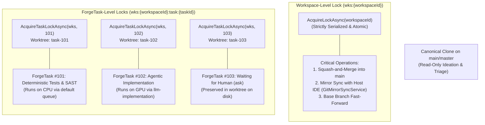

#### Dual-Tiered Locking Invariants:
1. **ForgeTask-Level Locks (`AcquireTaskLockAsync(workspaceId, taskId)`):**
   - Key format: `$"wks:{workspaceId}:task:{taskId}"`.
   - **Isolation Guarantee:** Serializes multi-turn stage executions for the *same* task to prevent overlapping pipeline actions on the same branch.
   - **Concurrency Benefit:** Independent tasks within the *same workspace* execute concurrently without blocking one another. ForgeTask #101 can execute long-running deterministic compilation and unit tests (running on CPU) while ForgeTask #102 executes reasoning and coding on the GPU.
2. **Workspace-Level Locks (`AcquireLockAsync(workspaceId)`):**
   - Key format: `$"wks:{workspaceId}"`.
   - **Strictly Atomic & Short-Lived:** Held only during brief operations that touch the shared canonical clone:
     - Merging a verified feature branch into `main` (`SquashAndMergeAsync`).
     - Synchronizing the canonical ext4 clone with the developer's host repository (`GitMirrorSyncService`).
3. **Non-Blocking Ideation & Triage:**
   - Because the canonical clone stays checked out on `main`/`master` and normal task execution happens in isolated worktrees, discovery chat (`IIdeationService`) and untrusted triage (`TriageStage`) inspect `main` without waiting for task locks.

#### 7.2.1 Fine-Grained Workspace Concurrency & Non-Blocking Git Merge Operations
Earlier designs suffered from a **writer starvation** bottleneck: `AcquireTaskLockAsync` maintained a shared reader lock on the workspace (`state.ActiveReaders++`) for the entire duration of a task's multi-turn LLM reasoning loop (often 5 to 15+ minutes). As a result, when a maintainer clicked *"🚀 Approve & Merge"* in the Review Room, the operation was blocked indefinitely waiting for all concurrent background reasoning tasks in that workspace to finish.

NightCodeForge eliminates this starvation through **fine-grained concurrency decoupling**:
1. **Decoupled Task Execution Loops:**
   - Long-running reasoning and tool loops hold strictly the per-task execution semaphore (`wks:{id}:task:{id}`).
   - Because agent tool invocations (`read_file`, `edit_file`, `run_command`) operate strictly inside the isolated Git worktree (`task-{id}/`), they have zero interaction with the canonical repository clone (`main`).
   - The task execution loop releases all workspace-level locks while inferring and testing.
2. **Instantaneous Review Room Merges:**
   - The exclusive workspace lock (`AcquireLockAsync(workspaceId)`) is acquired solely during discrete, sub-second canonical operations:
     - Ephemeral worktree allocation (`EnsureWorktreeAsync`: ~100–200ms)
     - Squash and merge into base branch (`SquashAndMergeAsync`: ~200–400ms)
     - Host mirror push/pull (`PushBaseBranchToHostAsync`, `PullFromHostAsync`: ~100–300ms)
     - Task markdown specification archiving (`ArchiveOrCleanupTaskFileAsync`: ~10–20ms)
   - Maintainers can approve and squash-merge completed tasks instantaneously in the Review Room without blocking behind active background dev-queue tasks.
3. **Lock Observability & Emergency Recovery:**
   - `IWorkspaceLockProvider.GetActiveLocks()`: Returns a real-time list of [ActiveLockSnapshot](file:///c:/Users/Julien/source/repos/jetelain/NightCodeForge/src/NightCodeForge.Core/Interfaces/IWorkspaceLockProvider.cs) records, capturing `WorkspaceId`, `TaskId`, `LockType` (`WorkspaceExclusive` vs `TaskExclusive`), `AcquiredAt`, and `DurationHeld`.
   - Surfaced directly in the DevQueue dashboard for operator transparency.
   - `EmergencyRelease(workspaceId, taskId)` and `EmergencyReleaseAll()`: Expose administrative overrides to forcibly release hung or orphaned semaphores without restarting the host process.

---

## 8. Git Workspace & Context-Switching Subsystem

### 8.1 Strict CLI Requirement
Wrappers such as `LibGit2Sharp` are **strictly prohibited** due to unmanaged binary dependencies, memory leak risks in long-running servers, and poor support for modern Git features. All Git operations are executed via native command-line invocations using **`CliWrap`**.

### 8.2 Save Strategy: WIP Commits vs. Stash
To ensure zero data loss during context switches:
1. `git stash` is **not used** because untracked files, subdirectories, or unstaged renames can lead to merge conflicts on unstash or orphaned changes.
2. The orchestrator uses **WIP Commits**:
   ```bash
   git add -A
   git commit -m "WIP: [ForgeTask #{id}][Stage: {stageName}] Awaiting human input: {QuestionSummary}" --no-verify
   ```
3. When the task passes all stages and is approved in the Review Room, the orchestrator squashes the WIP commits into a clean, conventional commit before merging.
4. **Clean Slate Hard Reset (`ResetTaskBranchToBaseAsync`):** When an operator restarts a task with `TaskRestartGitMode.HardResetToBaseBranch`, `GitWorkspaceManager` recycles sandbox containers first, purges all WIP commits and untracked files (`git reset --hard HEAD`, `git clean -fdx`), hard-resets the branch reference to `baseBranch`, validates relative worktree paths, and reconciles the remote `host-origin` branch (see Section 3.12).

### 8.3 Cross-Environment Architecture & Working Clone Protocol

#### 1. Operating System Separation & WSL2 Mandate
* **Forge Host:** Runs natively on Windows, Linux, or macOS.
* **Agent Confinement:** Agents work **strictly on Unix**. There is no Windows command execution for agents.
* **Crucible Embedded Execution:** Crucible runs in-process inside the Forge application. Its actions will always impact WSL2 on Windows (through `wsl.exe` or the `\\wsl.localhost\` share).
* **WSL2 Requirement:** When NightCodeForge runs on Windows, **WSL2 is strictly required**.

#### 2. Canonical Working Clones (`~/.nightcodeforge/wks/{id}`)
* The working clone repository where the agent performs all tasks is **always** located at:
  ```text
  ~/.nightcodeforge/wks/{workspaceId}
  ```
  - On Linux/macOS: Resolves to `$HOME/.nightcodeforge/wks/{workspaceId}` on the host ext4/APFS filesystem.
  - On Windows: Resolves to `/home/{wslUser}/.nightcodeforge/wks/{workspaceId}` on the native ext4 filesystem inside WSL2.
* This completely eliminates the notorious **WSL2 9p / DrvFs filesystem latency bottleneck** (`/mnt/c/...` Plan 9 network filesystem), allowing compiler builds, test suites, and file scans to run at native Linux SSD speeds.

#### 3. Remote URL Resolution & Cross-Environment Git Operations
* **Local Git Remote `host-origin`:**
  - On Windows: The developer's Windows repository path is transformed to its WSL mount path:
    ```bash
    git remote add host-origin /mnt/c/Users/Julien/source/repos/MyProject
    ```
  - On Linux/macOS: The remote points directly to the developer's workspace path:
    ```bash
    git remote add host-origin /path/to/developer/workspace
    ```
* **Git Operations on `main` (`push`, `pull`, `merge`):**
  - **On Unix:** Performed directly in the bare host environment.
  - **On Windows:** Performed strictly inside plain WSL2 (`wsl.exe -d <distrib> -- git ...`).
* **Host IDE Working Tree Synchronization (`updateInstead`):**
  - The developer's repository is configured with `git config receive.denyCurrentBranch updateInstead`.
  - Pushes from the working clone (`git push host-origin feature/task-{id}`) update the developer's checked-out branch without conflict.
  - **Dirty Host Tree Fallback:** If the developer has uncommitted changes to tracked files in their host IDE, `GitMirrorSyncService` catches the rejection, pushes to `refs/heads/feature/task-{id}-ncf`, and sends a SignalR alert to the UI with reconciliation guidance.

#### 4. Crucible Windows UNC Bridge & Cross-Platform Line-Ending Hygiene
Because Crucible runs in-process within the Windows Forge process:
* Crucible file tools (`read`, `write`, `edit`) access the WSL2 working tree via the high-speed Windows UNC share:
  ```text
  \\wsl.localhost\{distrib}\home\{username}\.nightcodeforge\wks\{workspaceId}\
  ```
* This ensures instant, direct file manipulation with full EditorConfig normalization without spawning intermediate shell processes.

#### 5. Tri-Part Cross-Platform Line-Ending Hygiene
Cross-platform development between Windows NTFS host repositories and isolated Linux/WSL2 ext4 mirrors introduces CRLF vs LF friction. If files on the host are converted to CRLF while the Linux Git index uses LF, Git perceives the working tree as modified with unstaged changes, aborting `receive.denyCurrentBranch updateInstead` pushes and diverting work to `-ncf` rescue branches.

NightCodeForge implements a tri-part defense:
1. **Repository-Level Line Ending Normalization (`.gitattributes` & `.editorconfig`):**
   - Host repositories are automatically scaffolded with `.gitattributes` (`* text=auto eol=lf`) and `.editorconfig` (`end_of_line = lf`).
   - Ensures consistent line breaks across Windows IDEs (Visual Studio, VS Code) and Linux agents.
2. **Local Git Configuration (`core.autocrlf false`):**
   - The host repository's local Git configuration explicitly sets `core.autocrlf false`, preventing Git on Windows from converting checked-out files from LF to CRLF.
3. **Agent Tool & Internal Service LF Enforcement:**
   - `EditorConfigFileApplier` detects WSL UNC paths (`\\wsl.localhost\...` or POSIX paths) and unconditionally enforces `\n` (LF), overriding sample-based CRLF detection.
   - On Windows targeting workspace mirrors (`wks`, `task-*`), line endings default to `\n` (LF) when unconfigured.
   - Internal writers (`TaskMarkdownSyncService`, `SessionTranscriptService`, `GitWorkspaceManager`, `GitMirrorSyncService`) strictly write pure `\n` line endings.
   - The UI Provisioning Wizard detects `.gitattributes`, `.editorconfig`, and `core.autocrlf` during repository probing, presenting diagnostic badges and auto-configuration toggles. The Reconcile Drawer provides guidance and `git add --renormalize .` suggestions if ghost CRLF/LF diffs occur.

### 8.4 Git Worktree Architecture & Ephemeral Working Trees

#### 1. Architectural Motivation: Worktrees vs. Clones vs. Locks

When designing concurrent multi-task execution on a workspace, three primary models were evaluated:

| Architecture | Mechanism | Disk Overhead | Concurrency | Ideation on `main` | Verdict |
| :--- | :--- | :--- | :--- | :--- | :--- |
| **A. Single Clone + Global Lock** | Single clone, branches checked out sequentially under full workspace lock. | Low (1x clone) | **Zero concurrent tasks**; deterministic tests block GPU tasks and triage. | Blocked while any task runs on a branch. | ❌ Rejected: severe throughput bottleneck. |
| **B. Clone Reservation Pool** | Pool of N full clones (`wks/{id}/clone_1..N`), dynamically leased per task. | High (N x repository size + N x `.git` databases) | Parallel execution across leased clones. | Requires dedicated idle clone for `main`. | ❌ Rejected: massive disk duplication & mirror sync complexity. |
| **C. Ephemeral Git Worktrees** *(Implemented)* | Single canonical clone on `main`; on-demand worktrees created per active task. | Minimal (shared `.git` object database; only checked-out working files duplicated). | **Full parallelism**: concurrent deterministic & agentic tasks on distinct tasks. | **Always available**: canonical clone remains permanently on `main`. | ✅ **Adopted Architectural Standard** |

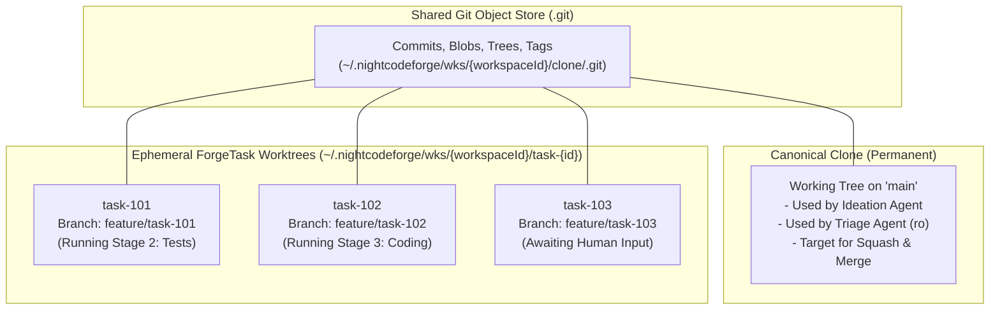

#### 2. Ephemeral Worktree Lifecycle

Each active task follows a strictly managed worktree lifecycle:

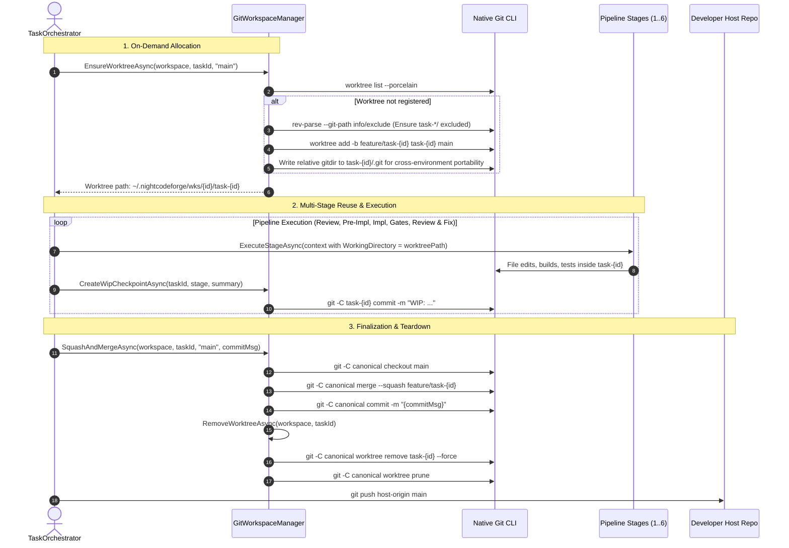

1. **Allocation & Idempotency (`EnsureWorktreeAsync`):**
   - When a task begins processing, `EnsureWorktreeAsync` checks if the worktree is already listed in `git worktree list --porcelain`.
   - If previously allocated (e.g. resuming from an interruption), it reuses the existing working directory without reinitializing.
   - If new, it creates the worktree bound to `feature/task-{id}`.
   - Automatically writes `task-*/` and `wt/` to `.git/info/exclude` in the canonical repository, guaranteeing that local worktrees never pollute `git status --porcelain` on the canonical repository.
   - **Bidirectional Relative Worktree Pointer Normalization (`EnsureWorktreeRelativePathsAsync`):**
     - Standard Git `worktree add` writes an absolute host filesystem path into `.git`. Inside container sandboxes or cross-environment mounts, this absolute path does not exist, causing Git to fail with `Exit Code 128: fatal: not a git repository`.
     - `GitWorkspaceManager.EnsureWorktreeRelativePathsAsync` strictly normalizes both pointers to relative POSIX paths:
       - **Forward Pointer:** In `<worktree>/.git`, sets `gitdir: ../{cloneDirName}/.git/worktrees/task-{taskId}`.
       - **Reverse Pointer:** In `<canonicalClone>/.git/worktrees/task-{taskId}/gitdir`, sets `../../../../task-{taskId}/.git`.
     - **Windows WSL UNC Path Resolution:** When running on Windows with a WSL target, paths are POSIX (`/home/{user}/...`). Using standard .NET `Path.Combine` would cause Windows `File.Exists` to check `C:\home\...` and fail. NightCodeForge invokes `ResolveHostAccessiblePath` to translate paths into Windows UNC shares (`\\wsl.localhost\{distro}\...`), allowing the host process to write relative pointers accurately.
     - **MSBuild Worktree Compatibility:** Configures `worktree.useRelativePaths = true`, but explicitly unsets `extensions.relativeworktrees`. This prevents `Microsoft.Build.Tasks.Git` in MSBuild from crashing during .NET builds on unsupported extension errors.
2. **Multi-Stage Reuse:**
   - The same worktree directory persists across all stages of a task. File edits made during `ImplementationStage` are immediately present for `DeterministicTestStage` and `CodeReviewAndFixStage` without checkout hops or stash pops.
   - Deterministic stages execute with `context.WorkingDirectory` pointed to the worktree.
   - AI agent tools (`view_file`, `write_to_file`, `replace_file_content`, `grep_search`) resolve relative paths against the worktree via `IWorkspacePathResolver.ResolveCruciblePath(workspaceId, path, taskId)`.
   - Checkpoints (`CreateWipCheckpointAsync`) commit directly in the worktree.
   - Noise-filtered diffs (`GenerateDiffAsync -U2`) compare `baseBranch...feature/task-{id}` within the worktree.
3. **Teardown & Clean Up (`RemoveWorktreeAsync` & Container Reaper):**
   - Once all stages pass and the task is squashed and merged (or if rejected), `SquashAndMergeAsync` or `RejectTaskAsync` invokes `RemoveWorktreeAsync`.
   - Executes `git worktree remove "<worktreePath>" --force` and `git worktree prune`.
   - **Container Sandbox Teardown:** Simultaneously calls `_environmentProvider.CleanupTaskContainerAsync(workspace, taskId)` to destroy the per-task container (`docker rm -f ncf-sandbox-{workspaceId}-task-{taskId}`), freeing RAM and Docker resources.
   - Disk space and container allocations are reclaimed immediately.

#### 3. Cross-Environment Path Resolution & Crucible UNC Bridge

Because NightCodeForge supports cross-environment execution (Windows host with WSL2 agent confinement, Linux bare-host, and container sandboxes), worktree paths are resolved systematically across boundaries:

| Environment | Canonical Repository Path | ForgeTask Worktree Path |
| :--- | :--- | :--- |
| **Linux / macOS Bare Host** | `~/.nightcodeforge/wks/{id}/clone/` | `~/.nightcodeforge/wks/{id}/task-{taskId}/` |
| **WSL2 Ext4 Mirror (Linux Path)** | `/home/{user}/.nightcodeforge/wks/{id}/clone/` | `/home/{user}/.nightcodeforge/wks/{id}/task-{taskId}/` |
| **Windows Host via Crucible UNC Bridge** | `\\wsl.localhost\{distro}\home\{user}\.nightcodeforge\wks\{id}\clone\` | `\\wsl.localhost\{distro}\home\{user}\.nightcodeforge\wks\{id}\task-{taskId}\` |
| **Local Bare Host (e.g. Unit Tests)** | `<workspaceRoot>/clone/` | `<workspaceRoot>/task-{taskId}/` |

Agents inside containers or WSL access the worktree as their native root working directory (`/workspace/task-{id}` or `~/.nightcodeforge/wks/{id}/task-{id}`).
Crucible running in-process on the Windows host seamlessly translates paths via `IWorkspacePathResolver.ResolveCruciblePath(workspaceId, relativeOrContainerPath, taskId)`, stripping container prefixes (`/workspace/`) and mounting to the high-speed WSL2 UNC network share.

#### 4. Isolated ForgeTask Worktree Mount (`/workspace`), Layered Clone Protection (`/clone:ro` & `/clone/.git:rw`) & LLM Cognitive Focus

To eliminate LLM confusion and safeguard the canonical repository while maintaining native Git worktree functionality:

1. **Per-ForgeTask Isolated Worktree Container Mount:**
   Instead of mounting the parent workspace directory (which would expose sibling `task-*` worktrees and the canonical `clone` directory inside `/workspace`), the sandbox container mounts **strictly the active task's worktree** directly at `/workspace`:
   ```bash
   # 1. Active task worktree mounted at /workspace (read-write)
   -v ~/.nightcodeforge/wks/{workspaceId}/task-{id}:/workspace

   # 2. Canonical clone repository (strictly read-only protection)
   -v ~/.nightcodeforge/wks/{workspaceId}/clone:/clone:ro

   # 3. Canonical clone Git database (read-write for worktree ref & object updates)
   -v ~/.nightcodeforge/wks/{workspaceId}/clone/.git:/clone/.git
   ```
   *Cognitive & Security Benefits:*
   - **Zero LLM Confusion:** Inside `/workspace`, the agent only sees the project files relevant to its assigned task. No other tasks (`task-2`, `task-3`) or the `clone` folder appear in directory listings, search tools, or file trees.
   - **Cross-Environment Relative GitDir Resolution:** The worktree `.git` file contains `gitdir: ../clone/.git/worktrees/task-{id}`. Inside the container, `/workspace/..` evaluates to `/`, so `../clone` cleanly resolves to `/clone/.git/worktrees/task-{id}`. On the host/WSL filesystem, `../clone` is the sibling folder `~/.nightcodeforge/wks/{id}/clone`. Git operations (`git status`, `git add`, `git commit`) function flawlessly in both environments.
   - **Canonical Working Tree Protection:** The canonical clone working tree at `/clone` is strictly read-only (`:ro`), preventing any container process from corrupting `main`. Worktree metadata and Git object writes to `/clone/.git` remain read-write (or read-only for untrusted triage).
   - **Per-ForgeTask Container Sandbox Naming:** Containers are named per task (e.g. `ncf-sandbox-{workspaceId}-task-{taskId}`), guaranteeing complete runtime isolation when multiple tasks are worked in parallel.

2. **Clean PWD & Environment Communication in Agent Prompts:**
   `PromptPrefixStabilizer` injects an explicit `<environment>` block into Layer 3 of the prompt prefix:
   ```markdown
   <environment>
   - Current Working Directory (PWD): /workspace (or local path in BareHost)
   - All relative paths, file operations (read, edit, write), bash commands, builds, and test runs execute in this working directory.
   - The canonical clone on 'main' is read-only. Do not attempt to modify files in other directories.
   </environment>
   ```
   In container mode, the agent's working directory is simply `/workspace`, keeping commands and mental models concise. In BareHost mode, it reflects the native worktree path. Global Layer 1 rules reinforce boundary isolation.

#### 5. Local Agent Base Image (`ncf-agent-base:latest`) & Auto-Generation Lifecycle

To ensure consistent, secure, and offline-capable execution without requiring accounts or publishing to Docker Hub:

1. **Zero External Registry Dependency:**
   NightCodeForge maintains an embedded base Dockerfile (`ContainerExecutorOptions.DefaultAgentBaseDockerfile`) targeting `ubuntu:24.04`. The image is built and tagged locally as `ncf-agent-base:latest` directly inside the local Docker daemon.

2. **Embedded Agent Toolset:**
   The image includes the core tools needed by modern coding agents and deterministic stages:
   - **Version Control:** `git` (with automatic `git config --global --add safe.directory '*'` configuration).
   - **Fast Search:** `ripgrep` (`rg`) for rapid code navigation.
   - **Networking & Utilities:** `curl`, `ca-certificates`, `jq`, `procps`, `unzip`, `tar`, `gzip`.
   - **Native Build Prerequisites:** `build-essential` (gcc, make).
   - **Python Runtime:** `python3`, `python3-venv`, `python3-pip`.

3. **Python Runtime Architecture (Base Image vs. Host Mount):**
   - **Why Python is Baked into the Base Image:** Python executables are dynamically linked against `glibc` and have a tightly-coupled standard library (`/usr/lib/python3.12`) with compiled C-extension shared objects (`.so`). Mounting Python directly from a host system (especially across different Linux distributions or Windows/WSL boundaries) frequently fails due to missing shared libraries or ABI mismatches (e.g., `_ssl`, `_ctypes`, `math`). Baking `python3` and `python3-venv` into the base image costs only ~35 MB uncompressed and guarantees rock-solid execution across any host.
   - **Package Cache Mounting:** While the Python runtime is baked into the base image, package download caches (e.g., `~/.cache/uv`, `~/.cache/pip`) can be cleanly bind-mounted from the host because they are architecture-independent file trees.

4. **Self-Healing 30-Day Freshness Lifecycle:**
   `NightCodeForgeContainerExecutor.EnsureImageReady()` automatically checks the image age before launching containers:
   - Uses `docker image inspect -f "{{.Created}}" ncf-agent-base:latest` to retrieve image creation timestamp.
   - If the image does not exist or was created more than 30 days ago, it automatically compiles an isolated temporary Dockerfile and executes `docker build -t ncf-agent-base:latest`, keeping security patches and tools fresh.
   - Builds execute in an isolated temp directory to prevent transmitting massive workspace context to the Docker daemon.

---

## 9. AI Harness Abstraction Layer (`IAgentHarness`)

NightCodeForge decouples orchestration from the underlying agent runtime via an open **Harness Abstraction Layer**. Any agent that implements `IAgentHarness` can be plugged in, either natively in C# or externally via standard protocols.

### 9.1 Interface Contract & Step Metrics
```csharp
public interface IAgentHarness
{
    string HarnessId { get; }
    Task<AgentRunResult> RunStageAsync(AgentSessionContext context, CancellationToken cancellationToken = default);
}

public class AgentSessionContext
{
    public required ForgeTask ForgeTask { get; init; }
    public Workspace? Workspace { get; init; }
    public required AgentProfile Profile { get; init; }
    public PipelineContext? PipelineContext { get; init; }
    public LocalOptimizationFlags? OptimizationFlags { get; set; }
    public string StageId { get; init; } = string.Empty;
    public string StageDirective { get; init; } = string.Empty;
    public AgentMode RequiredMode { get; init; } = AgentMode.Full;
    public string BootstrapPrompt { get; init; } = string.Empty;
    public string? SerializedStateJson { get; init; }
    public string WorkspacePath { get; init; } = string.Empty;
    public string? PendingHumanAnswer { get; init; }
    public string? PendingHumanAnswerJson { get; init; }
    public IReadOnlyList<string>? DiscoveredSymbols { get; init; }

    // --- Promoted Typed Properties ---
    public string? TaskMarkdownPath { get; init; }
    public string? ReviewDiffStat { get; init; }
    public string? ApprovedPlan { get; init; }
    public string? ReviewerFeedback { get; init; }
    public IReadOnlyList<string>? PriorDiagnostics { get; init; }
}

public record AgentRunMetrics(
    long DurationMs = 0,
    long PromptTokens = 0,
    long CompletionTokens = 0,
    long TotalTokens = 0);

public record AgentRunResult(
    AgentRunStatus Status,
    AgentRunMetrics Metrics,
    string? CommitHash = null,
    string? UpdatedState = null,
    IReadOnlyList<Question>? PendingQuestions = null,
    string? Summary = null,
    string? Error = null,
    IReadOnlyDictionary<string, string>? DiagnosticArtifacts = null,
    string? TargetRouting = null,
    string? ReviewerFeedback = null,
    IReadOnlyList<TaskProposal>? Proposals = null);

public enum AgentRunStatus
{
    Completed = 0,
    WaitingForHuman = 1,
    Failed = 2,
    Cancelled = 3
}
```

### 9.2 Primary Local Inference Gateway: OllamaRouter Integration
NightCodeForge provides native, first-class support for **OllamaRouter** (`jetelain/OllamaRouter`) as its intelligent inference gateway.

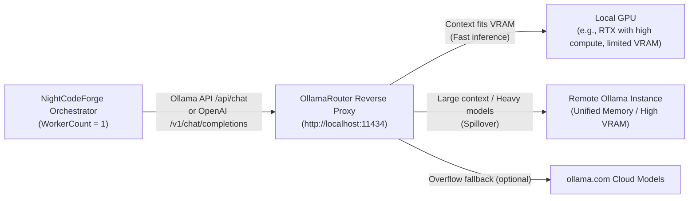

#### Key Capabilities & Synergy:
1. **Dual Protocol Compatibility:** NightCodeForge interacts with OllamaRouter via standard Ollama native endpoints (`POST /api/chat`, `POST /api/generate`) or OpenAI-compatible endpoints (`POST /v1/chat/completions`).
2. **Automated Best-GPU Selection:** OllamaRouter inspects each prompt's token count, evaluates live VRAM via `nvidia-smi`, checks active memory residency via `/api/ps`, and automatically routes:
   - Small/fast reasoning turns to the high-performance local GPU.
   - Long-context reviews, broad codebase lookups, or large-parameter models to the remote high-VRAM server.
   - NightCodeForge's `WorkerCount = 1` constraint guarantees that the local GPU is never overloaded by concurrent background jobs, while OllamaRouter ensures each sequential job runs on the most capable hardware.
3. **Dynamic Model Discovery:** NightCodeForge queries OllamaRouter's unified `/api/tags` endpoint to automatically populate available local and remote models in the web dashboard.
4. **Deep Cluster Telemetry & Target Transparency (`IOllamaRouterGatewayService`):**
   - The monitoring and operations console directly queries OllamaRouter's management endpoints:
     - Real-time resident models in GPU memory via `/api/ps` (model name, size in VRAM, processor distribution between CPU and GPU).
     - Health status, latency, and wire-level auto-heal counters across target backends (Local Host GPU, Dedicated LAN GPU Server, Cloud Overflow).
     - Accurate target routing attribution (`X-OllamaRouter-Target` response headers) identifying which node executed each inference call.
   - One-click memory eviction integration that flushes resident models on demand or automatically when Global Operations are paused.

### 9.3 Supported Harness Implementations

#### Implementation A (First-Class Native): Crucible Harness (Microsoft Agent Framework & `Microsoft.Extensions.AI`)
* **Type:** In-process C# Agent Engine.
* **Role:** Primary native execution harness for NightCodeForge.
* **Dedicated Specification:** For the complete, dedicated architectural specification, tool implementation details, resilient forgiving dispatcher, and token minimization engine, see **[CRUCIBLE.md](CRUCIBLE.md)**.
* **Compatibility:** Plugs directly into OllamaRouter, vanilla Ollama, LM Studio, vLLM, or any OpenAI-compatible server.
* **Profile Integration:** Adapts execution parameters based on the stage's `AgentProfile` (e.g. mapping `ThinkingEffort` to OpenAI `reasoning_effort` or DeepSeek/Ollama thinking budget tokens).
* **Auto-Configuration:** Pre-configured out of the box with system prompts, canonical function tools (`read`, `edit`, `write`, `bash`, `web_search`, `ask`, `propose_tasks`), and memory serialization.
* **Interruption:** Tool `ask` catches the call, serializes the active `ChatHistory` to JSON, captures token counters from `AdditionalProperties["usage"]`, and flags `AgentRunStatus.WaitingForHuman`.

#### Implementation B (First-Class Fallback): Pi via JSON-RPC
* **Type:** External sub-process runner communicating via JSON-RPC over `stdio` (JSON Lines protocol).
* **Dedicated Specification:** For the complete headless JSONL RPC protocol specification, event streaming, multi-disjoint edit tools, and interruption mapping, see **[PI.md](PI.md)**.
* **Profile Integration:** Passes `AgentProfile.ModelName`, custom flags, and `HarnessConfigurationJson` to the Pi RPC daemon.
* **Auto-Configuration:** Managed process lifecycle (`pi --mode rpc`) with automatic start/stop and session state snapshotting.
* **Interruption:** Listens for `extension_ui_request` events over JSONL stdout. Upon detection, requests session suspension, retrieves the serialized session snapshot ID, calculates duration/tokens, and yields `WaitingForHuman`.

#### Implementation C (Extensible Open Standard): Agent Client Protocol (ACP) Harness
* **Type:** Universal protocol adapter supporting the **[Agent Client Protocol (ACP)](https://agentclientprotocol.com/)** specification.
* **Dedicated Specification:** For the complete protocol specification, v1 vs. v2 comparison, modernized `acp-csharp` SDK architecture, and sandboxed client execution, see **[ACP.md](ACP.md)**.
* **Profile Integration:** Configures the spawned ACP agent binary or remote endpoint with the profile's model, thinking budget, and environment variables defined in `HarnessConfigurationJson`.
* **Value Proposition:** ACP is an open, standardized protocol (backed by Zed, JetBrains, and the open-source community) designed specifically for code editors and orchestrators to communicate with external AI coding agents via JSON-RPC over `stdio`, WebSocket, or HTTP.
* **How NightCodeForge Acts as an ACP Client:**
  1. **Lifecycle & Session Initialization:** NightCodeForge launches any ACP-compatible agent executable (or connects to its endpoint) and negotiates capabilities (`initializeSession`).
  2. **Workspace & Tool Delegation:** NightCodeForge exposes workspace tools (file system access, terminal execution) to the ACP agent via standardized MCP/ACP tool specifications.
  3. **Interruption & Human Input Mapping:** When an ACP agent sends a prompt/permission request requiring user input, NightCodeForge intercepts the request, saves the ACP session token/history into the checkpoint record, performs the Git WIP commit, and suspends the worker.
  4. **Universal Compatibility:** Allows developers to use existing or future ACP-compliant agents (e.g. from the ACP Registry, Zed AI agents, JetBrains AI agents) without modifying NightCodeForge core code.

### 9.4 Crucible Harness Specification & Token Minimization
For the complete technical specification of the native Crucible harness—including:
* **Canonical Tool Suite (Pi-Harmonized):** (`read`, `edit`, `write`, `bash`, `web_search`, `ask`, `propose_tasks` - with `list_dir` / `grep_search` / `get_file_outline` mapped to `bash` / `read`)
* **The "Forgiving" Tool Dispatcher:** Tool name aliasing, parameter normalization, markdown code fence stripping, and indentation tolerance
* **EditorConfig Enforcement for File Operations:** Automatic application of `.editorconfig` rules (`end_of_line` [LF/CRLF], `indent_style`, `indent_size`, `insert_final_newline`, `trim_trailing_whitespace`, `charset`) on `write` and `edit` to prevent cross-platform line ending churn and formatting diff noise
* **Stage-Scoped Tool Visibility Matrix:** Gating tool schemas across all 6 stages of the default workflow to reduce static prompt overhead
* **Pi-Style Context Compaction Engine:** Non-destructive context compaction (`PiStyleCrucibleCompactionStrategy`) with dynamic headroom budgeting, immutable task anchor (`messages[0]`), lossless file operation tracking (`<read-files>`, `<modified-files>`), 2,000-character tool clamping, and thinking trace omission during summarization
* **Local LLM Token Minimization:** Prompt prefix stabilization for KV cache reuse, compiler error extraction, synthetic conversation priming, and noise-filtered git diffs

Please refer directly to the dedicated specification documents: **[CRUCIBLE.md](CRUCIBLE.md)** and **[CRUCIBLE_CONTEXT_COMPACTION.md](CRUCIBLE_CONTEXT_COMPACTION.md)**.

---

## 10. Skills, MCP & Repository Guidelines (`AGENTS.md`)

Modern agentic engineering workflows require flexible extensibility beyond hardcoded functions. NightCodeForge integrates three complementary extensibility pillars: **Model Context Protocol (MCP)** for runtime tools/services, **Skills** for modular operational instructions, and **`AGENTS.md`** for repository-level rules.

### 10.1 Model Context Protocol (MCP) Architecture
NightCodeForge leverages the **Microsoft Agent Framework** native MCP client integration (`Microsoft.Agents.Mcp`) to act as an **MCP Host**:


#### MCP Features in NightCodeForge:
1. **Workspace-Scoped MCP Servers:** Configured via `mcp_config.json` inside the workspace root or via the web settings UI:
   ```json
   {
     "mcpServers": {
       "sqlite": {
         "command": "uvx",
         "args": ["mcp-server-sqlite", "--db-path", "data/app.db"]
       },
       "github": {
         "command": "npx",
         "args": ["-y", "@modelcontextprotocol/server-github"],
         "env": { "GITHUB_TOKEN": "..." }
       }
     }
   }
   ```
2. **Dynamic Tool Discovery:** When a task session begins, the MCP client manager connects to configured servers, queries `tools/list`, and dynamically exposes them as callable tools in the agent's reasoning loop.
3. **ACP & MCP Synergy:** Because the **Agent Client Protocol (ACP)** specification natively re-uses MCP data types, NightCodeForge seamlessly forwards configured MCP server capabilities to both native Crucible (Microsoft Agent Framework) harnesses and external ACP agents.

### 10.2 Modular Skills System
Skills are directory-based bundles of specialized operational instructions, guidelines, and reference implementations that teach agents specific frameworks, idioms, or repo-specific rules:

```text
<WorkspaceRoot>/.agents/skills/
├── efcore-migrations/
│   ├── SKILL.md                 # YAML frontmatter + detailed markdown instructions
│   └── templates/               # Reference migration templates
└── csharp-clean-code/
    └── SKILL.md                 # Clean code & architectural rules
```

#### Skill Structure (`SKILL.md`):
```markdown
---
name: efcore-migrations
description: Guidelines and best practices for creating and applying EF Core database migrations
triggers: ["*.cs", "DbContext", "Migration"]
---

# EF Core Migration Workflow
1. When modifying entity schemas, never edit old migrations directly.
2. Run `dotnet ef migrations add <DescriptiveName>` from the infrastructure directory.
3. Verify `Up()` and `Down()` methods for data safety before proceeding.
```

#### Skill Activation & Ingestion:
1. **Catalog Discovery:** NightCodeForge scans `<AppData>/skills/` (global) and `<WorkspaceRoot>/.agents/skills/` (workspace-specific).
2. **On-Demand Loading:** The agent is equipped with a `ReadSkill(skillName)` tool allowing it to read detailed instructions when tackling specialized topics.
3. **Context-Aware Injection:** Stages can declare mandatory skills in their `AgentProfile` or stage prompt templates to ensure adherence to team standards.

### 10.3 Repository Guidelines & AGENTS.md Ingestion
AI coding agents perform best when grounded in the conventions and rules of the repository they operate on. NightCodeForge natively supports **`AGENTS.md`** as a first-class project specification file.

#### Discovery Hierarchy:
When a task session initializes, the harness inspects the target workspace directory using the following precedence:
1. `<WorkspaceRoot>/AGENTS.md`
2. `<WorkspaceRoot>/.agents/AGENTS.md` (or `.agents/rules/*.md`)
3. Fallback to `<WorkspaceRoot>/CLAUDE.md` or `<WorkspaceRoot>/GEMINI.md`

#### Ingestion & Cross-Harness Augmentation:
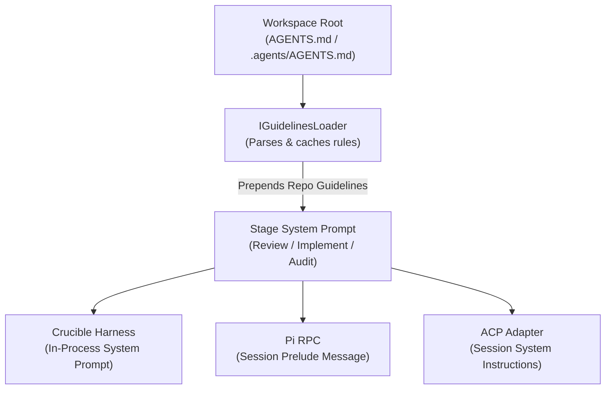

#### What AGENTS.md Injects into the Reasoning Loop:
* **Architecture Overview:** High-level project structure and module boundaries.
* **Build & Test Commands:** Precise CLI instructions (`dotnet build`, `dotnet test --filter ...`, `npm run build`).
* **Code Style & Formatting:** Naming conventions, nullability expectations, async best practices.
* **Negative Constraints:** Prohibited patterns (e.g., "Never edit auto-generated migration files directly", "Do not introduce external heavy dependencies").

By automatically loading `AGENTS.md`, NightCodeForge ensures that all 3 workflow stages—and all harness engines—adhere strictly to repository-specific rules without requiring developers to retype instructions for each task.

### 10.4 Deterministic Project Preparation & Onboarding (The `ncf` CLI Tool)
Onboarding an existing repository into NightCodeForge requires deterministic hygiene steps: establishing `.gitignore` exclusions, aligning `.editorconfig` line endings, detecting toolchains, running an initial format pass, and installing external agent skills. Rather than delegating these tasks to an LLM, NightCodeForge packages a dedicated NuGet global tool: **`NightCodeForge.Cli` (`ncf`)**.

```bash
dotnet tool install --global NightCodeForge.Cli
cd /path/to/target/repo
ncf init       # Deterministic repository preparation
ncf audit      # Pre-flight readiness scorecard (🟢 / 🟡 / 🔴)
```

#### 1. Deterministic Repository Initialization (`ncf init`)
Executes deterministic onboarding without prompt fatigue:
1. **`.gitignore` Merging:** Appends mandatory NightCodeForge exclusions (`bin/`, `obj/`, `.vs/`, `TestResults/`, `*.trx`, `.nightcodeforge/` runtime artifacts) without clobbering existing developer entries.
2. **`.editorconfig` Normalization:** Enforces `root = true`, `end_of_line = lf`, and language-specific indent rules, ensuring alignment with `EditorConfigFileApplier` to prevent cross-platform CRLF/LF churn and phantom Git diffs.
3. **Deterministic Stack Detection:** Inspects repository files (`.sln`/`.csproj`, `package.json`, `pyproject.toml`, `Cargo.toml`, `go.mod`) and resolves configurations against the shared [CodeStackPresets](file:///c:/Users/Julien/source/repos/jetelain/NightCodeForge/src/NightCodeForge.Core/Domain/CodeStack.cs) registry (dotnet, node, python, rust, go), guaranteeing identical command resolution between CLI and server pipelines.
4. **Baseline Format Pass:** Runs the stack's native formatter (`dotnet format --no-restore`, `cargo fmt`, `ruff format .`, `gofmt -w .`) to establish a clean, consistent baseline.
5. **Packaged Agent Skills Installation:** Installs embedded agent skills into `.agents/skills/ncf-*/SKILL.md` wrapped with managed block markers (`ManagedBlockConstants`), discoverable by both external IDE agents (Claude Code, Cursor, Antigravity) and the internal `SkillsService`:
   - `ncf-backlog`: Markdown specification authoring and frontmatter schema rules.
   - `ncf-backlog-migrator`: Structured migration of legacy issues, PR descriptions, and markdown plans into NightCodeForge task cards.
   - `ncf-project-readiness`: Interactive remediation assistant guiding developers through audit failures.
6. **Configuration Bootstrap:** Writes `.nightcodeforge/config.json` stamped with detected commands, base branch, and `ncfVersion`.

#### 2. Pre-Flight Readiness Audit (`ncf audit`)
A fast, read-only pre-flight inspection producing an interactive console scorecard and generating `.nightcodeforge/audit-report.md` across 5 architectural pillars:

| Pillar | Verification Criteria | Evaluation |
| :--- | :--- | :--- |
| **1. Git Health** | Clean working tree, committed HEAD, verified base branch (`main` / `master`). | 🟢 Clean / 🔴 Dirty |
| **2. Build Determinism** | Headless CLI build succeeds without human prompts or interactive licenses. | 🟢 Success / 🔴 Failure |
| **3. Test Fast Feedback** | Base unit/integration tests pass with fast category filters (`Category!=Acceptance&Category!=E2E`). | 🟢 Passing / 🟡 Skipped / 🔴 Failing |
| **4. Isolation Readiness** | Heuristic scan for hardcoded host paths or unmocked external socket calls in test code. | 🟢 Isolated / 🟡 Warnings |
| **5. NCF Configuration** | `.nightcodeforge/config.json` present, `ncfVersion` aligned with installed CLI, skills up to date. | 🟢 Aligned / 🟡 Drift / 🔴 Missing |

---

## 11. Session Transcripts & Cloud LLM Failure Diagnostics

Local LLMs (e.g. 7B, 14B, or 32B models) offer speed, low cost, and data privacy, but occasionally encounter edge-case reasoning loops, invalid tool call formats, or misunderstanding of complex skill instructions. Understanding *why* a local model failed is essential to refining skills, prompts, and harness adapters.

NightCodeForge captures every execution turn into a **chronological Markdown Transcript** and provides **integrated Cloud LLM diagnostics** to analyze and explain failures.

```mermaid
flowchart TD
    subgraph Execution ["Agent Session Execution"]
        Harness["IAgentHarness\n(Local Model Inference)"]
        Stream["Thought stream, Tool calls, File diffs, Stderr"]
    end

    subgraph TranscriptLayer ["Session Transcript Service"]
        Writer["SessionTranscriptService"]
        MarkdownFile["docs/transcripts/\nYYYY-MM-DD-task-123-stage-1.md"]
    end

    subgraph DiagnosticEngine ["Cloud Diagnostics"]
        CloudGateway["OllamaRouter Cloud Overflow\n(or Cloud Provider: Claude / OpenAI)"]
        DiagnosticReport["Diagnostic Analysis Card in Web UI"]
    end

    Harness --> Stream
    Stream --> Writer
    Writer --> MarkdownFile
    MarkdownFile -.->|"On Failure or On-Demand"| CloudGateway
    CloudGateway --> DiagnosticReport
```

### 11.1 Transcript Structure & Markdown Schema
Whenever a stage completes, pauses for a question, or encounters an error, a transcript is saved to `<WorkspaceRoot>/docs/transcripts/YYYY-MM-DD-task-{id}-{stage}-{status}.md`:

```markdown
---
task_id: 123
stage_id: Implementation
agent_profile: fast-coder
model: qwen2.5-coder:32b
thinking_effort: Medium
hardware_target: Local GPU
duration_ms: 45200
tokens:
  prompt: 3120
  completion: 1450
  total: 4570
optimizations:
  thinking_trace_compaction: true
  loop_circuit_breaker: true
  guided_grammar_decoding: true
  deterministic_symbol_map: true
  structured_diagnostic_extraction: true
  jit_model_preload: true
kv_cache_hit_rate: 0.92
status: Failed
exit_reason: "Build failure not resolved after 3 attempts"
created_at: 2026-10-12T22:25:00Z
---

# Session Transcript: ForgeTask #123 (Implementation)

## 🎯 Task Prompt & Grounding Context
- **Target Feature:** Implement OAuth2 Authorization Flow
- **Approved Plan:** `docs/tasks/2026-10-12-implement-oauth2-flow.md`
- **Active Skills:** `csharp-clean-code`, `efcore-migrations`
- **Loaded Guidelines:** `AGENTS.md` (Rules: nullability enabled, file-scoped namespaces)

---

## ⏱️ Turn-by-Turn Execution

### Turn 1
**Model Thoughts:**
> Need to check if `Microsoft.AspNetCore.Authentication.OpenIdConnect` is installed. I will inspect `NightCodeForge.Web.csproj`.

**Tool Invocation:** `read(path="src/NightCodeForge.Web/NightCodeForge.Web.csproj")`
**Tool Output:** (Csproj XML content...)

### Turn 2
**Model Thoughts:**
> Package is missing. I will add the package using `bash`.

**Tool Invocation:** `bash(command="dotnet add package Microsoft.AspNetCore.Authentication.OpenIdConnect")`
**Tool Output:** `error: NU1102: Unable to find package with version...`

### Turn 3 (Failure Event)
**Exception / Error:** Model attempted to retry same failing command with invalid syntax.
```

### 11.2 Hybrid Diagnostic Engine (Cloud or Local LLM)
When a stage fails, gets blocked, or exhibits abnormal duration, developers can trigger an automated post-mortem analysis directly from the web dashboard. The system supports two diagnostic execution modes:

```mermaid
flowchart LR
    Transcript["Session Transcript\n(docs/transcripts/*.md)"] --> Selector{"Diagnostic Engine Choice"}
    
    Selector -->|"Option A: Cloud LLM\n(Fast, Zero VRAM Impact)"| Cloud["Cloud Models\n(OllamaRouter Cloud Overflow\nor Claude / OpenAI)"]
    Selector -->|"Option B: Local LLM\n(100% Offline & Private)"| Local["Local GPU / Remote Instance\n(Queued sequentially via WorkerCount = 1)"]
    
    Cloud --> Report["Diagnostic Report in UI\n- Root Cause\n- Prompt/Skill Critique\n- Actionable Remediation"]
    Local --> Report
```

#### Diagnostic Execution Modes:
1. **Option A: Cloud Diagnostics (Recommended for Speed):**
   * **Mechanism:** Routes the diagnostic prompt and transcript to an **Ollama Cloud model** (e.g. `deepseek-v3.1:671b-cloud`, `llama3.3:70b-cloud`) via OllamaRouter's cloud overflow, or to a configured direct cloud provider (Anthropic Claude, OpenAI, Google Gemini).
   * **Advantage:** Fast, high-capacity reasoning that consumes **zero local VRAM**, leaving the local GPU free to continue running queued code tasks.
2. **Option B: Local Diagnostics (100% Air-Gapped & Private):**
   * **Mechanism:** Evaluates the transcript using a local reasoning model (e.g. `deepseek-r1:32b`, `qwen2.5-coder:32b`, or `llama3.3:70b` on a remote instance via OllamaRouter).
   * **Trade-off:** Fully private and offline. However, because local inference respects the physical hardware constraint (`WorkerCount = 1`), local diagnostic inference must queue sequentially, temporarily consuming local GPU compute time from the dev queue.

#### Diagnostic Evaluation Prompt:
Both modes execute a structured diagnostic evaluation prompt:
* **Root Cause Analysis:** Pinpoint the exact breakdown (e.g., tool argument formatting error, loop detection, compilation trap, hallucination).
* **Skill & Guideline Critique:** Identify missing, conflicting, or ambiguous instructions in `AGENTS.md` or active `.agents/skills/`.
* **Harness & Tooling Critique:** Check if tool outputs or error messages were truncated, malformed, or unparseable.
* **Actionable Remediation:** Provide concrete suggestions to fix the skill or unblock the task, with one-click prompt/skill patching where applicable.

---

## 12. Data Storage & Schema Design

NightCodeForge supports **multi-workspace management**, allowing developers to manage multiple local git repositories. While inference is queued globally to respect the single GPU constraint, each task and Git context switch is isolated to its respective workspace.

```mermaid
erDiagram
    WORKSPACE ||--o{ TASK : "contains"
    WORKSPACE ||--o{ AGENT_PROFILE : "defines"
    AGENT_PROFILE ||--o{ STAGE_EXECUTION_RECORD : "executes"
    TASK ||--o{ TASK_DEPENDENCY : "depends_on"
    TASK ||--o{ QUESTION : "triggers"
    TASK ||--o{ STAGE_CHECKPOINT : "records"
    TASK ||--o{ STAGE_EXECUTION_RECORD : "measures"
    TASK ||--o{ EXECUTION_LOG : "generates"
    TASK ||--o{ TASK_HISTORY : "tracks"
    
    WORKSPACE {
        int Id PK
        string Name
        string RepositoryPath
        string DefaultBaseBranch
        string ExecutionMode
        string ContainerImage
        string Ext4MirrorPath
        datetime CreatedAt
    }

    STAGE_DEFINITION {
        string StageId PK
        string PipelineId FK
        string DisplayName
        int Order
        string StageKind
        string QueueTier
        string DefaultAgentProfileId
    }

    SYSTEM_SETTINGS {
        string Key PK
        string Value
        datetime UpdatedAt
    }

    AGENT_PROFILE {
        string Id PK
        int WorkspaceId FK
        string Name
        string HarnessId
        string ModelName
        string ThinkingEffort
        int ThinkingTokenBudget
        double Temperature
        string HarnessConfigurationJson
        string OptimizationFlagsJson
    }

    TASK {
        int Id PK
        int WorkspaceId FK
        string Title
        string Description
        string BaseBranch
        string FeatureBranch
        string Status
        string Origin
        bool HasExecutionRun
        int MaxExecutedStageOrder
        string CurrentStageId
        int Priority
        string MergeMode
        bool IsWaitingForHuman
        bool IsDeferredByPause
        string InterruptedStageId
        string InterruptedAgentProfileId
        datetime CreatedAt
        datetime UpdatedAt
        string LastHangfireJobId
        string PipelineDataJson
        int Version
    }

    TASK_HISTORY {
        int Id PK
        int TaskId FK
        int Version
        string Title
        string Description
        string Status
        int Priority
        string MergeMode
        string BaseBranch
        string FeatureBranch
        string CurrentStageId
        string SerializedDependencies
        datetime ChangedAt
        string ChangedBy
        string ChangeReason
    }

    TASK_DEPENDENCY {
        int Id PK
        int TaskId FK
        int DependsOnTaskId FK
    }

    QUESTION {
        int Id PK
        int TaskId FK
        string StageId
        string AgentProfileId
        string Prompt
        string Rationale
        string QuestionType
        string OptionsJson
        string Answer
        datetime AskedAt
        datetime AnsweredAt
        string Status
    }

    STAGE_CHECKPOINT {
        int Id PK
        int TaskId FK
        string StageId
        string SerializedMemory
        string GitCommitHash
        datetime CreatedAt
    }

    STAGE_EXECUTION_RECORD {
        int Id PK
        int TaskId FK
        string StageId
        string StageKind
        string AgentProfileId
        string HarnessId
        string ModelName
        datetime StartedAt
        datetime CompletedAt
        int DurationMs
        int PromptTokens
        int CompletionTokens
        int TotalTokens
        string TargetRouting
        string Status
        string OutputDataJson
    }

    EXECUTION_LOG {
        int Id PK
        int TaskId FK
        string StageId
        datetime Timestamp
        string LogLevel
        string Source
        string Message
        string PayloadJson
    }
```

---

## 13. User Interface (Blazor Interactive Server)

### 13.1 Key Dashboard Modules
1. **Dedicated Task Creation Page (`/tasks/new`):**
   - First-class authoring form ([CreateTask.razor](file:///c:/Users/Julien/source/repos/jetelain/NightCodeForge/src/NightCodeForge.Web/Components/Pages/CreateTask.razor)) for manual task definition.
   - Form inputs for Title, Description, Base Branch, Priority selection (P1 Critical through P5 Low), Merge Mode (`Automatic` vs `ManualReviewRequired`), and optional dependency prerequisites.
   - Automatically stamps newly created tasks with `Origin = TaskOrigin.Manual`, `Status = TaskOverallStatus.Suggested`, and `HasExecutionRun = false`.
2. **Interactive Ideation & Codebase Discovery (`/ideation`):**
   - Chat interface with the codebase exploration agent (`IIdeationService`).
   - Natural language Q&A about architecture and requirements running concurrently on Host GPU or Cloud Overflow.
   - Interactive task proposal cards with one-click creation into backlog, stamped with `Origin = TaskOrigin.Ideation`.
3. **Untrusted Intake & Sandboxed Triage Portal (`/triage`):**
   - Security-focused portal for evaluating external issues, bug reports, and webhooks.
   - **Scoped Backlog Query:** Strictly displays proposed tasks with `Status == Suggested && Origin == TaskOrigin.UntrustedIntake`, isolating external triage proposals from internal human ideas.
   - Triage run status, confidence scoring, acceptance criteria, and one-click promotion or rejection.
4. **Backlog & Kanban Board (`/backlog`):**
   - Visual Kanban and dependency graph view showing tasks, priorities, and blocking links.
   - Status indicators: `Suggested`, `Open`, `Running [Stage]`, `Waiting for Human` (`IsWaitingForHuman`), `Ready` (awaiting merge), `Closed`, and `Rejected`.
   - **First-Class Maintainer Rejection Action:** Supports rejecting tasks directly from the drawer, detail page, or Kanban card, recording an audit reason and evicting pending jobs from Hangfire.
   - **Column Hygiene:** Tasks without execution (`HasExecutionRun == false`) or blocked on prerequisites strictly reside in "Open (Backlog)", never falsely appearing in "In-Flight".
   - High-contrast priority filter chips and stat chips for clear readability on dark surfaces.
   - Operations Paused warning banner when background processing is suspended.
5. **Task State History & Temporal Snapshot Timeline:**
   - Visual audit timeline ([TaskHistoryTimeline.razor](file:///c:/Users/Julien/source/repos/jetelain/NightCodeForge/src/NightCodeForge.Web/Components/Backlog/TaskHistoryTimeline.razor)) embedded in Task Detail drawer and Task Execution Inspector.
   - Captures immutable snapshots on every task mutation (`TaskHistories` table) with author attribution (`ChangedBy`), timestamp, and reason.
   - Interactive diff viewer powered by `DiffPlex` showing side-by-side or inline text diffs across Title, Description, Priority, Status, MergeMode, and Dependencies.
6. **Task Execution Inspector (`/inspector` and `/tasks/{id}`):**
   - Scoped task dropdown listing strictly tasks with `HasExecutionRun == true` (in-flight, waiting for human, or completed).
   - **Pipeline Stepper Hygiene:** Authoritative worker state checks ensure unstarted stages display clean pending icons without false "Running" spinners.
   - Real-time streaming of active agent reasoning, tool invocations, compiler logs, and Git operations via SignalR.
   - **Pipeline Restart Modal ([RestartPipelineModal.razor](file:///c:/Users/Julien/source/repos/jetelain/NightCodeForge/src/NightCodeForge.Web/Components/Monitoring/RestartPipelineModal.razor)):** Operator-facing dialog supporting **Soft Restart (`PreserveWork`)** to re-verify existing code or **Hard Reset & Rebase (`HardResetToBaseBranch`)** with container teardown and clean base alignment.
7. **Live Developer Operations & Hardware Telemetry Console (`/monitoring`):**
   - **Active Operations Hero ([ActiveOperationsHero.razor](file:///c:/Users/Julien/source/repos/jetelain/NightCodeForge/src/NightCodeForge.Web/Components/Monitoring/ActiveOperationsHero.razor)):** Displays in-flight LLM reasoning and running shell operations with an active 500ms duration ticking timer, preventing frozen elapsed time during large token generation.
   - **Real-Time LLM Call Stream:** Tracks in-flight calls and a bounded ring buffer ($N=50$) with exact full-message prompt context size, completion tokens, generation speed (tokens/sec), latency, model, and target backend route.
   - **Real-Time Shell Operations Stream:** Captures unmasked container commands (`dotnet test`, `git diff`, etc., via sentinel pipe) with container working directory, exit code, duration, and output logs.
   - **Deep OllamaRouter Cluster & VRAM Telemetry:** Direct runtime integration querying `/api/ps` resident models, backend health (Local Host GPU, Dedicated LAN GPU Server, Cloud Overflow), and one-click GPU VRAM eviction.
   - Clean, static status badges eliminating distracting pulsing CSS animations.
8. **Inbox (Human-in-the-Loop) (`/inbox`):**
   - Central view for all pending questions across blocked tasks.
   - Rich answer form supporting freeform text, code snippets, or multiple-choice options.
9. **Review Room (`/review`):**
   - Visual side-by-side / unified `git diff` against base branch.
   - **Guarded Pending Review Contract:** Strictly displays tasks meeting `TaskReviewService.IsPendingReview` (`HasExecutionRun == true && Status == TaskOverallStatus.Ready`). If a maintainer opens `/review/{taskId}` for an in-flight task, an informational notice directs them to the live execution inspector.
   - Action buttons: "Approve & Merge" (squashes WIP commits into base branch and triggers cascade unblocking) or "Request Changes" (opens revision notes input modal and routes task back to Stage 3 `ImplementationStage` via Tier 2 `llm-implementation`).
   - **Conflict Resolved Banner:** Displays *"⚠️ Autonomous Conflict Resolution Completed"* truthfully only after all downstream verification gates and Gate 2 pass.
10. **Top Navigation Bar & Global Operations Control (`TopNavBar.razor`):**
    - **Global Pause Toggle:** One-click button (`⏸️ Pause Operations`) to checkpoint running tasks, suspend worker polling, and immediately evict resident models from host GPU VRAM for gaming or 3D workloads.
    - **Pulsing Amber State Badge:** Indicates *"⏸️ Operations Paused (GPU Free)"* with a one-click *"▶️ Resume Operations"* action.
    - **Deferred Task Dispatch Retry:** Displays a warning button (*"🔄 Retry Deferred (N)"*) when open deferred tasks require reconciliation retry.
11. **DevQueue Management Table (`DevQueueTable.razor`):**
    - 5-Tier queue view (`llm-urgent`, `llm-code-review`, `llm-implementation`, `llm-task-review`, `llm-inference`).
    - Displays age of oldest waiting task per tier for starvation observability.
    - Clean break drag/reorder controls delegating to `DevQueueService.ReorderInferenceQueueByPriorityAsync`.
12. **Workspace, Profiles & MCP Settings:**
    - Manage target repositories, configure MCP servers (`mcp_config.json`), and tune Agent Profiles per stage.
13. **Session Transcripts & Cloud AI Diagnostics:**
    - Inspect full turn-by-turn markdown execution transcripts for any past or ongoing stage.
    - One-click "Diagnose with Cloud AI" to evaluate reasoning breakdowns, hallucinations, or harness bugs using Ollama Cloud or external cloud models.

---

## 14. Execution Sandboxing, Security & Reliability Safeguards

### 14.1 The Sandboxing Dilemma & Zero-Prompt Fatigue
Autonomous overnight coding agents cannot function effectively if every command (`rm`, `dotnet`, `npm`, `curl`, `pip`) triggers a human permission confirmation. Conversely, running autonomous agents on bare Windows or Linux hosts with unfettered system access introduces severe security and stability risks.

To achieve **zero prompt fatigue** without compromising host safety:
* **Agents work strictly on Unix.** When running on Windows, WSL2 is mandatory.
* Commands execute inside an isolated **Container Sandbox** or **WSL2 environment**.
* Only necessary directories (the agent's working clone at `~/.nightcodeforge/wks/{id}` and shared tool package caches) are mounted.
* The container can safely run with elevated or unrestricted permissions inside its own isolated namespace because the host OS, registry, user directories, and credentials remain inaccessible.

```mermaid
flowchart TD
    subgraph Host ["Host Machine (Windows / Linux / macOS)"]
        UserRepo["Developer Working Tree (NTFS / Native)\nC:/Users/.../MyProject"]
        Orchestrator["NightCodeForge Orchestrator\n(In-Process Engine & Central Config)"]
        GPU["Local GPU / OllamaRouter\n(Host Network localhost:11434)"]
    end

    subgraph Sandbox ["Execution Sandbox (WSL2 / Container)"]
        Ext4Repo["Agent Working Clone\n(~/.nightcodeforge/wks/{id})"]
        Runner["Agent Runner Container\n(/workspace mount & full autonomy)"]
        SharedCaches["Shared Package Caches\n(~/.nuget, ~/.npm, ~/.cache/uv)"]
    end

    Orchestrator -->|Direct Host Inference| GPU
    Orchestrator -->|Terminal Delegation via exec| Runner
    Orchestrator <-->|Git Push / Fetch Sync on Checkpoints| Ext4Repo
    Ext4Repo -->|Volume Mount /workspace| Runner
    SharedCaches -->|Bind Mounts (rw)| Runner
    UserRepo <-->|Local Git Remote Sync (host-origin)| Ext4Repo
```

### 14.2 Pluggable Execution Environments (`IExecutionEnvironment`)
NightCodeForge provides an extensible abstraction allowing developers to configure the execution environment per workspace:

```csharp
public interface IExecutionEnvironment : IAsyncDisposable
{
    ExecutionMode Mode { get; }
    string WorkingDirectory { get; }
    
    Task<CommandResult> ExecuteAsync(
        string command,
        IReadOnlyList<string> args,
        string? workingDirectory = null,
        IReadOnlyDictionary<string, string>? environmentVariables = null,
        CancellationToken cancellationToken = default);
        
    Task SyncToHostAsync(CancellationToken cancellationToken = default);
    Task SyncFromHostAsync(CancellationToken cancellationToken = default);
}

public enum ExecutionMode
{
    BareHost = 0,          // Direct host CLI (Opt-in for simple setups or bare Linux)
    WslDirect = 1,         // Direct execution inside WSL2 distro (wsl.exe -d <distrib>)
    ContainerSandbox = 2   // Ephemeral Docker/Podman container running on ext4 (Default)
}
```

#### Detailed Execution Mode Behaviors:

1. **"Bare Mode" (`BareHost` / `WslDirect`):**
   - **Agents work strictly on Unix:** On Windows, the `bash` tool executes directly inside WSL2 (`wsl.exe -d <distrib> -- bash -c "cd ~/.nightcodeforge/wks/{id} && ..."`). On Linux/macOS, it executes via the host `/bin/bash`.
   - **Zero PowerShell/CMD:** Windows command prompts are never used for agent tool executions.
2. **"Container Mode" (`ContainerSandbox` - Default):**
   - **Path Mapping:** The agent inside the container sees only `/workspace` mapped to the working clone `~/.nightcodeforge/wks/{id}`.
   - **Crucible Tool Call Remapping:** Because Crucible runs outside the container (in-process on the host), every file I/O tool call (`read`, `write`, `edit`) referring to `/workspace/...` is dynamically remapped to the "real path":
     - On Linux/macOS: `~/.nightcodeforge/wks/{id}/...`
     - On Windows: `\\wsl.localhost\{distrib}\home\{username}\.nightcodeforge\wks\{id}\...`
   - **On-the-Fly Lightweight Container Image:** The container image itself is almost empty and generated on the fly (a minimal, tailored base layer with essential CLI utilities), relying on host-mounted caches and toolchains rather than multi-GB prebuilt images.

#### Comparison of Execution Modes:

| Feature | `BareHost` | `WslDirect` | `ContainerSandbox` *(Default)* |
| :--- | :--- | :--- | :--- |
| **Host OS** | Windows (via WSL2 bash) / Linux | Windows (WSL2) / Linux | Windows (WSL2 Docker) / Linux |
| **Filesystem Speed** | Native host / WSL2 ext4 | **High** on WSL2 ext4 | **High** on ext4 |
| **Working Clone** | `~/.nightcodeforge/wks/{id}` | `~/.nightcodeforge/wks/{id}` | `~/.nightcodeforge/wks/{id}` $\rightarrow$ `/workspace` |
| **Isolation Level** | Minimal (Process level) | User space isolation | **Full container isolation** |
| **Prompt Fatigue** | High (caution required) | Moderate | **Zero** (Autonomous within container) |
| **Path Mapping** | Real path | Real path in WSL | Transparent `/workspace` $\rightarrow$ Real UNC/Host |
| **Tooling & SDKs** | Uses host/WSL SDKs | Distro-installed SDKs | Bind-mounted host package caches |

### 14.3 Shared SDKs, Persistent Package Caches & User Identity Preservation
To prevent containers from downloading gigabytes of SDKs and package dependencies for every task, while guaranteeing file permission safety:

1. **Persistent Package Caches (Read-Write Bind Mounts):**
   Package managers write to host-mounted shared cache directories:
   - **NuGet:** Host `~/.nuget/packages` $\rightarrow$ Container `/cache/nuget`
   - **npm / pnpm:** Host `~/.npm` and `~/.local/share/pnpm/store` $\rightarrow$ Container `/cache/npm` and `/cache/pnpm`
   - **Maven / Gradle:** Host `~/.m2` $\rightarrow$ Container `/cache/m2`
   - **Python:** Host `~/.cache/uv` $\rightarrow$ Container `/cache/uv`
   *Result:* When Container 1 downloads a package, Container 2 gets an immediate local cache hit.

2. **Host User Identity Preservation (`HostUserIdentityResolver`):**
   - By default, Docker containers run commands as `root` (UID 0, GID 0). If an agent creates files in the bind-mounted workspace (`/workspace`), they become owned by `root:root`, leading to `EACCES: permission denied` or `UnauthorizedAccessException` when the developer attempts to edit files or run Git commands on the host.
   - [HostUserIdentityResolver](file:///c:/Users/Julien/source/repos/jetelain/NightCodeForge/src/NightCodeForge.Infrastructure/Execution/HostUserIdentityResolver.cs) discovers and caches the host or WSL user credentials (e.g. `1000:1000` via `id -u` and `id -g`).
   - All `docker run` and `docker exec` invocations pass `--user <uid>:<gid>`.
   - Toolchains (git, dotnet, npm) execute under non-root identities with writable user configuration directories (`HOME=/tmp/ncf-home`), eliminating host permission collisions.

3. **Container Globalization & Internationalization (Full ICU):**
   - Base sandbox images install `libicu-dev` / `libicu74` and generate UTF-8 locales (`locale-gen en_US.UTF-8 fr_FR.UTF-8`).
   - Injects `DOTNET_SYSTEM_GLOBALIZATION_INVARIANT=0`, `LANG=en_US.UTF-8`, and `LC_ALL=en_US.UTF-8`.
   - Eliminates `NETSDK1188` international resource assembly warnings during .NET compilation.

4. **Dynamic Bash Tool Timeout Calculation:**
   - In [CanonicalTools.cs](file:///c:/Users/Julien/source/repos/jetelain/NightCodeForge/src/NightCodeForge.Agents/Tools/CanonicalTools.cs), tool timeouts are computed dynamically rather than hardcoded to a static 60s or 180s threshold:
     $$\text{Timeout} = \max(300\text{s (5 mins)}, \text{BuildTimeout} + \text{TestTimeout})$$
   - Combined build and test suites run with sufficient runway on large codebases while still providing a strict ceiling against infinite test loops or hangs.

5. **Heavy SDK Sharing (Read-Only Mounts or Base Images):**
   - **Strategy A (Host Toolchain Mounts):** On Linux/WSL2 hosts with existing toolchains, SDK directories (e.g. `/usr/share/dotnet`, `/usr/lib/jvm`, `/opt/android-sdk`) are mounted **read-only (`:ro`)** into the container.
   - **Strategy B (On-the-Fly Slim Runner):** NightCodeForge synthesizes a minimal runtime layer on the fly, mounting the host toolchains where possible.

### 14.4 In-Process Harness vs. Sandboxed Tool Execution
NightCodeForge adopts an **In-Process Harness + Sandboxed Tool Delegation** architecture:

```mermaid
flowchart LR
    subgraph Host ["NightCodeForge Host Process (C#)"]
        CentralConfig["Central Config\n(mcp_config.json, API Keys, Prompts)"]
        Harness["IAgentHarness\n(Crucible / ACP Client / Pi Host)"]
        FileTools["File Tools\n(read, edit, write)"]
        CmdTool["bash Tool"]
    end

    subgraph Sandbox ["Container Sandbox"]
        Exec["docker exec -i / wsl.exe\n(dotnet, npm, tests)"]
        Ext4FS["ext4 /workspace\n(mapped to ~/.nightcodeforge/wks/{id})"]
    end

    Harness --> CmdTool
    Harness --> FileTools
    CmdTool --> Exec
    FileTools -->|"Real path via \\wsl.localhost (UNC) or Linux path"| Ext4FS
    CentralConfig --> Harness
```

#### Why In-Process Orchestration is Superior:
1. **Network Simplicity for Inference:** The LLM client runs directly on the host, communicating with OllamaRouter on `localhost:11434` or cloud providers without Docker-to-Host bridge networking tasks.
2. **Central Configuration for Pi & ACP:**
   - **Pi JSON-RPC:** NightCodeForge spawns and monitors the Pi agent runner on the host, passing tool implementations that forward `bash` into the container sandbox / WSL2.
   - **Agent Client Protocol (ACP):** NightCodeForge acts as the ACP client. When an ACP agent requests a terminal command execution, NightCodeForge routes the command into the container sandbox.
   - `mcp_config.json`, API credentials, and skills remain centralized on the host.
3. **Optimized File Operations & EditorConfig Compliance:**
   - Single-file reads and writes (`read`, `edit`, `write`) access the working clone directly via `\\wsl.localhost\{distrib}\home\{username}\.nightcodeforge\wks\{id}\...` on Windows or native POSIX paths on Linux.
   - In container mode, the tool dispatcher seamlessly strips `/workspace/` and maps to the real host/UNC path.
   - All `write` and `edit` file mutations pass through Crucible's `EditorConfigFileApplier`, strictly enforcing repository `.editorconfig` rules (`end_of_line` [LF/CRLF], `indent_style`, `indent_size`, `trim_trailing_whitespace`, `insert_final_newline`, `charset`) before writing to disk. This completely prevents cross-environment newline churn (Windows CRLF vs Linux LF) and eliminates phantom diffs in Git.
   - Heavy recursive operations (compilation, test runners, git status) run completely inside the container.

### 14.5 Host Guardrails & Command Isolation
* **Docker Socket Prohibition:** Mounting `/var/run/docker.sock` into the container is strictly prohibited to prevent container escapes.
* **Network Policies:** Optional network egress restrictions limit container network calls to trusted package registries (nuget.org, npmjs.org, pypi.org) while blocking internal private subnets.
* **Timeout Governance:** Every command execution inside the sandbox is governed by a strict timeout (e.g. 5 minutes for compilation, 30 seconds for git operations).
* **Sentinel REPL Process Protection:** If a command hangs or enters an infinite loop inside `docker exec` / WSL, the runner sends `\x03` (SIGINT) over stdin. If the sentinel is not emitted within a 2-second grace period, the container shell process is forcefully terminated and restarted to eliminate runaway background processes.

#### 14.5.1 Restricted Read-Only Container Sandbox (Triage Tier)
For untrusted external input (such as incoming GitHub tasks processed by `TriageProfile` on the `main` or `master` branch), NightCodeForge enforces a hardened container profile:
* **Target Working Directory:** Mounted directly on the repository base branch (`main` or `master`) with strict read-only permissions (`-v /var/ncf/workspaces/{id}/repo:/workspace:ro`). No feature branch is checked out, guaranteeing the base branch cannot be modified.
* **Air-Gapped Network Namespace (`--network none`):** The container is launched with zero network connectivity. Outbound TCP/UDP, DNS resolution, and access to host or internal subnets are completely disabled, neutralizing any data exfiltration or credential phone-home attempts.
* **Read-Only Root Filesystem (`--read-only`):** The entire container filesystem (apart from a volatile 32MB in-memory `/tmp` tmpfs with `noexec,nosuid`) is immutable.
* **Privilege & Capability Stripping:**
  - `--cap-drop=ALL`: Drops all Linux kernel capabilities.
  - `--security-opt no-new-privileges:true`: Prevents escalation via setuid/setgid binaries.
  - `--user 1000:1000`: Enforces non-root execution.
* **Secret & Environment Sanitization:** Container environment variables are scrubbed of all host secrets (Ollama/OpenAI API keys, GitHub personal access tokens, database connection strings, JWT signing keys).
* **Host Execution Prohibition:** Invocations with `SecurityTier == SandboxSecurityTier.RestrictedReadOnly` strictly refuse to run under `BareHostExecutionEnvironment` or unconfined WSL; they must execute inside the hardened container.

#### 14.5.2 Container Reuse Validation & Task Lifecycle Cleanup
To maximize execution throughput while preventing resource leaks and stale configuration traps:

1. **Mount & Image Drift Detection (`EnsureContainerRunning`):**
   - When reusing an existing long-lived task container, [NightCodeForgeContainerExecutor.cs](file:///c:/Users/Julien/source/repos/jetelain/NightCodeForge/src/NightCodeForge.Infrastructure/Execution/NightCodeForgeContainerExecutor.cs) runs `docker inspect` to verify active container metadata against current [ContainerExecutorOptions](file:///c:/Users/Julien/source/repos/jetelain/NightCodeForge/src/NightCodeForge.Infrastructure/Execution/NightCodeForgeContainerExecutor.cs).
   - **Volume Mount Verification:** Confirms that all expected mounts (`/workspace`, `/clone`, and package caches `/cache/nuget`, `/cache/npm`, `/cache/pnpm`, `/cache/uv`, `/cache/m2`) exist with correct host sources and read/write flags.
   - **Image Tag Verification:** Confirms that the running container image matches the expected base image.
   - If drift is detected (e.g. package cache relocated or new toolchain mounted), the executor destroys the stale container (`docker rm -f`) and spawns a fresh instance, completely eliminating runtime `EACCES` permission errors from missing cache directories.
2. **Terminal State Container Teardown:**
   - When a task reaches a terminal lifecycle state (`TaskOverallStatus.Closed` after squash-and-merge, or `TaskOverallStatus.Rejected`), the orchestrator immediately invokes `IExecutionEnvironmentProvider.CleanupTaskContainerAsync`.
   - Forcefully removes the container (`docker rm -f ncf-sandbox-{workspaceId}-task-{taskId}`), ensuring containers never linger in the background consuming host memory and file descriptors.
3. **Background Orphan Container Sweep ([TaskContainerReaper](file:///c:/Users/Julien/source/repos/jetelain/NightCodeForge/src/NightCodeForge.Core/Services/TaskContainerReaper.cs)):**
   - At host startup (inside [StartupRecoveryService.cs](file:///c:/Users/Julien/source/repos/jetelain/NightCodeForge/src/NightCodeForge.Core/Services/StartupRecoveryService.cs)) and during periodic maintenance, `TaskContainerReaper.ReapAsync` enumerates active sandbox containers in Docker/WSL.
   - Queries `ITaskRepository` to cross-reference each container with its task status.
   - Automatically reaps containers whose associated tasks are `Closed`, `Rejected`, `Cancelled`, or deleted from the database, while preserving containers of in-flight and paused tasks.

### 14.6 Crash & Hang Protection
* Every LLM step and Git command is bound to a strict timeout policy.
* Hangfire automatic retry is disabled for LLM inference tasks (`[AutomaticRetry(Attempts = 0)]`) to prevent duplicate code edits on unexpected runtime exceptions; unhandled errors transition the task cleanly to `Failed`.
* **Clean Interruption Lifecycle:** Interruption via `ask` is intercepted internally: the checkpoint and question are persisted, `task.IsWaitingForHuman = true` and `task.InterruptedAgentProfileId` are set while preserving `task.Status`, and the background job returns `StageExecutionResult.WaitingForHuman()`, completing in a clean `Succeeded` status in Hangfire rather than an artificial failure.

### 14.7 Graceful Restart & Crash Recovery System (`IStartupRecoveryService`)

In overnight autonomous operation, unexpected host restarts are inevitable—most commonly triggered by **Windows Update reboot cycles**, power outages, or kernel driver updates. 

NightCodeForge implements an automated **Startup Reconciliation Protocol** executed during host boot before the Hangfire worker begins polling for jobs:

```mermaid
flowchart TD
    Boot["Host Application Boot (Program.cs)"] --> RunRecovery["IStartupRecoveryService.ReconcileWorkspacesAsync()"]
    
    subgraph Sanitation ["1. Git & Lock Sanitation"]
        CleanLocks["Detect & Purge Stale Lock Files\n(.git/index.lock, .git/HEAD.lock, .git/refs/...)"]
        CheckDirty{"Uncommitted / Untracked\nFiles on Disk?"}
        RescueCommit["Create Automated Rescue Commit\n'WIP-RECOVERY: [Crash Recovery] Preserving workspace state'"]
    end

    subgraph StateReconciliation ["2. State Machine Reconciliation"]
        FindRunning["Query DB for Tasks in 'Running' Status"]
        CheckStage{"Interrupted Stage Type?"}
        AgenticStage["Agentic Stage:\n- Restore last turn snapshot from STAGE_CHECKPOINT\n- Inject '[System Notice: Host restarted unexpectedly]'"]
        DeterministicStage["Deterministic Stage:\n- Reset stage execution metrics\n- Mark ready for fresh execution"]
    end

    subgraph Resumption ["3. Stage-Tier Re-Enqueueing"]
        EnqueueTier["Resolve Stage Queue Tier\nEnqueueStage(taskId, stage.QueueTier, priority)"]
        AuditLog["Log Recovery in EXECUTION_LOG\nAppend entry to docs/transcripts/"]
        StartWorker["Start Hangfire Background Queue\n(Sequential pickup by Queue Priority)"]
    end

    RunRecovery --> CleanLocks
    CleanLocks --> CheckDirty
    CheckDirty -->|Yes| RescueCommit --> FindRunning
    CheckDirty -->|Clean| FindRunning
    FindRunning --> CheckStage
    CheckStage -->|Agentic| AgenticStage --> EnqueueTier
    CheckStage -->|Deterministic| DeterministicStage --> EnqueueTier
    EnqueueTier --> AuditLog --> StartWorker
```

#### Detailed Recovery Procedures:
1. **Stale Lock Cleanup:** If the OS reboots during a Git command, dangling lock files (`.git/index.lock`, `.git/refs/heads/*.lock`) block all subsequent Git operations. The recovery service safely purges stale lock files before attempting workspace commands.
2. **Uncommitted Working Tree Rescue:** Any edits flushed to disk prior to the reboot that were not yet wrapped in a Git commit are safeguarded via an automated rescue commit (`WIP-RECOVERY: Preserving uncommitted workspace changes`). This guarantees zero developer code loss.
3. **Session Rehydration:**
   * For **Agentic Stages**, Crucible rehydrates the serialized conversation memory up to the last successful turn from `STAGE_CHECKPOINT.SerializedMemory`, appending a system notice informing the model that the environment was restarted and workspace files were restored.
   * For **Deterministic Stages** (e.g. interrupted midway through `dotnet test`), the stage is reset to run freshly from the beginning.
4. **Stage-Tier Preservation & Reboot Re-Enqueueing ([StartupRecoveryService](file:///c:/Users/Julien/source/repos/jetelain/NightCodeForge/src/NightCodeForge.Core/Services/StartupRecoveryService.cs)):**
   * Rescued tasks **strictly preserve the stage queue tier hierarchy** instead of being dumped into `llm-urgent`.
   * The recovery service resolves the target stage definition from the workflow (based on `task.CurrentStageId`) and calls `_jobQueue.EnqueueStage(task.Id, stage.QueueTier, task.Priority)`.
   * Only if the rescued task was already marked P1 Critical does `EnqueueStage` route it to `llm-urgent`; otherwise it re-enters its respective tier queue (`llm-code-review`, `llm-implementation`, or `llm-task-review`).
5. **Global Operations Pause Interplay:**
   * [StartupRecoveryService](file:///c:/Users/Julien/source/repos/jetelain/NightCodeForge/src/NightCodeForge.Core/Services/StartupRecoveryService.cs) injects [IOperationsControlService](file:///c:/Users/Julien/source/repos/jetelain/NightCodeForge/src/NightCodeForge.Core/Interfaces/IOperationsControlService.cs) as a required dependency.
   * If `_operationsControlService.IsPaused` is `true` on host boot, Git locks and container resources are reconciled normally, but active/orphaned tasks are checkpointed with `InterruptedStageId`, flagged with `IsDeferredByPause = true`, and held in `TaskOverallStatus.Open` without Hangfire dispatch. They are automatically enqueued when the operator clicks **"▶️ Resume Operations"**.
6. **Auditing & Notification:** The recovery event is permanently recorded in `EXECUTION_LOG`, noted in the task's session transcript under `docs/transcripts/`, and broadcasted via SignalR to the web UI.

---

## 15. Global Operations Control & GPU VRAM Reclamation (Gamer / Dedicated Workload Mode)

### 15.1 The "Gamer Problem" & Host Workstation Contention
Developer workstations running NightCodeForge are frequently shared, dual-use machines. During work hours, developers orchestrate automated local coding tasks. During breaks, evenings, or weekends, they use the same machine for gaming, 3D graphics, video rendering, or other VRAM-intensive workloads.

When local background pipelines are running:
1. **Resident LLM Models Pin GPU VRAM:** Models such as Qwen 2.5 Coder 32B or DeepSeek-R1 32B reserve between 14 GB and 32+ GB of dedicated GPU VRAM continuously via default `keep_alive` timeouts.
2. **Compute Contention:** Background agent turns and compiler/test suites saturate CUDA cores, CPU threads, and memory bandwidth.
3. If an operator launches a 3D video game while models are resident, the game stutters severely, drops frame rates, or crashes immediately with `DXGI_ERROR_DEVICE_RESET` or CUDA out-of-memory errors.
4. Previously, the developer's only recourse was terminating the web host process (`ncf-web.cmd`), risking dirty Git index locks, orphaned containers, and interrupted state loss.

### 15.2 The Solution: One-Click Operations Pause & Hardware VRAM Eviction
NightCodeForge provides a first-class, centralized **"Pause Operations"** toggle in the global navigation bar (`TopNavBar.razor`) and operations console (`ActiveOperationsHero.razor`):
* **Immediate In-Flight Task Suspension:** Gracefully pauses the active task without failing or cancelling it, checkpointing conversation turns and preserving uncommitted worktree changes.
* **Instant GPU VRAM Eviction:** Drops host GPU VRAM consumption to **0 MB** using [IOllamaRouterGatewayService.ReclaimVramAsync](file:///c:/Users/Julien/source/repos/jetelain/NightCodeForge/src/NightCodeForge.Core/Interfaces/IOllamaRouterGatewayService.cs) (setting `keep_alive: 0s`).
* **Inference Gatekeeping:** Rejects new inference attempts with [OperationsPausedException](file:///c:/Users/Julien/source/repos/jetelain/NightCodeForge/src/NightCodeForge.Core/Exceptions/OperationsPausedException.cs), guaranteeing models are not accidentally reloaded into VRAM while gaming.
* **Worker Queue Gate:** Hangfire workers dequeuing tasks while paused defer execution cleanly (`IsDeferredByPause = true`) without failing the jobs.
* **One-Click Resumption:** Clicking **"▶️ Resume Operations"** restores queue consumption, validates DAG readiness, and re-enqueues waiting tasks into their designated stage queues.

```mermaid
flowchart TD
    subgraph UI ["TopNavBar.razor / Operations Console"]
        UserAction["User clicks '⏸️ Pause Operations'"]
        ActiveBadge["TopNavBar displays pulsing Amber Badge:<br/>'⏸️ Operations Paused (GPU Free)'<br/>Action: '▶️ Resume Operations'"]
    end

    subgraph OperationsControl ["OperationsControlService (Singleton)"]
        SetState["Set IsPaused = true<br/>Persist state to SystemSettings ('Operations.IsPaused')"]
        BroadcastSignalR["Broadcast ReceiveOperationsStatusChanged(IsPaused = true)<br/>Updates all browser tabs & telemetry"]
    end

    subgraph TaskSuspension ["Task Orchestrator & Harness (Crucible)"]
        CheckActive{"Is any task actively executing?<br/>(WorkerState.ActiveTaskId != null)"}
        SignalPause["Signal Pause via ITaskCancellationManager<br/>TaskCancellationManager.RequestPause(activeTaskId)"]
        TeardownSocket["1. Abort LLM stream socket<br/>2. Terminate container subprocesses<br/>3. Await worker release (10s timeout)"]
        CheckpointTask["Checkpoint In-Flight Task:<br/>- Mark active conversation as StageExecutionStatus.Interrupted<br/>- Roll back incomplete assistant tool-call turn<br/>- Preserve InterruptedStageId & InterruptedAgentProfileId<br/>- Set IsDeferredByPause = true<br/>- Keep task.Status = Open (NOT Failed / Cancelled)"]
    end

    subgraph VramEviction ["GPU VRAM Reclaim Subsystem"]
        TriggerReclaim["IOllamaRouterGatewayService.ReclaimVramAsync()"]
        UnloadModels["OllamaRouter /monitor/reclaim-vram OR<br/>POST /api/generate with { model, keep_alive: '0s' }"]
        FreeGPU["Host GPU VRAM dropped to 0 MB<br/>GPU 100% available for Gaming / 3D Workloads"]
        ReclaimFail["Capture failure & update ReclaimStatus = Failed<br/>Surface alert in UI (No silent drop)"]
    end

    subgraph InferenceGate ["Global Inference Client Gate"]
        InferenceReq["Incoming LLM Inference Request<br/>(Triage, Suggestion, Router Health, Agent Turn)"]
        CheckGate{"IsPaused?"}
        BlockInference["Throw OperationsPausedException<br/>Prevents reloading models into GPU VRAM"]
    end

    subgraph WorkerGateAndResume ["Worker Queue Gate & Resume Reconciler"]
        WorkerPoll["Worker dequeues job while paused"]
        DeferJob["Exit cleanly; task flagged IsDeferredByPause = true"]
        UserResume["User clicks '▶️ Resume Operations'"]
        ReconcileResume["ResumeOperationsAsync:<br/>1. Persist IsPaused = false to database<br/>2. Clear pause flags via ClearAllPauses()<br/>3. Query Open tasks with IsDeferredByPause = true<br/>4. Validate DAG readiness via IsReadyForExecutionAsync<br/>5. Re-enqueue DAG-ready tasks via TaskJobQueue.EnqueueStage<br/>6. Broadcast resume event via SignalR"]
    end

    UserAction --> SetState
    SetState --> BroadcastSignalR
    BroadcastSignalR --> ActiveBadge
    SetState --> CheckActive
    CheckActive -- Yes --> SignalPause
    SignalPause --> TeardownSocket
    TeardownSocket --> CheckpointTask
    CheckpointTask --> TriggerReclaim
    CheckActive -- No --> TriggerReclaim
    TriggerReclaim --> UnloadModels
    UnloadModels --> FreeGPU
    UnloadModels -. Reclaim Failed .-> ReclaimFail

    InferenceReq --> CheckGate
    CheckGate -- Yes --> BlockInference

    WorkerPoll --> DeferJob
    UserResume --> ReconcileResume
```

### 15.3 Core Architecture & Component Contracts

#### 1. Operations State Store Abstraction ([IOperationsStateStore](file:///c:/Users/Julien/source/repos/jetelain/NightCodeForge/src/NightCodeForge.Core/Interfaces/IOperationsStateStore.cs))
Conforming to clean architecture layering, persistence is abstracted from `Core`:
```csharp
namespace NightCodeForge.Core.Interfaces;

public interface IOperationsStateStore
{
    Task<bool> GetIsPausedAsync(CancellationToken cancellationToken = default);
    Task SetIsPausedAsync(bool isPaused, CancellationToken cancellationToken = default);
}
```
Implemented in [OperationsStateStore.cs](file:///c:/Users/Julien/source/repos/jetelain/NightCodeForge/src/NightCodeForge.Infrastructure/Data/OperationsStateStore.cs) using `IDbContextFactory<AppDbContext>`, storing `"Operations.IsPaused"` in the `SystemSettings` table.

#### 2. Operations Control Service ([OperationsControlService](file:///c:/Users/Julien/source/repos/jetelain/NightCodeForge/src/NightCodeForge.Core/Services/OperationsControlService.cs))
Registered as a **Singleton** in dependency injection:
* **Concurrency Serialization:** Uses `SemaphoreSlim(1, 1)` (`_operationsLock`) to serialize pause and resume executions, preventing overlapping state mutations or premature VRAM eviction.
* **Dependency Lifetime Governance:** To prevent captive dependency bugs, `OperationsControlService` injects `IServiceScopeFactory` to resolve scoped services (`ITaskRepository`, `IWorkflowPipelineProvider`, `ITaskJobQueue`, `IDependencyResolutionEngine`, `IExecutionEnvironmentProvider`) per pause/resume cycle.
* **Rollback & Fail-Fast Semantics:**
  - In `PauseOperationsAsync`: task pauses are signaled before database persistence. If database persistence throws, the pause request is rolled back via `ClearPause`, in-memory states remain untouched, and `InvalidOperationException` is thrown.
  - In `ResumeOperationsAsync`: database persistence executes before mutating in-memory flags. If persistence throws, `_isPaused` remains `true` and no jobs are re-enqueued.

#### 3. In-Flight Task Suspension & Conversational Rollback
When an active task is paused:
1. [TaskCancellationManager](file:///c:/Users/Julien/source/repos/jetelain/NightCodeForge/src/NightCodeForge.Infrastructure/Services/TaskCancellationManager.cs) signals `RequestPause(activeTaskId)`.
2. Crucible immediately aborts streaming sockets and terminates long-running container subprocesses (`docker kill --signal=SIGTERM`).
3. **Conversational Turn Sanitization:** An assistant message with `tool_calls` that has not received matching tool responses violates OpenAI/Ollama protocol specifications, causing HTTP 400 Bad Request on resume. Crucible detects uncompleted tool calls and safely **rolls back the incomplete assistant turn** from chat history.
4. Active conversations are closed with `StageExecutionStatus.Interrupted`.
5. The task remains in **`TaskOverallStatus.Open`** (never marked `Failed` or `Cancelled`) with `InterruptedStageId` checkpointed and `IsDeferredByPause = true`.
6. Atomic Git critical sections (committing merge resolutions, squash merges) execute under non-cancellable scopes so pauses never leave corrupt intermediate indices.

#### 4. Hardware VRAM Eviction Subsystem ([IOllamaRouterGatewayService.ReclaimVramAsync](file:///c:/Users/Julien/source/repos/jetelain/NightCodeForge/src/NightCodeForge.Core/Interfaces/IOllamaRouterGatewayService.cs))
* **Eviction Strategy:** Sends `POST /monitor/reclaim-vram?disableTarget=false` to OllamaRouter, or queries resident models via `GET /api/ps` and posts `keep_alive: "0s"` to `/api/generate` for every resident model.
* **Status Tracking:** Tracked via [OperationsReclaimStatus](file:///c:/Users/Julien/source/repos/jetelain/NightCodeForge/src/NightCodeForge.Core/Domain/OperationsReclaimStatus.cs) (`Idle`, `Evicting`, `Evicted`, `Failed`). If eviction fails or times out, the error is surfaced in the UI rather than failing silently.

#### 5. Global Inference Gatekeeping ([OperationsPausedException](file:///c:/Users/Julien/source/repos/jetelain/NightCodeForge/src/NightCodeForge.Core/Exceptions/OperationsPausedException.cs))
To prevent any service (triage, suggestion, model preloading) from loading models back into GPU VRAM while the developer is gaming:
* All inference calls pass through `OperationsPauseGatingChatClient`, which wraps `IChatClient` and verifies `_operationsControlService.IsPaused`.
* If paused, it immediately throws `OperationsPausedException`.
* Both `CrucibleAgentHarness` and `TaskOrchestrator` catch `OperationsPausedException` and handle it as a graceful pause suspension rather than a pipeline error.

#### 6. Resumption Reconciler & DAG Cascade Guarantees
When the operator clicks **"▶️ Resume Operations"**:
1. `_stateStore.SetIsPausedAsync(false)` persists the unpaused state, clears pause tracking via `ClearAllPauses()`, and sets `_isPaused = false`.
2. Queries all candidate tasks: `t.Status == TaskOverallStatus.Open && !t.IsWaitingForHuman && t.IsDeferredByPause`.
3. For each task:
   - Validates prerequisite readiness via `_dependencyEngine.IsReadyForExecutionAsync(task.Id)`.
   - **Prerequisite Validation:** If a task's prerequisites are not yet completed, `task.IsDeferredByPause` is cleared to `false` and persisted, skipping Hangfire dispatch. Because operations are unpaused, the task is simply waiting on standard DAG completion; when its prerequisites merge, `ResolveCascadeUnblockedTasksAsync` will naturally enqueue it.
   - For DAG-ready tasks: resolves the target stage (using `InterruptedStageId` to preserve uncommitted disk edits and reset the conflict budget), clears `task.IsDeferredByPause = false`, and enqueues via `_taskJobQueue.EnqueueStage(task.Id, targetStage.QueueTier, task.Priority)`.
4. **Cascade Unblocking Guarantee:** When prerequisite tasks merge, `ResolveCascadeUnblockedTasksAsync` explicitly sets `unblockedTask.IsDeferredByPause = false`, guaranteeing dependent tasks never remain stuck in a deferred state.
5. **UI Granular Dispatch Retry:** If transient errors prevent a task from enqueuing during resume, `TopNavBar.razor` renders `🔄 Retry Deferred (N)` and `ActiveOperationsHero.razor` displays an alert card with a one-click retry dispatch button.


