# 🏗️ NightCodeForge - System Architecture Document

## 1. Executive Summary & Problem Space

### 1.1 Context & Objectives
**NightCodeForge** is an Asynchronous AI Orchestrator ("Dev-Queue") designed specifically for software engineering workflows backed by **local Large Language Models (LLMs)**.

In local AI-assisted development (e.g., using OllamaRouter, Ollama, vLLM, llama-server, or local agent runtimes like Pi and OpenCode), the physical environment is bound by a strict hardware reality: **a single primary GPU bottleneck for heavy reasoning**.
As described in Section 2.1, NightCodeForge operates on a **dual-compute topology**: a local **Host GPU** (developer workstation) and a dedicated **Remote LAN GPU Server** (high-VRAM machine on the local network). Because ~95% of automated software engineering tasks require high VRAM (32B+ models and 32k/64k context windows) and are routed to the dedicated Remote LAN server, that server constitutes a shared single-worker bottleneck. Unlike elastic cloud APIs, running multiple concurrent background reasoning/coding tasks against that GPU causes severe VRAM thrashing, context truncation, or out-of-memory (OOM) crashes. Therefore, **background dev-queue execution must strictly run sequentially (Concurrency = 1)**.

### 1.2 The Core Problem: Interactive Blocking vs. GPU Utilization
Standard autonomous coding agents operate in interactive synchronous loops:
1. Agent plans or inspects code.
2. Agent reaches an ambiguity (e.g., choice of library, business rule clarification, confirmation of breaking change).
3. Agent prompts the human and **blocks the process** waiting for input.
4. **Result:** The GPU sits idle for minutes or hours, blocking all other queued development tasks and wasting expensive compute resources.

### 1.3 The NightCodeForge Solution: Context-Switching Dev-Queue
NightCodeForge decouples task execution from human availability through **asynchronous checkpointing and workspace context switching**:
* When an agent needs human guidance, it invokes a specialized interruption tool (`ask`).
* The orchestrator intercepts this call, captures the agent's memory/chat session into persistent storage, performs a Git WIP commit on the task branch, and **terminates the worker task cleanly**.
* The single-worker GPU queue immediately picks up the next task in line.
* When the developer answers the pending question via the web interface, the task transitions back to high-priority readiness. The orchestrator checks out the branch, restores the memory context with the human's answer, and resumes reasoning without loss of continuity.

---

## 2. High-Level Architectural Diagram

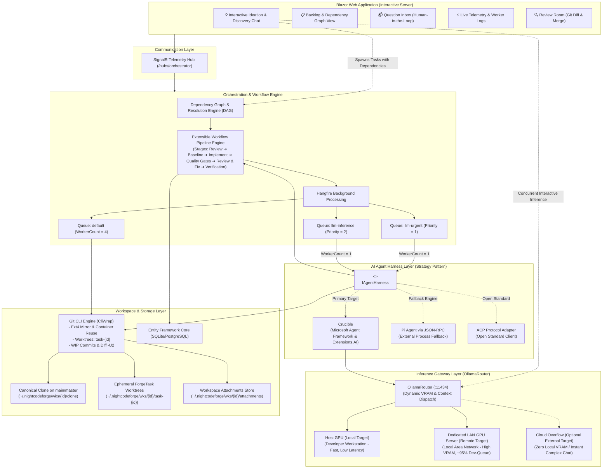

---

## 2.1 Inference Topology & Dual-Compute Hardware Model ([OllamaRouter](https://github.com/jetelain/OllamaRouter))

### 2.1.1 Target Classification: "Local" and "Remote" are Both Local/On-Premise Workloads
NightCodeForge integrates with [OllamaRouter](https://github.com/jetelain/OllamaRouter) as its unified reverse-proxy inference gateway. In this architecture, it is essential to understand the physical and operational semantics of the routing targets:

1. **Local Target (`Local`): Host GPU (Developer Workstation)**
   * **Physical Location:** The developer's primary machine running the NightCodeForge host process (e.g., an NVIDIA RTX 4070/4080/4090 laptop or desktop).
   * **Role:** Used whenever possible for fast, zero-latency inference when the model and context fit comfortably within host VRAM (typically 8–16 GB). Ideal for Stage 0 Untrusted Intake Triage, quick diff evaluations, or local interactive Ideation Chat.
2. **Remote Target (`Remote`): Dedicated Local Network Area (LAN) Server**
   * **Physical Location:** A dedicated compute node residing strictly on the **Local Area Network (LAN)** (e.g., a headless Linux workstation equipped with dual RTX 3090/4090s, RTX 6000 Ada, or 80GB VRAM).
   * **Role:** The primary inference workhorse for **~95% of automated software engineering workloads**. Provides the expansive VRAM necessary to load 32B/70B parameter models (e.g., `qwen2.5-coder:32b`, `deepseek-r1:32b`) and sustain 32k/64k token context windows without quantization degradation or out-of-memory (OOM) crashes.
3. **Strict Data-Privacy Invariant: Both Targets are On-Premise Workloads**
   * In traditional cloud vernacular, "remote" often connotes third-party public cloud services (AWS, Azure, GCP).
   * **In NightCodeForge & OllamaRouter, "Remote" explicitly means a Local Network Area server.**
   * Both `Local` and `Remote` targets reside behind the developer's physical/local network firewall. Zero tokens, source code fragments, or git diffs ever egress to the public internet when executing on either target. Both represent 100% private, sovereign, and air-gapped-capable infrastructure.
4. **Cloud Target (`Cloud` / Cloud Overflow): Optional External Fallback**
   * Only the `Cloud` target (e.g., `ollama.com` cloud models or external cloud API endpoints) communicates outside the local network perimeter.
   * This target is strictly opt-in and serves as an **overflow mechanism** for zero-local-VRAM operations (such as one-click AI transcript diagnostics) or when a developer wishes to run complex exploratory chats without waiting for local hardware.

---

### 2.1.2 The Single-GPU Dev-Queue Bottleneck Hypothesis
A foundational operational premise of NightCodeForge is that background dev-queue tasks in Hangfire (`llm-urgent` and `llm-inference`) run with `WorkerCount = 1`.

Why this single-GPU hypothesis remains correct and necessary:
* **The 95% Routing Reality:** Modern software engineering tasks (analyzing entire project ASTs, multi-turn tool loops, generating complex unit tests, and comprehensive code reviews) require high parameter density and large context windows. Consequently, **OllamaRouter routes approximately 95% of background dev-queue workloads to the dedicated Remote LAN GPU server**.
* **Contention & Thrashing Prevention:** Because the Remote LAN server is effectively a single shared high-capacity GPU resource, running concurrent background jobs would force GPU memory contention, interleaved prompt cache evictions, or out-of-memory crashes.
* **Conclusion:** Modeling the background dev-queue as a single sequential worker (`WorkerCount = 1`) accurately matches the physical reality of the primary LAN GPU bottleneck, ensuring 100% deterministic job completion without race conditions or thrashing.

---

### 2.1.3 Interactive Ideation Concurrency & Dual-Compute Flexibility
While automated background tasks must execute sequentially through the single Hangfire worker, **Interactive Ideation & Codebase Discovery Chat (`IIdeationService`) runs on-demand within the Blazor UI session**.

This introduces a powerful **Dual-Compute Concurrency** capability:

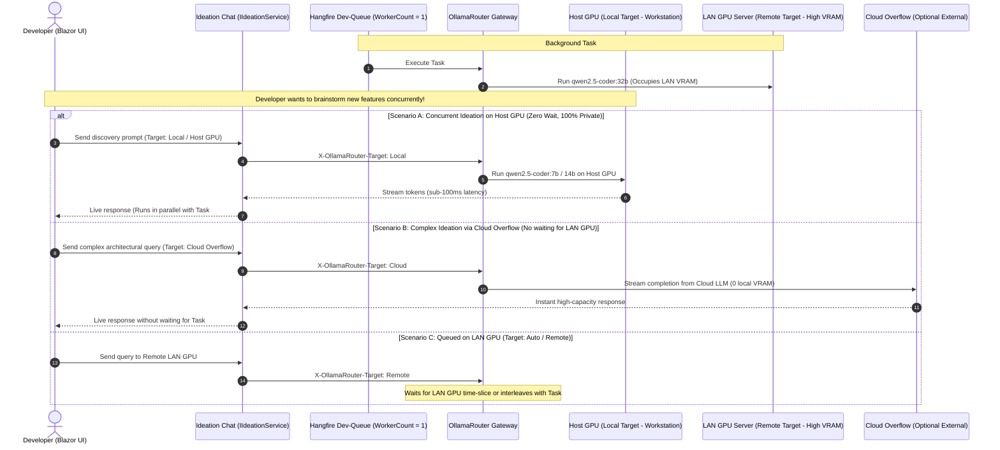

#### Key Operating Modes for Ideation:
1. **Host GPU Concurrency (Default Local Coexistence):**
   * The host workstation GPU is free while the background worker is executing on the LAN server.
   * Ideation can be pinned to `Local` (Host GPU) using a 7B or 14B model (e.g., `qwen2.5-coder:7b` or `deepseek-r1:14b`).
   * The developer enjoys instantaneous interactive discovery with zero queue delays and zero impact on the running dev-queue job.
2. **Optional Cloud Overflow for Complex Chats:**
   * If an ideation session demands a massive reasoning model (e.g., 70B+ or frontier thinking models) that exceeds Host GPU VRAM, and the Remote LAN GPU is currently occupied with a long-running dev-queue task, the developer can switch the Ideation routing target to **Cloud Overflow**.
   * This prevents the developer from being blocked, providing instant frontier intelligence without disturbing local VRAM or waiting for background tasks to finish.
3. **Auto / Sequential Queueing:**
   * If both tasks target the Remote LAN server, requests interleave or queue according to OllamaRouter's priority policies.

---

## 3. Extensible Multi-Agent Workflow Engine

Rather than binding to a rigid, hardcoded state machine library, NightCodeForge uses a **composable, stage-based Workflow Pipeline Engine**. Each task progresses through a sequence of discrete, pluggable stages executed by dedicated specialized agents and deterministic verification gates.

### 3.1 ForgeTask Creation & Intake Channels
Tasks enter NightCodeForge through three distinct channels. In all cases, every newly created task starts with the **`Suggested`** status:

1. **External Triage Workflow:**
   - External systems (GitHub tasks, Jira, webhooks) trigger an isolated triage pipeline.
   - Runs a dedicated **Triage Agent** on the base branch (`main` or `master`) in a `RestrictedReadOnly` sandbox (`:ro` workspace mount, `--network none`).
   - Deeply analyzes the request, validates reproducibility, and invokes `propose_tasks` if valid.
   - Newly proposed tasks enter the database in **`Suggested`** status.
2. **Ideation & Discovery Chat:**
   - The developer converses with the codebase exploration agent (`IIdeationService`) to explore features, refactorings, or architecture questions.
   - Either the developer or the ideation agent creates tasks with dependencies via `propose_tasks`.
   - Created in **`Suggested`** status.
3. **Markdown ForgeTask Synchronization (`docs/tasks/*.md`):**
   - The developer creates a new markdown specification directly in `<WorkspaceRoot>/docs/tasks/YYYY-MM-DD-<slug>.md` on their real workspace.
   - `TaskMarkdownSyncService` detects the file via `FileSystemWatcher`, allocates an ID, and injects frontmatter with initial `status: suggested` and `merge_mode: manual_review_required`.

### 3.2 Manual Promotion & Merge Mode Selection
A task remains dormant in `Suggested` until a maintainer performs a **single manual action** via the Web UI or CLI:
* **Promote to Open:**
  - The maintainer specifies two mandatory properties in the same action:
    1. **`Priority`** (1 to 5, default = 1).
    2. **`MergeMode`**:
       - `Automatic`: NightCodeForge will automatically squash and merge the verified branch to `baseBranch` once all quality checks pass.
       - `ManualReviewRequired`: Once verified, the task pauses at `Ready` so the maintainer can review diffs, test locally, and approve before merging.
  - State transitions to **`Open`**.
* **Reject:**
  - State transitions to **`Rejected`**; the task is archived and never executed.

### 3.3 Main Workflow Execution Engine
Once a task has `Status == TaskOverallStatus.Open` and **all its dependencies have `Status == TaskOverallStatus.Closed`**, it is enqueued to `llm-inference` (`WorkerCount = 1`) and executes through the main workflow:

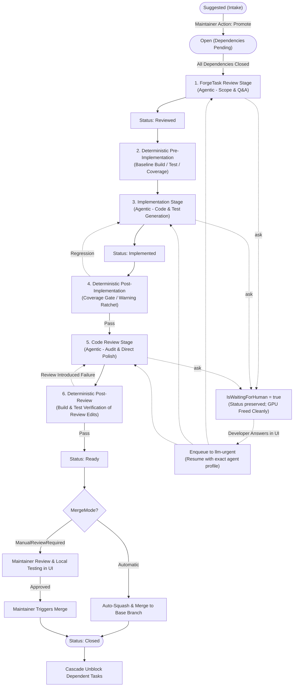

#### Main Workflow Stages:
1. **Stage 1: ForgeTask Review Agent (`TaskReviewStage`):**
   - **Mission:** Deeply inspect the codebase against the task request *before* coding begins. Detect ambiguities, uncover hidden constraints, identify impacted files, verify prerequisites, and formulate an approved technical plan.
   - **Transition:** On completion, updates `task.Status = TaskOverallStatus.Reviewed`.
2. **Stage 2: Deterministic Pre-Implementation:**
   - **Mission:** Execute baseline compilation (`dotnet build`), run baseline test suite, and capture baseline coverage and warning metrics without consuming LLM tokens. Metrics are recorded in `PipelineDataBag`.
3. **Stage 3: Implementation Agent (`ImplementationStage`):**
   - **Mission:** Implement the code changes outlined in the approved plan. Modify files, generate unit tests, iterate on compiler/test feedback inside the sandbox.
   - **Transition:** On completion, updates `task.Status = TaskOverallStatus.Implemented`.
4. **Stage 4: Deterministic Post-Implementation Quality Gates:**
   - **Mission:** Run `format,build,test-with-coverage,sast` via `CompositeDeterministicStage` (incorporating `DeterministicFormatStage`, `DeterministicBuildStage`, `DeterministicTestWithCoverageGate` [$\Delta \ge 0$], and `DeterministicSastStage`). If tests fail, coverage regresses, or build breaks, loops back to Stage 3 with structured compiler and assertion diagnostics.
5. **Stage 5: Code Review Agent (`CodeReviewAndFixStage`):**
   - **Mission:** Act as a critical reviewer and automated fixer. Inspect the noise-filtered `git diff -U2`, check coding conventions, detect subtle regressions, and apply direct minor polish patches.
6. **Stage 6: Deterministic Post-Review Verification:**
   - **Mission:** Because the Code Review agent can modify code and introduce syntax or regression bugs, this deterministic step re-compiles and re-executes unit tests on the final changeset.
   - **Transition:** On pass, updates `task.Status = TaskOverallStatus.Ready`. On failure, loops back to Stage 5 with diagnostic output.
7. **Stage 7: Merge Resolution Gate:**
   - Evaluates `task.MergeMode`:
     - **Automatic Mode:** NightCodeForge automatically squashes WIP commits into a conventional commit, merges into `baseBranch`, sets `task.Status = TaskOverallStatus.Closed`, and triggers cascade unblocking.
     - **Manual Review Required Mode:** ForgeTask remains in `Ready`. The maintainer inspects the diff in the Review Room, runs manual tests, and clicks "Approve & Merge" $\rightarrow$ sets `task.Status = TaskOverallStatus.Closed`.
8. **Universal Human Interruption (`ask`):**
   - At any time during agentic stages (1, 3, or 5), an agent can invoke `ask` to request clarification.
   - **Strict Architectural Invariant:** Human interruption **never mutates `task.Status`**. The task's overall lifecycle milestone (`Open`, `Reviewed`, or `Implemented`) is preserved completely intact.
   - Instead, interruption state is captured via dedicated tracking fields:
     - `task.IsWaitingForHuman = true;`
     - `task.InterruptedStageId = stage.StageId;`
     - `task.InterruptedAgentProfileId = profile?.Id;`
     - `question.AgentProfileId = profile?.Id;`
   - The orchestrator creates a Git WIP checkpoint, records the question, and cleanly completes the Hangfire task, releasing the GPU worker immediately.
   - When the user answers the question in the UI:
     - `question.Status = QuestionStatus.Answered; question.Answer = answer;`
     - `task.IsWaitingForHuman = false;`
     - The task is enqueued to **`llm-urgent`** for immediate priority pickup.
     - When dequeued, the orchestrator retrieves the original agent profile via `InterruptedAgentProfileId` and resumes the exact stage with the appropriate agent and injected answer context.

### 3.2 Agent Profiles: Specializing Intelligence per Stage
Each step in a workflow pipeline is associated with an **Agent Profile** (`AgentProfile`). Different stages of software development demand different model capabilities, reasoning depths, and tool permissions:

| Stage | Typical Profile Needs | Example Configuration |
| :--- | :--- | :--- |
| **0. Automated Triage** *(Untrusted Intake)* | Autonomous pre-analysis of external tasks/webhooks on canonical `main`/`master`, strictly read-only, indirect injection defense. | **Harness:** `Crucible` *(Exclusive - Pi/ACP unsupported)*<br>**Model:** `deepseek-r1:32b`<br>**Thinking Effort:** `Medium`<br>**Permitted Tools:** `["read", "propose_tasks"]`<br>**Security:** `RestrictedReadOnly` (`--network none`, `:ro`) |
| **Interactive Ideation** *(Discovery Chat)* | Open conversational exploration of codebase architecture, proposing PR-sized backlog tasks. | **Harness:** `Crucible`<br>**Model:** `qwen2.5-coder:32b`<br>**Mode:** `ReadOnly`<br>**Permitted Tools:** `["read", "bash", "web_search", "propose_tasks"]` |
| **1. Task Review** *(Agentic)* | High reasoning capability, deep codebase comprehension, proactively questioning edge cases and updating `docs/tasks/*.md`. | **Harness:** `Crucible` (or `PiRpc`)<br>**Model:** `deepseek-r1:32b`<br>**Thinking Effort:** `High`<br>**Permitted Tools:** `["read", "edit", "write", "bash", "web_search", "ask"]` |
| **2. Pre-Implementation Baseline** *(Deterministic)* | Pure CLI compilation and test execution on CPU (zero tokens). | *Deterministic Stage (No LLM Profile required)* |
| **3. Implementation** *(Agentic)* | Rapid tool execution, fast code generation, TDD iteration with compiler/test feedback. | **Harness:** `Crucible` (or `PiRpc`)<br>**Model:** `qwen2.5-coder:32b`<br>**Thinking Effort:** `Medium`<br>**Permitted Tools:** `["read", "edit", "write", "bash", "web_search", "ask"]` |
| **4. Post-Implementation Quality Gates** *(Deterministic)* | Automated format check, build verification, coverage regression gate, and DevSkim SAST scan. | *Deterministic Composite Stage (No LLM Profile required)* |
| **5. Code Review & Fixes** *(Agentic)* | Strict gap analysis against spec, diff review, minor polish edits, or `<request_changes>` rejection gate. | **Harness:** `Crucible` (or `Acp`)<br>**Model:** `qwen2.5-coder:32b`<br>**Thinking Effort:** `Medium`<br>**Permitted Tools:** `["read", "edit", "bash", "ask"]` |
| **6. Post-Review Verification** *(Deterministic)* | Final clean build and full test suite verification of review edits. | *Deterministic Composite Stage (No LLM Profile required)* |

#### Agent Profile Definition
```csharp
public class AgentProfile
{
    public const int DefaultMaxTurns = 500;

    public string Id { get; set; } = string.Empty;          // e.g. "triage-guard", "deep-analyst", "fast-coder", "acp-auditor"
    public int? WorkspaceId { get; set; }               // Nullable: global profile or workspace override
    public string Name { get; set; } = string.Empty;
    public string HarnessId { get; set; } = StandardHarnessIds.Crucible; // "crucible", "pi-rpc", or "acp"
    public string ModelName { get; set; } = string.Empty;    // e.g. "qwen2.5-coder:32b", "deepseek-r1:32b"
    public ThinkingEffort ThinkingEffort { get; set; } = ThinkingEffort.None;
    public int? ThinkingTokenBudget { get; set; }
    public double? Temperature { get; set; }
    public string? HarnessConfigurationJson { get; set; } // Harness-specific launch/runtime JSON options
    public LocalOptimizationFlags? OptimizationFlags { get; set; } // Opt-out optimization flags for A/B testing
    public IReadOnlyList<string>? PermittedTools { get; set; } // Whitelist: null = all stage tools; ["read", "propose_tasks"]
    public Dictionary<string, string>? StageDirectives { get; set; }
    public AgentMode Mode { get; set; } = AgentMode.Full;
    public SandboxSecurityTier SecurityTier { get; set; } = SandboxSecurityTier.Standard; // Standard vs RestrictedReadOnly
    public string? SystemPrompt { get; set; }
    public int? MaxTurns { get; set; } = DefaultMaxTurns;
    public bool AllowNoTests { get; set; }
    public int? ContextWindowTokens { get; set; }        // Token capacity for Pi-style compaction budgeting
    public OllamaRoutingTarget RoutingTarget { get; set; } = OllamaRoutingTarget.Auto; // Auto, Local, Remote, Cloud
}

public enum SandboxSecurityTier
{
    Standard = 0,          // Normal execution on feature branch; network permitted for restores
    RestrictedReadOnly = 1 // Untrusted external intake on main/master: :ro mount, --network none, --read-only, --cap-drop=ALL
}

public enum ThinkingEffort
{
    None = 0,
    Low = 1,
    Medium = 2,
    High = 3,
    CustomBudget = 4
}
```

### 3.3 Extensibility & Pipeline Abstraction
The workflow pipeline is defined via modular contracts. Stages can be **Agentic** (driven by LLMs with exclusive GPU scheduling) or **Deterministic** (driven by native commands, e.g., builds, tests, SAST, running on CPU with zero token usage):

```csharp
public enum WorkflowStageKind
{
    Agentic = 0,       // AI agent driven by LLM, consumes GPU worker, bound to AgentProfile
    Deterministic = 1  // Native command execution (build, test, SAST, linter), runs on CPU/sandbox, 0 GPU tokens
}

public interface IWorkflowStage
{
    string StageId { get; }
    string DisplayName { get; }
    int Order { get; }
    WorkflowStageKind StageKind { get; }
    string? DefaultAgentProfileId { get; } // Null for deterministic stages
    
    Task<StageExecutionResult> ExecuteAsync(
        StageExecutionContext context,
        IExecutionEnvironment executionEnvironment,
        IAgentHarness? harness,
        AgentProfile? profile,
        Func<AgentTelemetryEvent, Task> onTelemetry,
        CancellationToken cancellationToken);
}

public interface IWorkflowPipeline
{
    string PipelineId { get; }
    IReadOnlyList<IWorkflowStage> Stages { get; }
    IWorkflowStage? GetNextStage(string currentStageId);
    IWorkflowStage? GetStage(string stageId);
}
```

### 3.4 Stage Bootstrap Prompts & Context Injection
To maximize reasoning effectiveness and ensure consistent agent behavior, each stage relies on a specialized **System Prompt** (defining persona, behavioral boundaries, and available tools) and a dynamic **Bootstrap Prompt** (seeding task-specific context and instructions):

```csharp
public class StagePromptTemplate
{
    public string SystemPrompt { get; set; } = default!;
    public string BootstrapPromptTemplate { get; set; } = default!;
}
```

#### Specialized Prompts for the 3 Default Stages:
1. **Stage 1 (ForgeTask Review):**
   - **System Persona:** Architectural Analyst & Requirements Investigator.
   - **Mission:** Scrutinize the codebase against the task description. Proactively uncover ambiguities, implicit assumptions, and architectural conflicts *before* any implementation begins.
   - **Injected Context:** `{{ForgeTask.Title}}`, `{{ForgeTask.Description}}`, repository structure, guidelines.
   - **Behavioral Directive:** "If any requirement or design decision is ambiguous or has multiple valid alternatives, invoke `ask` immediately to clarify. Do not guess."
2. **Stage 2 (Implementation):**
   - **System Persona:** Senior Software Engineer & TDD Practitioner.
   - **Mission:** Implement clean, robust code according to the approved plan. Run builds (`dotnet build`), run tests, and fix errors incrementally.
   - **Injected Context:** Approved technical plan from Stage 1, all resolved Q&A pairs from `{{PriorAnswers}}`, list of affected files.
   - **Behavioral Directive:** "Write working code and verify with build tools. If unexpected blockers or breaking changes arise, call `ask`."
3. **Stage 3 (Code Review and Fixes):**
   - **System Persona:** Critical Code Auditor & QA Specialist.
   - **Mission:** Review the full changeset against the base branch. Identify regressions, edge cases, missing unit tests, or lint violations, and make targeted fixes.
   - **Injected Context:** Target base branch (`{{BaseBranch}}`), complete `git diff` generated from Stage 2 (`{{GitDiff}}`), project coding standards.
   - **Behavioral Directive:** "Inspect the diff line-by-line. If you find bugs or gaps, use file editing tools to fix them directly. When confident, summarize findings."

### 3.5 Stage Interruption & Universal Context Switching
At **any point** in **any stage**, an agent may invoke the `ask` tool. When this occurs:
1. The stage returns `StageExecutionResult.WaitingForHuman(question)`.
2. The orchestrator records the question in the database, associates `question.AgentProfileId = profile?.Id`, flags `task.IsWaitingForHuman = true`, and preserves the original `task.InterruptedAgentProfileId = profile?.Id`. **Crucially, `task.Status` is never changed to `BlockedQuestion`**; the task retains its current lifecycle status (`Open`, `Reviewed`, or `Implemented`).
3. The orchestrator triggers a native Git WIP commit on `feature/task-{id}`.
4. The Hangfire job completes cleanly (`Succeeded`), releasing the single GPU worker immediately.
5. When the user submits the answer, `task.IsWaitingForHuman = false`, and the task is enqueued into `llm-urgent`. The active stage is resumed with the exact original agent profile (`InterruptedAgentProfileId`), the previous conversation memory checkpoint, and the newly supplied human answer.

### 3.6 Review Room Iteration & Change Requests
If the developer inspects the diff in the Review Room and identifies tasks or wants adjustments before merging:
1. The developer clicks **"Request Changes"** and provides revision notes / feedback.
2. The orchestrator records the reviewer feedback.
3. The task transitions from `Review` back to **Stage 2 (`ImplementationStage`)**, with the reviewer feedback injected into the prompt context (`{{PriorAnswers}}` / `{{ReviewerFeedback}}`).
4. The task is enqueued with highest priority into `llm-urgent` so the Implementation Agent directly addresses the feedback on the existing feature branch.

### 3.7 Explicit Stage Boundary Handover Protocol (Zero-Memory Clean Handoff)
Carrying forward raw multi-turn conversation histories across stage boundaries causes massive token bloat, increases prompt evaluation latency on local LLMs, and leads to attention drift. NightCodeForge implements an **explicit zero-memory clean handoff**:

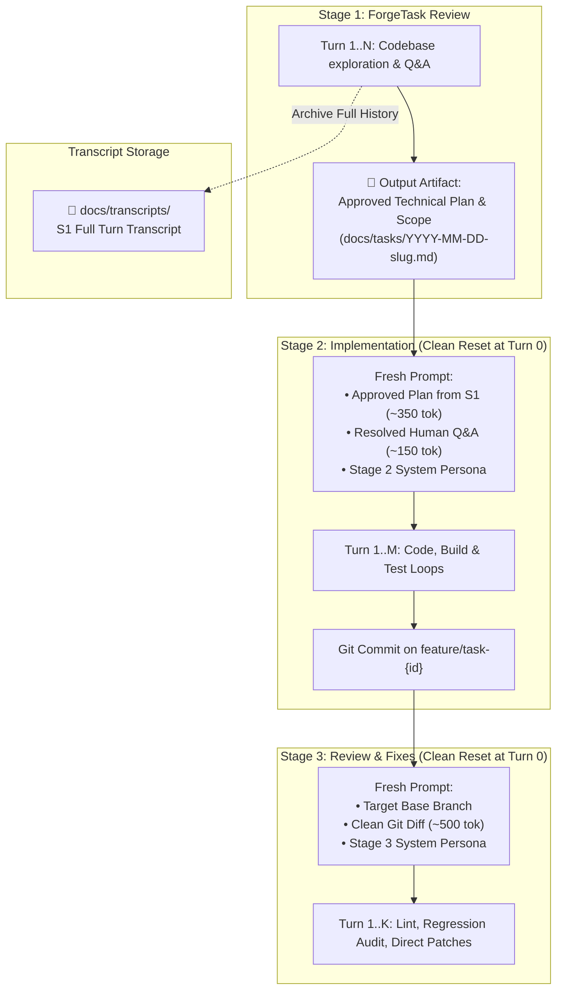

1. **Stage 1 $\rightarrow$ Stage 2 Handover:**
   - When `TaskReviewStage` finishes, its complete turn-by-turn chat history (10–20 turns) is archived to disk under `docs/transcripts/`.
   - `ImplementationStage` starts at **Turn 0 with an empty chat history**, receiving only the approved Technical Plan & Scope markdown artifact and the list of resolved Q&A pairs from `docs/tasks/`.
2. **Stage 2 $\rightarrow$ Stage 3 Handover:**
   - When `ImplementationStage` completes, all internal build attempts, compile errors, and test iterations are archived to disk.
   - `CodeReviewAndFixStage` starts at **Turn 0 with an empty chat history**, receiving only the base branch name, the clean `git diff` generated from the feature branch, and coding guidelines.
3. **Impact:** Eliminates 75%–85% of redundant prompt tokens, maintains high local LLM attention precision, and prevents cross-stage context pollution.

### 3.8 Deterministic Stages: Quality Gates & Agent Input Feeders

Workflows in NightCodeForge are not limited to purely agentic reasoning loops. A robust software engineering pipeline often requires **deterministic steps** (e.g., compilation, unit test suites, Static Application Security Testing [SAST], formatters, or linters) that execute predictable shell commands without AI intervention.

#### Architectural Advantages:
1. **Zero GPU & Token Overhead:** Deterministic stages execute directly in the workspace sandbox (`IExecutionEnvironment`), running on the host CPU or inside the sandbox container. They consume **0 LLM tokens** and **do not occupy the exclusive GPU inference worker** (`WorkerCount = 1`).
2. **Deterministic Quality Gates & Outcome-Based Routing:**
   * **Forward Routing (Pass):** If builds, unit tests, and SAST scans pass cleanly, the deterministic stage packages a verified status (`ValidationStatus = Success`) and advances to the next stage (e.g. `CodeReviewAndFixStage`).
   * **Backward Feedback Loop (Fail):** If compilation fails or tests break, the deterministic step routes backward to the implementation agent (with a configurable loop counter, e.g. max 3 iterations, to prevent infinite loops) to request an immediate fix. If the loop counter expires, it pauses and alerts the human (`WaitingForHuman`).
3. **Structured Diagnostics Feeder (Smart Handover & Synthetic Priming):**
   * When configured as an **Input Feeder**, failing command outputs are parsed into structured artifacts rather than raw console noise.
   * *Example (Deterministic Compiler/Test Stage):* The stage extracts failing compiler diagnostics (`error CS\d+`) and failing test assertion stacks, saving them into `StageHandoverArtifacts.Diagnostics`.
   * **Crucible Synthetic Conversation Priming:** To prevent local LLMs from redundantly running `bash("dotnet build")` or `bash("dotnet test")` at the start of a turn, Crucible seeds the agent's chat history with a synthetic tool call/result pair mimicking that the agent already ran the test/build and received the exact deterministic results. The agent immediately moves to editing code.
4. **Built-in Deterministic Stage Implementations:**
   * **`DeterministicBuildStage`:** Executes project build (`dotnet build`, `npm run build`, `mvn compile`). Validates compile cleanliness.
   * **`DeterministicTestStage`:** Executes test runners (`dotnet test`, `pytest`, `jest`). Parses failing assertions and stack traces.
   * **`DeterministicSastStage`:** Runs security and static code analyzers (e.g. Roslyn Analyzers, Semgrep, Trivy, SonarScanner). Produces structured vulnerability/finding reports for automated remediation agents.
   * **`DeterministicFormatStage`:** Runs code formatters (e.g. `dotnet format`, `prettier --check`).

#### Pipeline Composition with Deterministic Steps & Feedback Loops:
```mermaid
flowchart LR
    S1["1. ForgeTask Review\n(Agentic LLM)"] --> S2["2. Implementation\n(Agentic LLM)"]
    S2 --> S3["3. Deterministic Build & Test\n(CPU Native / SAST Gate)"]
    S3 -->|Pass: Success Input| S4["4. Code Review & Fix\n(Agentic LLM)"]
    S3 -->|Fail: Parse Diagnostics & Loop Back| S2Fix["2b. Fix Errors\n(Agentic LLM with Synthetic Priming)"]
    S2Fix --> S3
    S3 -.->|Exceeds Max Retries (3)| Blocked["Blocked: Human Q&A"]
```

### 3.8.1 Persistent Pipeline Data Bag & Differential Quality Gates

Deterministic stages are not merely ephemeral shell runners; they serve as **persistent telemetry and baseline extractors**. NightCodeForge provides a thread-safe, serializable **Pipeline Data Bag** (`PipelineContext.DataBag`) that persists cross-stage data into `AppDbContext.Tasks.PipelineDataJson` and records per-stage snapshots in `STAGE_EXECUTION_RECORD.OutputDataJson`.

This architecture enables **differential quality gates**: capturing baseline repository metrics *before* code changes, and comparing them *after* implementation to prevent regressions, coverage erosion, or agent "cheating".

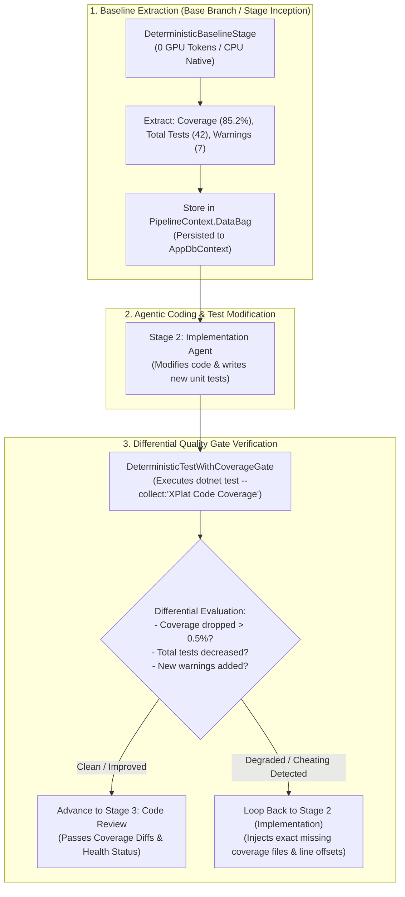

#### Core Differential Gates Supported:

1. **Test Coverage Degradation Gate (`DeterministicTestWithCoverageGate`):**
   * **Mechanism:** Executes coverage toolchain (`dotnet test --collect:"XPlat Code Coverage"` / Coverlet / Istanbul / lcov) and parses Cobertura XML or JSON coverage reports.
   * **Baseline:** Records `coverage.baseline.lineRate = 85.2%` and `coverage.baseline.branchRate = 78.4%`.
   * **Post-Implementation:** Computes `coverage.current.lineRate = 81.0%` ($\Delta = -4.2\%$).
   * **Enforcement:** If coverage drops beyond the configured tolerance (e.g. `allowedDrop = 0.0%`), the gate fails and synthesizes an actionable diagnostic:
     > *"❌ Coverage Degradation Detected: Line coverage dropped from 85.2% to 81.0% (-4.2%). Uncovered methods detected: `OrderService.CalculateTax()` (Lines 45-62) and `OrderService.ApplyDiscount()` (Lines 80-95). Please add unit tests covering these paths."*

2. **"No Cheating" Test Count Preservation Gate:**
   * **The Problem:** Local models occasionally "fix" a broken test suite by deleting or commenting out failing test assertions (`[Fact]` $\rightarrow$ `// [Fact]`) rather than fixing the underlying business logic.
   * **Enforcement:** The baseline stage records `tests.baseline.total = 42`. If post-implementation `tests.current.total < 42`, the gate fails immediately with a severe integrity violation error, rejecting the pull request.

3. **Compiler & Linter Warning Ratchet (`DeterministicWarningRatchetStage`):**
   * **The Problem:** Legacy repositories often contain dozens of preexisting compiler warnings. Enforcing `TreatWarningsAsErrors` globally breaks existing code, but allowing warnings permits agents to introduce fresh technical debt.
   * **Mechanism:** Captures `warnings.baseline = 14`. If the new build produces `warnings.current = 16`, the ratchet triggers a failure reporting only the **2 newly introduced warnings** (with file and line numbers) for remediation.

4. **Performance Benchmark & Binary Size Gates:**
   * Tracks execution benchmarks (via BenchmarkDotNet / pytest-benchmark) or compiled bundle sizes (`dist/bundle.js`, output `.dll` size), preventing stealthy performance regressions.

#### `PipelineDataBag` Data Contract:

```csharp
public class PipelineDataBag
{
    private readonly ConcurrentDictionary<string, JsonElement> _data = new();

    public void Set<T>(string key, T value)
    {
        var json = JsonSerializer.SerializeToElement(value);
        _data[key] = json;
    }

    public T? Get<T>(string key)
    {
        if (_data.TryGetValue(key, out var element))
        {
            return JsonSerializer.Deserialize<T>(element);
        }
        return default;
    }

    public bool TryGet<T>(string key, out T? value)
    {
        if (_data.TryGetValue(key, out var element))
        {
            value = JsonSerializer.Deserialize<T>(element);
            return true;
        }
        value = default;
        return false;
    }

    public string ToJson() => JsonSerializer.Serialize(_data);
    public static PipelineDataBag FromJson(string? json) => ...;
}
```

---

## 4. ForgeTask Dependency Management (DAG)

Complex features and refactoring tasks naturally break down into interdependent tasks. NightCodeForge natively manages dependencies via a **Directed Acyclic Graph (DAG)**.

### 4.1 Dependency Rules & State Propagation
* A task can declare one or more prerequisite tasks (`DependsOnTaskIds`).
* **Execution Gate:** A task with `Status == TaskOverallStatus.Open` and unsatisfied dependencies (i.e. one or more prerequisites do not have `Status == TaskOverallStatus.Closed`) is marked as dependency-blocked in the UI and **will not be enqueued** to Hangfire until all dependencies are met.
* **Cascade Activation:** When a task reaches the terminal `TaskOverallStatus.Closed` state (squashed and merged into the base branch), the orchestrator triggers cascade unblocking (`CascadeUnblockAsync`). Any dependent task whose prerequisites are now all `Closed` is automatically enqueued to the `llm-inference` queue for autonomous execution.
* **Cycle Prevention:** When creating or modifying dependencies, the `DependencyResolutionEngine` performs topological sorting to detect and reject circular references (cycles).

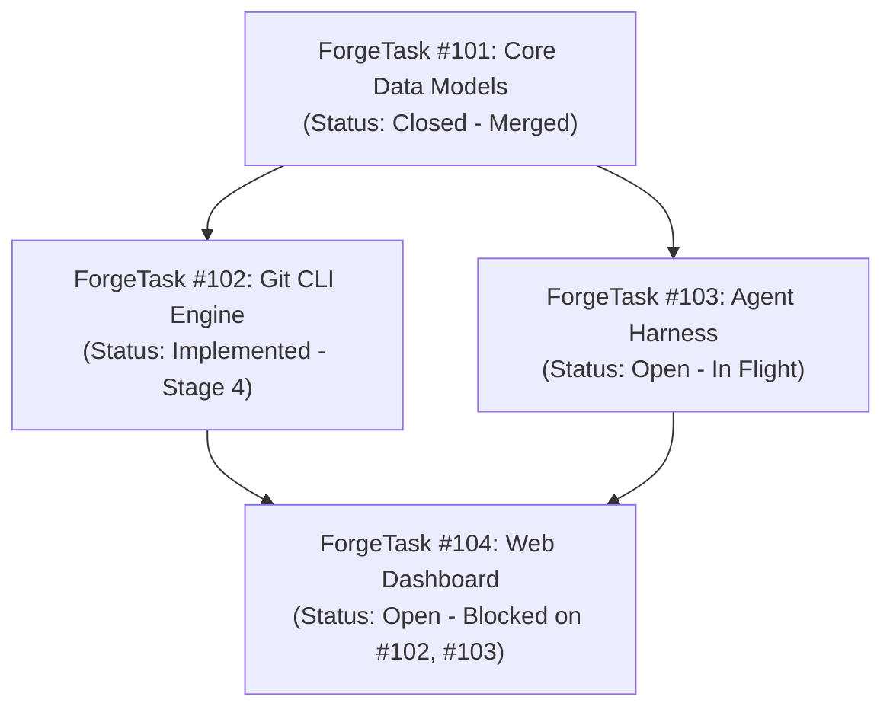

---

## 5. File-System ForgeTask Mirroring (`docs/tasks/`)

To provide optimal ergonomics for AI agents, developers, and Git workflows, active (non-resolved) tasks are mirrored directly in the workspace file system under **`docs/tasks/`** as structured Markdown documents with YAML frontmatter.

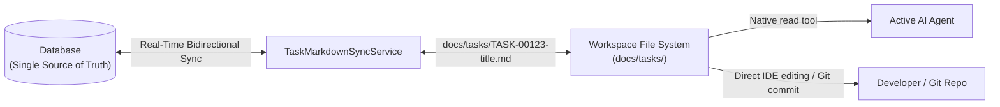

### 5.1 Why Markdown Files for Agents?
1. **Native Agent Accessibility:** Agents inside the workspace can read task specifications, requirements, and previous Q&A directly using basic file tools (`read`), without needing custom database query APIs or SDK dependencies.
2. **Developer & IDE Transparency:** Developers can review, search, and edit tasks directly in VS Code, Visual Studio, or Obsidian without leaving their editor.
3. **Version Control Integration:** Active task specifications live alongside the code on the task branch, preserving the exact requirements snapshot in Git history.

### 5.2 Document Naming & Frontmatter Schema

#### Naming Convention: Chronological Date Prefix (`YYYY-MM-DD-slug.md`)
To allow developers and agents to quickly sort tasks chronologically in their file explorer without having to rename files when IDs are assigned, files are named:
`docs/tasks/YYYY-MM-DD-<slug>.md` (e.g. `docs/tasks/2026-10-12-implement-oauth2-flow.md`).

* The database `id` is stored exclusively **inside the frontmatter**, not in the filename.
* Dropping a new file never requires a file rename when the system assigns an ID.
* **Slug Collision Resolution:** If multiple tasks created on the same date produce identical slugs, the sync service appends an incrementing numeric suffix (e.g. `YYYY-MM-DD-<slug>-2.md`, `YYYY-MM-DD-<slug>-3.md`).

```markdown
---
id: 123
title: Implement OAuth2 Authorization Flow
workspace: NightCodeForge
status: Open
waiting_for_human: true
interrupted_agent_profile: deep-analyst
current_stage: TaskReview
priority: 1
merge_mode: manual_review_required
base_branch: main
feature_branch: feature/task-123
depends_on: [101, 102]
agent_profile: deep-analyst
created_at: 2026-10-12T22:00:00Z
updated_at: 2026-10-12T22:05:00Z
---

# Implement OAuth2 Authorization Flow

## 📋 Requirements & Description
Implement authorization code flow with PKCE for local clients...

## ❓ Human Clarifications (Q&A)
### Question 1 (Asked during Stage: TaskReview on 2026-10-12 22:03:00)
**Prompt:** Should refresh token rotation be enforced on every token exchange?
**Answer:** Yes, rotate refresh tokens on every exchange and store revocations in SQLite.

## 📐 Technical Plan & Scope (Stage 1 Output)
- [ ] Add `OAuthClientOptions` configuration model.
- [ ] Implement `PkceTokenValidator` handler.
- [ ] Add integration tests in `NightCodeForge.Core.Tests`.
```

### 5.3 Bidirectional Synchronization & Field Protection Rules

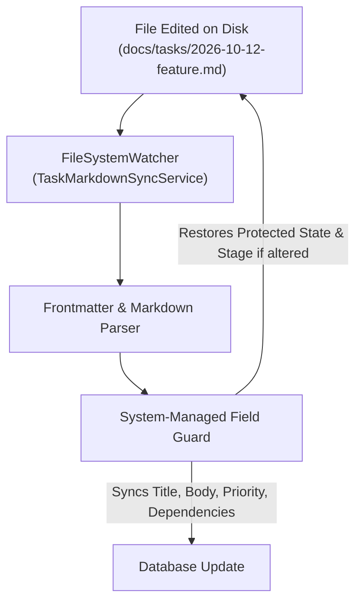

1. **System-Managed Fields (Protected):**
   * Fields like `id`, `status` (`overall_state`), `current_stage`, and `created_at` are strictly governed by the orchestrator engine and database.
   * If a user or agent modifies `status` or `current_stage` directly in the markdown file, the orchestrator rejects the state alteration and rewrites the authoritative database state back into the file's frontmatter.
2. **User/Agent Editable Fields (Synchronized to DB):**
   * Changes to `title`, markdown body (`description`, requirements, technical plan), `priority`, `agent_profile`, `base_branch`, and `depends_on` are automatically detected and saved into the database.
   * Dependency changes via `depends_on` are passed through DAG cycle checks before being committed.
3. **Drop-in Creation Without Renaming:**
   * When a developer or agent drops a new file (e.g. `docs/tasks/2026-10-13-add-dark-theme.md`) without an `id` field:
     1. The watcher detects the new file.
     2. A new `ForgeTask` entity is created in EF Core, allocating the next available `Id` (e.g. `124`).
     3. The sync service injects `id: 124` and `created_at` directly into the file's frontmatter **in-place**, without renaming the file.
4. **Resolution Archival / Cleanup:**
   * When a task reaches `Completed` (or `Cancelled`), the markdown file is removed from `docs/tasks/` (or archived to `docs/tasks/archive/`), ensuring that `docs/tasks/` contains only active and pending work.
5. **FileSystemWatcher Debouncing & Echo Loop Prevention:**
   * Operating systems and IDEs emit multiple rapid events per save (e.g. `Created` followed by multiple `Changed` events within 50ms) and may hold temporary locks during atomic saves.
   * `TaskMarkdownSyncService` applies a **300ms debounce window** to coalesce rapid I/O bursts.
   * To prevent infinite echo loops (where the system writing back protected frontmatter fields triggers the watcher to fire again), the service maintains an in-memory **write-suppression tracker**: whenever the orchestrator writes a file, it registers the computed hash and ignores the subsequent event.

---

## 6. Interactive ForgeTask Discovery & Ideation Chat

To prevent vague or poorly scoped tasks from entering the queue, NightCodeForge provides an **Interactive Ideation & Codebase Discovery Chat**:

```mermaid
sequenceDiagram
    autonumber
    actor User as Developer
    participant UI as Blazor Chat Interface
    participant Explorer as Discovery Agent (Read-Only)
    participant Git as Git Workspace
    participant Engine as Dependency & ForgeTask Engine

    User->>UI: "How does our authentication handle JWT refresh tokens, and what's needed for OAuth2?"
    UI->>Explorer: Stream prompt + conversation context
    Explorer->>Git: Read relevant auth files & configuration
    Git-->>Explorer: File contents & symbols
    Explorer-->>UI: Explains architecture & highlights gaps
    User->>UI: "Great, let's create tasks to implement OAuth2 support."
    Explorer->>UI: Proposes 2 structured tasks with dependencies:<br>1. ForgeTask A: Add OAuth2 client config & token model<br>2. ForgeTask B: Add Google/GitHub provider handlers (Depends on A)
    User->>UI: Reviews, tweaks scope, and clicks "Create in Backlog"
    UI->>Engine: Registers ForgeTask A & ForgeTask B with dependency link
    Engine-->>UI: ForgeTask A queued; ForgeTask B waiting on A
```

### 6.1 Discovery Agent Capabilities
* **Read-Only Access:** Equipped with search, file-reading, and code exploration tools (`bash` with ls/rg, `read`). Cannot modify working tree files.
* **ForgeTask Extraction Tool:** Agent has a function tool `propose_tasks(List<TaskProposalDto>)` allowing it to output structured titles, acceptance criteria, affected components, and recommended dependencies directly into the UI for developer approval.

### 6.2 Automated Untrusted ForgeTask Triage (`TriageProfile` & Security Sandbox)
NightCodeForge supports automated intake pre-analysis triggered by external webhooks (e.g. GitHub Tasks, GitLab Tasks, Jira):
* **Intake Trigger & Objective:** When a new external bug report or feature request arrives, NightCodeForge spawns an autonomous **Triage Stage** (`TriageStage`). The agent inspects the repository's default branch (`main` or `master`) directly (without creating or checking out a feature branch), verifies if the report is actionable, locates relevant source files, and suggests one or more structured backlog tasks via `propose_tasks` for human review.
* **Threat Model: Malicious External Content & Indirect Prompt Injections:**
  External tasks originate from unauthenticated or untrusted public users. Attackers can embed hidden prompt injections (e.g., instructions attempting to exfiltrate secrets, execute malicious shell scripts, or rewrite code).
* **Dual-Lock Defense Architecture:**

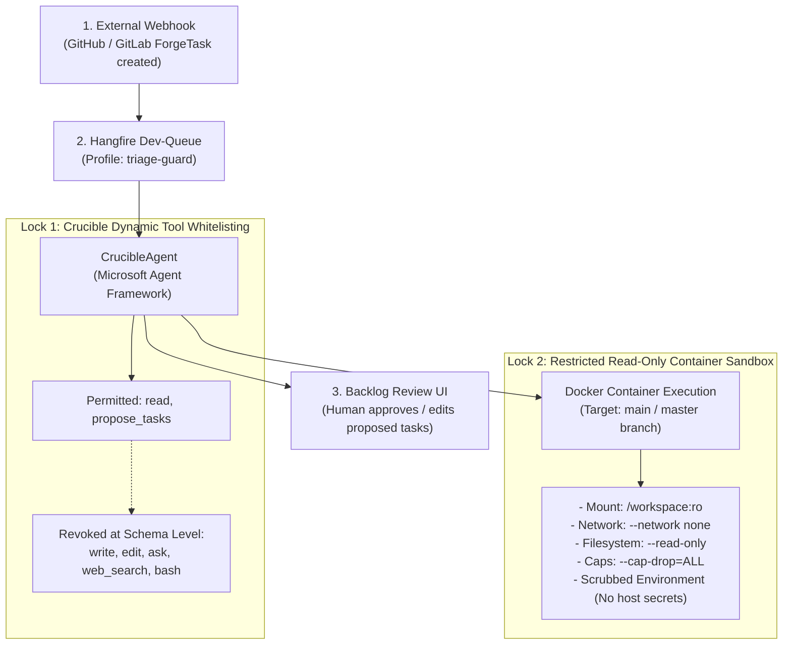

1. **Lock 1: In-Process Tool Restriction (Crucible Exclusive):**
   * Crucible dynamically binds *only* the read-only tools defined in `AgentProfile.PermittedTools`: `read` and `propose_tasks`.
   * `write` and `edit` are excluded entirely from the tool schema—the agent cannot modify files.
   * `ask` is excluded—an untrusted task cannot stall or block the human dev-queue.
   * `web_search` is excluded—eliminating outbound SSRF and exfiltration channels.
   * *Harness Exclusion:* **Pi and ACP harnesses cannot be used for triage** because their static tool engines advertise all capabilities (`write`, `edit`, `bash`) unconditionally.
2. **Lock 2: Restricted Read-Only Container Sandbox:**
   * Runs directly against the base branch (`main`/`master`) on ext4 mounted **read-only** (`:ro`).
   * **`--network none`:** Completely air-gapped network namespace. Even if an LLM is hijacked by an adversarial prompt injection, it cannot exfiltrate environment variables, source code, or internal tokens over the network.
   * **`--read-only` root filesystem:** Prevents writing malicious binaries or modifying system files.
   * **`--cap-drop=ALL` & `--security-opt no-new-privileges:true`:** Drops all Linux root privileges.
   * **Scrubbed Environment:** Host API keys, Git credentials, and database connection strings are strictly omitted from container environment variables.

---

## 7. Orchestration Engine & Queue Design

### 7.1 Queue Concurrency Architecture
The background job system uses **Hangfire** backed by persistent storage. Hangfire servers are separated into two distinct worker pools:

| Queue Name | Worker Count | Purpose | Constraints |
| :--- | :--- | :--- | :--- |
| `llm-urgent` | **1** (Shared pool) | Resumed tasks that just received developer answers. | Highest priority for GPU inference. |
| `llm-inference` | **1** (Shared pool) | Normal queued tasks awaiting execution. | Strictly sequential to protect VRAM. |
| `default` | **4** | Non-GPU background tasks: Git diff calculation, log cleanup, telemetry broadcasts. | Parallel execution allowed. |

> [!IMPORTANT]
> The `llm-urgent` and `llm-inference` queues share a dedicated Hangfire `BackgroundJobServer` configured with `WorkerCount = 1` and ordered queue processing:
> `Queues = new[] { "llm-urgent", "llm-inference" }`.
> This guarantees that:
> 1. At most **one** AI task runs on the GPU at any millisecond, strictly guarding VRAM against out-of-memory crashes.
> 2. Resumed tasks in `llm-urgent` receive **priority pick-up**: as soon as the single worker completes its active turn/task, jobs in `llm-urgent` are dequeued before standard items in `llm-inference` (non-preemptive priority dispatch without concurrent VRAM oversubscription).

### 7.2 Workspace & ForgeTask-Level Concurrency: Dual-Tiered Git Locking (`IWorkspaceLockProvider`)

While GPU inference is strictly serialized globally (`WorkerCount = 1` across `llm-urgent` and `llm-inference`), background utility tasks (`WorkerCount = 4` in the `default` queue), deterministic pipeline stages (compilation, unit tests, SAST scanning on CPU), and interactive developer actions (ideation chat, automated triage) can and should operate concurrently.

To prevent race conditions, concurrent Git index mutations, and `.git/index.lock` collisions while maximizing throughput, `IWorkspaceLockProvider` enforces a **dual-tiered locking hierarchy**:


#### Dual-Tiered Locking Invariants:
1. **ForgeTask-Level Locks (`AcquireTaskLockAsync(workspaceId, taskId)`):**
   - Key format: `$"wks:{workspaceId}:task:{taskId}"`.
   - **Isolation Guarantee:** Serializes multi-turn stage executions for the *same* task to prevent overlapping pipeline actions on the same branch.
   - **Concurrency Benefit:** Independent tasks within the *same workspace* execute concurrently without blocking one another. ForgeTask #101 can execute long-running deterministic compilation and unit tests (running on CPU) while ForgeTask #102 executes reasoning and coding on the GPU.
2. **Workspace-Level Locks (`AcquireLockAsync(workspaceId)`):**
   - Key format: `$"wks:{workspaceId}"`.
   - **Strictly Atomic & Short-Lived:** Held only during brief operations that touch the shared canonical clone:
     - Merging a verified feature branch into `main` (`SquashAndMergeAsync`).
     - Synchronizing the canonical ext4 clone with the developer's host repository (`GitMirrorSyncService`).
3. **Non-Blocking Ideation & Triage:**
   - Because the canonical clone stays checked out on `main`/`master` and normal task execution happens in isolated worktrees, discovery chat (`IIdeationService`) and untrusted triage (`TriageStage`) inspect `main` without waiting for task locks.

---

## 8. Git Workspace & Context-Switching Subsystem

### 8.1 Strict CLI Requirement
Wrappers such as `LibGit2Sharp` are **strictly prohibited** due to unmanaged binary dependencies, memory leak risks in long-running servers, and poor support for modern Git features. All Git operations are executed via native command-line invocations using **`CliWrap`**.

### 8.2 Save Strategy: WIP Commits vs. Stash
To ensure zero data loss during context switches:
1. `git stash` is **not used** because untracked files, subdirectories, or unstaged renames can lead to merge conflicts on unstash or orphaned changes.
2. The orchestrator uses **WIP Commits**:
   ```bash
   git add -A
   git commit -m "WIP: [ForgeTask #{id}][Stage: {stageName}] Awaiting human input: {QuestionSummary}" --no-verify
   ```
3. When the task passes all stages and is approved in the Review Room, the orchestrator squashes the WIP commits into a clean, conventional commit before merging.

### 8.3 Cross-Environment Architecture & Working Clone Protocol

#### 1. Operating System Separation & WSL2 Mandate
* **Forge Host:** Runs natively on Windows, Linux, or macOS.
* **Agent Confinement:** Agents work **strictly on Unix**. There is no Windows command execution for agents.
* **Crucible Embedded Execution:** Crucible runs in-process inside the Forge application. Its actions will always impact WSL2 on Windows (through `wsl.exe` or the `\\wsl.localhost\` share).
* **WSL2 Requirement:** When NightCodeForge runs on Windows, **WSL2 is strictly required**.

#### 2. Canonical Working Clones (`~/.nightcodeforge/wks/{id}`)
* The working clone repository where the agent performs all tasks is **always** located at:
  ```text
  ~/.nightcodeforge/wks/{workspaceId}
  ```
  - On Linux/macOS: Resolves to `$HOME/.nightcodeforge/wks/{workspaceId}` on the host ext4/APFS filesystem.
  - On Windows: Resolves to `/home/{wslUser}/.nightcodeforge/wks/{workspaceId}` on the native ext4 filesystem inside WSL2.
* This completely eliminates the notorious **WSL2 9p / DrvFs filesystem latency bottleneck** (`/mnt/c/...` Plan 9 network filesystem), allowing compiler builds, test suites, and file scans to run at native Linux SSD speeds.

#### 3. Remote URL Resolution & Cross-Environment Git Operations
* **Local Git Remote `host-origin`:**
  - On Windows: The developer's Windows repository path is transformed to its WSL mount path:
    ```bash
    git remote add host-origin /mnt/c/Users/Julien/source/repos/MyProject
    ```
  - On Linux/macOS: The remote points directly to the developer's workspace path:
    ```bash
    git remote add host-origin /path/to/developer/workspace
    ```
* **Git Operations on `main` (`push`, `pull`, `merge`):**
  - **On Unix:** Performed directly in the bare host environment.
  - **On Windows:** Performed strictly inside plain WSL2 (`wsl.exe -d <distrib> -- git ...`).
* **Host IDE Working Tree Synchronization (`updateInstead`):**
  - The developer's repository is configured with `git config receive.denyCurrentBranch updateInstead`.
  - Pushes from the working clone (`git push host-origin feature/task-{id}`) update the developer's checked-out branch without conflict.
  - **Dirty Host Tree Fallback:** If the developer has uncommitted changes to tracked files in their host IDE, `GitMirrorSyncService` catches the rejection, pushes to `refs/heads/feature/task-{id}-ncf`, and sends a SignalR alert to the UI with reconciliation guidance.

#### 4. Crucible Windows UNC Bridge & Cross-Platform Line-Ending Hygiene
Because Crucible runs in-process within the Windows Forge process:
* Crucible file tools (`read`, `write`, `edit`) access the WSL2 working tree via the high-speed Windows UNC share:
  ```text
  \\wsl.localhost\{distrib}\home\{username}\.nightcodeforge\wks\{workspaceId}\
  ```
* This ensures instant, direct file manipulation with full EditorConfig normalization without spawning intermediate shell processes.

#### 5. Tri-Part Cross-Platform Line-Ending Hygiene
Cross-platform development between Windows NTFS host repositories and isolated Linux/WSL2 ext4 mirrors introduces CRLF vs LF friction. If files on the host are converted to CRLF while the Linux Git index uses LF, Git perceives the working tree as modified with unstaged changes, aborting `receive.denyCurrentBranch updateInstead` pushes and diverting work to `-ncf` rescue branches.

NightCodeForge implements a tri-part defense:
1. **Repository-Level Line Ending Normalization (`.gitattributes` & `.editorconfig`):**
   - Host repositories are automatically scaffolded with `.gitattributes` (`* text=auto eol=lf`) and `.editorconfig` (`end_of_line = lf`).
   - Ensures consistent line breaks across Windows IDEs (Visual Studio, VS Code) and Linux agents.
2. **Local Git Configuration (`core.autocrlf false`):**
   - The host repository's local Git configuration explicitly sets `core.autocrlf false`, preventing Git on Windows from converting checked-out files from LF to CRLF.
3. **Agent Tool & Internal Service LF Enforcement:**
   - `EditorConfigFileApplier` detects WSL UNC paths (`\\wsl.localhost\...` or POSIX paths) and unconditionally enforces `\n` (LF), overriding sample-based CRLF detection.
   - On Windows targeting workspace mirrors (`wks`, `task-*`), line endings default to `\n` (LF) when unconfigured.
   - Internal writers (`TaskMarkdownSyncService`, `SessionTranscriptService`, `GitWorkspaceManager`, `GitMirrorSyncService`) strictly write pure `\n` line endings.
   - The UI Provisioning Wizard detects `.gitattributes`, `.editorconfig`, and `core.autocrlf` during repository probing, presenting diagnostic badges and auto-configuration toggles. The Reconcile Drawer provides guidance and `git add --renormalize .` suggestions if ghost CRLF/LF diffs occur.

### 8.4 Git Worktree Architecture & Ephemeral Working Trees

#### 1. Architectural Motivation: Worktrees vs. Clones vs. Locks

When designing concurrent multi-task execution on a workspace, three primary models were evaluated:

| Architecture | Mechanism | Disk Overhead | Concurrency | Ideation on `main` | Verdict |
| :--- | :--- | :--- | :--- | :--- | :--- |
| **A. Single Clone + Global Lock** | Single clone, branches checked out sequentially under full workspace lock. | Low (1x clone) | **Zero concurrent tasks**; deterministic tests block GPU tasks and triage. | Blocked while any task runs on a branch. | ❌ Rejected: severe throughput bottleneck. |
| **B. Clone Reservation Pool** | Pool of N full clones (`wks/{id}/clone_1..N`), dynamically leased per task. | High (N x repository size + N x `.git` databases) | Parallel execution across leased clones. | Requires dedicated idle clone for `main`. | ❌ Rejected: massive disk duplication & mirror sync complexity. |
| **C. Ephemeral Git Worktrees** *(Implemented)* | Single canonical clone on `main`; on-demand worktrees created per active task. | Minimal (shared `.git` object database; only checked-out working files duplicated). | **Full parallelism**: concurrent deterministic & agentic tasks on distinct tasks. | **Always available**: canonical clone remains permanently on `main`. | ✅ **Adopted Architectural Standard** |

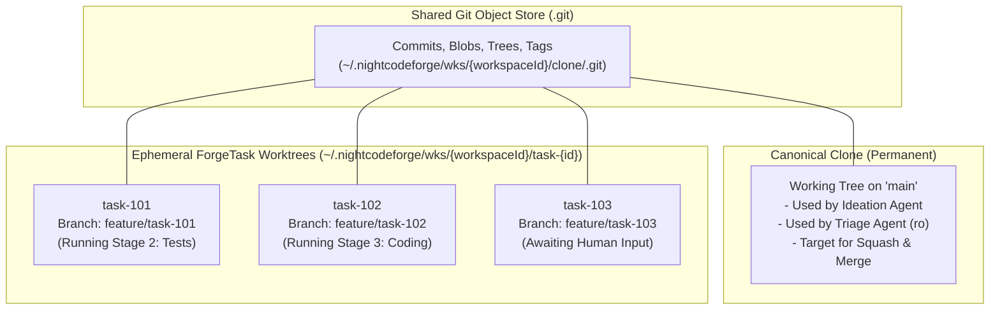

#### 2. Ephemeral Worktree Lifecycle

Each active task follows a strictly managed worktree lifecycle:

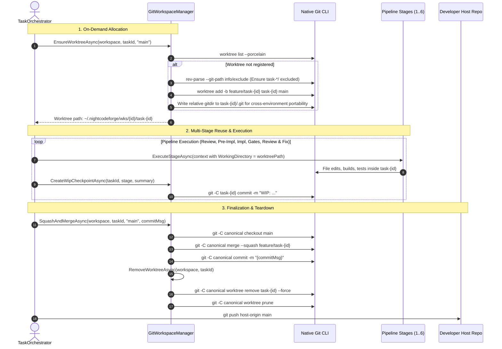

1. **Allocation & Idempotency (`EnsureWorktreeAsync`):**
   - When a task begins processing, `EnsureWorktreeAsync` checks if the worktree is already listed in `git worktree list --porcelain`.
   - If previously allocated (e.g. resuming from an interruption), it reuses the existing working directory without reinitializing.
   - If new, it creates the worktree bound to `feature/task-{id}`.
   - Automatically writes `task-*/` and `wt/` to `.git/info/exclude` in the canonical repository, guaranteeing that local worktrees never pollute `git status --porcelain` on the canonical repository.
2. **Multi-Stage Reuse:**
   - The same worktree directory persists across all stages of a task. File edits made during `ImplementationStage` are immediately present for `DeterministicTestStage` and `CodeReviewAndFixStage` without checkout hops or stash pops.
   - Deterministic stages execute with `context.WorkingDirectory` pointed to the worktree.
   - AI agent tools (`view_file`, `write_to_file`, `replace_file_content`, `grep_search`) resolve relative paths against the worktree via `IWorkspacePathResolver.ResolveCruciblePath(workspaceId, path, taskId)`.
   - Checkpoints (`CreateWipCheckpointAsync`) commit directly in the worktree.
   - Noise-filtered diffs (`GenerateDiffAsync -U2`) compare `baseBranch...feature/task-{id}` within the worktree.
3. **Teardown & Clean Up (`RemoveWorktreeAsync`):**
   - Once all stages pass and the task is squashed and merged (or if rejected), `SquashAndMergeAsync` invokes `RemoveWorktreeAsync`.
   - Executes `git worktree remove "<worktreePath>" --force` and `git worktree prune`.
   - Disk space is reclaimed immediately.

#### 3. Cross-Environment Path Resolution & Crucible UNC Bridge

Because NightCodeForge supports cross-environment execution (Windows host with WSL2 agent confinement, Linux bare-host, and container sandboxes), worktree paths are resolved systematically across boundaries:

| Environment | Canonical Repository Path | ForgeTask Worktree Path |
| :--- | :--- | :--- |
| **Linux / macOS Bare Host** | `~/.nightcodeforge/wks/{id}/clone/` | `~/.nightcodeforge/wks/{id}/task-{taskId}/` |
| **WSL2 Ext4 Mirror (Linux Path)** | `/home/{user}/.nightcodeforge/wks/{id}/clone/` | `/home/{user}/.nightcodeforge/wks/{id}/task-{taskId}/` |
| **Windows Host via Crucible UNC Bridge** | `\\wsl.localhost\{distro}\home\{user}\.nightcodeforge\wks\{id}\clone\` | `\\wsl.localhost\{distro}\home\{user}\.nightcodeforge\wks\{id}\task-{taskId}\` |
| **Local Bare Host (e.g. Unit Tests)** | `<workspaceRoot>/clone/` | `<workspaceRoot>/task-{taskId}/` |

Agents inside containers or WSL access the worktree as their native root working directory (`/workspace/task-{id}` or `~/.nightcodeforge/wks/{id}/task-{id}`).
Crucible running in-process on the Windows host seamlessly translates paths via `IWorkspacePathResolver.ResolveCruciblePath(workspaceId, relativeOrContainerPath, taskId)`, stripping container prefixes (`/workspace/`) and mounting to the high-speed WSL2 UNC network share.

#### 4. Isolated ForgeTask Worktree Mount (`/workspace`), Layered Clone Protection (`/clone:ro` & `/clone/.git:rw`) & LLM Cognitive Focus

To eliminate LLM confusion and safeguard the canonical repository while maintaining native Git worktree functionality:

1. **Per-ForgeTask Isolated Worktree Container Mount:**
   Instead of mounting the parent workspace directory (which would expose sibling `task-*` worktrees and the canonical `clone` directory inside `/workspace`), the sandbox container mounts **strictly the active task's worktree** directly at `/workspace`:
   ```bash
   # 1. Active task worktree mounted at /workspace (read-write)
   -v ~/.nightcodeforge/wks/{workspaceId}/task-{id}:/workspace

   # 2. Canonical clone repository (strictly read-only protection)
   -v ~/.nightcodeforge/wks/{workspaceId}/clone:/clone:ro

   # 3. Canonical clone Git database (read-write for worktree ref & object updates)
   -v ~/.nightcodeforge/wks/{workspaceId}/clone/.git:/clone/.git
   ```
   *Cognitive & Security Benefits:*
   - **Zero LLM Confusion:** Inside `/workspace`, the agent only sees the project files relevant to its assigned task. No other tasks (`task-2`, `task-3`) or the `clone` folder appear in directory listings, search tools, or file trees.
   - **Cross-Environment Relative GitDir Resolution:** The worktree `.git` file contains `gitdir: ../clone/.git/worktrees/task-{id}`. Inside the container, `/workspace/..` evaluates to `/`, so `../clone` cleanly resolves to `/clone/.git/worktrees/task-{id}`. On the host/WSL filesystem, `../clone` is the sibling folder `~/.nightcodeforge/wks/{id}/clone`. Git operations (`git status`, `git add`, `git commit`) function flawlessly in both environments.
   - **Canonical Working Tree Protection:** The canonical clone working tree at `/clone` is strictly read-only (`:ro`), preventing any container process from corrupting `main`. Worktree metadata and Git object writes to `/clone/.git` remain read-write (or read-only for untrusted triage).
   - **Per-ForgeTask Container Sandbox Naming:** Containers are named per task (e.g. `ncf-sandbox-{workspaceId}-task-{taskId}`), guaranteeing complete runtime isolation when multiple tasks are worked in parallel.

2. **Clean PWD & Environment Communication in Agent Prompts:**
   `PromptPrefixStabilizer` injects an explicit `<environment>` block into Layer 3 of the prompt prefix:
   ```markdown
   <environment>
   - Current Working Directory (PWD): /workspace (or local path in BareHost)
   - All relative paths, file operations (read, edit, write), bash commands, builds, and test runs execute in this working directory.
   - The canonical clone on 'main' is read-only. Do not attempt to modify files in other directories.
   </environment>
   ```
   In container mode, the agent's working directory is simply `/workspace`, keeping commands and mental models concise. In BareHost mode, it reflects the native worktree path. Global Layer 1 rules reinforce boundary isolation.

#### 5. Local Agent Base Image (`ncf-agent-base:latest`) & Auto-Generation Lifecycle

To ensure consistent, secure, and offline-capable execution without requiring accounts or publishing to Docker Hub:

1. **Zero External Registry Dependency:**
   NightCodeForge maintains an embedded base Dockerfile (`ContainerExecutorOptions.DefaultAgentBaseDockerfile`) targeting `ubuntu:24.04`. The image is built and tagged locally as `ncf-agent-base:latest` directly inside the local Docker daemon.

2. **Embedded Agent Toolset:**
   The image includes the core tools needed by modern coding agents and deterministic stages:
   - **Version Control:** `git` (with automatic `git config --global --add safe.directory '*'` configuration).
   - **Fast Search:** `ripgrep` (`rg`) for rapid code navigation.
   - **Networking & Utilities:** `curl`, `ca-certificates`, `jq`, `procps`, `unzip`, `tar`, `gzip`.
   - **Native Build Prerequisites:** `build-essential` (gcc, make).
   - **Python Runtime:** `python3`, `python3-venv`, `python3-pip`.

3. **Python Runtime Architecture (Base Image vs. Host Mount):**
   - **Why Python is Baked into the Base Image:** Python executables are dynamically linked against `glibc` and have a tightly-coupled standard library (`/usr/lib/python3.12`) with compiled C-extension shared objects (`.so`). Mounting Python directly from a host system (especially across different Linux distributions or Windows/WSL boundaries) frequently fails due to missing shared libraries or ABI mismatches (e.g., `_ssl`, `_ctypes`, `math`). Baking `python3` and `python3-venv` into the base image costs only ~35 MB uncompressed and guarantees rock-solid execution across any host.
   - **Package Cache Mounting:** While the Python runtime is baked into the base image, package download caches (e.g., `~/.cache/uv`, `~/.cache/pip`) can be cleanly bind-mounted from the host because they are architecture-independent file trees.

4. **Self-Healing 30-Day Freshness Lifecycle:**
   `NightCodeForgeContainerExecutor.EnsureImageReady()` automatically checks the image age before launching containers:
   - Uses `docker image inspect -f "{{.Created}}" ncf-agent-base:latest` to retrieve image creation timestamp.
   - If the image does not exist or was created more than 30 days ago, it automatically compiles an isolated temporary Dockerfile and executes `docker build -t ncf-agent-base:latest`, keeping security patches and tools fresh.
   - Builds execute in an isolated temp directory to prevent transmitting massive workspace context to the Docker daemon.

---

## 9. AI Harness Abstraction Layer (`IAgentHarness`)

NightCodeForge decouples orchestration from the underlying agent runtime via an open **Harness Abstraction Layer**. Any agent that implements `IAgentHarness` can be plugged in, either natively in C# or externally via standard protocols.

### 9.1 Interface Contract & Step Metrics
```csharp
public interface IAgentHarness
{
    string HarnessId { get; }
    Task<AgentRunResult> RunStageAsync(AgentSessionContext context, CancellationToken cancellationToken = default);
}

public class AgentSessionContext
{
    public required ForgeTask ForgeTask { get; init; }
    public Workspace? Workspace { get; init; }
    public required AgentProfile Profile { get; init; }
    public PipelineContext? PipelineContext { get; init; }
    public LocalOptimizationFlags? OptimizationFlags { get; set; }
    public string StageId { get; init; } = string.Empty;
    public string StageDirective { get; init; } = string.Empty;
    public AgentMode RequiredMode { get; init; } = AgentMode.Full;
    public string BootstrapPrompt { get; init; } = string.Empty;
    public string? SerializedStateJson { get; init; }
    public string WorkspacePath { get; init; } = string.Empty;
    public string? PendingHumanAnswer { get; init; }
    public string? PendingHumanAnswerJson { get; init; }
    public IReadOnlyList<string>? DiscoveredSymbols { get; init; }

    // --- Promoted Typed Properties ---
    public string? TaskMarkdownPath { get; init; }
    public string? ReviewDiffStat { get; init; }
    public string? ApprovedPlan { get; init; }
    public string? ReviewerFeedback { get; init; }
    public IReadOnlyList<string>? PriorDiagnostics { get; init; }
}

public record AgentRunMetrics(
    long DurationMs = 0,
    long PromptTokens = 0,
    long CompletionTokens = 0,
    long TotalTokens = 0);

public record AgentRunResult(
    AgentRunStatus Status,
    AgentRunMetrics Metrics,
    string? CommitHash = null,
    string? UpdatedState = null,
    IReadOnlyList<Question>? PendingQuestions = null,
    string? Summary = null,
    string? Error = null,
    IReadOnlyDictionary<string, string>? DiagnosticArtifacts = null,
    string? TargetRouting = null,
    string? ReviewerFeedback = null,
    IReadOnlyList<TaskProposal>? Proposals = null);

public enum AgentRunStatus
{
    Completed = 0,
    WaitingForHuman = 1,
    Failed = 2,
    Cancelled = 3
}
```

### 9.2 Primary Local Inference Gateway: OllamaRouter Integration
NightCodeForge provides native, first-class support for **OllamaRouter** (`jetelain/OllamaRouter`) as its intelligent inference gateway.

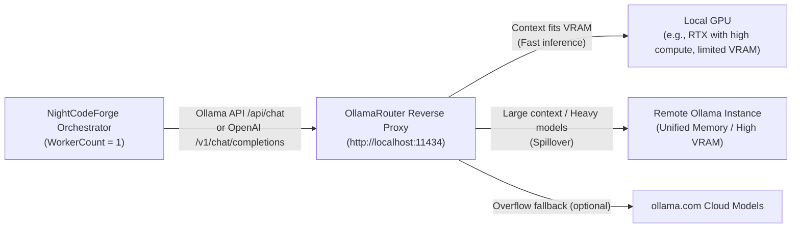

#### Key Capabilities & Synergy:
1. **Dual Protocol Compatibility:** NightCodeForge interacts with OllamaRouter via standard Ollama native endpoints (`POST /api/chat`, `POST /api/generate`) or OpenAI-compatible endpoints (`POST /v1/chat/completions`).
2. **Automated Best-GPU Selection:** OllamaRouter inspects each prompt's token count, evaluates live VRAM via `nvidia-smi`, checks active memory residency via `/api/ps`, and automatically routes:
   - Small/fast reasoning turns to the high-performance local GPU.
   - Long-context reviews, broad codebase lookups, or large-parameter models to the remote high-VRAM server.
   - NightCodeForge's `WorkerCount = 1` constraint guarantees that the local GPU is never overloaded by concurrent background jobs, while OllamaRouter ensures each sequential job runs on the most capable hardware.
3. **Dynamic Model Discovery:** NightCodeForge queries OllamaRouter's unified `/api/tags` endpoint to automatically populate available local and remote models in the web dashboard.
4. **Telemetry & Target Transparency:** The monitoring dashboard can query `/monitor` or capture response headers to display whether the current inference step was processed by the **Local GPU**, **Remote Instance**, or **Cloud Overflow**, along with exact token metrics.

### 9.3 Supported Harness Implementations

#### Implementation A (First-Class Native): Crucible Harness (Microsoft Agent Framework & `Microsoft.Extensions.AI`)
* **Type:** In-process C# Agent Engine.
* **Role:** Primary native execution harness for NightCodeForge.
* **Dedicated Specification:** For the complete, dedicated architectural specification, tool implementation details, resilient forgiving dispatcher, and token minimization engine, see **[CRUCIBLE.md](CRUCIBLE.md)**.
* **Compatibility:** Plugs directly into OllamaRouter, vanilla Ollama, LM Studio, vLLM, or any OpenAI-compatible server.
* **Profile Integration:** Adapts execution parameters based on the stage's `AgentProfile` (e.g. mapping `ThinkingEffort` to OpenAI `reasoning_effort` or DeepSeek/Ollama thinking budget tokens).
* **Auto-Configuration:** Pre-configured out of the box with system prompts, canonical function tools (`read`, `edit`, `write`, `bash`, `web_search`, `ask`, `propose_tasks`), and memory serialization.
* **Interruption:** Tool `ask` catches the call, serializes the active `ChatHistory` to JSON, captures token counters from `AdditionalProperties["usage"]`, and flags `AgentRunStatus.WaitingForHuman`.

#### Implementation B (First-Class Fallback): Pi via JSON-RPC
* **Type:** External sub-process runner communicating via JSON-RPC over `stdio` (JSON Lines protocol).
* **Dedicated Specification:** For the complete headless JSONL RPC protocol specification, event streaming, multi-disjoint edit tools, and interruption mapping, see **[PI.md](PI.md)**.
* **Profile Integration:** Passes `AgentProfile.ModelName`, custom flags, and `HarnessConfigurationJson` to the Pi RPC daemon.
* **Auto-Configuration:** Managed process lifecycle (`pi --mode rpc`) with automatic start/stop and session state snapshotting.
* **Interruption:** Listens for `extension_ui_request` events over JSONL stdout. Upon detection, requests session suspension, retrieves the serialized session snapshot ID, calculates duration/tokens, and yields `WaitingForHuman`.

#### Implementation C (Extensible Open Standard): Agent Client Protocol (ACP) Harness
* **Type:** Universal protocol adapter supporting the **[Agent Client Protocol (ACP)](https://agentclientprotocol.com/)** specification.
* **Dedicated Specification:** For the complete protocol specification, v1 vs. v2 comparison, modernized `acp-csharp` SDK architecture, and sandboxed client execution, see **[ACP.md](ACP.md)**.
* **Profile Integration:** Configures the spawned ACP agent binary or remote endpoint with the profile's model, thinking budget, and environment variables defined in `HarnessConfigurationJson`.
* **Value Proposition:** ACP is an open, standardized protocol (backed by Zed, JetBrains, and the open-source community) designed specifically for code editors and orchestrators to communicate with external AI coding agents via JSON-RPC over `stdio`, WebSocket, or HTTP.
* **How NightCodeForge Acts as an ACP Client:**
  1. **Lifecycle & Session Initialization:** NightCodeForge launches any ACP-compatible agent executable (or connects to its endpoint) and negotiates capabilities (`initializeSession`).
  2. **Workspace & Tool Delegation:** NightCodeForge exposes workspace tools (file system access, terminal execution) to the ACP agent via standardized MCP/ACP tool specifications.
  3. **Interruption & Human Input Mapping:** When an ACP agent sends a prompt/permission request requiring user input, NightCodeForge intercepts the request, saves the ACP session token/history into the checkpoint record, performs the Git WIP commit, and suspends the worker.
  4. **Universal Compatibility:** Allows developers to use existing or future ACP-compliant agents (e.g. from the ACP Registry, Zed AI agents, JetBrains AI agents) without modifying NightCodeForge core code.

### 9.4 Crucible Harness Specification & Token Minimization
For the complete technical specification of the native Crucible harness—including:
* **Canonical Tool Suite (Pi-Harmonized):** (`read`, `edit`, `write`, `bash`, `web_search`, `ask`, `propose_tasks` - with `list_dir` / `grep_search` / `get_file_outline` mapped to `bash` / `read`)
* **The "Forgiving" Tool Dispatcher:** Tool name aliasing, parameter normalization, markdown code fence stripping, and indentation tolerance
* **EditorConfig Enforcement for File Operations:** Automatic application of `.editorconfig` rules (`end_of_line` [LF/CRLF], `indent_style`, `indent_size`, `insert_final_newline`, `trim_trailing_whitespace`, `charset`) on `write` and `edit` to prevent cross-platform line ending churn and formatting diff noise
* **Stage-Scoped Tool Visibility Matrix:** Gating tool schemas across all 6 stages of the default workflow to reduce static prompt overhead
* **Pi-Style Context Compaction Engine:** Non-destructive context compaction (`PiStyleCrucibleCompactionStrategy`) with dynamic headroom budgeting, immutable task anchor (`messages[0]`), lossless file operation tracking (`<read-files>`, `<modified-files>`), 2,000-character tool clamping, and historical reasoning trace pruning (`HistoricalReasoningCompactionChatClient`)
* **Local LLM Token Minimization:** Prompt prefix stabilization for KV cache reuse, compiler error extraction, synthetic conversation priming, and noise-filtered git diffs

Please refer directly to the dedicated specification documents: **[CRUCIBLE.md](CRUCIBLE.md)** and **[CRUCIBLE_CONTEXT_COMPACTION.md](CRUCIBLE_CONTEXT_COMPACTION.md)**.

---

## 10. Skills, MCP & Repository Guidelines (`AGENTS.md`)

Modern agentic engineering workflows require flexible extensibility beyond hardcoded functions. NightCodeForge integrates three complementary extensibility pillars: **Model Context Protocol (MCP)** for runtime tools/services, **Skills** for modular operational instructions, and **`AGENTS.md`** for repository-level rules.

### 10.1 Model Context Protocol (MCP) Architecture
NightCodeForge leverages the **Microsoft Agent Framework** native MCP client integration (`Microsoft.Agents.Mcp`) to act as an **MCP Host**:


#### MCP Features in NightCodeForge:
1. **Workspace-Scoped MCP Servers:** Configured via `mcp_config.json` inside the workspace root or via the web settings UI:
   ```json
   {
     "mcpServers": {
       "sqlite": {
         "command": "uvx",
         "args": ["mcp-server-sqlite", "--db-path", "data/app.db"]
       },
       "github": {
         "command": "npx",
         "args": ["-y", "@modelcontextprotocol/server-github"],
         "env": { "GITHUB_TOKEN": "..." }
       }
     }
   }
   ```
2. **Dynamic Tool Discovery:** When a task session begins, the MCP client manager connects to configured servers, queries `tools/list`, and dynamically exposes them as callable tools in the agent's reasoning loop.
3. **ACP & MCP Synergy:** Because the **Agent Client Protocol (ACP)** specification natively re-uses MCP data types, NightCodeForge seamlessly forwards configured MCP server capabilities to both native Crucible (Microsoft Agent Framework) harnesses and external ACP agents.

### 10.2 Modular Skills System
Skills are directory-based bundles of specialized operational instructions, guidelines, and reference implementations that teach agents specific frameworks, idioms, or repo-specific rules:

```text
<WorkspaceRoot>/.agents/skills/
├── efcore-migrations/
│   ├── SKILL.md                 # YAML frontmatter + detailed markdown instructions
│   └── templates/               # Reference migration templates
└── csharp-clean-code/
    └── SKILL.md                 # Clean code & architectural rules
```

#### Skill Structure (`SKILL.md`):
```markdown
---
name: efcore-migrations
description: Guidelines and best practices for creating and applying EF Core database migrations
triggers: ["*.cs", "DbContext", "Migration"]
---

# EF Core Migration Workflow
1. When modifying entity schemas, never edit old migrations directly.
2. Run `dotnet ef migrations add <DescriptiveName>` from the infrastructure directory.
3. Verify `Up()` and `Down()` methods for data safety before proceeding.
```

#### Skill Activation & Ingestion:
1. **Catalog Discovery:** NightCodeForge scans `<AppData>/skills/` (global) and `<WorkspaceRoot>/.agents/skills/` (workspace-specific).
2. **On-Demand Loading:** The agent is equipped with a `ReadSkill(skillName)` tool allowing it to read detailed instructions when tackling specialized topics.
3. **Context-Aware Injection:** Stages can declare mandatory skills in their `AgentProfile` or stage prompt templates to ensure adherence to team standards.

### 10.3 Repository Guidelines & AGENTS.md Ingestion
AI coding agents perform best when grounded in the conventions and rules of the repository they operate on. NightCodeForge natively supports **`AGENTS.md`** as a first-class project specification file.

#### Discovery Hierarchy:
When a task session initializes, the harness inspects the target workspace directory using the following precedence:
1. `<WorkspaceRoot>/AGENTS.md`
2. `<WorkspaceRoot>/.agents/AGENTS.md` (or `.agents/rules/*.md`)
3. Fallback to `<WorkspaceRoot>/CLAUDE.md` or `<WorkspaceRoot>/GEMINI.md`

#### Ingestion & Cross-Harness Augmentation:
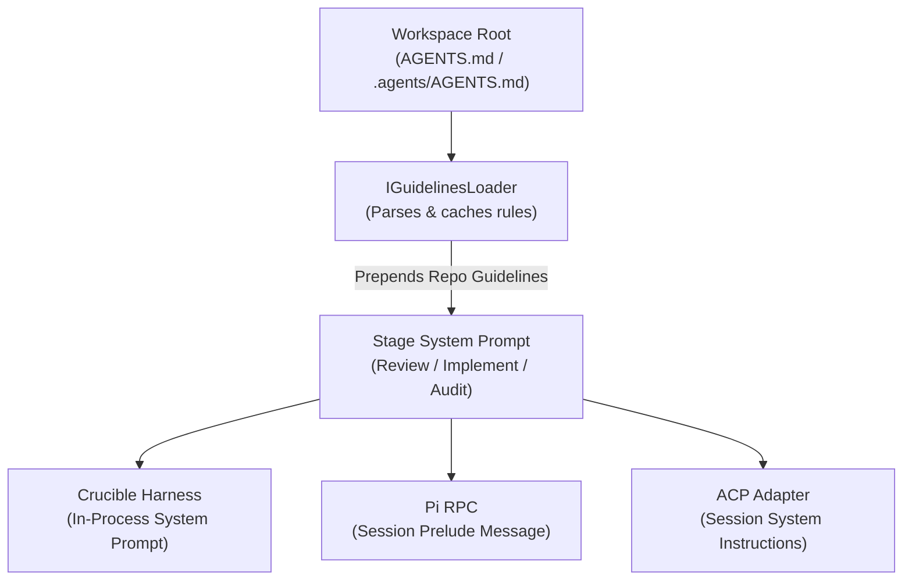

#### What AGENTS.md Injects into the Reasoning Loop:
* **Architecture Overview:** High-level project structure and module boundaries.
* **Build & Test Commands:** Precise CLI instructions (`dotnet build`, `dotnet test --filter ...`, `npm run build`).
* **Code Style & Formatting:** Naming conventions, nullability expectations, async best practices.
* **Negative Constraints:** Prohibited patterns (e.g., "Never edit auto-generated migration files directly", "Do not introduce external heavy dependencies").

By automatically loading `AGENTS.md`, NightCodeForge ensures that all 3 workflow stages—and all harness engines—adhere strictly to repository-specific rules without requiring developers to retype instructions for each task.

---

## 11. Session Transcripts & Cloud LLM Failure Diagnostics

Local LLMs (e.g. 7B, 14B, or 32B models) offer speed, low cost, and data privacy, but occasionally encounter edge-case reasoning loops, invalid tool call formats, or misunderstanding of complex skill instructions. Understanding *why* a local model failed is essential to refining skills, prompts, and harness adapters.

NightCodeForge captures every execution turn into a **chronological Markdown Transcript** and provides **integrated Cloud LLM diagnostics** to analyze and explain failures.

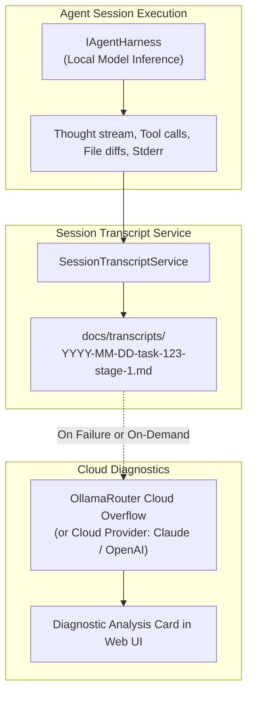

### 11.1 Transcript Structure & Markdown Schema
Whenever a stage completes, pauses for a question, or encounters an error, a transcript is saved to `<WorkspaceRoot>/docs/transcripts/YYYY-MM-DD-task-{id}-{stage}-{status}.md`:

```markdown
---
task_id: 123
stage_id: Implementation
agent_profile: fast-coder
model: qwen2.5-coder:32b
thinking_effort: Medium
hardware_target: Local GPU
duration_ms: 45200
tokens:
  prompt: 3120
  completion: 1450
  total: 4570
optimizations:
  thinking_trace_compaction: true
  loop_circuit_breaker: true
  guided_grammar_decoding: true
  deterministic_symbol_map: true
  structured_diagnostic_extraction: true
  prefix_stabilization: true
  jit_model_preload: true
kv_cache_hit_rate: 0.92
status: Failed
exit_reason: "Build failure not resolved after 3 attempts"
created_at: 2026-10-12T22:25:00Z
---

# Session Transcript: ForgeTask #123 (Implementation)

## 🎯 Task Prompt & Grounding Context
- **Target Feature:** Implement OAuth2 Authorization Flow
- **Approved Plan:** `docs/tasks/2026-10-12-implement-oauth2-flow.md`
- **Active Skills:** `csharp-clean-code`, `efcore-migrations`
- **Loaded Guidelines:** `AGENTS.md` (Rules: nullability enabled, file-scoped namespaces)

---

## ⏱️ Turn-by-Turn Execution

### Turn 1
**Model Thoughts:**
> Need to check if `Microsoft.AspNetCore.Authentication.OpenIdConnect` is installed. I will inspect `NightCodeForge.Web.csproj`.

**Tool Invocation:** `read(path="src/NightCodeForge.Web/NightCodeForge.Web.csproj")`
**Tool Output:** (Csproj XML content...)

### Turn 2
**Model Thoughts:**
> Package is missing. I will add the package using `bash`.

**Tool Invocation:** `bash(command="dotnet add package Microsoft.AspNetCore.Authentication.OpenIdConnect")`
**Tool Output:** `error: NU1102: Unable to find package with version...`

### Turn 3 (Failure Event)
**Exception / Error:** Model attempted to retry same failing command with invalid syntax.
```

### 11.2 Hybrid Diagnostic Engine (Cloud or Local LLM)
When a stage fails, gets blocked, or exhibits abnormal duration, developers can trigger an automated post-mortem analysis directly from the web dashboard. The system supports two diagnostic execution modes:

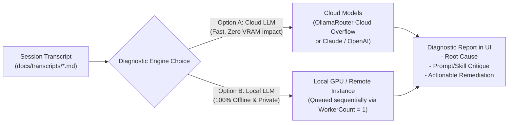

#### Diagnostic Execution Modes:
1. **Option A: Cloud Diagnostics (Recommended for Speed):**
   * **Mechanism:** Routes the diagnostic prompt and transcript to an **Ollama Cloud model** (e.g. `deepseek-v3.1:671b-cloud`, `llama3.3:70b-cloud`) via OllamaRouter's cloud overflow, or to a configured direct cloud provider (Anthropic Claude, OpenAI, Google Gemini).
   * **Advantage:** Fast, high-capacity reasoning that consumes **zero local VRAM**, leaving the local GPU free to continue running queued code tasks.
2. **Option B: Local Diagnostics (100% Air-Gapped & Private):**
   * **Mechanism:** Evaluates the transcript using a local reasoning model (e.g. `deepseek-r1:32b`, `qwen2.5-coder:32b`, or `llama3.3:70b` on a remote instance via OllamaRouter).
   * **Trade-off:** Fully private and offline. However, because local inference respects the physical hardware constraint (`WorkerCount = 1`), local diagnostic inference must queue sequentially, temporarily consuming local GPU compute time from the dev queue.

#### Diagnostic Evaluation Prompt:
Both modes execute a structured diagnostic evaluation prompt:
* **Root Cause Analysis:** Pinpoint the exact breakdown (e.g., tool argument formatting error, loop detection, compilation trap, hallucination).
* **Skill & Guideline Critique:** Identify missing, conflicting, or ambiguous instructions in `AGENTS.md` or active `.agents/skills/`.
* **Harness & Tooling Critique:** Check if tool outputs or error messages were truncated, malformed, or unparseable.
* **Actionable Remediation:** Provide concrete suggestions to fix the skill or unblock the task, with one-click prompt/skill patching where applicable.

---

## 12. Data Storage & Schema Design

NightCodeForge supports **multi-workspace management**, allowing developers to manage multiple local git repositories. While inference is queued globally to respect the single GPU constraint, each task and Git context switch is isolated to its respective workspace.

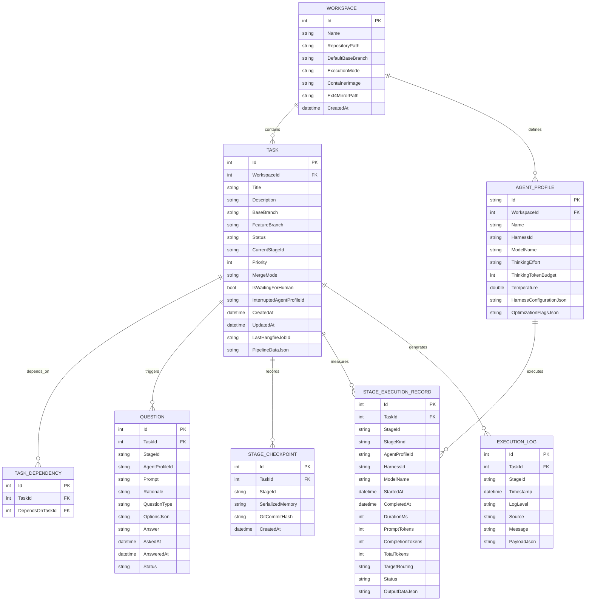

---

## 13. User Interface (Blazor Interactive Server)

### 13.1 Key Dashboard Modules
1. **Interactive Ideation & Codebase Discovery:**
   - Chat interface with the codebase exploration agent.
   - Natural language Q&A about architecture and requirements.
   - Interactive task proposal cards with one-click creation into backlog.
2. **Backlog & Dependency DAG:**
   - Visual Kanban and dependency graph view showing tasks and blocking links.
   - Status indicators: `Suggested`, `Open` (with dependency/in-flight markers), `Running [Stage]`, `Waiting for Human` (`IsWaitingForHuman`), `Ready` (awaiting merge), `Closed`.
   - Manual priority adjustment and dependency linking.
3. **Monitoring & Terminal:**
   - Real-time streaming of active agent reasoning, tool invocations, compiler logs, and Git operations via SignalR.
   - Visual stage progression indicator (`Task Review ➔ Pre-Impl Baseline ➔ Implementation ➔ Quality Gates ➔ Review & Fix ➔ Verification`).
   - Hardware routing badge (Local GPU vs Remote Server) and real-time token/timing metrics.
4. **Inbox (Human-in-the-Loop):**
   - Central view for all pending questions across blocked tasks.
   - Rich answer form supporting freeform text, code snippets, or multiple-choice options.
5. **Review Room:**
   - Visual side-by-side / unified `git diff` against base branch.
   - Displays pending tasks awaiting manual review.
   - Action buttons: "Approve & Merge" (squashes WIP commits into base branch and triggers cascade unblocking) or "Request Changes" (opens revision notes input modal and routes task back to Stage 3 `ImplementationStage` with highest priority via `llm-urgent`).
6. **Workspace, Profiles & MCP Settings:**
   - Manage target repositories, configure MCP servers (`mcp_config.json`), and tune Agent Profiles per stage.
7. **Session Transcripts & Cloud AI Diagnostics:**
   - Inspect full turn-by-turn markdown execution transcripts for any past or ongoing stage.
   - One-click "Diagnose with Cloud AI" to evaluate reasoning breakdowns, hallucinations, or harness bugs using Ollama Cloud or external cloud models.

---

## 14. Execution Sandboxing, Security & Reliability Safeguards

### 14.1 The Sandboxing Dilemma & Zero-Prompt Fatigue
Autonomous overnight coding agents cannot function effectively if every command (`rm`, `dotnet`, `npm`, `curl`, `pip`) triggers a human permission confirmation. Conversely, running autonomous agents on bare Windows or Linux hosts with unfettered system access introduces severe security and stability risks.

To achieve **zero prompt fatigue** without compromising host safety:
* **Agents work strictly on Unix.** When running on Windows, WSL2 is mandatory.
* Commands execute inside an isolated **Container Sandbox** or **WSL2 environment**.
* Only necessary directories (the agent's working clone at `~/.nightcodeforge/wks/{id}` and shared tool package caches) are mounted.
* The container can safely run with elevated or unrestricted permissions inside its own isolated namespace because the host OS, registry, user directories, and credentials remain inaccessible.

```mermaid
flowchart TD
    subgraph Host ["Host Machine (Windows / Linux / macOS)"]
        UserRepo["Developer Working Tree (NTFS / Native)\nC:/Users/.../MyProject"]
        Orchestrator["NightCodeForge Orchestrator\n(In-Process Engine & Central Config)"]
        GPU["Local GPU / OllamaRouter\n(Host Network localhost:11434)"]
    end

    subgraph Sandbox ["Execution Sandbox (WSL2 / Container)"]
        Ext4Repo["Agent Working Clone\n(~/.nightcodeforge/wks/{id})"]
        Runner["Agent Runner Container\n(/workspace mount & full autonomy)"]
        SharedCaches["Shared Package Caches\n(~/.nuget, ~/.npm, ~/.cache/uv)"]
    end

    Orchestrator -->|Direct Host Inference| GPU
    Orchestrator -->|Terminal Delegation via exec| Runner
    Orchestrator <-->|Git Push / Fetch Sync on Checkpoints| Ext4Repo
    Ext4Repo -->|Volume Mount /workspace| Runner
    SharedCaches -->|Bind Mounts (rw)| Runner
    UserRepo <-->|Local Git Remote Sync (host-origin)| Ext4Repo
```

### 14.2 Pluggable Execution Environments (`IExecutionEnvironment`)
NightCodeForge provides an extensible abstraction allowing developers to configure the execution environment per workspace:

```csharp
public interface IExecutionEnvironment : IAsyncDisposable
{
    ExecutionMode Mode { get; }
    string WorkingDirectory { get; }
    
    Task<CommandResult> ExecuteAsync(
        string command,
        IReadOnlyList<string> args,
        string? workingDirectory = null,
        IReadOnlyDictionary<string, string>? environmentVariables = null,
        CancellationToken cancellationToken = default);
        
    Task SyncToHostAsync(CancellationToken cancellationToken = default);
    Task SyncFromHostAsync(CancellationToken cancellationToken = default);
}

public enum ExecutionMode
{
    BareHost = 0,          // Direct host CLI (Opt-in for simple setups or bare Linux)
    WslDirect = 1,         // Direct execution inside WSL2 distro (wsl.exe -d <distrib>)
    ContainerSandbox = 2   // Ephemeral Docker/Podman container running on ext4 (Default)
}
```

#### Detailed Execution Mode Behaviors:

1. **"Bare Mode" (`BareHost` / `WslDirect`):**
   - **Agents work strictly on Unix:** On Windows, the `bash` tool executes directly inside WSL2 (`wsl.exe -d <distrib> -- bash -c "cd ~/.nightcodeforge/wks/{id} && ..."`). On Linux/macOS, it executes via the host `/bin/bash`.
   - **Zero PowerShell/CMD:** Windows command prompts are never used for agent tool executions.
2. **"Container Mode" (`ContainerSandbox` - Default):**
   - **Path Mapping:** The agent inside the container sees only `/workspace` mapped to the working clone `~/.nightcodeforge/wks/{id}`.
   - **Crucible Tool Call Remapping:** Because Crucible runs outside the container (in-process on the host), every file I/O tool call (`read`, `write`, `edit`) referring to `/workspace/...` is dynamically remapped to the "real path":
     - On Linux/macOS: `~/.nightcodeforge/wks/{id}/...`
     - On Windows: `\\wsl.localhost\{distrib}\home\{username}\.nightcodeforge\wks\{id}\...`
   - **On-the-Fly Lightweight Container Image:** The container image itself is almost empty and generated on the fly (a minimal, tailored base layer with essential CLI utilities), relying on host-mounted caches and toolchains rather than multi-GB prebuilt images.

#### Comparison of Execution Modes:

| Feature | `BareHost` | `WslDirect` | `ContainerSandbox` *(Default)* |
| :--- | :--- | :--- | :--- |
| **Host OS** | Windows (via WSL2 bash) / Linux | Windows (WSL2) / Linux | Windows (WSL2 Docker) / Linux |
| **Filesystem Speed** | Native host / WSL2 ext4 | **High** on WSL2 ext4 | **High** on ext4 |
| **Working Clone** | `~/.nightcodeforge/wks/{id}` | `~/.nightcodeforge/wks/{id}` | `~/.nightcodeforge/wks/{id}` $\rightarrow$ `/workspace` |
| **Isolation Level** | Minimal (Process level) | User space isolation | **Full container isolation** |
| **Prompt Fatigue** | High (caution required) | Moderate | **Zero** (Autonomous within container) |
| **Path Mapping** | Real path | Real path in WSL | Transparent `/workspace` $\rightarrow$ Real UNC/Host |
| **Tooling & SDKs** | Uses host/WSL SDKs | Distro-installed SDKs | Bind-mounted host package caches |

### 14.3 Shared SDKs & Persistent Package Caches
To prevent containers from downloading gigabytes of SDKs and package dependencies for every task:

1. **Persistent Package Caches (Read-Write Bind Mounts):**
   Package managers write to host-mounted shared cache directories:
   - **NuGet:** Host `~/.nuget/packages` $\rightarrow$ Container `/root/.nuget/packages`
   - **npm / pnpm:** Host `~/.npm` $\rightarrow$ Container `/root/.npm` and `/root/.local/share/pnpm/store`
   - **Maven / Gradle:** Host `~/.m2` $\rightarrow$ Container `/root/.m2/repository`
   - **Python:** Host `~/.cache/uv` $\rightarrow$ Container `/root/.cache/uv`
   *Result:* When Container 1 downloads a package, Container 2 gets an immediate local cache hit.

2. **Heavy SDK Sharing (Read-Only Mounts or Base Images):**
   - **Strategy A (Host Toolchain Mounts):** On Linux/WSL2 hosts with existing toolchains, SDK directories (e.g. `/usr/share/dotnet`, `/usr/lib/jvm`, `/opt/android-sdk`) are mounted **read-only (`:ro`)** into the container.
   - **Strategy B (On-the-Fly Slim Runner):** NightCodeForge synthesizes a minimal runtime layer on the fly, mounting the host toolchains where possible.

### 14.4 In-Process Harness vs. Sandboxed Tool Execution
NightCodeForge adopts an **In-Process Harness + Sandboxed Tool Delegation** architecture:

```mermaid
flowchart LR
    subgraph Host ["NightCodeForge Host Process (C#)"]
        CentralConfig["Central Config\n(mcp_config.json, API Keys, Prompts)"]
        Harness["IAgentHarness\n(Crucible / ACP Client / Pi Host)"]
        FileTools["File Tools\n(read, edit, write)"]
        CmdTool["bash Tool"]
    end

    subgraph Sandbox ["Container Sandbox"]
        Exec["docker exec -i / wsl.exe\n(dotnet, npm, tests)"]
        Ext4FS["ext4 /workspace\n(mapped to ~/.nightcodeforge/wks/{id})"]
    end

    Harness --> CmdTool
    Harness --> FileTools
    CmdTool --> Exec
    FileTools -->|"Real path via \\wsl.localhost (UNC) or Linux path"| Ext4FS
    CentralConfig --> Harness
```

#### Why In-Process Orchestration is Superior:
1. **Network Simplicity for Inference:** The LLM client runs directly on the host, communicating with OllamaRouter on `localhost:11434` or cloud providers without Docker-to-Host bridge networking tasks.
2. **Central Configuration for Pi & ACP:**
   - **Pi JSON-RPC:** NightCodeForge spawns and monitors the Pi agent runner on the host, passing tool implementations that forward `bash` into the container sandbox / WSL2.
   - **Agent Client Protocol (ACP):** NightCodeForge acts as the ACP client. When an ACP agent requests a terminal command execution, NightCodeForge routes the command into the container sandbox.
   - `mcp_config.json`, API credentials, and skills remain centralized on the host.
3. **Optimized File Operations & EditorConfig Compliance:**
   - Single-file reads and writes (`read`, `edit`, `write`) access the working clone directly via `\\wsl.localhost\{distrib}\home\{username}\.nightcodeforge\wks\{id}\...` on Windows or native POSIX paths on Linux.
   - In container mode, the tool dispatcher seamlessly strips `/workspace/` and maps to the real host/UNC path.
   - All `write` and `edit` file mutations pass through Crucible's `EditorConfigFileApplier`, strictly enforcing repository `.editorconfig` rules (`end_of_line` [LF/CRLF], `indent_style`, `indent_size`, `trim_trailing_whitespace`, `insert_final_newline`, `charset`) before writing to disk. This completely prevents cross-environment newline churn (Windows CRLF vs Linux LF) and eliminates phantom diffs in Git.
   - Heavy recursive operations (compilation, test runners, git status) run completely inside the container.

### 14.5 Host Guardrails & Command Isolation
* **Docker Socket Prohibition:** Mounting `/var/run/docker.sock` into the container is strictly prohibited to prevent container escapes.
* **Network Policies:** Optional network egress restrictions limit container network calls to trusted package registries (nuget.org, npmjs.org, pypi.org) while blocking internal private subnets.
* **Timeout Governance:** Every command execution inside the sandbox is governed by a strict timeout (e.g. 5 minutes for compilation, 30 seconds for git operations).
* **Sentinel REPL Process Protection:** If a command hangs or enters an infinite loop inside `docker exec` / WSL, the runner sends `\x03` (SIGINT) over stdin. If the sentinel is not emitted within a 2-second grace period, the container shell process is forcefully terminated and restarted to eliminate runaway background processes.

#### 14.5.1 Restricted Read-Only Container Sandbox (Triage Tier)
For untrusted external input (such as incoming GitHub tasks processed by `TriageProfile` on the `main` or `master` branch), NightCodeForge enforces a hardened container profile:
* **Target Working Directory:** Mounted directly on the repository base branch (`main` or `master`) with strict read-only permissions (`-v /var/ncf/workspaces/{id}/repo:/workspace:ro`). No feature branch is checked out, guaranteeing the base branch cannot be modified.
* **Air-Gapped Network Namespace (`--network none`):** The container is launched with zero network connectivity. Outbound TCP/UDP, DNS resolution, and access to host or internal subnets are completely disabled, neutralizing any data exfiltration or credential phone-home attempts.
* **Read-Only Root Filesystem (`--read-only`):** The entire container filesystem (apart from a volatile 32MB in-memory `/tmp` tmpfs with `noexec,nosuid`) is immutable.
* **Privilege & Capability Stripping:**
  - `--cap-drop=ALL`: Drops all Linux kernel capabilities.
  - `--security-opt no-new-privileges:true`: Prevents escalation via setuid/setgid binaries.
  - `--user 1000:1000`: Enforces non-root execution.
* **Secret & Environment Sanitization:** Container environment variables are scrubbed of all host secrets (Ollama/OpenAI API keys, GitHub personal access tokens, database connection strings, JWT signing keys).
* **Host Execution Prohibition:** Invocations with `SecurityTier == SandboxSecurityTier.RestrictedReadOnly` strictly refuse to run under `BareHostExecutionEnvironment` or unconfined WSL; they must execute inside the hardened container.

### 14.6 Crash & Hang Protection
* Every LLM step and Git command is bound to a strict timeout policy.
* Hangfire automatic retry is disabled for LLM inference tasks (`[AutomaticRetry(Attempts = 0)]`) to prevent duplicate code edits on unexpected runtime exceptions; unhandled errors transition the task cleanly to `Failed`.
* **Clean Interruption Lifecycle:** Interruption via `ask` is intercepted internally: the checkpoint and question are persisted, `task.IsWaitingForHuman = true` and `task.InterruptedAgentProfileId` are set while preserving `task.Status`, and the background job returns `StageExecutionResult.WaitingForHuman()`, completing in a clean `Succeeded` status in Hangfire rather than an artificial failure.

### 14.7 Graceful Restart & Crash Recovery System (`IStartupRecoveryService`)

In overnight autonomous operation, unexpected host restarts are inevitable—most commonly triggered by **Windows Update reboot cycles**, power outages, or kernel driver updates. 

NightCodeForge implements an automated **Startup Reconciliation Protocol** executed during host boot before the Hangfire worker begins polling for jobs:

```mermaid
flowchart TD
    Boot["Host Application Boot (Program.cs)"] --> RunRecovery["IStartupRecoveryService.ReconcileWorkspacesAsync()"]
    
    subgraph Sanitation ["1. Git & Lock Sanitation"]
        CleanLocks["Detect & Purge Stale Lock Files\n(.git/index.lock, .git/HEAD.lock, .git/refs/...)"]
        CheckDirty{"Uncommitted / Untracked\nFiles on Disk?"}
        RescueCommit["Create Automated Rescue Commit\n'WIP-RECOVERY: [Crash Recovery] Preserving workspace state'"]
    end

    subgraph StateReconciliation ["2. State Machine Reconciliation"]
        FindRunning["Query DB for Tasks in 'Running' Status"]
        CheckStage{"Interrupted Stage Type?"}
        AgenticStage["Agentic Stage:\n- Restore last turn snapshot from STAGE_CHECKPOINT\n- Inject '[System Notice: Host restarted unexpectedly]'"]
        DeterministicStage["Deterministic Stage:\n- Reset stage execution metrics\n- Mark ready for fresh execution"]
    end

    subgraph Resumption ["3. Urgent Re-Enqueueing"]
        EnqueueUrgent["Transition ForgeTask to 'Pending'\nEnqueue to 'llm-urgent' queue"]
        AuditLog["Log Recovery in EXECUTION_LOG\nAppend entry to docs/transcripts/"]
        StartWorker["Start Hangfire Background Queue\n(Immediate pickup of recovered task)"]
    end

    RunRecovery --> CleanLocks
    CleanLocks --> CheckDirty
    CheckDirty -->|Yes| RescueCommit --> FindRunning
    CheckDirty -->|Clean| FindRunning
    FindRunning --> CheckStage
    CheckStage -->|Agentic| AgenticStage --> EnqueueUrgent
    CheckStage -->|Deterministic| DeterministicStage --> EnqueueUrgent
    EnqueueUrgent --> AuditLog --> StartWorker
```

#### Detailed Recovery Procedures:
1. **Stale Lock Cleanup:** If the OS reboots during a Git command, dangling lock files (`.git/index.lock`, `.git/refs/heads/*.lock`) block all subsequent Git operations. The recovery service safely purges stale lock files before attempting workspace commands.
2. **Uncommitted Working Tree Rescue:** Any edits flushed to disk prior to the reboot that were not yet wrapped in a Git commit are safeguarded via an automated rescue commit (`WIP-RECOVERY: Preserving uncommitted workspace changes`). This guarantees zero developer code loss.
3. **Session Rehydration:**
   * For **Agentic Stages**, Crucible rehydrates the serialized conversation memory up to the last successful turn from `STAGE_CHECKPOINT.SerializedMemory`, appending a system notice informing the model that the environment was restarted and workspace files were restored.
   * For **Deterministic Stages** (e.g. interrupted midway through `dotnet test`), the stage is reset to run freshly from the beginning.
4. **Immediate Priority Re-Enqueueing (`llm-urgent`):** The recovered task is placed directly at the head of `llm-urgent`. When Hangfire initializes (`WorkerCount = 1`), the single GPU worker immediately resumes the interrupted overnight task before touching any other backlog items.
5. **Auditing & Notification:** The recovery event is permanently recorded in `EXECUTION_LOG`, noted in the task's session transcript under `docs/transcripts/`, and broadcasted via SignalR to the web UI.

