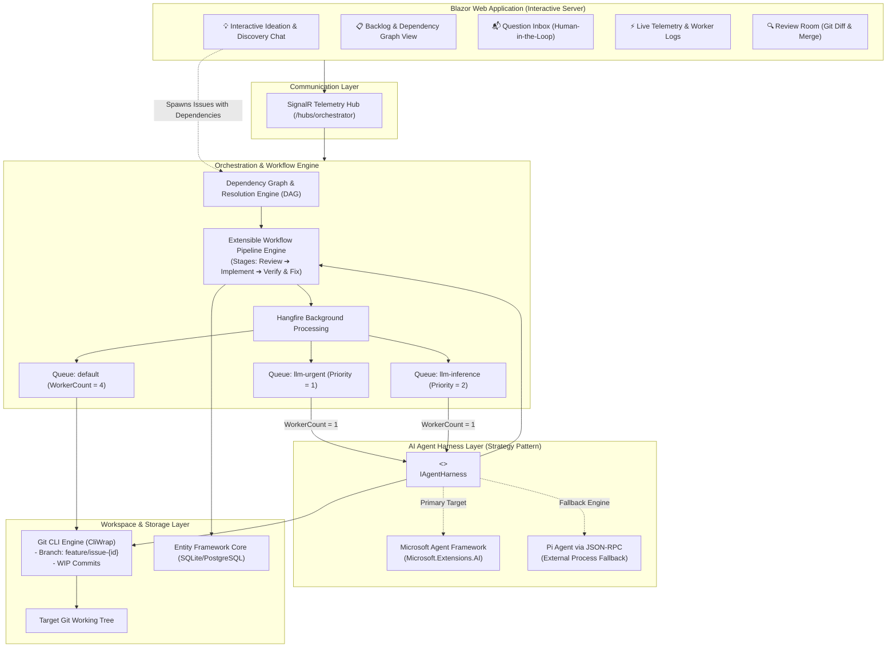
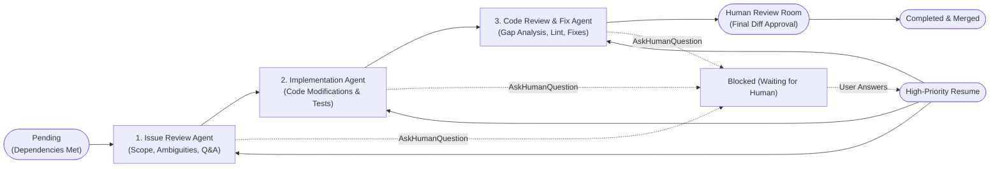
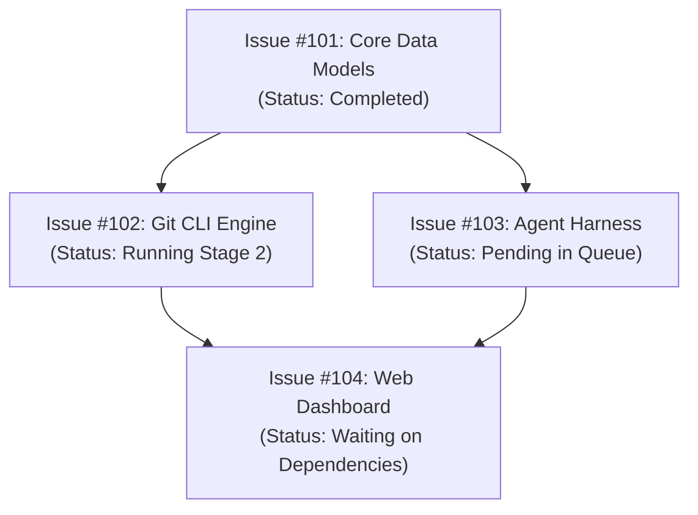
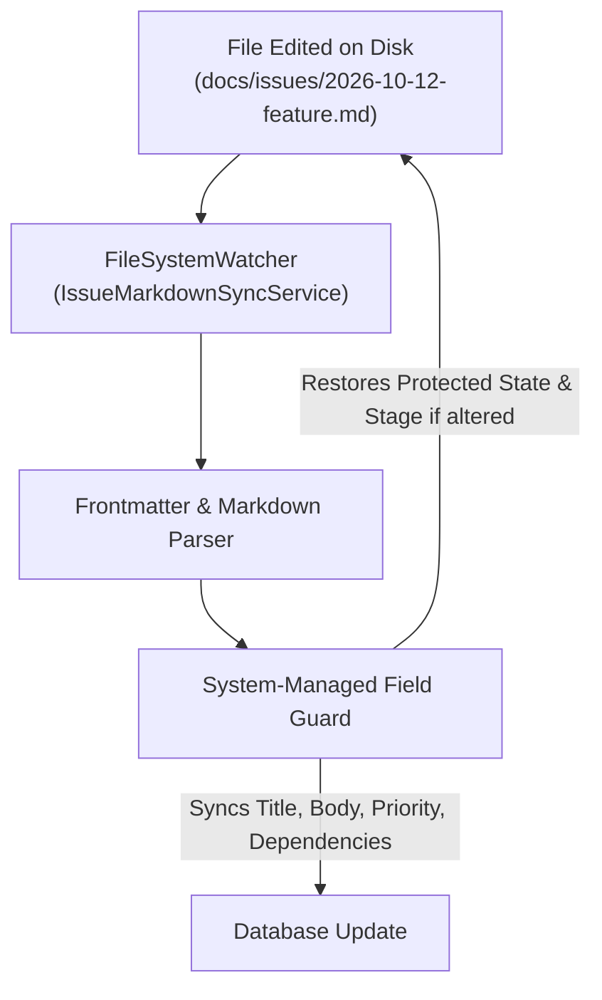
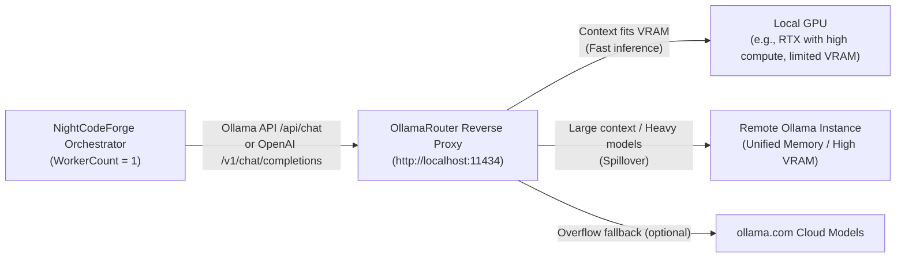
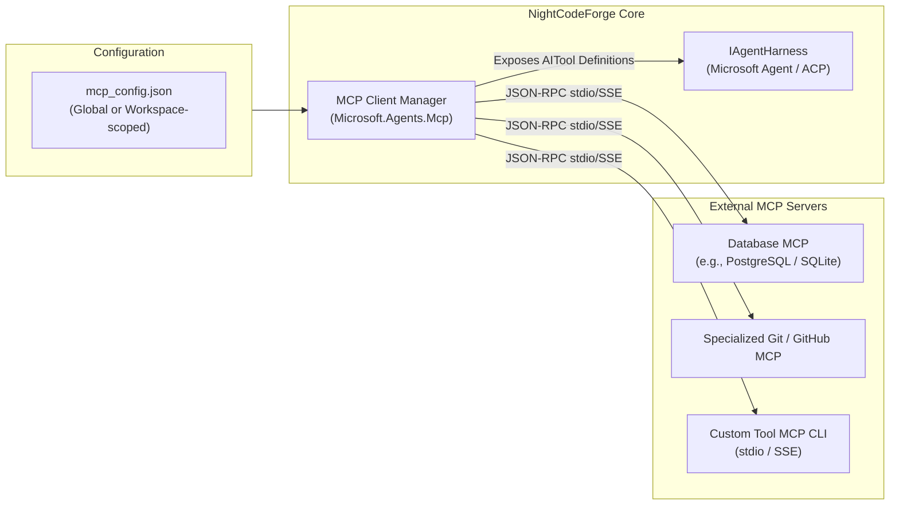
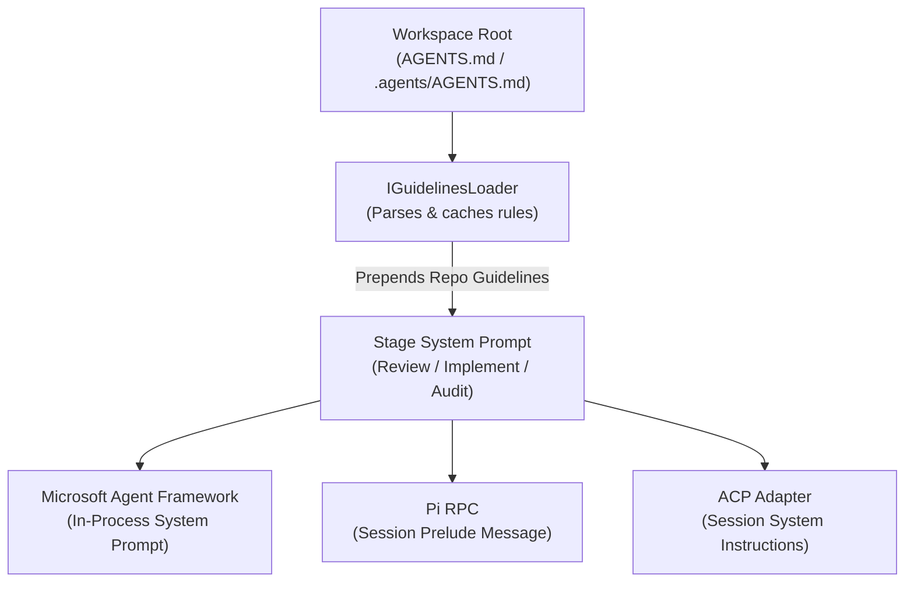
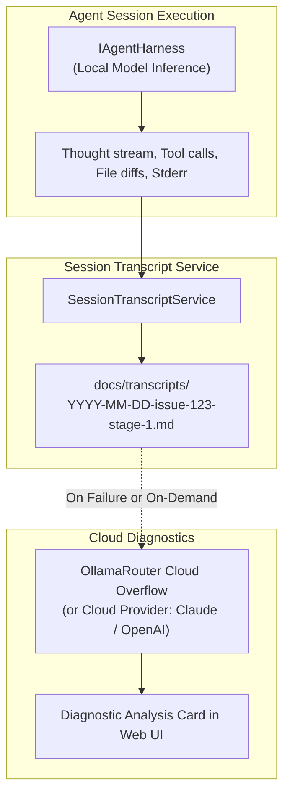
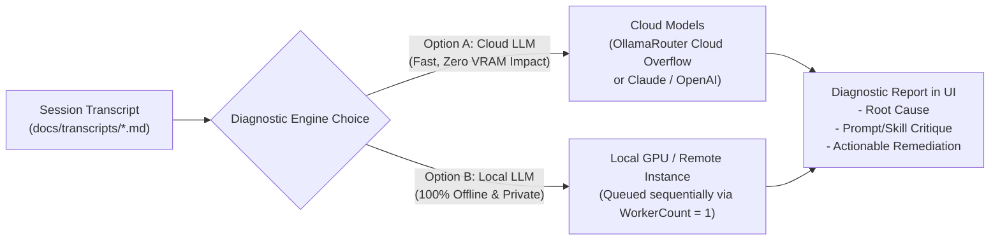

# 🏗️ NightCodeForge - System Architecture Document

## 1. Executive Summary & Problem Space

### 1.1 Context & Objectives
**NightCodeForge** is an Asynchronous AI Orchestrator ("Dev-Queue") designed specifically for software engineering workflows backed by **local Large Language Models (LLMs)**.

In local AI-assisted development (e.g., using Ollama, vLLM, llama-server, or local agent runtimes like Pi and OpenCode), the physical environment is bound by a strict hardware limitation: **a single dedicated GPU**.
Unlike elastic cloud APIs, local inference throughput cannot run multiple concurrent reasoning/coding tasks without severe VRAM thrashing, context truncation, or out-of-memory (OOM) crashes. Therefore, **LLM execution must strictly run sequentially (Concurrency = 1)**.

### 1.2 The Core Problem: Interactive Blocking vs. GPU Utilization
Standard autonomous coding agents operate in interactive synchronous loops:
1. Agent plans or inspects code.
2. Agent reaches an ambiguity (e.g., choice of library, business rule clarification, confirmation of breaking change).
3. Agent prompts the human and **blocks the process** waiting for input.
4. **Result:** The GPU sits idle for minutes or hours, blocking all other queued development tasks and wasting expensive compute resources.

### 1.3 The NightCodeForge Solution: Context-Switching Dev-Queue
NightCodeForge decouples task execution from human availability through **asynchronous checkpointing and workspace context switching**:
* When an agent needs human guidance, it invokes a specialized interruption tool (`AskHumanQuestion`).
* The orchestrator intercepts this call, captures the agent's memory/chat session into persistent storage, performs a Git WIP commit on the issue branch, and **terminates the worker task cleanly**.
* The single-worker GPU queue immediately picks up the next task in line.
* When the developer answers the pending question via the web interface, the issue transitions back to high-priority readiness. The orchestrator checks out the branch, restores the memory context with the human's answer, and resumes reasoning without loss of continuity.

---

## 2. High-Level Architectural Diagram



---

## 3. Extensible Multi-Agent Workflow Engine

Rather than binding to a rigid, hardcoded state machine library, NightCodeForge uses a **composable, stage-based Workflow Pipeline Engine**. Each issue progresses through a sequence of discrete, pluggable stages executed by dedicated specialized agents.

### 3.1 Default 3-Agent Workflow Stages



1. **Stage 1: Issue Review Agent (`IssueReviewStage`)**
   - **Mission:** Deeply inspect the codebase against the issue request *before* any implementation begins.
   - **Goals:** Detect ambiguities, uncover hidden constraints, identify impacted files, verify prerequisites, and proactively ask clarifying questions to avoid rework during coding.
   - **Output:** Approved Technical Specification & Execution Plan.
2. **Stage 2: Implementation Agent (`ImplementationStage`)**
   - **Mission:** Implement the code changes outlined in the approved plan.
   - **Goals:** Create/modify files, invoke workspace build tools (e.g. `dotnet build`), execute unit tests, and iterate until the code compiles and passes tests.
   - **Output:** Working implementation with initial commit history.
3. **Stage 3: Code Review and Fixes Agent (`CodeReviewAndFixStage`)**
   - **Mission:** Act as a critical reviewer and automated fixer.
   - **Goals:** Compare the `git diff` against the base branch, check coding standards, detect potential regression gaps, missing error handling, or performance traps, and make direct fixes.
   - **Output:** Polished, review-ready code diff.

### 3.2 Agent Profiles: Specializing Intelligence per Stage
Each step in a workflow pipeline is associated with an **Agent Profile** (`AgentProfile`). Different stages of software development demand different model capabilities, reasoning depths, and tool permissions:

| Stage | Typical Profile Needs | Example Configuration |
| :--- | :--- | :--- |
| **1. Issue Review** | High reasoning capability, deep codebase comprehension, proactively questioning edge cases. | **Harness:** `MicrosoftAgent` (or `PiRpc`)<br>**Model:** `deepseek-r1:32b`<br>**Thinking Effort:** `High`<br>**Config:** `{ "proactiveAmbiguityCheck": true }` |
| **2. Implementation** | Rapid tool execution, fast code generation, test iteration. | **Harness:** `MicrosoftAgent`<br>**Model:** `qwen2.5-coder:32b`<br>**Thinking Effort:** `Medium` (or `Low`)<br>**Config:** `{ "autoCompile": true, "maxTestRetries": 3 }` |
| **3. Code Review & Fixes** | Strict gap analysis, linting, regression auditing. | **Harness:** `Acp` (or `MicrosoftAgent`)<br>**Model:** `qwen2.5-coder:32b`<br>**Thinking Effort:** `Medium`<br>**Config:** `{ "strictLinting": true, "temperature": 0.1 }` |

#### Agent Profile Definition
```csharp
public class AgentProfile
{
    public string Id { get; set; } = default!;          // e.g. "deep-analyst", "fast-coder", "acp-auditor"
    public string Name { get; set; } = default!;
    public string HarnessId { get; set; } = default!;    // "microsoft-agent", "pi-rpc", or "acp"
    public string ModelName { get; set; } = default!;    // e.g. "deepseek-r1:32b", "qwen2.5-coder:32b"
    public ThinkingEffort ThinkingEffort { get; set; }  // None, Low, Medium, High, CustomBudget
    public int? ThinkingTokenBudget { get; set; }
    public double? Temperature { get; set; }
    public string? HarnessConfigurationJson { get; set; } // Harness-specific launch/runtime JSON options
    public int? WorkspaceId { get; set; }               // Nullable: global profile or workspace override
}

public enum ThinkingEffort
{
    None = 0,
    Low = 1,
    Medium = 2,
    High = 3,
    CustomBudget = 4
}
```

### 3.3 Extensibility & Pipeline Abstraction
The workflow pipeline is defined via modular contracts. Each stage specifies its default `AgentProfileId` while allowing per-issue or per-workspace overrides:

```csharp
public interface IWorkflowStage
{
    string StageId { get; }
    string DisplayName { get; }
    int Order { get; }
    string DefaultAgentProfileId { get; }
    
    Task<StageExecutionResult> ExecuteAsync(
        StageExecutionContext context,
        IAgentHarness harness,
        AgentProfile profile,
        Func<AgentTelemetryEvent, Task> onTelemetry,
        CancellationToken cancellationToken);
}

public interface IWorkflowPipeline
{
    string PipelineId { get; }
    IReadOnlyList<IWorkflowStage> Stages { get; }
    IWorkflowStage? GetNextStage(string currentStageId);
    IWorkflowStage? GetStage(string stageId);
}
```

### 3.4 Stage Bootstrap Prompts & Context Injection
To maximize reasoning effectiveness and ensure consistent agent behavior, each stage relies on a specialized **System Prompt** (defining persona, behavioral boundaries, and available tools) and a dynamic **Bootstrap Prompt** (seeding task-specific context and instructions):

```csharp
public class StagePromptTemplate
{
    public string SystemPrompt { get; set; } = default!;
    public string BootstrapPromptTemplate { get; set; } = default!;
}
```

#### Specialized Prompts for the 3 Default Stages:
1. **Stage 1 (Issue Review):**
   - **System Persona:** Architectural Analyst & Requirements Investigator.
   - **Mission:** Scrutinize the codebase against the issue description. Proactively uncover ambiguities, implicit assumptions, and architectural conflicts *before* any implementation begins.
   - **Injected Context:** `{{Issue.Title}}`, `{{Issue.Description}}`, repository structure, guidelines.
   - **Behavioral Directive:** "If any requirement or design decision is ambiguous or has multiple valid alternatives, invoke `AskHumanQuestion` immediately to clarify. Do not guess."
2. **Stage 2 (Implementation):**
   - **System Persona:** Senior Software Engineer & TDD Practitioner.
   - **Mission:** Implement clean, robust code according to the approved plan. Run builds (`dotnet build`), run tests, and fix errors incrementally.
   - **Injected Context:** Approved technical plan from Stage 1, all resolved Q&A pairs from `{{PriorAnswers}}`, list of affected files.
   - **Behavioral Directive:** "Write working code and verify with build tools. If unexpected blockers or breaking changes arise, call `AskHumanQuestion`."
3. **Stage 3 (Code Review and Fixes):**
   - **System Persona:** Critical Code Auditor & QA Specialist.
   - **Mission:** Review the full changeset against the base branch. Identify regressions, edge cases, missing unit tests, or lint violations, and make targeted fixes.
   - **Injected Context:** Target base branch (`{{BaseBranch}}`), complete `git diff` generated from Stage 2 (`{{GitDiff}}`), project coding standards.
   - **Behavioral Directive:** "Inspect the diff line-by-line. If you find bugs or gaps, use file editing tools to fix them directly. When confident, summarize findings."

### 3.5 Stage Interruption & Universal Context Switching
At **any point** in **any stage**, an agent may invoke the `AskHumanQuestion` tool. When this occurs:
1. The stage returns `StageExecutionResult.WaitingForHuman(question)`.
2. The orchestrator records the question in the database and updates the issue state to `BlockedQuestion(stageId)`.
3. The orchestrator triggers a native Git WIP commit on `feature/issue-{id}`.
4. The Hangfire job completes, releasing the single GPU worker.
5. When the user submits the answer, the issue transitions back to `Pending` and is enqueued into `llm-urgent`. The active stage is resumed with the previous conversation memory and the newly supplied human answer.

---

## 4. Issue Dependency Management (DAG)

Complex features and refactoring tasks naturally break down into interdependent issues. NightCodeForge natively manages dependencies via a **Directed Acyclic Graph (DAG)**.

### 4.1 Dependency Rules & State Propagation
* An issue can declare one or more prerequisite issues (`DependsOnIssueIds`).
* **Execution Gate:** An issue with unsatisfied dependencies remains in status `WaitingOnDependencies` and **will not be enqueued** to Hangfire.
* **Cascade Activation:** When an issue reaches `Completed` state, the orchestrator evaluates all dependent issues. If all dependencies of a dependent issue are satisfied, its state automatically transitions to `Pending` and it enters the Hangfire queue.
* **Cycle Prevention:** When creating or modifying dependencies, the `DependencyResolutionEngine` performs topological sorting to detect and reject circular references (cycles).



---

## 5. File-System Issue Mirroring (`docs/issues/`)

To provide optimal ergonomics for AI agents, developers, and Git workflows, active (non-resolved) issues are mirrored directly in the workspace file system under **`docs/issues/`** as structured Markdown documents with YAML frontmatter.


### 5.1 Why Markdown Files for Agents?
1. **Native Agent Accessibility:** Agents inside the workspace can read issue specifications, requirements, and previous Q&A directly using basic file tools (`ReadFile`), without needing custom database query APIs or SDK dependencies.
2. **Developer & IDE Transparency:** Developers can review, search, and edit issues directly in VS Code, Visual Studio, or Obsidian without leaving their editor.
3. **Version Control Integration:** Active issue specifications live alongside the code on the issue branch, preserving the exact requirements snapshot in Git history.

### 5.2 Document Naming & Frontmatter Schema

#### Naming Convention: Chronological Date Prefix (`YYYY-MM-DD-slug.md`)
To allow developers and agents to quickly sort issues chronologically in their file explorer without having to rename files when IDs are assigned, files are named:
`docs/issues/YYYY-MM-DD-<slug>.md` (e.g. `docs/issues/2026-10-12-implement-oauth2-flow.md`).

* The database `id` is stored exclusively **inside the frontmatter**, not in the filename.
* Dropping a new file never requires a file rename when the system assigns an ID.

```markdown
---
id: 123
title: Implement OAuth2 Authorization Flow
workspace: NightCodeForge
status: BlockedQuestion
current_stage: IssueReview
priority: 1
base_branch: main
feature_branch: feature/issue-123
depends_on: [101, 102]
agent_profile: deep-analyst
created_at: 2026-10-12T22:00:00Z
updated_at: 2026-10-12T22:05:00Z
---

# Implement OAuth2 Authorization Flow

## 📋 Requirements & Description
Implement authorization code flow with PKCE for local clients...

## ❓ Human Clarifications (Q&A)
### Question 1 (Asked during Stage: IssueReview on 2026-10-12 22:03:00)
**Prompt:** Should refresh token rotation be enforced on every token exchange?
**Answer:** Yes, rotate refresh tokens on every exchange and store revocations in SQLite.

## 📐 Technical Plan & Scope (Stage 1 Output)
- [ ] Add `OAuthClientOptions` configuration model.
- [ ] Implement `PkceTokenValidator` handler.
- [ ] Add integration tests in `NightCodeForge.Core.Tests`.
```

### 5.3 Bidirectional Synchronization & Field Protection Rules



1. **System-Managed Fields (Protected):**
   * Fields like `id`, `status` (`overall_state`), `current_stage`, and `created_at` are strictly governed by the orchestrator engine and database.
   * If a user or agent modifies `status` or `current_stage` directly in the markdown file, the orchestrator rejects the state alteration and rewrites the authoritative database state back into the file's frontmatter.
2. **User/Agent Editable Fields (Synchronized to DB):**
   * Changes to `title`, markdown body (`description`, requirements, technical plan), `priority`, `agent_profile`, `base_branch`, and `depends_on` are automatically detected and saved into the database.
   * Dependency changes via `depends_on` are passed through DAG cycle checks before being committed.
3. **Drop-in Creation Without Renaming:**
   * When a developer or agent drops a new file (e.g. `docs/issues/2026-10-13-add-dark-theme.md`) without an `id` field:
     1. The watcher detects the new file.
     2. A new `Issue` entity is created in EF Core, allocating the next available `Id` (e.g. `124`).
     3. The sync service injects `id: 124` and `created_at` directly into the file's frontmatter **in-place**, without renaming the file.
4. **Resolution Archival / Cleanup:**
   * When an issue reaches `Completed` (or `Cancelled`), the markdown file is removed from `docs/issues/` (or archived to `docs/issues/archive/`), ensuring that `docs/issues/` contains only active and pending work.

---

## 6. Interactive Issue Discovery & Ideation Chat

To prevent vague or poorly scoped issues from entering the queue, NightCodeForge provides an **Interactive Ideation & Codebase Discovery Chat**:

```mermaid
sequenceDiagram
    autonumber
    actor User as Developer
    participant UI as Blazor Chat Interface
    participant Explorer as Discovery Agent (Read-Only)
    participant Git as Git Workspace
    participant Engine as Dependency & Issue Engine

    User->>UI: "How does our authentication handle JWT refresh tokens, and what's needed for OAuth2?"
    UI->>Explorer: Stream prompt + conversation context
    Explorer->>Git: Read relevant auth files & configuration
    Git-->>Explorer: File contents & symbols
    Explorer-->>UI: Explains architecture & highlights gaps
    User->>UI: "Great, let's create issues to implement OAuth2 support."
    Explorer->>UI: Proposes 2 structured issues with dependencies:<br>1. Issue A: Add OAuth2 client config & token model<br>2. Issue B: Add Google/GitHub provider handlers (Depends on A)
    User->>UI: Reviews, tweaks scope, and clicks "Create in Backlog"
    UI->>Engine: Registers Issue A & Issue B with dependency link
    Engine-->>UI: Issue A queued; Issue B waiting on A
```

### 6.1 Discovery Agent Capabilities
* **Read-Only Access:** Equipped with search, file-reading, and symbol exploration tools (`FindFiles`, `ReadFile`, `GrepSearch`, `ListTree`). Cannot modify working tree files.
* **Issue Extraction Tool:** Agent has a function tool `ProposeIssues(List<IssueProposalDto>)` allowing it to output structured titles, acceptance criteria, affected components, and recommended dependencies directly into the UI for developer approval.

---

## 7. Orchestration Engine & Queue Design

### 7.1 Queue Concurrency Architecture
The background job system uses **Hangfire** backed by persistent storage. Hangfire servers are separated into two distinct worker pools:

| Queue Name | Worker Count | Purpose | Constraints |
| :--- | :--- | :--- | :--- |
| `llm-urgent` | **1** (Shared pool) | Resumed issues that just received developer answers. | Highest priority for GPU inference. |
| `llm-inference` | **1** (Shared pool) | Normal queued issues awaiting execution. | Strictly sequential to protect VRAM. |
| `default` | **4** | Non-GPU background tasks: Git diff calculation, log cleanup, telemetry broadcasts. | Parallel execution allowed. |

> [!IMPORTANT]
> The `llm-urgent` and `llm-inference` queues share a dedicated Hangfire `BackgroundJobServer` configured with `WorkerCount = 1` and ordered queue processing:
> `Queues = new[] { "llm-urgent", "llm-inference" }`.
> This guarantees that:
> 1. At most **one** AI task runs on the GPU at any millisecond.
> 2. An answered issue in `llm-urgent` will preemptively be picked up before any new task in `llm-inference`.

---

## 8. Git Workspace & Context-Switching Subsystem

### 8.1 Strict CLI Requirement
Wrappers such as `LibGit2Sharp` are **strictly prohibited** due to unmanaged binary dependencies, memory leak risks in long-running servers, and poor support for modern Git features. All Git operations are executed via native command-line invocations using **`CliWrap`**.

### 8.2 Save Strategy: WIP Commits vs. Stash
To ensure zero data loss during context switches:
1. `git stash` is **not used** because untracked files, subdirectories, or unstaged renames can lead to merge conflicts on unstash or orphaned changes.
2. The orchestrator uses **WIP Commits**:
   ```bash
   git add -A
   git commit -m "WIP: [Issue #{id}][Stage: {stageName}] Awaiting human input: {QuestionSummary}" --no-verify
   ```
3. When the issue passes all stages and is approved in the Review Room, the orchestrator squashes the WIP commits into a clean, conventional commit before merging.

---

## 9. AI Harness Abstraction Layer (`IAgentHarness`)

NightCodeForge decouples orchestration from the underlying agent runtime via an open **Harness Abstraction Layer**. Any agent that implements `IAgentHarness` can be plugged in, either natively in C# or externally via standard protocols.

### 9.1 Interface Contract & Step Metrics
```csharp
public interface IAgentHarness
{
    string HarnessId { get; }
    string DisplayName { get; }
    
    Task<AgentRunResult> ExecuteSessionAsync(
        AgentSessionContext sessionContext,
        Func<AgentTelemetryEvent, Task> onTelemetry,
        CancellationToken cancellationToken);
}

public record AgentSessionContext(
    int WorkspaceId,
    int IssueId,
    string StageId,
    AgentProfile Profile,
    string StageSystemPrompt,
    string TaskPrompt,
    string WorkingDirectory,
    string? SerializedState,
    IReadOnlyList<QuestionAnswerPair> PriorAnswers);

public record AgentRunResult(
    AgentRunStatus Status,
    string? UpdatedState,
    QuestionPrompt? PendingQuestion,
    string? Summary,
    StepExecutionMetrics Metrics,
    Exception? Error);

public record StepExecutionMetrics(
    DateTime StartedAt,
    DateTime CompletedAt,
    TimeSpan Duration,
    int PromptTokens,
    int CompletionTokens,
    int TotalTokens,
    string? AgentProfileId,
    string? ModelName,
    string? TargetRouting); // e.g. "Local GPU", "Remote Server", "Cloud"

public enum AgentRunStatus
{
    Completed,
    WaitingForHuman,
    Failed,
    Cancelled
}
```

### 9.2 Primary Local Inference Gateway: OllamaRouter Integration
NightCodeForge provides native, first-class support for **OllamaRouter** (`jetelain/OllamaRouter`) as its intelligent inference gateway.



#### Key Capabilities & Synergy:
1. **Dual Protocol Compatibility:** NightCodeForge interacts with OllamaRouter via standard Ollama native endpoints (`POST /api/chat`, `POST /api/generate`) or OpenAI-compatible endpoints (`POST /v1/chat/completions`).
2. **Automated Best-GPU Selection:** OllamaRouter inspects each prompt's token count, evaluates live VRAM via `nvidia-smi`, checks active memory residency via `/api/ps`, and automatically routes:
   - Small/fast reasoning turns to the high-performance local GPU.
   - Long-context reviews, broad codebase lookups, or large-parameter models to the remote high-VRAM server.
   - NightCodeForge's `WorkerCount = 1` constraint guarantees that the local GPU is never overloaded by concurrent background jobs, while OllamaRouter ensures each sequential job runs on the most capable hardware.
3. **Dynamic Model Discovery:** NightCodeForge queries OllamaRouter's unified `/api/tags` endpoint to automatically populate available local and remote models in the web dashboard.
4. **Telemetry & Target Transparency:** The monitoring dashboard can query `/monitor` or capture response headers to display whether the current inference step was processed by the **Local GPU**, **Remote Instance**, or **Cloud Overflow**, along with exact token metrics.

### 9.3 Supported Harness Implementations

#### Implementation A (First-Class Native): Microsoft Agent Framework & `Microsoft.Extensions.AI`
* **Type:** In-process C# Agent Engine.
* **Compatibility:** Plugs directly into OllamaRouter, vanilla Ollama, LM Studio, vLLM, or any OpenAI-compatible server.
* **Profile Integration:** Adapts execution parameters based on the stage's `AgentProfile` (e.g. mapping `ThinkingEffort` to OpenAI `reasoning_effort` or DeepSeek/Ollama thinking budget tokens).
* **Auto-Configuration:** Pre-configured out of the box with system prompts, function tools (`ReadFile`, `WriteFile`, `ListDirectory`, `RunCommand`), and memory serialization.
* **Interruption:** Tool `AskHumanQuestion` catches the call, serializes the active `ChatHistory` to JSON, captures token counters from `AdditionalProperties["usage"]`, and flags `AgentRunStatus.WaitingForHuman`.

#### Implementation B (First-Class Fallback): Pi via JSON-RPC
* **Type:** External sub-process runner communicating via JSON-RPC over `stdio` or a local socket.
* **Profile Integration:** Passes `AgentProfile.ModelName`, custom flags, and `HarnessConfigurationJson` to the Pi RPC daemon.
* **Auto-Configuration:** Managed process lifecycle with automatic start/stop and session state snapshotting.
* **Interruption:** Listens for `ask_user` notification/request events over JSON-RPC. Upon detection, requests session suspension, retrieves the serialized session snapshot ID, calculates duration/tokens, and yields `WaitingForHuman`.

#### Implementation C (Extensible Open Standard): Agent Client Protocol (ACP) Harness
* **Type:** Universal protocol adapter supporting the **[Agent Client Protocol (ACP)](https://agentclientprotocol.com/)** specification.
* **Profile Integration:** Configures the spawned ACP agent binary or remote endpoint with the profile's model, thinking budget, and environment variables defined in `HarnessConfigurationJson`.
* **Value Proposition:** ACP is an open, standardized protocol (backed by Zed, JetBrains, and the open-source community) designed specifically for code editors and orchestrators to communicate with external AI coding agents via JSON-RPC over `stdio`, WebSocket, or HTTP.
* **How NightCodeForge Acts as an ACP Client:**
  1. **Lifecycle & Session Initialization:** NightCodeForge launches any ACP-compatible agent executable (or connects to its endpoint) and negotiates capabilities (`initializeSession`).
  2. **Workspace & Tool Delegation:** NightCodeForge exposes workspace tools (file system access, terminal execution) to the ACP agent via standardized MCP/ACP tool specifications.
  3. **Interruption & Human Input Mapping:** When an ACP agent sends a prompt/permission request requiring user input, NightCodeForge intercepts the request, saves the ACP session token/history into the checkpoint record, performs the Git WIP commit, and suspends the worker.
  4. **Universal Compatibility:** Allows developers to use existing or future ACP-compliant agents (e.g. from the ACP Registry, Zed AI agents, JetBrains AI agents) without modifying NightCodeForge core code.

---

## 10. Skills, MCP & Repository Guidelines (`AGENTS.md`)

Modern agentic engineering workflows require flexible extensibility beyond hardcoded functions. NightCodeForge integrates three complementary extensibility pillars: **Model Context Protocol (MCP)** for runtime tools/services, **Skills** for modular operational instructions, and **`AGENTS.md`** for repository-level rules.

### 10.1 Model Context Protocol (MCP) Architecture
NightCodeForge leverages the **Microsoft Agent Framework** native MCP client integration (`Microsoft.Agents.Mcp`) to act as an **MCP Host**:



#### MCP Features in NightCodeForge:
1. **Workspace-Scoped MCP Servers:** Configured via `mcp_config.json` inside the workspace root or via the web settings UI:
   ```json
   {
     "mcpServers": {
       "sqlite": {
         "command": "uvx",
         "args": ["mcp-server-sqlite", "--db-path", "data/app.db"]
       },
       "github": {
         "command": "npx",
         "args": ["-y", "@modelcontextprotocol/server-github"],
         "env": { "GITHUB_TOKEN": "..." }
       }
     }
   }
   ```
2. **Dynamic Tool Discovery:** When an issue session begins, the MCP client manager connects to configured servers, queries `tools/list`, and dynamically exposes them as callable tools in the agent's reasoning loop.
3. **ACP & MCP Synergy:** Because the **Agent Client Protocol (ACP)** specification natively re-uses MCP data types, NightCodeForge seamlessly forwards configured MCP server capabilities to both native Microsoft Agent Framework harnesses and external ACP agents.

### 10.2 Modular Skills System
Skills are directory-based bundles of specialized operational instructions, guidelines, and reference implementations that teach agents specific frameworks, idioms, or repo-specific rules:

```text
<WorkspaceRoot>/.agents/skills/
├── efcore-migrations/
│   ├── SKILL.md                 # YAML frontmatter + detailed markdown instructions
│   └── templates/               # Reference migration templates
└── csharp-clean-code/
    └── SKILL.md                 # Clean code & architectural rules
```

#### Skill Structure (`SKILL.md`):
```markdown
---
name: efcore-migrations
description: Guidelines and best practices for creating and applying EF Core database migrations
triggers: ["*.cs", "DbContext", "Migration"]
---

# EF Core Migration Workflow
1. When modifying entity schemas, never edit old migrations directly.
2. Run `dotnet ef migrations add <DescriptiveName>` from the infrastructure directory.
3. Verify `Up()` and `Down()` methods for data safety before proceeding.
```

#### Skill Activation & Ingestion:
1. **Catalog Discovery:** NightCodeForge scans `<AppData>/skills/` (global) and `<WorkspaceRoot>/.agents/skills/` (workspace-specific).
2. **On-Demand Loading:** The agent is equipped with a `ReadSkill(skillName)` tool allowing it to read detailed instructions when tackling specialized topics.
3. **Context-Aware Injection:** Stages can declare mandatory skills in their `AgentProfile` or stage prompt templates to ensure adherence to team standards.

### 10.3 Repository Guidelines & AGENTS.md Ingestion
AI coding agents perform best when grounded in the conventions and rules of the repository they operate on. NightCodeForge natively supports **`AGENTS.md`** as a first-class project specification file.

#### Discovery Hierarchy:
When an issue session initializes, the harness inspects the target workspace directory using the following precedence:
1. `<WorkspaceRoot>/AGENTS.md`
2. `<WorkspaceRoot>/.agents/AGENTS.md` (or `.agents/rules/*.md`)
3. Fallback to `<WorkspaceRoot>/CLAUDE.md` or `<WorkspaceRoot>/GEMINI.md`

#### Ingestion & Cross-Harness Augmentation:


#### What AGENTS.md Injects into the Reasoning Loop:
* **Architecture Overview:** High-level project structure and module boundaries.
* **Build & Test Commands:** Precise CLI instructions (`dotnet build`, `dotnet test --filter ...`, `npm run build`).
* **Code Style & Formatting:** Naming conventions, nullability expectations, async best practices.
* **Negative Constraints:** Prohibited patterns (e.g., "Never edit auto-generated migration files directly", "Do not introduce external heavy dependencies").

By automatically loading `AGENTS.md`, NightCodeForge ensures that all 3 workflow stages—and all harness engines—adhere strictly to repository-specific rules without requiring developers to retype instructions for each issue.

---

## 11. Session Transcripts & Cloud LLM Failure Diagnostics

Local LLMs (e.g. 7B, 14B, or 32B models) offer speed, low cost, and data privacy, but occasionally encounter edge-case reasoning loops, invalid tool call formats, or misunderstanding of complex skill instructions. Understanding *why* a local model failed is essential to refining skills, prompts, and harness adapters.

NightCodeForge captures every execution turn into a **chronological Markdown Transcript** and provides **integrated Cloud LLM diagnostics** to analyze and explain failures.



### 11.1 Transcript Structure & Markdown Schema
Whenever a stage completes, pauses for a question, or encounters an error, a transcript is saved to `<WorkspaceRoot>/docs/transcripts/YYYY-MM-DD-issue-{id}-{stage}-{status}.md`:

```markdown
---
issue_id: 123
stage_id: Implementation
agent_profile: fast-coder
model: qwen2.5-coder:32b
thinking_effort: Medium
hardware_target: Local GPU
duration_ms: 45200
tokens:
  prompt: 3120
  completion: 1450
  total: 4570
status: Failed
exit_reason: "Build failure not resolved after 3 attempts"
created_at: 2026-10-12T22:25:00Z
---

# Session Transcript: Issue #123 (Implementation)

## 🎯 Task Prompt & Grounding Context
- **Target Feature:** Implement OAuth2 Authorization Flow
- **Approved Plan:** `docs/issues/2026-10-12-implement-oauth2-flow.md`
- **Active Skills:** `csharp-clean-code`, `efcore-migrations`
- **Loaded Guidelines:** `AGENTS.md` (Rules: nullability enabled, file-scoped namespaces)

---

## ⏱️ Turn-by-Turn Execution

### Turn 1
**Model Thoughts:**
> Need to check if `Microsoft.AspNetCore.Authentication.OpenIdConnect` is installed. I will inspect `NightCodeForge.Web.csproj`.

**Tool Invocation:** `ReadFile(path="src/NightCodeForge.Web/NightCodeForge.Web.csproj")`
**Tool Output:** (Csproj XML content...)

### Turn 2
**Model Thoughts:**
> Package is missing. I will add the package using `RunCommand`.

**Tool Invocation:** `RunCommand(command="dotnet add package Microsoft.AspNetCore.Authentication.OpenIdConnect")`
**Tool Output:** `error: NU1102: Unable to find package with version...`

### Turn 3 (Failure Event)
**Exception / Error:** Model attempted to retry same failing command with invalid syntax.
```

### 11.2 Hybrid Diagnostic Engine (Cloud or Local LLM)
When a stage fails, gets blocked, or exhibits abnormal duration, developers can trigger an automated post-mortem analysis directly from the web dashboard. The system supports two diagnostic execution modes:



#### Diagnostic Execution Modes:
1. **Option A: Cloud Diagnostics (Recommended for Speed):**
   * **Mechanism:** Routes the diagnostic prompt and transcript to an **Ollama Cloud model** (e.g. `deepseek-v3.1:671b-cloud`, `llama3.3:70b-cloud`) via OllamaRouter's cloud overflow, or to a configured direct cloud provider (Anthropic Claude, OpenAI, Google Gemini).
   * **Advantage:** Fast, high-capacity reasoning that consumes **zero local VRAM**, leaving the local GPU free to continue running queued code tasks.
2. **Option B: Local Diagnostics (100% Air-Gapped & Private):**
   * **Mechanism:** Evaluates the transcript using a local reasoning model (e.g. `deepseek-r1:32b`, `qwen2.5-coder:32b`, or `llama3.3:70b` on a remote instance via OllamaRouter).
   * **Trade-off:** Fully private and offline. However, because local inference respects the physical hardware constraint (`WorkerCount = 1`), local diagnostic inference must queue sequentially, temporarily consuming local GPU compute time from the dev queue.

#### Diagnostic Evaluation Prompt:
Both modes execute a structured diagnostic evaluation prompt:
* **Root Cause Analysis:** Pinpoint the exact breakdown (e.g., tool argument formatting error, loop detection, compilation trap, hallucination).
* **Skill & Guideline Critique:** Identify missing, conflicting, or ambiguous instructions in `AGENTS.md` or active `.agents/skills/`.
* **Harness & Tooling Critique:** Check if tool outputs or error messages were truncated, malformed, or unparseable.
* **Actionable Remediation:** Provide concrete suggestions to fix the skill or unblock the issue, with one-click prompt/skill patching where applicable.

---

## 12. Data Storage & Schema Design

NightCodeForge supports **multi-workspace management**, allowing developers to manage multiple local git repositories. While inference is queued globally to respect the single GPU constraint, each issue and Git context switch is isolated to its respective workspace.

```mermaid
erDiagram
    WORKSPACE ||--o{ ISSUE : "contains"
    WORKSPACE ||--o{ AGENT_PROFILE : "defines"
    AGENT_PROFILE ||--o{ STAGE_EXECUTION_RECORD : "executes"
    ISSUE ||--o{ ISSUE_DEPENDENCY : "depends_on"
    ISSUE ||--o{ QUESTION : "triggers"
    ISSUE ||--o{ STAGE_CHECKPOINT : "records"
    ISSUE ||--o{ STAGE_EXECUTION_RECORD : "measures"
    ISSUE ||--o{ EXECUTION_LOG : "generates"
    
    WORKSPACE {
        int Id PK
        string Name
        string RepositoryPath
        string DefaultBaseBranch
        datetime CreatedAt
    }

    AGENT_PROFILE {
        string Id PK
        int WorkspaceId FK
        string Name
        string HarnessId
        string ModelName
        string ThinkingEffort
        int ThinkingTokenBudget
        double Temperature
        string HarnessConfigurationJson
    }

    ISSUE {
        int Id PK
        int WorkspaceId FK
        string Title
        string Description
        string BaseBranch
        string FeatureBranch
        string OverallState
        string CurrentStageId
        int Priority
        datetime CreatedAt
        datetime UpdatedAt
        string LastHangfireJobId
    }

    ISSUE_DEPENDENCY {
        int Id PK
        int IssueId FK
        int DependsOnIssueId FK
    }

    QUESTION {
        int Id PK
        int IssueId FK
        string StageId
        string Prompt
        string Rationale
        string QuestionType
        string OptionsJson
        string Answer
        datetime AskedAt
        datetime AnsweredAt
        string Status
    }

    STAGE_CHECKPOINT {
        int Id PK
        int IssueId FK
        string StageId
        string SerializedMemory
        string GitCommitHash
        datetime CreatedAt
    }

    STAGE_EXECUTION_RECORD {
        int Id PK
        int IssueId FK
        string StageId
        string HarnessId
        datetime StartedAt
        datetime CompletedAt
        int DurationMs
        int PromptTokens
        int CompletionTokens
        int TotalTokens
        string TargetRouting
        string Status
    }

    EXECUTION_LOG {
        int Id PK
        int IssueId FK
        string StageId
        datetime Timestamp
        string LogLevel
        string Source
        string Message
        string PayloadJson
    }
```



---

## 13. User Interface (Blazor Interactive Server)

### 13.1 Key Dashboard Modules
1. **Interactive Ideation & Codebase Discovery:**
   - Chat interface with the codebase exploration agent.
   - Natural language Q&A about architecture and requirements.
   - Interactive issue proposal cards with one-click creation into backlog.
2. **Backlog & Dependency DAG:**
   - Visual Kanban and dependency graph view showing issues and blocking links.
   - Status indicators: `Waiting on Dependencies`, `Pending`, `Running [Stage]`, `Blocked`, `Review`, `Completed`.
   - Manual priority adjustment and dependency linking.
3. **Monitoring & Terminal:**
   - Real-time streaming of active agent reasoning, tool invocations, compiler logs, and Git operations via SignalR.
   - Visual stage progression indicator (`Review ➔ Implement ➔ Fixes`).
   - Hardware routing badge (Local GPU vs Remote Server) and real-time token/timing metrics.
4. **Inbox (Human-in-the-Loop):**
   - Central view for all pending questions across blocked issues.
   - Rich answer form supporting freeform text, code snippets, or multiple-choice options.
5. **Review Room:**
   - Visual side-by-side / unified `git diff` against base branch.
   - One-click "Approve & Merge" (squashing WIP commits) or "Request Changes".
6. **Workspace, Profiles & MCP Settings:**
   - Manage target repositories, configure MCP servers (`mcp_config.json`), and tune Agent Profiles per stage.
7. **Session Transcripts & Cloud AI Diagnostics:**
   - Inspect full turn-by-turn markdown execution transcripts for any past or ongoing stage.
   - One-click "Diagnose with Cloud AI" to evaluate reasoning breakdowns, hallucinations, or harness bugs using Ollama Cloud or external cloud models.

---

## 14. Security, Isolation & Reliability Safeguards

1. **Tool Execution Sandboxing:**
   - `RunCommand` and MCP tool calls are constrained to the target workspace repository directory.
   - Potentially destructive commands are governed by an allowlist/blocklist security filter.
2. **Crash & Hang Protection:**
   - Every LLM step and Git command is bound to a strict timeout (e.g., 5-minute timeout per reasoning turn, 30-second timeout per Git CLI command).
   - Hangfire automatic retry is disabled for LLM inference tasks (`[AutomaticRetry(Attempts = 0)]`) to prevent duplicate code edits on failure; instead, failures transition cleanly to `Failed` state.
3. **Working Tree Recovery:**
   - If a worker is terminated unexpectedly (e.g. server reboot or process kill), the startup health check scans for uncommitted or untracked changes, creates a rescue WIP commit, and recovers the state machine cleanly.

