# 🏗️ NightCodeForge - System Architecture Document

## 1. Executive Summary & Problem Space

### 1.1 Context & Objectives
**NightCodeForge** is an Asynchronous AI Orchestrator ("Dev-Queue") designed specifically for software engineering workflows backed by **local Large Language Models (LLMs)**.

In local AI-assisted development (e.g., using Ollama, vLLM, llama-server, or local agent runtimes like Pi and OpenCode), the physical environment is bound by a strict hardware limitation: **a single dedicated GPU**.
Unlike elastic cloud APIs, local inference throughput cannot run multiple concurrent reasoning/coding tasks without severe VRAM thrashing, context truncation, or out-of-memory (OOM) crashes. Therefore, **LLM execution must strictly run sequentially (Concurrency = 1)**.

### 1.2 The Core Problem: Interactive Blocking vs. GPU Utilization
Standard autonomous coding agents operate in interactive synchronous loops:
1. Agent plans or inspects code.
2. Agent reaches an ambiguity (e.g., choice of library, business rule clarification, confirmation of breaking change).
3. Agent prompts the human and **blocks the process** waiting for input.
4. **Result:** The GPU sits idle for minutes or hours, blocking all other queued development tasks and wasting expensive compute resources.

### 1.3 The NightCodeForge Solution: Context-Switching Dev-Queue
NightCodeForge decouples task execution from human availability through **asynchronous checkpointing and workspace context switching**:
* When an agent needs human guidance, it invokes a specialized interruption tool (`ask`).
* The orchestrator intercepts this call, captures the agent's memory/chat session into persistent storage, performs a Git WIP commit on the issue branch, and **terminates the worker task cleanly**.
* The single-worker GPU queue immediately picks up the next task in line.
* When the developer answers the pending question via the web interface, the issue transitions back to high-priority readiness. The orchestrator checks out the branch, restores the memory context with the human's answer, and resumes reasoning without loss of continuity.

---

## 2. High-Level Architectural Diagram

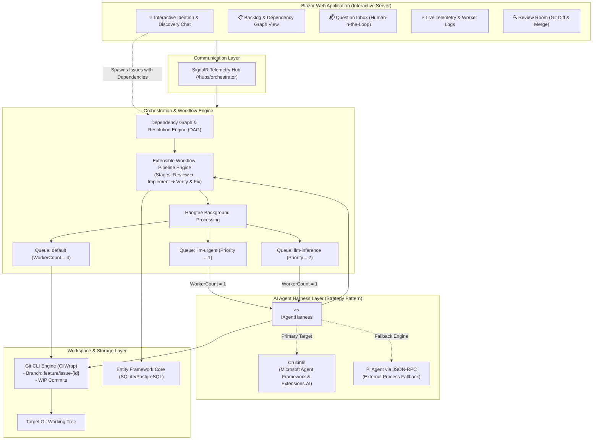

---

## 3. Extensible Multi-Agent Workflow Engine

Rather than binding to a rigid, hardcoded state machine library, NightCodeForge uses a **composable, stage-based Workflow Pipeline Engine**. Each issue progresses through a sequence of discrete, pluggable stages executed by dedicated specialized agents.

### 3.1 Default 3-Agent Workflow Stages

```mermaid
flowchart LR
    Pending(["Pending\n(Dependencies Met)"]) --> S1["1. Issue Review Agent\n(Scope, Ambiguities, Q&A)"]
    S1 --> S2["2. Implementation Agent\n(Code Modifications & Tests)"]
    S2 --> S3["3. Code Review & Fix Agent\n(Gap Analysis, Lint, Fixes)"]
    S3 --> Review(["Human Review Room\n(Final Diff Approval)"])
    Review --> Completed(["Completed & Merged"])

    Review -.->|Request Changes (with feedback)| UrgentQueue(["High-Priority Resume"])
    S1 -.->|ask| Blocked["Blocked (Waiting for Human)"]
    S2 -.->|ask| Blocked
    S3 -.->|ask| Blocked
    Blocked -.->|User Answers| UrgentQueue
    UrgentQueue --> S1
    UrgentQueue --> S2
    UrgentQueue --> S3
```

1. **Stage 1: Issue Review Agent (`IssueReviewStage`)**
   - **Mission:** Deeply inspect the codebase against the issue request *before* any implementation begins.
   - **Goals:** Detect ambiguities, uncover hidden constraints, identify impacted files, verify prerequisites, and proactively ask clarifying questions to avoid rework during coding.
   - **Output:** Approved Technical Specification & Execution Plan.
2. **Stage 2: Implementation Agent (`ImplementationStage`)**
   - **Mission:** Implement the code changes outlined in the approved plan.
   - **Goals:** Create/modify files, invoke workspace build tools (e.g. `dotnet build`), execute unit tests, and iterate until the code compiles and passes tests.
   - **Output:** Working implementation with initial commit history.
3. **Stage 3: Code Review and Fixes Agent (`CodeReviewAndFixStage`)**
   - **Mission:** Act as a critical reviewer and automated fixer.
   - **Goals:** Compare the `git diff` against the base branch, check coding standards, detect potential regression gaps, missing error handling, or performance traps, and make direct fixes.
   - **Output:** Polished, review-ready code diff.

### 3.2 Agent Profiles: Specializing Intelligence per Stage
Each step in a workflow pipeline is associated with an **Agent Profile** (`AgentProfile`). Different stages of software development demand different model capabilities, reasoning depths, and tool permissions:

| Stage | Typical Profile Needs | Example Configuration |
| :--- | :--- | :--- |
| **0. Automated Triage** *(Untrusted Intake)* | Autonomous pre-analysis of external issues/webhooks on `main`/`master`, strictly read-only, indirect injection defense. | **Harness:** `Crucible` *(Exclusive - Pi/ACP unsupported)*<br>**Model:** `deepseek-r1:32b`<br>**Thinking Effort:** `Medium`<br>**Permitted Tools:** `["read", "propose_issues"]`<br>**Security:** `RestrictedReadOnly` (`--network none`, `:ro`) |
| **1. Issue Review** | High reasoning capability, deep codebase comprehension, proactively questioning edge cases. | **Harness:** `Crucible` (or `PiRpc`)<br>**Model:** `deepseek-r1:32b`<br>**Thinking Effort:** `High`<br>**Config:** `{ "proactiveAmbiguityCheck": true }` |
| **2. Implementation** | Rapid tool execution, fast code generation, test iteration. | **Harness:** `Crucible`<br>**Model:** `qwen2.5-coder:32b`<br>**Thinking Effort:** `Medium` (or `Low`)<br>**Config:** `{ "autoCompile": true, "maxTestRetries": 3 }` |
| **3. Code Review & Fixes** | Strict gap analysis, linting, regression auditing. | **Harness:** `Acp` (or `Crucible`)<br>**Model:** `qwen2.5-coder:32b`<br>**Thinking Effort:** `Medium`<br>**Config:** `{ "strictLinting": true, "temperature": 0.1 }` |

#### Agent Profile Definition
```csharp
public class AgentProfile
{
    public string Id { get; set; } = default!;          // e.g. "triage-guard", "deep-analyst", "fast-coder", "acp-auditor"
    public string Name { get; set; } = default!;
    public string HarnessId { get; set; } = default!;    // "crucible", "pi-rpc", or "acp"
    public string ModelName { get; set; } = default!;    // e.g. "deepseek-r1:32b", "qwen2.5-coder:32b"
    public ThinkingEffort ThinkingEffort { get; set; }  // None, Low, Medium, High, CustomBudget
    public int? ThinkingTokenBudget { get; set; }
    public double? Temperature { get; set; }
    public string? HarnessConfigurationJson { get; set; } // Harness-specific launch/runtime JSON options
    public IReadOnlyList<string>? PermittedTools { get; set; } // Whitelist: null = all stage tools; ["read", "propose_issues"]
    public SandboxSecurityTier SecurityTier { get; set; } = SandboxSecurityTier.Standard; // Standard vs RestrictedReadOnly
    public int? WorkspaceId { get; set; }               // Nullable: global profile or workspace override
}

public enum SandboxSecurityTier
{
    Standard = 0,          // Normal execution on feature branch; network permitted for restores
    RestrictedReadOnly = 1 // Untrusted external intake on main/master: :ro mount, --network none, --read-only, --cap-drop=ALL
}

public enum ThinkingEffort
{
    None = 0,
    Low = 1,
    Medium = 2,
    High = 3,
    CustomBudget = 4
}
```

### 3.3 Extensibility & Pipeline Abstraction
The workflow pipeline is defined via modular contracts. Stages can be **Agentic** (driven by LLMs with exclusive GPU scheduling) or **Deterministic** (driven by native commands, e.g., builds, tests, SAST, running on CPU with zero token usage):

```csharp
public enum WorkflowStageKind
{
    Agentic = 0,       // AI agent driven by LLM, consumes GPU worker, bound to AgentProfile
    Deterministic = 1  // Native command execution (build, test, SAST, linter), runs on CPU/sandbox, 0 GPU tokens
}

public interface IWorkflowStage
{
    string StageId { get; }
    string DisplayName { get; }
    int Order { get; }
    WorkflowStageKind StageKind { get; }
    string? DefaultAgentProfileId { get; } // Null for deterministic stages
    
    Task<StageExecutionResult> ExecuteAsync(
        StageExecutionContext context,
        IExecutionEnvironment executionEnvironment,
        IAgentHarness? harness,
        AgentProfile? profile,
        Func<AgentTelemetryEvent, Task> onTelemetry,
        CancellationToken cancellationToken);
}

public interface IWorkflowPipeline
{
    string PipelineId { get; }
    IReadOnlyList<IWorkflowStage> Stages { get; }
    IWorkflowStage? GetNextStage(string currentStageId);
    IWorkflowStage? GetStage(string stageId);
}
```

### 3.4 Stage Bootstrap Prompts & Context Injection
To maximize reasoning effectiveness and ensure consistent agent behavior, each stage relies on a specialized **System Prompt** (defining persona, behavioral boundaries, and available tools) and a dynamic **Bootstrap Prompt** (seeding task-specific context and instructions):

```csharp
public class StagePromptTemplate
{
    public string SystemPrompt { get; set; } = default!;
    public string BootstrapPromptTemplate { get; set; } = default!;
}
```

#### Specialized Prompts for the 3 Default Stages:
1. **Stage 1 (Issue Review):**
   - **System Persona:** Architectural Analyst & Requirements Investigator.
   - **Mission:** Scrutinize the codebase against the issue description. Proactively uncover ambiguities, implicit assumptions, and architectural conflicts *before* any implementation begins.
   - **Injected Context:** `{{Issue.Title}}`, `{{Issue.Description}}`, repository structure, guidelines.
   - **Behavioral Directive:** "If any requirement or design decision is ambiguous or has multiple valid alternatives, invoke `ask` immediately to clarify. Do not guess."
2. **Stage 2 (Implementation):**
   - **System Persona:** Senior Software Engineer & TDD Practitioner.
   - **Mission:** Implement clean, robust code according to the approved plan. Run builds (`dotnet build`), run tests, and fix errors incrementally.
   - **Injected Context:** Approved technical plan from Stage 1, all resolved Q&A pairs from `{{PriorAnswers}}`, list of affected files.
   - **Behavioral Directive:** "Write working code and verify with build tools. If unexpected blockers or breaking changes arise, call `ask`."
3. **Stage 3 (Code Review and Fixes):**
   - **System Persona:** Critical Code Auditor & QA Specialist.
   - **Mission:** Review the full changeset against the base branch. Identify regressions, edge cases, missing unit tests, or lint violations, and make targeted fixes.
   - **Injected Context:** Target base branch (`{{BaseBranch}}`), complete `git diff` generated from Stage 2 (`{{GitDiff}}`), project coding standards.
   - **Behavioral Directive:** "Inspect the diff line-by-line. If you find bugs or gaps, use file editing tools to fix them directly. When confident, summarize findings."

### 3.5 Stage Interruption & Universal Context Switching
At **any point** in **any stage**, an agent may invoke the `ask` tool. When this occurs:
1. The stage returns `StageExecutionResult.WaitingForHuman(question)`.
2. The orchestrator records the question in the database and updates the issue state to `BlockedQuestion(stageId)`.
3. The orchestrator triggers a native Git WIP commit on `feature/issue-{id}`.
4. The Hangfire job completes, releasing the single GPU worker.
5. When the user submits the answer, the issue transitions back to `Pending` and is enqueued into `llm-urgent`. The active stage is resumed with the previous conversation memory and the newly supplied human answer.

### 3.6 Review Room Iteration & Change Requests
If the developer inspects the diff in the Review Room and identifies issues or wants adjustments before merging:
1. The developer clicks **"Request Changes"** and provides revision notes / feedback.
2. The orchestrator records the reviewer feedback.
3. The issue transitions from `Review` back to **Stage 2 (`ImplementationStage`)**, with the reviewer feedback injected into the prompt context (`{{PriorAnswers}}` / `{{ReviewerFeedback}}`).
4. The task is enqueued with highest priority into `llm-urgent` so the Implementation Agent directly addresses the feedback on the existing feature branch.

### 3.7 Explicit Stage Boundary Handover Protocol (Zero-Memory Clean Handoff)
Carrying forward raw multi-turn conversation histories across stage boundaries causes massive token bloat, increases prompt evaluation latency on local LLMs, and leads to attention drift. NightCodeForge implements an **explicit zero-memory clean handoff**:

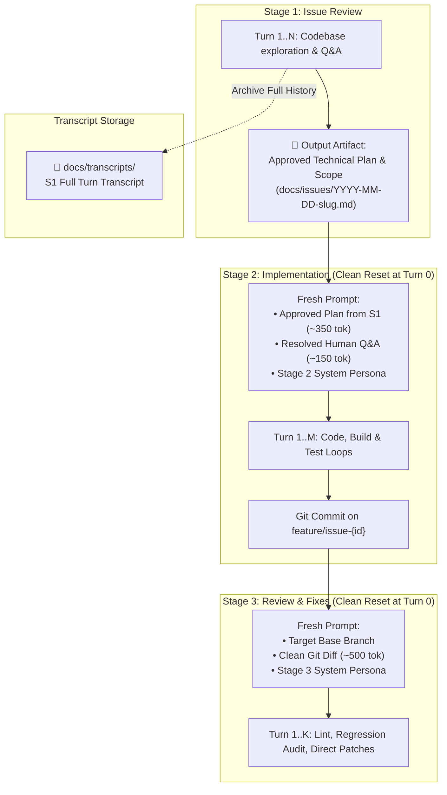

1. **Stage 1 $\rightarrow$ Stage 2 Handover:**
   - When `IssueReviewStage` finishes, its complete turn-by-turn chat history (10–20 turns) is archived to disk under `docs/transcripts/`.
   - `ImplementationStage` starts at **Turn 0 with an empty chat history**, receiving only the approved Technical Plan & Scope markdown artifact and the list of resolved Q&A pairs from `docs/issues/`.
2. **Stage 2 $\rightarrow$ Stage 3 Handover:**
   - When `ImplementationStage` completes, all internal build attempts, compile errors, and test iterations are archived to disk.
   - `CodeReviewAndFixStage` starts at **Turn 0 with an empty chat history**, receiving only the base branch name, the clean `git diff` generated from the feature branch, and coding guidelines.
3. **Impact:** Eliminates 75%–85% of redundant prompt tokens, maintains high local LLM attention precision, and prevents cross-stage context pollution.

### 3.8 Deterministic Stages: Quality Gates & Agent Input Feeders

Workflows in NightCodeForge are not limited to purely agentic reasoning loops. A robust software engineering pipeline often requires **deterministic steps** (e.g., compilation, unit test suites, Static Application Security Testing [SAST], formatters, or linters) that execute predictable shell commands without AI intervention.

#### Architectural Advantages:
1. **Zero GPU & Token Overhead:** Deterministic stages execute directly in the workspace sandbox (`IExecutionEnvironment`), running on the host CPU or inside the sandbox container. They consume **0 LLM tokens** and **do not occupy the exclusive GPU inference worker** (`WorkerCount = 1`).
2. **Deterministic Quality Gates & Outcome-Based Routing:**
   * **Forward Routing (Pass):** If builds, unit tests, and SAST scans pass cleanly, the deterministic stage packages a verified status (`ValidationStatus = Success`) and advances to the next stage (e.g. `CodeReviewAndFixStage`).
   * **Backward Feedback Loop (Fail):** If compilation fails or tests break, the deterministic step routes backward to the implementation agent (with a configurable loop counter, e.g. max 3 iterations, to prevent infinite loops) to request an immediate fix. If the loop counter expires, it pauses and alerts the human (`WaitingForHuman`).
3. **Structured Diagnostics Feeder (Smart Handover & Synthetic Priming):**
   * When configured as an **Input Feeder**, failing command outputs are parsed into structured artifacts rather than raw console noise.
   * *Example (Deterministic Compiler/Test Stage):* The stage extracts failing compiler diagnostics (`error CS\d+`) and failing test assertion stacks, saving them into `StageHandoverArtifacts.Diagnostics`.
   * **Crucible Synthetic Conversation Priming:** To prevent local LLMs from redundantly running `bash("dotnet build")` or `bash("dotnet test")` at the start of a turn, Crucible seeds the agent's chat history with a synthetic tool call/result pair mimicking that the agent already ran the test/build and received the exact deterministic results. The agent immediately moves to editing code.
4. **Built-in Deterministic Stage Implementations:**
   * **`DeterministicBuildStage`:** Executes project build (`dotnet build`, `npm run build`, `mvn compile`). Validates compile cleanliness.
   * **`DeterministicTestStage`:** Executes test runners (`dotnet test`, `pytest`, `jest`). Parses failing assertions and stack traces.
   * **`DeterministicSastStage`:** Runs security and static code analyzers (e.g. Roslyn Analyzers, Semgrep, Trivy, SonarScanner). Produces structured vulnerability/finding reports for automated remediation agents.
   * **`DeterministicFormatStage`:** Runs code formatters (e.g. `dotnet format`, `prettier --check`).

#### Pipeline Composition with Deterministic Steps & Feedback Loops:
```mermaid
flowchart LR
    S1["1. Issue Review\n(Agentic LLM)"] --> S2["2. Implementation\n(Agentic LLM)"]
    S2 --> S3["3. Deterministic Build & Test\n(CPU Native / SAST Gate)"]
    S3 -->|Pass: Success Input| S4["4. Code Review & Fix\n(Agentic LLM)"]
    S3 -->|Fail: Parse Diagnostics & Loop Back| S2Fix["2b. Fix Errors\n(Agentic LLM with Synthetic Priming)"]
    S2Fix --> S3
    S3 -.->|Exceeds Max Retries (3)| Blocked["Blocked: Human Q&A"]
```

---

## 4. Issue Dependency Management (DAG)

Complex features and refactoring tasks naturally break down into interdependent issues. NightCodeForge natively manages dependencies via a **Directed Acyclic Graph (DAG)**.

### 4.1 Dependency Rules & State Propagation
* An issue can declare one or more prerequisite issues (`DependsOnIssueIds`).
* **Execution Gate:** An issue with unsatisfied dependencies remains in status `WaitingOnDependencies` and **will not be enqueued** to Hangfire.
* **Cascade Activation:** When an issue reaches `Completed` state, the orchestrator evaluates all dependent issues. If all dependencies of a dependent issue are satisfied, its state automatically transitions to `Pending` and it enters the Hangfire queue.
* **Cycle Prevention:** When creating or modifying dependencies, the `DependencyResolutionEngine` performs topological sorting to detect and reject circular references (cycles).

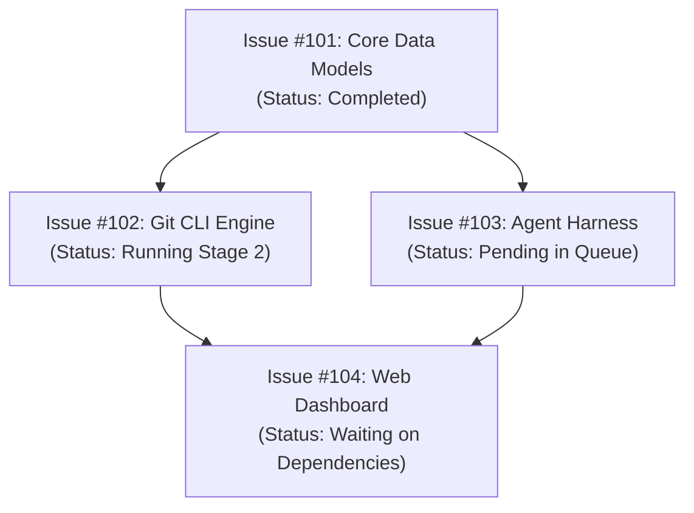

---

## 5. File-System Issue Mirroring (`docs/issues/`)

To provide optimal ergonomics for AI agents, developers, and Git workflows, active (non-resolved) issues are mirrored directly in the workspace file system under **`docs/issues/`** as structured Markdown documents with YAML frontmatter.

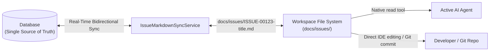

### 5.1 Why Markdown Files for Agents?
1. **Native Agent Accessibility:** Agents inside the workspace can read issue specifications, requirements, and previous Q&A directly using basic file tools (`read`), without needing custom database query APIs or SDK dependencies.
2. **Developer & IDE Transparency:** Developers can review, search, and edit issues directly in VS Code, Visual Studio, or Obsidian without leaving their editor.
3. **Version Control Integration:** Active issue specifications live alongside the code on the issue branch, preserving the exact requirements snapshot in Git history.

### 5.2 Document Naming & Frontmatter Schema

#### Naming Convention: Chronological Date Prefix (`YYYY-MM-DD-slug.md`)
To allow developers and agents to quickly sort issues chronologically in their file explorer without having to rename files when IDs are assigned, files are named:
`docs/issues/YYYY-MM-DD-<slug>.md` (e.g. `docs/issues/2026-10-12-implement-oauth2-flow.md`).

* The database `id` is stored exclusively **inside the frontmatter**, not in the filename.
* Dropping a new file never requires a file rename when the system assigns an ID.
* **Slug Collision Resolution:** If multiple issues created on the same date produce identical slugs, the sync service appends an incrementing numeric suffix (e.g. `YYYY-MM-DD-<slug>-2.md`, `YYYY-MM-DD-<slug>-3.md`).

```markdown
---
id: 123
title: Implement OAuth2 Authorization Flow
workspace: NightCodeForge
status: BlockedQuestion
current_stage: IssueReview
priority: 1
base_branch: main
feature_branch: feature/issue-123
depends_on: [101, 102]
agent_profile: deep-analyst
created_at: 2026-10-12T22:00:00Z
updated_at: 2026-10-12T22:05:00Z
---

# Implement OAuth2 Authorization Flow

## 📋 Requirements & Description
Implement authorization code flow with PKCE for local clients...

## ❓ Human Clarifications (Q&A)
### Question 1 (Asked during Stage: IssueReview on 2026-10-12 22:03:00)
**Prompt:** Should refresh token rotation be enforced on every token exchange?
**Answer:** Yes, rotate refresh tokens on every exchange and store revocations in SQLite.

## 📐 Technical Plan & Scope (Stage 1 Output)
- [ ] Add `OAuthClientOptions` configuration model.
- [ ] Implement `PkceTokenValidator` handler.
- [ ] Add integration tests in `NightCodeForge.Core.Tests`.
```

### 5.3 Bidirectional Synchronization & Field Protection Rules

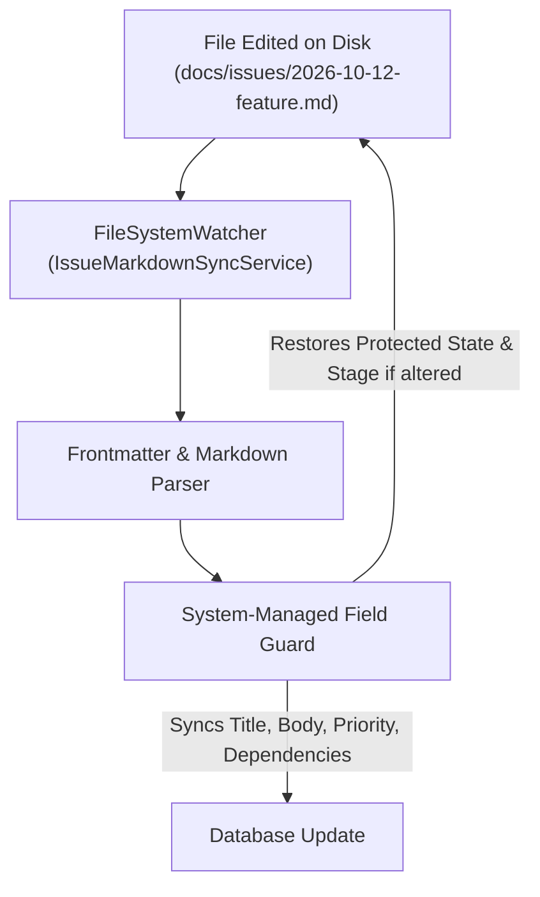

1. **System-Managed Fields (Protected):**
   * Fields like `id`, `status` (`overall_state`), `current_stage`, and `created_at` are strictly governed by the orchestrator engine and database.
   * If a user or agent modifies `status` or `current_stage` directly in the markdown file, the orchestrator rejects the state alteration and rewrites the authoritative database state back into the file's frontmatter.
2. **User/Agent Editable Fields (Synchronized to DB):**
   * Changes to `title`, markdown body (`description`, requirements, technical plan), `priority`, `agent_profile`, `base_branch`, and `depends_on` are automatically detected and saved into the database.
   * Dependency changes via `depends_on` are passed through DAG cycle checks before being committed.
3. **Drop-in Creation Without Renaming:**
   * When a developer or agent drops a new file (e.g. `docs/issues/2026-10-13-add-dark-theme.md`) without an `id` field:
     1. The watcher detects the new file.
     2. A new `Issue` entity is created in EF Core, allocating the next available `Id` (e.g. `124`).
     3. The sync service injects `id: 124` and `created_at` directly into the file's frontmatter **in-place**, without renaming the file.
4. **Resolution Archival / Cleanup:**
   * When an issue reaches `Completed` (or `Cancelled`), the markdown file is removed from `docs/issues/` (or archived to `docs/issues/archive/`), ensuring that `docs/issues/` contains only active and pending work.
5. **FileSystemWatcher Debouncing & Echo Loop Prevention:**
   * Operating systems and IDEs emit multiple rapid events per save (e.g. `Created` followed by multiple `Changed` events within 50ms) and may hold temporary locks during atomic saves.
   * `IssueMarkdownSyncService` applies a **300ms debounce window** to coalesce rapid I/O bursts.
   * To prevent infinite echo loops (where the system writing back protected frontmatter fields triggers the watcher to fire again), the service maintains an in-memory **write-suppression tracker**: whenever the orchestrator writes a file, it registers the computed hash and ignores the subsequent event.

---

## 6. Interactive Issue Discovery & Ideation Chat

To prevent vague or poorly scoped issues from entering the queue, NightCodeForge provides an **Interactive Ideation & Codebase Discovery Chat**:

```mermaid
sequenceDiagram
    autonumber
    actor User as Developer
    participant UI as Blazor Chat Interface
    participant Explorer as Discovery Agent (Read-Only)
    participant Git as Git Workspace
    participant Engine as Dependency & Issue Engine

    User->>UI: "How does our authentication handle JWT refresh tokens, and what's needed for OAuth2?"
    UI->>Explorer: Stream prompt + conversation context
    Explorer->>Git: Read relevant auth files & configuration
    Git-->>Explorer: File contents & symbols
    Explorer-->>UI: Explains architecture & highlights gaps
    User->>UI: "Great, let's create issues to implement OAuth2 support."
    Explorer->>UI: Proposes 2 structured issues with dependencies:<br>1. Issue A: Add OAuth2 client config & token model<br>2. Issue B: Add Google/GitHub provider handlers (Depends on A)
    User->>UI: Reviews, tweaks scope, and clicks "Create in Backlog"
    UI->>Engine: Registers Issue A & Issue B with dependency link
    Engine-->>UI: Issue A queued; Issue B waiting on A
```

### 6.1 Discovery Agent Capabilities
* **Read-Only Access:** Equipped with search, file-reading, and code exploration tools (`bash` with ls/rg, `read`). Cannot modify working tree files.
* **Issue Extraction Tool:** Agent has a function tool `propose_issues(List<IssueProposalDto>)` allowing it to output structured titles, acceptance criteria, affected components, and recommended dependencies directly into the UI for developer approval.

### 6.2 Automated Untrusted Issue Triage (`TriageProfile` & Security Sandbox)
NightCodeForge supports automated intake pre-analysis triggered by external webhooks (e.g. GitHub Issues, GitLab Issues, Jira):
* **Intake Trigger & Objective:** When a new external bug report or feature request arrives, NightCodeForge spawns an autonomous **Triage Stage** (`TriageStage`). The agent inspects the repository's default branch (`main` or `master`) directly (without creating or checking out a feature branch), verifies if the report is actionable, locates relevant source files, and suggests one or more structured backlog issues via `propose_issues` for human review.
* **Threat Model: Malicious External Content & Indirect Prompt Injections:**
  External issues originate from unauthenticated or untrusted public users. Attackers can embed hidden prompt injections (e.g., instructions attempting to exfiltrate secrets, execute malicious shell scripts, or rewrite code).
* **Dual-Lock Defense Architecture:**


1. **Lock 1: In-Process Tool Restriction (Crucible Exclusive):**
   * Crucible dynamically binds *only* the read-only tools defined in `AgentProfile.PermittedTools`: `read` and `propose_issues`.
   * `write` and `edit` are excluded entirely from the tool schema—the agent cannot modify files.
   * `ask` is excluded—an untrusted issue cannot stall or block the human dev-queue.
   * `web_search` is excluded—eliminating outbound SSRF and exfiltration channels.
   * *Harness Exclusion:* **Pi and ACP harnesses cannot be used for triage** because their static tool engines advertise all capabilities (`write`, `edit`, `bash`) unconditionally.
2. **Lock 2: Restricted Read-Only Container Sandbox:**
   * Runs directly against the base branch (`main`/`master`) on ext4 mounted **read-only** (`:ro`).
   * **`--network none`:** Completely air-gapped network namespace. Even if an LLM is hijacked by an adversarial prompt injection, it cannot exfiltrate environment variables, source code, or internal tokens over the network.
   * **`--read-only` root filesystem:** Prevents writing malicious binaries or modifying system files.
   * **`--cap-drop=ALL` & `--security-opt no-new-privileges:true`:** Drops all Linux root privileges.
   * **Scrubbed Environment:** Host API keys, Git credentials, and database connection strings are strictly omitted from container environment variables.

---

## 7. Orchestration Engine & Queue Design

### 7.1 Queue Concurrency Architecture
The background job system uses **Hangfire** backed by persistent storage. Hangfire servers are separated into two distinct worker pools:

| Queue Name | Worker Count | Purpose | Constraints |
| :--- | :--- | :--- | :--- |
| `llm-urgent` | **1** (Shared pool) | Resumed issues that just received developer answers. | Highest priority for GPU inference. |
| `llm-inference` | **1** (Shared pool) | Normal queued issues awaiting execution. | Strictly sequential to protect VRAM. |
| `default` | **4** | Non-GPU background tasks: Git diff calculation, log cleanup, telemetry broadcasts. | Parallel execution allowed. |

> [!IMPORTANT]
> The `llm-urgent` and `llm-inference` queues share a dedicated Hangfire `BackgroundJobServer` configured with `WorkerCount = 1` and ordered queue processing:
> `Queues = new[] { "llm-urgent", "llm-inference" }`.
> This guarantees that:
> 1. At most **one** AI task runs on the GPU at any millisecond, strictly guarding VRAM against out-of-memory crashes.
> 2. Resumed issues in `llm-urgent` receive **priority pick-up**: as soon as the single worker completes its active turn/task, jobs in `llm-urgent` are dequeued before standard items in `llm-inference` (non-preemptive priority dispatch without concurrent VRAM oversubscription).

### 7.2 Workspace-Level Concurrency & Git Locking (`IWorkspaceLockProvider`)
While GPU inference is strictly serialized globally (`WorkerCount = 1`), background utility tasks (the `default` queue with `WorkerCount = 4`) and interactive developer actions (e.g. diff inspections, status checks, ideation chat) can operate concurrently.

To prevent race conditions, concurrent Git index mutations, and `.git/index.lock` collisions on a given working tree:
* All workspace-level Git CLI commands and filesystem modifications are guarded by a workspace-keyed concurrency lock (`IWorkspaceLockProvider`, backed by `AsyncKeyedLock<int>` or named mutex per `WorkspaceId`).
* Operations on independent workspaces execute in parallel without contention; operations targeting the same workspace are strictly serialized.

---

## 8. Git Workspace & Context-Switching Subsystem

### 8.1 Strict CLI Requirement
Wrappers such as `LibGit2Sharp` are **strictly prohibited** due to unmanaged binary dependencies, memory leak risks in long-running servers, and poor support for modern Git features. All Git operations are executed via native command-line invocations using **`CliWrap`**.

### 8.2 Save Strategy: WIP Commits vs. Stash
To ensure zero data loss during context switches:
1. `git stash` is **not used** because untracked files, subdirectories, or unstaged renames can lead to merge conflicts on unstash or orphaned changes.
2. The orchestrator uses **WIP Commits**:
   ```bash
   git add -A
   git commit -m "WIP: [Issue #{id}][Stage: {stageName}] Awaiting human input: {QuestionSummary}" --no-verify
   ```
3. When the issue passes all stages and is approved in the Review Room, the orchestrator squashes the WIP commits into a clean, conventional commit before merging.

### 8.3 Cross-Environment Git Synchronization & Ext4 Mirroring (Solving the 9p Trap)
When running on Windows hosts with containerized or WSL2 execution:
1. **The 9p / DrvFs Bottleneck:** Accessing Windows NTFS files from WSL2 via `/mnt/c/...` uses the Plan 9 (9p) network filesystem. For recursive Git scans, `dotnet build`, `node_modules`, and code searches, 9p is **10x to 50x slower** than native Linux ext4.
2. **Local Git Mirror Architecture:**
   * The developer keeps their primary repo on Windows NTFS (e.g., `C:\Users\Julien\source\repos\MyProject`).
   * The host repository is configured with `git config receive.denyCurrentBranch updateInstead` to ensure pushes to a branch that happens to be checked out in the host IDE succeed cleanly without refusal.
   * NightCodeForge maintains an isolated clone on the WSL2/Linux ext4 filesystem (`/var/ncf/workspaces/{workspaceId}/repo`).
   * A local Git remote is registered linking the ext4 mirror back to the host repository:
     ```bash
     git remote add host-origin file:///mnt/c/Users/Julien/source/repos/MyProject
     ```
3. **Synchronization Protocol:**
   * **Stage Inception:** NightCodeForge fetches the latest base branch commits (`git fetch host-origin <baseBranch>`) and checks out `feature/issue-{id}` on ext4.
   * **Active Reasoning & Build Loop:** All file inspections, edits, compiler builds (`dotnet build`), and test runs execute 100% on native ext4 at full SSD speeds.
   * **WIP Checkpoint / Human Interruption / Stage Completion:**
     NightCodeForge commits the WIP state on ext4 and pushes the branch directly back to the host repository:
     ```bash
     git push host-origin feature/issue-{id}
     ```
   * **Ergonomics & Safety:** The developer's Windows IDE sees the updated `feature/issue-{id}` branch immediately without touching the active `main` branch. Zero 9p disk overhead during compilation or code search.
   * **Handling Host Working Tree Dirty Conflicts:**
     If the developer happens to have `feature/issue-{id}` checked out in their host IDE with uncommitted changes to tracked files, Git's `updateInstead` policy will reject the push to prevent overwriting uncommitted host edits.
     * When this occurs, NightCodeForge catches the push rejection and pushes to an isolated tracking reference instead:
       ```bash
       git push host-origin feature/issue-{id}:refs/heads/feature/issue-{id}-ncf
       ```
     * An informative alert is broadcasted via SignalR to the UI, notifying the developer that their local uncommitted changes prevented direct working tree checkout, and providing the diff command to reconcile.
4. **WSL-Native Repositories:** If the developer's project already lives natively in WSL2 (e.g. `\\wsl.localhost\Ubuntu\home\...`), the container directly volume-mounts that directory on ext4, bypassing the mirror sync step.

---

## 9. AI Harness Abstraction Layer (`IAgentHarness`)

NightCodeForge decouples orchestration from the underlying agent runtime via an open **Harness Abstraction Layer**. Any agent that implements `IAgentHarness` can be plugged in, either natively in C# or externally via standard protocols.

### 9.1 Interface Contract & Step Metrics
```csharp
public interface IAgentHarness
{
    string HarnessId { get; }
    string DisplayName { get; }
    
    Task<AgentRunResult> ExecuteSessionAsync(
        AgentSessionContext sessionContext,
        Func<AgentTelemetryEvent, Task> onTelemetry,
        CancellationToken cancellationToken);
}

public record AgentSessionContext(
    int WorkspaceId,
    int IssueId,
    string StageId,
    AgentProfile Profile,
    string StageSystemPrompt,
    string TaskPrompt,
    string WorkingDirectory,
    string? SerializedState,
    IReadOnlyList<QuestionAnswerPair> PriorAnswers);

public record AgentRunResult(
    AgentRunStatus Status,
    string? UpdatedState,
    QuestionPrompt? PendingQuestion,
    string? Summary,
    StepExecutionMetrics Metrics,
    Exception? Error);

public record StepExecutionMetrics(
    DateTime StartedAt,
    DateTime CompletedAt,
    TimeSpan Duration,
    int PromptTokens,
    int CompletionTokens,
    int TotalTokens,
    string? AgentProfileId,
    string? ModelName,
    string? TargetRouting); // e.g. "Local GPU", "Remote Server", "Cloud"

public enum AgentRunStatus
{
    Completed,
    WaitingForHuman,
    Failed,
    Cancelled
}
```

### 9.2 Primary Local Inference Gateway: OllamaRouter Integration
NightCodeForge provides native, first-class support for **OllamaRouter** (`jetelain/OllamaRouter`) as its intelligent inference gateway.

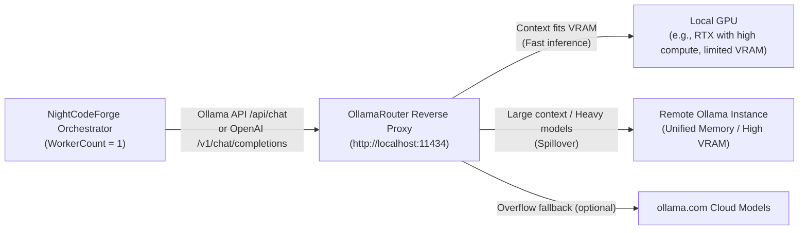

#### Key Capabilities & Synergy:
1. **Dual Protocol Compatibility:** NightCodeForge interacts with OllamaRouter via standard Ollama native endpoints (`POST /api/chat`, `POST /api/generate`) or OpenAI-compatible endpoints (`POST /v1/chat/completions`).
2. **Automated Best-GPU Selection:** OllamaRouter inspects each prompt's token count, evaluates live VRAM via `nvidia-smi`, checks active memory residency via `/api/ps`, and automatically routes:
   - Small/fast reasoning turns to the high-performance local GPU.
   - Long-context reviews, broad codebase lookups, or large-parameter models to the remote high-VRAM server.
   - NightCodeForge's `WorkerCount = 1` constraint guarantees that the local GPU is never overloaded by concurrent background jobs, while OllamaRouter ensures each sequential job runs on the most capable hardware.
3. **Dynamic Model Discovery:** NightCodeForge queries OllamaRouter's unified `/api/tags` endpoint to automatically populate available local and remote models in the web dashboard.
4. **Telemetry & Target Transparency:** The monitoring dashboard can query `/monitor` or capture response headers to display whether the current inference step was processed by the **Local GPU**, **Remote Instance**, or **Cloud Overflow**, along with exact token metrics.

### 9.3 Supported Harness Implementations

#### Implementation A (First-Class Native): Crucible Harness (Microsoft Agent Framework & `Microsoft.Extensions.AI`)
* **Type:** In-process C# Agent Engine.
* **Role:** Primary native execution harness for NightCodeForge.
* **Dedicated Specification:** For the complete, dedicated architectural specification, tool implementation details, resilient forgiving dispatcher, and token minimization engine, see **[CRUCIBLE.md](CRUCIBLE.md)**.
* **Compatibility:** Plugs directly into OllamaRouter, vanilla Ollama, LM Studio, vLLM, or any OpenAI-compatible server.
* **Profile Integration:** Adapts execution parameters based on the stage's `AgentProfile` (e.g. mapping `ThinkingEffort` to OpenAI `reasoning_effort` or DeepSeek/Ollama thinking budget tokens).
* **Auto-Configuration:** Pre-configured out of the box with system prompts, canonical function tools (`read`, `edit`, `write`, `bash`, `web_search`, `ask`, `propose_issues`), and memory serialization.
* **Interruption:** Tool `ask` catches the call, serializes the active `ChatHistory` to JSON, captures token counters from `AdditionalProperties["usage"]`, and flags `AgentRunStatus.WaitingForHuman`.

#### Implementation B (First-Class Fallback): Pi via JSON-RPC
* **Type:** External sub-process runner communicating via JSON-RPC over `stdio` (JSON Lines protocol).
* **Dedicated Specification:** For the complete headless JSONL RPC protocol specification, event streaming, multi-disjoint edit tools, and interruption mapping, see **[PI.md](PI.md)**.
* **Profile Integration:** Passes `AgentProfile.ModelName`, custom flags, and `HarnessConfigurationJson` to the Pi RPC daemon.
* **Auto-Configuration:** Managed process lifecycle (`pi --mode rpc`) with automatic start/stop and session state snapshotting.
* **Interruption:** Listens for `extension_ui_request` events over JSONL stdout. Upon detection, requests session suspension, retrieves the serialized session snapshot ID, calculates duration/tokens, and yields `WaitingForHuman`.

#### Implementation C (Extensible Open Standard): Agent Client Protocol (ACP) Harness
* **Type:** Universal protocol adapter supporting the **[Agent Client Protocol (ACP)](https://agentclientprotocol.com/)** specification.
* **Dedicated Specification:** For the complete protocol specification, v1 vs. v2 comparison, modernized `acp-csharp` SDK architecture, and sandboxed client execution, see **[ACP.md](ACP.md)**.
* **Profile Integration:** Configures the spawned ACP agent binary or remote endpoint with the profile's model, thinking budget, and environment variables defined in `HarnessConfigurationJson`.
* **Value Proposition:** ACP is an open, standardized protocol (backed by Zed, JetBrains, and the open-source community) designed specifically for code editors and orchestrators to communicate with external AI coding agents via JSON-RPC over `stdio`, WebSocket, or HTTP.
* **How NightCodeForge Acts as an ACP Client:**
  1. **Lifecycle & Session Initialization:** NightCodeForge launches any ACP-compatible agent executable (or connects to its endpoint) and negotiates capabilities (`initializeSession`).
  2. **Workspace & Tool Delegation:** NightCodeForge exposes workspace tools (file system access, terminal execution) to the ACP agent via standardized MCP/ACP tool specifications.
  3. **Interruption & Human Input Mapping:** When an ACP agent sends a prompt/permission request requiring user input, NightCodeForge intercepts the request, saves the ACP session token/history into the checkpoint record, performs the Git WIP commit, and suspends the worker.
  4. **Universal Compatibility:** Allows developers to use existing or future ACP-compliant agents (e.g. from the ACP Registry, Zed AI agents, JetBrains AI agents) without modifying NightCodeForge core code.

### 9.4 Crucible Harness Specification & Token Minimization
For the complete technical specification of the native Crucible harness—including:
* **Canonical Tool Suite (Pi-Harmonized):** (`read`, `edit`, `write`, `bash`, `web_search`, `ask`, `propose_issues` - with `list_dir` / `grep_search` / `get_file_outline` mapped to `bash` / `read`)
* **The "Forgiving" Tool Dispatcher:** Tool name aliasing, parameter normalization, markdown code fence stripping, and indentation tolerance
* **EditorConfig Enforcement for File Operations:** Automatic application of `.editorconfig` rules (`end_of_line` [LF/CRLF], `indent_style`, `indent_size`, `insert_final_newline`, `trim_trailing_whitespace`, `charset`) on `write` and `edit` to prevent cross-platform line ending churn and formatting diff noise
* **Stage-Scoped Tool Visibility Matrix:** Gating tool schemas per stage to reduce static prompt overhead
* **Local LLM Token Minimization:** Prompt prefix stabilization for KV cache reuse, ephemeral tool output eviction, compiler error extraction, and noise-filtered git diffs

Please refer directly to the dedicated specification document: **[CRUCIBLE.md](CRUCIBLE.md)**.

---

## 10. Skills, MCP & Repository Guidelines (`AGENTS.md`)

Modern agentic engineering workflows require flexible extensibility beyond hardcoded functions. NightCodeForge integrates three complementary extensibility pillars: **Model Context Protocol (MCP)** for runtime tools/services, **Skills** for modular operational instructions, and **`AGENTS.md`** for repository-level rules.

### 10.1 Model Context Protocol (MCP) Architecture
NightCodeForge leverages the **Microsoft Agent Framework** native MCP client integration (`Microsoft.Agents.Mcp`) to act as an **MCP Host**:


#### MCP Features in NightCodeForge:
1. **Workspace-Scoped MCP Servers:** Configured via `mcp_config.json` inside the workspace root or via the web settings UI:
   ```json
   {
     "mcpServers": {
       "sqlite": {
         "command": "uvx",
         "args": ["mcp-server-sqlite", "--db-path", "data/app.db"]
       },
       "github": {
         "command": "npx",
         "args": ["-y", "@modelcontextprotocol/server-github"],
         "env": { "GITHUB_TOKEN": "..." }
       }
     }
   }
   ```
2. **Dynamic Tool Discovery:** When an issue session begins, the MCP client manager connects to configured servers, queries `tools/list`, and dynamically exposes them as callable tools in the agent's reasoning loop.
3. **ACP & MCP Synergy:** Because the **Agent Client Protocol (ACP)** specification natively re-uses MCP data types, NightCodeForge seamlessly forwards configured MCP server capabilities to both native Crucible (Microsoft Agent Framework) harnesses and external ACP agents.

### 10.2 Modular Skills System
Skills are directory-based bundles of specialized operational instructions, guidelines, and reference implementations that teach agents specific frameworks, idioms, or repo-specific rules:

```text
<WorkspaceRoot>/.agents/skills/
├── efcore-migrations/
│   ├── SKILL.md                 # YAML frontmatter + detailed markdown instructions
│   └── templates/               # Reference migration templates
└── csharp-clean-code/
    └── SKILL.md                 # Clean code & architectural rules
```

#### Skill Structure (`SKILL.md`):
```markdown
---
name: efcore-migrations
description: Guidelines and best practices for creating and applying EF Core database migrations
triggers: ["*.cs", "DbContext", "Migration"]
---

# EF Core Migration Workflow
1. When modifying entity schemas, never edit old migrations directly.
2. Run `dotnet ef migrations add <DescriptiveName>` from the infrastructure directory.
3. Verify `Up()` and `Down()` methods for data safety before proceeding.
```

#### Skill Activation & Ingestion:
1. **Catalog Discovery:** NightCodeForge scans `<AppData>/skills/` (global) and `<WorkspaceRoot>/.agents/skills/` (workspace-specific).
2. **On-Demand Loading:** The agent is equipped with a `ReadSkill(skillName)` tool allowing it to read detailed instructions when tackling specialized topics.
3. **Context-Aware Injection:** Stages can declare mandatory skills in their `AgentProfile` or stage prompt templates to ensure adherence to team standards.

### 10.3 Repository Guidelines & AGENTS.md Ingestion
AI coding agents perform best when grounded in the conventions and rules of the repository they operate on. NightCodeForge natively supports **`AGENTS.md`** as a first-class project specification file.

#### Discovery Hierarchy:
When an issue session initializes, the harness inspects the target workspace directory using the following precedence:
1. `<WorkspaceRoot>/AGENTS.md`
2. `<WorkspaceRoot>/.agents/AGENTS.md` (or `.agents/rules/*.md`)
3. Fallback to `<WorkspaceRoot>/CLAUDE.md` or `<WorkspaceRoot>/GEMINI.md`

#### Ingestion & Cross-Harness Augmentation:
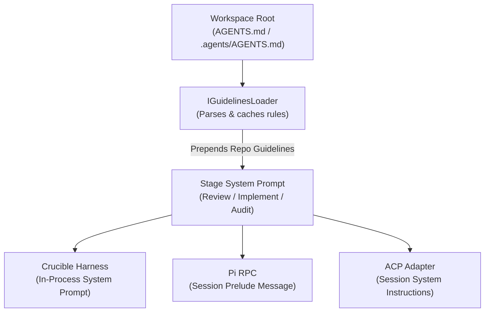

#### What AGENTS.md Injects into the Reasoning Loop:
* **Architecture Overview:** High-level project structure and module boundaries.
* **Build & Test Commands:** Precise CLI instructions (`dotnet build`, `dotnet test --filter ...`, `npm run build`).
* **Code Style & Formatting:** Naming conventions, nullability expectations, async best practices.
* **Negative Constraints:** Prohibited patterns (e.g., "Never edit auto-generated migration files directly", "Do not introduce external heavy dependencies").

By automatically loading `AGENTS.md`, NightCodeForge ensures that all 3 workflow stages—and all harness engines—adhere strictly to repository-specific rules without requiring developers to retype instructions for each issue.

---

## 11. Session Transcripts & Cloud LLM Failure Diagnostics

Local LLMs (e.g. 7B, 14B, or 32B models) offer speed, low cost, and data privacy, but occasionally encounter edge-case reasoning loops, invalid tool call formats, or misunderstanding of complex skill instructions. Understanding *why* a local model failed is essential to refining skills, prompts, and harness adapters.

NightCodeForge captures every execution turn into a **chronological Markdown Transcript** and provides **integrated Cloud LLM diagnostics** to analyze and explain failures.

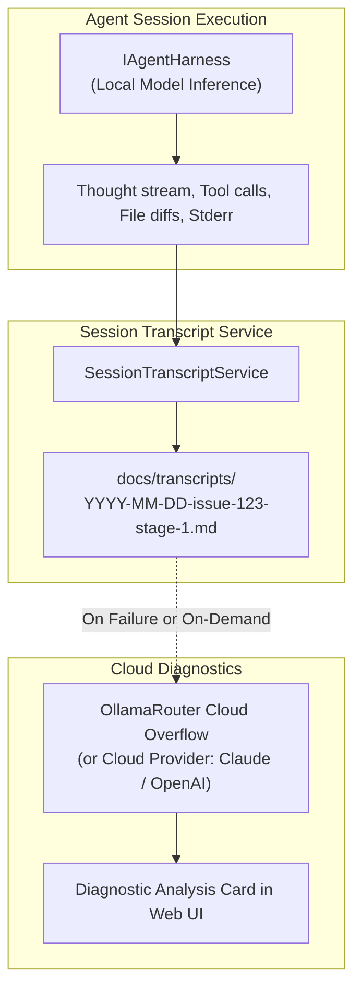

### 11.1 Transcript Structure & Markdown Schema
Whenever a stage completes, pauses for a question, or encounters an error, a transcript is saved to `<WorkspaceRoot>/docs/transcripts/YYYY-MM-DD-issue-{id}-{stage}-{status}.md`:

```markdown
---
issue_id: 123
stage_id: Implementation
agent_profile: fast-coder
model: qwen2.5-coder:32b
thinking_effort: Medium
hardware_target: Local GPU
duration_ms: 45200
tokens:
  prompt: 3120
  completion: 1450
  total: 4570
status: Failed
exit_reason: "Build failure not resolved after 3 attempts"
created_at: 2026-10-12T22:25:00Z
---

# Session Transcript: Issue #123 (Implementation)

## 🎯 Task Prompt & Grounding Context
- **Target Feature:** Implement OAuth2 Authorization Flow
- **Approved Plan:** `docs/issues/2026-10-12-implement-oauth2-flow.md`
- **Active Skills:** `csharp-clean-code`, `efcore-migrations`
- **Loaded Guidelines:** `AGENTS.md` (Rules: nullability enabled, file-scoped namespaces)

---

## ⏱️ Turn-by-Turn Execution

### Turn 1
**Model Thoughts:**
> Need to check if `Microsoft.AspNetCore.Authentication.OpenIdConnect` is installed. I will inspect `NightCodeForge.Web.csproj`.

**Tool Invocation:** `read(path="src/NightCodeForge.Web/NightCodeForge.Web.csproj")`
**Tool Output:** (Csproj XML content...)

### Turn 2
**Model Thoughts:**
> Package is missing. I will add the package using `bash`.

**Tool Invocation:** `bash(command="dotnet add package Microsoft.AspNetCore.Authentication.OpenIdConnect")`
**Tool Output:** `error: NU1102: Unable to find package with version...`

### Turn 3 (Failure Event)
**Exception / Error:** Model attempted to retry same failing command with invalid syntax.
```

### 11.2 Hybrid Diagnostic Engine (Cloud or Local LLM)
When a stage fails, gets blocked, or exhibits abnormal duration, developers can trigger an automated post-mortem analysis directly from the web dashboard. The system supports two diagnostic execution modes:

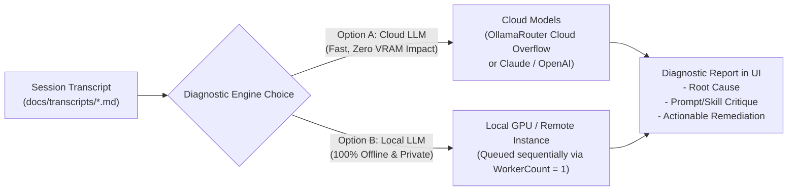

#### Diagnostic Execution Modes:
1. **Option A: Cloud Diagnostics (Recommended for Speed):**
   * **Mechanism:** Routes the diagnostic prompt and transcript to an **Ollama Cloud model** (e.g. `deepseek-v3.1:671b-cloud`, `llama3.3:70b-cloud`) via OllamaRouter's cloud overflow, or to a configured direct cloud provider (Anthropic Claude, OpenAI, Google Gemini).
   * **Advantage:** Fast, high-capacity reasoning that consumes **zero local VRAM**, leaving the local GPU free to continue running queued code tasks.
2. **Option B: Local Diagnostics (100% Air-Gapped & Private):**
   * **Mechanism:** Evaluates the transcript using a local reasoning model (e.g. `deepseek-r1:32b`, `qwen2.5-coder:32b`, or `llama3.3:70b` on a remote instance via OllamaRouter).
   * **Trade-off:** Fully private and offline. However, because local inference respects the physical hardware constraint (`WorkerCount = 1`), local diagnostic inference must queue sequentially, temporarily consuming local GPU compute time from the dev queue.

#### Diagnostic Evaluation Prompt:
Both modes execute a structured diagnostic evaluation prompt:
* **Root Cause Analysis:** Pinpoint the exact breakdown (e.g., tool argument formatting error, loop detection, compilation trap, hallucination).
* **Skill & Guideline Critique:** Identify missing, conflicting, or ambiguous instructions in `AGENTS.md` or active `.agents/skills/`.
* **Harness & Tooling Critique:** Check if tool outputs or error messages were truncated, malformed, or unparseable.
* **Actionable Remediation:** Provide concrete suggestions to fix the skill or unblock the issue, with one-click prompt/skill patching where applicable.

---

## 12. Data Storage & Schema Design

NightCodeForge supports **multi-workspace management**, allowing developers to manage multiple local git repositories. While inference is queued globally to respect the single GPU constraint, each issue and Git context switch is isolated to its respective workspace.

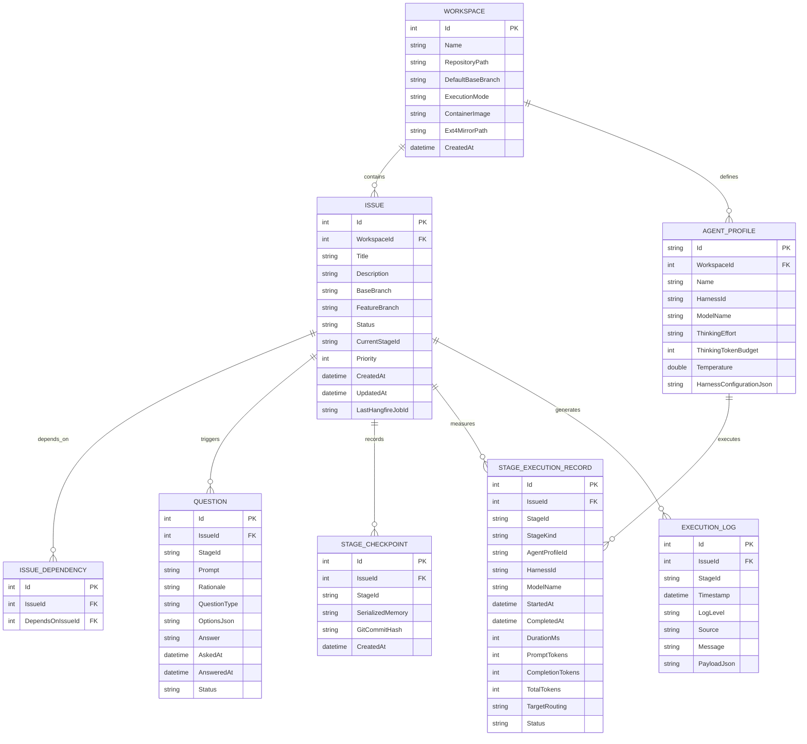

---

## 13. User Interface (Blazor Interactive Server)

### 13.1 Key Dashboard Modules
1. **Interactive Ideation & Codebase Discovery:**
   - Chat interface with the codebase exploration agent.
   - Natural language Q&A about architecture and requirements.
   - Interactive issue proposal cards with one-click creation into backlog.
2. **Backlog & Dependency DAG:**
   - Visual Kanban and dependency graph view showing issues and blocking links.
   - Status indicators: `Waiting on Dependencies`, `Pending`, `Running [Stage]`, `Blocked`, `Review`, `Completed`.
   - Manual priority adjustment and dependency linking.
3. **Monitoring & Terminal:**
   - Real-time streaming of active agent reasoning, tool invocations, compiler logs, and Git operations via SignalR.
   - Visual stage progression indicator (`Review ➔ Implement ➔ Fixes`).
   - Hardware routing badge (Local GPU vs Remote Server) and real-time token/timing metrics.
4. **Inbox (Human-in-the-Loop):**
   - Central view for all pending questions across blocked issues.
   - Rich answer form supporting freeform text, code snippets, or multiple-choice options.
5. **Review Room:**
   - Visual side-by-side / unified `git diff` against base branch.
   - Action buttons: "Approve & Merge" (squashes WIP commits into base branch and triggers cascade unblocking) or "Request Changes" (opens revision notes input modal and routes issue back to Stage 2 `ImplementationStage` with highest priority via `llm-urgent`).
6. **Workspace, Profiles & MCP Settings:**
   - Manage target repositories, configure MCP servers (`mcp_config.json`), and tune Agent Profiles per stage.
7. **Session Transcripts & Cloud AI Diagnostics:**
   - Inspect full turn-by-turn markdown execution transcripts for any past or ongoing stage.
   - One-click "Diagnose with Cloud AI" to evaluate reasoning breakdowns, hallucinations, or harness bugs using Ollama Cloud or external cloud models.

---

## 14. Execution Sandboxing, Security & Reliability Safeguards

### 14.1 The Sandboxing Dilemma & Zero-Prompt Fatigue
Autonomous overnight coding agents cannot function effectively if every command (`rm`, `dotnet`, `npm`, `curl`, `pip`) triggers a human permission confirmation. Conversely, running autonomous agents on bare Windows or Linux hosts with unfettered system access introduces severe security and stability risks.

To achieve **zero prompt fatigue** without compromising host safety:
* Agents execute commands inside an isolated **Container Sandbox** or **WSL2 environment**.
* Only necessary directories (the ext4 repository mirror and shared tool caches) are mounted.
* The container can safely run with elevated or unrestricted permissions inside its own isolated namespace because the host OS, registry, user directories, and credentials remain inaccessible.

```mermaid
flowchart TD
    subgraph Host ["Host Machine (Windows / Linux / macOS)"]
        UserRepo["Host Working Tree (NTFS / Native)\nC:/Users/.../MyProject"]
        Orchestrator["NightCodeForge Orchestrator\n(In-Process Engine & Central Config)"]
        GPU["Local GPU / OllamaRouter\n(Host Network localhost:11434)"]
    end

    subgraph Sandbox ["Execution Sandbox (Docker / Podman in WSL2)"]
        Ext4Repo["ext4 Working Tree Mirror\n(/var/ncf/workspaces/{id}/repo)"]
        Runner["Agent Runner Container\n(Full command autonomy inside sandbox)"]
        SharedCaches["Shared Package Caches\n(~/.nuget, ~/.npm, ~/.m2)"]
    end

    Orchestrator -->|Direct Host Inference| GPU
    Orchestrator -->|Terminal Delegation via exec| Runner
    Orchestrator <-->|Git Push / Fetch Sync on Checkpoints| Ext4Repo
    Ext4Repo -->|Volume Mount| Runner
    SharedCaches -->|Bind Mounts (rw)| Runner
    UserRepo <-->|Local Git Remote Sync| Ext4Repo
```

### 14.2 Pluggable Execution Environments (`IExecutionEnvironment`)
NightCodeForge provides an extensible abstraction allowing developers to configure the execution environment per workspace:

```csharp
public interface IExecutionEnvironment : IAsyncDisposable
{
    ExecutionMode Mode { get; }
    string WorkingDirectory { get; }
    
    Task<CommandResult> ExecuteAsync(
        string command,
        IReadOnlyList<string> args,
        string? workingDirectory = null,
        IReadOnlyDictionary<string, string>? environmentVariables = null,
        CancellationToken cancellationToken = default);
        
    Task SyncToHostAsync(CancellationToken cancellationToken = default);
    Task SyncFromHostAsync(CancellationToken cancellationToken = default);
}

public enum ExecutionMode
{
    BareHost = 0,          // Direct host CLI (Opt-in for simple setups or bare Linux)
    WslDirect = 1,         // Direct execution inside WSL2 distro (wsl.exe -d <distro>)
    ContainerSandbox = 2   // Ephemeral Docker/Podman container running on ext4 (Default)
}
```

#### Comparison of Execution Modes:

| Feature | `BareHost` | `WslDirect` | `ContainerSandbox` *(Default)* |
| :--- | :--- | :--- | :--- |
| **Host OS** | Windows / Linux / macOS | Windows (WSL2) / Linux | Windows (WSL2 Docker) / Linux |
| **Filesystem Speed** | Native host | **High** on ext4 | **High** on ext4 |
| **Isolation Level** | None | User space isolation | **Full container isolation** |
| **Prompt Fatigue** | High (must confirm risky commands) | Moderate | **Zero** (Autonomous within container) |
| **Windows Sync** | Direct (Same filesystem) | Git local remote push/fetch | Git local remote push/fetch |
| **Tooling & SDKs** | Uses host SDKs | Distro-installed SDKs | Shared cache mounts + Host SDK mounts |

### 14.3 Shared SDKs & Persistent Package Caches
To prevent containers from downloading gigabytes of SDKs and package dependencies for every issue:

1. **Persistent Package Caches (Read-Write Bind Mounts):**
   Package managers write to host-mounted shared cache directories:
   - **NuGet:** `/var/ncf/caches/nuget` $\rightarrow$ `/root/.nuget/packages`
   - **npm / pnpm:** `/var/ncf/caches/npm` $\rightarrow$ `/root/.npm` and `/root/.local/share/pnpm/store`
   - **Maven / Gradle:** `/var/ncf/caches/m2` $\rightarrow$ `/root/.m2/repository`
   - **Python:** `/var/ncf/caches/uv` $\rightarrow$ `/root/.cache/uv`
   *Result:* When Container 1 downloads a package, Container 2 gets an immediate local cache hit.

2. **Heavy SDK Sharing (Read-Only Mounts or Base Images):**
   - **Strategy A (Host Toolchain Mounts):** On Linux/WSL2 hosts with existing toolchains, SDK directories (e.g. `/usr/share/dotnet`, `/usr/lib/jvm`, `/opt/android-sdk`) are mounted **read-only (`:ro`)** into the container.
   - **Strategy B (Standard Multi-Tool Runner Image):** NightCodeForge ships a pre-built base image (`nightcodeforge/runner:latest`) containing LTS versions of .NET, Node.js, Python/uv, and Git, eliminating runtime provisioning.

### 14.4 In-Process Harness vs. Sandboxed Tool Execution
NightCodeForge adopts an **In-Process Harness + Sandboxed Tool Delegation** architecture:

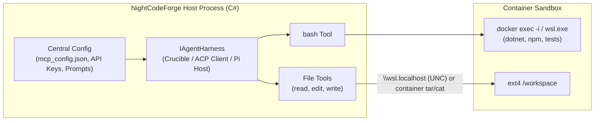

#### Why In-Process Orchestration is Superior:
1. **Network Simplicity for Inference:** The LLM client runs directly on the host, communicating with OllamaRouter on `localhost:11434` or cloud providers without Docker-to-Host bridge networking issues.
2. **Central Configuration for Pi & ACP:**
   - **Pi JSON-RPC:** NightCodeForge spawns and monitors the Pi agent runner on the host, passing tool implementations that forward `bash` into the container sandbox.
   - **Agent Client Protocol (ACP):** NightCodeForge acts as the ACP client. When an ACP agent requests a terminal command execution, NightCodeForge routes the command into the container sandbox.
   - `mcp_config.json`, API credentials, and skills remain centralized on the host.
3. **Optimized File Operations & EditorConfig Compliance:**
   - Single-file reads and writes (`read`, `edit`, `write`) access the ext4 mirror directly via `\\wsl.localhost\Ubuntu\var\ncf\...` or fast exec streaming.
   - All `write` and `edit` file mutations pass through Crucible's `EditorConfigFileApplier`, strictly enforcing repository `.editorconfig` rules (`end_of_line` [LF/CRLF], `indent_style`, `indent_size`, `trim_trailing_whitespace`, `insert_final_newline`, `charset`) before writing to disk. This completely prevents cross-environment newline churn (Windows CRLF vs Linux LF) and eliminates phantom diffs in Git.
   - Heavy recursive operations (compilation, test runners, git status) run completely inside the container.

### 14.5 Host Guardrails & Command Isolation
* **Docker Socket Prohibition:** Mounting `/var/run/docker.sock` into the container is strictly prohibited to prevent container escapes.
* **Network Policies:** Optional network egress restrictions limit container network calls to trusted package registries (nuget.org, npmjs.org, pypi.org) while blocking internal private subnets.
* **Timeout Governance:** Every command execution inside the sandbox is governed by a strict timeout (e.g. 5 minutes for compilation, 30 seconds for git operations).
* **Sentinel REPL Process Protection:** If a command hangs or enters an infinite loop inside `docker exec` / WSL, the runner sends `\x03` (SIGINT) over stdin. If the sentinel is not emitted within a 2-second grace period, the container shell process is forcefully terminated and restarted to eliminate runaway background processes.

#### 14.5.1 Restricted Read-Only Container Sandbox (Triage Tier)
For untrusted external input (such as incoming GitHub issues processed by `TriageProfile` on the `main` or `master` branch), NightCodeForge enforces a hardened container profile:
* **Target Working Directory:** Mounted directly on the repository base branch (`main` or `master`) with strict read-only permissions (`-v /var/ncf/workspaces/{id}/repo:/workspace:ro`). No feature branch is checked out, guaranteeing the base branch cannot be modified.
* **Air-Gapped Network Namespace (`--network none`):** The container is launched with zero network connectivity. Outbound TCP/UDP, DNS resolution, and access to host or internal subnets are completely disabled, neutralizing any data exfiltration or credential phone-home attempts.
* **Read-Only Root Filesystem (`--read-only`):** The entire container filesystem (apart from a volatile 32MB in-memory `/tmp` tmpfs with `noexec,nosuid`) is immutable.
* **Privilege & Capability Stripping:**
  - `--cap-drop=ALL`: Drops all Linux kernel capabilities.
  - `--security-opt no-new-privileges:true`: Prevents escalation via setuid/setgid binaries.
  - `--user 1000:1000`: Enforces non-root execution.
* **Secret & Environment Sanitization:** Container environment variables are scrubbed of all host secrets (Ollama/OpenAI API keys, GitHub personal access tokens, database connection strings, JWT signing keys).
* **Host Execution Prohibition:** Invocations with `SecurityTier == SandboxSecurityTier.RestrictedReadOnly` strictly refuse to run under `BareHostExecutionEnvironment` or unconfined WSL; they must execute inside the hardened container.

### 14.6 Crash & Hang Protection
* Every LLM step and Git command is bound to a strict timeout policy.
* Hangfire automatic retry is disabled for LLM inference tasks (`[AutomaticRetry(Attempts = 0)]`) to prevent duplicate code edits on unexpected runtime exceptions; unhandled errors transition the issue cleanly to `Failed`.
* **Clean Interruption Lifecycle:** Interruption via `ask` is intercepted internally: the checkpoint and question are persisted, the issue transitions to `BlockedQuestion`, and the background job returns `StageExecutionResult.WaitingForHuman()`, completing in a clean `Succeeded` status in Hangfire rather than an artificial failure.

### 14.7 Graceful Restart & Crash Recovery System (`IStartupRecoveryService`)

In overnight autonomous operation, unexpected host restarts are inevitable—most commonly triggered by **Windows Update reboot cycles**, power outages, or kernel driver updates. 

NightCodeForge implements an automated **Startup Reconciliation Protocol** executed during host boot before the Hangfire worker begins polling for jobs:

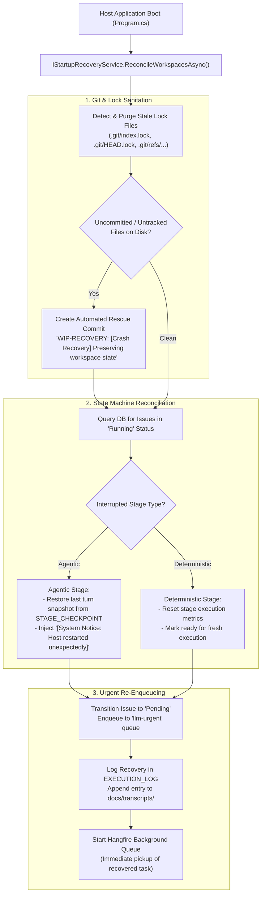

#### Detailed Recovery Procedures:
1. **Stale Lock Cleanup:** If the OS reboots during a Git command, dangling lock files (`.git/index.lock`, `.git/refs/heads/*.lock`) block all subsequent Git operations. The recovery service safely purges stale lock files before attempting workspace commands.
2. **Uncommitted Working Tree Rescue:** Any edits flushed to disk prior to the reboot that were not yet wrapped in a Git commit are safeguarded via an automated rescue commit (`WIP-RECOVERY: Preserving uncommitted workspace changes`). This guarantees zero developer code loss.
3. **Session Rehydration:**
   * For **Agentic Stages**, Crucible rehydrates the serialized conversation memory up to the last successful turn from `STAGE_CHECKPOINT.SerializedMemory`, appending a system notice informing the model that the environment was restarted and workspace files were restored.
   * For **Deterministic Stages** (e.g. interrupted midway through `dotnet test`), the stage is reset to run freshly from the beginning.
4. **Immediate Priority Re-Enqueueing (`llm-urgent`):** The recovered issue is placed directly at the head of `llm-urgent`. When Hangfire initializes (`WorkerCount = 1`), the single GPU worker immediately resumes the interrupted overnight task before touching any other backlog items.
5. **Auditing & Notification:** The recovery event is permanently recorded in `EXECUTION_LOG`, noted in the issue's session transcript under `docs/transcripts/`, and broadcasted via SignalR to the web UI.

