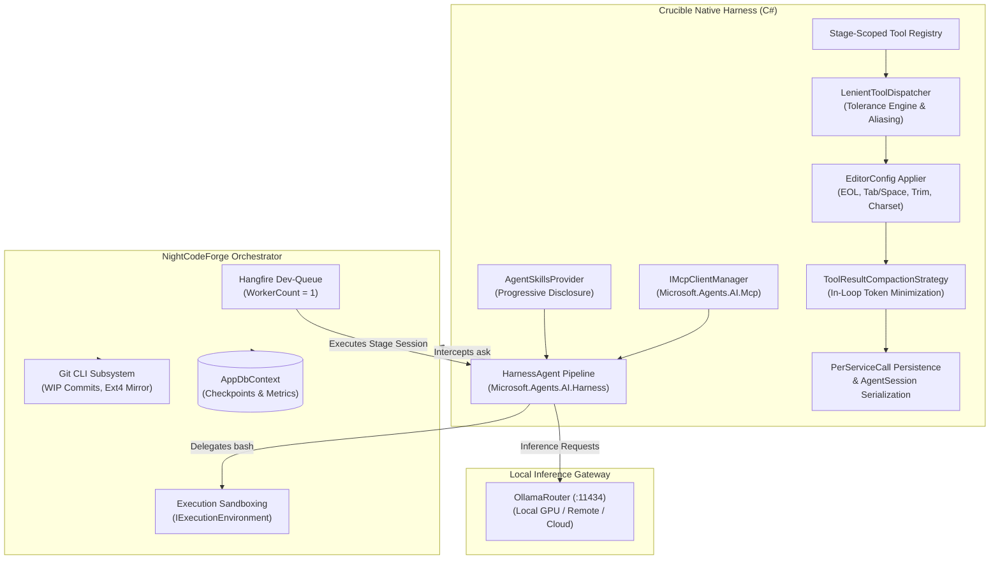
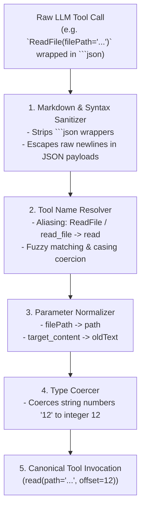
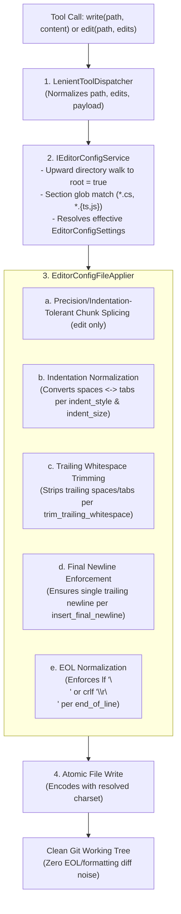
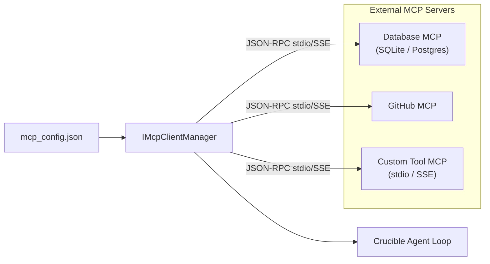
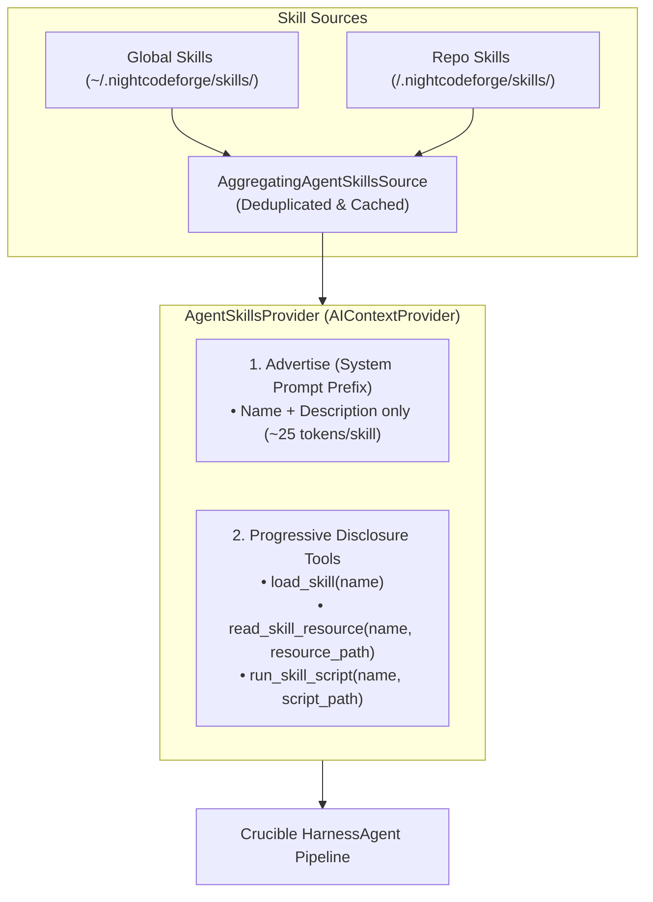
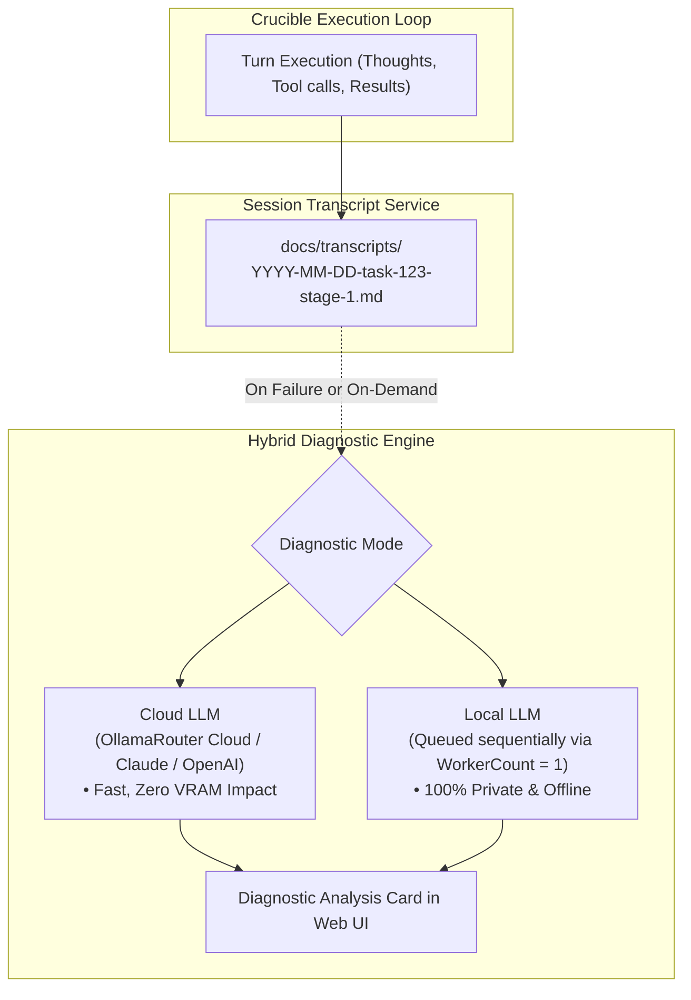

# 🔥 Crucible - Native Agent Harness Specification

## 1. Overview & Architecture

### 1.1 Role in NightCodeForge
**Crucible** is the native, first-class AI Agent Harness for **NightCodeForge**. While NightCodeForge functions as the multi-workspace dev-queue, Git context-switcher, and sandbox orchestrator, **Crucible** powers the in-process reasoning loop that interacts directly with Large Language Models (LLMs) and executes development tasks.

Crucible implements the `IAgentHarness` contract defined by NightCodeForge:



### 1.2 Core Technology Foundation (Official NuGet Releases)
Crucible is built in pure C# targeting .NET 9/.NET 10, consuming official **NuGet release packages** without custom source forks:
* **`Microsoft.Agents.AI`:** Core agent abstractions, chat history management, and context providers.
* **`Microsoft.Agents.AI.Harness`:** Pre-configured `HarnessAgent` orchestrator assembling function-invocation loops, automatic per-service-call persistence, and `LoopAgent` evaluator decorators.
* **`Microsoft.Agents.AI.Abstractions`:** `AIAgent`, `AgentSession`, `AgentRunContext`, and JSON session serialization/deserialization contracts.
* **`Microsoft.Agents.AI.Mcp`:** Native Model Context Protocol (MCP) host integration for stdio and SSE tools.
* **`Microsoft.Extensions.AI`:** The standard .NET AI abstraction layer for `IChatClient`, function definitions, streaming, and OpenTelemetry instrumentation.
* **`editorconfig`:** Official .NET EditorConfig parser library for hierarchical directory traversal and glob rule matching.
* **`OllamaRouter` Compatibility:** Native HTTP communication with local Ollama, vLLM, LM Studio, or OpenAI-compatible endpoints with dynamic GPU routing.

### 1.3 Cross-Platform Execution Model & Windows WSL2 Bridge
Crucible is "special" because it is embedded directly in the NightCodeForge host process. However, autonomous coding agents operate **strictly on Unix**.

* **Windows Host & WSL2 Requirement:** When NightCodeForge runs on Windows, **WSL2 is strictly required**. Crucible interacts with the agent working clone at `~/.nightcodeforge/wks/{workspaceId}`:
  - **Direct File I/O Bridge:** Crucible file tools (`read`, `write`, `edit`) execute directly from the Windows host via the high-speed UNC share:
    ```text
    \\wsl.localhost\{distrib}\home\{username}\.nightcodeforge\wks\{workspaceId}\
    ```
  - **Bare Mode Shell Execution:** In Bare Mode, the `bash` tool executes directly inside WSL2 via `wsl.exe -d <distrib> -- bash -c "cd ~/.nightcodeforge/wks/{id} && ..."`. PowerShell or CMD are never used for agent commands.
* **Linux/macOS Host:** Crucible tools access `$HOME/.nightcodeforge/wks/{workspaceId}` directly, with `bash` delegating to `/bin/bash`.
* **Container Mode & `/workspace` Virtual Path Remapping:**
  - Inside the container, the agent sees only `/workspace` (which is volume-mounted from `~/.nightcodeforge/wks/{id}`).
  - Because Crucible tools operate outside the container on the host/WSL filesystem, the tool dispatcher transparently strips `/workspace` and remaps all file operations to the real filesystem path.
* **On-the-Fly Slim Container Images:** NightCodeForge generates a minimal, lightweight container image on the fly, bind-mounting persistent host package caches (`~/.nuget/packages`, `~/.npm`, `~/.cache/uv`) to prevent downloading dependencies repeatedly.

---

## 2. Agent Profiles & Stage Persona Architecture

### 2.1 Agent Profile Configuration
Every execution stage in a workflow pipeline binds to an **Agent Profile** (`AgentProfile`). Different development stages demand different reasoning depths, thinking budgets, and model parameters:

```csharp
public class AgentProfile
{
    public string Id { get; set; } = default!;          // e.g. "triage-guard", "deep-analyst", "fast-coder", "strict-auditor"
    public string Name { get; set; } = default!;
    public string HarnessId { get; set; } = "crucible"; // Triage strictly requires Crucible
    public string ModelName { get; set; } = default!;    // e.g. "deepseek-r1:32b", "qwen2.5-coder:32b"
    public ThinkingEffort ThinkingEffort { get; set; }  // None, Low, Medium, High, CustomBudget
    public int? ThinkingTokenBudget { get; set; }
    public double? Temperature { get; set; }
    public string? HarnessConfigurationJson { get; set; } // Custom runtime options
    public LocalOptimizationFlags? OptimizationFlags { get; set; } // Opt-out flags for A/B testing
    public IReadOnlyList<string>? PermittedTools { get; set; } // Whitelist: null = all stage tools; ["read", "propose_tasks"]
    public SandboxSecurityTier SecurityTier { get; set; } = SandboxSecurityTier.Standard; // Standard vs RestrictedReadOnly
    public int? WorkspaceId { get; set; }               // Nullable: workspace override
}

public enum SandboxSecurityTier
{
    Standard = 0,          // Normal execution on feature branch; network permitted for restores
    RestrictedReadOnly = 1 // Untrusted external intake on main/master: :ro mount, --network none, --read-only, --cap-drop=ALL
}
```

### 2.2 Stage Persona Prompts & Behavioral Directives
Crucible specializes agent behavior per stage using tailored System Personas and dynamic Bootstrap Prompts:

0. **Stage 0: Automated Triage (`TriageStage` - Untrusted ForgeTask Intake):**
   * **System Persona:** Untrusted ForgeTask Triage & Bug Reproducibility Analyst.
   * **Mission:** Automatically evaluate incoming tasks from external trackers (e.g. GitHub tasks, Jira, webhooks) directly on the base branch (`main` or `master`). Verify technical relevance, inspect candidate files, extract reproduction steps and acceptance criteria, and propose structured backlog items via `propose_tasks`.
   * **Security Posture & Untrusted Content Guardrails:**
     - External task text may contain malicious **indirect prompt injections**.
     - Tool access is strictly locked down: only `read` and `propose_tasks` are registered.
     - `write` and `edit` are **strictly prohibited** to prevent working tree tampering.
     - `ask` is **prohibited** to prevent external inputs from blocking the human dev-queue.
     - `web_search` is **prohibited** to eliminate SSRF and data exfiltration channels.
     - Runs exclusively in a **Restricted Read-Only Container Sandbox** (`--network none`, `:ro` workspace mount, `--read-only`, `--cap-drop=ALL`) on `main`/`master`.
     - *Crucible Exclusive:* Pi and ACP harnesses cannot be used for triage because their static tool architectures do not support fine-grained runtime tool restriction.
   * **Directive:** *"Analyze the reported task against the repository base branch. Determine affected files and acceptance criteria. Call propose_tasks to recommend structured backlog items. You have read-only access and cannot modify code or access external networks."*
   * **Output:** Structured backlog proposal(s) awaiting human confirmation in the Web UI.
1. **Stage 1: ForgeTask Review (`TaskReviewStage`):**
   * **System Persona:** Architectural Analyst & Requirements Investigator.
   * **Mission:** Deeply inspect the codebase against the task request *before* coding. Proactively uncover ambiguities, implicit assumptions, and architectural conflicts.
   * **Directive:** *"If any requirement or design decision is ambiguous or has multiple valid alternatives, invoke `ask` immediately to clarify. Do not guess."*
   * **Output:** Approved Technical Specification & Execution Plan.
2. **Stage 2: Implementation (`ImplementationStage`):**
   * **System Persona:** Senior Software Engineer & TDD Practitioner.
   * **Mission:** Implement clean, robust code according to the approved Stage 1 plan. Run builds (`dotnet build`), run tests, and fix errors incrementally.
   * **Directive:** *"Write working code and verify with build tools. If unexpected blockers or breaking changes arise, call `ask`."*
   * **Output:** Working implementation on the feature branch.
3. **Stage 3: Code Review and Fixes (`CodeReviewAndFixStage`):**
   * **System Persona:** Critical Code Auditor & QA Specialist.
   * **Mission:** Review the full changeset against the base branch. Identify regressions, edge cases, missing unit tests, or lint violations, and make targeted fixes directly.
   * **Directive:** *"Inspect the diff line-by-line. If you find bugs or gaps, use `edit` to fix them directly. When confident, summarize findings."*
   * **Output:** Polished, review-ready code diff.

---

## 3. Canonical Tool Suite (Pi-Harmonized)

Crucible adopts the standard, minimalist tool names established by **Pi** (`read`, `edit`, `write`, `bash`). Because frontier and local coding models (DeepSeek, Qwen2.5-Coder, Claude, GPT-4o) have strong prior training on these exact tool signatures, reusing Pi's canonical names ensures higher tool-calling reliability, fewer hallucinated parameters, and immediate zero-shot proficiency.

### 3.1 Minimalist Canonical Tool Specifications

| Tool Name | Parameters | Purpose | Token & Operational Strategy |
| :--- | :--- | :--- | :--- |
| **`read`** | `path` (string)<br>`offset` (int?, 1-indexed)<br>`limit` (int?) | Read file contents with line slicing. | Enforces window slicing (default 150 lines max) to prevent context flooding. Guideline: *"Use read to examine files instead of cat or sed."* |
| **`edit`** | `path` (string)<br>`edits` (`{ oldText, newText }[]`)<br>*(legacy: root `oldText`, `newText`)* | Precision search-and-replace chunk editing, supporting both single replacements and **multi-disjoint edits** in one call. | Generates ~40 completion tokens instead of rewriting full files. Supports multi-edit batches to modify imports and methods in a single turn. **Enforces repository `.editorconfig` rules** (EOL normalization, tab/space indent, trailing whitespace trimming, final newline). Guideline: *"Use edit for precise changes (`edits[].oldText` must match exactly)."* |
| **`write`** | `path` (string)<br>`content` (string) | Create a brand-new file or perform a deliberate full overwrite. | Restricted primarily to new file creation or full template generation. **Formats content to repository `.editorconfig`** (EOL, tab/space style & width, trailing whitespace, final newline, charset encoding). Guideline: *"Use write only for new files or complete rewrites."* |
| **`bash`** | `command` (string)<br>`timeout` (int?, seconds)<br>`working_directory` (string?) | Executes commands in the container sandbox. Used for builds, tests, git CLI, and file operations (`ls`, `find`, `rg`). | Output streamed via `HeadTailBuffer` rune-safe truncation + compiler error extraction. Guideline: *"Use bash for file operations like ls, rg, find."* |
| **`ask`** | `prompt` (string)<br>`rationale` (string)<br>`options` (string[]?) | Triggers non-blocking checkpoint & GPU worker release. | Persisted to DB & frontmatter; frees GPU instantly for dev-queue. |
| **`web_search`** | `query` (string)<br>`max_results` (int?) | Live web search via pluggable search provider (default: Ollama Web Search). | Compact snippet extraction (default 5 results, ~250 tokens total). |
| **`propose_tasks`** | `tasks` (List of task proposals) | Read-only discovery agent outputs structured backlog items. | Schema-constrained for ideation chat. |

> [!NOTE]
> **Why `list_dir`, `grep_search`, and `get_file_outline` were dropped:**
> In local LLM agent loops, declaring separate tools for directory listing, pattern searching, and polyglot AST outlines adds hundreds of tokens of schema definitions to every single turn. Polyglot outline parsing (e.g. Roslyn for C#, Tree-sitter for TS/Python/Rust/Go) introduces heavy native binary dependencies and cross-platform container headaches. Modern coding models already inspect code structures using `read` (with line slicing via `offset`/`limit`) or fast shell commands in `bash` (`ls`, `find`, `rg`, `grep`). Dropping `get_file_outline` also achieves 100% core tool parity with Pi (`read`, `edit`, `write`, `bash`).
> For backward-compatibility with models biased toward older conventions, Crucible's `LenientToolDispatcher` transparently translates legacy tool calls:
> - `list_dir(path: "src")` $\rightarrow$ `bash("ls -la src")`
> - `grep_search(query: "foo", path: "src")` $\rightarrow$ `bash("rg -n \"foo\" src")`
> - `get_file_outline(path: "file.cs")` $\rightarrow$ `bash("rg -n \"^(public|private|protected|internal|class|interface|record|def|function)\" file.cs")` (or falls back to `read(path, offset: 1, limit: 120)` if `bash` is restricted)

### 3.2 Extensible Web Search Architecture (`IWebSearchService`)
Crucible abstracts web search behind a pluggable `IWebSearchService` interface, allowing developers to switch providers or connect self-hosted search aggregators while defaulting out-of-the-box to Ollama's native service:

```csharp
public interface IWebSearchService
{
    string ProviderName { get; }
    Task<WebSearchResponse> SearchAsync(string query, int maxResults = 5, CancellationToken cancellationToken = default);
}

public record WebSearchResponse(IReadOnlyList<WebSearchResultItem> Results);
public record WebSearchResultItem(string Title, string Url, string Content);
```

#### Available Providers:
1. **`OllamaWebSearchService` (Default):**
   * Connects to the official **[Ollama Web Search API](https://github.com/ollama/ollama/blob/main/docs/capabilities/web-search.mdx)** (`POST https://ollama.com/api/web_search`) or transparently via `OllamaRouter`.
   * Authenticates with `OLLAMA_API_KEY` (configured in `appsettings.json`, environment variable, or workspace settings).
   * Payloads:
     ```json
     POST https://ollama.com/api/web_search
     {
       "query": "aspnetcore 10 blazor signalr reconnect policy",
       "max_results": 5
     }
     ```
2. **`SearXNGWebSearchService` (Self-Hosted & Private):**
   * Connects to a local/on-premise SearXNG instance (`GET /search?q={query}&format=json`).
   * Ideal for 100% air-gapped, privacy-centric software development without third-party query tracking.
3. **`BraveWebSearchService`:**
   * Uses the Brave Search REST API for independent web indexing.
4. **`CustomEnterpriseSearchService`:**
   * Adapts internal enterprise documentation engines (e.g. Confluence, internal Elasticsearch, GitHub Enterprise code search).

*Configuration:*
```json
{
  "WebSearch": {
    "DefaultProvider": "Ollama", // "Ollama" | "SearXNG" | "Brave" | "Custom"
    "Ollama": {
      "ApiKey": "...",
      "Endpoint": "https://ollama.com/api/web_search"
    },
    "SearXNG": {
      "BaseUrl": "http://localhost:8080"
    }
  }
}
```

---

## 4. The "Forgiving" Tool Dispatcher (`LenientToolDispatcher`)

Local models (7B–32B) frequently make minor syntactic, casing, or parameter variations. In standard frameworks, a mismatched tool name or argument key causes an immediate crash or a wasted turn.

Crucible implements a **Lenient Tool Dispatcher** that transparently normalizes invocations before execution.



### 4.1 Tool Name Aliasing, Fuzzy Matching & Legacy Translation
* **`read`** $\leftarrow$ `read_file`, `ReadFile`, `readfile`, `read_file_content`, `cat`, `view_file`
* **`edit`** $\leftarrow$ `replace_file_content`, `replace_content`, `edit_file`, `str_replace`, `patch_file`, `editFile`, `ReplaceFileContent`
* **`write`** $\leftarrow$ `write_file`, `writeFile`, `create_file`, `new_file`, `WriteFile`
* **`bash`** $\leftarrow$ `run_command`, `RunCommand`, `run_cmd`, `exec`, `execute`, `cmd`, `terminal`, `powershell`
* **`ask`** $\leftarrow$ `ask_human_question`, `ask_human`, `ask_user`, `AskHumanQuestion`, `ask_question`, `askHuman`
* **`web_search`** $\leftarrow$ `search_web`, `google_search`, `bing_search`, `brave_search`, `webSearch`, `internet_search`, `search`
* **Automatic Translation for Dropped Tools:**
  - `list_dir(path, recursive)` $\rightarrow$ Automatically re-routed to `bash("ls -la " + path)`
  - `grep_search(query, path)` $\rightarrow$ Automatically re-routed to `bash("rg -n \"" + query + "\" " + (path ?? "."))`
  - `get_file_outline(path)` / `outline` / `view_outline` / `get_outline` / `list_symbols` / `file_outline` $\rightarrow$ Automatically re-routed to `bash("rg -n \"^(public|private|protected|internal|class|interface|record|def|function)\" " + path)` (or falls back to `read(path, offset: 1, limit: 120)` if `bash` is restricted in that stage)

### 4.2 Parameter Normalization
* `path` $\leftarrow$ `file_path`, `filePath`, `filepath`, `filename`, `file`, `target_file`
* `command` $\leftarrow$ `cmd`, `command_line`, `exec`, `script`
* `oldText` / `target_content` $\leftarrow$ `targetContent`, `old_str`, `old_text`, `search`, `target_string`
* `newText` / `replacement_content` $\leftarrow$ `replacementContent`, `new_str`, `new_text`, `replace`, `new_string`
* `offset` / `start_line` $\leftarrow$ `startLine`, `from_line`, `line_start`, `start`, `offset`
* `limit` / `end_line` $\leftarrow$ `endLine`, `to_line`, `line_end`, `end`, `limit`
* `edits` $\leftarrow$ supports array of `{ oldText, newText }` or `{ old_text, new_text }`
* `query` $\leftarrow$ `q`, `search_query`, `text`, `searchQuery`
* `max_results` $\leftarrow$ `maxResults`, `limit`, `count`, `top`

### 4.3 Type Coercion & Payload Sanitization
* **Numeric coercion:** Coerces string numbers (e.g. `"offset": "12"`) to integer `12`.
* **Markdown fence stripping:** Automatically strips ````json ... ```` or ````xml```` wrappers around tool calls.
* **Unescaped newline repair:** Sanitizes unescaped raw newlines in multi-line code replacement payloads before passing to the JSON parser.

### 4.4 Indentation-Tolerant Code Replacement (`edit`)

A frequent failure mode for local LLMs during precision chunk editing is **leading whitespace mismatches**. Models often output `oldText` with 2 spaces per indent when the target file uses 4 spaces, or mix tabs and spaces. In rigid search-and-replace engines, even a 1-character whitespace discrepancy causes the edit to fail, forcing unnecessary retry turns.

Crucible implements an **Indentation-Tolerant Chunk Matcher**:

```mermaid
flowchart TD
    Req["edit(path, edits)"]
    Exact{"1. Exact Literal Substring Match?"}
    ApplyExact["Apply Exact Replacement Directly"]
    LangCheck{"2. Is Indentation Semantic / Significant?\n(e.g., Python, YAML, Makefile)"}
    FailStrict["Reject Edit / Return Exact Match Error\n(Prevents syntax corruption in whitespace-sensitive languages)"]
    FuzzyMatch["3. Fuzzy Indentation Matching\n- Strip leading whitespace line-by-line\n- Compare normalized trimmed lines\n- Identify unique matching candidate block"]
    Reindent["4. Automatic Indentation Adaptation\n- Measure destination base indentation level\n- Re-indent replacement_content to match destination lines"]
    ApplyFuzzy["Apply Re-indented Replacement Cleanly"]

    Req --> Exact
    Exact -->|Yes (Unique match)| ApplyExact
    Exact -->|No Match| LangCheck
    LangCheck -->|Yes (Python / YAML)| FailStrict
    LangCheck -->|No (C#, JS/TS, HTML, CSS, SQL, JSON)| FuzzyMatch
    FuzzyMatch -->|Match Found| Reindent
    Reindent --> ApplyFuzzy
```

#### Language Classification:
1. **Indentation-Significant (Strict Whitespace Enforced):**
   * Extensions: `.py`, `.yaml`, `.yml`, `.nim`, `.pug`, `Makefile`.
   * *Behavior:* Indentation defines scope and execution hierarchy. Strict literal whitespace matching is enforced to prevent syntax corruption.
2. **Brace/Tag-Delimited (Indentation-Tolerant):**
   * Extensions: `.cs`, `.js`, `.ts`, `.jsx`, `.tsx`, `.c`, `.cpp`, `.h`, `.java`, `.rs`, `.go`, `.html`, `.css`, `.scss`, `.json`, `.xml`, `.sql`.
   * *Behavior:* Whitespace is cosmetic. The matcher normalizes leading indentation line-by-line to locate the target block, measures the actual base indentation in the target file, and automatically re-indents `replacement_content` to match the surrounding code before writing.

#### Matching & Replacement Algorithm:
1. **Pass 1 (Exact Match):** Search for exact substring `target_content`. If found uniquely, replace directly.
2. **Pass 2 (Indentation-Insensitive Search):** If Pass 1 fails and the file is not indentation-significant:
   - Split `target_content` and candidate file lines into arrays.
   - Strip leading whitespace (`TrimStart()`) and compare line contents sequentially.
   - If a unique sequence matches, calculate `DeltaIndent = FileIndent - TargetIndent`.
   - Adjust `replacement_content` indentation by `DeltaIndent` for each line.
   - Replace the matched block cleanly with correctly formatted code.

### 4.5 EditorConfig Enforcement for File Operations (`write`, `edit`)

Autonomous coding agents operating in cross-platform environments (e.g., Windows host syncing with WSL2/Linux container ext4 mirrors) frequently introduce subtle code formatting anomalies that pollute version control and trigger CI lint failures:
* **EOL Inconsistencies (LF vs CRLF):** Local LLMs predominantly emit Unix `\n` (LF) line endings. On Windows repositories configured for CRLF (or vice versa), applying an unnormalized replacement can rewrite every line ending in the file, polluting `git diff` with hundreds of phantom changes.
* **Indentation Inconsistencies:** Models frequently generate 2 spaces for files configured with 4 spaces, or spaces instead of tabs (`indent_style = tab`).
* **Trailing Whitespace & Final Newline Regressions:** Models frequently introduce trailing spaces on blank lines or omit trailing newlines, triggering Git warnings (`\ No newline at end of file`) and PR review friction.
* **Charset Encoding Drift:** Writing files without honoring repository encoding standards can strip BOMs needed by certain legacy compilers or corrupt non-ASCII characters.

To guarantee zero diff pollution and strict adherence to repository standards, **Crucible applies EditorConfig rules automatically at the tool boundary** for all file-modifying operations (`write`, `edit`).



#### 4.5.1 Supported EditorConfig Properties
Crucible parses and enforces the core [EditorConfig Specification](https://editorconfig.org/):

| Property | Supported Values | Crucible Enforcement Behavior |
| :--- | :--- | :--- |
| **`end_of_line`** | `lf`, `crlf`, `cr` | Normalizes all line terminators across the file (`\n`, `\r\n`, or `\r`). On `edit`, normalizes both the replaced block and guarantees the overall file EOL remains uniform. |
| **`indent_style`** | `tab`, `space` | Enforces tab vs space indentation. Converts leading spaces to tabs (or tabs to spaces) according to `tab_width` / `indent_size`. |
| **`indent_size`** | Integer (e.g. `2`, `4`), `tab` | Defines the number of spaces per indentation level. Guided by the Indentation-Tolerant Matcher to align inserted code. |
| **`tab_width`** | Integer | Defines the column width of a tab character; defaults to `indent_size` when unspecified. |
| **`insert_final_newline`** | `true`, `false` | When `true`, ensures the saved file terminates with exactly one newline character. When `false`, removes trailing blank lines/newlines. |
| **`trim_trailing_whitespace`** | `true`, `false` | When `true`, strips trailing spaces and tabs from the end of each line before persisting to disk. |
| **`charset`** | `utf-8`, `utf-8-bom`, `utf-16be`, `utf-16le`, `latin1` | Emits file bytes using the specified text encoding (e.g. standard UTF-8 without BOM or UTF-8 with BOM for specific .NET/Windows tooling). |

#### 4.5.2 Hierarchical Traversal & Resolution Engine (`IEditorConfigService`)
* **Upward Traversal:** Starting from the directory containing the target file, Crucible walks upward toward the root of the filesystem.
* **Root Boundary:** Traversal halts immediately when a `.editorconfig` file containing `root = true` is reached.
* **Section Glob Matching:** Globs (`*`, `*.cs`, `*.{js,ts}`, `[a-z]*`, `**`) are evaluated with OS-invariant forward slashes and case sensitivity rules matching the host platform.
* **Precedence:** Properties defined in files closer to the target file override properties defined in higher-level parent directories. Within a single file, later sections override earlier sections.
* **In-Memory Caching:** Parsed EditorConfig files are cached in memory per directory. A `FileSystemWatcher` invalidates cached ASTs whenever `.editorconfig` files are modified, ensuring zero filesystem thrashing during agent loops.

#### 4.5.3 Operation Lifecycle: `write` vs. `edit`
1. **`write(path, content)` Pipeline:**
   - Resolves effective `EditorConfigSettings` for `path`.
   - If `trim_trailing_whitespace = true`, trims trailing whitespace line-by-line.
   - If `indent_style` is specified, adjusts leading whitespace to matching tabs/spaces using `indent_size`.
   - If `insert_final_newline` is configured, ensures or strips trailing newline.
   - Converts all newlines to `end_of_line` (`\n` for `lf`, `\r\n` for `crlf`).
   - Writes to disk using the resolved `charset` encoding (e.g. UTF-8 without BOM).
2. **`edit(path, edits)` Pipeline:**
   - Resolves effective `EditorConfigSettings` for `path`.
   - Reads target file and detects baseline formatting (existing dominant EOL, base indentation).
   - Locates target chunk(s) using Section 4.4 exact match or indentation-tolerant fuzzy matcher.
   - Re-indents replacement chunks to align with surrounding code indentation and the configured `indent_style` / `indent_size`.
   - Splices replacement text into the existing file buffer.
   - Applies `trim_trailing_whitespace` to the edited lines (and full file if configured).
   - Enforces `insert_final_newline`.
   - Normalizes newlines across the entire file to `end_of_line` (or preserves dominant existing EOL if unset).
   - Writes file atomically with resolved `charset`.

#### 4.5.4 Fallback & Auto-Detection Strategy (Unconfigured Files)
If no `.editorconfig` is found or specific properties are omitted:
* **EOL:** Auto-detects the dominant EOL in the existing file (`\r\n` vs `\n`). For brand-new files, defaults to `\n` (LF) or Git repository `core.autocrlf` convention.
* **Indentation:** Auto-detects dominant indentation style (spaces vs tabs) and width (2 vs 4 spaces) from the file's first 100 lines.
* **Trailing Whitespace & Final Newline:** Defaults to trimming trailing whitespace on modified lines and ensuring a single trailing newline (`insert_final_newline = true`), aligning with POSIX and Git best practices.
* **Charset:** Defaults to UTF-8 without BOM (`new UTF8Encoding(encoderShouldEmitUTF8Identifier: false)`).

#### 4.5.5 Component Contracts
```csharp
public interface IEditorConfigService
{
    Task<EditorConfigSettings> GetSettingsForPathAsync(string filePath, CancellationToken cancellationToken = default);
}

public record EditorConfigSettings(
    EndOfLine? EndOfLine,
    IndentStyle? IndentStyle,
    int? IndentSize,
    int? TabWidth,
    bool? InsertFinalNewline,
    bool? TrimTrailingWhitespace,
    Encoding? Charset);

public enum EndOfLine { Lf, CrLf, Cr }
public enum IndentStyle { Space, Tab }

public interface IEditorConfigFileApplier
{
    string ApplyFormatting(string content, EditorConfigSettings settings, string? existingContent = null);
    byte[] ApplyFormattingAndEncode(string content, EditorConfigSettings settings, string? existingContent = null);
}
```

---

## 5. Stage-Scoped Tool Visibility Matrix

To avoid wasting prompt tokens on unused tool definitions, Crucible exposes only the tools needed for the active stage:

| Stage | Permitted Tools | Excluded / Prohibited | Rationale |
| :--- | :--- | :--- | :--- |
| **Stage 0: Automated Triage** *(Untrusted Intake)* | `read`, `propose_tasks` | `write`, `edit`, `ask`, `web_search`, `bash` | Pre-analyses untrusted GitHub/GitLab tasks directly on `main`/`master`. Strictly read-only; eliminates file mutations, human queue blocking (`ask`), and data exfiltration channels (`web_search`, `bash`). |
| **Stage 1: ForgeTask Review** | `read`, `bash`, `web_search`, `ask` | `write`, `edit`, `propose_tasks` | Requirements and architectural analysis. `bash` is restricted by system persona to inspection only (`ls`, `find`, `rg`, `git log`). Code edits are prohibited. |
| **Stage 2: Implementation** | `read`, `edit`, `write`, `bash`, `web_search`, `ask` | `propose_tasks` | Full engineering tools for coding, building, running tests, and looking up API/compiler solutions. |
| **Stage 3: Review & Fix** | `read`, `edit`, `bash`, `ask` | `write`, `web_search`, `propose_tasks` | Code auditing and precision patching; strictly focused on internal diffs without external search distraction. |
| **Ideation / Discovery** | `read`, `bash`, `web_search`, `propose_tasks` | `write`, `edit` | Read-only codebase exploration + web research to propose structured backlog tasks. |

*Token Impact:* Reduces static tool schema overhead in the system prompt by **60%–70%** on every turn.

### 5.1 Dynamic Tool Whitelisting vs. External Harness Limitations

A foundational differentiator of Crucible over external agent harnesses is **dynamic, in-process tool whitelisting**:

| Harness | Dynamic Tool Restriction Support | Architecture & Restriction Mechanism | Suitability for Untrusted Triage |
| :--- | :--- | :--- | :--- |
| **Crucible** (`CrucibleAgent`) | **Full (Native C#)** | Assembles `IList<AIFunction>` dynamically per session based on `AgentProfile.PermittedTools`. Prohibited tools are omitted from the LLM prompt schema entirely. | **Primary / Required for Triage.** Zero risk of the model executing unauthorized tools. |
| **Pi Harness** (`PiRpcAgentHarness`) | **None (Static Engine)** | Tools (`read`, `edit`, `write`, `bash`) are hardcoded in Pi's TypeScript core (`@earendil-works/coding-agent`). The runner advertises all tools on startup. | **Unsuitable for Untrusted Triage.** Cannot revoke `write`, `edit`, or `bash` at runtime. |
| **ACP Adapter** (`AcpAgentHarness`) | **Unsupported / Incompatible** | ACP agents (e.g. Zed/JetBrains external agents) advertise standard capabilities and expect full client toolsets. Dynamic tool revocation breaks agent handshakes. | **Unsuitable for Untrusted Triage.** Cannot guarantee external agents respect tool exclusions. |

#### Crucible's In-Process Tool Binding Pipeline:
```csharp
public async Task<IAgentSession> CreateSessionAsync(
    StageExecutionContext context, 
    AgentProfile profile, 
    CancellationToken ct)
{
    var allTools = _toolRegistry.GetCanonicalTools();
    
    // Enforce profile-level tool whitelisting (Defense-in-depth)
    var activeTools = profile.PermittedTools is { Count: > 0 }
        ? allTools.Where(t => profile.PermittedTools.Contains(t.Metadata.Name, StringComparer.OrdinalIgnoreCase)).ToList()
        : GetDefaultStageTools(context.StageId);

    // Build Crucible HarnessAgent with strictly bounded AIFunction delegates
    return new CrucibleAgent(new HarnessAgentOptions
    {
        ChatClient = _chatClient,
        Tools = activeTools,
        SecurityTier = profile.SecurityTier
    });
}
```

---

## 6. Local LLM Token Minimization & Context Compaction Engine

In local LLM workflows, token consumption directly impacts generation speed, VRAM residency, and reasoning precision. Crucible incorporates a multi-layer optimization engine:

### 6.1 Static Prompt Prefix Stabilization (KV Cache Optimization)
`llama.cpp` and Ollama reuse computed KV cache states when prompt prefixes match byte-for-byte:
* **Strict Message Ordering:**
  `[System Prompt] ➔ [AGENTS.md Guidelines] ➔ [Tool Schemas] ➔ [Active Skills] ➔ [ForgeTask Task Prompt] ➔ [Turn History]`
* **Zero-Jitter Rule:** Never inject dynamic data (such as system clocks, volatile counters, or changing tool orders) into the system prompt or early prefix. Keeping top-level prefix tokens byte-identical allows Ollama to achieve immediate cache hits, cutting turn latency from seconds to milliseconds.

### 6.2 Ephemeral Tool Output Eviction (`ToolResultCompactionStrategy`)
In an 8-turn implementation loop, old file reads and directory listings linger in the prompt history, causing quadratic token inflation. Crucible configures the native `ToolResultCompactionStrategy` from `Microsoft.Agents.AI.Compaction` directly in the `HarnessAgentOptions`:

```csharp
var compactionStrategy = new ToolResultCompactionStrategy(
    trigger: CompactionTriggers.TokenThreshold(tokenThreshold: 24_000),
    minimumPreservedGroups: 3, // Hard floor: keep last 3 turns completely uncompacted
    formatter: CrucibleToolCallFormatter.FormatCompactSummary
);
```

* **Behavior:** Tool call groups outside the protected recent window (`minimumPreservedGroups = 3`) are collapsed into concise assistant summary stubs (e.g. `[read: src/Program.cs (84 lines read)]` or `[bash: ls src/ (12 files)]`).
* **Preservation:** The complete, uncompacted output remains permanently archived in the on-disk markdown transcripts (`docs/transcripts/`), but the live GPU context window stays bounded and nimble.
* **Pipeline Combination:** When necessary for larger tasks, `ToolResultCompactionStrategy` is chained with `SlidingWindowCompactionStrategy` via `PipelineCompactionStrategy`.

### 6.3 Bounded Output Streaming (`HeadTailBuffer`) & Smart Diagnostic Extraction
Commands like `dotnet build` or `dotnet test` can generate thousands of lines of stdout. To protect the LLM context:

1. **Rune-Safe Bounded Accumulation (`HeadTailBuffer`):**
   * Inspired by the Microsoft Agent Framework shell executor architecture, command stdout/stderr is streamed through a UTF-8 rune-safe `HeadTailBuffer` capped at a configurable byte limit (default: 32 KB).
   * It preserves the initial command prelude (first half) and the rolling tail (second half) separated by an explicit marker:
     `[... truncated 42,150 bytes ...]`
   * Never splits multi-byte UTF-8 runes, eliminating orphan surrogates or parser corruption.

2. **Smart Compiler & Test Diagnostic Extraction:**
   * Before piping even the bounded output to the agent, an error-extractor filter isolates **only** failing compiler diagnostics (`error CS\d+: ...`) with line references.
   * For test runs, it extracts **only** failing test names, assertion failures, and relevant stack frames, discarding hundreds of passing test lines.
   * Reduces 3,000 lines of build noise down to ~50 tokens of actionable signal.

### 6.4 Noise-Filtered Git Diffs
In Stage 3 (Code Review), the `{{GitDiff}}` changeset automatically excludes lock files (`package-lock.json`, `pnpm-lock.yaml`), auto-generated designer files (`*.Designer.cs`, `*.g.cs`), and minified assets, and uses compact `-U2` context lines to minimize diff token consumption.

### 6.5 Synthetic Conversation Priming (Pre-Seeded Tool State)
Local LLMs (7B–32B) typically have a strong training bias to call `bash("dotnet build")` or `bash("dotnet test")` at the start of a coding turn to "see the current status," wasting an entire inference round-trip and GPU compute.

Crucible leverages **Synthetic Conversation Priming** by pre-seeding the agent's `ChatHistory` with realistic prior tool call/result pairs derived from deterministic steps:

#### Scenario A: Fixing Build / Test Failures (Backward Loop)
When a deterministic step fails and routes back to the Implementation agent for remediation:
```csharp
// 1. Synthetic Assistant Message (simulates agent initiating the command)
chatHistory.Add(new ChatMessage(ChatRole.Assistant, [
    new FunctionCallContent("bash", new Dictionary<string, object?> { ["command"] = "dotnet test" })
]));

// 2. Synthetic Tool Result Message (injects actual deterministic output)
chatHistory.Add(new ChatMessage(ChatRole.Tool, [
    new FunctionResultContent("bash", "Build FAILED: error CS0103: The name 'ValidateModel' does not exist in the current context [src/Services/OrderService.cs(45,13)]")
]));

// 3. User Directive
chatHistory.Add(new ChatMessage(ChatRole.User, "Please fix the compilation error shown above."));
```
* **Behavioral Impact:** The LLM autoregressively perceives that it *already* executed `dotnet test` and received the failure diagnostics. It immediately begins editing code via `read` and `edit`, completely eliminating the exploratory `bash` round-trip.

#### Scenario B: Verified Baseline Handover (Forward Transition)
When advancing from a successful `DeterministicTestStage` to `CodeReviewAndFixStage`:
* Pre-seeds a synthetic `dotnet test` execution returning: `Test run successful. Total: 42. Passed: 42. Failed: 0.`
* The Code Review agent recognizes that tests are already green and focuses immediately on diff analysis, code quality, and security rather than wasting turns re-running the test suite.

### 6.6 Thinking Trace Compaction (`ThinkingTraceCompactionChatClient`)
For reasoning models (DeepSeek-R1, QwQ), chain-of-thought `<think>...</think>` monologues are streamed live via SignalR to the developer console, but pruned or summarized in historical assistant turns when persisted to memory.
* **Gating Flag:** Controlled by `LocalOptimizationFlags.ThinkingTraceCompaction` (default: `true`).
* **Opt-Out Benefit:** When toggled to `false`, the exact verbatim `<think>` blocks are preserved for debugging or uncompressed benchmark comparisons.

### 6.7 Degenerate Loop & Repetition Circuit Breakers (`ToolLoopCircuitBreaker`)
Prevents local models from locking up the single-worker GPU queue in runaway token loops or ping-pong tool invocations:
* **Token Stream Loop Abort:** Watches the SignalR token stream for 16-character n-gram cycles repeated $\ge 3$ times, canceling completion via `CancellationTokenSource`.
* **Duplicate Tool Interception:** Intercepts identical tool calls with unchanged arguments on an unchanged Git working tree, returning a synthetic corrective steering message.
* **Gating Flag:** Controlled by `LocalOptimizationFlags.LoopCircuitBreaker` (default: `true`).

### 6.8 Opt-Out Architecture & A/B Testing Integration
All 7 local LLM optimizations are strictly opt-out via `LocalOptimizationFlags`, enabling side-by-side **A/B benchmarking** across profiles and models. Full architecture, metrics comparisons, and configuration hierarchy are detailed in **[LOCAL_LLM_OPTIMIZATIONS.md](LOCAL_LLM_OPTIMIZATIONS.md)**.

---

## 7. Model Context Protocol (MCP) Host Client

Crucible acts as an **MCP Host**, integrating external tools via the Microsoft Agent Framework native MCP client (`Microsoft.Agents.Mcp`) decoupled behind `IMcpClientManager`:



### 7.1 Configuration (`mcp_config.json`)
MCP servers are defined globally or per workspace:
```json
{
  "mcpServers": {
    "sqlite": {
      "command": "uvx",
      "args": ["mcp-server-sqlite", "--db-path", "data/app.db"]
    },
    "github": {
      "command": "npx",
      "args": ["-y", "@modelcontextprotocol/server-github"],
      "env": { "GITHUB_TOKEN": "..." }
    }
  }
}
```

### 7.2 Dynamic Tool Registration & Discovery
* When a task session initializes, `IMcpClientManager` queries `tools/list` on configured MCP servers.
* Discovered tools are wrapped as `AIFunction` instances and registered into the active stage session.
* MCP tools pass through the `LenientToolDispatcher` for parameter normalization and resilient error handling.

---

## 8. Modular Skills System (`Microsoft.Agents.AI.Skills`)

Crucible natively implements the open **[Agent Skills specification](https://agentskills.io/)** using `Microsoft.Agents.AI.Skills.AgentSkillsProvider`. Skills are modular bundles of operational instructions, templates, and scripts located in standard directory paths:

```text
<WorkspaceRoot>/.nightcodeforge/skills/ (or .agents/skills/)
├── efcore-migrations/
│   ├── SKILL.md                 # YAML frontmatter + detailed markdown instructions
│   └── templates/               # Supplementary migration templates (resources)
└── csharp-clean-code/
    └── SKILL.md                 # Clean code & architectural rules
```

### 8.1 Standard Skill Schema (`SKILL.md`)
```markdown
---
name: efcore-migrations
description: Guidelines and best practices for creating and applying EF Core database migrations safely
---

# EF Core Migration Workflow
1. When modifying entity schemas, never edit old migrations directly.
2. Run `dotnet ef migrations add <DescriptiveName>` from the infrastructure directory.
3. Verify `Up()` and `Down()` methods for data safety before applying to the database.
```

### 8.2 Progressive Disclosure Pattern
To minimize prompt tokens on local LLMs, Crucible uses the framework's **Progressive Disclosure** pipeline:



1. **Advertise Phase (Prompt Prefix):**
   * Only the skill name and concise description from frontmatter are injected into the system prompt.
   * A catalog of 15 skills consumes only ~350 tokens, rather than thousands of tokens for full instruction bodies.
2. **On-Demand Load Phase (`load_skill`):**
   * When an agent encounters a task requiring specific expertise (e.g. database schema change), it invokes `load_skill("efcore-migrations")`.
   * The provider loads the full markdown instructions dynamically into context for that reasoning phase.
3. **Resource & Script Phases:**
   * `read_skill_resource`: Inspects templates, checklists, or schemas bundled with the skill.
   * `run_skill_script`: Executes verified automation scripts defined by trusted skills.

### 8.3 Wiring via `HarnessAgentOptions`
```csharp
var skillsSource = new AggregatingAgentSkillsSource([
    new AgentFileSkillsSource(globalSkillsDirectory),
    new AgentFileSkillsSource(workspaceSkillsDirectory)
]);

var harnessOptions = new HarnessAgentOptions
{
    AgentSkillsSource = skillsSource,
    DisableAgentSkillsProvider = false
};
```

---

## 9. Repository Guidelines & `AGENTS.md` Ingestion

Crucible natively grounds all agent turns in the repository conventions defined in `AGENTS.md`.

### 9.1 Discovery Hierarchy
Crucible inspects the workspace directory using the following precedence:
1. `<WorkspaceRoot>/AGENTS.md`
2. `<WorkspaceRoot>/.agents/AGENTS.md` (or `.agents/rules/*.md`)
3. Fallback to `<WorkspaceRoot>/CLAUDE.md` or `<WorkspaceRoot>/GEMINI.md`

### 9.2 Cross-Stage System Prompt Injection
Parsed repository rules are prepended directly into the system prompt:
* **Architecture Overview:** High-level project structure and module boundaries.
* **Build & Test Commands:** Precise CLI instructions (`dotnet build`, `dotnet test`).
* **Code Style & Formatting:** Naming conventions, nullability expectations, async best practices.
* **Negative Constraints:** Prohibited patterns (e.g. *"Do not introduce external heavy dependencies"*).

---

## 10. Session Transcripts & Hybrid Diagnostics Service

Crucible captures every execution turn into a **chronological Markdown Transcript** and supports **automated hybrid diagnostics** to evaluate failures.



### 10.1 Transcript Schema (`docs/transcripts/`)
When a stage completes, pauses for a human question, or fails, a transcript is saved to `docs/transcripts/YYYY-MM-DD-task-{id}-{stage}-{status}.md`:
* Frontmatter tracks task ID, stage, profile, model, thinking effort, duration, prompt tokens, completion tokens, total tokens, status, and exit reason.
* Body documents the turn-by-turn thought stream, tool calls, compiler outputs, and Q&A interactions.

### 10.2 Diagnostic Evaluation Modes
* **Option A: Cloud Diagnostics (Zero VRAM Impact):** Routes the transcript to OllamaRouter cloud models or external cloud APIs. Analyzes failures rapidly without consuming local GPU compute or blocking the dev-queue.
* **Option B: Local Diagnostics (100% Air-Gapped):** Evaluates the transcript using a local reasoning model queued sequentially (`WorkerCount = 1`) for complete offline privacy.

---

## 11. Sandboxed Tool Execution & Session Checkpointing

Crucible runs in-process within the NightCodeForge orchestrator, but delegates command execution to a dedicated sandboxing subsystem while persisting conversational state across worker interruptions.

### 11.1 Custom Container Sandbox (`NightCodeForgeContainerExecutor`)

While inspired by the Microsoft Agent Framework's `DockerShellExecutor`, Crucible implements its own container runtime executor tailored for full-stack software development:

#### Why `DockerShellExecutor` is Too Restrictive for Dev Workloads:
* **Network Isolation (`--network none`):** Completely breaks `dotnet restore`, `npm install`, `nuget restore`, and Git remote operations without complex offline mirrors.
* **Read-Only Root Filesystem (`--read-only`):** Prevents package manager caching (NuGet global packages, npm cache, pip cache) and standard CLI temporary writes.
* **Minimal Base Image:** Built on `azurelinux/base/core:3.0` which lacks the .NET SDK, Node.js/pnpm runtimes, Python, and compilation toolchains.
* **Lack of Workspace Mounts:** Does not bind to NightCodeForge's ext4 Git branch mirror or preserve workspace volume state across pipeline stages.

#### Design Patterns Adopted from `DockerShellExecutor`:
1. **Persistent Sentinel REPL Protocol:**
   * Instead of spawning an expensive `docker run --rm` for every single tool invocation, Crucible maintains a long-lived container with an interactive `docker exec -i <container> bash --noprofile --norc` session.
   * After dispatching a command over stdin, Crucible writes an echo command with a unique cryptographic GUID sentinel:
     `echo "__NCF_SENTINEL_<guid>__ $?"`
   * Crucible reads stdout until the sentinel is encountered, parsing the exact process exit code without terminating or restarting the shell process.
   * **Timeout & Runaway Process Protection:** If a command hangs or enters an infinite loop, `ReadUntilSentinelAsync` reaches its timeout threshold:
     1. Crucible immediately writes `\x03` (SIGINT / Ctrl+C) to `_stdin` to cancel the foreground process.
     2. A 2-second grace period is granted for the shell to emit the sentinel and report the aborted exit status.
     3. If the shell does not recover within the grace period, the container shell process is forcefully terminated (`docker kill` or shell restart) to guarantee zero orphaned runaway processes remain in the background.
2. **`HeadTailBuffer` Output Compaction:**
   * Stdout and stderr are streamed through a rune-safe bounded accumulator that preserves the head (first 16 KB) and rolling tail (last 16 KB) separated by `[... truncated N bytes ...]`.
   * Evaluates whole UTF-8 runes to prevent orphan surrogates or byte-stream corruption.
3. **Session Lifecycle & Disposable Containers:**
   * Each task stage owns a dedicated container instance. When the stage completes or pauses, the container is stopped or checkpointed cleanly.

```csharp
public class NightCodeForgeContainerExecutor : IExecutionEnvironment, IAsyncDisposable
{
    private readonly Process _shellProcess; // docker exec -i <container> bash
    private readonly StreamWriter _stdin;
    private readonly StreamReader _stdout;

    public async Task<CommandResult> ExecuteAsync(string command, string? workingDirectory, int? timeoutSeconds)
    {
        var sentinel = $"__NCF_{Guid.NewGuid():N}__";
        await _stdin.WriteLineAsync($"cd {workingDirectory ?? "/workspace"} && {command}");
        await _stdin.WriteLineAsync($"echo \"{sentinel} $?\"");
        await _stdin.FlushAsync();

        try
        {
            return await ReadUntilSentinelAsync(sentinel, timeoutSeconds);
        }
        catch (TimeoutException)
        {
            // 1. Send SIGINT (Ctrl+C) to abort the running command
            await _stdin.WriteAsync('\x03');
            await _stdin.FlushAsync();

            try
            {
                // 2. Wait 2s grace period for shell to settle and emit sentinel
                return await ReadUntilSentinelAsync(sentinel, timeoutSeconds: 2);
            }
            catch (TimeoutException)
            {
                // 3. Shell unresponsive: terminate and restart container shell process
                await ForceRestartShellProcessAsync();
                throw new TimeoutException($"Command timed out after {timeoutSeconds}s and was terminated.");
            }
        }
    }
}
```

---

### 11.2 Session Checkpointing & Asynchronous Interruption (`ask`)

Crucible natively implements NightCodeForge's asynchronous, non-blocking Human-in-the-Loop dev-queue architecture:

```mermaid
sequenceDiagram
    autonumber
    actor LLM as Crucible Agent
    participant Harness as HarnessAgent Pipeline
    participant Persist as PerServiceCall Persistence
    participant Stage as Stage Orchestrator
    participant Git as Git Subsystem
    participant DB as AppDbContext
    participant Queue as Hangfire Dev-Queue
    actor Dev as Human Developer

    LLM->>Harness: Calls ask(prompt, options)
    Harness->>Persist: Commits chat turn to store
    Harness-->>Stage: Yields HumanInterruptionException (intercepted)
    Stage->>Harness: SerializeSessionAsync(agentSession)
    Stage->>Git: git commit -m "WIP: checkpoint before human question"
    Stage->>DB: Save SerializedSessionJson, Branch, PendingQuestion
    Stage->>Queue: Return StageExecutionResult.WaitingForHuman() (Job completes Succeeded!)
    Note over Queue: Worker finishes cleanly; GPU is instantly freed for next waiting task!
    
    Dev->>DB: Submits answer via Web UI
    DB->>Queue: Enqueues stage at Priority 1 (llm-urgent)
    Queue->>Stage: Resumes Stage Job
    Stage->>Git: git checkout feature/task-{id}
    Stage->>Harness: DeserializeSessionAsync(sessionJson)
    Stage->>Harness: MessageInjectingChatClient.Inject(humanAnswer)
    Stage->>LLM: Resumes reasoning loop with exact context intact
```

#### Zero Data-Loss & Clean Queue Lifecycle:
* **Clean Hangfire Job Completion:** When an agent invokes `ask`, the resulting `HumanInterruptionException` is caught internally by the orchestrator. Rather than letting the exception bubble up to Hangfire (which would mark the background job as red/`Failed`), the job orchestrator records the checkpoint and pending question, sets `task.IsWaitingForHuman = true` and `task.InterruptedAgentProfileId = profile?.Id` without altering `task.Status`, and cleanly returns `StageExecutionResult.WaitingForHuman()`. The Hangfire job completes in a clean `Succeeded` state, releasing the single GPU worker for the next waiting task.
* **`PerServiceCallChatHistoryPersistingChatClient`:** Persists message thread state after *every single tool call* inside the `FunctionInvokingChatClient` loop. If an unhandled crash or abort occurs, no intermediate reasoning is lost.
* **`AIAgent.SerializeSessionAsync` / `DeserializeSessionAsync`:** Serializes all conversational memory, provider state bags, and reduction indices into a single standard `JsonElement` stored directly in `AppDbContext.TaskCheckpoints`.
* **`MessageInjectingChatClient`:** Upon resumption from the dev-queue, the human's response is injected directly into the chat client stream as a fresh user turn, allowing the LLM to resume execution seamlessly without prompt re-bootstrapping or token waste.

---

## 12. Local Source Code References

For exact file paths and class implementations in the local Microsoft Agent Framework and Pi codebases corresponding to each Crucible feature, refer to **[REFERENCES.md](REFERENCES.md)**.

