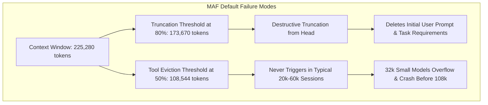
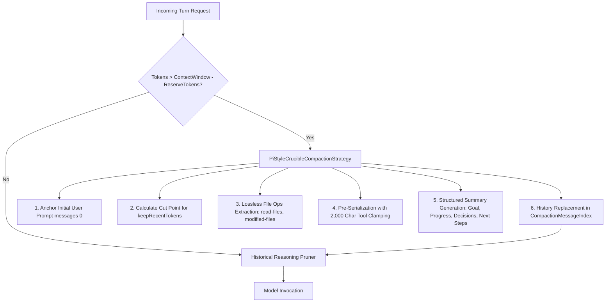
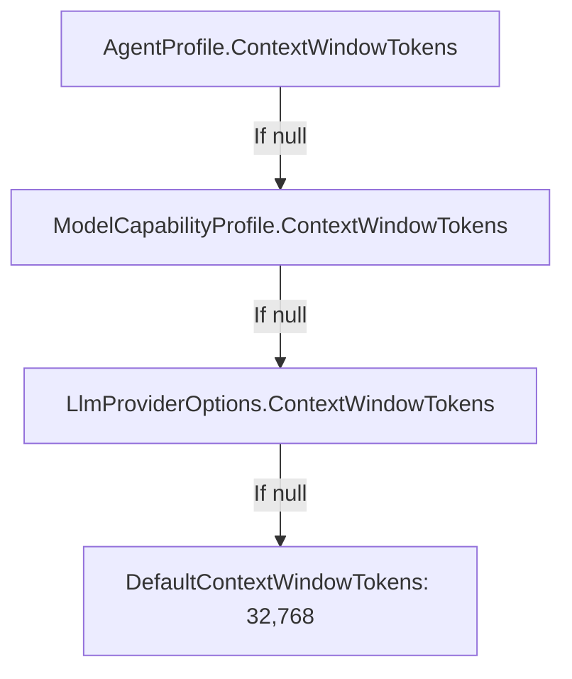

# ✂️ Crucible Context Compaction Specification & Strategy

## 1. Executive Overview

Context window management is one of the most critical aspects of autonomous agent reliability. In multi-turn coding sessions, agent history rapidly accumulates file listings, git diffs, compiler diagnostics, and thinking tokens.

In NightCodeForge, production deployments utilize models with extensive context windows (such as `Qwen3.8-27B:latest` with **262k tokens**, configured at `225,280` tokens in `appsettings.json`), alongside smaller models or sub-agents (e.g., 32k local coder models).

This document specifies the **Pi-Style Context Compaction Engine** implemented in `NightCodeForge.Agents.Compaction`, replacing standard Microsoft Agent Framework (MAF) heuristics with a battle-tested, non-destructive compaction pipeline.

---

## 2. The Problem with Standard MAF Compaction

Prior to this implementation, Crucible utilized MAF's built-in `ContextWindowCompactionStrategy`. In-depth empirical testing and reverse engineering revealed four critical flaws:



1. **Massive Trigger Thresholds for Large Windows:**
   With a 225k context window and an 8k max output, MAF's `ToolEvictionThreshold` ($50\%$) sits at **108,544 tokens**, and `TruncationThreshold` ($80\%$) sits at **173,670 tokens**. In standard coding runs, conversations never reach 108k tokens, so compaction **never triggers**.
2. **Context Overflows on Small Budgets (e.g., 32k):**
   When smaller models or testing budgets are used, Ollama/vLLM overflows at 32k tokens because MAF is waiting for 108k tokens.
3. **Destructive Task Prompt Eviction:**
   When truncation occurs in MAF, it evicts oldest messages starting at index `0`. This deletes the initial User prompt containing the task description, acceptance criteria, and project rules, leaving the agent disoriented with orphaned intermediate assistant tool calls.
4. **Unbounded Tool Outputs and Reasoning Traces:**
   MAF's tool compaction preserves the most recent tool groups intact without clamping their character length (e.g. a 50,000-character file read remains in context). Additionally, historical `TextReasoningContent` blocks are ignored and accumulate unbounded across turns.

---

## 3. The Pi-Style Architecture

Inspired by Pi's context compaction engine (`packages/coding-agent` and `packages/durable`), NightCodeForge introduces a multi-tier compaction architecture:



### 3.1 Dynamic Headroom Budgeting (`ReserveTokens`)
Compaction triggers based on model output and reasoning headroom, not arbitrary percentages:
$$\text{Trigger Condition: } \text{TotalTokens} > \text{ContextWindowTokens} - \text{ReserveTokens}$$

| Parameter | 32k Small Budget (Coder / Test) | 225k Production Budget (Qwen 3.8 27B) | Purpose |
| :--- | :--- | :--- | :--- |
| `ContextWindowTokens` | `32,768` | `225,280` | Total context window capacity. |
| `ReserveTokens` | `8,192` | `16,384` | Dedicated generation & reasoning headroom. |
| `KeepRecentTokens` | `12,288` | `20,000` | Recent turns preserved verbatim in full fidelity. |
| `ToolResultMaxChars` | `2,000` | `2,000` | Tool result length limit during summarization. |

### 3.2 Immutable Task Anchor
The initial User prompt (`messages[0]`) containing task instructions, acceptance criteria, and project constraints, along with any developer system instructions, is marked as the **Task Anchor**.
* The Task Anchor is **never excluded or truncated**.
* The LLM always sees the original user requirements at the beginning of the context.

### 3.3 Lossless File Operation Extraction (`FileOperationTracker`)
Before historical tool calls are summarized and excluded, `FileOperationTracker` scans tool calls (`read`, `write`, `edit`, `view_file`, `replace_file_content`, etc.):
* Distinguishes files that were only read from files that were modified.
* Automatically seeds from any `<read-files>` and `<modified-files>` sections in prior checkpoints via `SeedFromSummaryXml`, ensuring file tracking history carries forward losslessly across multiple successive compactions.
* Formats them into structured XML tags appended to the summary:
```xml
<read-files>
src/Core/Domain/Model.cs
docs/ARCHITECTURE.md
</read-files>

<modified-files>
src/Agents/Compaction/PiStyleCrucibleCompactionStrategy.cs
tests/Agents.Tests/Compaction/CrucibleCompactionIntegrationTests.cs
</modified-files>
```

### 3.4 Pre-Serialization & Tool Output Clamping (`ConversationSerializer`)
Messages selected for summarization are serialized into a plain-text transcript:
* `[User]: ...`
* `[Assistant]: ...`
* `[Assistant tool calls]: read(path="foo.cs"); edit(path="bar.cs")`
* `[Tool result]: ...` (clamped to 2,000 characters with `[... {N} more characters truncated]`)
* Raw reasoning blocks (`TextReasoningContent`) are excluded, preventing multi-turn reasoning traces from inflating the summarization prompt.

### 3.5 Structured Context Checkpoint Template
Summaries are formatted using a strict, non-conversational markdown schema:
```markdown
[CONTEXT COMPACTION CHECKPOINT]
The conversation history prior to this point was compacted into the following summary:

## Goal
[What the user is trying to accomplish]

## Constraints & Preferences
- [Explicit constraints and rules]

## Progress
### Done
- [x] [Completed work]

### In Progress
- [ ] [Current work]

### Blocked
- [Issues if any]

## Key Decisions
- **[Decision]**: [Brief rationale]

## Next Steps
1. [Ordered list of next actions]

## Critical Context
[Data, error messages, and references needed to continue]

<read-files>
...
</read-files>

<modified-files>
...
</modified-files>
```

#### Iterative Summarization Across Multiple Compactions
When context compaction triggers repeatedly in an extended session:
* The prior checkpoint is identified and extracted from the message index.
* For LLM summarization, the previous summary is presented inside `<previous-summary>` tags using `UpdateSummarizationPromptTemplate` (matching Pi's `UPDATE_SUMMARIZATION_PROMPT`). This instructs the model to preserve earlier goals, decisions, and completed tasks while rolling forward new progress and next steps.
* For deterministic fallback, sections such as `## Goal` and `### Done` are preserved and merged from the earlier summary.
* The summarizer response token budget is dynamically scaled to $0.8 \times \text{ReserveTokens}$ (clamped between 1,024 and 8,192 tokens), preventing summarizer token truncation.

### 3.6 Historical Reasoning Pruning (`HistoricalReasoningCompactionChatClient`)
Reasoning models (such as Qwen 3.8) emit extensive thinking traces on every turn. Even within the uncompacted recent window, historical reasoning traces quickly consume thousands of tokens.
`HistoricalReasoningCompactionChatClient` sits in the client middleware stack:
* Preserves `TextReasoningContent` on the most recent assistant turn (the active turn).
* Strips `TextReasoningContent` from all older assistant turns before sending messages to the model.

---

## 4. Context Window Configuration Hierarchy

Context window limits are resolved hierarchically in `ModelCapabilityResolver.BuildCompactionStrategy`:



1. **`AgentProfile.ContextWindowTokens`:** Specific override per profile (e.g. 32k for coder profile, 225k for reviewer profile).
2. **`ModelCapabilityProfile.ContextWindowTokens`:** Pre-configured capability map for known models.
3. **`LlmProviderOptions.ContextWindowTokens`:** Global fallback from `appsettings.json`.
4. **`DefaultContextWindowTokens`:** System baseline (32,768).

---

## 5. Verification & Integration Testing

The compaction strategy is verified through dedicated automated tests in `tests/NightCodeForge.Agents.Tests/Compaction/`:

1. **`FileOperationTrackerTests`:** Verifies accurate extraction and disjoint categorization of read vs. modified files.
2. **`ConversationSerializerTests`:** Verifies plain-text formatting, thinking omission, and 2,000-character tool output clamping.
3. **`HistoricalReasoningCompactionChatClientTests`:** Verifies that only the active assistant turn retains reasoning tokens.
4. **`PiStyleCrucibleCompactionStrategyTests`:** Verifies threshold evaluation, Task Anchor immutability, cut-point selection, and summary injection on `CompactionMessageIndex`.
5. **`CrucibleCompactionIntegrationTests`:** End-to-end integration test running `HarnessAgent` under an artificial **32,768-token budget**, validating multi-turn tool execution, context bounded execution, and task completion.
