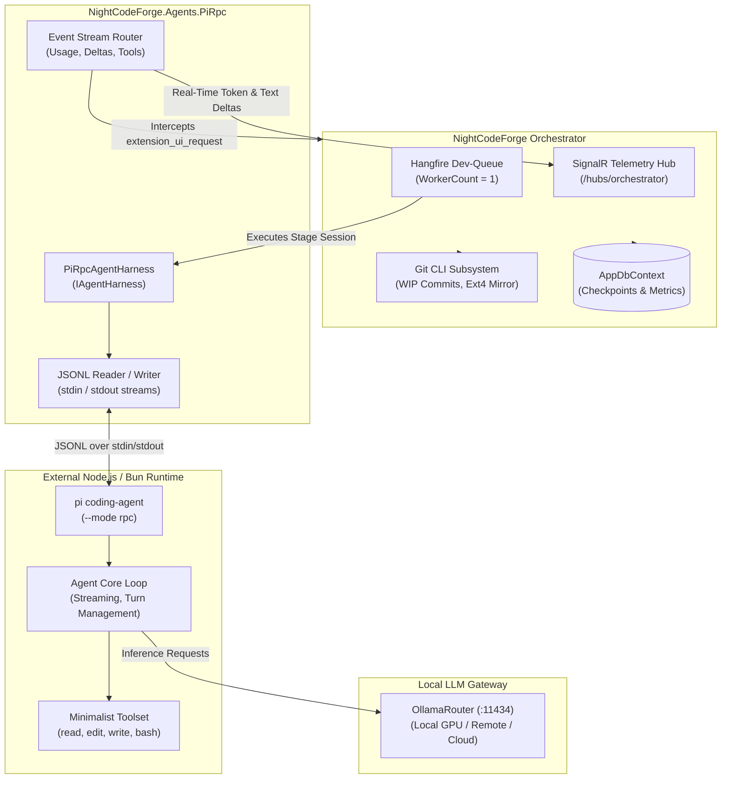
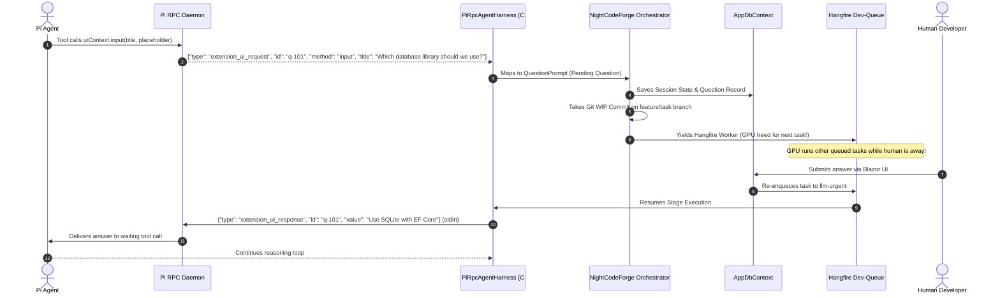

# 🥧 Pi Agent Harness - Integration Specification

## 1. Overview & Role in NightCodeForge

**Pi** (`@earendil-works/coding-agent`) is a high-performance, minimalist autonomous coding agent designed around a lean toolset and headless JSON-RPC execution. In **NightCodeForge**, Pi serves as a first-class alternative harness (`PiRpcAgentHarness`) operating alongside **Crucible**.

While Crucible runs in-process in C# on top of Microsoft Agent Framework and `Microsoft.Extensions.AI`, the **Pi Harness** runs as a managed external subprocess communicating with NightCodeForge via a bidirectional line-delimited JSON (JSONL) protocol over standard input/output.



---

## 2. Minimalist Toolset Architecture

Pi deliberately eschews complex, redundant tool catalogs in favor of four primitive operations. All file searching and directory discovery tasks are delegated directly to the shell tool (`bash`), radically minimizing static prompt token overhead.

### 2.1 The Four Core Tools

| Tool Name | Parameters | Purpose | System Prompt Guideline |
| :--- | :--- | :--- | :--- |
| **`read`** | `path` (string)<br>`offset` (int?, 1-indexed)<br>`limit` (int?) | Read file contents with line slicing. | *"Use read to examine files instead of cat or sed."* |
| **`edit`** | `path` (string)<br>`edits` (`{ oldText, newText }[]`) | Precision search-and-replace, supporting **multiple disjoint edits in a single turn**. | *"Use edit for precise changes (`edits[].oldText` must match exactly). When changing multiple separate locations in one file, use one edit call with multiple entries in `edits[]`. Keep `oldText` as small as possible while still unique."* |
| **`write`** | `path` (string)<br>`content` (string) | Create a new file or completely rewrite an existing file. | *"Use write only for new files or complete rewrites."* |
| **`bash`** | `command` (string)<br>`timeout` (number?, seconds) | Executes commands in the shell. Used for builds, tests, git CLI, and discovery (`ls`, `find`, `rg`). | *"Use bash for file operations like ls, rg, find."* |

### 2.2 Multi-Disjoint Edits in One Turn
A standout feature of Pi's `edit` tool is the `edits: []` array. Instead of making sequential round-trips to edit different parts of a file, the model emits all edits simultaneously:

```json
{
  "path": "src/Services/OrderService.cs",
  "edits": [
    {
      "oldText": "using System.Collections.Generic;",
      "newText": "using System.Collections.Generic;\nusing System.Text.Json;"
    },
    {
      "oldText": "public decimal CalculateTotal() => _subtotal;",
      "newText": "public decimal CalculateTotal() => _subtotal * (1 + _taxRate);"
    }
  ]
}
```

* Each `oldText` is matched against the original file content before any edits from that call are applied.
* Overlapping or nested edits within the same call are rejected.

---

## 3. Structured XML System Prompt Architecture

Pi structures its system prompt into clean, predictable, XML-tagged sections. The section order is strictly immutable across turns, ensuring byte-identical prompt prefixes that maximize KV cache hit rates in Ollama and `llama.cpp`.

```text
You are an expert coding assistant operating inside pi, a coding agent harness. You help users by reading files, executing commands, editing code, and writing new files.

<tools>
- read: Read file contents
- edit: Make precise file edits with exact text replacement, including multiple disjoint edits in one call
- write: Create or overwrite files
- bash: Execute bash commands (ls, grep, find, etc.)
</tools>

<rules>
- Use bash for file operations like ls, rg, find
- Use read to examine files instead of cat or sed
- Use edit for precise changes (edits[].oldText must match exactly)
- When changing multiple separate locations in one file, use one edit call with multiple entries in edits[]
- Use write only for new files or complete rewrites
- Be concise in your responses
- Show file paths clearly when working with files
</rules>

<project_context>
Project-specific instructions and guidelines:
<project_instructions path="AGENTS.md">
... parsed repository rules ...
</project_instructions>
</project_context>

<skills>
... advertised skills catalog ...
</skills>

<cwd>/workspace</cwd>
```

---

## 4. Headless JSONL RPC Protocol Specification

Pi is invoked in RPC daemon mode:
```bash
node ./packages/coding-agent/dist/rpc-entry.js --mode rpc
```

### 4.1 Transport Format
* **Encoding:** UTF-8.
* **Framing:** Every message is a single JSON object terminated by a newline (`\n`).
* **Channels:**
  * `stdin`: NightCodeForge $\rightarrow$ Pi (Commands, UI responses).
  * `stdout`: Pi $\rightarrow$ NightCodeForge (Command responses, streaming events, UI requests).
  * `stderr`: Raw process diagnostics / warnings.

---

### 4.2 Inbound Commands (`stdin` $\rightarrow$ Pi)

#### 1. Start Prompt Run (`prompt`)
```json
{
  "id": "req-1",
  "type": "prompt",
  "message": "Fix compilation error CS0103 in src/OrderService.cs",
  "streamingBehavior": "steer"
}
```

#### 2. Steer Mid-Run (`steer`)
Injects guidance into the agent while it is executing a tool loop:
```json
{
  "id": "req-2",
  "type": "steer",
  "message": "Do not modify the public method signature."
}
```

#### 3. Abort Run (`abort`)
Immediately aborts the current thinking turn and halts child processes:
```json
{
  "id": "req-3",
  "type": "abort"
}
```

#### 4. Configure Model & Thinking Level
```json
{ "id": "req-4", "type": "set_model", "provider": "ollama", "modelId": "qwen2.5-coder:32b" }
{ "id": "req-5", "type": "set_thinking_level", "level": "medium" }
```
*(Thinking levels: `off`, `minimal`, `low`, `medium`, `high`, `xhigh`, `max`).*

#### 5. Session State & Resumption
```json
{ "id": "req-6", "type": "get_state" }
{ "id": "req-7", "type": "switch_session", "sessionPath": "/var/ncf/sessions/task-42.json" }
{ "id": "req-8", "type": "compact", "customInstructions": "Summarize file reads" }
```

---

### 4.3 Outbound Streaming Events (`stdout` $\rightarrow$ Forge)

Pi streams fine-grained events during execution. NightCodeForge routes these events to the SignalR hub for real-time UI rendering:

| Event `type` | Payload | NightCodeForge Mapping |
| :--- | :--- | :--- |
| `agent_start` | `{}` | Marks stage start; records start timestamp. |
| `turn_start` | `{}` | Initializes a new reasoning turn. |
| `message_start` | `message: { role: "assistant" }` | Prepares assistant text stream buffer. |
| `message_update` | `usage: { promptTokens, completionTokens, totalTokens }, assistantMessageEvent: { type: "text_delta", delta: "..." }` | Streams tokens to web UI and updates real-time token gauge. |
| `tool_execution_start` | `toolCallId: string, toolName: string, args: object` | Displays active tool indicator card in UI. |
| `tool_execution_end` | `toolCallId: string, toolName: string, result: object, isError: bool, durationMs: number` | Emits tool completion metric and audit log. |
| `turn_end` | `message: AgentMessage, toolResults: ToolResultMessage[]` | Commits turn record. |
| `agent_end` | `messages: AgentMessage[], willRetry: bool` | Concludes run loop. |
| `agent_settled` | `aborted: bool` | Notifies that all stream handlers are completely flushed. |

---

## 5. Human-in-the-Loop Interruption Protocol

Pi models human questions via **Extension UI Requests** (`extension_ui_request`). NightCodeForge intercepts these events to power its asynchronous, non-blocking dev-queue.



### 5.1 Request Types Supported
1. **Freeform Input (`method: "input"`):**
   ```json
   { "type": "extension_ui_request", "id": "q-1", "method": "input", "title": "Confirm API design", "placeholder": "Enter response..." }
   ```
   *Response:* `{"type": "extension_ui_response", "id": "q-1", "value": "Use REST endpoints."}`
2. **Multiple Choice (`method: "select"`):**
   ```json
   { "type": "extension_ui_request", "id": "q-2", "method": "select", "title": "Target Framework", "options": [".NET 8", ".NET 9", ".NET 10"] }
   ```
   *Response:* `{"type": "extension_ui_response", "id": "q-2", "value": ".NET 10"}`
3. **Confirmation (`method: "confirm"`):**
   ```json
   { "type": "extension_ui_request", "id": "q-3", "method": "confirm", "title": "Breaking Change", "message": "Drop legacy v1 schema?" }
   ```
   *Response:* `{"type": "extension_ui_response", "id": "q-3", "confirmed": true}`

---

## 6. Implementation in `NightCodeForge.Agents.PiRpc`

NightCodeForge encapsulates all Pi RPC daemon communication inside `PiRpcAgentHarness`:

```csharp
public class PiRpcAgentHarness : IAgentHarness, IAsyncDisposable
{
    private readonly Process _piProcess;
    private readonly StreamWriter _stdin;
    private readonly StreamReader _stdout;
    private readonly IHubContext<OrchestratorHub> _hubContext;

    public async Task<AgentRunResult> RunStageAsync(
        AgentProfile profile,
        PipelineContext context,
        CancellationToken cancellationToken)
    {
        // 1. Configure Model & Thinking Budget
        await SendCommandAsync(new SetModelCommand(profile.ModelName));
        await SendCommandAsync(new SetThinkingLevelCommand(profile.ThinkingEffort.ToPiLevel()));

        // 2. Dispatch Prompt Command
        var promptId = Guid.NewGuid().ToString("N");
        await SendCommandAsync(new PromptCommand(promptId, context.StagePrompt));

        // 3. Process Streamed JSON Lines
        while (!cancellationToken.IsCancellationRequested)
        {
            var line = await _stdout.ReadLineAsync(cancellationToken);
            if (line is null) break;

            var rpcMessage = JsonSerializer.Deserialize<RpcEvent>(line);
            
            // Real-Time Token Telemetry
            if (rpcMessage is MessageUpdateEvent update && update.Usage is not null)
            {
                await _hubContext.Clients.Group(context.TaskId.ToString())
                    .SendAsync("OnTokenUsage", update.Usage);
            }

            // Human-in-the-Loop Interruption
            if (rpcMessage is ExtensionUiRequestEvent uiReq)
            {
                return new AgentRunResult(
                    Status: AgentRunStatus.WaitingForHuman,
                    UpdatedState: await CaptureSessionSnapshotAsync(),
                    PendingQuestion: new QuestionPrompt(uiReq.Id, uiReq.Title, uiReq.Options),
                    Summary: "Pi agent paused waiting for human clarification",
                    Metrics: BuildMetrics(),
                    Error: null
                );
            }

            if (rpcMessage is AgentSettledEvent)
            {
                break;
            }
        }

        return new AgentRunResult(AgentRunStatus.Completed, ...);
    }
}
```

---

## 7. Comparison Matrix: Crucible vs. Pi Harness

| Dimension | Crucible Harness (`CrucibleAgent`) | Pi Harness (`PiRpcAgentHarness`) |
| :--- | :--- | :--- |
| **Execution Model** | Native In-Process C# (.NET 9/10) | External Node.js/Bun Subprocess |
| **Foundation** | Microsoft Agent Framework & `Microsoft.Extensions.AI` | Pi Agent Core (`@earendil-works/pi-agent-core`) |
| **Communication** | Direct in-memory C# method calls & delegates | JSON-RPC over `stdio` pipes (JSON Lines) |
| **Core Toolset** | `read`, `edit`, `write`, `bash`, `ask`, `web_search` | `read`, `edit`, `write`, `bash` |
| **Multi-Disjoint Edit** | Native via `edits: [{ oldText, newText }]` | Native via `edits: [{ oldText, newText }]` |
| **EditorConfig Compliance** | Native automated enforcement (`end_of_line`, `indent_style`, `indent_size`, `trim_trailing_whitespace`, `insert_final_newline`, `charset`) | Relies on LLM model compliance or external prettier/linters |
| **Dynamic Tool Restriction & Untrusted Triage** | **Fully Supported:** In-process `IList<AIFunction>` whitelisting; enables read-only untrusted triage (`TriageStage`) on `main`/`master` | **Unsupported:** Fixed static tool definitions; cannot revoke `write`/`edit`/`bash` dynamically per session |
| **Sandboxing** | `NightCodeForgeContainerExecutor` (Docker Sentinel REPL) | Process-level sandbox or WSL execution |
| **Interruption Mechanism** | `HumanInterruptionException` + `AIAgent.SerializeSessionAsync` | `extension_ui_request` + session snapshot |
| **Best Used For** | Primary native pipeline, tight EF Core & MCP integration, maximum performance | Fallback harness, testing models on Pi's reference harness, headless parity validation |

---

## 8. Local Source Code References

For exact file paths to Pi's headless JSONL RPC daemon, minimalist tools (`read.ts`, `edit.ts`, `write.ts`, `bash.ts`), and system prompts in `C:/Users/Julien/source/repos/pi-main/packages/coding-agent`, see **[REFERENCES.md](REFERENCES.md)**.

