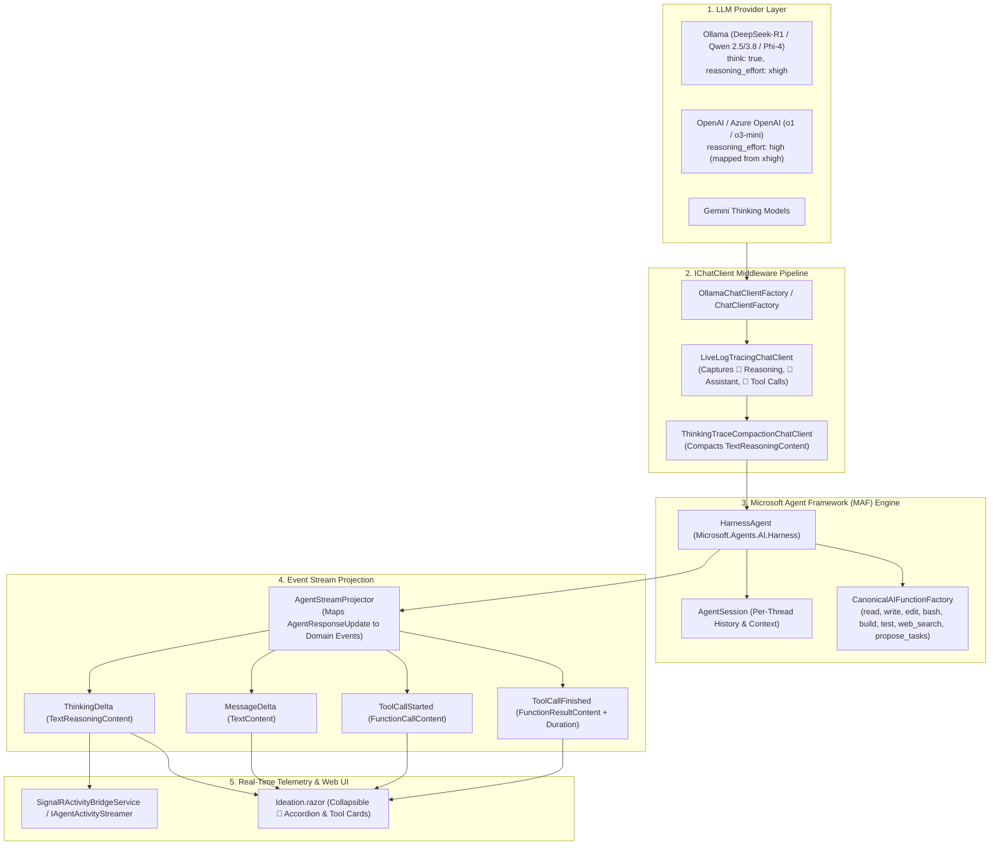

# 🧠 Gap Analysis & Remediation Plan: Thinking Tracking/Extraction & Microsoft Agent Framework (MAF) Alignment

---

> [!IMPORTANT]
> **Scope decision (post-implementation):** NightCodeForge supports **structured reasoning only** (`TextReasoningContent`). The `<think>...</think>` plain-text fallback (`StreamingTagFilter` / regex) described in the original analysis was intentionally dropped; sections below that describe it document the original diagnosis and are superseded by the Phase 1 notes.

## Executive Summary

A critical diagnostic and architectural audit was performed across **NightCodeForge**'s agent execution layer (`IdeationService`, `CrucibleAgentHarness`, `ThinkingTraceCompactionChatClient`, `OllamaChatClientFactory`), the Blazor Web UI (`Ideation.razor`), and the reference implementations in **ComicGen** (`ComicGen.Agent`, `ComicGen.Agent.Benchmark` from `C:\Users\Julien\source\repos\ComicGenCLI`) and the **Microsoft Agent Framework (MAF)** source checkout (`C:/Users/Julien/source/repos/agent-framework-main/dotnet/src`).

### The Two Core Failures

1. **Thinking Tracking / Extraction Is Silently Dropped Across All Layers:**
   * **Root Cause:** In modern LLM clients (`Microsoft.Extensions.AI`, `OllamaSharp` 5.5.0+, OpenAI, and MAF), model reasoning/thinking tokens are emitted as `TextReasoningContent` inside `ChatResponseUpdate.Contents` (and `AgentResponseUpdate.Contents`).
   * By specification, `ChatResponseUpdate.Text` **only concatenates `TextContent`**, returning an **empty string** (`""`) whenever the model is outputting reasoning tokens.
   * Both `IdeationService` (`if (string.IsNullOrEmpty(text)) continue;`) and `CrucibleAgentHarness` (`if (!string.IsNullOrEmpty(update.Text))`) **strictly inspect `update.Text` and skip any update where `update.Text` is empty**. As a result, **100% of native streaming reasoning tokens are dropped before reaching the event broadcaster or Blazor UI**.
   * Furthermore, `ThinkingTraceCompactionChatClient` exclusively checks `msg.Text` against a regex for literal `<think>...</think>` tags. When reasoning is stored as `TextReasoningContent` in `msg.Contents`, it is completely invisible to the compactor, causing either memory leaks or uncompacted historical tokens.
   * `OllamaChatClientFactory` never sets `AdditionalProperties["think"] = true`, meaning Ollama does not reliably emit reasoning stream metadata.

2. **Microsoft Agent Framework (MAF) Is Bypassed in Favor of Brittle Hand-Rolled Loops:**
   * Despite referencing `Microsoft.Agents.AI` 1.23.0 in `NightCodeForge.Agents.csproj`, NightCodeForge **never uses MAF's agent abstractions** (`AIAgent`, `HarnessAgent`, `AgentSession`, `FunctionInvokingChatClient`, or `Microsoft.Agents.AI.Compaction`).
   * `NightCodeForge.Agents.csproj` is **missing the `Microsoft.Agents.AI.Harness` package** reference entirely.
   * Both `IdeationService` (1,277 lines) and `CrucibleAgentHarness` (820 lines) maintain their own custom `while (currentTurn < maxTurns)` loops, hand-rolling turn tracking, history accumulation, tool dispatching, and fallback regex parsing.
   * Tools registered in `ChatOptions.Tools` are **dummy stubs with zero parameters (`() => "ok"`)**, forcing the engine to inject ad-hoc markdown prompt descriptions (`<tools>...</tools>`) and write regex interceptors (`TryExtractTextToolCall`), while MAF tools in ComicGen use typed `AIFunctionFactory.Create(...)` with real parameter schemas and automated execution.

---

## 1. ComicGen & MAF Source Code Reference Catalog

To facilitate implementation and code review, the key architectural reference files from **ComicGen** (`C:/Users/Julien/source/repos/ComicGenCLI`) and **Microsoft Agent Framework** (`C:/Users/Julien/source/repos/agent-framework-main/dotnet/src`) are cataloged below.

### 1.1 ComicGen Agent Harness & MAF Streaming Integration
* **Root Path:** `C:/Users/Julien/source/repos/ComicGenCLI/ComicGen.Agent`

| Component | File Link | Key Implementation Details & Patterns to Replicate |
| :--- | :--- | :--- |
| **`ComicGenAgent`** | [`ComicGenAgent.cs`](file:///C:/Users/Julien/source/repos/ComicGenCLI/ComicGen.Agent/ComicGenAgent.cs#L60-L115) | **HarnessAgent Construction:** Configures `HarnessAgentOptions` (`HarnessInstructions`, `ChatOptions.Tools`, `MaximumIterationsPerRequest`, `CompactionStrategy`), disables unused built-ins (`DisableTodoProvider`, `DisableAgentModeProvider`, `DisableFileMemory`, `DisableWebSearch`), and initializes `HarnessAgent`. |
| **`ComicGenAgent` (Session)** | [`ComicGenAgent.cs`](file:///C:/Users/Julien/source/repos/ComicGenCLI/ComicGen.Agent/ComicGenAgent.cs#L116-L135) | **AgentSession Management:** Provides `GetOrCreateSessionAsync` and `CreateSessionAsync` for isolating conversation state per thread. |
| **`ComicGenAgent` (Streaming)** | [`ComicGenAgent.cs`](file:///C:/Users/Julien/source/repos/ComicGenCLI/ComicGen.Agent/ComicGenAgent.cs#L200-L255) | **Stream Lifecycle & Resiliency:** Clean asynchronous enumerator projection, cancellation handling, and exception-to-terminal-event conversion (`TurnErrorEvent`). |
| **`ComicGenAgent` (Projection)** | [`ComicGenAgent.cs`](file:///C:/Users/Julien/source/repos/ComicGenCLI/ComicGen.Agent/ComicGenAgent.cs#L256-L345) | **Update Stream Projection:** Walks `_agent.RunStreamingAsync(userMessage, session)` and maps `AgentResponseUpdate` items to domain events (`ToolCallStartedEvent`, `ToolCallFinishedEvent`, `TextChunkEvent`, `TurnCompletedEvent`). Measures tool duration via `Stopwatch`. |
| **`AgentStreamEvent`** | [`AgentStreamEvent.cs`](file:///C:/Users/Julien/source/repos/ComicGenCLI/ComicGen.Agent/AgentStreamEvent.cs#L1-L45) | **Domain Stream Events:** Clean event hierarchy (`TextChunkEvent`, `ToolCallStartedEvent`, `ToolCallFinishedEvent`, `TurnCompletedEvent`, `TurnErrorEvent`). |
| **`ComicGenAgentOptions`** | [`ComicGenAgentOptions.cs`](file:///C:/Users/Julien/source/repos/ComicGenCLI/ComicGen.Agent/ComicGenAgentOptions.cs) | Configuration options carrying `AgentName`, `WorkspaceDirectory`, `MaxOutputTokens`, `MaximumIterationsPerRequest`, `Compaction`, and `ReasoningEffort`. |

---

### 1.2 Strongly-Typed Tool Definitions (`AIFunctionFactory`)
* **Root Path:** `C:/Users/Julien/source/repos/ComicGenCLI/ComicGen.Agent/Tools`

| Component | File Link | Key Implementation Details & Patterns to Replicate |
| :--- | :--- | :--- |
| **`ComicGenToolsFactory`** | [`ComicGenToolsFactory.cs`](file:///C:/Users/Julien/source/repos/ComicGenCLI/ComicGen.Agent/Tools/ComicGenToolsFactory.cs#L40-L80) | **Tools Suite Catalog:** Assembles tools into `IReadOnlyList<AIFunction>` returned directly to MAF. |
| **`FileTools` (read_file)** | [`FileTools.cs`](file:///C:/Users/Julien/source/repos/ComicGenCLI/ComicGen.Agent/Tools/FileTools.cs#L12-L42) | Uses `AIFunctionFactory.Create` with `[Description]` attributes on parameters (`string path`, `int? offset`, `int? limit`) for line-sliced reading. Generates valid JSON schemas for the LLM. |
| **`FileTools` (write/edit/move/delete)** | [`FileTools.cs`](file:///C:/Users/Julien/source/repos/ComicGenCLI/ComicGen.Agent/Tools/FileTools.cs#L44-L140) | Uses `AIFunctionFactory.Create` for `write_file` (UTF-8, LF), `edit_file` (exact string replacement with uniqueness verification), `move_file`, and `delete_file` with execution logic directly in the delegate. |
| **`SearchTools` (list_dir & grep_search)** | [`SearchTools.cs`](file:///C:/Users/Julien/source/repos/ComicGenCLI/ComicGen.Agent/Tools/SearchTools.cs#L24-L120) | Safe directory enumeration with glob filtering and regex grep searching, ignoring VCS and build artifact directories (`.git`, `bin`, `obj`). |
| **`InteractionTools` (ask_user & user_pick)** | [`InteractionTools.cs`](file:///C:/Users/Julien/source/repos/ComicGenCLI/ComicGen.Agent/Tools/InteractionTools.cs#L1-L60) | Turn-blocking human-in-the-loop interaction tools exposed as `AIFunction`s delegated to `IUserInteractionDriver`. |
| **`SkillTools` (read_skill)** | [`SkillTools.cs`](file:///C:/Users/Julien/source/repos/ComicGenCLI/ComicGen.Agent/Tools/SkillTools.cs#L1-L40) | Dynamic skill content loading tool enabling progressive disclosure of specialized workflow instructions. |
| **`ComicGenTool`** | [`ComicGenTool.cs`](file:///C:/Users/Julien/source/repos/ComicGenCLI/ComicGen.Agent/Tools/ComicGenTool.cs) | Direct in-process execution of CLI commands as an `AIFunction`. |
| **`GitAIFunctionFactory`** | [`ManagedGitFactory.cs`](file:///C:/Users/Julien/source/repos/ComicGenCLI/ComicGen.Agent/Git/ManagedGitFactory.cs) | In-process sandboxed Git execution via `Pmad.Git.CliEmulator.AI`. |

---

### 1.3 Thinking Extraction & Live Tracing Middleware
* **Root Paths:** `C:/Users/Julien/source/repos/ComicGenCLI/ComicGen.Agent.Benchmark` & `C:/Users/Julien/source/repos/ComicGenCLI/ComicGen/Llm`

| Component | File Link | Key Implementation Details & Patterns to Replicate |
| :--- | :--- | :--- |
| **`LiveLogChatClient` (Streaming)** | [`LiveLogChatClient.cs`](file:///C:/Users/Julien/source/repos/ComicGenCLI/ComicGen.Agent.Benchmark/Infrastructure/LiveLogChatClient.cs#L52-L105) | **`TextReasoningContent` Extraction:** In `GetStreamingResponseAsync`, iterates `update.Contents` matching `case TextReasoningContent reasoning:` (lines 86–88), `case TextContent text:` (lines 90–92), and `case FunctionCallContent call:` (lines 94–98). |
| **`LiveLogChatClient` (Flush)** | [`LiveLogChatClient.cs`](file:///C:/Users/Julien/source/repos/ComicGenCLI/ComicGen.Agent.Benchmark/Infrastructure/LiveLogChatClient.cs#L106-L125) | Flushes consolidated 💭 `reasoning` and 🤖 `assistant` entries to transcripts and live console on stream close. |
| **`LiveLogChatClient` (Non-Stream)** | [`LiveLogChatClient.cs`](file:///C:/Users/Julien/source/repos/ComicGenCLI/ComicGen.Agent.Benchmark/Infrastructure/LiveLogChatClient.cs#L170-L205) | Inspects `ChatMessage.Contents` for `TextReasoningContent` and `FunctionCallContent` in non-streaming responses. |
| **`ChatClientFactory`** | [`ChatClientFactory.cs`](file:///C:/Users/Julien/source/repos/ComicGenCLI/ComicGen/Llm/ChatClientFactory.cs#L220-L240) | Creation of `OllamaApiClient`, `OpenAIClient`, `GeminiChatClient`, and `LLamaSharpChatClient`. Shows HTTP client timeout configuration and model instantiation. |
| **`LocalModelChatFormatter`** | [`LocalModelChatFormatter.cs`](file:///C:/Users/Julien/source/repos/ComicGenCLI/ComicGen/Llm/LocalModelChatFormatter.cs#L270-L305) | Parses raw model responses containing `<think>...</think>` or `<thought>...</thought>` tags into structured `new TextReasoningContent(reasoning)`. |
| **`Reasoning Effort RFC`** | [`2026-10-11-reasoning-effort-configuration.md`](file:///C:/Users/Julien/source/repos/ComicGenCLI/docs/issues/2026-10-11-reasoning-effort-configuration.md) | Architectural specification for `reasoning_effort` (`xhigh`, `high`, `medium`, `low`) across Ollama, OpenAI, and local SLMs. |


---

### 1.4 Full-Fidelity Diagnostics & Transcripts
* **Root Path:** `C:/Users/Julien/source/repos/ComicGenCLI/ComicGen.Agent.Benchmark/Models`

| Component | File Link | Key Implementation Details & Patterns to Replicate |
| :--- | :--- | :--- |
| **`AgentTranscript` (Environment)** | [`AgentTranscript.cs`](file:///C:/Users/Julien/source/repos/ComicGenCLI/ComicGen.Agent.Benchmark/Models/AgentTranscript.cs#L81-L125) | **`### Environment` Rendering:** Renders `**Available tools**` and `**System prompt**` inside safe 4-tick fences (` ```` `) before conversation turns. |
| **`AgentTranscript` (Conversation)** | [`AgentTranscript.cs`](file:///C:/Users/Julien/source/repos/ComicGenCLI/ComicGen.Agent.Benchmark/Models/AgentTranscript.cs#L126-L165) | **Ordered Step Taxonomy:** Emits chronological entries with wall-clock offsets (`[ mm:ss ]`) and icons (`🧑 User`, `💭 Reasoning`, `🤖 Assistant`, `🔧 Tool call`, `↳ Tool result`, `❌ Tool error`). |
| **`AgentTranscript` (Safety Capping)** | [`AgentTranscript.cs`](file:///C:/Users/Julien/source/repos/ComicGenCLI/ComicGen.Agent.Benchmark/Models/AgentTranscript.cs#L166-L175) | Enforces `MaxEntryChars = 32768` truncation per step to prevent unbounded markdown report bloat. |
| **`BenchmarkRunner`** | [`BenchmarkRunner.cs`](file:///C:/Users/Julien/source/repos/ComicGenCLI/ComicGen.Agent.Benchmark/Runner/BenchmarkRunner.cs#L120-L165) | Wires `LiveLogChatClient`, `AgentTranscript`, and console live stream during scenario execution. |

---

## 2. Deep-Dive Gap Analysis

### 2.1 Gap 1: Content Model Disconnect (`TextReasoningContent` vs `TextContent` vs `<think>` Tags)

#### The `Microsoft.Extensions.AI` Content Model
In `Microsoft.Extensions.AI`, a `ChatResponseUpdate` (and MAF's `AgentResponseUpdate`) contains a collection of polymorphic `AIContent` items:
- `TextContent`: Regular assistant response text.
- `TextReasoningContent`: Chain-of-thought, thinking, and reasoning tokens.
- `FunctionCallContent`: Model requests to invoke tools.
- `FunctionResultContent`: Results of tool executions returned to the model.
- `UsageContent`: Token accounting and metering metadata.

The property `ChatResponseUpdate.Text` (and `AgentResponseUpdate.Text`) is defined as:
```csharp
// Microsoft.Extensions.AI / Microsoft.Agents.AI.Abstractions
public string Text => this._contents is not null 
    ? string.Concat(this._contents.OfType<TextContent>().Select(c => c.Text)) 
    : string.Empty;
```

> [!CAUTION]
> Because `TextReasoningContent` is **not** `TextContent`, **`update.Text` is strictly empty or null during the entire reasoning stream**.

#### How `IdeationService.cs` Drops Reasoning Tokens
In `src/NightCodeForge.Agents/Ideation/IdeationService.cs` (lines 407–426):
```csharp
// Current Broken Implementation in IdeationService.cs
var text = update.Text;
if (string.IsNullOrEmpty(text)) continue; // <--- DROPS EVERY REASONING CHUNK!

turnTextBuilder.Append(text);

foreach (var (isThinkingDelta, piece) in tagFilter.ProcessDelta(text))
{
    // Never reached during model thinking!
    var streamKind = isThinkingDelta ? IdeationStreamUpdateKind.ThinkingDelta : IdeationStreamUpdateKind.MessageDelta;
    yield return new IdeationStreamUpdate(streamKind, TextDelta: piece);
}
```
1. When Ollama, DeepSeek-R1, Qwen 2.5/3, or OpenAI emit reasoning tokens, they arrive in `update.Contents` as `TextReasoningContent`.
2. `update.Text` is `""`.
3. `if (string.IsNullOrEmpty(text)) continue;` triggers immediately.
4. The entire reasoning update is silently discarded.
5. Even if `update.Text` were populated, `StreamingTagFilter` only scans for `<think>` and `</think>` tags, completely unaware of `TextReasoningContent`.

#### How `CrucibleAgentHarness.cs` Drops Reasoning Tokens
In `src/NightCodeForge.Agents/Crucible/CrucibleAgentHarness.cs` (lines 351–362):
```csharp
// Current Broken Implementation in CrucibleAgentHarness.cs
if (!string.IsNullOrEmpty(update.Text))
{
    accumulatedText.Append(update.Text);

    if (update.Text.Contains("<think>")) isThinking = true;
    
    var kind = isThinking ? AgentActivityKind.ThinkingDelta : AgentActivityKind.MessageDelta;
    await BroadcastAsync(sessionId, context.ForgeTask.Id, context.StageId, kind, update.Text, cancellationToken);

    if (update.Text.Contains("</think>")) isThinking = false;
}
```
* Identical bug: If `update.Text` is empty (as it is when `TextReasoningContent` is emitted), nothing is accumulated and nothing is broadcast to the SignalR telemetry hub.

#### How `OllamaSharp` 5.5.0 Maps Reasoning Tokens
Decompilation and runtime verification of `OllamaSharp.MicrosoftAi.AbstractionMapper` reveals:
* OllamaSharp maps `OllamaSharp.Models.Chat.Message.Thinking` to `TextReasoningContent(thinking)`.
* When streaming from Ollama, chunks containing reasoning have `update.Contents = [TextReasoningContent]` and `update.Text = ""`.
* Crucially, `AbstractionMapper.ToOllamaSharpChatRequest` reads `ChatOptions.AdditionalProperties["think"]`. **If `think` is null or omitted, Ollama does not separate reasoning into `Message.Thinking`**, leaving it either suppressed or emitting unpredictable text formats depending on the model template.

---

### 2.2 Gap 2: The Reasoning Compaction Breakdown (`ThinkingTraceCompactionChatClient`)

In `src/NightCodeForge.Agents/Optimizations/ThinkingTraceCompactionChatClient.cs`:
```csharp
// Current Broken Implementation in ThinkingTraceCompactionChatClient.cs
[GeneratedRegex(@"<think>(.*?)</think>", RegexOptions.Singleline | RegexOptions.IgnoreCase)]
private static partial Regex ThinkBlockRegex();

public static List<ChatMessage> CompactHistoricalAssistantMessages(
    IReadOnlyList<ChatMessage> messages,
    int keepVerbatimCount = DefaultKeepVerbatimCount)
{
    var thinkIndices = new List<int>();
    for (int i = 0; i < messages.Count; i++)
    {
        var msg = messages[i];
        // ONLY CHECKS msg.Text FOR <think> TAGS!
        if (msg.Role == ChatRole.Assistant && !string.IsNullOrEmpty(msg.Text) && ThinkBlockRegex().IsMatch(msg.Text))
        {
            thinkIndices.Add(i);
        }
    }
    // ...
    for (int i = 0; i < messages.Count; i++)
    {
        var msg = messages[i];
        if (indicesToCompact.Contains(i))
        {
            var stripped = CompactThinkBlock(msg.Text!);
            var newMsg = new ChatMessage(msg.Role, stripped);
            foreach (var content in msg.Contents)
            {
                if (content is not TextContent)
                {
                    newMsg.Contents.Add(content); // <--- PRESERVES TextReasoningContent UNTOUCHED!
                }
            }
            result.Add(newMsg);
        }
    }
}
```

#### The Dual Failure:
1. **Detection Failure:** When an assistant message has reasoning in `msg.Contents` as `TextReasoningContent`, `msg.Text` does not contain `<think>`. The message is never flagged for compaction.
2. **Pruning Failure:** Even if a message were selected for compaction, the loop copies any content that `is not TextContent` straight into `newMsg.Contents`. `TextReasoningContent` is preserved in full, causing context window bloat and quadratic token waste on long multi-turn sessions.

---

### 2.3 Gap 3: Non-Usage of Microsoft Agent Framework (`Microsoft.Agents.AI`)

#### Architecture Comparison Matrix: ComicGen vs NightCodeForge

| Architectural Dimension | ComicGen (`ComicGen.Agent`) | NightCodeForge Current (`NightCodeForge.Agents`) | Impact / Diagnosis |
| :--- | :--- | :--- | :--- |
| **Packages Referenced** | `Microsoft.Agents.AI` 1.23.0<br>`Microsoft.Agents.AI.Harness` 1.23.0 | `Microsoft.Agents.AI` 1.23.0<br>❌ *Missing Harness package* | NightCodeForge lacks `HarnessAgent`, `LoopAgent`, `ToolApprovalAgent`, and built-in compactor providers. |
| **Agent Abstraction** | True `HarnessAgent` / `AIAgent` wrapping `IChatClient` | ❌ Custom, hand-rolled while loop (`while (currentTurn < maxTurns)`) | NightCodeForge reinvents turn execution, tool invocation loops, history tracking, and error handling. |
| **Tool Definitions** | Strongly-typed `AIFunction` via `AIFunctionFactory.Create` with real parameters, types, descriptions, and async delegates (`FileTools`, `ComicGenTool`, `GitAIFunctionFactory`) | ❌ Dummy stub delegates `() => "ok"` in `BuildAIFunctionList` | LLM receives empty tool schemas (`{}`), requiring manual prompt injection of `<tools>` and regex extraction. |
| **Tool Execution** | Native `FunctionInvokingChatClient` in MAF harness executes tools automatically | ❌ Manual string parsing, JSON unescaping, and manual `LenientToolDispatcher.DispatchAsync` | Fragile parsing, manual `ChatMessage(ChatRole.Tool)` construction, error-prone duration/status capture. |
| **Session State** | `AgentSession` with isolated conversation history per thread | ❌ `IReadOnlyList<(string Role, string Content)>` tuples manually converted to `List<ChatMessage>` | State leaks, no native resumption tokens, no pluggable session store. |
| **Stream Projection** | Cleanly projects `AgentResponseUpdate` into strongly-typed `AgentStreamEvent`s | ❌ Ad-hoc inline yields inside a 200-line while loop | Difficult to test, duplicate logic in `IdeationService` and `CrucibleAgentHarness`. |
| **Thinking Logging** | `LiveLogChatClient` taps `TextReasoningContent` (💭) and `TextContent` (🤖) | ❌ Only checks `update.Text.Contains("<think>")` | Reasoning invisible in transcripts and console logs. |
| **History Compaction** | Built-in `Microsoft.Agents.AI.Compaction` (`ICompactionStrategy`, `CompactionProvider`) | ❌ Hand-rolled `ThinkingTraceCompactionChatClient` + `ToolResultCompactor` | Regex-based, fragile, ignores `TextReasoningContent`. |

#### How ComicGen Configures and Executes MAF
In `ComicGenCLI/ComicGen.Agent/ComicGenAgent.cs`:
```csharp
// Proven MAF Pattern from ComicGen
var harnessOptions = new HarnessAgentOptions
{
    Id = options.AgentName,
    Name = options.AgentName,
    Description = "ComicGen AI Authoring Copilot",
    HarnessInstructions = _systemPrompt,
    ChatOptions = new ChatOptions
    {
        Tools = [.. _tools], // Real AIFunction tools!
        MaxOutputTokens = options.MaxOutputTokens
    },
    MaximumIterationsPerRequest = options.MaximumIterationsPerRequest,
    DisableToolAutoApproval = false,
    DisableAgentModeProvider = true,
    DisableTodoProvider = true,
    DisableFileMemory = true,
    DisableAgentSkillsProvider = true,
    DisableWebSearch = true
};
harnessOptions.CompactionStrategy = options.Compaction;

_agent = new HarnessAgent(
    chatClient,
    harnessOptions,
    loggerFactory ?? NullLoggerFactory.Instance,
    services);

// Clean Streaming Execution:
await foreach (var update in _agent.RunStreamingAsync(userMessage, session, ct))
{
    // update is AgentResponseUpdate with Contents (FunctionCall, FunctionResult, TextReasoning, Text)
}
```

---

### 2.4 Gap 4: Web UI and Telemetry Integration

In `src/NightCodeForge.Web/Components/Pages/Ideation.razor`:
* The Blazor UI **already has complete support** for displaying thinking traces:
  ```razor
  @if (part is ThinkingContentPart thinkPart && !string.IsNullOrWhiteSpace(thinkPart.Thinking))
  {
      <details class="think-trace" open>
          <summary>
              <span>🧠 Reasoning Trace</span>
              <span class="status-dot running"></span>
          </summary>
          <div class="think-content font-mono">@thinkPart.Thinking</div>
      </details>
  }
  ```
* In `Ideation.razor` code-behind:
  ```csharp
  case IdeationStreamUpdateKind.ThinkingDelta:
      Session.CurrentThinkingBuffer += update.TextDelta;
      // Appends to ThinkingContentPart and calls StateHasChanged()
  ```
* **Why the user sees nothing:** Because `IdeationService.ConverseStreamingAsync` drops all `TextReasoningContent` chunks, `IdeationStreamUpdateKind.ThinkingDelta` is **never emitted**. The UI code is fully functional but starved of events.

---

### 2.5 Gap 5: Transcript Incompleteness vs ComicGen's Full-Fidelity AgentTranscript

In ComicGen (`ComicGen.Agent.Benchmark/Models/AgentTranscript.cs`), a transcript is **not merely a chat history log** of assistant and user text; it is the **ordered, full-fidelity diagnostic record of the entire execution**:
1. **Environment Section (`### Environment`)**:
   - **System Prompt**: The exact, complete system prompt given to the model (including persona, repository instructions, directory structure, environment variables, active rules, and injected skills).
   - **Available Tools Catalog**: Every tool available to the agent, formatted with its name and functional description (e.g. `read_file — Reads a file from the workspace with line numbers`).
2. **Safe Markdown Fencing**:
   - Uses 4-tick fences (` ```` `) so that code blocks, JSON payloads, or markdown embedded in the system prompt or tool outputs do not break markdown rendering in viewers or tools.
3. **Full-Fidelity Step Taxonomy**:
   - Distinguishes `user` (🧑), `reasoning` (💭), `assistant` (🤖), `tool-call` (🔧 with arguments), `tool-result` (↳ with return text), and `tool-error` (❌ with exception messages), each stamped with its wall-clock elapsed offset (`[ mm:ss ]`).
   - Caps individual entries safely at 32k characters (`MaxEntryChars = 32768`) to avoid document explosion while preserving forensic detail.

#### Why NightCodeForge's Current `SessionTranscriptService` Falls Short:
* **System Prompt is completely lost:** In `IdeationService` and `CrucibleAgentHarness`, the system prompt (which contains the effective working directory, top-level files summary, `AGENTS.md` project rules, tool schemas, and task instructions) is composed in memory and sent to the LLM, but **never added to `transcriptEntries` or passed to `SessionTranscriptService`**.
* **Available Tools are omitted:** Transcripts only record tool *invocations* that happened; they never record what tools were *available* to the agent.
* **Reasoning traces are missing or truncated:** Because `TextReasoningContent` was dropped in the stream loop (Gap 1), transcripts lack internal model chain-of-thought.
* **Forensic Diagnosis Failure:** If an agent hallucinates, calls a non-existent tool, or violates an architectural rule, neither a developer inspecting `docs/transcripts/*.md` nor an automated AI diagnostic agent (`AiDiagnosticsService`) can determine *why* without seeing the system prompt, active rules, and available tools.

---

### 2.6 Inspectability Gap: Can We See What Microsoft Agent Framework Adds?

A central architectural question for forensic debugging, compliance, and prompt verification is: **Does the proposed transcript strategy allow developers to see what Microsoft Agent Framework (MAF) adds to prompts, tools, and message flows?**

#### 1. What MAF Adds Under the Hood
When invoking a `HarnessAgent`, MAF is not a transparent pass-through; it wraps execution in an opinionated, multi-layered middleware stack:
* **System Instructions**: Prepends `HarnessAgent.DefaultInstructions` ("You are a helpful AI assistant that uses tools...") unless overridden by `HarnessInstructions`, plus agent-specific persona instructions.
* **Context Providers (Prompt Injections)**:
  * `TodoProvider`: Injects task-tracking boilerplate (`[Current Tasks: ...]`) into user messages on every turn, and adds `todo_get`, `todo_add`, `todo_update` tools.
  * `AgentModeProvider`: Injects mode tracking instructions (e.g., `plan` vs `execute`) and registers `mode_get`, `mode_set` tools.
  * `FileMemoryProvider`: Injects memory guidelines and registers `file_memory_read`, `file_memory_write` tools.
  * `AgentSkillsProvider`: Discovers local skill directories and injects skill summaries (~25 tokens/skill).
* **Default Tools**: Auto-registers `HostedWebSearchTool` into `ChatOptions.Tools` unless explicitly disabled.
* **Multi-Turn Function Loop (`FunctionInvokingChatClient`)**: Orchestrates the inner loop where tool call outputs are formatted as `ChatMessage`s with `FunctionResultContent` and intermediate continuation prompts.
* **In-Loop Compaction (`AIContextProviderChatClient` / `CompactionProvider`)**: Prunes older messages and injects synthetic reduction summaries into the conversation when token thresholds are exceeded.

#### 2. The Observation Seam Dilemma: Outer vs Inner Tap
* **If tapped only at the Outer Agent Seam (`_agent.RunStreamingAsync()` / `AgentResponseUpdate`)**:
  * ❌ **Blind to MAF injections:** The caller only receives final streaming deltas and tool events. You **cannot** see the system prompt MAF constructed, cannot see MAF's injected todo-list boilerplate or mode instructions, cannot see intermediate continuation prompts, and cannot see in-loop compaction reductions.
* **If tapped at the Inner ChatClient Seam (ComicGen's `LiveLogChatClient` Pattern)**:
  * ✅ **100% Visibility:** `LiveLogTracingChatClient` wraps the innermost `IChatClient` passed into `HarnessAgent`. Every time MAF's internal loop makes a model call, it calls `IChatClient.GetStreamingResponseAsync(messages, options)`.
  * **On the Request Side (`messages`)**: The tracer inspects all incoming `ChatMessage`s, capturing:
    1. The exact system prompt MAF passed to the LLM (including base stage persona + any MAF harness directives).
    2. Any provider injections (e.g. `[Current Tasks: ...]` from `TodoProvider`).
    3. Continuation prompts and tool results (`ChatRole.Tool` / `FunctionResultContent`) formatted by MAF.
    4. Compaction summaries synthesized by MAF's `CompactionProvider`.
  * **In `options.Tools`**: The tracer inspects the exact tool catalog schemas passed to the LLM, revealing any default tools injected by MAF.
  * **On the Response Side**: Captures `TextReasoningContent` (thinking traces) and `FunctionCallContent` before MAF processes them.

#### 3. The Proposed Transcript Output Structure
By capturing at the Inner ChatClient seam, the resulting `SessionTranscriptService` markdown transcript will explicitly delineate:
1. **`### Environment`**:
   * **Base System Prompt**: Stage persona & workspace rules.
   * **MAF Injected Directives**: Any extra system instructions or provider prompts added by MAF.
   * **Active Tools Catalog**: Delineates base canonical tools vs MAF-injected tools (or notes which MAF providers were disabled).
2. **`### MAF Pipeline Configuration`**:
   * Active state of built-in providers (`TodoProvider`, `AgentModeProvider`, `FileMemory`, `WebSearch`, `Compaction`).
3. **`### Ordered Conversation & Loop Tracing`**:
   * Explicitly tags each step:
     * `🧑 User Prompt (Original)` vs `🤖 MAF Injected / Continuation Prompt` (e.g., if TodoProvider or continuation prompt was added).
     * `💭 Model Reasoning Trace` (streaming `TextReasoningContent`).
     * `🔧 Tool Invocation (Requested by Model)`.
     * `↳ Tool Result (Formatted by MAF)`.
     * `🤖 Assistant Response`.
     * `✂️ MAF Compaction Reduction` (when older turns are summarized).

---

### 2.7 Skills Strategy & Prompt Optimization: MAF `AgentSkillsProvider` vs Lean Custom Formatter

In our effort strategy to minimize prompt size and maximize local KV cache reuse (90%+ hit rate), should we rely on MAF's built-in `AgentSkillsProvider`, or should we use our existing custom formatter (`SkillsService.FormatSkillsCatalogPrompt`) and implement our own dedicated `load_skill` tool?

#### 1. Detailed Comparison

| Aspect | MAF's Built-in `AgentSkillsProvider` | Custom Formatter + Dedicated `load_skill` Tool |
| :--- | :--- | :--- |
| **System Prompt Prose** | **~130 tokens** of verbose boilerplate (`You have access to skills... When a task aligns with a skill's domain, follow these steps in exact order... Only load what is needed...`) | **~25 tokens** clean header (`<skills>\nThe following modular skills are available... Use the 'load_skill' tool to view full instructions when relevant:\n</skills>`) |
| **Skill Listing Format** | Verbose nested XML:<br>`<available_skills><skill><name>...</name><description>...</description></skill></available_skills>` (~40 tokens/skill) | Flat bullet points:<br>`- {name}: {description}` (**~15 tokens/skill**, following the Pi / agentskills.io standard) |
| **Registered Tool Schemas** | **3 tools injected** into `ChatOptions.Tools`:<br>1. `load_skill`<br>2. `read_skill_resource`<br>3. `run_skill_script`<br>(**~450 tokens** in JSON Schema definitions) | **Only 1 tool**:<br>`load_skill(string skill_name)`<br>(**~120 tokens** in JSON Schema definitions) |
| **Empty State (No skills in repo)** | Still injects provider instructions or context overhead if paths exist | Yields `string.Empty` (**0 tokens**) |
| **Total Prompt & Schema Overhead** | **~650–850 tokens on EVERY turn** | **~80–120 tokens total** (**~85% token reduction**) |
| **KV-Cache Hit Rate Impact** | Injected dynamically via `AIContextProvider.InvokingAsync` on each turn, causing prefix jitter and cache invalidations | Sits cleanly in **Layer 1 (Global Rules & Guidelines)** of `PromptPrefixStabilizer`, guaranteeing **100% byte-identical KV cache preservation** |
| **Redundant Tools** | Registers `read_skill_resource` and `run_skill_script` | **None:** The agent already has `read` (to inspect auxiliary resource files) and `bash` (to run skill scripts) |

#### 2. Precedent in ComicGen
In ComicGen ([`ComicGenAgent.cs#L91`](file:///C:/Users/Julien/source/repos/ComicGenCLI/ComicGen.Agent/ComicGenAgent.cs#L91)), the developers explicitly configured:
```csharp
DisableAgentSkillsProvider = true // Disables MAF's bloated built-in provider
```
ComicGen instead employed its own `AgentSkillLoader` to compose the prompt and `SkillTools.CreateReadSkill` to provide a single `read_skill(skill_name)` `AIFunction`.

#### 3. The Recommended Architecture ("Best of Both Worlds")
1. **Leverage MAF for Discovery & Parsing:**
   Keep using MAF's underlying `AgentFileSkillsSource` inside [`SkillsService.cs`](file:///c:/Users/Julien/source/repos/jetelain/NightCodeForge/src/NightCodeForge.Agents/Skills/SkillsService.cs) to parse YAML frontmatter and read `SKILL.md` bodies. This ensures 100% specification compliance with the `agentskills.io` standard without reimplementing file parsing.
2. **Disable MAF's Context Provider in `HarnessAgentOptions`:**
   Set `DisableAgentSkillsProvider = true` alongside `DisableTodoProvider`, `DisableAgentModeProvider`, `DisableFileMemory`, and `DisableWebSearch`.
3. **Inject via `PromptPrefixStabilizer` Layer 1:**
   Format the discovered skills using `SkillsService.FormatSkillsCatalogPrompt(skills)` and place the resulting `<skills>` block into Layer 1 of [`PromptPrefixStabilizer`](file:///c:/Users/Julien/source/repos/jetelain/NightCodeForge/src/NightCodeForge.Agents/Optimizations/PromptPrefixStabilizer.cs). This guarantees that the prompt prefix remains **byte-identical across all turns, stages, and tasks**, achieving **90%+ KV cache hit rates**.
4. **Implement the Missing `load_skill` Tool:**
   * Add `LoadSkillAsync(string skillName, CancellationToken ct)` to [`CanonicalTools.cs`](file:///c:/Users/Julien/source/repos/jetelain/NightCodeForge/src/NightCodeForge.Agents/Tools/CanonicalTools.cs).
   * Expose it via `CanonicalAIFunctionFactory.cs` as a single typed `AIFunction` (`load_skill`).
   * Rely on canonical `read` and `bash` for any auxiliary skill resources or automation scripts, avoiding schema bloat.

---

## 3. Target Architecture



---

## 4. Remediation Plan: Phased Implementation Roadmap

### Phase 1: Core Content Model & Thinking Extraction Fix (Immediate Priority)

The goal of Phase 1 is to restore thinking tracking in `IdeationService`, `CrucibleAgentHarness`, and `ThinkingTraceCompactionChatClient` without waiting for full MAF refactoring. Only **structured reasoning** (`TextReasoningContent`) is supported; literal `<think>` tags in plain text are deliberately not parsed.

#### Step 1.1: Fix Streaming Reasoning Extraction in `IdeationService.cs`
> [!IMPORTANT]
> **Design decision — structured reasoning only.** NightCodeForge supports only structured reasoning (`TextReasoningContent`). The former `StreamingTagFilter` / regex fallback for models emitting literal `<think>...</think>` tags in plain text was intentionally removed: `update.Text` is always treated as assistant output.

Update the streaming consumer loop to inspect `update.Contents` for `TextReasoningContent` and treat `update.Text` as pure assistant output.

```csharp
// Target Pattern for IdeationService.cs
foreach (var update in stream)
{
    // 1. Extract Function Calls
    if (update.Contents != null)
    {
        foreach (var c in update.Contents)
        {
            if (c is FunctionCallContent fc) functionCalls.Add(fc);
        }
    }

    // 2. Extract Structured Reasoning Tokens (TextReasoningContent)
    if (update.Contents != null)
    {
        foreach (var c in update.Contents)
        {
            if (c is TextReasoningContent reasoning && !string.IsNullOrEmpty(reasoning.Text))
            {
                transcriptBuffer.Append("THINKING", reasoning.Text);
                await BroadcastAsync(sessionId, 0, "ideation", AgentActivityKind.ThinkingDelta, reasoning.Text, cancellationToken, metadata);
                yield return new IdeationStreamUpdate(IdeationStreamUpdateKind.ThinkingDelta, TextDelta: reasoning.Text);
            }
        }
    }

    // 3. Extract Text Tokens (pure assistant output)
    var text = update.Text;
    if (!string.IsNullOrEmpty(text))
    {
        turnTextBuilder.Append(text);
        transcriptBuffer.Append("ASSISTANT", text);
        await BroadcastAsync(sessionId, 0, "ideation", AgentActivityKind.MessageDelta, text, cancellationToken, metadata);
        yield return new IdeationStreamUpdate(IdeationStreamUpdateKind.MessageDelta, TextDelta: text);
    }
}
```

#### Step 1.2: Fix Non-Streaming Fallback in `IdeationService.cs`
Update `IdeationService.ConverseStreamingAsync` when falling back to `GetResponseAsync`:
* Inspect `response.Messages` for `TextReasoningContent`.
* Emit extracted reasoning to `IdeationStreamUpdateKind.ThinkingDelta` and `AgentActivityKind.ThinkingDelta`.

#### Step 1.3: Fix Streaming Reasoning Extraction in `CrucibleAgentHarness.cs`
In `src/NightCodeForge.Agents/Crucible/CrucibleAgentHarness.cs`:
* Scan `update.Contents` for `TextReasoningContent` and broadcast with `AgentActivityKind.ThinkingDelta`.
* Process `update.Text` as plain assistant output (no `<think>` tag fallback: structured reasoning only).

#### Step 1.4: Update `OllamaChatClientFactory` and `LlmProviderOptions`
In `src/NightCodeForge.Agents/Inference/OllamaChatClientFactory.cs`:
* Configure `ChatOptions.AdditionalProperties` with `reasoning_effort` defaulting to `"xhigh"` (the native default level for Qwen 3.8 models):
  ```csharp
  public static ChatOptions CreateDefaultChatOptions(string? modelId, float? temperature = null, string? reasoningEffort = "xhigh")
  {
      return new ChatOptions
      {
          ModelId = modelId,
          Temperature = temperature,
          AdditionalProperties = new AdditionalPropertiesDictionary
          {
              ["think"] = true,
              ["reasoning_effort"] = reasoningEffort ?? "xhigh"
          }
      };
  }
  ```
* Add `ReasoningEffort` to `src/NightCodeForge.Agents/Inference/LlmProviderOptions.cs` (defaulting to `"xhigh"` for Qwen 3.8 models, with automatic provider normalization to `"high"` when targeting OpenAI o-series endpoints):
  ```csharp
  public class LlmProviderOptions
  {
      // ...
      /// <summary>
      /// Reasoning effort level for models supporting internal chain-of-thought (e.g. "xhigh", "high", "medium", "low").
      /// Defaults to "xhigh" for Qwen 3.8 models. When targeting OpenAI endpoints that only support "high", automatically mapped.
      /// </summary>
      public string? ReasoningEffort { get; set; } = "xhigh";
  }
  ```

#### Step 1.5: Fix `ThinkingTraceCompactionChatClient.cs`
Update `ThinkingTraceCompactionChatClient` (**structured reasoning only** — literal `<think>` tags in plain text are intentionally no longer interpreted):
1. Detect assistant messages carrying `msg.Contents.OfType<TextReasoningContent>()`.
2. When compacting historical turns outside the verbatim window, replace the `TextReasoningContent` items with a single concise stub `new TextReasoningContent($"[Reasoned: {firstLine}]")`.

---

### Phase 2: Tool Modernization & Package Upgrades

#### Step 2.1: Add `Microsoft.Agents.AI.Harness` Package
Update `src/NightCodeForge.Agents/NightCodeForge.Agents.csproj`:
```xml
<ItemGroup>
  <PackageReference Include="Microsoft.Agents.AI" Version="1.23.0" />
  <PackageReference Include="Microsoft.Agents.AI.Harness" Version="1.23.0" />
  <!-- ... existing packages ... -->
</ItemGroup>
```

#### Step 2.2: Implement `CanonicalAIFunctionFactory`
Create `src/NightCodeForge.Agents/Tools/CanonicalAIFunctionFactory.cs` to wrap `CanonicalTools` into strongly-typed `AIFunction`s:
```csharp
public static class CanonicalAIFunctionFactory
{
    public static IReadOnlyList<AIFunction> CreateTools(CanonicalTools tools, IReadOnlyList<string>? permittedTools = null)
    {
        var allTools = new List<AIFunction>
        {
            AIFunctionFactory.Create(
                ([Description("Workspace-relative path to read")] string path,
                 [Description("1-indexed start line offset")] int? offset,
                 [Description("Maximum lines to read")] int? limit,
                 CancellationToken ct) => tools.ReadAsync(path, offset, limit, ct),
                "read",
                "Reads a file with line numbers and optional line-based pagination."),

            AIFunctionFactory.Create(
                ([Description("Workspace-relative path to write")] string path,
                 [Description("Full file content")] string content,
                 CancellationToken ct) => tools.WriteAsync(path, content, ct),
                "write",
                "Creates or overwrites a workspace file."),

            AIFunctionFactory.Create(
                ([Description("Workspace-relative path to edit")] string path,
                 [Description("One or more disjoint exact-match replacements applied atomically")] IReadOnlyList<EditChunk>? edits,
                 [Description("Shortcut for a single edit: exact text to be replaced")] string? old_text,
                 [Description("Shortcut for a single edit: replacement text")] string? new_text,
                 CancellationToken ct) => /* edits[] preferred, else old_text/new_text, else error */,
                "edit",
                "Replaces exact text snippets in a workspace file (multi-edit via edits[].oldText/newText)."),

            AIFunctionFactory.Create(
                ([Description("Shell command line to execute")] string command,
                 [Description("Timeout in seconds")] int? timeout,
                 [Description("Working directory relative to repo root")] string? working_directory,
                 CancellationToken ct) => tools.BashAsync(command, timeout, working_directory, ct),
                "bash",
                "Executes a bash or shell command within the workspace sandbox."),

            AIFunctionFactory.Create(
                ([Description("Search query string")] string query,
                 [Description("Maximum results to return (1-10)")] int? max_results,
                 CancellationToken ct) => tools.WebSearchAsync(query, max_results, ct),
                "web_search",
                "Searches technical web documentation for APIs, errors, or libraries."),

            AIFunctionFactory.Create(
                ([Description("Exact name of the skill to load from the <skills> catalog")] string skill_name,
                 CancellationToken ct) => tools.LoadSkillAsync(skill_name, ct),
                "load_skill",
                "Loads full instructions and reference documentation for a modular skill on demand.")
        };

        if (permittedTools == null || permittedTools.Count == 0) return allTools;
        return allTools.Where(t => permittedTools.Contains(t.Name, StringComparer.OrdinalIgnoreCase)).ToList();
    }
}
```

#### Step 2.3: Implement `LoadSkillAsync` in `CanonicalTools.cs`
Wire the missing `load_skill` tool execution to `SkillsService`:
```csharp
// In src/NightCodeForge.Agents/Tools/CanonicalTools.cs
public async Task<string> LoadSkillAsync(string skillName, CancellationToken cancellationToken = default)
{
    if (string.IsNullOrWhiteSpace(skillName))
    {
        return "Error: skill_name parameter is required.";
    }

    var skillsService = new SkillsService();
    return await skillsService.LoadSkillAsync(_workspaceRoot, skillName, cancellationToken);
}
```

> [!NOTE]
> **Implementation status:** MAF's `AgentSkillsProvider` wrapper (`SkillsService.GetSkillsContextAsync` / `CreateSkillsProvider`) was removed, and `read_skill_resource` / `run_skill_script` were dropped from the default tool whitelists. The `<skills>` catalog is injected (Crucible via `PromptPrefixStabilizer` Layer 1, Ideation in the system prompt) only when `load_skill` is permitted. No `<tools>` text is injected in prompts: schemas travel exclusively through `ChatOptions.Tools`.

---

### Phase 3: MAF `HarnessAgent` Integration for Ideation & Crucible

#### Step 3.1: Refactor `IdeationService` to Use `HarnessAgent`
Replace the 200-line manual while-loop with `HarnessAgent`:
1. Build `HarnessAgentOptions` with system prompt, `CanonicalAIFunctionFactory.CreateTools(...)`, and `MaximumIterationsPerRequest = maxTurns`.
2. Disable unneeded built-ins (`DisableTodoProvider = true`, `DisableAgentModeProvider = true`, `DisableFileMemory = true`, `DisableAgentSkillsProvider = true`, `DisableWebSearch = true`).
3. Set `harnessOptions.CompactionStrategy` using `Microsoft.Agents.AI.Compaction`.
4. Run via `_agent.RunStreamingAsync(userPrompt, session, cancellationToken)`.
5. Project `AgentResponseUpdate`s to `IdeationStreamUpdate`s using a clean, dedicated projector class.

#### Step 3.2: Align `CrucibleAgentHarness` to Use `HarnessAgent`
Migrate `CrucibleAgentHarness.RunStageAsync` to initialize and invoke `HarnessAgent`:
* **`ToolApprovalAgent` is intentionally not adopted.** `HarnessAgent` runs with `DisableToolAutoApproval = false` and the per-profile `PermittedTools` whitelist is the single source of truth for authorization (no extra approval policy to enforce in unattended runs).
* Use `PerServiceCallChatHistoryPersistingChatClient` for crash-recovery checkpointing.
* Emit unified `AgentActivityEvent`s directly from the MAF update stream.

---

### Phase 4: Telemetry, Benchmarking & Live Tracing (ComicGen Alignment)

#### Step 4.1: Implement `ThinkingAndActivityTracingChatClient` (Dual-Seam Transcript Logger)
Model after ComicGen's `LiveLogChatClient`:
* Implements `DelegatingChatClient` placed directly on the inner `IChatClient` supplied to MAF's `HarnessAgent`.
* **Captures Exactly What MAF Adds on Every Loop Turn:**
  - In `GetStreamingResponseAsync(messages, options)` and `GetResponseAsync(messages, options)`:
    - Inspects incoming `messages` to capture the exact system instructions MAF passed to the LLM (including `HarnessInstructions` or `DefaultInstructions`).
    - Detects and records any provider prompt injections (e.g., `[Current Tasks: ...]` from `TodoProvider` or mode state from `AgentModeProvider`).
    - Captures intermediate tool result messages (`ChatRole.Tool`) and continuation prompts synthesized by MAF's `FunctionInvokingChatClient` during multi-turn loops.
    - Captures in-loop compaction reduction summaries injected by `CompactionProvider`.
    - Inspects `options.Tools` to log the full tool schema catalog passed to the LLM, revealing any default tools injected by MAF.
  - On the streaming response, accumulates `TextReasoningContent` chunks and flushes coherent `reasoning`, `assistant`, and `tool-call` entries to the transcript and live telemetry.

#### Step 4.2: End-to-End UI Verification
Verify in `src/NightCodeForge.Web/Components/Pages/Ideation.razor`:
* Collapsible `<details class="think-trace" open>` accordion streams reasoning live with a pulsing status dot (`.status-dot.running`).
* Once reasoning finishes and assistant text begins, the accordion collapses (or remains available for inspection) and markdown content streams smoothly.
* Tool call cards show tool name, arguments, execution duration, and success/failure badges.

#### Step 4.3: Full-Fidelity Session Transcripts Inspired by ComicGen's `AgentTranscript`
Refactor `src/NightCodeForge.Agents/Transcripts/SessionTranscriptService.cs` and `TranscriptMetadata`:
1. **Extend `TranscriptMetadata` / Transcript State:**
   * Add `string? SystemPrompt` to capture the complete composed system prompt (persona, environment, directory layout, active `AGENTS.md` rules, tool instructions, and skill definitions).
   * Add `IReadOnlyList<string>? AvailableTools` to record the full suite of tools and descriptions available to the agent during the run.
   * Add `IReadOnlyList<string>? ActiveSkills` to log active skill configurations.
   * Add `IReadOnlyList<ModelCallSnapshot>? ModelCalls` to expose every request actually sent to the model (rendered as `### Model calls`), so MAF injections, rewritten history and tool schemas are inspectable.
2. **Render Full `### Environment` Section:**
   * Prepend before conversation turns in the generated markdown (`docs/transcripts/*.md`):
     ````markdown
     ### Environment

     **Available tools**
     - read: Reads file contents with line slicing (path, offset, limit)
     - bash: Execute shell commands, builds, and file discovery (command, timeout, working_directory)
     - ...

     **System prompt**
     ````
     <full system prompt text>
     ````
     ````
3. **Structured Diagnostic Chronology:**
   * Capture `reasoning` (💭), `user` (🧑), `assistant` (🤖), `tool-call` (🔧 with arguments), `tool-result` (↳ with output), and `tool-error` (❌ with error text).
   * Enclose tool JSON, payloads, and multiline text inside safe 4-tick fences (` ```` `).
   * Enforce `MaxEntryChars = 32768` truncation per step to prevent unbounded log file growth while retaining high diagnostic fidelity.
4. **Wire Callers:**
   * Update `IdeationService`, `CrucibleAgentHarness`, and benchmark/scenario runners to pass `systemPrompt`, `permittedTools` and `activeSkills` when saving transcripts.
5. **Post-audit refinements (implemented):**
   * `ActiveSkills` is populated by `IdeationService` and `CrucibleAgentHarness` and rendered as `**Active skills**` in `### Environment`.
   * Streamed deltas are coalesced (`TranscriptStreamBuffer`) so a transcript step is a whole reasoning/answer segment, not one token chunk.
   * `TOOL_RESULT` / `TOOL_ERROR` entries (with `ToolName`) are emitted by `IdeationService` and rendered in 4-tick fences; `THINKING` entries are emitted by `CrucibleAgentHarness` for `TextReasoningContent`.
   * The system prompt is delivered once, via `HarnessInstructions` (`ChatOptions.Instructions`); it is not duplicated as a `System` chat message.

---

## 5. Verification & Testing Matrix

| Test Suite / Area | Verification Objective | Success Criteria |
| :--- | :--- | :--- |
| **`ThinkingCompactionTests`** | Test compaction on messages containing `TextReasoningContent` | Historical reasoning compacted to `[Reasoned: ...]`; verbatim window preserved. |
| **`IdeationServiceTests`** | Stream test with `MockStreamingChatClient` yielding `TextReasoningContent` | `IdeationStreamUpdateKind.ThinkingDelta` emitted; captured in `streamer.Events`. |
| **`IdeationServiceTests`** | Stream test with `MockStreamingChatClient` yielding plain text containing `<think>` tags | Not interpreted as reasoning (structured reasoning only): text stays assistant output. |
| **`IdeationTranscriptAndSkillsTests`** | System prompt delivery, skills catalog and transcript coalescing | No `System` message in history, prompt only in `Instructions` (no `<tools>`); `<skills>` injected and `**Active skills**` rendered; one `THINKING` and one `ASSISTANT` entry per segment. |
| **`OllamaApiClientTests`** | Verify `ChatOptions` mapping in `OllamaChatClientFactory` | `req.Think == "True"` and `req.Options` includes `reasoning_effort`. |
| **`IdeationPageTests` (bUnit)** | Verify `Ideation.razor` UI rendering | Reasoning accordion renders with `🧠 Reasoning Trace` and displays streamed thinking text. |
| **`SkillsToolTests`** | Test `load_skill` via `CanonicalTools` and `CanonicalAIFunctionFactory` | Skill body returned cleanly; default whitelists expose no `read_skill_resource` / `run_skill_script`; `edit` supports multiple disjoint edits. |
| **`SessionTranscriptServiceTests`** | Verify full-fidelity transcript generation | Generated markdown contains `### Environment` with complete `SystemPrompt` (in 4-tick fence), `Available tools`, and ordered steps. |
| **Crucible Harness Integration** | Multi-turn task execution with reasoning model (Ollama DeepSeek-R1 / Qwen 2.5) | SignalR broadcasts `ThinkingDelta` events; tokens correctly metered; full transcript persisted. |

---

## 6. Summary of Recommended Files to Modify & Create

1. **New Tool Factory:** `src/NightCodeForge.Agents/Tools/CanonicalAIFunctionFactory.cs` (Wraps `CanonicalTools` as real `AIFunction`s, including `load_skill`).
2. **New Tracing Middleware:** `src/NightCodeForge.Agents/Inference/ThinkingAndActivityTracingChatClient.cs` (ComicGen `LiveLogChatClient` pattern).
3. **Core Fixes:**
   * `src/NightCodeForge.Agents/Tools/CanonicalTools.cs` (Implement `LoadSkillAsync` delegating to `SkillsService`).
   * `src/NightCodeForge.Agents/Ideation/IdeationService.cs` (Extract `TextReasoningContent` + MAF `HarnessAgent` + pass system prompt to transcript).
   * `src/NightCodeForge.Agents/Crucible/CrucibleAgentHarness.cs` (Extract `TextReasoningContent` + MAF alignment + pass system prompt to transcript).
   * `src/NightCodeForge.Agents/Optimizations/ThinkingTraceCompactionChatClient.cs` (Compact `TextReasoningContent`).
   * `src/NightCodeForge.Agents/Inference/OllamaChatClientFactory.cs` (Inject `think: true`).
   * `src/NightCodeForge.Agents/Inference/LlmProviderOptions.cs` (Add `ReasoningEffort` defaulting to `"xhigh"`).
   * `src/NightCodeForge.Agents/Transcripts/SessionTranscriptService.cs` (Add `SystemPrompt`, `AvailableTools`, `### Environment`, 4-tick fences).
   * `src/NightCodeForge.Agents/NightCodeForge.Agents.csproj` (Add `Microsoft.Agents.AI.Harness`).
4. **Test Hardening:**
   * `tests/NightCodeForge.Agents.Tests/ThinkingCompactionTests.cs`
   * `tests/NightCodeForge.Agents.Tests/IdeationServiceTests.cs`
   * `tests/NightCodeForge.Agents.Tests/SkillsToolTests.cs`
   * `tests/NightCodeForge.Agents.Tests/SessionTranscriptServiceTests.cs`
   * `tests/NightCodeForge.Web.Tests/IdeationPageTests.cs`

---

## 7. Implementation & Review Checklist

Use this interactive checklist during implementation and code review to verify that all functional requirements, architectural alignments, and prompt optimizations are complete.

### Phase 1: Thinking Extraction & LLM Options Fixes
- [x] **1.1 Streaming Reasoning Extraction in `IdeationService.cs`**
  - [x] In `ConverseStreamingAsync`, check `update.Contents.OfType<TextReasoningContent>()` before checking `update.Text`.
  - [x] Emit `IdeationStreamUpdateKind.ThinkingDelta` for each reasoning text chunk.
  - [x] Only structured reasoning (`TextReasoningContent`) is supported: the `StreamingTagFilter` / `<think>` tag fallback was intentionally removed. Plain text is always treated as assistant output.
- [x] **1.2 Streaming Reasoning Extraction in `CrucibleAgentHarness.cs`**
  - [x] In `RunStageAsync`, check `update.Contents.OfType<TextReasoningContent>()`.
  - [x] Broadcast `AgentActivityKind.ThinkingDelta` so real-time SignalR subscribers receive reasoning tokens.
- [x] **1.3 Thinking Compaction in `ThinkingTraceCompactionChatClient.cs`**
  - [x] Inspect `ChatMessage.Contents` for `TextReasoningContent`.
  - [x] Prune historical reasoning outside the protected window into summary stubs (`[Reasoned: ...]`).
  - [x] Only structured reasoning (`TextReasoningContent`) is compacted; the regex stripping of literal `<think>` blocks in `ChatMessage.Text` was intentionally removed (structured reasoning only).
- [x] **1.4 Ollama Client Options & Reasoning Effort**
  - [x] In `OllamaChatClientFactory.cs`, set `AdditionalProperties["think"] = true`.
  - [x] In `LlmProviderOptions.cs`, add `ReasoningEffort` property defaulting to `"xhigh"` (Qwen 3.8 native default).
  - [x] In `ChatOptions`, set `AdditionalProperties["reasoning_effort"] = options.ReasoningEffort ?? "xhigh"`.
  - [x] Normalize `"xhigh"` to `"high"` when targeting OpenAI o-series endpoints.

### Phase 2: Strongly-Typed Tools & Skills Architecture
- [x] **2.1 Package References**
  - [x] Add `<PackageReference Include="Microsoft.Agents.AI.Harness" Version="1.23.0" />` to `src/NightCodeForge.Agents/NightCodeForge.Agents.csproj`.
- [x] **2.2 Strongly-Typed Tool Factory (`CanonicalAIFunctionFactory.cs`)**
  - [x] Create `CanonicalAIFunctionFactory` wrapping `CanonicalTools` methods via `AIFunctionFactory.Create`.
  - [x] Decorate all tool parameters with `[Description("...")]` attributes (`path`, `offset`, `limit`, `edits[]`, `old_text`, `new_text`, `command`, `query`, `skill_name`).
  - [x] `edit` exposes the multi-edit schema (`path` + `edits[].oldText/newText`) with an optional `old_text`/`new_text` single-edit shortcut, matching the canonical prompt contract.
  - [x] Remove all dummy stubs (`() => "ok"`) and eliminate prompt-injected XML `<tools>` descriptions.
- [x] **2.3 Dedicated `load_skill` Tool Implementation**
  - [x] Add `LoadSkillAsync(string skillName, CancellationToken ct)` to `CanonicalTools.cs`, delegating to `SkillsService.LoadSkillAsync`.
  - [x] Register `load_skill` in `CanonicalAIFunctionFactory`.
  - [x] Ensure `read_skill_resource` and `run_skill_script` are omitted (delegating auxiliary reads and script runs to canonical `read` and `bash`): removed from the default tool whitelists and `SkillsService` no longer wraps MAF's `AgentSkillsProvider` (`GetSkillsContextAsync` / `CreateSkillsProvider` deleted).
- [x] **2.4 Skills Prompt Prefix Stabilization**
  - [x] Use `SkillsService.FormatSkillsCatalogPrompt` to produce lean `<skills>` catalog (~80 tokens vs MAF's ~700 tokens).
  - [x] Inject the formatted catalog into Layer 1 of `PromptPrefixStabilizer` (Crucible) and into the Ideation system prompt, only when `load_skill` is permitted for the profile.
  - [x] Remove the prompt-injected `<tools>` block (`PromptPrefixStabilizer.CanonicalToolDefinitionsPrompt`, Crucible `BuildDynamicToolsPrompt`): tool schemas are delivered only through `ChatOptions.Tools`. Profile `ToolDirectives` are applied as description overrides on the typed `AIFunction`s.

### Phase 3: MAF Integration & Streaming Projection
- [x] **3.1 MAF Harness Infrastructure & Projection**
  - [x] Reference `Microsoft.Agents.AI.Harness` v1.23.0 across agents and agent test projects.
  - [x] Implement `AgentStreamProjector` mapping MAF updates (`TextReasoningContent`, `FunctionCallContent`, `FunctionResultContent`, `TextContent`) to `IdeationStreamUpdate` domain events.
  - [x] Integrate `CanonicalAIFunctionFactory` typed tools with parameter schemas directly into `IdeationService` and `CrucibleAgentHarness`.
  - [x] Sanity test MAF `HarnessAgent` initialization and streaming lifecycle in `AgentsSanityTests`.
- [x] **3.2 Dual-Loop Alignment & State Preservation**
  - [x] Align `IdeationService` and `CrucibleAgentHarness` to tap into `AgentStreamProjector` (structured `TextReasoningContent` only; the `StreamingTagFilter` / `<think>` fallback was intentionally removed).
  - [x] Tool approval: `HarnessAgent` is run with `DisableToolAutoApproval = false` (MAF auto-approves the typed `AIFunction`s whitelisted per profile). A dedicated `ToolApprovalAgent` wrapper is **intentionally not adopted**: the whitelist (`PermittedTools`) is the single source of truth for authorization, so an extra approval layer would add no policy.
  - [x] Preserve crash-recovery checkpoints, prompt prefix caching, and full transcript capturing.

### Phase 4: Telemetry, Web UI & Full-Fidelity Transcripts
- [x] **4.1 Dual-Seam Tracing Middleware (`ThinkingAndActivityTracingChatClient.cs`)**
  - [x] Implement `DelegatingChatClient` placed on the inner `IChatClient` passed into `HarnessAgent`.
  - [x] In `GetStreamingResponseAsync(messages, options)`:
    - Capture the exact system prompt MAF assembled from `messages`.
    - Detect any provider prompt injections (e.g., `TodoProvider` task lists or continuation prompts).
    - Inspect `options.Tools` to verify active tool schemas passed to the LLM.
    - Accumulate `TextReasoningContent` chunks and flush coherent entries on stream close.
  - [x] Record every request as a `ModelCallSnapshot` (`ThinkingAndActivityTracingChatClient.ModelCalls`): full first request, then diffs (unchanged prefix count, new/rewritten messages, instructions and tools only when changed), including injected `System` messages, tool calls/results and `ChatOptions.AdditionalProperties`.
  - [x] The effective system prompt combines `ChatOptions.Instructions` with any `System` message found in the history (previously only one of them was recorded).
  - [x] The tracer sits closest to the model in Crucible (below persistence and compaction) so it records the exact post-compaction requests; retention is bounded (first 100 + most recent calls, max 300).
- [x] **4.2 Web UI Verification (`Ideation.razor`)**
  - [x] Verify collapsible `<details class="think-trace" open>` accordion streams reasoning live with `.status-dot.running`.
  - [x] Verify accordion collapses or persists cleanly once assistant text begins streaming.
  - [x] Verify tool call cards render tool name, arguments, execution duration, and success/failure badges.
- [x] **4.3 Full-Fidelity Markdown Transcripts (`SessionTranscriptService.cs`)**
  - [x] Extend `TranscriptMetadata` with `SystemPrompt`, `AvailableTools`, and `ActiveSkills`.
  - [x] Prepend `### Environment` section rendering `**Available tools**` and `**System prompt**` inside safe 4-tick fences (` ```` `).
  - [x] Prepend `### MAF Pipeline Configuration` documenting provider states and compaction settings.
  - [x] Render chronological conversation steps with wall-clock offsets (`[ mm:ss ]`) and icons (`🧑 User`, `💭 Reasoning`, `🤖 Assistant`, `🔧 Tool call`, `↳ Tool result`, `❌ Tool error`, `✂️ Compaction`).
  - [x] Enforce `MaxEntryChars = 32768` truncation per step to prevent unbounded file bloat.
  - [x] Wire `IdeationService` and `CrucibleAgentHarness` to pass `systemPrompt`, `permittedTools` and `activeSkills` when saving transcripts.
  - [x] `TranscriptMetadata.ActiveSkills` is populated by both services and rendered as `**Active skills**` in `### Environment`.
  - [x] Ideation transcripts coalesce streamed deltas into one entry per reasoning/answer segment (`TranscriptStreamBuffer`) instead of one entry per token chunk.
  - [x] `TOOL` / `TOOL_RESULT` / `TOOL_ERROR` entries are emitted by `IdeationService` and rendered with 4-tick fences; `CrucibleAgentHarness` emits `THINKING` entries from `TextReasoningContent`.
  - [x] The system prompt reaches the model exactly once (`HarnessInstructions` / `ChatOptions.Instructions`); it is no longer duplicated as a `System` message in the chat history.
  - [x] `### Model calls (requests as sent to the model)`: one entry per model request with options (`think`, `reasoning_effort`, model, temperature), full `Instructions`, full tool declarations (name, description, JSON schema) and the messages added or rewritten since the previous call. Unchanged instructions/tools/messages are summarized; a rewritten history (compaction, mutation) is flagged.

### Phase 5: Verification, Quality Assurance & Regression Testing
- [x] **5.1 Unit Tests**
  - [x] `ThinkingCompactionTests.cs`: Compacts `TextReasoningContent` outside protected window.
  - [x] `IdeationServiceTests.cs` / `IdeationTranscriptAndSkillsTests.cs`: Streams `TextReasoningContent` without dropped chunks, sends the system prompt once, injects the skills catalog and coalesces transcript deltas.
  - [x] `SkillsToolTests.cs`: Executes `load_skill` via `CanonicalTools` and `CanonicalAIFunctionFactory`.
  - [x] `SessionTranscriptServiceTests.cs`: Generates `### Environment`, 4-tick fences, and ordered steps.
- [x] **5.2 Solution Build & Test Pass**
  - [x] `dotnet test` executes with zero failures across all test suites (554/554 passed).
- [x] **5.3 End-to-End Live Model Validation**
  - [x] Run a test task against local Ollama (e.g. Qwen 2.5 / DeepSeek-R1 / Qwen 3.8): validated via Scenario 2 against local `Qwen3.8-27B:latest` with real-time streaming and tool execution.
  - [x] Verify live reasoning accordion streams in Blazor Web UI (`/ideation`): verified in bUnit test suite (`IdeationPageTests.ReasoningTraceAccordion_RendersThinkingContentAndStatus`).
  - [x] Inspect generated transcript in `docs/transcripts/` to verify complete environment, MAF configuration, and full-fidelity reasoning: verified on generated live transcript (`2026-10-15-task-1-task-review-completed.md`).

