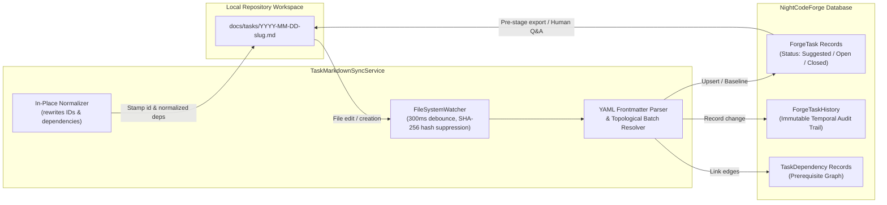

# 📄 Task Markdown & Frontmatter Specification

> **NightCodeForge Core Specification**  
> *Target Directory:* `docs/tasks/*.md`  
> *Authoritative Service:* [TaskMarkdownSyncService](file:///c:/Users/Julien/source/repos/jetelain/NightCodeForge/src/NightCodeForge.Core/Services/TaskMarkdownSyncService.cs)  
> *Domain Entity:* [ForgeTask](file:///c:/Users/Julien/source/repos/jetelain/NightCodeForge/src/NightCodeForge.Core/Domain/ForgeTask.cs)  
> *Status:* Production Reference

---

## 1. Overview & Architectural Role

In **NightCodeForge**, task specifications are **first-class Git artifacts** stored directly in the repository under `docs/tasks/*.md`. 

Rather than confining task descriptions and backlog items to an external web database or proprietary SaaS issue tracker, NightCodeForge maintains **continuous, bidirectional synchronization** between markdown files on disk and the SQLite database (`ForgeTask` records):



### Key Principles:
1. **Single Source of Truth on Disk:** Developers and external AI harnesses (Antigravity IDE, Claude Code, Cursor) can author, edit, or branch tasks using standard markdown and git workflows.
2. **Deterministic Database Synchronization:** Any change on disk is detected in real-time, validated, and mirrored into `ForgeTask` records.
3. **Audit History Tracking:** Every disk modification is recorded as an immutable temporal audit record in `ForgeTaskHistory`.
4. **Echo-Loop Suppression:** Content hashes (SHA-256) suppress echo-loop roundtrips between disk writes and file system events.
5. **Fail-Fast Validation:** Malformed frontmatter, missing titles, circular dependencies, self-dependencies, or illegal status transitions immediately throw dedicated domain exceptions (`TaskMarkdownSyncException`) rather than silently corrupting state.

---

## 2. File Naming & Organization

### 2.1 Storage Path
All active and pending task files reside at:
```text
<WorkspaceRoot>/docs/tasks/
```

Archived (completed and closed) tasks are relocated to:
```text
<WorkspaceRoot>/docs/tasks/archive/
```

### 2.2 File Name Format
Canonical task file names follow the pattern:
```text
{YYYY-MM-DD}-{slug}.md
```
- `{YYYY-MM-DD}`: The UTC creation date of the task (e.g. `2026-10-20`).
- `{slug}`: A lowercase, alphanumeric hyphen-separated slug generated from the task title (e.g. `user-authentication-flow`).
- **Collision Suffix:** If multiple tasks share the same title and date prefix, NightCodeForge appends `-2`, `-3`, etc. (e.g. `2026-10-20-user-authentication-flow-2.md`).

### 2.3 Authoring New Files
When authoring a new task manually or via an AI harness:
- You may use the canonical naming format: `docs/tasks/2026-10-20-my-new-task.md`.
- You may also create a simple file like `docs/tasks/my-new-task.md`. Upon initial synchronization, NightCodeForge automatically allocates a unique database ID and renames the file to the canonical date-prefixed format.

---

## 3. YAML Frontmatter Specification

Every task markdown file must start with a YAML frontmatter fence (`---` ... `---`).

### 3.1 Comprehensive Frontmatter Schema

```yaml
---
id: 101
title: "Implement Model Latency Tracking in Router"
priority: 2
merge_mode: "manual_review_required"
base_branch: "main"
feature_branch: "feature/task-101-latency-tracking"
status: "Suggested"
waiting_for_human: false
current_stage: "task-review"
depends_on:
  - 42
  - 89
agent_profile: "deep-analyst"
created_at: 2026-10-20T08:00:00Z
updated_at: 2026-10-20T08:30:00Z
---
```

### 3.2 Field Definitions & Constraints

| Field | Type | Required for New Tasks? | Default Value | Description & Constraints |
| :--- | :--- | :--- | :--- | :--- |
| `title` | `string` | **Yes** | *None* | Imperative, non-blank title describing the task. Used to derive file slugs and human-readable references. |
| `id` | `integer` | **No** (Omit for new tasks) | Allocated by DB | Unique database primary key. Leave omitted when creating new tasks. NightCodeForge assigns it upon sync and writes it back to disk. |
| `priority` | `integer` | No | `3` (Normal) | Priority level from `1` (highest) to `5` (lowest):<br/>• `1`: **Critical / Urgent** (Blockers, hotfixes)<br/>• `2`: **High** (Architectural milestones)<br/>• `3`: **Normal** (Standard feature development)<br/>• `4`: **Low** (Minor polish)<br/>• `5`: **Lowest / Trivial** (Cosmetic, typos) |
| `merge_mode` | `string` | No | `"manual_review_required"` | Git merge policy once all quality gates pass:<br/>• `"manual_review_required"`: Requires human maintainer sign-off in Review Room.<br/>• `"automatic"`: Automatically merges to base branch once all pipeline stages, tests, and SAST checks succeed. |
| `base_branch` | `string` | No | Workspace default (e.g. `"main"`) | Target Git branch from which the feature branch is created and into which it will be merged. |
| `feature_branch` | `string` | No | Generated on launch | Dedicated Git branch for the task's execution worktree. |
| `status` | `string` | **Do not modify** | `"Suggested"` | **Protected workflow status:** `Suggested`, `Open`, `InProgress`, `Review`, `Closed`, `Failed`. Modifying status directly via markdown is **strictly forbidden** and rejected by the sync service. Status transitions must occur through workflow gates. |
| `waiting_for_human`| `boolean` | No | `false` | Read-only reflection of whether an agent has invoked the interactive `ask` tool or is waiting for maintainer input. |
| `current_stage` | `string` | No | `"task-review"` | Identifier of the active workflow stage (e.g. `task-review`, `implementation`, `code-review`). |
| `depends_on` | `list` | No | `[]` | List of prerequisite tasks that must complete before this task can start. **Supports flexible references** (IDs, filenames, slugs, titles) — see §4. |
| `agent_profile` | `string` | No | `null` | Optional agent profile ID override (e.g. `"deep-analyst"` or `"quick-coder"`). |
| `created_at` | `DateTime` | No | `DateTime.UtcNow` | UTC ISO-8601 creation timestamp. |
| `updated_at` | `DateTime` | No | `DateTime.UtcNow` | UTC ISO-8601 modification timestamp. |

---

## 4. Flexible `depends_on` & DAG Resolution

NightCodeForge features a **flexible dependency resolution engine** that simplifies both single-task editing and multi-task batch authoring.

### 4.1 Supported Reference Formats
In `depends_on`, tasks can be referenced using any of the following formats:

```yaml
depends_on:
  - 101                             # 1. Numeric database ID
  - "2026-10-20-task-alpha.md"      # 2. Exact file name
  - "task-alpha.md"                 # 3. File name without date prefix
  - "task-alpha"                    # 4. Slug (case-insensitive)
  - "Setup Database Schema"         # 5. Full task title (case-insensitive)
```

### 4.2 Multi-Task Batch Authoring
When an external harness (Antigravity IDE, Claude Code, Cursor) or human developer decomposes a large feature into several interdependent tasks, they do **not** need to wait for NightCodeForge to assign database IDs one file at a time:

1. **Simultaneous Creation:** Author all tasks in `docs/tasks/` using filenames or slugs for dependencies:
   ```yaml
   # docs/tasks/2026-10-20-database-migration.md
   ---
   title: Database Migration
   ---
   ```
   ```yaml
   # docs/tasks/2026-10-20-api-endpoints.md
   ---
   title: API Endpoints
   depends_on:
     - "database-migration"
   ---
   ```
   ```yaml
   # docs/tasks/2026-10-20-frontend-ui.md
   ---
   title: Frontend UI
   depends_on:
     - "api-endpoints"
   ---
   ```

2. **Topological Order Processing:**
   - `TaskMarkdownSyncService` analyzes all pending files alongside existing database tasks.
   - It builds a combined dependency graph and computes a **topological sort**.
   - Prerequisite tasks (`Database Migration`) are created in SQLite first and receive their IDs (e.g. `101`).
   - Dependent tasks (`API Endpoints`) are created next, automatically wired to `101`, and receive their IDs (e.g. `102`).
   - Downstream tasks (`Frontend UI`) are created next, wired to `102`, and receive `103`.

3. **In-Place Normalization:**
   - Once all tasks in the batch are committed to the database, `TaskMarkdownSyncService` rewrites the markdown files on disk.
   - String references are replaced with **canonical numeric IDs**:
     ```yaml
     # docs/tasks/2026-10-20-api-endpoints.md (rewritten on disk)
     ---
     id: 102
     title: API Endpoints
     depends_on:
       - 101
     ---
     ```

### 4.3 Validation & Cycle Detection
- **Cycle Prevention:** A Depth-First Search (`HasCycleDfs`) verifies the unified graph across both existing database tasks and newly proposed tasks. If a cycle is detected (e.g. `A -> B -> A`), synchronization fails fast with a `TaskMarkdownSyncException` displaying the exact cycle path.
- **Self-Dependencies:** Any task that directly or indirectly references itself (by ID, filename, slug, or title) fails fast.
- **Missing References:** Any reference that cannot be resolved against existing database tasks or pending files in the current batch throws a `TaskMarkdownSyncException`.

---

## 5. Required Markdown Body Structure

The body of the markdown document below the frontmatter fence defines the technical specification used by implementation and review agents.

```markdown
# <Imperative Task Title>

## 📋 Requirements & Description

### Summary
<Concise explanation of the user or system value delivered by this task.>

### Implementation Checklist
- [ ] <Sub-task 1: Concrete technical item to implement>
- [ ] <Sub-task 2: Concrete technical item to implement>
- [ ] <Sub-task 3: Unit test implementation>

### Affected Files
- `<path/to/source.ext>`: <Short description of intended changes>
- `<tests/path/to/test.ext>`: <Unit test assertions>

### Acceptance Criteria
- [ ] <Verifiable criterion 1: expected behaviors, status codes, payload shapes>
- [ ] <Verifiable criterion 2: error handling and domain exceptions>
- [ ] <Verifiable criterion 3: deterministic unit test verification>

### Prerequisite Dependencies
- <None, or descriptive list of prerequisite tasks>

## ❓ Human Clarifications (Q&A)
### Question 1 (Asked during Stage: task-review on 2026-10-20 09:15:00)
**Prompt:** Should the latency tracker use milliseconds or microseconds?
**Answer:** Use milliseconds stored as a double precision float.
```

### Body Section Breakdown:
- **`# <Task Title>`**: Top-level heading matching `frontmatter.title`.
- **`## 📋 Requirements & Description`**: Core specification extracted by `ExtractDescriptionFromBody` into `ForgeTask.Description`. Subsections:
  - `### Summary`: High-level context.
  - `### Implementation Checklist`: Concrete implementation steps.
  - `### Affected Files`: Files intended to be modified or created.
  - `### Acceptance Criteria`: Automated, testable conditions for task completion.
  - `### Prerequisite Dependencies`: Optional human-readable notes complementing `depends_on`.
- **`## ❓ Human Clarifications (Q&A)`**: Managed exclusively by NightCodeForge. When an agent invokes the interactive `ask` tool during a workflow run, questions and human responses are recorded here chronologically.

---

## 6. Sizing & Granularity Principles

When creating tasks for NightCodeForge:

1. **One Task = One Complete Pull Request (PR/MR):**
   - Each task is executed in an isolated worktree and must pass all builds, quality gates, and unit tests before merging.
   - Do **not** create incomplete tasks that break compilation on the base branch.
2. **Avoid Micro-Tasks:**
   - Do **not** create separate tasks for "Add configuration key", "Add entity property", and "Add migration". Combine them into a cohesive feature task.
3. **Avoid Multi-Month Epics:**
   - Break large subsystems into sequential milestones where each milestone compiles, has passing tests, and leaves the codebase healthy.
   - Connect the milestones using `depends_on`.

---

## 7. Synchronization Mechanics & Safety

### 7.1 Real-Time File Watching
- `TaskMarkdownSyncService` runs a `FileSystemWatcher` on `docs/tasks/`.
- File events are debounced with a **300ms window** to prevent partial reads during atomic writes.
- SHA-256 hashes of generated content are suppressed (`_suppressedHashes`) so internal file writes do not trigger recursive event loops.

### 7.2 Protected Status Invariant
Task status (`Suggested`, `Open`, `InProgress`, `Review`, `Closed`, `Failed`) represents workflow engine state transitions.
- Markdown files **reflect** status; they **cannot alter** it.
- If a user or agent manually edits `status: "Closed"` in a markdown file, the sync service detects the illegal transition and throws:
  ```text
  TaskMarkdownSyncException: Modifying task status via markdown is forbidden. Task #42 status is 'Suggested', but markdown specifies 'Closed'. Status transitions must go through workflow gates.
  ```

### 7.3 Concurrency & Baseline Checks
- Before an autonomous agent stage begins, NightCodeForge writes all workspace tasks to disk and records a cryptographic baseline snapshot (`TaskBaselineEntry`).
- When the agent finishes, the sync service compares disk files against the baseline. If a task was concurrently updated by another process, a `TaskConcurrencyException` is raised to protect against race conditions.

---

## 8. Summary Checklist for Task Authors

Before committing a task markdown file to `docs/tasks/`:

- [ ] File is saved under `docs/tasks/{yyyy-MM-dd}-{slug}.md` or `docs/tasks/{slug}.md`.
- [ ] YAML frontmatter starts and ends with `---`.
- [ ] `title` is non-blank and imperative.
- [ ] `id` is omitted for new tasks (or contains the valid integer ID of an existing task).
- [ ] `priority` is between 1 and 5 (default 3).
- [ ] `depends_on` lists valid IDs, filenames, or slugs (or is empty `[]`).
- [ ] `status` is omitted for new tasks (starts as `Suggested`).
- [ ] Body contains `## 📋 Requirements & Description` with Summary, Implementation Checklist, and Acceptance Criteria.
