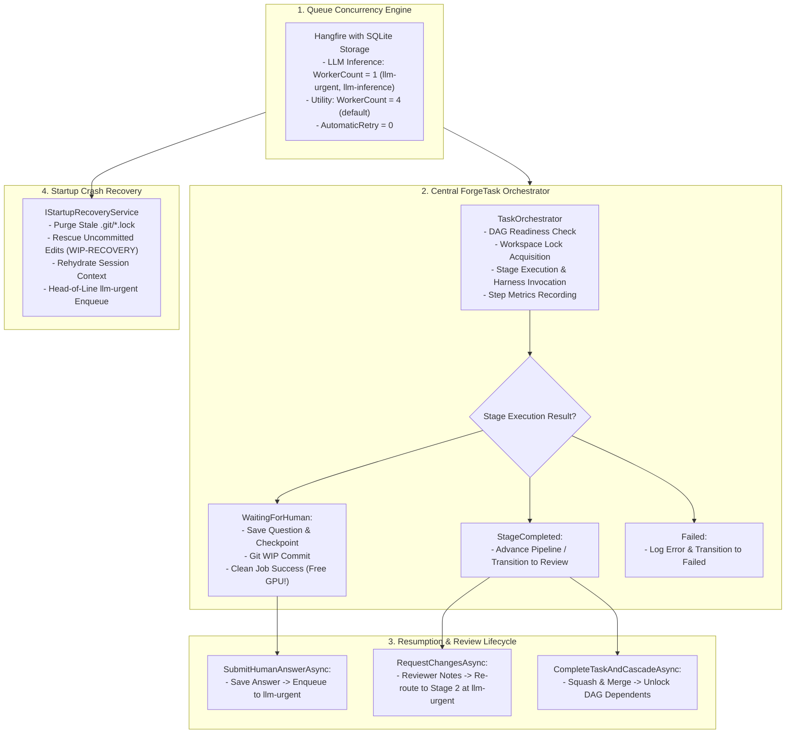

# ⚡ Phase 3: Hangfire Queue & Orchestration Engine

> **Implementation Roadmap & Technical Specification**  
> *Parent Plan:* [docs/PLAN.md](../PLAN.md) | *Status:* Completed

---

## 1. Executive Objective

Implement the non-blocking asynchronous development queue and central orchestrator for **NightCodeForge**. Enforce strict single-GPU concurrency (`WorkerCount = 1`) to eliminate local VRAM thrashing, provide dual-priority queueing (`llm-urgent` vs. `llm-inference`), capture turn-by-turn execution metrics, manage the clean interruption lifecycle (`WaitingForHuman`), and ensure automated crash recovery upon unexpected host reboots.

---

## 2. Detailed Task Breakdown



### Step 3.1: Hangfire Queue Architecture (`NightCodeForge.Infrastructure/BackgroundJobs`)
* **Package:** `Hangfire.AspNetCore` and `Hangfire.Storage.SQLite`.
* **Two Dedicated Background Processing Servers:**
  ```csharp
  // 1. LLM Inference Server (Strict VRAM Protection)
  app.UseHangfireServer(new BackgroundJobServerOptions
  {
      ServerName = "NCF-LLM-Inference-Worker",
      WorkerCount = 1,
      Queues = new[] { "llm-urgent", "llm-inference" }
  });

  // 2. Utility & Git Operations Server
  app.UseHangfireServer(new BackgroundJobServerOptions
  {
      ServerName = "NCF-Utility-Worker",
      WorkerCount = 4,
      Queues = new[] { "default" }
  });
  ```
* **Job Retry Policy:**
  - LLM inference jobs are decorated with `[AutomaticRetry(Attempts = 0)]`.
  - Unhandled exceptions transition the task cleanly to `Failed` to prevent duplicate code edits or runaway loops.

### Step 3.2: Central ForgeTask Orchestrator (`NightCodeForge.Core/Workflow`)
* **Contract:** `ITaskOrchestrator`
  ```csharp
  public interface ITaskOrchestrator
  {
      Task ProcessTaskAsync(int taskId, CancellationToken cancellationToken);
      Task SubmitHumanAnswerAsync(int questionId, string answer, CancellationToken cancellationToken);
      Task RequestChangesAsync(int taskId, string revisionNotes, CancellationToken cancellationToken);
      Task CompleteTaskAndCascadeAsync(int taskId, string finalCommitMessage, CancellationToken cancellationToken);
  }
  ```
* **Step-by-Step Execution Lifecycle:**
  1. **Readiness & Workspace Locking:**
     - Checks DAG readiness: verifies that `task.Status == TaskOverallStatus.Open` and all dependencies in `DependsOnTaskId` have `Status == TaskOverallStatus.Closed`.
     - Acquires workspace lock via `IWorkspaceLockProvider.AcquireLockAsync(task.WorkspaceId)`.
  2. **Branch & Environment Setup:**
     - Invokes `IGitWorkspaceManager.CheckoutTaskBranchAsync`.
  3. **Stage Execution & Metric Capture:**
     - Loads current stage from `IWorkflowPipeline` and resolves the stage's `AgentProfile`.
     - Records start timestamp; executes `stage.ExecuteAsync(pipelineContext)`.
     - Records end timestamp, calculates `DurationMs`, and extracts token counts (`PromptTokens`, `CompletionTokens`, `TotalTokens`).
     - Saves `StageExecutionRecord` to `AppDbContext`.
  4. **Result Evaluation & State Transitions:**
     - **`WaitingForHuman`:**
       - Intercepted from `HumanInterruptionException` (via `ask`).
       - Creates Git WIP commit via `IGitWorkspaceManager.CreateWipCheckpointAsync`.
       - Persists `Question` (with `AgentProfileId`), serialized memory in `StageCheckpoint`, sets `IsWaitingForHuman = true` and `InterruptedAgentProfileId = profile?.Id` while preserving `task.Status`.
       - **Hangfire Clean Return:** Returns `StageExecutionResult.WaitingForHuman()`; Hangfire marks the job as `Succeeded`. **The single GPU worker is immediately freed for the next queued task.**
     - **`StageCompleted`:**
       - Saves stage checkpoint.
       - Advances stage:
         - After Stage 1 (ForgeTask Review): sets `Status = TaskOverallStatus.Reviewed`.
         - After Stage 2 (Deterministic Pre-Implementation): captures baseline metrics in `PipelineDataBag`.
         - After Stage 3 (Implementation): sets `Status = TaskOverallStatus.Implemented`.
         - After Stage 4 (Deterministic Post-Implementation): validates differential coverage gate and warning ratchet.
         - After Stage 5 (Code Review): applies review patches.
         - After Stage 6 (Deterministic Post-Review Verification): validates that review patches compile and pass tests. On pass, sets `Status = TaskOverallStatus.Ready`. On failure, loops back to Stage 5 with compiler/test diagnostics.
       - **Merge Resolution:**
         - If `task.MergeMode == MergeMode.Automatic`: automatically calls `CompleteTaskAndCascadeAsync`, squashes and merges to `baseBranch`, sets `Status = TaskOverallStatus.Closed`, and cascades unblocking.
         - If `task.MergeMode == MergeMode.ManualReviewRequired`: retains `Ready`, notifies UI, and awaits maintainer approval in the Review Room before merging.
     - **`Failed`:**
       - Logs error in `ExecutionLog` and transitions task to `Failed`.

### Step 3.3: Preemptive Resumption & Cascade Unblocking
1. **`SubmitHumanAnswerAsync`:**
   - Persists human answer in `Question.Answer` and marks `Status = Answered`.
   - Transitions task status back to `Open`.
   - Enqueues job to **`llm-urgent`** queue. When the GPU worker finishes its active turn, it immediately resumes this task before touching standard backlog items.
2. **`RequestChangesAsync`:**
   - Reviewer enters revision notes in the Review Room modal.
   - Transitions task from `Ready` back to Stage 3 (`ImplementationStage`).
   - Injects revision notes into `PipelineContext.HandoverArtifacts.ReviewerFeedback`.
   - Enqueues to **`llm-urgent`**.
3. **`CompleteTaskAndCascadeAsync`:**
   - Executes `IGitWorkspaceManager.SquashAndMergeAsync` to merge the feature branch into `baseBranch`.
   - Sets task status to `Closed`.
   - Calls `IDependencyResolutionEngine.ResolveCascadeUnblockedTasksAsync(taskId)`.
   - Dependent tasks that are in `Open` status and whose dependencies are now all `Closed` are enqueued to `llm-inference`.

### Step 3.4: Startup Recovery & Crash Resilience (`IStartupRecoveryService`)
* **Contract:** `IStartupRecoveryService`
  ```csharp
  public interface IStartupRecoveryService
  {
      Task ReconcileWorkspacesAsync(CancellationToken cancellationToken = default);
  }
  ```
* **Execution Procedure (Invoked in `Program.cs` before Hangfire starts):**
  1. **Stale Lock Cleanup:** Scans target repositories for dangling `.git/index.lock` or `.git/refs/heads/*.lock` files left by abrupt power loss or Windows Update reboot cycles, safely purging them.
  2. **Uncommitted Working Tree Rescue:** Inspects working tree with `git status --porcelain`. If dirty files exist, creates an automated rescue commit:
     `git add -A && git commit -m "WIP-RECOVERY: [Crash Recovery] Preserving uncommitted workspace changes" --no-verify`
  3. **State Reconciliation:** Queries database for tasks left in `Running` status:
     - For **Agentic Stages:** Rehydrates conversation memory from `STAGE_CHECKPOINT.SerializedMemory`, appends a `[System Notice: Host restarted unexpectedly; workspace restored]`, and enqueues to `llm-urgent`.
     - For **Deterministic Stages:** Resets metrics and re-enqueues to `llm-urgent` to execute freshly.
  4. **Broadcast & Audit:** Logs recovery event in `ExecutionLog` and broadcasts status via SignalR.

---

## 3. Verification & Test Plan

| Test Class | Focus Area | Scenarios Covered |
| :--- | :--- | :--- |
| **`HangfireQueuePriorityTests`** | Concurrency | Priority ordering (`llm-urgent` dequeued before `llm-inference`), `WorkerCount = 1` serial execution across multiple tasks. |
| **`TaskOrchestratorTests`** | Lifecycle | Clean `WaitingForHuman` completion releasing worker, stage advancement, final diff generation on transition to `Review`. |
| **`ResumptionTests`** | Human-in-the-Loop | Answer submission, clearing `IsWaitingForHuman` while preserving task status, resuming with exact `InterruptedAgentProfileId` agent, prompt context rehydration with human reply. |
| **`CascadeUnblockingTests`** | DAG Integration | Merge squashing, dependency state cascade, unlocking dependent tasks into `llm-inference`. |
| **`StartupRecoveryTests`** | Crash Resilience | Stale `.git/index.lock` purging, dirty working tree rescue commit, re-enqueueing orphaned running tasks to `llm-urgent`. |

---

## 4. Definition of Done (DoD) Checklist

- [x] Hangfire configured with SQLite storage and two isolated background processing servers.
- [x] `WorkerCount = 1` verified: zero concurrent LLM inference jobs across all workspaces.
- [x] Human interruption (`ask`) cleanly completes Hangfire job as `Succeeded`, releasing GPU.
- [x] Answering a question enqueues task to `llm-urgent` with top priority.
- [x] Requesting changes in review room routes task back to Stage 2 at `llm-urgent`.
- [x] Approving a task merges branch and cascades unblocking to dependent tasks.
- [x] `IStartupRecoveryService` purges stale locks and rescues uncommitted files upon boot.
- [x] All queue and orchestrator unit/integration tests pass 100%.
