# 🔥 Phase 4: AI Harness Abstraction, Tools & Local LLM Optimization Engine

> **Implementation Roadmap & Technical Specification**  
> *Parent Plan:* [docs/PLAN.md](../PLAN.md) | *Status:* Ready for Scaffolding

---

## 1. Executive Objective

Deliver the unified AI harness abstraction layer supporting **Crucible** (in-process C# via Microsoft Agent Framework & `Microsoft.Extensions.AI`), **Pi JSON-RPC** (external managed Node.js daemon), and **Agent Client Protocol (ACP)** (open-standard adapter). Implement the canonical tool suite with `EditorConfigFileApplier` compliance and `LenientToolDispatcher` resilience, container sandbox REPL with sentinel execution, and the **7 high-value local LLM optimizations** with configurable opt-out flags for A/B testing.

---

## 2. Detailed Task Breakdown

```mermaid
flowchart TD
    subgraph Step1 ["1. Harness Abstraction & Gateway"]
        IHarness["IAgentHarness & IHarnessRegistry"]
        Router["OllamaRouter Integration (:11434)\n- Dynamic Model Catalog (/api/tags)\n- JIT Model Preload Trigger"]
    end

    subgraph Step2 ["2. Canonical Tools & Sandboxing"]
        Tools["Pi-Harmonized Canonical Tools (read, edit, write, bash, ask)"]
        EditorConfig["EditorConfig Applier (EOL, indent, tab/space, charset)"]
        Dispatcher["LenientToolDispatcher (Aliasing, fuzzy matching, payload repair)"]
        Sandbox["Container Sandbox REPL (Persistent Sentinel Protocol)"]
        TriageSandbox["RestrictedReadOnly Sandbox (--network none, :ro)"]
    end

    subgraph Step3 ["3. Harness Implementations"]
        Crucible["Implementation A: Crucible (Microsoft Agent Framework)"]
        PiRpc["Implementation B: Pi JSON-RPC Daemon Bridge"]
        Acp["Implementation C: Open Agent Client Protocol (ACP) Adapter"]
    end

    subgraph Step4 ["4. Context & Extensibility"]
        MCP["Model Context Protocol (Microsoft.Agents.Mcp)"]
        Skills["Modular Skills (SKILL.md) & AGENTS.md Ingestion"]
        Transcripts["docs/transcripts/ Markdown Schema & AI Diagnostics"]
    end

    subgraph Step5 ["5. Local LLM Optimization Suite (Opt-Out)"]
        Flags["LocalOptimizationFlags Configuration"]
        ThinkCompaction["ThinkingTraceCompactionChatClient (<think> pruning)"]
        LoopBreaker["ToolLoopCircuitBreaker (N-gram loop & duplicate tool interceptor)"]
        Grammar["Guided Grammar Decoding (Ollama JSON Schema / GBNF)"]
        SymbolMap["RoslynSymbolIndexProvider (0-GPU Code Intelligence)"]
        DiagExtract["Structured Diagnostic Extractor (Roslyn CS errors)"]
        PrefixCache["4-Layer Prompt Prefix Stabilization (90%+ KV Cache Hit)"]
    end

    Step1 --> Step2
    Step2 --> Step3
    Step3 --> Step4
    Step4 --> Step5
```



### Step 4.1: Unified Harness Abstraction (`NightCodeForge.Core/Interfaces`)
* **Contracts:**
  ```csharp
  public interface IAgentHarness
  {
      string HarnessId { get; }
      Task<AgentRunResult> RunStageAsync(AgentSessionContext context, CancellationToken cancellationToken = default);
  }

  public interface IHarnessRegistry
  {
      IAgentHarness GetHarness(string harnessId);
      void RegisterHarness(IAgentHarness harness);
  }
  ```
* **Context & Result Models (`NightCodeForge.Agents/Common`):**
  - `AgentSessionContext`: Carrying `ForgeTask`, `Workspace`, `AgentProfile`, `PipelineContext`, `OptimizationFlags`, and cancellation token.
  - `AgentRunResult`: Capturing status (`Completed`, `WaitingForHuman`, `Failed`), step metrics (`DurationMs`, `PromptTokens`, `CompletionTokens`, `TotalTokens`), generated commit hash, and diagnostic handover artifacts.

### Step 4.2: OllamaRouter Gateway & JIT Model Preload
* **Connection:** Point `Microsoft.Extensions.AI.Ollama` or `OpenAI` client to `http://localhost:11434`.
* **Catalog Discovery (`IOllamaModelCatalogService`):** Queries `/api/tags` to dynamically populate available local and remote models for the UI profile editor.
* **JIT Model Preload Trigger:**
  - When a CPU-bound deterministic stage starts (e.g. `DeterministicBuildStage`), asynchronously POST to OllamaRouter:
    `POST /api/generate { "model": "<NextStageModel>", "keep_alive": "15m" }`
  - Unloads previous model and warms up weights in VRAM while CPU is compiling, hiding model swap latency.

### Step 4.3: Minimalist Canonical Tools & Lenient Dispatcher
1. **Canonical Tools Suite (`NightCodeForge.Agents/Tools`):**
   - `read`: Line-sliced viewing via `offset` (1-indexed) and `limit`.
   - `edit`: Precision search-and-replace supporting multi-disjoint `edits: [{ oldText, newText }]` applied in single turn.
   - `write`: File creation or full overwrite.
   - `bash`: Shell execution with timeout governance and output compaction.
   - `web_search`: Extensible via `IWebSearchService` (Ollama Web Search / DuckDuckGo / SearXNG).
   - `ask`: Asynchronous human interruption yielding `HumanInterruptionException`.
   - `propose_tasks`: Structural backlog proposal tool for triage and discovery agents.
2. **EditorConfig Compliance (`IEditorConfigService` & `EditorConfigFileApplier`):**
   - Resolves `.editorconfig` from target file path up to `root = true` using official `editorconfig` .NET parser.
   - Enforces `end_of_line` (`lf`, `crlf`), `indent_style` (`tab`, `space`), `indent_size`, `trim_trailing_whitespace`, `insert_final_newline`, and `charset` before writing mutations to disk.
   - Auto-detects dominant file conventions when `.editorconfig` is absent, eliminating cross-OS phantom diffs.
3. **The Forgiving Dispatcher (`LenientToolDispatcher`):**
   - Tool name aliasing and fuzzy matching (`read_file` $\rightarrow$ `read`, `replace_file_content` $\rightarrow$ `edit`, `run_command` $\rightarrow$ `bash`).
   - Translates dropped tools: `list_dir` $\rightarrow$ `bash("ls -la ...")`, `grep_search` $\rightarrow$ `bash("rg -n ...")`.
   - Parameter normalization (`filePath` $\rightarrow$ `path`, `target_content` $\rightarrow$ `edits[0].oldText`).
   - JSON payload repair: strips markdown code fences, sanitizes unescaped newlines in code strings, coerces numeric strings to integers.

### Step 4.4: Execution Sandboxing Subsystem (`NightCodeForge.Infrastructure/Execution`)
* **Contract:** `IExecutionEnvironment` supporting `BareHost`, `WslDirect`, and `ContainerSandbox`.
* **`NightCodeForgeContainerExecutor` (Docker Sentinel REPL):**
  - Keeps interactive `docker exec -i <container> bash --noprofile --norc` alive.
  - Evaluates completion using cryptographic GUID sentinels: `echo "__NCF_SENTINEL_<guid>__ $?"`.
  - **Hang Cancellation:** On timeout, writes `\x03` (SIGINT) to stdin, waits 2-second grace period for sentinel return, and forcefully restarts the container shell process if unresponsive.
  - **`HeadTailBuffer`:** UTF-8 rune-safe bounded accumulation capping stdout/stderr at 32 KB with `[... truncated N bytes ...]` markers.
* **Restricted Read-Only Sandbox Tier (`RestrictedReadOnly`):**
  - For untrusted external intake triage on `main`/`master`: mounts repo as `:ro`, enforces `--network none`, `--read-only` root filesystem, `--cap-drop=ALL`, `--user 1000:1000`, and scrubs host environment secrets.

### Step 4.5: Native Crucible Harness (`Microsoft.Agents.AI`)
* **Pipeline Composition:** Chains `HarnessAgent` (`Microsoft.Agents.AI.Harness`) wrapping `LoopAgent`, `ToolApprovalAgent`, and `OpenTelemetryAgent`.
* **Zero Data Loss:** `PerServiceCallChatHistoryPersistingChatClient` persists conversational thread state after every single tool invocation.
* **Checkpoint Serialization:** Uses `AIAgent.SerializeSessionAsync` / `DeserializeSessionAsync` storing JSON state in `STAGE_CHECKPOINT`.
* **Preemptive Resumption:** `MessageInjectingChatClient` injects the human's response from `ask` directly into the chat stream on queue pickup.

### Step 4.6: Pi JSON-RPC Daemon & ACP Adapter
* **Pi JSON-RPC Harness (`PiRpcAgentHarness`):**
  - Managed Node.js subprocess running `pi coding-agent --mode rpc`.
  - Communicates via line-delimited JSON over stdio (`StreamJsonRpc`).
  - Intercepts `extension_ui_request` for human interruption.
* **Open ACP Adapter (`AcpAgentHarness`):**
  - Modernizes `acp-csharp` targeting C# 13 and .NET 10.
  - Negotiates ACP v2 with backward-compatible v1 fallback.
  - Acts as ACP Client Host, intercepting file/terminal requests and executing them inside `NightCodeForgeContainerExecutor`.

### Step 4.7: Skills, MCP Host & `AGENTS.md` Ingestion
* **Modular Skills (`Microsoft.Agents.AI.Skills`):**
  - Implements progressive disclosure: advertises skill names/descriptions in system prompt (~25 tokens/skill), loading full markdown instructions on-demand via `load_skill`.
* **MCP Client Host (`Microsoft.Agents.Mcp`):**
  - Decoupled behind `IMcpClientManager`. Reads `mcp_config.json`, queries `tools/list`, and dynamically binds external MCP servers (SQLite, Postgres, GitHub).
* **`AGENTS.md` Ingestion:**
  - Discovers `<WorkspaceRoot>/AGENTS.md` or `.agents/AGENTS.md` and prepends rules and build/test commands to stage system prompts across all harnesses.

### Step 4.8: Local LLM Optimization Suite (Opt-Out A/B Framework)
All optimizations respect [LocalOptimizationFlags](file:///c:/Users/Julien/source/repos/jetelain/NightCodeForge/docs/LOCAL_LLM_OPTIMIZATIONS.md#L265-L315) for A/B testing:
1. **`ThinkingTraceCompactionChatClient`:** Prunes `<think>` monologues from historical assistant turns in conversation memory (60%–80% token savings for DeepSeek-R1 / QwQ).
2. **`ToolLoopCircuitBreaker`:** Monitors token stream for 16-character n-gram cycles repeated $\ge 3$ times; intercepts duplicate tool calls on unchanged working trees with synthetic steering warnings.
3. **Guided Grammar Decoding:** Passes native JSON Schemas to Ollama `/api/chat` or GBNF grammars to vLLM, guaranteeing 100% syntactically valid JSON tool calls.
4. **`RoslynSymbolIndexProvider`:** CPU-based workspace symbol indexer injecting exact file paths and line offsets into Stage 1 prompt (saving 2–4 exploratory turns with 0 GPU tokens).
5. **Structured Diagnostic Extraction:** Roslyn error parser (`error CS\d+`) and test assertion extractor replacing raw multi-line compiler dumps.
6. **4-Layer Prompt Prefix Stabilization:** Immutably orders system rules and tools at the prompt head to achieve **90%+ KV cache hit rate**.

### Step 4.9: Session Transcripts & Hybrid Diagnostics Service
* **Transcripts:** Saves turn-by-turn markdown execution logs to `docs/transcripts/YYYY-MM-DD-task-{id}-{stage}-{status}.md` embedding active `optimizations:` flags in frontmatter.
* **Hybrid Diagnostics:** One-click evaluation of failed transcripts using fast zero-VRAM Cloud LLMs or 100% offline Local LLMs.

---

## 3. Verification & Test Plan

| Test Class | Focus Area | Scenarios Covered |
| :--- | :--- | :--- |
| **`LenientToolDispatcherTests`** | Tool Parsing | Aliased names (`replace_file_content` $\rightarrow$ `edit`), parameter mapping (`filePath` $\rightarrow$ `path`), markdown fence stripping, unescaped newline repair. |
| **`EditorConfigFileApplierTests`** | File Formatting | CRLF/LF enforcement based on `.editorconfig`, tab vs. space indentation, trimming trailing spaces, final newline insertion. |
| **`ContainerReplExecutorTests`** | Sandboxing | Sentinel execution, timeout SIGINT `\x03` abort, 2s grace period recovery, shell process kill and restart, `HeadTailBuffer` truncation. |
| **`ThinkingCompactionTests`** | Token Optimization | `<think>` block streaming on active turn vs. historical pruning when committed to memory, opt-out flag verification. |
| **`ToolLoopCircuitBreakerTests`** | Loop Protection | Streaming n-gram repetition detection, duplicate tool call interception on unchanged working tree, steering prompt injection. |
| **`RoslynSymbolIndexTests`** | Code Intelligence | Class/interface/method indexing, line offset extraction, bootstrap prompt injection. |
| **`CrucibleCheckpointTests`** | Checkpointing | Zero data-loss across tool calls, session serialization, resumption via `MessageInjectingChatClient`. |
| **`AcpProtocolNegotiationTests`** | Protocol Adapter | ACP v1 vs. v2 negotiation, terminal command routing into sandbox container. |

---

## 4. Definition of Done (DoD) Checklist

- [x] Unified `IAgentHarness` and `IHarnessRegistry` contracts implemented.
- [x] OllamaRouter gateway connected with dynamic catalog discovery and JIT model warmup.
- [x] Canonical tools (`read`, `edit`, `write`, `bash`, `web_search`, `ask`) and `LenientToolDispatcher` operational.
- [x] `EditorConfigFileApplier` strictly enforces `.editorconfig` rules across all file mutations.
- [x] `NightCodeForgeContainerExecutor` persistent sentinel REPL verified with timeout SIGINT handling.
- [x] Native Crucible harness implemented with zero data-loss persistence and clean interruption.
- [x] Pi JSON-RPC daemon and ACP modernized adapter operational.
- [x] All 7 local LLM optimizations implemented with `LocalOptimizationFlags` opt-out support.
- [x] Session transcripts and hybrid failure diagnostics operational.
- [x] 100% of unit/integration tests in `NightCodeForge.Agents.Tests` pass cleanly.
