# 🎭 End-to-End Acceptance Test Plan: Synthetic .NET Feature Lifecycle

> **Autonomous Multi-Stage Pipeline E2E Acceptance Specification**  
> *Parent Plan:* [docs/PLAN.md](../PLAN.md) | *Technical Reference:* [Phase 6: End-to-End Hardening](06_END_TO_END_TESTING_AND_HARDENING.md)  
> *Automation Engine:* **Playwright** (C# / TypeScript) | *Target UI:* **NightCodeForge Blazor Server Web App**  
> *Status:* Implemented & Verified in `tests/NightCodeForge.Web.Tests/E2E`

---

## 1. Executive Summary & Test Objective

The primary objective of this acceptance test plan is to provide a **100% repeatable, fully automated end-to-end acceptance test** that validates the complete autonomous software engineering lifecycle of **NightCodeForge** against a real, isolated .NET application.

The test begins on a synthetic repository created in a randomized temporary path, drives the entire workflow through the modern Blazor Web UI via Playwright, and concludes by asserting that the requested feature and its accompanying unit tests have been successfully implemented, verified by deterministic quality gates, and automatically squash-merged into the host developer repository.

```mermaid
flowchart TD
    subgraph Setup ["0. Synthetic Repo Fixture"]
        TempDir["Randomized Temp Directory\nPath: %TEMP%/ncf-e2e-{guid}"]
        Scaffold["Scaffold Buildable .NET 10 App\nSyntheticLib + Unit Tests + AGENTS.md"]
        InitGit["git init -b main & commit\nBaseline commit: 'Initial scaffold'"]
    end

    subgraph Step1 ["1. Workspace Provisioning (UI)"]
        OpenWizard["Open Provisioning Wizard\n(TopNavBar ➕ / Hero Button)"]
        ProbePath["Step 1: Input Path & Probe Directory\nDetects valid Git repo & .NET stack"]
        ConfigEnv["Step 2 & 3: Configure Target & Env\nBaseBranch: main, Mode: BareHost"]
        ExecuteProv["Step 4: Provision & Activate\nExt4 Clone + SQLite Registration"]
    end

    subgraph Step2 ["2. Ideation & Planning (UI)"]
        NavIdeation["Navigate to /ideation"]
        SendPrompt["Submit Feature Request Prompt\n'Implement Multiply with XML docs & unit tests'"]
        AgentDelib["Architect Agent Deliberation\nRead files -> Propose backlog tasks"]
        IngestTask["Ingest Proposal to Backlog\nCreates ForgeTask (Status: Suggested)"]
    end

    subgraph Step3 ["3. Validation & Auto-Merge (UI)"]
        NavBacklog["Navigate to /backlog"]
        LocateCard["Locate Task in 'Suggested' Column"]
        OpenPromote["Open Maintainer Promotion Modal"]
        SetAutoMerge["Configure Promotion:\nPriority = 1, MergeMode = Automatic"]
        SubmitPromote["Promote to Open & Enqueue\nTransitions to Open -> Hangfire Queue"]
    end

    subgraph Step4 ["4. Process Flow & Pipeline (Orchestrator & UI)"]
        QueuePick["Hangfire llm-inference Worker Picks Task\nAcquires Workspace Concurrency Lock"]
        StageExec["Execute 6-Stage Autonomous Pipeline:\n1. Review -> 2. Pre-Impl Gate -> 3. Impl ->\n4. Coverage Gate -> 5. Code Review -> 6. Post-Review"]
        AutoMergeGate["Deterministic Auto-Merge Gate Passes\nSquash WIP commits -> main branch -> Closed"]
    end

    subgraph Step5 ["5. Host Dev Repo Assertions"]
        VerifyGit["Verify Git Branch & History:\nCurrent = main, Squash commit on log"]
        VerifyCode["Verify Source Code (Calculator.cs):\nContains Multiply() with XML doc"]
        VerifyTests["Verify Test Code (CalculatorTests.cs):\nContains Multiply unit test"]
        ExecuteCli["Run 'dotnet test' on Host:\nExit Code = 0, 100% tests passing"]
    end

    Setup --> Step1
    Step1 --> Step2
    Step2 --> Step3
    Step3 --> Step4
    Step4 --> Step5
```



---

## 2. Test Architecture & Environment Isolation

### 2.1 Synthetic Case: Ephemeral .NET Application Structure
Each test run creates a fresh, isolated Git repository in a randomized path (e.g. `Path.Combine(Path.GetTempPath(), "ncf-e2e-" + Guid.NewGuid().ToString("N")[..8])`).

```text
ncf-e2e-a1b2c3d4/
├── .git/
├── .gitignore
├── .editorconfig
├── AGENTS.md
├── .nightcodeforge/
│   └── config.json
├── src/
│   └── SyntheticLib/
│       ├── SyntheticLib.csproj
│       └── Calculator.cs
└── tests/
    └── SyntheticLib.Tests/
        ├── SyntheticLib.Tests.csproj
        └── CalculatorTests.cs
```

#### Key File Specifications
1. **`src/SyntheticLib/SyntheticLib.csproj`**:
   - SDK: `Microsoft.NET.Sdk`
   - TargetFramework: `net10.0`
   - `<ImplicitUsings>enable</ImplicitUsings>`
   - `<Nullable>enable</Nullable>`
   - `<TreatWarningsAsErrors>true</TreatWarningsAsErrors>`
2. **`src/SyntheticLib/Calculator.cs`**:
   - Baseline implementation with `Add(int a, int b)` and `Subtract(int a, int b)`.
   - Full XML doc summaries (`/// <summary>...`).
3. **`tests/SyntheticLib.Tests/SyntheticLib.Tests.csproj`**:
   - Test packages: `xunit` (2.9+), `Microsoft.NET.Test.Sdk`, `xunit.runner.visualstudio`.
   - ProjectReference to `../../src/SyntheticLib/SyntheticLib.csproj`.
4. **`tests/SyntheticLib.Tests/CalculatorTests.cs`**:
   - Baseline tests: `Add_ReturnsCorrectSum()`, `Subtract_ReturnsCorrectDifference()`.
5. **`.nightcodeforge/config.json`**:
   ```json
   {
     "CodeStack": "dotnet",
     "BuildCommand": "dotnet build",
     "TestCommand": "dotnet test --no-build"
   }
   ```
6. **`AGENTS.md`**:
   ```markdown
   # Autonomous Agent Directives
   - Maintain 100% test coverage and zero compiler warnings.
   - Every public method MUST include full XML documentation.
   - For every newly added method, add a corresponding unit test in CalculatorTests.cs.
   ```

### 2.2 Repeatability & Isolation Guarantees
- **No Path Collisions**: Temporary directory uses cryptographic GUID prefixes.
- **Dedicated Workspace Range**: Workspace IDs $> 2,000,000$ to prevent collisions with any existing local databases or WSL working clones.
- **Deterministic Teardown**:
  - Kill any active background worker jobs bound to the workspace.
  - Purge working clone worktrees at `~/.nightcodeforge/wks/{workspaceId}`.
  - Delete temporary repository directory on test completion (unless `--keep` / `KEEP_TEST_ARTIFACTS=true` is set).
- **Execution Mode Options**:
  - **Live Ollama Mode**: Connects to live Ollama Router (`Qwen3.8-27B:latest`) for full multi-agent generative reasoning.
  - **Deterministic Fast CI Mode**: Uses an offline mock LLM / deterministic mock stage runner that completes the entire 5-step flow in **< 20 seconds** without requiring a local GPU.

---

## 3. Step-by-Step Test Execution Plan

### Step 1: Create the Workspace via UI Wizard

| Attribute | Specification |
| :--- | :--- |
| **Target Route** | `GET /` |
| **Initial State** | Clean browser session, synthetic repo initialized on disk |
| **Expected Duration**| ~3–5 seconds |

#### Automation Steps (Playwright)
1. **Trigger Wizard**:
   - If no workspaces exist, click `button:has-text("Provision New Workspace")` on `.empty-state-hero`.
   - Alternatively, click the `➕` icon button in `.top-navbar`: `button.forge-btn-icon-addon[title*='Create']`.
   - Assert modal card is visible: `.forge-modal-card.wizard-card`.
2. **Step 1 (Repository Validation)**:
   - Fill `#repo-path-input` with `SyntheticRepoFixture.RepositoryPath`.
   - Click `button:has-text("Probe Directory")`.
   - Wait for `.probe-feedback-card.probe-success` containing text `"Valid Git Repository Detected"`.
   - Assert `#workspace-name-input` auto-populates with repository directory name (or fill with `"E2E-SyntheticApp"`).
   - Click `button:has-text("Continue →")`.
3. **Step 2 (Stack & Branch Auto-Discovery)**:
   - Wait for `.wizard-stepper .step-node:nth-child(3).active`.
   - Assert `#base-branch-select` has selected value `"main"`.
   - Assert `.tech-stack-title` contains `".NET / C#"`.
   - Click `button:has-text("Continue →")`.
4. **Step 3 (Execution Mode & Environment)**:
   - Wait for `.execution-modes-grid`.
   - Click `.mode-card` corresponding to `BareHost` (or `ContainerSandbox` if Docker is active in CI).
   - Click `button:has-text("Provision Workspace")` (`button.font-bold`).
5. **Step 4 (Provisioning & Activation)**:
   - Wait for Step 4 progress animation to complete.
   - Wait for button `button:has-text("Open Workspace in Forge ➔")` to become visible and enabled.
   - Click `button:has-text("Open Workspace in Forge ➔")`.
   - Assert URL is `/`.
   - Assert `.top-navbar .workspace-dropdown` has selected text `"E2E-SyntheticApp"`.

---

### Step 2: Use Ideation to Plan a Task

| Attribute | Specification |
| :--- | :--- |
| **Target Route** | `GET /ideation` |
| **Initial State** | Active workspace selected |
| **Expected Duration**| ~10–30 seconds (Live LLM) / ~2 seconds (Mock) |

#### Automation Steps (Playwright)
1. **Navigate to Ideation**:
   - Click sidebar navigation link `a[href='ideation']` (or `Page.GotoAsync("/ideation")`).
   - Assert `PageTitle` is `"Ideation Chat - NightCodeForge"`.
2. **Input Feature Requirements**:
   - Wait for `textarea.chat-textarea` to be enabled.
   - Fill `textarea.chat-textarea` with:
     ```text
     Add a Multiply(int a, int b) method to Calculator with full XML documentation and corresponding unit tests in CalculatorTests.cs.
     ```
   - Click `button.send-btn` (or press `Enter`).
3. **Observe Agent Deliberation**:
   - Wait for `.chat-bubble.assistant` to appear.
   - Observe streaming tokens / reasoning trace (`details.think-trace`).
   - Observe tool executions: agent reads `Calculator.cs` and `CalculatorTests.cs` using the `read` tool.
4. **Ingest Backlog Proposal**:
   - Wait for the **Discovered Proposals** pane (`.proposals-pane`) to populate with at least 1 proposal card (`.ideation-proposal-card`).
   - Assert proposal card title contains `"Multiply"` (e.g. `"Implement Multiply Operation in Calculator"`).
   - In the proposal card, click `button:has-text("Add to Backlog")` or `button.btn-ingest` (or `.add-all-btn`).
   - Wait for toast notification: `.toast-success` containing text `"Added to Backlog"`.
   - Assert proposal card displays status badge `"✓ Ingested"`.
   - Extract created task ID (e.g. `#101` or read from proposal badge/attributes).

---

### Step 3: Validate the Task (Auto-Merge Configuration)

| Attribute | Specification |
| :--- | :--- |
| **Target Route** | `GET /backlog` |
| **Initial State** | Task formulated in DB (`Status = TaskOverallStatus.Suggested`) |
| **Expected Duration**| ~3–5 seconds |

#### Automation Steps (Playwright)
1. **Navigate to Backlog**:
   - Click sidebar navigation link `a[href='backlog']`.
   - Wait for `.backlog-main-surface` and `.kanban-board`.
2. **Locate Suggested Task**:
   - In Kanban column `💡 Suggested (Triage)` (`.kanban-column:has-text("Suggested")`), locate task card `.task-card:has-text("Multiply")`.
   - Click the promotion button on the card: `button.promote-btn` (or icon `🚀`).
3. **Configure Promotion & Auto-Merge**:
   - Modal `.maintainer-promotion-modal` appears (`role="dialog"`).
   - Assert modal title contains `"Promote ForgeTask #"` and `"Multiply"`.
   - Set Priority: select option `"1"` in `#priority-select`.
   - Set Merge Mode: select option `"Automatic"` in `#merge-mode-select`:
     ```html
     <option value="Automatic">Automatic (Auto-merge upon passing all deterministic gates)</option>
     ```
   - Click `button:has-text("Promote to Open & Enqueue")` (`.forge-btn-primary`).
4. **Assert Promotion & Dispatch**:
   - Modal closes.
   - Wait for toast notification: `.toast-success:has-text("ForgeTask Promoted")`.
   - In Kanban board, task card moves from `Suggested` to `📂 Open (Backlog)`.
   - Dependency engine confirms 0 unclosed dependencies; task is dispatched to Hangfire `llm-inference` queue.

---

### Step 4: Let the Process Flow (Autonomous Execution)

| Attribute | Specification |
| :--- | :--- |
| **Target Route** | `GET /dev-queue` and `GET /monitoring` |
| **Initial State** | Task enqueued in Hangfire |
| **Expected Duration**| ~30–90 seconds (Live LLM) / ~5–10 seconds (Mock) |

#### Automation Steps (Playwright)
1. **Observe Dev Queue & Lock Acquisition**:
   - Navigate to `/dev-queue`.
   - Assert task appears in `DevQueueTable` under `llm-inference` or active worker processing slot.
   - Assert `ActiveLocksGrid` displays an active workspace lock for the target workspace.
2. **Monitor Stage Progression**:
   - Navigate to `/monitoring` or remain on `/backlog`.
   - Task progresses through the 6 stages automatically:
     - **Stage 1 (`task-review`)**: Technical plan approved $\rightarrow$ status `Reviewed`.
     - **Stage 2 (`pre-implementation`)**: Deterministic baseline `dotnet build` & `dotnet test` (0 tokens).
     - **Stage 3 (`implementation`)**: Coding agent creates feature branch `feature/task-{id}`, modifies `Calculator.cs`, and adds unit tests to `CalculatorTests.cs` $\rightarrow$ status `Implemented`.
     - **Stage 4 (`post-implementation`)**: `DeterministicCoverageGate` runs `dotnet test`, verifies line coverage did not decrease and warning count is $\le 0$.
     - **Stage 5 (`code-review-fix`)**: Agent reviews noise-filtered diff `git diff -U2`.
     - **Stage 6 (`post-review-verification`)**: Final regression test run passes $\rightarrow$ status `Ready`.
3. **Observe Autonomous Squash-Merge**:
   - Because `MergeMode == MergeMode.Automatic`, the orchestrator does NOT halt for manual approval.
   - Orchestrator invokes `CompleteTaskAndCascadeAsync`:
     - WIP commits on `feature/task-{id}` are squashed into a conventional commit on `main`.
     - ForgeTask transitions to `TaskOverallStatus.Closed`.
     - Workspace lock is released.
4. **Wait Assertion (Playwright)**:
   - Poll `/backlog` (or wait for SignalR event on `.kanban-column:has-text("Closed")`).
   - Wait for selector `.kanban-column:has-text("Closed") .task-card:has-text("Multiply")` (Timeout: 180s).
   - Assert status badge shows `"Closed"`.

---

### Step 5: Ensure Requested Feature Added in Dev Repo

| Attribute | Specification |
| :--- | :--- |
| **Target** | Local Host Filesystem (`SyntheticRepoFixture.RepositoryPath`) |
| **Initial State** | Pipeline finished and task closed in DB |
| **Expected Duration**| ~1–3 seconds |

#### Assertions (Host Git & Filesystem)
1. **Git Branch & Clean Working Tree**:
   - Execute `git -C <repo> status --short`.
   - Assert stdout is empty (no unstaged files, no untracked files).
   - Execute `git -C <repo> branch --show-current`.
   - Assert stdout is `"main"`.
2. **Squash Commit in Git Log**:
   - Execute `git -C <repo> log -n 3 --oneline`.
   - Assert log contains squash commit referencing the task: `feat: Implement Multiply Operation in Calculator`.
3. **Source Code Implementation (`Calculator.cs`)**:
   - Read `<repo>/src/SyntheticLib/Calculator.cs`.
   - Assert file contains `Multiply(int a, int b)`.
   - Assert file contains valid multiplication arithmetic (`a * b`).
   - Assert file contains XML documentation comment:
     ```csharp
     /// <summary>
     /// Computes the product of two integers.
     /// </summary>
     public int Multiply(int a, int b) => a * b;
     ```
4. **Unit Test Implementation (`CalculatorTests.cs`)**:
   - Read `<repo>/tests/SyntheticLib.Tests/CalculatorTests.cs`.
   - Assert file contains a test method exercising `Multiply` (e.g. `Multiply_ReturnsCorrectProduct`).
   - Assert test method calls `calculator.Multiply(...)` and asserts the expected product.
5. **Live Verification via .NET Test Runner**:
   - Run `dotnet test` directly in the synthetic repository root:
     ```powershell
     dotnet test <repo>/tests/SyntheticLib.Tests/SyntheticLib.Tests.csproj -c Release
     ```
   - Assert Process Exit Code is `0`.
   - Assert test suite passed completely: total tests executed $\ge 3$ (Add, Subtract, Multiply).

---

## 4. UI Elements & DOM Locators Matrix

| Page / Component | Element Description | Selector / Locator |
| :--- | :--- | :--- |
| **Layout** | Top Navbar Workspace Selector | `select.workspace-dropdown` |
| **Layout** | Provision Wizard Open Button | `button.forge-btn-icon-addon[title*='Create']` |
| **Wizard Step 1** | Repository Path Input | `input#repo-path-input` |
| **Wizard Step 1** | Probe Directory Button | `button:has-text("Probe Directory")` |
| **Wizard Step 1** | Probe Success Card | `.probe-feedback-card.probe-success` |
| **Wizard Step 1** | Workspace Name Input | `input#workspace-name-input` |
| **Wizard Stepper**| Next Step Button | `button:has-text("Continue →")` |
| **Wizard Step 2** | Base Branch Dropdown | `select#base-branch-select` |
| **Wizard Step 2** | Tech Stack Label | `.tech-stack-title` |
| **Wizard Step 3** | Bare Host Card | `.mode-card:has-text("Bare Host")` |
| **Wizard Step 3** | Container Sandbox Card | `.mode-card:has-text("Container Sandbox")` |
| **Wizard Step 3** | Submit Provisioning Button | `button:has-text("Provision Workspace")` |
| **Wizard Step 4** | Complete & Open Button | `button:has-text("Open Workspace in Forge ➔")` |
| **Ideation** | Chat Prompt Textarea | `textarea.chat-textarea` |
| **Ideation** | Send Prompt Button | `button.send-btn` |
| **Ideation** | Proposal Card | `.ideation-proposal-card` |
| **Ideation** | Ingest Proposal Button | `.ideation-proposal-card button:has-text("Add to Backlog")` |
| **Backlog** | Suggested Kanban Column | `.kanban-column:has-text("Suggested")` |
| **Backlog** | Task Promotion Button | `.task-card button.promote-btn` |
| **Promotion Modal**| Modal Dialog | `.maintainer-promotion-modal[role="dialog"]` |
| **Promotion Modal**| Priority Select | `select#priority-select` |
| **Promotion Modal**| Merge Mode Select | `select#merge-mode-select` |
| **Promotion Modal**| Submit Promotion Button | `button:has-text("Promote to Open & Enqueue")` |
| **Dev Queue** | Queue Table Row | `table.devqueue-table tbody tr` |
| **Backlog** | Closed Kanban Column | `.kanban-column:has-text("Closed")` |
| **Toast** | Success Notification | `.toast-item.toast-success` |

---

## 5. Playwright Test Implementation Blueprint

Below is the concrete, production-ready C# Playwright test suite and synthetic repo generator.

### 5.1 Synthetic Repository Fixture (`SyntheticRepoFixture.cs`)

```csharp
using System.Diagnostics;
using System.Text;

namespace NightCodeForge.Web.Tests.E2E;

public sealed class SyntheticRepoFixture : IAsyncDisposable
{
    public string RepositoryPath { get; }
    public string WorkspaceName { get; }

    public SyntheticRepoFixture()
    {
        var runId = Guid.NewGuid().ToString("N")[..8];
        WorkspaceName = $"E2E-App-{runId}";
        RepositoryPath = Path.Combine(Path.GetTempPath(), $"ncf-e2e-{runId}");
    }

    public async Task InitializeAsync()
    {
        Directory.CreateDirectory(RepositoryPath);
        var srcDir = Path.Combine(RepositoryPath, "src", "SyntheticLib");
        var testDir = Path.Combine(RepositoryPath, "tests", "SyntheticLib.Tests");
        Directory.CreateDirectory(srcDir);
        Directory.CreateDirectory(testDir);
        Directory.CreateDirectory(Path.Combine(RepositoryPath, ".nightcodeforge"));

        // 1. SyntheticLib.csproj
        await File.WriteAllTextAsync(Path.Combine(srcDir, "SyntheticLib.csproj"), @"<Project Sdk=""Microsoft.NET.Sdk"">
  <PropertyGroup>
    <TargetFramework>net10.0</TargetFramework>
    <ImplicitUsings>enable</ImplicitUsings>
    <Nullable>enable</Nullable>
    <TreatWarningsAsErrors>true</TreatWarningsAsErrors>
  </PropertyGroup>
</Project>");

        // 2. Calculator.cs
        await File.WriteAllTextAsync(Path.Combine(srcDir, "Calculator.cs"), @"namespace SyntheticLib;

/// <summary>
/// Arithmetic computation engine.
/// </summary>
public class Calculator
{
    /// <summary>
    /// Computes the sum of two integers.
    /// </summary>
    public int Add(int a, int b) => a + b;

    /// <summary>
    /// Computes the difference between two integers.
    /// </summary>
    public int Subtract(int a, int b) => a - b;
}
");

        // 3. SyntheticLib.Tests.csproj
        await File.WriteAllTextAsync(Path.Combine(testDir, "SyntheticLib.Tests.csproj"), @"<Project Sdk=""Microsoft.NET.Sdk"">
  <PropertyGroup>
    <TargetFramework>net10.0</TargetFramework>
    <ImplicitUsings>enable</ImplicitUsings>
    <Nullable>enable</Nullable>
    <IsPackable>false</IsPackable>
  </PropertyGroup>
  <ItemGroup>
    <PackageReference Include=""Microsoft.NET.Test.Sdk"" Version=""17.14.1"" />
    <PackageReference Include=""xunit"" Version=""2.9.3"" />
    <PackageReference Include=""xunit.runner.visualstudio"" Version=""3.1.4"" />
  </ItemGroup>
  <ItemGroup>
    <ProjectReference Include=""..\..\src\SyntheticLib\SyntheticLib.csproj"" />
  </ItemGroup>
</Project>");

        // 4. CalculatorTests.cs
        await File.WriteAllTextAsync(Path.Combine(testDir, "CalculatorTests.cs"), @"namespace SyntheticLib.Tests;

using SyntheticLib;
using Xunit;

public class CalculatorTests
{
    private readonly Calculator _calc = new();

    [Fact]
    public void Add_ReturnsCorrectSum()
    {
        Assert.Equal(5, _calc.Add(2, 3));
    }

    [Fact]
    public void Subtract_ReturnsCorrectDifference()
    {
        Assert.Equal(1, _calc.Subtract(4, 3));
    }
}
");

        // 5. Config, AGENTS.md, .gitignore
        await File.WriteAllTextAsync(Path.Combine(RepositoryPath, ".nightcodeforge", "config.json"), 
            @"{ ""CodeStack"": ""dotnet"", ""BuildCommand"": ""dotnet build"", ""TestCommand"": ""dotnet test --no-build"" }");

        await File.WriteAllTextAsync(Path.Combine(RepositoryPath, "AGENTS.md"), 
            "# Directives\n- Maintain 100% test coverage.\n- Public APIs must include XML doc.\n- Add unit tests for every method.");

        await File.WriteAllTextAsync(Path.Combine(RepositoryPath, ".gitignore"), "bin/\nobj/\n.vs/\n");

        // Initialize Git repo & commit
        await RunGitAsync("init -b main");
        await RunGitAsync("config user.name \"NCF Acceptance Bot\"");
        await RunGitAsync("config user.email \"bot@nightcodeforge.local\"");
        await RunGitAsync("config commit.gpgsign false");
        await RunGitAsync("add -A");
        await RunGitAsync("commit -m \"Initial commit: Scaffold synthetic test library\" --no-verify");
    }

    public async Task<int> RunDotnetTestAsync()
    {
        var psi = new ProcessStartInfo("dotnet", "test")
        {
            WorkingDirectory = RepositoryPath,
            RedirectStandardOutput = true,
            RedirectStandardError = true,
            UseShellExecute = false,
            CreateNoWindow = true
        };
        using var proc = Process.Start(psi)!;
        await proc.WaitForExitAsync();
        return proc.ExitCode;
    }

    public async Task<string> RunGitAsync(string args)
    {
        var psi = new ProcessStartInfo("git", args)
        {
            WorkingDirectory = RepositoryPath,
            RedirectStandardOutput = true,
            RedirectStandardError = true,
            UseShellExecute = false,
            CreateNoWindow = true
        };
        using var proc = Process.Start(psi)!;
        var stdout = await proc.StandardOutput.ReadToEndAsync();
        await proc.WaitForExitAsync();
        if (proc.ExitCode != 0)
        {
            var stderr = await proc.StandardError.ReadToEndAsync();
            throw new InvalidOperationException($"Git command 'git {args}' failed: {stderr}");
        }
        return stdout.Trim();
    }

    public async ValueTask DisposeAsync()
    {
        if (Environment.GetEnvironmentVariable("KEEP_TEST_ARTIFACTS") == "true")
            return;

        try
        {
            if (Directory.Exists(RepositoryPath))
            {
                // Clear read-only attributes in .git before deletion
                foreach (var file in Directory.EnumerateFiles(RepositoryPath, "*", SearchOption.AllDirectories))
                {
                    File.SetAttributes(file, FileAttributes.Normal);
                }
                Directory.Delete(RepositoryPath, recursive: true);
            }
        }
        catch { /* best-effort cleanup */ }
    }
}
```

---

### 5.2 Playwright Acceptance Test Spec (`AutonomousFeatureLifecycleTests.cs`)

```csharp
using Microsoft.Playwright;
using Xunit;

namespace NightCodeForge.Web.Tests.E2E;

public class AutonomousFeatureLifecycleTests : IAsyncLifetime
{
    private IPlaywright _playwright = default!;
    private IBrowser _browser = default!;
    private IBrowserContext _context = default!;
    private IPage _page = default!;
    private SyntheticRepoFixture _repo = default!;
    private readonly string _baseUrl = Environment.GetEnvironmentVariable("NCF_BASE_URL") ?? "http://localhost:5000";

    public async Task InitializeAsync()
    {
        _repo = new SyntheticRepoFixture();
        await _repo.InitializeAsync();

        _playwright = await Playwright.CreateAsync();
        _browser = await _playwright.Chromium.LaunchAsync(new BrowserTypeLaunchOptions
        {
            Headless = Environment.GetEnvironmentVariable("CI") != null
        });

        _context = await _browser.NewContextAsync(new BrowserNewContextOptions
        {
            ViewportSize = new ViewportSize { Width = 1440, Height = 900 },
            RecordVideoDir = "artifacts/videos"
        });

        _page = await _context.NewPageAsync();
    }

    [Fact]
    public async Task FullAutonomousFeatureLifecycle_CreatesWorkspace_PlansTask_AutoMerges_UpdatesDevRepo()
    {
        // -------------------------------------------------------------
        // Step 1: Create the Workspace via UI Provisioning Wizard
        // -------------------------------------------------------------
        await _page.GotoAsync(_baseUrl);

        // Open wizard via top bar '+' button or empty state hero
        var openWizardBtn = _page.Locator("button.forge-btn-icon-addon[title*='Create']");
        if (await openWizardBtn.IsVisibleAsync())
        {
            await openWizardBtn.ClickAsync();
        }
        else
        {
            await _page.ClickAsync("button:has-text('Provision New Workspace')");
        }

        await _page.WaitForSelectorAsync(".forge-modal-card.wizard-card");

        // Step 1: Probe synthetic directory
        await _page.FillAsync("#repo-path-input", _repo.RepositoryPath);
        await _page.ClickAsync("button:has-text('Probe Directory')");
        await _page.WaitForSelectorAsync(".probe-feedback-card.probe-success");

        // Verify/Set workspace name
        await _page.FillAsync("#workspace-name-input", _repo.WorkspaceName);
        await _page.ClickAsync("button:has-text('Continue →')");

        // Step 2: Stack & Branch verification
        await _page.WaitForSelectorAsync("#base-branch-select");
        var baseBranch = await _page.InputValueAsync("#base-branch-select");
        Assert.Equal("main", baseBranch);
        await _page.ClickAsync("button:has-text('Continue →')");

        // Step 3: Execution Environment
        await _page.WaitForSelectorAsync(".execution-modes-grid");
        await _page.ClickAsync(".mode-card:has-text('Bare Host')");
        await _page.ClickAsync("button:has-text('Provision Workspace')");

        // Step 4: Finish provisioning
        var finishBtn = _page.Locator("button:has-text('Open Workspace in Forge ➔')");
        await finishBtn.WaitForAsync(new LocatorWaitForOptions { Timeout = 30000 });
        await finishBtn.ClickAsync();

        // -------------------------------------------------------------
        // Step 2: Use Ideation to Plan a Task
        // -------------------------------------------------------------
        await _page.ClickAsync("a[href='ideation']");
        await _page.WaitForSelectorAsync("textarea.chat-textarea");

        const string prompt = "Add a Multiply(int a, int b) method to Calculator with full XML documentation and corresponding unit tests in CalculatorTests.cs.";
        await _page.FillAsync("textarea.chat-textarea", prompt);
        await _page.ClickAsync("button.send-btn");

        // Wait for proposal card to appear in right panel
        var proposalCard = _page.Locator(".ideation-proposal-card:has-text('Multiply')");
        await proposalCard.WaitForAsync(new LocatorWaitForOptions { Timeout = 60000 });

        // Ingest proposal into backlog
        await proposalCard.Locator("button:has-text('Add to Backlog')").ClickAsync();
        await _page.WaitForSelectorAsync(".toast-item.toast-success:has-text('Added to Backlog')");

        // -------------------------------------------------------------
        // Step 3: Validate the Task (Auto-Merge)
        // -------------------------------------------------------------
        await _page.ClickAsync("a[href='backlog']");
        await _page.WaitForSelectorAsync(".kanban-board");

        // Locate suggested task card & trigger promotion modal
        var taskCard = _page.Locator(".kanban-column:has-text('Suggested') .task-card:has-text('Multiply')");
        await taskCard.WaitForAsync();
        await taskCard.Locator("button.promote-btn").ClickAsync();

        // Modal configuration
        var modal = _page.Locator(".maintainer-promotion-modal");
        await modal.WaitForAsync();
        await modal.Locator("#priority-select").SelectOptionAsync("1");
        await modal.Locator("#merge-mode-select").SelectOptionAsync("Automatic");
        await modal.Locator("button:has-text('Promote to Open & Enqueue')").ClickAsync();

        await _page.WaitForSelectorAsync(".toast-item.toast-success:has-text('ForgeTask Promoted')");

        // -------------------------------------------------------------
        // Step 4: Let the Process Flow (Autonomous Pipeline Execution)
        // -------------------------------------------------------------
        // Wait for task to move through pipeline stages and reach Closed in Kanban
        var closedTaskCard = _page.Locator(".kanban-column:has-text('Closed') .task-card:has-text('Multiply')");
        await closedTaskCard.WaitForAsync(new LocatorWaitForOptions
        {
            Timeout = 180000 // 3 minutes timeout for autonomous pipeline execution
        });

        // -------------------------------------------------------------
        // Step 5: Ensure Requested Feature Added in Dev Repo
        // -------------------------------------------------------------
        // 1. Verify Git working tree is clean on main branch
        var status = await _repo.RunGitAsync("status --short");
        Assert.True(string.IsNullOrWhiteSpace(status), $"Working tree is dirty: {status}");

        var branch = await _repo.RunGitAsync("branch --show-current");
        Assert.Equal("main", branch);

        // 2. Verify Squash commit in log
        var log = await _repo.RunGitAsync("log -n 3 --oneline");
        Assert.Contains("Multiply", log);

        // 3. Verify Calculator.cs contains Multiply method & XML docs
        var calcCode = await File.ReadAllTextAsync(Path.Combine(_repo.RepositoryPath, "src", "SyntheticLib", "Calculator.cs"));
        Assert.Contains("Multiply(int a, int b)", calcCode);
        Assert.Contains("Computes the product", calcCode);

        // 4. Verify CalculatorTests.cs contains Multiply unit test
        var testCode = await File.ReadAllTextAsync(Path.Combine(_repo.RepositoryPath, "tests", "SyntheticLib.Tests", "CalculatorTests.cs"));
        Assert.Contains("Multiply", testCode);

        // 5. Run live dotnet test CLI on host repo
        var testExitCode = await _repo.RunDotnetTestAsync();
        Assert.Equal(0, testExitCode);
    }

    public async Task DisposeAsync()
    {
        await _page.CloseAsync();
        await _context.CloseAsync();
        await _browser.CloseAsync();
        _playwright.Dispose();
        await _repo.DisposeAsync();
    }
}
```

---

## 6. Failure Modes, Timeouts & CI/CD Resilience

| Failure Scenario | Interception Strategy & Diagnosis |
| :--- | :--- |
| **Directory Probe Failure** | Assert `#repo-path-input` contains an absolute rooted path. If `.git` metadata is missing, verify `SyntheticRepoFixture.InitializeAsync()` completed before browser launch. |
| **Ideation Streaming Timeout** | If Ollama is cold or LAN server is busy, adjust prompt timeout to 120s or use the `--mock-llm` target flag. |
| **Compiler Error in Implementation** | Deterministic quality gates (`DeterministicCoverageGate`) automatically route compilation failures into a self-healing loopback turn before auto-merge. |
| **Stale Lock Contention** | `StartupRecoveryService` purges stale `index.lock` files on startup; each test uses an isolated workspace ID $> 2,000,000$. |
| **Playwright Test Failure Diagnostics** | Automatically capture Playwright trace (`trace.zip`), full-resolution screenshot, and WebP session video in `artifacts/videos` on test failure. |

---

## 7. Definition of Done (DoD) Checklist

- [x] **Synthetic Case Scaffolded**: Ephemeral .NET 10 project + unit tests scaffolded at random temporary path with baseline commit on `main` ([`SyntheticRepoFixture.cs`](../../tests/NightCodeForge.Web.Tests/E2E/SyntheticRepoFixture.cs)).
- [x] **Step 1 Automated**: Workspace Provisioning Wizard probes directory, discovers .NET stack, provisions workspace, and activates in top bar.
- [x] **Step 2 Automated**: Ideation chat dispatches prompt, agent deliberates with read tools, and proposes backlog task ingested as `Suggested`.
- [x] **Step 3 Automated**: Maintainer Promotion Modal promotes suggested task to `Open` with `Priority = 1` and `MergeMode = MergeMode.Automatic`.
- [x] **Step 4 Automated**: Task executes through the 6-stage autonomous pipeline without human intervention and auto-merges into `main` upon passing quality gates.
- [x] **Step 5 Automated**: Host developer repository is verified: clean working tree, squash commit present, `Multiply()` method implemented with XML docs, unit tests present, and `dotnet test` exits with `0`.
- [x] **Playwright Suite Ready**: C# Playwright test spec and fixture implemented with trace, screenshot, and video recording for CI/CD regression pipelines ([`AutonomousFeatureLifecycleTests.cs`](../../tests/NightCodeForge.Web.Tests/E2E/AutonomousFeatureLifecycleTests.cs)).
- [x] **Automation Harness Ready**: Dedicated runner script [`run-e2e-acceptance.ps1`](../../run-e2e-acceptance.ps1) with headed/headless toggles, custom URL target, and artifact preservation.

