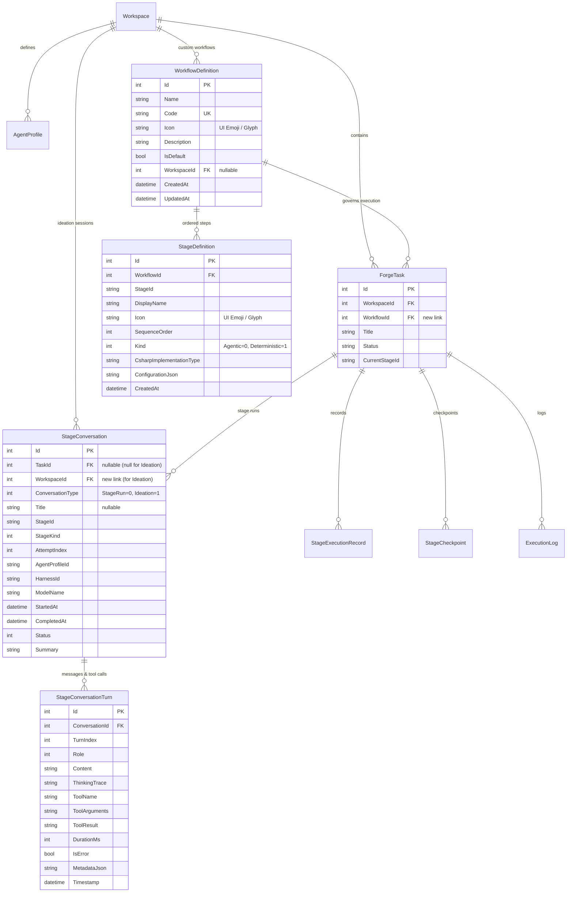
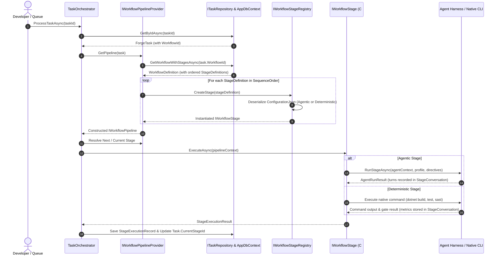
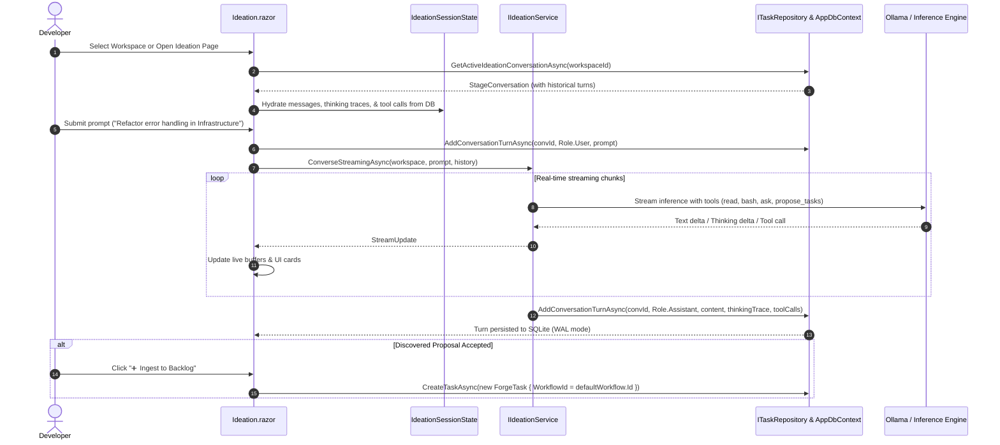
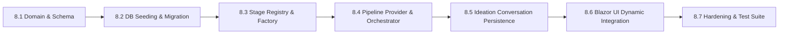

# ⚙️ Phase 8: Database-Driven Extensible Workflows, Dynamic Stages & Unified Conversation Persistence

> **Architectural Specification & Implementation Roadmap**  
> *Parent Plan:* [docs/PLAN.md](../PLAN.md) | *Dependencies:* Phase 1 (Foundation), Phase 3 (Orchestration), Phase 5 (Web UI)  
> *Status:* Proposal & Planning | *Target Framework:* .NET 10 (C# 13)

---

## 1. Executive Summary & Objective

In the initial architecture of **NightCodeForge**, workflow pipelines and stages were structured as static C# classes and factories (`Default3AgentPipeline`, `WorkflowPipeline`). While clean, this design tightly coupled workflow topology to compiled code: adding a new quality gate, reordering stages, adjusting tool configurations, or introducing alternative pipelines (e.g. lightweight fast-track builds, triage-only sweeps, or security SAST audits) required modifying C# source code and rebuilding the application. Furthermore, tasks did not retain a database link to their executing workflow, and Ideation chat sessions remained in-memory within Blazor's scoped state, causing conversation loss on page reloads or restarts.

The primary objective of **Phase 8** is to elevate **Workflows** and **Stages** to first-class, database-persisted entities, while unifying conversation persistence:
1. **Database Entities for Workflows & Stages**:
   - `WorkflowDefinition`: Represents an end-to-end pipeline (global template or workspace-specific).
   - `StageDefinition`: Represents an individual step within a workflow, carrying execution order, execution kind (`Agentic` vs `Deterministic`), designated C# implementation type, and typed JSON configuration.
2. **Task-to-Workflow Linkage**:
   - Every `ForgeTask` is explicitly linked to a `WorkflowDefinition` via `task.WorkflowId`.
   - Workspaces specify a default workflow, with maintainers able to select custom workflows per task.
3. **Extensible C# Implementation Dispatcher & Registry**:
   - Each `StageDefinition` references a registered C# implementation handler (e.g. `AgenticHarnessStage`, `DeterministicBuildStage`, `DeterministicTestStage`, `DeterministicCoverageGate`, `DeterministicSastStage`, `DeterministicWarningRatchetStage`, or custom script runners).
   - Stage configurations are strongly parameterized:
     - **Agentic Stages**: Agent profile link/override, custom stage directives, required operational mode (`ReadOnly`, `Full`, `Review`), loopback failure target, and token/retry limits.
     - **Deterministic Stages**: Action type (`Build`, `Test`, `Coverage`, `Sast`, `WarningRatchet`, `Script`), command overrides, extra parameters (thresholds, flags, script paths), and loopback failure target.
4. **Standard Workflow Database Seeding**:
   - On database initialization/migration, NightCodeForge seeds the default standard 6-stage autonomous workflow and automatically backfills legacy tasks.
5. **Unified Conversation Persistence (`StageConversation`)**:
   - Generalize `StageConversation` and `StageConversationTurn` to store both **Task Stage Execution Runs** and **Ideation Discovery Chats**.
   - Make `TaskId` nullable and add `WorkspaceId`, allowing interactive ideation sessions, thought traces, tool invocations, and discovered task proposals to persist permanently in SQLite.

---

## 2. High-Level Architecture & Entity Relationships

### 2.1 Entity Relationship Diagram (ERD)



---

### 2.2 Dynamic Workflow Execution Sequence



---

### 2.3 Unified Ideation Conversation Flow



---

## 3. Data Model & Configuration Specifications

### 3.1 `WorkflowDefinition` Entity

```csharp
namespace NightCodeForge.Core.Domain;

/// <summary>
/// Defines an end-to-end task execution workflow pipeline stored in the database.
/// </summary>
public class WorkflowDefinition
{
    public int Id { get; set; }
    
    /// <summary>
    /// Friendly display name, e.g. "Standard 3-Agent Pipeline", "Fast TDD Gate".
    /// </summary>
    public string Name { get; set; } = string.Empty;
    
    /// <summary>
    /// Unique machine identifier, e.g. "standard-3-agent", "fast-tdd", "security-audit".
    /// </summary>
    public string Code { get; set; } = string.Empty;
    
    /// <summary>
    /// UI Glyph or Emoji icon representing the workflow (e.g. "⚡", "🔄", "🛡️").
    /// </summary>
    public string Icon { get; set; } = "⚡";
    
    /// <summary>
    /// Human-readable description of this pipeline's purpose and gates.
    /// </summary>
    public string Description { get; set; } = string.Empty;
    
    /// <summary>
    /// Indicates if this workflow is the global system default applied to new tasks.
    /// </summary>
    public bool IsDefault { get; set; } = false;
    
    /// <summary>
    /// Optional workspace scoping. If null, this workflow is a global template available to all workspaces.
    /// </summary>
    public int? WorkspaceId { get; set; }
    
    public DateTime CreatedAt { get; set; } = DateTime.UtcNow;
    public DateTime UpdatedAt { get; set; } = DateTime.UtcNow;

    public Workspace? Workspace { get; set; }
    public ICollection<StageDefinition> Stages { get; set; } = new List<StageDefinition>();
    public ICollection<ForgeTask> Tasks { get; set; } = new List<ForgeTask>();
}
```

---

### 3.2 `StageDefinition` Entity

```csharp
namespace NightCodeForge.Core.Domain;

/// <summary>
/// Represents an ordered step within a WorkflowDefinition, referencing a registered C# implementation.
/// </summary>
public class StageDefinition
{
    public int Id { get; set; }
    public int WorkflowId { get; set; }
    
    /// <summary>
    /// Machine identifier for the stage within this workflow, e.g. "task-review", "implementation".
    /// </summary>
    public string StageId { get; set; } = string.Empty;
    
    /// <summary>
    /// Display name shown in UI steppers, e.g. "ForgeTask Review", "Deterministic Compilation Gate".
    /// </summary>
    public string DisplayName { get; set; } = string.Empty;
    
    /// <summary>
    /// UI Glyph or Emoji icon representing this stage (e.g. "🔍", "⚙️", "💻", "🧪", "🧐", "🛡️").
    /// </summary>
    public string Icon { get; set; } = "⚙️";
    
    /// <summary>
    /// Execution order (1-indexed: 1, 2, 3...).
    /// </summary>
    public int SequenceOrder { get; set; }
    
    /// <summary>
    /// Operational kind: Agentic (LLM-driven) or Deterministic (CPU tool execution).
    /// </summary>
    public WorkflowStageKind Kind { get; set; } = WorkflowStageKind.Agentic;
    
    /// <summary>
    /// Identifier or Type name of the C# implementation registered in IWorkflowStageRegistry.
    /// Examples: "AgenticHarnessStage", "DeterministicBuildStage", "DeterministicTestStage", 
    /// "DeterministicCoverageGate", "DeterministicSastStage", "DeterministicWarningRatchetStage".
    /// </summary>
    public string CsharpImplementationType { get; set; } = string.Empty;
    
    /// <summary>
    /// Serialized JSON configuration payload for the C# implementation.
    /// Deserialized to AgenticStageConfig or DeterministicStageConfig.
    /// </summary>
    public string ConfigurationJson { get; set; } = "{}";
    
    public DateTime CreatedAt { get; set; } = DateTime.UtcNow;

    public WorkflowDefinition? Workflow { get; set; }
}
```

---

### 3.3 Strongly-Typed Configuration Models

#### A. Agentic Stage Configuration (`AgenticStageConfig`)

```csharp
namespace NightCodeForge.Core.Workflow.Configuration;

/// <summary>
/// Configuration payload for an Agentic (LLM-driven) stage.
/// </summary>
public class AgenticStageConfig
{
    /// <summary>
    /// Explicit AgentProfile ID to execute this stage (e.g. "task-review-architect", "developer-agent").
    /// If null or empty, falls back to the workspace default or matching stage identifier.
    /// </summary>
    public string? AgentProfileId { get; set; }
    
    /// <summary>
    /// Custom stage directive (system prompt role and rules). Overrides default stage prompt.
    /// </summary>
    public string? StageDirective { get; set; }
    
    /// <summary>
    /// Minimum required tool capability mode.
    /// </summary>
    public AgentMode RequiredMode { get; set; } = AgentMode.Full;
    
    /// <summary>
    /// Target stage ID to loop back to when the agent rejects or requests changes (e.g. "implementation").
    /// </summary>
    public string? LoopBackStageId { get; set; }
    
    /// <summary>
    /// Maximum retry attempts before marking the stage as Failed.
    /// </summary>
    public int MaxRetries { get; set; } = 3;
    
    /// <summary>
    /// Optional execution timeout in minutes.
    /// </summary>
    public int? TimeoutMinutes { get; set; }
}
```

#### B. Deterministic Stage Configuration (`DeterministicStageConfig`)

```csharp
namespace NightCodeForge.Core.Workflow.Configuration;

/// <summary>
/// Configuration payload for a Deterministic (CPU-native) stage.
/// </summary>
public class DeterministicStageConfig
{
    /// <summary>
    /// Action category: "Build", "Test", "Coverage", "Sast", "WarningRatchet", "Script".
    /// </summary>
    public string Action { get; set; } = "Build";
    
    /// <summary>
    /// Optional command override (e.g. "dotnet test --no-build", "npm run lint").
    /// If null, resolved automatically from CodeStack presets.
    /// </summary>
    public string? Command { get; set; }
    
    /// <summary>
    /// Target stage to loop back to on failure (e.g. "implementation").
    /// </summary>
    public string LoopBackStageId { get; set; } = "implementation";
    
    /// <summary>
    /// Whether a non-zero exit code or gate failure blocks pipeline progression.
    /// </summary>
    public bool FailOnError { get; set; } = true;
    
    /// <summary>
    /// Execution timeout in seconds (default 300s).
    /// </summary>
    public int TimeoutSeconds { get; set; } = 300;
    
    /// <summary>
    /// Extensible action-specific key-value parameters.
    /// Examples:
    /// - MinimumLineCoveragePercent: "80.0"
    /// - MaxAllowedWarnings: "0"
    /// - RatchetBaselineDiffOnly: "true"
    /// - SastRuleset: "security-extended"
    /// - ScriptPath: "scripts/verify-schema.sh"
    /// </summary>
    public Dictionary<string, string> ExtraParameters { get; set; } = new();
}
```

---

### 3.4 Generalized `StageConversation` Entity

```csharp
namespace NightCodeForge.Core.Domain;

public enum ConversationType
{
    StageRun = 0,    // Autonomous pipeline stage execution (tied to a task)
    Ideation = 1,    // Interactive discovery & task formulation chat (workspace-level)
    AdHoc = 2        // Standalone developer consultation
}

public class StageConversation
{
    public int Id { get; set; }
    
    /// <summary>
    /// Nullable link to ForgeTask. Null for general Ideation discovery conversations.
    /// </summary>
    public int? TaskId { get; set; }
    
    /// <summary>
    /// Link to Workspace. Required for Ideation sessions; inferred from Task for stage runs.
    /// </summary>
    public int? WorkspaceId { get; set; }
    
    /// <summary>
    /// Classification of conversation purpose.
    /// </summary>
    public ConversationType ConversationType { get; set; } = ConversationType.StageRun;
    
    /// <summary>
    /// Friendly session title for Ideation chats (e.g. "Architecture Review - Auth Subsystem").
    /// </summary>
    public string? Title { get; set; }
    
    public string StageId { get; set; } = string.Empty;
    public WorkflowStageKind StageKind { get; set; } = WorkflowStageKind.Agentic;
    public int AttemptIndex { get; set; } = 1;
    public string? AgentProfileId { get; set; }
    public string? HarnessId { get; set; }
    public string? ModelName { get; set; }
    public DateTime StartedAt { get; set; } = DateTime.UtcNow;
    public DateTime? CompletedAt { get; set; }
    public StageExecutionStatus Status { get; set; } = StageExecutionStatus.Running;
    public string? Summary { get; set; }
    public string? TranscriptFileName { get; set; }

    public ForgeTask? ForgeTask { get; set; }
    public Workspace? Workspace { get; set; }
    public ICollection<StageConversationTurn> Turns { get; set; } = new List<StageConversationTurn>();
}
```

---

## 4. C# Implementation Extensibility: Registry & Factory Pattern

To guarantee that database records can cleanly instantiate any registered C# workflow stage with full dependency injection, we introduce `IWorkflowStageRegistry` and `IWorkflowStageFactory`:

```csharp
namespace NightCodeForge.Core.Workflow;

/// <summary>
/// Factory contract creating executable IWorkflowStage instances from database StageDefinition entities.
/// </summary>
public interface IWorkflowStageFactory
{
    IWorkflowStage CreateStage(StageDefinition definition);
}

/// <summary>
/// Registry managing C# implementation runners for agentic and deterministic workflow stages.
/// </summary>
public interface IWorkflowStageRegistry
{
    void RegisterHandler(string implementationType, Func<IServiceProvider, StageDefinition, IWorkflowStage> factory);
    bool TryGetFactory(string implementationType, out Func<IServiceProvider, StageDefinition, IWorkflowStage>? factory);
    IReadOnlyCollection<string> RegisteredTypes { get; }
}
```

### Standard Registered Handlers:
| Handler Key | Implementation Class | Stage Kind | Configuration Type | Description |
| :--- | :--- | :--- | :--- | :--- |
| `agentic-review` | `TaskReviewStage` | Agentic | `AgenticStageConfig` | Deep inspection, task clarification, plan formulation. |
| `agentic-impl` | `ImplementationStage` | Agentic | `AgenticStageConfig` | Code editing, TDD, incremental compilation. |
| `agentic-review-fix` | `CodeReviewAndFixStage` | Agentic | `AgenticStageConfig` | Git diff audit, precision fixes, change requests. |
| `agentic-custom` | `GenericAgenticStage` | Agentic | `AgenticStageConfig` | Arbitrary custom agentic role/directive. |
| `deterministic-format`| `DeterministicFormatStage` | Deterministic | `DeterministicStageConfig` | Direct code formatting (e.g. dotnet format, ruff format). |
| `deterministic-build` | `DeterministicBuildStage` | Deterministic | `DeterministicStageConfig` | Native CPU build & compiler error/warning gate. |
| `deterministic-test` | `DeterministicTestStage` | Deterministic | `DeterministicStageConfig` | Native unit/integration test runner gate without coverage. |
| `deterministic-test-with-coverage`| `DeterministicTestWithCoverageGate` | Deterministic | `DeterministicStageConfig` | Test runner with coverage collection & regression ratchet. |
| `deterministic-sast` | `DeterministicSastStage` | Deterministic | `DeterministicStageConfig` | Security analysis & code vulnerability scan extension point. |
| `deterministic-ratchet` | `DeterministicWarningRatchetStage` | Deterministic | `DeterministicStageConfig` | Zero-warning regression ratchet gate. |
| `deterministic-composite`| `CompositeDeterministicStage` | Deterministic | `DeterministicStageConfig` | Bundled baseline or post-verification stages. |
| `deterministic-script` | `DeterministicScriptStage` | Deterministic | `DeterministicStageConfig` | Custom shell script, Python script, or container tool. |

---

## 5. Phased Implementation Breakdown (Steps 8.1 - 8.7)



---

### Step 8.1: Domain Entities & Database Schema Evolution
* **File Targets:**
  - `src/NightCodeForge.Core/Domain/WorkflowDefinition.cs` (New)
  - `src/NightCodeForge.Core/Domain/StageDefinition.cs` (New)
  - `src/NightCodeForge.Core/Workflow/Configuration/AgenticStageConfig.cs` (New)
  - `src/NightCodeForge.Core/Workflow/Configuration/DeterministicStageConfig.cs` (New)
  - `src/NightCodeForge.Core/Domain/ForgeTask.cs` (Update: add `WorkflowId`, `Workflow`)
  - `src/NightCodeForge.Core/Domain/Workspace.cs` (Update: add `DefaultWorkflowId`, `Workflows`)
  - `src/NightCodeForge.Core/Domain/Conversation.cs` (Generalized entity: nullable `TaskId`, add `WorkspaceId`, `ConversationType`, `Title`)
  - `src/NightCodeForge.Infrastructure/Data/AppDbContext.cs` (Update: entity mappings, value converters, SQLite WAL mode)
* **Key Actions:**
  - Map `WorkflowDefinitions`, `StageDefinitions`, `Conversations`, and `ConversationTurns` sets in `AppDbContext`.
  - Configure one-to-many relationship `WorkflowDefinition.Stages` with cascading delete.
  - Make `Conversation.TaskId` nullable and add foreign key to `Workspace`.
  - Configure `EnsureDatabaseCreatedAndWalAsync` to rely on standard `Database.EnsureCreatedAsync()` + SQLite WAL pragmas for development, targeting EF Core migrations for v1 shipping.

---

### Step 8.2: Fresh Database Seeding & Default Standard Workflow
* **File Targets:**
  - `src/NightCodeForge.Infrastructure/Data/AppDbContext.cs` (`EnsureDefaultWorkflowsAsync`)
  - `src/NightCodeForge.Web/Program.cs` (Call startup seeder)
* **Key Actions:**
  - Implement `EnsureDefaultWorkflowsAsync()` in `AppDbContext`:
    - Checks if a default workflow with Code `"standard-3-agent"` exists.
    - If not present, creates the **Standard 3-Agent Workflow** with icon `"⚡"` and its 6 stages (each configured with its UI icon):
      1. `task-review` (🔍, Agentic, `agentic-review`, `AgenticStageConfig`)
      2. `deterministic-pre-impl` (⚙️, Deterministic, `deterministic-composite`, Baseline build & test)
      3. `implementation` (💻, Agentic, `agentic-impl`, `AgenticStageConfig`)
      4. `deterministic-post-impl` (🧪, Deterministic, `deterministic-composite`, Build, test, coverage)
      5. `code-review-fix` (🧐, Agentic, `agentic-review-fix`, LoopBack: `implementation`)
      6. `deterministic-post-review` (🛡️, Deterministic, `deterministic-composite`, Post-review verification)
    - Saves changes to SQLite.
  - Setup initializes against a fresh empty database without requiring legacy schema backfilling.

---

### Step 8.3: Extensible C# Stage Registry & Factory Engine
* **File Targets:**
  - `src/NightCodeForge.Core/Workflow/IWorkflowStageRegistry.cs` (New)
  - `src/NightCodeForge.Core/Workflow/IWorkflowStageFactory.cs` (New)
  - `src/NightCodeForge.Infrastructure/Workflow/WorkflowStageRegistry.cs` (New)
  - `src/NightCodeForge.Infrastructure/Workflow/WorkflowStageFactory.cs` (New)
  - `src/NightCodeForge.Core/Workflow/Stages/GenericAgenticStage.cs` (New)
  - `src/NightCodeForge.Core/Workflow/Stages/DeterministicScriptStage.cs` (New)
  - `src/NightCodeForge.Infrastructure/ServiceCollectionExtensions.cs` (DI registration)
* **Key Actions:**
  - Register standard stage handler types in DI.
  - Parse `ConfigurationJson` safely, binding to `AgenticStageConfig` or `DeterministicStageConfig`.
  - Provide fallback behavior with informative errors if a configuration payload or implementation type is invalid.

---

### Step 8.4: Database-Driven Pipeline Provider & Orchestrator Integration
* **File Targets:**
  - `src/NightCodeForge.Core/Repositories/IWorkflowRepository.cs` (New)
  - `src/NightCodeForge.Infrastructure/Data/Repositories/EfCoreWorkflowRepository.cs` (New)
  - `src/NightCodeForge.Core/Repositories/InMemoryWorkflowRepository.cs` (New)
  - `src/NightCodeForge.Core/Workflow/IWorkflowPipelineProvider.cs` (Update: load dynamic pipeline from DB)
  - `src/NightCodeForge.Core/Workflow/TaskOrchestrator.cs` (Update: query pipeline from task's `WorkflowId`, dynamic loopbacks & retries)
* **Key Actions:**
  - `IWorkflowPipelineProvider.GetPipeline(ForgeTask task)` looks up `task.WorkflowId`.
  - If `task.WorkflowId` is 0 or unset, resolves from `Workspace.DefaultWorkflowId`, or global default workflow.
  - Assembles the ordered `IWorkflowPipeline` on-the-fly using `IWorkflowStageFactory`.
  - In `TaskOrchestrator`, replace hardcoded loopback targets (e.g. fallback `"implementation"`) with the stage definition's configured `LoopBackStageId`.

---

### Step 8.5: Ideation Chat Persistence & Repository Alignment
* **File Targets:**
  - `src/NightCodeForge.Core/Repositories/ITaskRepository.cs` (Add conversation query methods)
  - `src/NightCodeForge.Infrastructure/Data/Repositories/EfCoreTaskRepository.cs` (Implement methods)
  - `src/NightCodeForge.Core/Services/IdeationSessionManager.cs` (New or update `IIdeationService`)
  - `src/NightCodeForge.Web/Services/IdeationSessionState.cs` (Add hydration/persistence hooks)
  - `src/NightCodeForge.Web/Components/Pages/Ideation.razor` (Connect to DB conversation lifecycle)
* **Key Actions:**
  - Add repository methods:
    - `Task<StageConversation> StartIdeationConversationAsync(int workspaceId, string title, string? modelName, ...)`
    - `Task<IReadOnlyList<StageConversation>> GetIdeationConversationsAsync(int workspaceId, ...)`
    - `Task<StageConversation?> GetActiveIdeationConversationAsync(int workspaceId, ...)`
  - When the user sends a message in `Ideation.razor`:
    - Ensure an active `StageConversation` exists for the current workspace (or create one).
    - Persist the user turn immediately.
    - Stream agent responses and tool invocations, updating the conversation turns in SQLite.
  - Reloading the page or switching workspaces automatically hydratres the active Ideation chat and discovered proposals from SQLite.
  - Allow developers to view a history dropdown of past ideation sessions and start a new conversation at any time.

---

### Step 8.6: Dynamic Blazor UI Integration & Workflow Management
* **File Targets:**
  - `src/NightCodeForge.Web/Components/Monitoring/PipelineStepper.razor` (Update to accept dynamic stage definitions)
  - `src/NightCodeForge.Web/Components/Monitoring/TaskExecutionInspector.razor` (Update to pass dynamic stages)
  - `src/NightCodeForge.Web/Components/Backlog/TaskCreationModal.razor` (Add workflow selector dropdown)
  - `src/NightCodeForge.Web/Components/Settings/WorkflowManagementTab.razor` (New: view, clone, and configure workflows & stages)
* **Key Actions:**
  - `PipelineStepper.razor` drops hardcoded 7-step array; accepts `IReadOnlyList<StageDefinition>` or resolves from `task.Workflow.Stages`.
  - Connect connectors and icons dynamically according to the actual workflow sequence.
  - Add a dedicated Workflow Management UI in Settings to view standard workflows and inspect individual stage parameters.

---

### Step 8.7: Comprehensive Hardening & Test Suite
* **File Targets:**
  - `tests/NightCodeForge.Core.Tests/WorkflowDefinitionTests.cs` (New)
  - `tests/NightCodeForge.Infrastructure.Tests/WorkflowRepositoryTests.cs` (New)
  - `tests/NightCodeForge.Agents.Tests/StageRegistryAndFactoryTests.cs` (New)
  - `tests/NightCodeForge.Core.Tests/TaskOrchestratorDynamicWorkflowTests.cs` (New)
  - `tests/NightCodeForge.Infrastructure.Tests/IdeationConversationPersistenceTests.cs` (New)
  - `tests/NightCodeForge.Web.Tests/PipelineStepperDynamicTests.cs` (New)
  - `tests/NightCodeForge.Web.Tests/E2E/PlaywrightWorkflowLifecycleTests.cs` (Update/New)
* **Key Actions:**
  - Validate SQLite migrations, foreign keys, cascading rules, and WAL integrity.
  - Verify that standard 6-stage workflow seeds idempotently and existing tasks remain valid.
  - Test dynamic pipeline execution in `TaskOrchestrator` with custom 3-stage and 5-stage workflows.
  - Verify Ideation chat turns, thinking traces, and tool results persist across session reloads.

---

### Step 8.8: Legacy & Dead Code Cleanup
* **File Targets:**
  - `src/NightCodeForge.Core/Workflow/Stages/StandardStages.cs` (Delete/Cleanup)
  - `src/NightCodeForge.Core/Workflow/Default3AgentPipeline.cs` (Delete/Cleanup)
  - `src/NightCodeForge.Core/Workflow/TaskOrchestrator.cs` (Remove hardcoded stage conditionals)
  - `src/NightCodeForge.Core/Domain/StageConversation.cs` (Finalize model alias deprecation)
  - `src/NightCodeForge.ScenarioRunner/Scenarios/*.cs` (Migrate mocks to `GenericAgenticStage`)
* **Key Actions:**
  - Eliminate redundant C# stage classes (`TaskReviewStage`, `ImplementationStage`, `CodeReviewAndFixStage`) now superseded by `GenericAgenticStage` and Scriban templates.
  - Remove deprecated static pipeline factories (`Default3AgentPipeline`).
  - Strip hardcoded `if (stageId == "...")` logic from `BuildBootstrapPrompt`.
  - Migrate all remaining test and scenario runner references to dynamic stage definitions.

---

## 6. Detailed Step Breakdown Matrix

| Step | Focus Area | Complexity | Deliverables | Verification Gates |
| :--- | :--- | :---: | :--- | :--- |
| **8.1** | **Domain & DB Schema** | Medium | `WorkflowDefinition`, `StageDefinition`, `AgenticStageConfig`, `DeterministicStageConfig`, EF Core schema | DB Migration passes; SQLite WAL tables created; Unit tests for entity invariants |
| **8.2** | **DB Seeding & Migration**| Low-Med | `EnsureDefaultWorkflowsAsync()`, startup registration, legacy task backfill | Seeder runs idempotently; existing database without workflows upgrades smoothly |
| **8.3** | **C# Stage Registry** | Medium | `IWorkflowStageRegistry`, `IWorkflowStageFactory`, handler registrations | Registry creates all standard stage types with config payloads; handles invalid types cleanly |
| **8.4** | **Orchestrator Integration**| High | `IWorkflowPipelineProvider` DB querying, `TaskOrchestrator` dynamic resolution & loopbacks | Orchestrator processes tasks through dynamic DB workflows; respects configured loopbacks |
| **8.5** | **Ideation Chat Persistence**| High | `StageConversation` generalization, repository queries, `Ideation.razor` sync | Ideation messages, thinking traces, and tool calls persist to DB; survive page reloads |
| **8.6** | **Dynamic Blazor UI** | Medium | `PipelineStepper` dynamic rendering, Task Creation workflow picker, Settings Workflow tab | Stepper dynamically adapts to N-stage workflows; users can select workflow on task creation |
| **8.7** | **Hardening & Test Suite**| Medium | Unit, integration, and Playwright E2E tests | 100% test pass rate across Core, Infrastructure, Agents, and Web test suites |
| **8.8** | **Dead Code Cleanup** | Low-Med | Removal of `StandardStages.cs`, `Default3AgentPipeline.cs`, hardcoded stage branching | 0 warnings/errors; 100% test pass rate without obsolete types |

---

## 7. Non-Breaking Migration & Rollback Strategy

1. **Backwards Compatibility**:
   - The default standard workflow (`standard-3-agent`) mirrors the existing hardcoded 6 stages identically.
   - Any task without a specified `WorkflowId` automatically resolves to the default standard workflow.
2. **Database Integrity**:
   - In development, `Database.EnsureCreatedAsync()` builds the complete, normalized schema directly from entity configurations.
   - For initial release (v1), formal EF Core migrations (`dotnet ef migrations add ...`) will manage incremental schema evolutions.
   - Foreign key constraints use `ON DELETE RESTRICT` for workflows referenced by active tasks, and `ON DELETE CASCADE` for stage definitions belonging to a deleted workflow.
3. **Graceful Fallbacks**:
   - If a stage references an unknown C# implementation type, `WorkflowStageFactory` emits an explicit configuration failure rather than crashing the orchestrator process.
   - If an ideation session cannot find an existing database record, it automatically seeds a new active conversation seamlessly.
