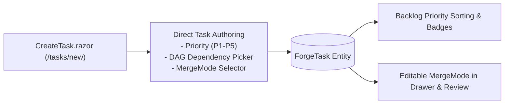
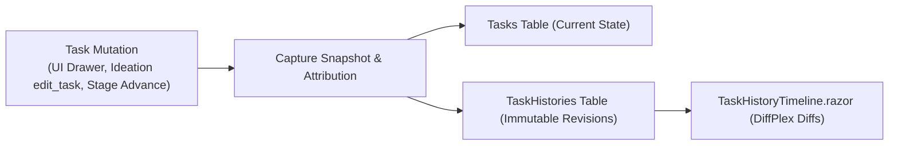
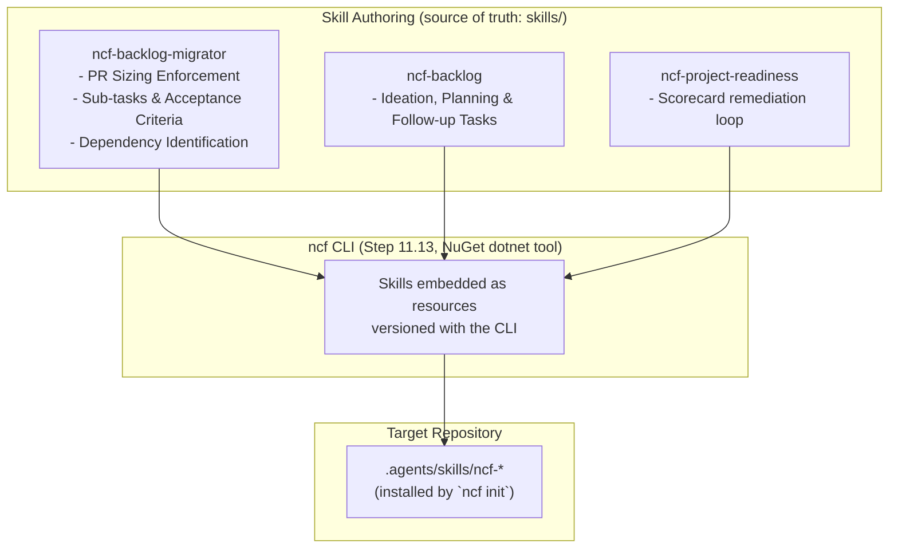
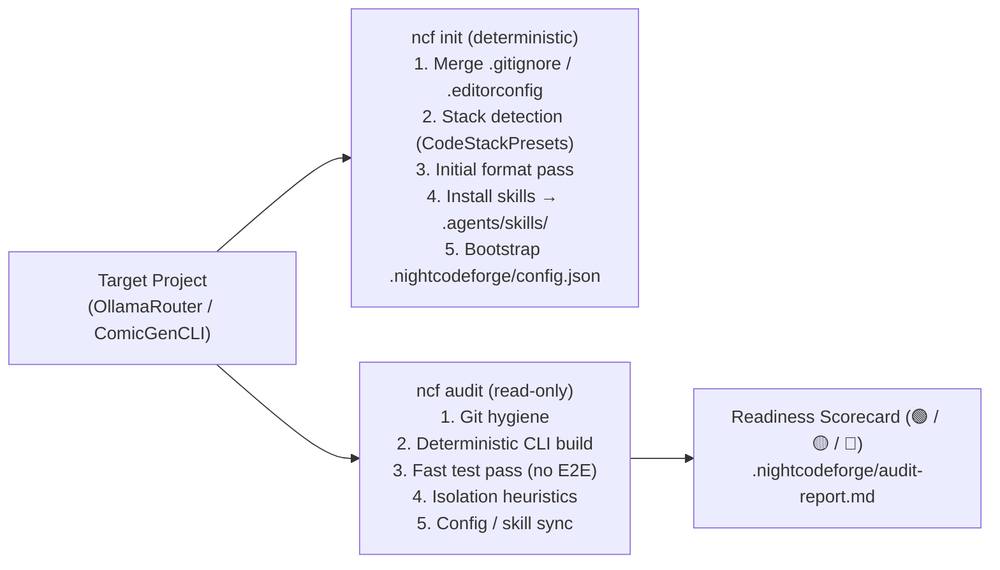
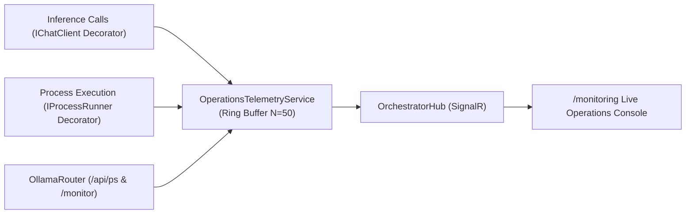
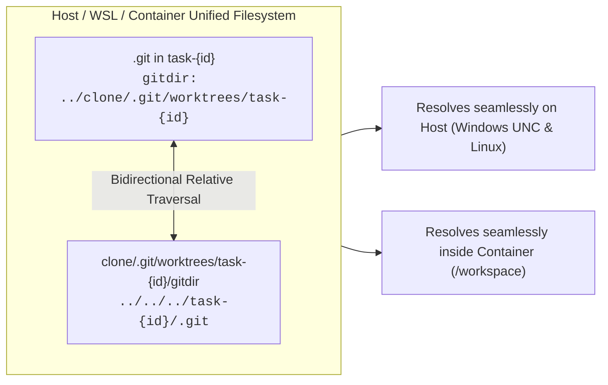
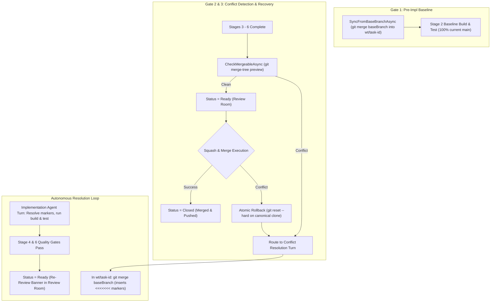
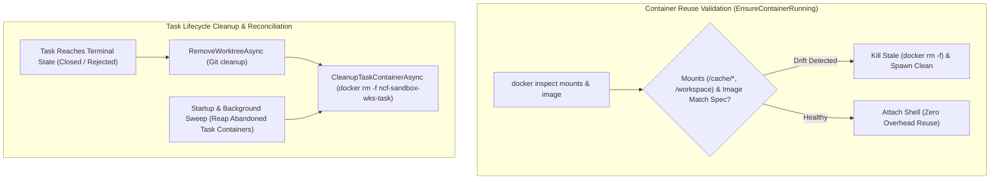
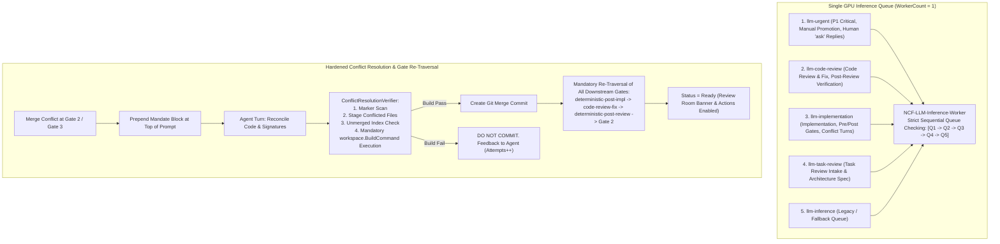

# 🧩 Phase 11: Real-Project Onboarding, Hardening & Bug Fixes

> **Architectural Specification & Implementation Roadmap**  
> *Parent Plan:* [docs/PLAN.md](../PLAN.md) | *Dependencies:* Phase 4 (Harnesses & Sandboxing), Phase 5 (Web UI), Phase 8 (Database-Driven Workflows), Phase 9 (Codebase Remediation & Robustness), Phase 10 (MVP Final Polish)  
> *Status:* Completed | *Target Framework:* .NET 10 (C# 13)

---

## 1. Executive Summary & Strategic Prioritization

The core architecture of **NightCodeForge** delivers an autonomous software engineering pipeline: multi-workspace isolation, local Git mirror synchronization, single-worker GPU Hangfire queuing, multi-stage agentic workflows, deterministic verification quality gates, a modern Blazor web dashboard, database-driven dynamic workflow orchestration, and strict adherence to architectural robustness policies.

To transition active, real-world development projects (**OllamaRouter** and **ComicGenCLI**) into NightCodeForge immediately, **Phase 11** was re-focused on **backlog onboarding, direct task management, project preparedness, system hardening, and critical bug fixes**:

1. **Backlog Management & Direct Task Authoring:**
   - **Step 11.2:** Dedicated Task Creation Page (`/tasks/new`), First-Class Priority Management (P1–P5), and MergeMode Lifecycle.
   - **Step 11.7:** Task State History & Temporal Snapshot Audit Trail (interactive timeline and DiffPlex visual text diffs in Web UI).
   - **Step 11.12:** Packaged Agent Skills for Backlog Management & Migration — versioned, model-agnostic skills (`ncf-backlog`, `ncf-backlog-migrator`, `ncf-project-readiness`) authored as a packaging source of truth and distributed by the `ncf` CLI, plus ready-to-use prompt templates.
   - **Step 11.13:** `ncf` CLI — a NuGet `dotnet tool` performing all deterministic preparation in one command: `.gitignore`/`.editorconfig` management, stack detection, initial format pass, external harness skills installation (`.agents/skills/`), and `.nightcodeforge/config.json` bootstrap, with a read-only `ncf audit` readiness scorecard.
   - **Step 11.15:** Priority-Aware Task Queue Scheduling & Execution Ordering (aligning DAG cascade unblocking, Hangfire insertion order, and DevQueue promotion with 1 Highest -> 5 Lowest).

2. **Pipeline State Hygiene, Portal Scoping & Telemetry:**
   - **Step 11.17:** Portal Task Scoping, Origin Provenance & Pipeline State Hygiene — enforcing `TaskOrigin.UntrustedIntake` for `/triage` proposed backlog cards, restricting `/inspector` and `/review` dropdowns to tasks with $\ge 1$ stage run, and eliminating false "Running" stepper indicators on idle tasks.
   - **Step 11.18:** Live Operations Telemetry: Real-Time LLM Calls, Shell Activity & OllamaRouter Deep Monitoring — re-architecting `/monitoring` from redundant pipeline inspector into a real-time Developer Operations Console showing current and last $N$ LLM calls, deterministic bash/CLI operations, and deep OllamaRouter cluster/VRAM metrics.
   - **Step 11.20:** Live Operations Telemetry Refinement, Command Transparency & Context Sizing — 500ms dynamic ticking timer preventing frozen elapsed duration on large tool generation, clean static badge styling, container command transparency logging real commands instead of persistent wrappers, and accurate full prompt context sizing.

3. **Container Sandboxing, Git Worktree Concurrency & Bug Fixes:**
   - **Step 11.21:** Dynamic Tool Timeouts, Container ICU & User Permissions, and Review Rejection Test Mandate — dynamic bash timeout formula $\max(300\text{s}, \text{build} + \text{test})$, full `libicu-dev` & locales in container base image fixing `NETSDK1188`, preserving host user name and group (`-u $(id -u):$(id -g)`) to eliminate workspace file permission conflicts, and mandatory automated regression test authoring contract on Review rejection.
   - **Step 11.22:** Container Git Worktree Relative Paths & Cross-Environment Portability — bidirectional relative Git worktree pointer normalization (`<worktree>/.git` and `<clone>/.git/worktrees/.../gitdir`) with Windows WSL UNC path resolution and `worktree.useRelativePaths = true`, resolving Exit Code 128 "fatal: not a git repository" errors in container sandboxes.
   - **Step 11.23:** Backlog Task Rejection Lifecycle, Kanban State Hygiene & Shell UI Polish — first-class maintainer rejection action for backlog tasks (domain orchestration, audit attribution, queue eviction, disk markdown sync), white text contrast for priority filter chips, decoupling stage ID from unstarted tasks to prevent false In-Flight display, sidebar collapse visibility fix, and SVG favicon replacement.
   - **Step 11.24:** Fine-Grained Workspace Concurrency & Non-Blocking Git Merge Operations — decoupling long-running agent LLM loops from the workspace reader lock, keeping atomic mutual exclusion on the shared canonical Git clone (< 500ms), and enabling instantaneous Squash & Merge in the Review Room while background tasks execute.
   - **Step 11.25:** Autonomous Git Conflict Management, Baseline Synchronization & Re-Review Lifecycle — zero-conflict synchronization of task feature branches from main at Stage 2 Pre-Implementation Baseline, non-destructive merge preview and conflict detection at Stage 6 / Review Room entry, atomic rollback on Squash & Merge failure, and autonomous conflict resolution by the Implementation Agent with re-review audit trail.
   - **Step 11.26:** Container Reuse Validation & Task Lifecycle Sandbox Cleanup — comprehensive volume mount and image drift detection during container reuse in `EnsureContainerRunning` (eliminating permission denied errors from stale mounts), task terminal state container teardown (`Closed`, `Rejected`), and startup/background orphan container reconciliation sweeps.
   - **Step 11.27:** Stage-Priority Inference Queue Scheduling & Conflict Resolution Lifecycle Hardening — stage-priority queue hierarchy treating each task "as a whole" (`code-review-fix` -> `implementation` -> `task-review`), mandatory compilation/build verification in `ConflictResolutionVerifier` before creating merge commits, mandatory re-traversal of all downstream gates (`deterministic-post-impl`, `code-review-fix`, `deterministic-post-review`, Gate 2), prompt mandate block prepended at top of prompt, and Review Room state hygiene restricting review actions and banners strictly to `Ready` tasks.
   - **Step 11.28:** Pipeline Restart Git Options: Soft Resume vs Hard Reset & Base Branch Rebase — first-class operator choice in Task Execution Inspector between Soft Restart (preserving existing worktree/branch commits) and Clean Hard Reset (discarding WIP commits, rebasing/hard-resetting feature branch onto latest base branch, recycling sandbox container, and starting Stage 1 on a clean baseline).
   - **Step 11.29:** Global Operations Pause & GPU VRAM Eviction (Gamer / Dedicated Workload Mode) — first-class global pause toggle (`TopNavBar.razor`, operations telemetry) that suspends all background queues, checkpoints in-flight tasks gracefully without failure, and instantly evicts resident LLM models from GPU VRAM via `IOllamaRouterGatewayService.ReclaimVramAsync` so the host GPU is 100% free for gaming or dedicated workloads.
   - **Step 11.31:** Prompt Deduplication, Dynamic Compaction Budgeting & Inference Ergonomics — eliminate duplicate task descriptions in initial user bootstrap messages to slim the immutable anchor, dynamically scale compaction budgets with mathematically sound safety margins and turn debounce to prevent infinite back-to-back compaction loops (eliminating 80+ churn cycles and saving millions of tokens per task), dump active context window tokens and compaction parameters in transcripts for full auditability, support multi-match `edit` replacements, and raise transcript logging limits.
   - **Step 11.32:** Synthetic Conversation Priming & Human Clarification Answer Hygiene — scope isolation and single-consumption lifecycle for human clarification answers (`LastHumanAnswer`) preventing rogue `ask` tool turns from polluting downstream stages, defensive orphan tool result prevention in `CrucibleAgentHarness`, and implementation of Synthetic Conversation Priming (pre-seeding `ChatHistory` with verified or failing `bash` tool call/result pairs from prior deterministic quality gates to eliminate redundant exploratory build/test agent turns).
   - **Step 11.33:** Unified LLM Provider Architecture (Standalone Ollama vs OllamaRouter), Auto Context Window Discovery, & Dynamic Fleet Telemetry — zero OllamaRouter imposition for single-GPU developers (standalone Ollama support with target pinning suppression), simplified global configuration (provider selection, default model + thinking effort, optional Coder vs Architect role differentiation), automated context window discovery from Ollama Modelfiles / GGUF metadata or OllamaRouter capability engines, and clean REST fleet topology telemetry.
   - **Step 11.34:** Live Git Diff Worktree Ingestion, Untracked File Tracking & Inspector Accuracy — ensure `GenerateLiveDiffAsync` reliably locates active task worktrees across cross-platform environments, index newly created files via intent-to-add (`git add -N`) to surface untracked files in the inspector, and provide clear diff provenance signaling (`LiveWorktree`, `BranchHeadFallback`, `SquashCommit`) in the Task Execution Inspector and Task Detail pages.
   - **Step 11.35:** OpenAI-Compatible LLM Provider Integration & Explicit Model Allowlist (to be done after 11.33) — first-class integration with standard OpenAI Chat Completions API endpoints (vLLM, LM Studio, OpenRouter, DeepSeek, OpenAI), mandatory model allowlist configuration with explicit per-model context window sizes and max output token budgets, fail-fast unlisted model validation (`ModelNotAllowedException`), deterministic Crucible compaction sizing, Bearer token authentication, and strict suppression of OllamaRouter target/session headers.
   - **Step 11.36:** Unified In-Place Conversation Resumption on Global Pause/Resume & Crash Recovery — resume `StageExecutionStatus.Interrupted` conversations in-place alongside `WaitingForHuman`, preserve paused conversation state across host restarts in `StartupRecoveryService`, transition crashed `Running` conversations to `Interrupted` (instead of closing as `Failed` and spawning fragmented new conversations), sanitize trailing unanswered tool turns in SQLite on mid-tool interruption, and prevent turn loss on chained pause/crash cycles.
   - **Step 11.38A:** Pre-Refactoring Characterization Tests & Constructor Parameter Ceiling Guard — characterization tests for `AcpAgentHarness` & `PiRpcAgentHarness` outer `RunStageAsync` process lifecycle, JSON configuration parsing, cancellation/error handling, and ACP host RPC operations; shared `CrucibleAgentHarness` & `IdeationService` skills catalog injection, dynamic context window discovery, and read-only tool scoping tests; and a reflection-based `ConstructorParameterCeilingTests` guard enforcing `<= 10` constructor parameters across all solution assemblies with a shrinking legacy allowlist.

4. **Deterministic Playwright Browser E2E Testing Suite (Zero LLM Calls):**
   - **Step 11.39A:** Reusable LLM-Free Playwright E2E Host Fixture & Core Backlog Baseline Tests — reusable `PlaywrightWebHostFixture` (`[Collection("PlaywrightUiE2E")]`, `[Trait("Category", "E2E")]`) booting `NightCodeForge.Web` on an isolated loopback port + temp SQLite DB with `SeedDatabaseAsync` / `QueryDatabaseAsync` and zero LLM calls, plus baseline Chromium E2E tests for Workspace Wizard & Switching, Home Dashboard & Pause/Resume toggle, Manual Task Creation (`/tasks/new`), Backlog Kanban/DAG, and `TaskDetail` page.
   - **Step 11.39B:** Baseline Playwright E2E Tests for HITL Question Inbox, Review Room, Inspector & Settings — LLM-free Playwright browser E2E suite covering Human Question Inbox batch answering (`/inbox`), Review Room Git branch diff rendering & task rejection (`/review/{taskId}`), Task Execution Inspector & Transcripts browser (`/inspector`, `/transcripts`), and Settings persistence (`/settings`).

5. **Resiliency, Code Factorization & Pmad.AI Migration:**
   - **Step 11.37A:** Dedicated LLM 5-minute outage retry policy with UI notifications, connection refused classification, and hardened SocketsHttpHandler.
   - **Step 11.38B:** Shared `ExternalProcessAgentHarnessBase` eliminating duplication across AcpAgentHarness and PiRpcAgentHarness, and ACP host RPC extraction.
   - **Step 11.38C:** Shared agent session & toolset factorization (`CanonicalToolScope`, `ICanonicalToolsetFactory`, `IAgentWorkspaceContextService`, `IHarnessAgentFactory`, `ICrucibleConversationCoordinator`).
   - **Step 11.38D:** `TaskOrchestrator` & `StartupRecoveryService` decomposition, eliminating legacy allowlist to strictly enforce `<= 10` constructor parameters.
   - **Step 11.41:** Task Review specification enforcement with in-session conversational continuation rather than fatal aborts.
   - **Step 11.42:** Crucible harness false-completion prevention via interrupted generation detection, stream continuation loops, and stage empty-diff gate.
   - **Step 11.43A:** `Pmad.AI` 0.0.2 upgrade and hardened `ReadOnlyCommandValidator` migration.
   - **Step 11.43B:** `Pmad.AI` 0.0.3 `LenientToolDispatcher` & `LenientToolDispatchChatClient` delegating middleware migration.
   - **Step 11.44:** `web_search` result capping with `/tmp` offloading and single-timeout retry policy.
   - **Step 11.45:** Measured-token compaction trigger with `Pmad.AI` next-turn token estimation and deterministic template error guard.
   - **Step 11.47:** Compaction checkpoint persistence (`StageTurnRole.Optimization`), `< 64k` post-compaction/summarizer/cold-resume ceiling, 10m/30m timeout retry policy for Cloud overflow, header-correlated HTTP retry telemetry, tail-aware prompt previews, and stage token accounting.

> [!NOTE]
> **Active Roadmaps:** Remaining bug-fix and resiliency steps are tracked in **[docs/fixes/README.md](../fixes/README.md)**, and remaining new feature steps are tracked in **[docs/features/README.md](../features/README.md)**.  
> Step numbering in `phase-11/` preserves its historical numbers to match Git commit history.

---

## 2. Completed Implementation Steps (Archive)

| Step | Specification | Focus & Key Deliverables | Status |
| :--- | :--- | :--- | :--- |
| **11.2** | [📄 Step 11.2: Dedicated Task Creation Page, Priority Management & MergeMode](phase-11/STEP_11_2_TASK_CREATION_PAGE_AND_MERGE_MODE.md) | Dedicated task authoring page (`/tasks/new`) and modal, first-class editable Priority management (P1 Critical to P5 Trivial badges, drawer & inline card editing, sorting/filtering in Backlog), DAG prerequisite selection at creation, and interactive `MergeMode` editing (`Automatic`, `ManualReviewRequired`). | Completed |
| **11.7** | [🕰️ Step 11.7: Task State History & Temporal Snapshot Audit Trail](phase-11/STEP_11_7_TASK_STATE_HISTORY_AND_AUDIT_TRAIL.md) | Temporal audit history for `ForgeTask` entities: backend `TaskHistories` table with immutable snapshots, attribution (`ChangedBy`, `ChangeReason`), and interactive `TaskHistoryTimeline.razor` UI with DiffPlex text diff comparison. | Completed |
| **11.12** | [📦 Step 11.12: Packaged Agent Skills for Backlog Migration, Ideation & Flexible Dependencies](phase-11/STEP_11_12_BACKLOG_MIGRATION_AND_IDEATION_SKILLS.md) | Versioned agent skills (`ncf-backlog`, `ncf-backlog-migrator`, `ncf-project-readiness`), prompt templates, canonical `docs/TASK_MARKDOWN_SPECIFICATION.md`, and flexible `depends_on` in `TaskFrontmatter`/`TaskMarkdownSyncService` with topological sorting and in-place normalization. | Completed |
| **11.13** | [🚀 Step 11.13: `ncf` CLI — Deterministic Project Preparation & Onboarding](phase-11/STEP_11_13_PROJECT_PREPAREDNESS_AND_ONBOARDING.md) | NuGet `dotnet tool` (`ncf init` / `ncf audit`): one-command deterministic preparation of existing repositories — `.gitignore`/`.editorconfig` merge, stack detection via shared `CodeStackPresets`, initial format pass, skills installation into `.agents/skills/`, `.nightcodeforge/config.json` bootstrap, and green/yellow/red readiness audit. | Completed |
| **11.15** | [⏱️ Step 11.15: Priority-Aware Task Queue Scheduling & Execution Ordering](phase-11/STEP_11_15_PRIORITY_AWARE_TASK_QUEUE_SCHEDULING.md) | Priority queue enforcement for single GPU inference worker: DAG unblocking cascade ordered by `Priority ASC (1 -> 5)`, P1 hotfix routing to `llm-urgent`, and DevQueue priority sorting and manual head promotion. | Completed |
| **11.17** | [🎯 Step 11.17: Portal Task Scoping, Origin Provenance & Pipeline State Hygiene](phase-11/STEP_11_17_PORTAL_TASK_SCOPING_AND_EXECUTION_STATE_HYGIENE.md) | Enforce `TaskOrigin.UntrustedIntake` filtering in `/triage`, restrict `/inspector` task dropdown and `/review` pending reviews to tasks with $\ge 1$ stage run, and eliminate false "Running" state for idle tasks in `PipelineStepper`. | Completed |
| **11.18** | [⚡ Step 11.18: Live Operations Telemetry: Real-Time LLM Calls, Shell Activity & OllamaRouter Deep Monitoring](phase-11/STEP_11_18_LIVE_OPERATIONS_TELEMETRY_LLM_SHELL_OLLAMAROUTER.md) | Re-architect `/monitoring` into a live Developer Operations Console: in-flight and last $N$ LLM calls (speed, tokens, target backend), live shell/CLI commands with stdout/stderr, and deep OllamaRouter cluster/VRAM metrics. | Completed |
| **11.20** | [⚡ Step 11.20: Live Operations Telemetry Refinement, Command Transparency & Context Sizing](phase-11/STEP_11_20_LIVE_TELEMETRY_REFINEMENT_AND_COMMAND_TRANSPARENCY.md) | Dynamic 500ms ticker preventing frozen elapsed time during large tool generation, clean static badges, real command logging in container executor, and full prompt context sizing across telemetry. | Completed |
| **11.21** | [🛡️ Step 11.21: Dynamic Tool Timeouts, Container ICU & User Permissions, and Review Rejection Test Mandate](phase-11/STEP_11_21_CONTAINER_ICU_DYNAMIC_TIMEOUTS_AND_REVIEW_TEST_MANDATE.md) | Dynamic bash tool timeout $\max(300\text{s}, \text{build} + \text{test})$, install `libicu-dev` & locales in base container image (resolving `NETSDK1188`), preserve host user/group permissions (`-u $(id -u):$(id -g)`), and mandate automated test creation for each bug upon review rejection. | Completed |
| **11.22** | [🌳 Step 11.22: Container Git Worktree Relative Paths & Cross-Environment Portability](phase-11/STEP_11_22_CONTAINER_GIT_WORKTREE_RELATIVE_PATHS_AND_PORTABILITY.md) | Enforce bidirectional relative Git worktree pointers (`<worktree>/.git` and `<clone>/.git/worktrees/.../gitdir`), resolve Windows WSL UNC paths via `ResolveHostAccessiblePath`, set `worktree.useRelativePaths = true`, and add startup legacy worktree repair. | Completed |
| **11.23** | [🎯 Step 11.23: Backlog Task Rejection Lifecycle, Kanban State Hygiene & Shell UI Polish](phase-11/STEP_11_23_BACKLOG_REJECTION_KANBAN_HYGIENE_AND_SHELL_ERGONOMICS.md) | First-class maintainer rejection action for backlog tasks (domain orchestration, audit attribution, queue eviction, disk markdown sync), white text contrast for priority filter chips, decoupling stage ID from unstarted tasks to prevent false In-Flight display, sidebar collapse visibility fix, and SVG favicon replacement. | Completed |
| **11.24** | [🔒 Step 11.24: Fine-Grained Workspace Concurrency & Non-Blocking Git Merge Operations](phase-11/STEP_11_24_FINE_GRAINED_WORKSPACE_LOCKING_AND_NON_BLOCKING_MERGE.md) | Decouple long-running agent LLM loops from the workspace reader lock, keep atomic mutual exclusion on the shared canonical Git clone (< 500ms), and enable instantaneous Review Room Squash & Merge without waiting for background dev-queue tasks. | Completed |
| **11.25** | [🔀 Step 11.25: Autonomous Git Conflict Management, Baseline Synchronization & Re-Review Lifecycle](phase-11/STEP_11_25_GIT_CONFLICT_MANAGEMENT_AND_RE_REVIEW_LIFECYCLE.md) | Synchronize task branch from main prior to Stage 2 Pre-Implementation Baseline (conflict-free), non-destructive mergeability preview (`git merge-tree`) before entering Ready, atomic canonical rollback on squash conflict with `MergeConflictException`, and autonomous conflict resolution by Implementation Agent with re-review alert banner in Review Room. | Completed |
| **11.26** | [🐳 Step 11.26: Container Reuse Validation & Task Lifecycle Sandbox Cleanup](phase-11/STEP_11_26_CONTAINER_REUSE_VALIDATION_AND_TASK_LIFECYCLE_CLEANUP.md) | Complete volume mount and image drift detection during container reuse in `EnsureContainerRunning` (eliminating root permission errors from stale mounts), task terminal state container teardown (`Closed`, `Rejected`), and startup/background orphan container reconciliation sweeps. | Completed |
| **11.27** | [🎯 Step 11.27: Stage-Priority Inference Queue Scheduling & Conflict Resolution Lifecycle Hardening](phase-11/STEP_11_27_STAGE_PRIORITY_SCHEDULING_AND_CONFLICT_RESOLUTION_HARDENING.md) | Stage-priority queue scheduling hierarchy (`code-review-fix` -> `implementation` -> `task-review`) treating tasks "as a whole", mandatory compilation/build verification in `ConflictResolutionVerifier` before creating merge commits, mandatory re-traversal of all downstream gates (`deterministic-post-impl`, `code-review-fix`, `deterministic-post-review`, Gate 2), prompt mandate block prepended at top of prompt, and Review Room state hygiene restricting review actions and banners strictly to `Ready` tasks. | Completed |
| **11.28** | [🔄 Step 11.28: Pipeline Restart Git Options: Soft Resume vs Hard Reset & Base Branch Rebase](phase-11/STEP_11_28_PIPELINE_RESTART_GIT_RESET_AND_REBASE_OPTIONS.md) | First-class operator choice when restarting pipelines: Soft Restart (preserve commits/worktree) vs Clean Hard Reset (discard changes, hard reset/rebase to latest base branch, teardown task container, and restart Stage 1 fresh). | Completed |
| **11.29** | [⏸️ Step 11.29: Global Operations Pause & GPU VRAM Eviction (Gamer / Dedicated Workload Mode)](phase-11/STEP_11_29_GLOBAL_OPERATIONS_PAUSE_AND_GPU_VRAM_RECLAMATION.md) | One-click global operations pause: gracefully suspend in-flight tasks, defer Hangfire inference queues, and immediately evict resident models from GPU VRAM (`keep_alive: 0`) to free the GPU for gaming or 3D applications. | Completed |
| **11.30** | [⚡ Step 11.30: Pipeline Stage Chaining & Atomic Cohort Job Execution](phase-11/STEP_11_30_PIPELINE_STAGE_CHAINING_AND_COHORT_JOB_CONTINUATION.md) | In-process stage chaining grouping Stages 2, 3, 4 into an atomic Implementation Cohort job and Stages 5, 6, Auto-Merge into an atomic Review & Delivery Cohort job, eliminating inter-stage GPU hijacking and branch drift during deterministic gates. | Completed |
| **11.31** | [⚡ Step 11.31: Prompt Deduplication, Dynamic Compaction Budgeting & Inference Ergonomics](phase-11/STEP_11_31_PROMPT_DEDUPLICATION_DYNAMIC_COMPACTION_AND_TOOL_ERGONOMICS.md) | Single-source task descriptions in System Prompt Layer 3, mathematically balanced dynamic compaction budgets and turn debounce (stopping 80+ compaction passes per task), transcript compaction diagnostics dumping, multi-match `edit` tool replacements, and transcript sizing resilience. | Completed |
| **11.32** | [⚡ Step 11.32: Synthetic Conversation Priming & Human Clarification Answer Hygiene](phase-11/STEP_11_32_SYNTHETIC_CONVERSATION_PRIMING_AND_HUMAN_ANSWER_HYGIENE.md) | Scope isolation and single-consumption lifecycle for human clarification answers (`LastHumanAnswer`), defensive orphan tool result prevention in `CrucibleAgentHarness`, and implementation of Synthetic Conversation Priming (pre-seeding `ChatHistory` with verified or failing `bash` tool call/result pairs from prior deterministic quality gates to eliminate redundant exploratory build/test agent turns). | Completed |
| **11.33** | [⚡ Step 11.33: Unified LLM Provider, Dynamic Context & Fleet Integration](phase-11/STEP_11_33_UNIFIED_LLM_PROVIDER_DYNAMIC_CONTEXT_AND_FLEET_INTEGRATION.md) | Unified provider switch (Standalone Ollama vs OllamaRouter), simplified default model configuration with optional Coder/Architect role specialization, automated context window discovery based on largest fleet capability, and dynamic fleet telemetry. Consumes OllamaRouter Tasks #16, #17, #18. | Completed |
| **11.34** | [🔀 Step 11.34: Live Git Diff Worktree Ingestion, Untracked File Tracking & Inspector Accuracy](phase-11/STEP_11_34_LIVE_GIT_DIFF_WORKTREE_RESOLUTION_AND_UNTRACKED_CHANGES.md) | Robust worktree path resolution for live diffs, intent-to-add (`git add -N`) ingestion for newly authored untracked files, and explicit diff provenance indicators (`LiveWorktree`, `BranchHeadFallback`, `SquashCommit`) across Task Execution Inspector and Task Detail. | Completed |
| **11.35** | [🌐 Step 11.35: OpenAI-Compatible LLM Provider Integration & Explicit Model Allowlist](phase-11/STEP_11_35_OPENAI_COMPATIBLE_LLM_PROVIDER.md) | Standard OpenAI Chat Completions API provider (`/v1/chat/completions`) for local (vLLM, LM Studio) and cloud (OpenRouter, DeepSeek, OpenAI) endpoints, mandatory allowed model list with per-model context sizes, fail-fast unlisted model enforcement, deterministic compaction sizing, and clean Bearer authentication. *(to be done after Step 11.33)* | Completed |
| **11.36** | [🔁 Step 11.36: Unified In-Place Conversation Resumption on Global Pause/Resume & Crash Recovery](phase-11/STEP_11_36_CONVERSATION_CONTINUITY_ON_PAUSE_AND_CRASH_RECOVERY.md) | Unified in-place resumption of `Interrupted` and `WaitingForHuman` conversations in `CrucibleAgentHarness`, preservation of paused conversations across host restarts in `StartupRecoveryService`, in-place crash recovery without conversation fragmentation or chained-interruption turn loss, SQLite trailing tool-turn sanitization, and UI pause badge support. | Completed |
| **11.37A** | [🛡️ Step 11.37A: HTTP Transport Hardening, `ConnectionRefused` Classification & 5-Minute Outage Retry Policy](phase-11/STEP_11_37A_HTTP_TRANSPORT_HARDENING_AND_OUTAGE_RETRY_POLICY.md) | Dedicated LLM 5-minute outage survival budget (`LlmRetryPolicyOptions`: `MaxRetryDuration = 5m`, `MaxDelay = 30s`, `MaxRetries = 20`) with live UI activity notice hooks and `Retry-After` compliance in `TransientHttpErrorRetryHandler`, fast UI liveness probes separation (`ILlmGatewayService`, `ILlmModelCatalogService`), `TransientErrorDetector` classification of `SocketError.ConnectionRefused` and DNS/network transition errors, disabling `System.ClientModel` duplicate retries, and `SocketsHttpHandler` hardening (`ConnectTimeout = 10s`, OS TCP Keep-Alive via `ConnectCallback`, 15-minute `HttpClient.Timeout`). | Completed |
| **11.37B** | [🛡️ Step 11.37B: Turn-Level ResilientChatClient, 15-Minute Stream Stall Watchdog & Multi-Turn Tool Recovery](phase-11/STEP_11_37B_TURN_LEVEL_RESILIENT_CHAT_CLIENT_AND_TOOL_RECOVERY.md) | Dropped / Superseded by Step 11.37A (consolidating outage resilience directly into the HTTP transport layer). | Dropped |
| **11.38A** | [🧪 Step 11.38A: Pre-Refactoring Characterization Tests & Constructor Parameter Ceiling Guard](phase-11/STEP_11_38A_PRE_REFACTORING_CHARACTERIZATION_TESTS_AND_CONSTRUCTOR_GUARD.md) | Characterization test suite covering `AcpAgentHarness` & `PiRpcAgentHarness` outer `RunStageAsync` process lifecycle, JSON configuration parsing, cancellation/error handling, and ACP host RPC edge cases; shared `CrucibleAgentHarness` & `IdeationService` skills/context-window/read-only behavior tests; and a reflection-based `ConstructorParameterCeilingTests` guard enforcing `<= 10` constructor parameters across all assemblies. | Completed |
| **11.38B** | [🧱 Step 11.38B: Shared Base Class for `AcpAgentHarness` & `PiRpcAgentHarness` (`ExternalProcessAgentHarnessBase`)](phase-11/STEP_11_38B_EXTERNAL_PROCESS_AGENT_HARNESS_BASE_AND_ACP_SLIMMING.md) | Extract `ExternalProcessAgentHarnessBase` to eliminate ~180 lines of duplicated process spawning, `HarnessConfigurationJson` parsing, Windows/WSL path resolution, prompt enrichment, activity broadcasting, and transcript persistence between `AcpAgentHarness` and `PiRpcAgentHarness`; extract ACP `fs/*` and `terminal/*` callbacks into `IAcpHostRpcHandler`, reducing `AcpAgentHarness` from 11 to `<= 8` constructor parameters. | Completed |
| **11.38C** | [🧩 Step 11.38C: Shared Agent Session & Toolset Factorization for `CrucibleAgentHarness`, `IdeationService` & `CanonicalTools`](phase-11/STEP_11_38C_CRUCIBLE_AND_IDEATION_SHARED_SESSION_AND_TOOLSET_FACTORIZATION.md) | Introduce `CanonicalToolScope` and `ICanonicalToolsetFactory` (eliminating 6 pass-through dependencies from callers), `IAgentWorkspaceContextService` (shared across Crucible, Ideation, and Triage), `IHarnessAgentFactory` (shared model/compaction/options wiring), and `ICrucibleConversationCoordinator` (conversation resumption, priming, `TurnWriter`, and transcripts), reducing `CrucibleAgentHarness` (`23 -> <= 8`), `IdeationService` (`19 -> <= 8`), and `CanonicalTools` (`13 -> <= 8`) constructor parameters. | Completed |
| **11.38D** | [🏗️ Step 11.38D: `TaskOrchestrator` & `StartupRecoveryService` Decomposition and Zero-Exception `<= 10` Constructor Parameter Enforcement](phase-11/STEP_11_38D_TASK_ORCHESTRATOR_AND_STARTUP_RECOVERY_DECOMPOSITION.md) | Decompose `TaskOrchestrator` (`19 -> <= 9` params) by extracting `ITaskWorkspacePreparer`, `ITaskMergeAndCascadeCoordinator`, and `ITaskLifecycleMutationCoordinator`; decompose `StartupRecoveryService` (`11 -> <= 8` params) by extracting `IWorkspaceGitRecoveryService`; extract `IContainerEnvironmentFactory` from `ExecutionEnvironmentProvider` (`10 -> <= 5` params); and remove the legacy allowlist from `ConstructorParameterCeilingTests` so zero classes in the solution exceed 10 constructor parameters. | Completed |
| **11.39A** | [🎭 Step 11.39A: Reusable LLM-Free Playwright E2E Host Fixture & Core Backlog Baseline Tests](phase-11/STEP_11_39A_PLAYWRIGHT_E2E_HOST_FIXTURE_AND_BACKLOG_BASELINE_TESTS.md) | Reusable `PlaywrightWebHostFixture` (`[Collection("PlaywrightUiE2E")]`, `[Trait("Category", "E2E")]`) booting `NightCodeForge.Web` on an isolated loopback port + temp SQLite DB with `SeedDatabaseAsync` / `QueryDatabaseAsync` and **zero LLM calls**, plus baseline Chromium E2E tests for Workspace Wizard & Switching, Home Dashboard & Pause/Resume toggle, Manual Task Creation (`/tasks/new`), Backlog Kanban/DAG, and `TaskDetail` page. | Completed |
| **11.39B** | [🎭 Step 11.39B: Baseline Playwright E2E Tests for HITL Question Inbox, Review Room, Inspector & Settings](phase-11/STEP_11_39B_PLAYWRIGHT_E2E_HITL_INBOX_REVIEW_AND_INSPECTOR_TESTS.md) | LLM-free Playwright browser E2E suite covering Human Question Inbox batch answering (`/inbox`), Review Room Git branch diff rendering & task rejection (`/review/{taskId}`), Task Execution Inspector & Transcripts browser (`/inspector`, `/transcripts`), and Settings persistence (`/settings`). | Completed |
| **11.41** | [🛡️ Step 11.41: Task Review Specification Enforcement, Conversational Remediation & Unhandled Exception Shielding](phase-11/STEP_11_41_TASK_REVIEW_SPECIFICATION_ENFORCEMENT_AND_CONVERSATIONAL_REMEDIATION.md) | Prevent premature pipeline aborts when `task-review` concludes without editing `docs/tasks/*.md`: replace fatal `WorkflowExecutionException` with in-session conversational continuation (injecting a high-priority user turn reminding the agent to update the specification or call `ask`), resume the conversation preserving 160+ turns of deep investigation context, shield against unhandled crashes, and harden stage directives against plain-text questioning. | Completed |
| **11.42** | [🛡️ Step 11.42: Crucible Harness False-Completion Prevention, In-Session Conversational Continuation & Stage Artifact Gates](phase-11/STEP_11_42_CRUCIBLE_HARNESS_FALSE_COMPLETION_PREVENTION_AND_CONVERSATIONAL_CONTINUATION.md) | Prevent premature stage completion when agents emit truncated mid-thought output or finish `implementation` without modifying code: add an in-harness multi-turn continuation loop in `CrucibleAgentHarness` with `InterruptedGenerationDetector` (`error=EOF` / unclosed fences & tags) and a 3-strike truncation circuit breaker, and enforce a harness-agnostic `Implementation` non-scratch diff gate in `TaskOrchestrator` (`implementation:empty-diff`) sharing Step 11.41's conversational remediation mechanism. | Completed |
| **11.43A** | [🛡️ Step 11.43A: `Pmad.AI` 0.0.2 Upgrade & `ReadOnlyCommandValidator` Guardrail Migration](phase-11/STEP_11_43A_PMAD_AI_READONLY_COMMAND_VALIDATOR_MIGRATION.md) | Add `Pmad.AI` `0.0.2` and replace the in-repo `ReadOnlyCommandValidator` (~382 lines) with `Pmad.AI.Guardrails.ReadOnlyCommandValidator` (~1,280 lines), configured with NightCodeForge's `AllowedBinaries` and a custom `csnav` `CommandValidationRule` (allowing read-only subcommands and `server status|start|reload` while blocking `skills` and `server stop`), closing shell escape hatches (`find -exec`/`-delete`, `rg --pre`, `sed -i`, `git -c` / branch / tag / remote mutations, process substitution, and variable expansion). | Completed |
| **11.43B** | [🧩 Step 11.43B: `Pmad.AI` `LenientToolDispatcher` & Delegating Chat Client (`LenientToolDispatchChatClient`) Migration](phase-11/STEP_11_43B_PMAD_AI_LENIENT_TOOL_DISPATCHER_AND_DELEGATING_CHAT_CLIENT_MIGRATION.md) | Replace ~1,450 lines of in-repo duplicated tool dispatching and XML tool-call chat client code (`LenientToolDispatcher`, `LenientToolDispatcher.Backlog`, `ToolDefinition`, `LenientToolCallChatClient`) with `Pmad.AI.Tools.LenientToolDispatchChatClient` and schema-driven `Pmad.AI.Tools.LenientToolDispatcher` (`ToolDispatcherConfiguration`), making `CanonicalAIFunctionFactory`'s unwrapped `AIFunction`s the single source of truth with transparent HITL/loopback exception propagation. | Completed |
| **11.44** | [🛡️ Step 11.44: `web_search` Result Size Capping with `/tmp` Offload, Timeout Classification & 30-Minute Single-Timeout-Retry Policy](phase-11/STEP_11_44_WEB_SEARCH_RESULT_CAPPING_TMP_OFFLOAD_AND_TIMEOUT_RETRY_RESILIENCE.md) | Cap `web_search` inline output (`3,000` chars/item, `12,000` chars total) while offloading full untruncated search results to `/tmp/web-search-*.md` (with 1-indexed line ranges for `read`/`bash`), extend `LlmRetryPolicyOptions.MaxRetryDuration` to 30 minutes (`1800s`) with a single retry on timeout (`MaxTimeoutRetries = 1`), and fix `HttpClient.Timeout` (`TaskCanceledException` $\to$ `TimeoutException`) classification and error formatting so timeouts are retried once and reported as `Failed` rather than `"Stage cancelled"`. | Completed |
| **11.45** | [🛡️ Step 11.45: Measured-Token Compaction Trigger, `Pmad.AI` Next-Turn Token Estimation & Non-Retryable Template Error Guard](phase-11/STEP_11_45_MEASURED_TOKEN_COMPACTION_TRIGGER_AND_PMAD_AI_ESTIMATOR.md) | Track actual server-measured `InputTokenCount` (`prompt_eval_count`) and `OutputTokenCount` (`eval_count`) from each completed LLM call, estimate next-request additional tokens using `Pmad.AI.Tokens.HeuristicTokenEstimator` (`Qwen`, `Gemma`, `Default`), trigger `PiStyleCrucibleCompactionStrategy` before the next request reaches `TriggerThresholdTokens` (replacing MAF's `UTF8ByteCount / 4` gate), and fail fast on deterministic `HTTP 500` chat template errors (`"no user query found in messages"`). | Completed |
| **11.47** | [🛡️ Step 11.47: Compaction Checkpoint Persistence, `< 64k` Cold-Resume & Compaction Ceiling, 10m/30m Timeout Retry & Global Correlation Telemetry](phase-11/STEP_11_47_COMPACTION_CHECKPOINT_PERSISTENCE_RESUME_FIDELITY_AND_IN_FLIGHT_TELEMETRY.md) | Persist compaction checkpoints (`[CONTEXT COMPACTION CHECKPOINT]` + cut boundary) to `ConversationTurns` (`StageTurnRole.Optimization`) and honor them in `ConversationHistorySerializer.Serialize` and `CrucibleConversationCoordinator.ResolveSerializedState`; enforce a `< 64k` token ceiling on post-compaction output, summarizer input, and cold-cache session resumption (while preserving `> 200k` warm-cache context windows); adjust single-call timeout to 10m (`MaxTimeoutRetries = 3` over 30m) for `OllamaRouter` Cloud overflow; add header-correlated (`X-NCF-*`, no `AsyncLocal`) global HTTP retry telemetry; make `TelemetryChatClient.ExtractPromptPreview` tail-aware; inject a non-null `ILogger` into `PiStyleCrucibleCompactionStrategy`; and fix streaming stage token accounting. | Completed |

---

## 3. High-Level Architecture Overview

### 3.1 Step 11.2: Dedicated Task Creation & Priority Management


### 3.2 Step 11.7: Task State History & Snapshots


### 3.3 Step 11.12: Packaged Skills (distributed by the `ncf` CLI)


### 3.4 Step 11.13: `ncf` CLI — Deterministic Preparation & Audit


### 3.5 Step 11.17: Portal Task Scoping & Origin Provenance
```mermaid
flowchart LR
    Triage["Untrusted Intake Triage"] -->|Stamp Origin = UntrustedIntake| DB[("ForgeTask")]
    DB -->|Origin == UntrustedIntake| TriageUI["/triage Proposed Tasks"]
    DB -->|HasExecutionRun == true| InspectorUI["/inspector Task Dropdown"]
    DB -->|HasExecutionRun & Status in (Ready, Implemented, Reviewed, Closed)| ReviewUI["/review Pending Reviews"]
```

### 3.6 Step 11.18 & 11.20: Live Operations Telemetry & OllamaRouter Integration


### 3.7 Step 11.22: Container Git Worktree Relative Paths & Cross-Environment Portability


### 3.8 Step 11.25: Autonomous Git Conflict Management & Re-Review Lifecycle


### 3.9 Step 11.26: Container Reuse Validation & Task Lifecycle Sandbox Cleanup


### 3.10 Step 11.27: Stage-Priority Inference Queue Scheduling & Conflict Resolution Hardening


---

## 4. Phase 11 Definition of Done (DoD) Checklist

### Real-Project Onboarding & Backlog Management
- [x] **Step 11.2 (Dedicated Task Creation Page, Priority & MergeMode):**
  - [x] Implement `CreateTask.razor` page at `/tasks/new` supporting direct creation without ideation chat.
  - [x] Implement multi-select prerequisite dependency selector querying existing workspace tasks.
  - [x] Make priority fully editable on existing tasks (interactive [TaskDetailDrawer.razor](file:///c:/Users/Julien/source/repos/jetelain/NightCodeForge/src/NightCodeForge.Web/Components/Backlog/TaskDetailDrawer.razor) selector, fast inline Kanban/card popover, and queue synchronization).
  - [x] Add sorting and filtering by priority in [Backlog.razor](file:///c:/Users/Julien/source/repos/jetelain/NightCodeForge/src/NightCodeForge.Web/Components/Pages/Backlog.razor) (`OrderBy(t => t.Priority).ThenBy(t => t.CreatedAt)` putting P1 first).
  - [x] Enable interactive MergeMode editing (Automatic, ManualReviewRequired) in [TaskDetailDrawer.razor](file:///c:/Users/Julien/source/repos/jetelain/NightCodeForge/src/NightCodeForge.Web/Components/Backlog/TaskDetailDrawer.razor) and [ApproveMergeModal.razor](file:///c:/Users/Julien/source/repos/jetelain/NightCodeForge/src/NightCodeForge.Web/Components/Review/ApproveMergeModal.razor).

- [x] **Step 11.7 (Task State History & Audit Trail):**
  - [x] Configure EF Core table `TaskHistories` with unique `(TaskId, Version)` index and entity `ForgeTaskHistory`.
  - [x] Implement repository baseline history capture and version incrementation in `EfCoreTaskRepository`.
  - [x] Ensure all mutation channels (`TaskDetailDrawer`, `IdeationService`, `TaskOrchestrator`, `TaskMarkdownSyncService`) provide explicit `ChangedBy` and `ChangeReason`.
  - [x] Build `TaskHistoryTimeline.razor` revision viewer with DiffPlex text diff comparison and embed in `TaskDetailDrawer.razor` and `TaskInspector.razor`.

- [x] **Step 11.12 (Packaged Agent Skills):**
  - [x] Author `skills/ncf-backlog-migrator/SKILL.md` (+ `assets/TASK_TEMPLATE.md`) with PR-sizing and decomposition rules.
  - [x] Author `skills/ncf-backlog/SKILL.md` for ideation, planning, and non-blocking follow-up task creation.
  - [x] Author `skills/ncf-project-readiness/SKILL.md` (remediation companion to `ncf audit`).
  - [x] Unit tests validating skill frontmatter contract and `SkillsService` loadability for every packaged skill.
  - [x] Provide standalone prompt templates in `docs/prompts/` (`BACKLOG_MIGRATION_PROMPT.md`, `TASK_DECOMPOSITION_PROMPT.md`, `PROJECT_PREPAREDNESS_PROMPT.md`).

- [x] **Step 11.13 (`ncf` CLI — Deterministic Preparation & Onboarding):**
  - [x] Create `src/NightCodeForge.Cli/` packaged as NuGet `dotnet tool` (`ncf`), referencing `NightCodeForge.Core` and embedding `skills/**` as resources.
  - [x] Implement `ncf init`: `.gitignore`/`.editorconfig` merge (managed blocks, idempotent), stack detection via shared `CodeStackPresets`, initial format pass, skills installation into `.agents/skills/`, `.nightcodeforge/config.json` bootstrap with `ncfVersion`.
  - [x] Implement `ncf audit`: read-only 5-pillar readiness scorecard (git hygiene, deterministic build, fast tests, isolation heuristics, config/skill sync) with `.nightcodeforge/audit-report.md` and exit codes 0/1/2.
  - [x] Tests: merge idempotency, stack detection fixtures (dotnet/node/python/rust/go), config JSON conformance to `WorkspaceProjectConfig`, end-to-end `init` + `audit` on sample git repos.

- [x] **Step 11.15 (Priority-Aware Task Queue Scheduling & Ordering):**
  - [x] Update `TaskOrchestrator` cascade unblocking to query and sort unblocked tasks by `Priority ASC (1 -> 5), CreatedAt ASC`.
  - [x] Route Priority 1 (Critical) unblocked tasks directly to `llm-urgent`.
  - [x] Set default priority to `3` (Normal) across `ForgeTask`, `TaskCreationModal`, `MaintainerPromotionModal`, and `CanonicalTools`.
  - [x] Add queue priority sorting and manual head promotion in `DevQueueService` and `DevQueueTable.razor`.

### Pipeline State Hygiene & Telemetry Console
- [x] **Step 11.17 (Portal Task Scoping, Origin Provenance & Pipeline State Hygiene):**
  - [x] Add `TaskOrigin` enum (`Manual`, `Ideation`, `UntrustedIntake`, `Import`, `GitHubIssue`) and property `ForgeTask.Origin` with EF Core migration.
  - [x] Update `TriageService` to stamp `TaskOrigin.UntrustedIntake` on all triage task proposals.
  - [x] Update `TaskMarkdownSyncService` to serialize and parse `origin` in YAML frontmatter.
  - [x] Update `Triage.razor` to filter "Proposed Backlog Tasks" strictly by `Status == Suggested && Origin == UntrustedIntake`.
  - [x] Add `HasExecutionRun` (bool) and `MaxExecutedStageOrder` (int) to `ForgeTask` entity and EF Core index `(WorkspaceId, HasExecutionRun)`.
  - [x] Stamp `task.HasExecutionRun = true` in `TaskOrchestrator` upon execution start.
  - [x] Implement `GetExecutedTasksByWorkspaceIdAsync` on `ITaskRepository` querying `t.HasExecutionRun == true`.
  - [x] Update `TaskInspector.razor` dropdown to display tasks with `HasExecutionRun == true`.
  - [x] Update `TaskReviewService.GetPendingReviewsAsync` to only return tasks with `HasExecutionRun == true` in reviewable statuses (`Ready`, `Implemented`, `Reviewed`, `Closed`).
  - [x] Fix `PipelineStepper.razor` to default null `CurrentStageStatus` to `Pending` instead of `Running`.

- [x] **Step 11.18 (Live Operations Telemetry: Real-Time LLM Calls, Shell Activity & OllamaRouter Deep Monitoring):**
  - [x] Implement `IOperationsTelemetryService` with thread-safe ring buffer (`MaxLlmCalls = 50`, `MaxShellCommands = 50`).
  - [x] Implement `TelemetryChatClient` (`DelegatingChatClient`) wrapping `IChatClient` to transparently intercept all LLM inference calls without requiring task metadata.
  - [x] Implement `TelemetryProcessRunner` decorator wrapping `IProcessRunner` to universally capture all process execution without requiring task metadata.
  - [x] Extend `IOllamaRouterGatewayService` with cluster latency checks and resident model VRAM percentage calculations.
  - [x] Redesign `/monitoring` with `ActiveOperationsHero` (live LLM inference + live shell command), `OllamaRouterClusterHealthCard`, `LlmCallsHistoryTable`, and `ShellOperationsFeed`.

- [x] **Step 11.20 (Live Operations Telemetry Refinement, Command Transparency & Context Sizing):**
  - [x] Add 500ms dynamic ticking timer in `ActiveOperationsHero.razor` computing live elapsed duration from `StartTime` when status is `Running`.
  - [x] Remove `animation: pulse` from `● Inferring` and `● Executing` badges in `ActiveOperationsHero.razor`.
  - [x] Instrument `NightCodeForgeContainerExecutor.ExecuteAsync` to record each real executing command (`dotnet build`, `dotnet test`, etc.) to `IOperationsTelemetryService`.
  - [x] Suppress outer persistent interactive shell session wrapper from hero active shell card.
  - [x] Implement full input messages token estimation in `TelemetryChatClient.cs` and capture `response.Usage.InputTokenCount`.
  - [x] Display `Context: {N} tokens` in `ActiveOperationsHero`, `LlmCallsHistoryTable`, and `InferenceInspectionModal`.

### Sandboxing, Concurrency & Bug Fixes
- [x] **Step 11.21 (Dynamic Tool Timeouts, Container ICU & User Permissions, and Review Rejection Test Mandate):**
  - [x] Update `CanonicalTools.bash` timeout calculation to $\max(300\text{s}, \text{buildTimeout} + \text{testTimeout})$.
  - [x] Update `DefaultAgentBaseDockerfile` to install `libicu-dev`, `locales`, and configure `en_US.UTF-8` and `fr_FR.UTF-8` locales.
  - [x] Set `DOTNET_SYSTEM_GLOBALIZATION_INVARIANT=0`, `LANG=en_US.UTF-8`, `LC_ALL=en_US.UTF-8` in `NightCodeForgeContainerExecutor.ExecuteAsync`.
  - [x] Implement host user/group discovery capturing `$(id -u):$(id -g)` once and caching in `ContainerExecutorOptions.UserUidGid`.
  - [x] Update `BuildDockerRunArgs` and `BuildProcessStartSpec` in `NightCodeForgeContainerExecutor.cs` to pass `--user <uid>:<gid>`.
  - [x] Configure container environment `$HOME` and relocate shared package caches (`/cache/nuget` with `NUGET_PACKAGES=/cache/nuget`) ensuring zero-redownload parity for non-root UIDs.
  - [x] Update `StandardWorkflowDefinitions.cs` review stage directive requiring automated unit/integration tests for each bug upon rejection.
  - [x] Update `CrucibleAgentHarness.cs` review and implementation loopback directives to enforce the bug regression test mandate.

- [x] **Step 11.22 (Container Git Worktree Relative Paths & Cross-Environment Portability):**
  - [x] Enforce bidirectional relative worktree pointers in `GitWorkspaceManager` (`../{cloneDir}/.git/worktrees/task-{id}` forward and `../../../task-{id}/.git` reverse).
  - [x] Ensure all worktree `.git` file I/O operations resolve Windows WSL UNC paths via `ResolveHostAccessiblePath(path)`.
  - [x] Add `EnsureWorktreeRelativePathsAsync(Workspace workspace, int taskId)` to `IGitWorkspaceManager` and `GitWorkspaceManager`.
  - [x] Configure `worktree.useRelativePaths = true` on the canonical repository.
  - [x] Enforce relative normalization unconditionally in `EnsureWorktreeAsync`, even when `isWorktreeRegistered == true`.
  - [x] Integrate worktree relative path verification into `ExecutionEnvironmentProvider` and container pre-flight.
  - [x] Update `StartupRecoveryService` to migrate legacy absolute worktree pointers on startup.
  - [x] Author unit tests in `GitWorkspaceManagerTests` verifying relative forward/reverse pointers, UNC path resolution, idempotency, and clean Git CLI execution.

- [x] **Step 11.23 (Backlog Task Rejection Lifecycle, Kanban State Hygiene & Shell UI Polish):**
  - [x] Add `RejectTaskAsync` to `ITaskOrchestrator` and `ITaskMutationService` enabling rejection of non-terminal backlog tasks with immutable audit history, DevQueue/Hangfire job cancellation, and markdown synchronization.
  - [x] Add `🗑️ Reject Task` action buttons in `TaskDetailDrawer.razor`, `TaskDetail.razor`, and `KanbanCard.razor`.
  - [x] Fix Priority filter chip text color in `app.css` to render high-contrast white text (`#ffffff` / `var(--text-primary)`) on dark surfaces.
  - [x] Extract `BacklogStatusClassifier` in `NightCodeForge.Web.Services` ensuring unstarted `Open` tasks (`!t.HasExecutionRun`) remain in Column 2 ("Open (Backlog)") and never in "In-Flight".
  - [x] Remove preemptive `CurrentStageId` initialization to `"task-review"` for unstarted tasks in `TaskMarkdownSyncService.cs` and `TriageService.cs`.
  - [x] Fix sidebar collapse styling in `app.css` and `NavMenu.razor` hiding `.brand-text`, centering icons, and keeping `.sidebar-toggle-btn` visible and clickable.
  - [x] Replace brand header emoji with vector `favicon.svg` and style `.brand-favicon` cleanly at $32\times 32\text{px}$.
  - [x] Author unit tests in `BacklogStatusClassifierTests` and `TaskOrchestratorRejectionTests`.

- [x] **Step 11.24 (Fine-Grained Workspace Concurrency & Non-Blocking Git Merge Operations):**
  - [x] Decouple task execution semaphore (`taskSem`) from workspace active reader count in `WorkspaceLockProvider`.
  - [x] Ensure `AcquireTaskLockAsync` maintains task-level execution exclusivity without blocking canonical `AcquireLockAsync`.
  - [x] Keep atomic workspace lock on canonical Git operations (`CheckoutTaskBranchAsync`, `SquashAndMergeAsync`, mirror push/pull) lasting $< 500\text{ms}$.
  - [x] Enable immediate Review Room Squash & Merge while background tasks actively infer on the GPU.

- [x] **Step 11.25 (Autonomous Git Conflict Management, Baseline Synchronization & Re-Review Lifecycle):**
  - [x] Implement `SyncFromBaseBranchAsync` on `IGitWorkspaceManager` and `GitWorkspaceManager` performing worktree merge of `baseBranch` with conflict detection.
  - [x] Implement `CheckMergeableAsync` on `IGitWorkspaceManager` and `GitWorkspaceManager` performing non-destructive `git merge-tree` preview.
  - [x] Update `SquashAndMergeAsync` with atomic rollback (`git reset --hard HEAD` on the canonical clone; no `git clean`) throwing `MergeConflictException`, plus bounded host push-race retry (`MirrorPushRejectedException`).
  - [x] Gate 2 re-runs deterministic build/test verification when the base merge brought new changes; conflict resolution has a bounded retry budget with human escalation and a deterministic `ConflictResolutionVerifier` (orchestrator-owned merge commit).
  - [x] Gate 1: Synchronize task feature branch from latest base branch at start of Stage 2 (`PreImplementationBaseline`).
  - [x] Gate 2: Verify mergeability prior to setting `Ready` state; route to conflict resolution if conflicts exist.
  - [x] Gate 3: Catch `MergeConflictException` in `CompleteTaskAndCascadeInternalAsync` and trigger automated conflict resolution.
  - [x] Implement `InitiateConflictResolutionAsync` in `TaskOrchestrator` routing task back to Implementation Agent with conflict metadata.
  - [x] Update `StandardWorkflowDefinitions` and `TaskOrchestrator` to inject conflict resolution directives and file lists into implementation prompt when conflicts exist.
  - [x] Display "Conflict Resolved by Agent" warning banner in `Review.razor` when `HasResolvedConflict` is true.
  - [x] Handle `MergeConflictException` cleanly in `ApproveMergeModal.razor` with informative feedback.

- [x] **Step 11.26 (Container Reuse Validation & Task Lifecycle Sandbox Cleanup):**
  - [x] Enhance `EnsureContainerRunning` in `NightCodeForgeContainerExecutor` to inspect all mount destinations and RW modes against `BuildVolumeMounts(options)`, recreating containers on mount or image drift.
  - [x] Add `CleanupTaskContainerAsync` and `CleanupWorkspaceContainersAsync` to `IExecutionEnvironmentProvider` and `ExecutionEnvironmentProvider`.
  - [x] Hook container teardown into `TaskOrchestrator` on task squash-merge (`Closed`), task rejection (`Rejected`), and task deletion.
  - [x] Implement orphan container reconciliation sweep in `StartupRecoveryService` and `GitSyncService` to reap running containers belonging to closed/missing tasks.
  - [x] Author unit and integration tests verifying mount drift detection, container recreation, and lifecycle cleanup.

- [x] **Step 11.27 (Stage-Priority Inference Queue Scheduling & Conflict Resolution Lifecycle Hardening):**
  - [x] Add `HangfireQueues.LlmCodeReview`, `HangfireQueues.LlmImplementation`, `HangfireQueues.LlmTaskReview` and configure `NCF-LLM-Inference-Worker` polling sequence (`LlmUrgent` -> `LlmCodeReview` -> `LlmImplementation` -> `LlmTaskReview` -> `LlmInference`).
  - [x] Update `ITaskJobQueue` with `EnqueueStage(taskId, stageId, priority)` and update all dispatchers across `TaskOrchestrator`, `CreateTask.razor`, and `DevQueueService`.
  - [x] Update `DevQueueService` snapshot and re-ordering logic to prioritize by stage tier first, then task priority (P1 -> P5), then FIFO.
  - [x] Inject `IExecutionEnvironmentProvider` into `ConflictResolutionVerifier` and execute `workspace.BuildCommand` deterministically; fail fast without creating merge commit on compiler errors.
  - [x] Prepend conflict resolution mandate block at the very top of the prompt in `DefaultBootstrapPromptBuilder.cs` with explicit instructions on constructor/interface reconciliation and compiler diagnostic injection.
  - [x] Enforce mandatory full pipeline re-traversal (`PostImplementationGates` -> `CodeReviewAndFix` -> `PostReviewVerification` -> Gate 2) after conflict resolution.
  - [x] Restrict `TaskReviewService.GetPendingReviewsAsync` strictly to `Status == TaskOverallStatus.Ready` (eliminating `Implemented` and `Reviewed` tasks).
  - [x] Restrict Review Room actions (`Approve & Merge`, `Request Changes`) and `Autonomous Conflict Resolution Completed` banner strictly to `Ready` status.
  - [x] Author unit tests in `HangfireQueuePriorityTests`, `ConflictResolutionVerifierTests`, `DefaultBootstrapPromptBuilderTests`, and `TaskReviewServiceTests`.

- [x] **Step 11.35 (OpenAI-Compatible LLM Provider Integration & Explicit Model Allowlist):**
  - [x] Add `LlmProviderType.OpenAiCompatible` to `NightCodeForge.Core.Domain.LlmProviderType`.
  - [x] Implement `OpenAiAllowedModel` and `OpenAiCompatibleOptions` with mandatory model allowlist and explicit `ContextWindowTokens` configuration.
  - [x] Implement `ModelNotAllowedException` domain exception throwing hard errors on unlisted model usage.
  - [x] Update `ModelCapabilityResolver` to resolve context sizes directly from `AllowedModels` without network discovery.
  - [x] Implement OpenAI-compatible `IChatClient` factory with Bearer token authentication, standard function calling, and suppression of Ollama-specific headers.
  - [x] Update `Settings.razor` with `OpenAI Compatible` toggle, API key field, allowed models table editor with context preset chips (32k, 64k, 128k, 200k), and allowed-model dropdown filtering.
  - [x] Add "Test Connection & Verify Models" probe comparing `/v1/models` against configured allowlist.
  - [x] Author unit tests in `NightCodeForge.Agents.Tests` and component tests in `NightCodeForge.Web.Tests`.

- [x] **Step 11.36 (Unified In-Place Conversation Resumption on Global Pause/Resume & Crash Recovery):**
  - [x] Add `GetResumableConversationAsync` and trailing unanswered tool turn sanitization to `ITaskRepository` and `EfCoreTaskRepository`.
  - [x] Update `EfCoreTaskRepository.ResumeConversationAsync` to clear `CompletedAt` and `Summary` when resuming a conversation.
  - [x] Update `CrucibleAgentHarness.RunStageAsync` to resume `StageExecutionStatus.Interrupted` conversations in-place, rehydrate `chatHistory` from `ConversationHistorySerializer.Serialize(conversation.Turns)` when `SerializedStateJson` is empty, populate `writtenToolCallIds`, and skip synthetic priming on resumed conversations.
  - [x] Update `CrucibleAgentHarness.SuspendOnPauseAsync` to sanitize trailing unanswered non-`ask` tool turns in SQLite on pause.
  - [x] Update `StartupRecoveryService.ReconcileWorkspacesAsync` to include `StageExecutionStatus.Interrupted` in active conversation lookup, transition crashed `Running` conversations to `StageExecutionStatus.Interrupted` (instead of `Failed`), and avoid duplicate recovery notices.
  - [x] Update `TaskOrchestrator` (`ProcessTaskAsync`, `RestartTaskPipelineAsync`, `CancelJobAsync`) to preserve recovery state across pause/resume and supersede/cancel `Interrupted` conversations on manual restart or cancellation.
  - [x] Update `StageRunSelector.razor` and `PipelineStepper.razor` to render pause/interrupted badges for `StageExecutionStatus.Interrupted`.
  - [x] Update and add tests in `CrucibleAgentHarnessPauseTests`, `TaskOrchestratorPauseTests`, `ResilientCrashRecoveryTests`, and Web tests.

- [x] **Step 11.38A (Pre-Refactoring Characterization Tests & Constructor Parameter Ceiling Guard):**
  - [x] Add outer `RunStageAsync` process lifecycle, config parsing, path resolution, cancellation, error handling, and host RPC characterization tests for `AcpAgentHarness` and `PiRpcAgentHarness`.
  - [x] Add characterization tests for shared `CrucibleAgentHarness` and `IdeationService` skills catalog injection, dynamic context window discovery, and read-only tool scoping.
  - [x] Add `ConstructorParameterCeilingTests` enforcing `<= 10` constructor parameters across all solution assemblies with an explicit, shrinking allowlist for the 6 legacy classes.

- [x] **Step 11.39A (Reusable LLM-Free Playwright E2E Host Fixture & Core Backlog Baseline Tests):**
  - [x] Implement `PlaywrightWebHostFixture` (`[Collection("PlaywrightUiE2E")]`) booting `NightCodeForge.Web` on an isolated port + temp SQLite DB with `SeedDatabaseAsync` / `QueryDatabaseAsync` and zero LLM calls.
  - [x] Tag deterministic browser E2E tests with `[Trait("Category", "E2E")]` (without `"Acceptance"`) so `dotnet test --filter "Category=E2E&Category!=Acceptance"` runs fast LLM-free Playwright tests.
  - [x] Implement `CoreBacklogAndNavigationE2ETests` covering Workspace Wizard & Switching, Home Dashboard & Pause/Resume toggle, Manual Task Creation (`/tasks/new`), Backlog Kanban/DAG, and `TaskDetail` page.

- [x] **Step 11.39B (Baseline Playwright E2E Tests for HITL Question Inbox, Review Room, Inspector & Settings):**
  - [x] Implement `HitlAndObservabilityE2ETests` covering Human Question Inbox batch answering (`/inbox`), Review Room Git branch diff rendering & task rejection (`/review/{taskId}`), Task Execution Inspector & Transcripts browser (`/inspector`, `/transcripts`), and Settings persistence (`/settings`).

- [x] **Step 11.37A (HTTP Transport Hardening, `ConnectionRefused` Classification & 5-Minute Outage Retry Policy):**
  - [x] Introduce `LlmRetryPolicyOptions` with 5-minute outage defaults (`MaxRetries = 20`, `BaseDelay = 1s`, `MaxDelay = 30s`, `MaxRetryDuration = 300s`) and add `MaxRetryDuration` support to `RetryPolicyOptions`.
  - [x] Add `RetryNotificationContext` and notification callback support to `TransientHttpErrorRetryHandler` and wire live `AgentActivityKind.Notice` broadcasting in the LLM chat client factories.
  - [x] Enforce HTTP `Retry-After` header parsing (delta seconds and date) on 429 and 503 responses in `TransientHttpErrorRetryHandler`.
  - [x] Remove `.AddTransientHttpErrorRetry()` from fast UI liveness and catalog probes (`ILlmGatewayService`, `ILlmModelCatalogService`) in `InferenceServiceCollectionExtensions`.
  - [x] Update `TransientErrorDetector` to classify `SocketError.ConnectionRefused`, `TryAgain`, `HostNotFound`, `NoData`, `OperationAborted`, and `Interrupted` as transient.
  - [x] Disable built-in `System.ClientModel` retries (`maxRetries: 0`) in `OpenAiCompatibleChatClientFactory`.
  - [x] Harden `SocketsHttpHandler` in `OllamaHttpConstants` / chat client factories with `ConnectTimeout = 10s`, OS-level TCP Keep-Alive via `ConnectCallback`, and `PooledConnectionIdleTimeout = 1m`.
  - [x] Retain targeted 15-minute `HttpClient.Timeout` (`RequestTimeoutMinutes`) across Ollama and OpenAI-compatible factories.
  - [x] Add and update unit tests in `NightCodeForge.Core.Tests` and `NightCodeForge.Agents.Tests` using `FakeTimeProvider` or fast retry options; verify all tests pass via `dotnet test --filter "Category!=Acceptance&Category!=E2E"`.

- [x] **Step 11.38B (Shared Base Class for `AcpAgentHarness` & `PiRpcAgentHarness`):**
  - [x] Implement `ExternalProcessAgentHarnessBase` and refactor `AcpAgentHarness` and `PiRpcAgentHarness` to inherit from it.
  - [x] Extract ACP `fs/*` and `terminal/*` host RPC methods into `IAcpHostRpcHandler` (`AcpHostRpcHandler`).
  - [x] Reduce `AcpAgentHarness` constructor to `<= 8` parameters and remove it from `LegacyConstructorDebtAllowlist`.

- [x] **Step 11.38C (Shared Agent Session & Toolset Factorization for `CrucibleAgentHarness`, `IdeationService` & `CanonicalTools`):**
  - [x] Introduce `CanonicalToolScope` and `ICanonicalToolsetFactory`, reducing `CanonicalTools` constructor to `<= 8` parameters.
  - [x] Extract `IAgentWorkspaceContextService`, `IHarnessAgentFactory`, and `ICrucibleConversationCoordinator`.
  - [x] Refactor `CrucibleAgentHarness` (`23 -> <= 8` params) and `IdeationService` (`19 -> <= 8` params) to use the shared services and remove `CrucibleAgentHarness`, `IdeationService`, and `CanonicalTools` from `LegacyConstructorDebtAllowlist`.

- [x] **Step 11.38D (`TaskOrchestrator` & `StartupRecoveryService` Decomposition and Zero-Exception `<= 10` Constructor Parameter Enforcement):**
  - [x] Extract `ITaskWorkspacePreparer`, `ITaskMergeAndCascadeCoordinator`, and `ITaskLifecycleMutationCoordinator` from `TaskOrchestrator`, reducing its constructor from `19` to `<= 9` parameters.
  - [x] Extract `IWorkspaceGitRecoveryService` from `StartupRecoveryService` (`11 -> <= 8` params) and `IContainerEnvironmentFactory` from `ExecutionEnvironmentProvider` (`10 -> <= 5` params).
  - [x] Delete `LegacyConstructorDebtAllowlist` from `ConstructorParameterCeilingTests` so that zero classes in the solution exceed 10 constructor parameters.

- [x] **Step 11.41 (Task Review Specification Enforcement, Conversational Remediation & Unhandled Exception Shielding):**
  - [x] Remove naked `throw new WorkflowExecutionException` at `TaskOrchestrator.cs:1535`.
  - [x] Expose `int MaxRetries => WorkflowDefaults.DefaultMaxStageRetries;` on `IWorkflowStage` and track remediation attempts via `pipelineContext.IncrementRetry($"{stage.StageId}:missing-doc")`.
  - [x] Locate the latest stage conversation via `GetConversationsAsync`, inject a `StageTurnRole.User` remediation turn prompting the agent to edit `docs/tasks/*.md` or call `ask`, reopen the conversation as `StageExecutionStatus.Interrupted`, and populate `PipelineDataBagKeys.RecoveredSerializedMemory` (with fallback when no conversation record exists).
  - [x] Re-enter stage execution in-process (`isResumedRun = true`, `continue`), resuming the conversation with all preceding turns preserved and clearing `task.InterruptedStageId` upon consumption.
  - [x] When `remediationAttempt > effectiveMaxRetries`, mark the latest stage conversation as `StageExecutionStatus.Failed`, clear premature `ApprovedPlan` / `StageSummary` entries, and route deterministically through `HandleStageFatalFailureAsync`.
  - [x] Harden `CrucibleAgentHarness.BuildTaskReviewDirective()` and `StandardWorkflowDefinitions.cs` against conversational plain-text questions.
  - [x] Author unit tests in `NightCodeForge.Core.Tests` and update the 3 existing `WorkflowExecutionException` tests in `WorkflowSpecIntegrationTests.cs` (`NightCodeForge.Agents.Tests`).

- [x] **Step 11.42 (Crucible Harness False-Completion Prevention, In-Session Conversational Continuation & Stage Artifact Gates):**
  - [x] Implement `InterruptedGenerationDetector` in `NightCodeForge.Agents` to reliably identify truncated trailing markdown fences, backticks, bullet items, and unclosed tool tags.
  - [x] Implement the in-harness truncated-stream continuation loop in `CrucibleAgentHarness` (governed by `MaxConsecutiveTruncationNudges = 3`, reset on tool calls), calling `FlushTurnToHistory()`, updating `historySnapshot`, and recreating the MAF `AgentSession` before each continuation pass.
  - [x] Add `.scratch/**` and `docs/transcripts/**` exclusions to `GitDiffConstants.ExclusionPathspecs` and implement the harness-agnostic `Implementation` non-scratch diff gate in `TaskOrchestrator` (`implementation:empty-diff`), sharing the conversational remediation helper with Step 11.41's `TaskReview` gate.
  - [x] Update `TestOrchestratorBuilder.CreateDefaultGitWorkspaceManager()` to return a non-empty default diff stat matching `FakeGitWorkspaceManager`.
  - [x] Update rules and implementation directives in `PromptPrefixStabilizer` and `CrucibleAgentHarness.BuildImplementationDirective()` instructing models not to stop after intermediate planning monologues.
  - [x] Author unit tests in `NightCodeForge.Agents.Tests` (for mid-thought stream continuation and circuit breaking) and `NightCodeForge.Core.Tests` (for orchestrator-level `Implementation` empty-diff conversational remediation and retry exhaustion).
  - [x] Verify all tests pass via `dotnet test --filter "Category!=Acceptance&Category!=E2E"`.

- [x] **Step 11.43A (`Pmad.AI` 0.0.2 Upgrade & `ReadOnlyCommandValidator` Guardrail Migration):**
  - [x] Add `Pmad.AI` (`0.0.2`) package reference in `src/NightCodeForge.Agents/NightCodeForge.Agents.csproj`.
  - [x] Replace the custom in-repo `ReadOnlyCommandValidator` implementation with `Pmad.AI.Guardrails.ReadOnlyCommandValidator` configured with NightCodeForge's `AllowedBinaries` and `csnav` `CommandValidationRule` (allowing read-only `csnav` subcommands and `server status|start|reload`, while blocking `skills` and `server stop`).
  - [x] Wire `CanonicalTools.BashAsync` to validate read-only commands via the configured `Pmad.AI` validator and return `[READ-ONLY VIOLATION]: {reason}` when disallowed.
  - [x] Update and expand `ReadOnlyCommandValidatorTests` in `tests/NightCodeForge.Agents.Tests` to cover `Pmad.AI` 0.0.2 hardened rules (`git` flags/branch/tag/remote mutations, `find -exec`/`-delete`, `rg --pre`, `sed -i`, `csnav skills`/`server stop`, variable expansion, and process substitution).
  - [x] Verify all non-E2E tests pass via `dotnet test --filter "Category!=Acceptance&Category!=E2E"`.

- [x] **Step 11.43B (`Pmad.AI` `LenientToolDispatcher` & Delegating Chat Client Migration):**
  - [x] Prerequisite `Pmad.AI` `0.0.3` changes completed: transparent `LenientAIFunction` exception propagation and full schema-driven in-flight JSON normalization in `LenientToolDispatcher.NormalizeCall` (`#42` integer coercion, scalar array element coercion, top-level JSON array mapping, null-key alias fallback, and nested schema normalization).
  - [x] Upgrade `Pmad.AI` package reference in `src/NightCodeForge.Agents/NightCodeForge.Agents.csproj` from `0.0.2` to `0.0.3`.
  - [x] Create NightCodeForge's declarative `ToolDispatcherConfiguration` builder covering all canonical tools, backlog mutation tools, parameter aliases, nested collection aliases, computed parameters, propagated parameters, and dropped-tool shell translations (`list_dir`, `grep_search`, `get_file_outline`, `find_files`).
  - [x] Refactor `CanonicalAIFunctionFactory` and `CanonicalToolsetFactory` to return standard unwrapped `AIFunction` instances (removing NightCodeForge's private `LenientAIFunction` and duplicate tool handler lambdas) and register them with `Pmad.AI.Tools.LenientToolDispatcher` for schema inspection; return model-visible `"Error: ..."` strings from `CanonicalTools` for recoverable domain errors (`EditAsync` and `TaskCannotBeModifiedException`).
  - [x] Delete legacy in-repo `Dispatcher/LenientToolDispatcher.Backlog.cs`, `Dispatcher/ToolDefinition.cs`, and `Inference/LenientToolCallChatClient.cs`, and replace `Dispatcher/LenientToolDispatcher.cs` with `Pmad.AI.Tools.LenientToolDispatcher`.
  - [x] Wire `LenientToolDispatchChatClient` into the `IChatClient` pipeline in `HarnessAgentFactory` immediately above `baseClient` and below `ThinkingAndActivityTracingChatClient` (serving both `CrucibleAgentHarness` and `IdeationService`).
  - [x] Update and expand `LenientToolDispatcherTests`, `BacklogToolWiringTests`, `CanonicalAIFunctionFactoryTests`, `CanonicalToolsetFactoryTests`, `HarnessAgentFactoryTests`, `IdeationServiceTests`, and `LenientToolDispatchChatClient` pipeline tests in `tests/NightCodeForge.Agents.Tests`.
  - [x] Verify all non-E2E tests pass via `dotnet test --filter "Category!=Acceptance&Category!=E2E"`.

- [x] **Step 11.44 (`web_search` Result Size Capping with `/tmp` Offload, Timeout Classification & 30-Minute Single-Timeout-Retry Policy):**
  - [x] Add `MaxWebSearchResultInlineChars` (`3_000`) and `MaxWebSearchTotalInlineChars` (`12_000`) constants and update `CanonicalTools.WebSearchAsync` to cap inline results and offload full untruncated search results to `/tmp/web-search-*.md` with 1-indexed line ranges readable via `read` and `bash`.
  - [x] Update `LlmRetryPolicyOptions` defaults to `MaxRetryDuration = 30 minutes` (`1800s`) and `MaxTimeoutRetries = 1`, and add `MaxTimeoutRetries` and `PerAttemptTimeout` to `RetryPolicyOptions`.
  - [x] Update `TransientHttpErrorRetryHandler`, `OllamaChatClientFactory`, and `OpenAiCompatibleChatClientFactory` so per-attempt timeouts (15m default) are enforced per attempt and retried at most once (`MaxTimeoutRetries = 1`) within the 30-minute retry window.
  - [x] Update `TransientErrorDetector` (`IsHttpTimeout`, `IsTransient`, `HasNonRetryableMarkerOrCancellation`) to distinguish `HttpClient.Timeout` (`TaskCanceledException` $\to$ `TimeoutException`) from caller cancellation.
  - [x] Update `HttpErrorDetailHelper.FormatLlmInvocationError`, `TelemetryChatClient`, `CrucibleAgentHarness`, `IdeationService`, and `TaskOrchestrator` so LLM request timeouts are reported as `Failed` with a clear timeout diagnostic rather than `Cancelled` (`"Stage cancelled"`).
  - [x] Add unit tests in `NightCodeForge.Core.Tests` and `NightCodeForge.Agents.Tests` covering `web_search` capping and `/tmp` offload, single-retry-on-timeout behavior, 30-minute retry window, and timeout error reporting; verify all non-E2E tests pass via `dotnet test --filter "Category!=Acceptance&Category!=E2E"`.

- [x] **Step 11.45 (Measured-Token Compaction Trigger, `Pmad.AI` Next-Turn Token Estimation & Non-Retryable Template Error Guard):**
  - [x] Capture server-measured `InputTokenCount` (`prompt_eval_count`), `OutputTokenCount` (`eval_count`), and sent message count on each completed LLM call in `ThinkingAndActivityTracingChatClient` and feed them into `PiStyleCrucibleCompactionStrategy`.
  - [x] Integrate `Pmad.AI.Tokens.HeuristicTokenEstimator` (`Qwen`, `Gemma`, `Default`) for estimating message/group token counts (including text, reasoning traces, tool calls, and tool results) in `PiStyleCrucibleCompactionStrategy` and `TelemetryChatClient`.
  - [x] Update `PiStyleCrucibleCompactionStrategy` (`ShouldCompact` and `CompactCoreAsync`) to project the next request's prompt token count from `LastMeasuredInputTokens + LastMeasuredOutputTokens + EstimatedNewMessageTokens` (with full-history `HeuristicTokenEstimator` fallback and post-compaction baseline reset) and trigger compaction before the next message reaches the limit.
  - [x] Use model-calibrated `HeuristicTokenEstimator` group token counts for anchor budget, keep-recent window slicing, and debounce calculations in `PiStyleCrucibleCompactionStrategy`, and bypass debounce when projected tokens reach the emergency/context ceiling.
  - [x] Distinguish `"GatewayDiscovery"` from `"AgentProfile"` in `HarnessAgentFactory` / `ModelCapabilityResolver` when resolving context window tokens.
  - [x] Guard `TransientHttpErrorRetryHandler` against retrying deterministic `HTTP 500` chat prompt/template errors (`"no user query found in messages"`, `"chat prompt error"`).
  - [x] Add unit tests in `NightCodeForge.Agents.Tests` and `NightCodeForge.Core.Tests` covering measured-token + `Pmad.AI` delta compaction triggering, streaming/non-streaming usage capture, baseline reset after compaction, and fast-fail on deterministic template errors; verify all non-E2E tests pass via `dotnet test --filter "Category!=Acceptance&Category!=E2E"`.

- [x] **Step 11.47 (Compaction Checkpoint Persistence, `< 64k` Cold-Resume & Compaction Ceiling, 10m/30m Timeout Retry & Global Correlation Telemetry):**
  - [x] Persist compaction checkpoints as `StageTurnRole.Optimization` turns in `ConversationTurns` and update `ConversationHistorySerializer.Serialize` and `CrucibleConversationCoordinator.ResolveSerializedState` so pause/resume, human clarification (`ask`), remediation, and crash recovery preserve compacted history without resurrecting pre-compaction turns.
  - [x] Enforce a `< 64k` token (`65,536`) ceiling on post-compaction context size, bound the compaction summarizer `<conversation>` prompt to `< 64k` tokens, and trigger compaction on session resumption whenever the restored history is `>= 64k` tokens (while keeping normal warm-cache `ContextWindowTokens > 200k` untouched).
  - [x] Change `LlmProviderOptions.RequestTimeoutMinutes` default from `15` to `10` minutes and `LlmRetryPolicyOptions.DefaultLlmMaxTimeoutRetries` from `1` to `3` (within the 30-minute `MaxRetryDuration`) to enable `OllamaRouter` repeated-failure Cloud overflow.
  - [x] Add global HTTP retry telemetry on `IOperationsTelemetryService` correlated via `LlmCorrelationHeaders` (`X-NCF-Session-Id`, `X-NCF-Task-Id`, `X-NCF-Stage-Id`) in `LlmChatClientFactoryBase.BroadcastRetryNoticeAsync` (without `AsyncLocal`) and surface retry attempt/reason in `ActiveOperationsHero.razor` and `InferenceInspectionModal.razor`.
  - [x] Update `TelemetryChatClient.ExtractPromptPreview` to show the latest active turn at the tail of `messages` instead of stale `[CONTEXT COMPACTION CHECKPOINT]` messages, prefix compaction summarization calls with `"[Context Compaction Summarizer]"`, inject `ILogger` into `PiStyleCrucibleCompactionStrategy`, broadcast compaction activity notices, and accumulate cumulative `PromptTokens`/`CompletionTokens` across streaming tool loops in `CrucibleAgentHarness`.
  - [x] Add unit and integration tests in `NightCodeForge.Core.Tests`, `NightCodeForge.Agents.Tests`, and `NightCodeForge.Web.Tests`, and verify all non-E2E tests pass via `dotnet test --filter "Category!=Acceptance&Category!=E2E"`.


