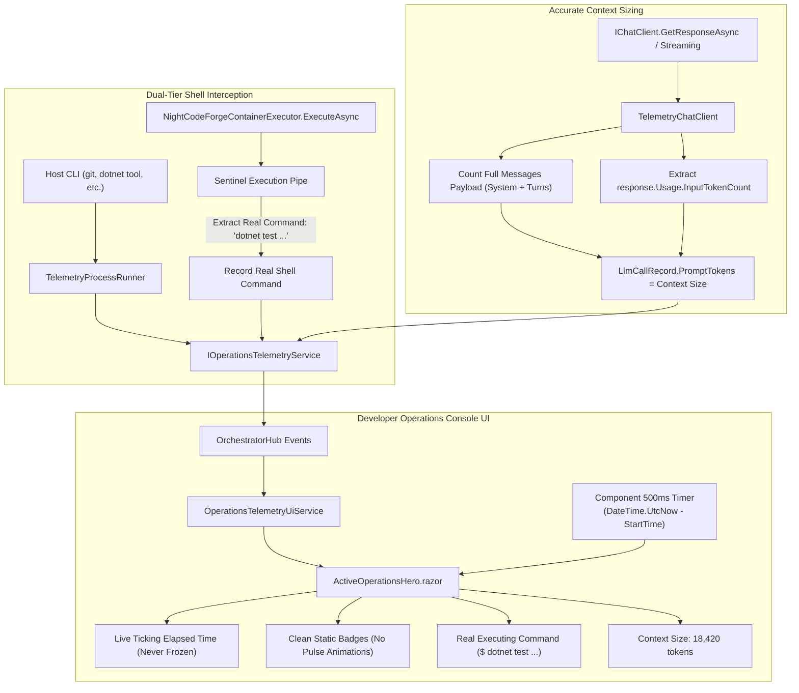

# ⚡ Step 11.20: Live Operations Telemetry Refinement, Command Transparency & Context Sizing

> **Phase 11 Implementation Step (Post-MVP - Observability & Developer Ergonomics)**  
> *Parent Plan:* [Phase 11 Master Plan](../11_EXTEND_FEATURES.md)  
> *Project Target:* `src/NightCodeForge.Agents/Inference`, `src/NightCodeForge.Infrastructure/Execution`, `src/NightCodeForge.Web/Components/Monitoring`, `src/NightCodeForge.Web/Services`, `src/NightCodeForge.Core/Workflow`  
> *Status:* Completed | *Target Framework:* .NET 10 (C# 13)

---

## 1. Executive Summary & Problem Statement

Real-time telemetry in the Developer Operations Console (`/monitoring`) was established in Step 11.18. User feedback from running live tasks on active repositories highlighted four specific operational friction points:

1. **Frozen Elapsed Timer During Large Tool Calls & Long Inference:**
   When an LLM model generates large tool call payloads (e.g. extensive code edits or multi-file replacements) or pauses during deep reasoning, the elapsed time in `ActiveOperationsHero.razor` appears frozen.
   *Root Cause:* The UI displayed `call.DurationMs` directly from the immutable record received over SignalR. Between streaming chunk updates, or if chunk emission slows down during large JSON buffer formatting, `call.DurationMs` remains static. The UI lacked an active ticker computing elapsed time against `DateTime.UtcNow - call.StartTime`.
   *Resolution:* Add an active 500ms ticking timer in `ActiveOperationsHero.razor` that computes live elapsed duration from `StartTime` whenever an operation is in `Running` status, ensuring smooth, non-frozen time display.

2. **Subpar Badging Animations:**
   The `● Inferring` and `● Executing` badges utilized a distracting `animation: pulse 1.8s infinite` CSS rule that users found visually unappealing.
   *Resolution:* Remove the pulsing CSS animations across `ActiveOperationsHero.razor` in favor of crisp, clean, static badges with color-coded dot indicators.

3. **Masked Commands Behind Container Shell Wrappers:**
   In the active operations card, developers see:
   `$ wsl.exe -d Ubuntu -- docker exec -i ncf-sandbox-1-task-1 bash --noprofile --norc`
   instead of the actual command running (e.g. `dotnet test --filter Category!=Acceptance`, `git diff`, `npm run build`).
   *Root Cause:* `NightCodeForgeContainerExecutor` maintains a persistent interactive shell session to avoid container spawn overhead on every command. Because `TelemetryProcessRunner` intercepts process creation, it captured the long-running outer `wsl.exe ... docker exec` wrapper. Individual commands dispatched through `_stdin.WriteLineAsync(...)` bypass `IProcessRunner.Run` and were never recorded to `IOperationsTelemetryService`.
   *Resolution:* Instrument `NightCodeForgeContainerExecutor.ExecuteAsync` to record each individual command directly to `IOperationsTelemetryService` with the clean command string and container working directory, completing it when the command sentinel returns. Suppress persistent interactive wrapper sessions from the hero card.

4. **Missing Context Size Visibility:**
   While completion tokens and generation speeds are tracked, developers cannot see the input context size (prompt tokens). Furthermore, `TelemetryChatClient` was calculating `promptTokens` solely from a 500-character truncated preview of the last user message, producing drastically inaccurate context size metrics (e.g., reporting 40 tokens for a 32,000-token prompt).
   *Resolution:* Accurately compute input tokens across the entire `chatMessages` payload (system instructions, user turns, and tool history), capture `response.Usage.InputTokenCount` when available, and display context size prominently across `ActiveOperationsHero`, `LlmCallsHistoryTable`, and `InferenceInspectionModal`.

---

## 2. Architecture & Data Flow



---

## 3. Detailed Specifications

### 3.1 Live Elapsed Timer in Active Operations Hero

1. **Update [ActiveOperationsHero.razor](file:///c:/Users/Julien/source/repos/jetelain/NightCodeForge/src/NightCodeForge.Web/Components/Monitoring/ActiveOperationsHero.razor):**
   - Introduce a local `System.Threading.PeriodicTimer` or `System.Timers.Timer` running at 500ms intervals when either `TelemetryUi.ActiveLlmCall != null` or `TelemetryUi.ActiveShellCommand != null`.
   - In the Razor markup, compute elapsed time dynamically:
     ```csharp
     private string GetLlmElapsed(LlmCallRecord call)
     {
         if (call.Status == LlmCallStatus.Running)
         {
             var elapsed = (DateTime.UtcNow - call.StartTime).TotalMilliseconds;
             return OperationsTelemetryUiService.FormatDuration(Math.Max(elapsed, call.DurationMs));
         }
         return OperationsTelemetryUiService.FormatDuration(call.DurationMs);
     }
     ```
   - Perform the equivalent calculation for active shell commands:
     ```csharp
     private string GetShellElapsed(ShellCommandRecord cmd)
     {
         if (cmd.Status == ShellCommandStatus.Running)
         {
             var elapsed = (DateTime.UtcNow - cmd.StartTime).TotalMilliseconds;
             return OperationsTelemetryUiService.FormatDuration(Math.Max(elapsed, cmd.DurationMs));
         }
         return OperationsTelemetryUiService.FormatDuration(cmd.DurationMs);
     }
     ```
   - Automatically dispose the timer in `Dispose()` to prevent memory leaks.

2. **Remove Pulse Animations:**
   - In `ActiveOperationsHero.razor`, update badges:
     ```razor
     <!-- Old -->
     <span class="forge-badge badge-amber" style="animation: pulse 1.8s infinite; font-size: 0.78rem;">
         ● Inferring
     </span>

     <!-- New: Clean static badge -->
     <span class="forge-badge badge-amber" style="font-size: 0.78rem; font-weight: 600;">
         ● Inferring
     </span>
     ```
   - Apply the same static styling to the `● Executing` badge for shell commands.

### 3.2 Real Container Command Transparency

1. **Instrument [NightCodeForgeContainerExecutor.cs](file:///c:/Users/Julien/source/repos/jetelain/NightCodeForge/src/NightCodeForge.Infrastructure/Execution/NightCodeForgeContainerExecutor.cs):**
   - Inject `IOperationsTelemetryService?` into `NightCodeForgeContainerExecutor`.
   - In `ExecuteAsync`:
     - Clean command string: sanitize carriage returns and extract clean command line.
     - Generate unique `commandId = Guid.NewGuid().ToString("N")`.
     - Record command start:
       ```csharp
       var record = new ShellCommandRecord(
           CommandId: commandId,
           CommandLine: cleanCommand,
           WorkingDirectory: workDir,
           StartTime: DateTime.UtcNow,
           DurationMs: 0,
           ExitCode: null,
           Status: ShellCommandStatus.Running,
           OutputPreview: null,
           ErrorPreview: null);
       
       _telemetryService?.RecordShellCommandStarted(record);
       ```
     - Upon receiving the sentinel exit code or timing out, record completion:
       ```csharp
       var completedRecord = record with
       {
           DurationMs = stopwatch.Elapsed.TotalMilliseconds,
           ExitCode = exitCode,
           OutputPreview = output.GetFormattedString(),
           Status = exitCode == 0 ? ShellCommandStatus.Completed : ShellCommandStatus.Failed
       };
       _telemetryService?.RecordShellCommandCompleted(completedRecord);
       ```

2. **Filter Persistent Interactive Shell Sessions:**
   - In `TelemetryProcessRunner`:
     - If `spec.ArgumentList` contains `["bash", "--noprofile", "--norc"]` and is spawned via `StartSession`, tag the record as internal infrastructure or suppress broadcasting to `ActiveShellCommand`.
     - This ensures only real developer operations (`dotnet build`, `dotnet test`, `git`, etc.) populate the active operations hero card.

### 3.3 Accurate Context Size Sizing & Display

1. **Update [TelemetryChatClient.cs](file:///c:/Users/Julien/source/repos/jetelain/NightCodeForge/src/NightCodeForge.Agents/Inference/TelemetryChatClient.cs):**
   - Implement `EstimateTotalContextTokens(IEnumerable<ChatMessage> messages)`:
     - Iterate through all messages (system directives, user queries, assistant responses, tool call results).
     - Sum the estimated token count of all text contents, tool call names, arguments, and result payloads.
   - Set initial `PromptTokens` in `runningRecord` to this total token estimate.
   - When response completes:
     - If `response.Usage?.InputTokenCount` is present and $> 0$, use `response.Usage.InputTokenCount.Value` as authoritative `PromptTokens`.
     - Otherwise, keep the total estimated tokens across the input messages.

2. **Display Context Size in Telemetry UI:**
   - **ActiveOperationsHero.razor:**
     - Add Context Size to the metrics strip:
       ```razor
       <span title="Context Size (Prompt Tokens)">Context: <strong style="color: var(--text-primary);">@call.PromptTokens tokens</strong></span>
       ```
   - **LlmCallsHistoryTable.razor:**
     - Rename the column header from `Tokens (P / C)` to `Tokens (Context / Output)`.
     - Add tooltip clarifying that the first value represents the full prompt context size sent to the model.
   - **InferenceInspectionModal.razor:**
     - Display `Context Window Size: @Call.PromptTokens tokens` alongside generation speed and duration.

---

## 4. Verification & Testing Strategy

1. **Unit & Integration Tests:**
   - `TelemetryChatClientTests`: Verify that a multi-turn conversation with 5 messages calculates prompt tokens over all messages, not just the last message preview.
   - `NightCodeForgeContainerExecutorTests`: Verify that `ExecuteAsync` calls `RecordShellCommandStarted` and `RecordShellCommandCompleted` with the actual command string (e.g. `dotnet build`).
   - `ActiveOperationsHeroTests`: Verify that timer ticks update the displayed elapsed time without freezing.

2. **Manual Acceptance:**
   - Run a long agentic task (e.g. implementation stage with multi-file edits).
   - Observe `/monitoring`:
     - Confirm the elapsed timer advances continuously every second even during large tool generation.
     - Confirm the `Inferring` and `Executing` badges are clean without pulsating effects.
     - Confirm the shell operation card displays the real command (`dotnet build`, `dotnet test`) rather than `wsl.exe ... docker exec`.
     - Confirm Context Size shows the true context length (e.g. 8k-32k tokens).

---

## 5. Implementation Summary & Verification Results

### 5.1 Components Modified

1. **`ActiveOperationsHero.razor` & `OperationsTelemetryUiService.cs`:**
   - Added a live 500ms `PeriodicTimer` ticker in [ActiveOperationsHero.razor](file:///c:/Users/Julien/source/repos/jetelain/NightCodeForge/src/NightCodeForge.Web/Components/Monitoring/ActiveOperationsHero.razor) triggering UI updates whenever an active LLM call or shell command is running.
   - Implemented `FormatLiveLlmDuration` and `FormatLiveShellDuration` in [OperationsTelemetryUiService.cs](file:///c:/Users/Julien/source/repos/jetelain/NightCodeForge/src/NightCodeForge.Web/Services/OperationsTelemetryUiService.cs), calculating live elapsed time against `DateTime.UtcNow - StartTime` so elapsed time never freezes during long tool execution or stream pauses.
   - Added component disposal protections (`_isDisposed` flag and `ObjectDisposedException` / `OperationCanceledException` guards) to prevent exceptions on teardown.
   - Removed distracting `animation: pulse` badge effects in favor of clean static status badges.

2. **`NightCodeForgeContainerExecutor.cs` & `TelemetryProcessRunner.cs`:**
   - Injected `IOperationsTelemetryService` into [NightCodeForgeContainerExecutor.cs](file:///c:/Users/Julien/source/repos/jetelain/NightCodeForge/src/NightCodeForge.Infrastructure/Execution/NightCodeForgeContainerExecutor.cs).
   - In `ExecuteAsync`: generates a distinct `commandId`, sanitizes the command line, records `RecordShellCommandStarted`, and streams output lines via `UpdateShellCommandOutput`.
   - Enclosed stdin write and sentinel polling operations within a guarded `try/catch` block: broken stdin pipes or process write errors automatically record a `Failed` command record (`ExitCode = -1`), preventing orphaned "Running" commands in the console.
   - Logged exceptions explicitly during SIGINT timeout recovery before restarting the shell.
   - In [TelemetryProcessRunner.cs](file:///c:/Users/Julien/source/repos/jetelain/NightCodeForge/src/NightCodeForge.Infrastructure/Execution/TelemetryProcessRunner.cs), filtered persistent interactive container shell wrapper sessions (`bash --noprofile --norc`) via discrete CLI argument token inspection (`IsPersistentInteractiveShellSession`), ensuring background container wrappers do not mask developer commands.

3. **`TelemetryChatClient.cs` & Context Window Presentation:**
   - Implemented `EstimateTotalContextTokens` in [TelemetryChatClient.cs](file:///c:/Users/Julien/source/repos/jetelain/NightCodeForge/src/NightCodeForge.Agents/Inference/TelemetryChatClient.cs), computing input context tokens across the entire conversation history (system instructions, user turns, assistant reasoning, tool calls, and tool outputs).
   - Prioritized `message.Contents` over `message.Text` to prevent double-counting text content.
   - Promoted authoritative input token usage from `ChatResponse.Usage.InputTokenCount` (and streaming `UsageContent`) whenever reported by the backend provider.
   - Updated [LlmCallsHistoryTable.razor](file:///c:/Users/Julien/source/repos/jetelain/NightCodeForge/src/NightCodeForge.Web/Components/Monitoring/LlmCallsHistoryTable.razor) (`Tokens (Context / Output)`) and [InferenceInspectionModal.razor](file:///c:/Users/Julien/source/repos/jetelain/NightCodeForge/src/NightCodeForge.Web/Components/Monitoring/InferenceInspectionModal.razor) (`Context Window Size`) with clear tooltips and badges.

### 5.2 Test Coverage & Verification

| Test Suite | Tests Added / Updated | Result |
| :--- | :--- | :--- |
| **`TelemetryChatClientTests`** | `EstimateTotalContextTokens_AccountsForFullContextTurnsAndToolPayloads`<br/>`EstimateTotalContextTokens_DoesNotDoubleCountTextContentAndMessageText`<br/>`GetResponseAsync_SetsInitialPromptTokensFromFullContext_AndPrefersAuthoritativeUsage` | ✅ Passed |
| **`ContainerReplExecutorTests`** | `ContainerExecutor_ExecuteAsync_RecordsShellCommandTelemetry`<br/>`ContainerExecutor_ExecuteAsync_WhenStdinWriteFails_MarksShellCommandFailedAndRethrows` | ✅ Passed |
| **`TelemetryProcessRunnerTests`** | `StartSession_WhenPersistentShellSession_BypassesTelemetry`<br/>`StartSession_WhenOrdinaryBashCommand_DoesNotBypassTelemetry` | ✅ Passed |
| **`MonitoringPageTests`** | `ActiveOperationsHero_RendersDynamicLiveElapsedDuration`<br/>`InferenceInspectionModal_RendersContextWindowSizeAndTooltips` | ✅ Passed |

- **Unit & Integration Suite (`dotnet test --filter "Category!=Acceptance&Category!=E2E"`):** 1,633 passing tests (0 failures).
- **Full Solution Suite (`dotnet test`):** 1,636 passing tests (0 failures).
