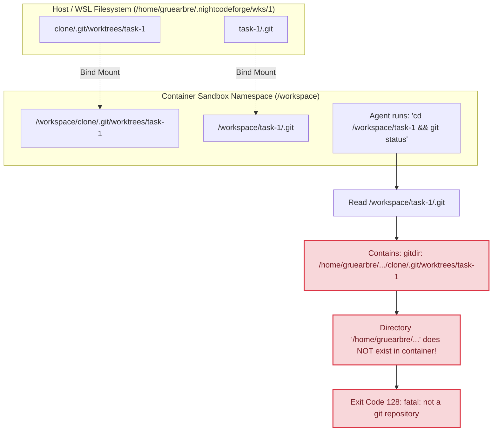
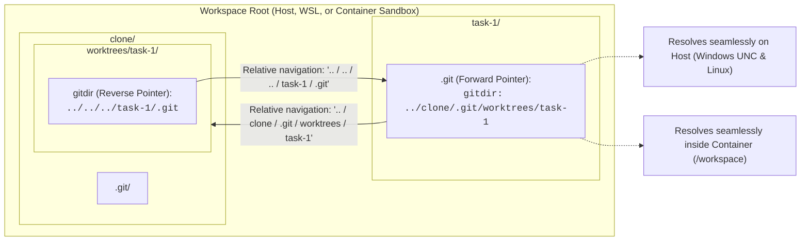
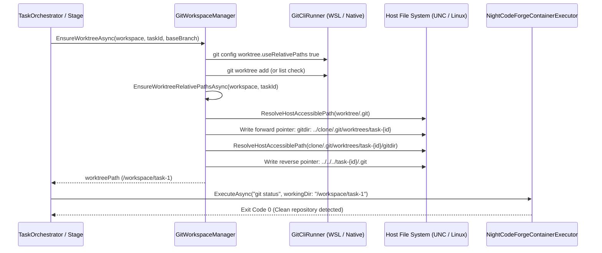

# 🌳 Step 11.22: Container Git Worktree Relative Paths & Cross-Environment Portability

> **Phase 11 Implementation Step (Post-MVP - Git Subsystem & Container Runtime Robustness)**  
> *Parent Plan:* [Phase 11 Master Plan](../11_EXTEND_FEATURES.md)  
> *Project Target:* `src/NightCodeForge.Infrastructure/Git`, `src/NightCodeForge.Core/Interfaces`, `src/NightCodeForge.Infrastructure/Execution`, `src/NightCodeForge.Core/Services`, `tests/NightCodeForge.Infrastructure.Tests/Git`  
> *Status:* Complete | *Target Framework:* .NET 10 (C# 13)

---

## 1. Executive Summary & Problem Statement

During real-world agent execution within the Docker container sandbox (`ContainerSandbox`), agents encountered immediate Git command failures upon attempting to inspect or modify task branches:

```bash
🔧 bash TOOL_CALL
Arguments (Payload):
{"command":"cd /workspace/task-1 && git status 2>&1 | head -20; git branch -a 2>&1 | head; git log --oneline -3 2>&1"}

Output / Result:
Exit Code: 128
fatal: not a git repository: /home/gruearbre/.nightcodeforge/wks/1/clone/.git/worktrees/task-1
fatal: not a git repository: /home/gruearbre/.nightcodeforge/wks/1/clone/.git/worktrees/task-1
fatal: not a git repository: /home/gruearbre/.nightcodeforge/wks/1/clone/.git/worktrees/task-1
```

### 1.1 Root Cause Analysis

1. **Container Namespace Boundary vs. Absolute Git Worktree Pointers:**
   - In NightCodeForge's architecture, the workspace root on the host or WSL (e.g. `/home/gruearbre/.nightcodeforge/wks/1`) contains sibling directories:
     - `/home/gruearbre/.nightcodeforge/wks/1/clone` (the canonical Git clone)
     - `/home/gruearbre/.nightcodeforge/wks/1/task-1` (the isolated Git worktree for ForgeTask #1)
   - When [NightCodeForgeContainerExecutor.cs](file:///c:/Users/Julien/source/repos/jetelain/NightCodeForge/src/NightCodeForge.Infrastructure/Execution/NightCodeForgeContainerExecutor.cs) starts the sandbox container, it bind-mounts this root directory to `/workspace`. Inside the container:
     - `/workspace/clone` maps to `.../wks/1/clone`
     - `/workspace/task-1` maps to `.../wks/1/task-1`
   - By default, standard `git worktree add` writes an **absolute** filesystem path into the worktree's `.git` file:
     ```
     gitdir: /home/gruearbre/.nightcodeforge/wks/1/clone/.git/worktrees/task-1
     ```
   - Inside the container sandbox, the host path `/home/gruearbre/...` **does not exist**. When the agent runs `git status` or any git command inside `/workspace/task-1`, Git attempts to read the path in `.git`, fails to find the directory, and aborts with `Exit Code 128: fatal: not a git repository`.

2. **Silently Skipped Normalization Due to Windows vs. WSL UNC Path Mismatch:**
   - An earlier attempt to make the `.git` pointer relative existed in [GitWorkspaceManager.cs](file:///c:/Users/Julien/source/repos/jetelain/NightCodeForge/src/NightCodeForge.Infrastructure/Git/GitWorkspaceManager.cs):
     ```csharp
     var gitFile = Path.Combine(worktreePath, ".git");
     if (File.Exists(gitFile))
     {
         ...
         await File.WriteAllTextAsync(gitFile, $"gitdir: {targetGitDir}\n", cancellationToken);
     }
     ```
   - When running on Windows with a WSL target, `worktreePath` is a POSIX path (`/home/gruearbre/.nightcodeforge/wks/1/task-1`).
   - In .NET running on Windows, `Path.Combine(worktreePath, ".git")` evaluates to `\home\gruearbre\.nightcodeforge\wks\1\task-1\.git`.
   - `File.Exists` evaluates against the local Windows drive root (`C:\home\...`), which does not exist!
   - Because `gitFile` was never converted via `ResolveHostAccessiblePath` to a Windows UNC path (`\\wsl.localhost\Ubuntu\home\...`), `File.Exists(gitFile)` evaluated to `false`, and the pointer rewriting was silently skipped on Windows!

3. **Omission of the Reverse Git Worktree Pointer (`gitdir` in Clone):**
   - Git worktrees maintain a **bidirectional link**:
     - Forward pointer: `<worktree>/.git` $\rightarrow$ points to `<canonicalClone>/.git/worktrees/<task-name>`
     - Reverse pointer: `<canonicalClone>/.git/worktrees/<task-name>/gitdir` $\rightarrow$ points back to `<worktree>/.git`
   - When the reverse pointer contains an absolute host path, Git administrative commands (`git worktree list`, `git worktree prune`, `git status`) executed inside the container consider the worktree broken or prunable. Both pointers must be strictly relative.

4. **Early Return Bypassing Existing Worktrees:**
   - In `EnsureWorktreeAsync`, if `git worktree list --porcelain` showed the worktree was already registered (`isWorktreeRegistered == true`), the method returned immediately without verifying or repairing the `.git` pointer. Any worktrees created prior to the fix or across restarts remained broken.

5. **Modern Git Native Setting (`worktree.useRelativePaths`):**
   - Git 2.42+ introduced `worktree.useRelativePaths = true`. Enabling this on the repository ensures that subsequent native Git operations maintain relative paths automatically.

---

## 2. Architecture & Data Flow

### 2.1 The Broken State: Absolute Path Crossing Namespace Boundary



### 2.2 The Resolved State: Bidirectional Relative Worktree Resolution



### 2.3 Worktree Creation & Relative Normalization Lifecycle



---

## 3. Detailed Specifications

### 3.1 Bidirectional Relative Worktree Pointer Normalization

1. **Forward Pointer Normalization (`<worktree>/.git`):**
   - The `.git` file in `<worktree>` must be a single-line pointer ending with a newline:
     ```text
     gitdir: ../{cloneDirName}/.git/worktrees/task-{taskId}
     ```
     (or `gitdir: ../.git/worktrees/task-{taskId}` when using child worktree layout).
   - This ensures that whether accessed from the host path (`/home/user/.../wks/1/task-1`) or inside the container (`/workspace/task-1`), the relative traversal `../clone` reliably reaches the clone directory.

2. **Reverse Pointer Normalization (`<canonicalClone>/.git/worktrees/task-{taskId}/gitdir`):**
   - The `gitdir` file in the clone's worktree administrative folder must contain a relative path back to the worktree's `.git` file:
     ```text
     ../../../task-{taskId}/.git
     ```
     - `..` (from `task-{taskId}`) points to `.git/worktrees/`
     - `../..` points to `.git/`
     - `../../..` points to `clone/`
     - `../../../task-{taskId}/.git` points to the task worktree `.git` file.
   - For child layout (`<canonical>/task-{taskId}`), the relative path must be `../../task-{taskId}/.git`.
   - This ensures Git commands run in the clone (`git worktree list`, `git status`, `git commit`) do not fail or prune active worktrees.

3. **Cross-Platform Host-Accessible Path Resolution:**
   - All file operations on `.git` pointers must resolve host-accessible paths using `ResolveHostAccessiblePath` in [GitWorkspaceManager.cs](file:///c:/Users/Julien/source/repos/jetelain/NightCodeForge/src/NightCodeForge.Infrastructure/Git/GitWorkspaceManager.cs):
     ```csharp
     private string ResolveHostAccessiblePath(string path)
     {
         if (string.IsNullOrWhiteSpace(path)) return path;
         if (RuntimeInformation.IsOSPlatform(OSPlatform.Windows) && (path.StartsWith('/') || path.StartsWith('~')))
         {
             var distro = _wslMetadataService.GetDefaultDistributionName();
             var user = _wslMetadataService.GetDefaultUserName();
             return WslPathConverter.ToWslUncPath(path, distro, user);
         }
         return path;
     }
     ```
   - Before reading or writing `<worktree>/.git` or `<canonicalClone>/.git/worktrees/...`, wrap the path with `ResolveHostAccessiblePath`. On Windows, this turns POSIX paths like `/home/gruearbre/.nightcodeforge/...` into accessible Windows UNC paths (`\\wsl.localhost\Ubuntu\home\gruearbre\...`), allowing `File.Exists` and `File.WriteAllTextAsync` to succeed.

4. **Idempotency & Unconditional Normalization:**
   - In `GitWorkspaceManager.EnsureWorktreeAsync`:
     - If the worktree is already registered (`isWorktreeRegistered == true`), do **not** return early before verifying relative pointers.
     - Always invoke the relative path normalization logic before returning `worktreePath`.
     - Clear file read-only attributes with `File.SetAttributes(..., FileAttributes.Normal)` prior to rewriting to prevent `UnauthorizedAccessException`.

5. **Native Git `worktree.useRelativePaths` Configuration:**
   - In `EnsureWorktreeAsync`, configure Git to use relative paths natively:
     ```csharp
     try
     {
         await _gitCliRunner.ExecuteAsync(canonicalPath, ["config", "worktree.useRelativePaths", "true"], cancellationToken: cancellationToken);
     }
     catch (Exception ex)
     {
         _logger.LogDebug(ex, "Setting worktree.useRelativePaths in '{CanonicalPath}' ignored", canonicalPath);
     }
     ```

### 3.2 Dedicated Public API on `IGitWorkspaceManager`

Add a dedicated method to [IGitWorkspaceManager.cs](file:///c:/Users/Julien/source/repos/jetelain/NightCodeForge/src/NightCodeForge.Core/Interfaces/IGitWorkspaceManager.cs) and implement in [GitWorkspaceManager.cs](file:///c:/Users/Julien/source/repos/jetelain/NightCodeForge/src/NightCodeForge.Infrastructure/Git/GitWorkspaceManager.cs):

```csharp
/// <summary>
/// Verifies and enforces that both the worktree .git pointer and the canonical clone worktree gitdir
/// use bidirectional relative paths, ensuring portability across host, WSL, and Docker containers.
/// </summary>
/// <param name="workspace">The workspace owning the repository.</param>
/// <param name="taskId">The task ID identifying the worktree.</param>
/// <param name="cancellationToken">Cancellation token.</param>
Task EnsureWorktreeRelativePathsAsync(Workspace workspace, int taskId, CancellationToken cancellationToken = default);
```

### 3.3 Container Pre-Flight Verification & Execution Environment Alignment

1. **Update [ExecutionEnvironmentProvider.cs](file:///c:/Users/Julien/source/repos/jetelain/NightCodeForge/src/NightCodeForge.Infrastructure/Execution/ExecutionEnvironmentProvider.cs):**
   - When provisioning an execution environment for a specific task (`effectiveTaskId.HasValue`), ensure `EnsureWorktreeRelativePathsAsync` has been applied to the target worktree before the container executor begins command execution.

2. **Container Shell Session Safe Directory Policy:**
   - In [NightCodeForgeContainerExecutor.cs](file:///c:/Users/Julien/source/repos/jetelain/NightCodeForge/src/NightCodeForge.Infrastructure/Execution/NightCodeForgeContainerExecutor.cs), ensure that the persistent interactive shell exports:
     ```csharp
     await _stdin!.WriteLineAsync("git config --global --add safe.directory '*' 2>/dev/null || true");
     ```
     so that Git does not refuse repository operations due to differing file ownership between the host and container user namespaces.

### 3.4 Startup Recovery & Legacy Worktree Migration

In [StartupRecoveryService.cs](file:///c:/Users/Julien/source/repos/jetelain/NightCodeForge/src/NightCodeForge.Core/Services/StartupRecoveryService.cs):
- When inspecting active task worktrees during startup recovery, call `EnsureWorktreeRelativePathsAsync` on each active worktree.
- If an existing worktree has an absolute `gitdir:` containing `/home/...` or a host path, it will be automatically migrated to a relative path on application startup, self-healing legacy workspaces without manual developer intervention.

---

## 4. Verification & Testing Strategy

### 4.1 Unit Tests (`NightCodeForge.Infrastructure.Tests/Git/GitWorkspaceManagerTests.cs`)

1. **`EnsureWorktreeAsync_WritesRelativeForwardGitdir`:**
   - Verify that after `EnsureWorktreeAsync`, `<worktree>/.git` contains `gitdir: ../{clone}/.git/worktrees/task-{id}\n`.
   - Verify that the path starts with `../` and does **not** contain any absolute drive or root path.

2. **`EnsureWorktreeAsync_WritesRelativeReverseGitdir`:**
   - Verify that `<canonical>/.git/worktrees/task-{id}/gitdir` contains `../../../task-{id}/.git\n`.
   - Verify that Git commands executed from both the clone and the worktree succeed.

3. **`EnsureWorktreeAsync_WhenAlreadyRegisteredWithAbsolutePointer_MigratesToRelative`:**
   - Seed a worktree where `.git` contains a synthetic absolute path (`gitdir: /synthetic/abs/path/clone/.git/worktrees/task-1`).
   - Call `EnsureWorktreeAsync` (or `EnsureWorktreeRelativePathsAsync`).
   - Assert that the absolute path was replaced with the relative path.

4. **`EnsureWorktreeRelativePathsAsync_HandlesWslUncPathsOnWindows`:**
   - On Windows, verify that paths starting with `/home/...` or `~/.nightcodeforge/...` are converted via `WslPathConverter.ToWslUncPath` and written successfully without throwing `DirectoryNotFoundException` or `FileNotFoundException`.

5. **`GitCommands_SucceedInWorktreeWithRelativePointers`:**
   - In the created worktree, execute:
     - `git status --porcelain` $\rightarrow$ Exit Code 0
     - `git branch -a` $\rightarrow$ Exit Code 0
     - `git log -1` $\rightarrow$ Exit Code 0
   - Confirm zero `fatal: not a git repository` errors.

### 4.2 Manual Acceptance & End-to-End Verification

1. Start an agent execution session on an active task in an Ext4 mirror workspace on Windows with WSL and Docker.
2. Observe the agent running commands in the container sandbox:
   ```bash
   cd /workspace/task-1 && git status
   ```
3. Verify that the command executes cleanly with Exit Code 0, reporting branch `feature/task-1` without error code 128.
4. Verify that running `git worktree list` from both WSL and the container lists the worktree in good health.
