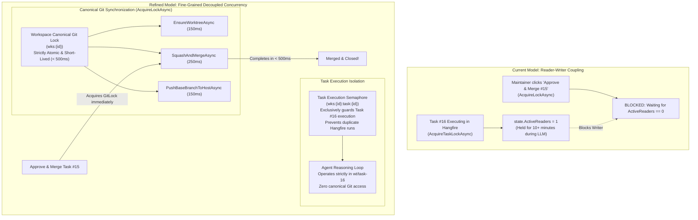

# 🔒 Step 11.24: Fine-Grained Workspace Concurrency & Non-Blocking Git Merge Operations

> **Phase 11 Implementation Step (Post-MVP - Concurrency & Git Subsystem Refinement)**  
> *Parent Plan:* [Phase 11 Master Plan](../11_EXTEND_FEATURES.md)  
> *Project Target:* `src/NightCodeForge.Core`, `src/NightCodeForge.Web`, `tests/NightCodeForge.Core.Tests`, `tests/NightCodeForge.Web.Tests`  
> *Status:* Completed | *Target Framework:* .NET 10 (C# 13)

---

## 1. Executive Summary & Problem Statement

In the live Review Room, when a maintainer approves and squash-merges a task (`🚀 Approve & Merge ForgeTask #15`), the modal spins indefinitely on "Squashing & Merging...". Investigating the **Dev-Queue & Concurrency Operations** dashboard reveals that the operation is waiting for a workspace lock held by an actively running background task.

### 1.1 Root Cause Analysis

1. **Over-Scoped Task Reader Lock:**
   - In Step 9.14, [`WorkspaceLockProvider`](file:///c:/Users/Julien/source/repos/jetelain/NightCodeForge/src/NightCodeForge.Core/Concurrency/WorkspaceLockProvider.cs) introduced a Reader-Writer lock hierarchy where `AcquireTaskLockAsync(workspaceId, taskId)` acquires a shared reader lock on the workspace (`state.ActiveReaders++`) alongside an exclusive semaphore on `taskId`.
   - In [`TaskOrchestrator.ProcessTaskAsync`](file:///c:/Users/Julien/source/repos/jetelain/NightCodeForge/src/NightCodeForge.Core/Workflow/TaskOrchestrator.cs#L116), `using var lockReleaser = await _workspaceLockProvider.AcquireTaskLockAsync(...)` was placed at the very top of the method (line 116) and kept in scope until line 1244.
   - Consequently, `state.ActiveReaders` remains $> 0$ for the **entire duration** of the task execution — spanning multi-turn LLM prompts, token generation on local GPUs / cloud, tool execution, compilation, and test suites (often 2–15+ minutes).

2. **Writer Starvation in Squash & Merge:**
   - In [`TaskOrchestrator.CompleteTaskAndCascadeAsync`](file:///c:/Users/Julien/source/repos/jetelain/NightCodeForge/src/NightCodeForge.Core/Workflow/TaskOrchestrator.cs#L1660), squash-merges acquire an exclusive workspace lock via `await _workspaceLockProvider.AcquireLockAsync(task.WorkspaceId)`.
   - In `WorkspaceLockProvider.cs`, `AcquireLockAsync` strictly blocks whenever `state.ActiveReaders > 0`.
   - As a result, a completed task sitting in the Review Room cannot be merged while *any* other task on that workspace is executing in Hangfire. The maintainer is forced to wait minutes for unrelated LLM generation to complete or invoke Emergency Release.

3. **Architectural Realignment (Isolated Worktrees vs. Canonical Clone):**
   - As documented in [`docs/ARCHITECTURE.md#L800-L840`](file:///c:/Users/Julien/source/repos/jetelain/NightCodeForge/docs/ARCHITECTURE.md#L800-L840), tasks execute in **isolated Git worktrees** (`wt/task-{id}`) on separate feature branches (`feature/task-{id}`).
   - During the agentic reasoning loop, the LLM tools (`read_file`, `edit_file`, `run_command`) touch *only* the task's isolated worktree directory. The agent never executes Git commands on the canonical repository (`RepositoryPath` or `Ext4MirrorPath`) and never mutates `main`/`master`.
   - The only operations that touch the shared canonical clone are strictly short-lived Git operations:
     - Worktree creation / setup (`EnsureWorktreeAsync`: ~100–200ms)
     - Squash-and-merge (`SquashAndMergeAsync`: ~200–400ms)
     - Mirror sync push/pull (`PushBaseBranchToHostAsync`, `PullFromHostAsync`: ~100–300ms)
     - Task markdown file archiving (`ArchiveOrCleanupTaskFileAsync`: ~10–20ms)
   - Therefore, the long-running task execution loop should **never** hold a shared workspace lock that blocks canonical Git merges.

---

## 2. Architecture & Data Flow

---

## 3. Detailed Specifications

### 3.1 `WorkspaceLockProvider` Concurrency Refinement

1. **Decouple Task Execution from Workspace Reader Count:**
   - In `WorkspaceLockProvider`:
     - `AcquireTaskLockAsync(workspaceId, taskId)` acquires exclusive execution rights on `(workspaceId, taskId)` via the task semaphore (`taskSem`), tracking it in `state.ActiveTaskLocks`.
     - `AcquireTaskLockAsync` does **not** increment `state.ActiveReaders` on the workspace, eliminating the blockage of `AcquireLockAsync`.
     - `TryAcquireTaskLock` and `TryAcquireTaskLockAsync` similarly manage `taskSem` without requiring `WriterActive == false`.
   - In `ActiveLockSnapshot`:
     - Running tasks continue to be reported in `GetActiveLocks()` as `Task-Exclusive` locks (`Workspace #X, ForgeTask #Y, Duration Held: MM:SS`), maintaining full observability in the Dev-Queue console.
     - `EmergencyRelease(workspaceId, taskId)` continues to safely release the task lock.

2. **Maintain Strict Workspace Mutual Exclusion for Canonical Operations:**
   - `AcquireLockAsync(workspaceId)` remains an exclusive lock across the canonical workspace, serializing all canonical Git and mirror operations (`SquashAndMergeAsync`, `EnsureWorktreeAsync`, `RemoveWorktreeAsync`, `PushBaseBranchToHostAsync`, `PullFromHostAsync`).
   - If two Git operations on the canonical clone attempt to run simultaneously (e.g. worktree checkout during startup and squash-merge in Review Room), one waits milliseconds for the other, guaranteeing zero `.git/index.lock` collisions.

### 3.2 `TaskOrchestrator` Lock Scoping

1. **Task Execution Lifecycle:**
   - `ProcessTaskAsync` retains `using var lockReleaser = await _workspaceLockProvider.AcquireTaskLockAsync(...)` across its execution. This ensures that duplicate Hangfire jobs or user submissions for the *same* task cannot execute concurrently.
   - Because `AcquireTaskLockAsync` no longer blocks `AcquireLockAsync`, `ProcessTaskAsync` can run for hours of LLM reasoning without impeding maintainer review room merges.

2. **Canonical Git Operations Synchronization:**
   - In `ProcessTaskAsync`, worktree checkout (`CheckoutTaskBranchAsync`) touches the canonical clone. Wrap `CheckoutTaskBranchAsync` (and ext4 mirror pull) with `await _workspaceLockProvider.AcquireLockAsync(task.WorkspaceId)` so worktree creation is atomic on the canonical repo.
   - In `CompleteTaskAndCascadeAsync`, `using var lockReleaser = await _workspaceLockProvider.AcquireLockAsync(task.WorkspaceId)` acquires the workspace lock immediately, performs `SquashAndMergeAsync`, pushes the base branch, and releases the lock in $< 500\text{ms}$.

---

## 4. Definition of Done (DoD) Checklist

- [x] `WorkspaceLockProvider`: `AcquireTaskLockAsync` decouples task execution semaphore from workspace reader counter so active tasks do not block `AcquireLockAsync`.
- [x] `ActiveLockSnapshot` and DevQueue dashboard continue to display active task locks with duration held and emergency release.
- [x] Canonical Git operations (`CheckoutTaskBranchAsync`, `SquashAndMergeAsync`, mirror push/pull) are properly serialized on `AcquireLockAsync`.
- [x] Clicking "🚀 Confirm Squash & Merge" in `ApproveMergeModal` completes immediately ($< 500\text{ms}$) even when another task is actively executing in Hangfire.
- [x] Concurrency unit and integration tests updated and passing without flakiness.
- [x] Full test suite passes (`dotnet test`, 1,690 passing tests across all projects).
