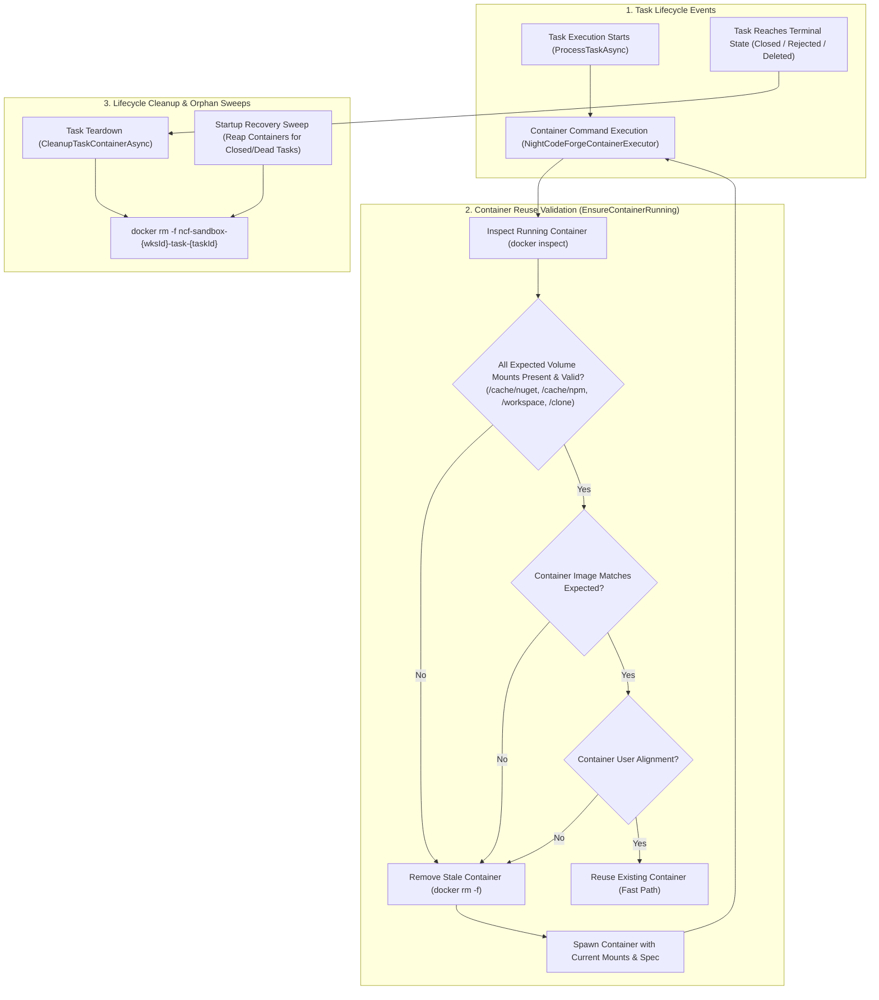

# 🐳 Step 11.26: Container Reuse Validation & Task Lifecycle Sandbox Cleanup

> **Phase 11 Implementation Step (Post-MVP - Execution Sandbox & Container Lifecycle Hardening)**  
> *Parent Plan:* [Phase 11 Master Plan](../11_EXTEND_FEATURES.md)  
> *Project Target:* `src/NightCodeForge.Core`, `src/NightCodeForge.Infrastructure`, `tests/NightCodeForge.Core.Tests`, `tests/NightCodeForge.Infrastructure.Tests`  
> *Status:* Completed | *Target Framework:* .NET 10 (C# 13)

---

## 1. Executive Summary & Problem Statement

NightCodeForge relies on persistent or dynamic container sandboxes (`NightCodeForgeContainerExecutor` in `ContainerSandbox` execution tier) to execute toolchains (`dotnet`, `npm`, `python3`, etc.) in isolated environments with mounted host workspaces and shared package caches.

Investigation of live instance failures and Docker engine state revealed two critical lifecycle vulnerabilities:

1. **Mount & Configuration Staleness in Container Reuse (`EnsureContainerRunning`):**
   - When container configuration evolves (e.g. Step 11.21 relocating package caches to `/cache/*` and enforcing non-root host UID:GID execution), existing long-lived containers created under previous schemas are silently reused without verifying that required mount points or user identities match.
   - `EnsureContainerRunning` previously verified only whether `/workspace` matched the expected source directory and whether `/clone` was present. It ignored missing volume mounts (such as `/cache/nuget`, `/cache/npm`, `/cache/pnpm`, `/cache/uv`, `/cache/m2`), image tag changes, or user identity drift.
   - Consequently, when an existing container created under an older schema was reused, non-root commands (`1000:1000`) attempted to create missing mount points under `/` (e.g., `/cache/nuget`), failing immediately with fatal OS permission errors:
     ```text
     /usr/lib/dotnet/sdk/10.0.113/NuGet.targets(196,5): error : Access to the path '/cache' is denied.
     error : Permission denied [/workspace/task-5/OllamaRouter.slnx]
     ```

2. **Container Leaks across Completed & Terminated Tasks:**
   - Per-task containers (`ncf-sandbox-{workspaceId}-task-{taskId}`) are spawned whenever an agent or deterministic stage executes commands against a task worktree.
   - However, when a task reaches a terminal state (`Closed` after squash-and-merge, `Rejected`, or deleted), only the Git worktree was cleaned up (`RemoveWorktreeAsync`).
   - The associated Docker container remained running indefinitely in the background (`tail -f /dev/null`). On active developer instances, containers created days or weeks prior remain alive in Docker / WSL2, consuming RAM, swap, and container table entries.
   - Furthermore, host reboot / service startup and periodic orphan worktree sweeps lacked any container reconciliation logic to reap abandoned task containers.

---

## 2. Architecture & Container Lifecycle Flow



---

## 3. Detailed Specifications

### 3.1 Comprehensive Container Reuse Validation (`EnsureContainerRunning`)

1. **Volume Mount Drift Detection:**
   - During `EnsureContainerRunning()`, after checking `{{.State.Running}}`, inspect the container's active mount list using Docker inspect:
     `["inspect", "-f", "{{range .Mounts}}{{.Destination}}={{.Source}}={{.RW}};{{end}}", containerName]`
   - Compute the full list of expected volume mounts from `BuildVolumeMounts(options)`.
   - For every expected mount in `BuildVolumeMounts(options)`:
     - The container MUST have a mount whose `Destination` matches `expected.ContainerPath` (case-insensitive for Linux path normalization).
     - The `RW` status MUST match `!expected.IsReadOnly` (e.g. read-only mounts like `/usr/share/dotnet` or `/usr/lib/dotnet` must be `ro` / `RW == false`, and cache mounts must be `rw` / `RW == true`).
   - If any expected mount destination is missing from the container, or its read/write mode is inconsistent, log an explicit warning identifying the exact missing/mismatched mounts:
     `"Recreating container {Container} due to mount drift. Missing/Mismatched: {MissingMounts}"`
     and trigger automatic recreation.

2. **Image & Base Specification Drift Detection:**
   - Inspect the image of the running container via `["inspect", "-f", "{{.Config.Image}}", containerName]`.
   - If the running container's image does not match the configured `options.ContainerImage` (e.g. an old image tag was used when the container was created), log the discrepancy and trigger recreation.

3. **Atomic Re-Creation:**
   - When drift is detected:
     1. Run `docker rm -f {containerName}` with a timeout of 10s.
     2. Call `BuildDockerRunProcessSpec(options)` and spawn a fresh container instance with the exact current mount parameters, user flags, and image.
     3. Proceed with shell process attachment.

---

### 3.2 Task Terminal State Container Teardown

1. **Container Teardown Contract in `IExecutionEnvironmentProvider`:**
   - Add first-class container teardown methods to `IExecutionEnvironmentProvider` and `ExecutionEnvironmentProvider`:
     ```csharp
     Task CleanupTaskContainerAsync(Workspace workspace, int taskId, CancellationToken cancellationToken = default);
     Task CleanupWorkspaceContainersAsync(Workspace workspace, CancellationToken cancellationToken = default);
     ```
   - For a given `(workspace, taskId)`, determine the container name:
     `$"{baseContainerName}-task-{taskId}"` (e.g. `ncf-sandbox-1-task-5`).
   - Execute container removal via the configured process runner:
     `docker rm -f {containerName}` (passing WSL distribution args if `workspace.UseWsl` is true).
   - **Non-Throwing Resilience:** If the container does not exist (exit code 1 with "No such container"), treat as successful teardown. If Docker/WSL reports an error, log a warning without throwing or interrupting the task completion pipeline.

2. **Integration into `TaskOrchestrator` Lifecycle Touchpoints:**
   - **Touchpoint 1: Squash and Merge Completion (`CompleteTaskAndCascadeAsync`):**
     Immediately after `_gitWorkspaceManager.RemoveWorktreeAsync(workspace, task.Id, cancellationToken)` succeeds and the task status transitions to `Closed`, invoke:
     ```csharp
     await _executionEnvironmentProvider.CleanupTaskContainerAsync(workspace, task.Id, cancellationToken);
     ```
   - **Touchpoint 2: Backlog / Review Rejection (`RejectTaskAsync` / `RejectReviewAsync`):**
     When a task is rejected and transitions to `Rejected`, ensure both worktree cleanup (`RemoveWorktreeAsync`) and container cleanup (`CleanupTaskContainerAsync`) are invoked.
   - **Touchpoint 3: Task Deletion / Purge:**
     When a task is permanently removed or discarded, clean up its worktree and container.

---

### 3.3 Startup Recovery & Background Container Reconciliation

1. **Startup Recovery Sweep (`StartupRecoveryService`):**
   - During application startup (`ReconcileWorkspacesAsync` / `RecoverOrphanedTasksAsync`), query active Docker containers with prefix `ncf-sandbox-` using `docker ps --filter "name=ncf-sandbox-" --format "{{.Names}}"`.
   - Parse container names conforming to the pattern `ncf-sandbox-{workspaceId}-task-{taskId}`.
   - Look up the corresponding `ForgeTask` in the database:
     - If the task does not exist, or its status is `Closed` or `Rejected`:
       Reap the orphaned container with `docker rm -f {containerName}`.
       Log: `"Reaped orphaned container {Container} for terminal task #{TaskId} (Status: {Status})."`
     - If the task is `Open`, `Running`, or `Ready`:
       Leave container intact for resumption (its mounts will be validated via Section 3.1 when execution begins).

2. **Periodic Maintenance Sweep (`GitSyncService.SweepOrphanedWorktreesAsync`):**
   - Extend the periodic background sweep that detects orphaned task worktrees to also detect and clean up orphaned task containers whose task is `Closed` or `Rejected`.

---

## 4. Test Strategy & Quality Verification

1. **Unit Tests (`NightCodeForge.Infrastructure.Tests`):**
   - `EnsureContainerRunning_WhenMountsAreMissing_RemovesAndRecreatesContainer`:
     Simulate an existing running container whose `inspect` output lacks `/cache/nuget`. Verify `docker rm -f` is executed followed by `docker run` with updated mounts.
   - `EnsureContainerRunning_WhenMountsMatch_ReusesContainerWithoutRecreation`:
     Verify that when all required mounts (`/workspace`, `/cache/nuget`, etc.) match, no `docker rm` is issued.
   - `EnsureContainerRunning_WhenImageMismatches_RemovesAndRecreatesContainer`:
     Verify container is recreated when the running container's image differs from `options.ContainerImage`.
   - `CleanupTaskContainerAsync_RemovesMatchingTaskContainer`:
     Verify correct `docker rm -f ncf-sandbox-{wksId}-task-{taskId}` argument construction for both native Docker and WSL targets.

2. **Integration Tests (`NightCodeForge.Core.Tests`):**
   - `CompleteTaskAndCascadeAsync_OnTerminalSuccess_InvokesContainerCleanup`:
     Verify that completing a task triggers `CleanupTaskContainerAsync`.
   - `StartupRecoveryService_ReapsContainersForClosedAndMissingTasks`:
     Verify startup reconciliation purges containers belonging to closed/rejected tasks while preserving active tasks.

---

## 5. Implementation Roadmap & Deliverables

- [x] **Step 1:** Enhance `NightCodeForgeContainerExecutor.EnsureContainerRunning` to parse full mount destinations and RW modes, adding complete mount and image mismatch validation.
- [x] **Step 2:** Add `CleanupTaskContainerAsync` and `CleanupWorkspaceContainersAsync` to `IExecutionEnvironmentProvider` and `ExecutionEnvironmentProvider`.
- [x] **Step 3:** Hook container cleanup into `TaskOrchestrator` on task completion (`Closed`), rejection (`Rejected`), and task worktree teardown.
- [x] **Step 4:** Add container reconciliation sweep in `StartupRecoveryService` and `GitSyncService`.
- [x] **Step 5:** Author comprehensive unit and integration tests verifying mount drift detection, container recreation, and lifecycle cleanup.
