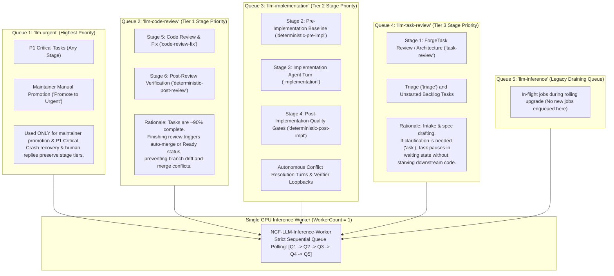
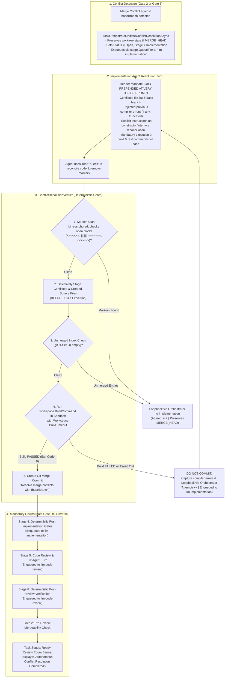

# 🎯 Step 11.27: Stage-Priority Inference Queue Scheduling & Conflict Resolution Lifecycle Hardening

> **Phase 11 Implementation Step (Post-MVP - Queue Prioritization, Conflict Resilience & Review Hygiene)**  
> *Parent Plan:* [Phase 11 Master Plan](../11_EXTEND_FEATURES.md)  
> *Project Target:* `src/NightCodeForge.Core`, `src/NightCodeForge.Infrastructure`, `src/NightCodeForge.Web`, `src/NightCodeForge.ScenarioRunner`, `tests/NightCodeForge.Core.Tests`, `tests/NightCodeForge.Infrastructure.Tests`, `tests/NightCodeForge.Web.Tests`  
> *Status:* Proposed / Specified | *Target Framework:* .NET 10 (C# 13)

---

## 1. Executive Summary & Problem Statement

NightCodeForge orchestrates autonomous software engineering tasks sequentially on a dedicated, single-worker GPU inference queue (`WorkerCount = 1`) to eliminate model thrashing and out-of-memory contention on local Ollama / OllamaRouter backends.

However, real-world development on active repositories (**OllamaRouter**, **ComicGenCLI**) revealed two critical architectural vulnerabilities in task scheduling and autonomous conflict resolution:

### 1.1 The Priority Inversion Problem & The "Task as a Whole" Principle

Under the existing FIFO scheduling model within `llm-inference`:
1. When multiple tasks are in flight, tasks at earlier stages (such as newly promoted tasks entering `task-review` or starting `implementation`) are enqueued ahead of, or interleaved with, tasks that are already 90% completed (`code-review-fix`).
2. When a task near completion is delayed in the inference queue:
   - Target base branch (`main`) keeps advancing as other tasks merge or maintainers push changes.
   - By the time the delayed task finally runs its review and reaches the merge stage, its branch has drifted significantly from `main`, dramatically increasing the probability of Git merge conflicts.
3. Furthermore, **Stage 1 (`task-review`)** is the primary intake stage where the architect agent inspects requirements, plans architecture, and frequently raises clarification questions via the `ask` tool, placing tasks into `IsWaitingForHuman = true`.
4. **The "Task as a Whole" Strategy:**
   To minimize conflict probability and pipeline thrashing, tasks must be prioritized by their proximity to completion:
   - **Emergency (Highest Priority):** `HangfireQueues.LlmUrgent` is reserved **strictly** for P1 Critical tasks (any stage) and explicit maintainer manual promotion ("Promote to Urgent"). Human clarification replies and system crash recovery are **not** urgent: they strictly preserve the stage tier system and re-enter the queue of the stage they belong to (`stage.QueueTier`) with their task priority.
   - **Tier 1 (Highest Stage Priority):** All tasks ready for **Code Review & Fix** (`code-review-fix`) and post-review verification. Pushing these through triggers automated merge when `MergeMode.Automatic` is configured, or advances the task to `Ready` status for human approval in the Review Room, closing tasks rapidly and keeping `main` clean.
   - **Tier 2 (Mid Stage Priority):** All tasks ready for **Implementation** (`implementation`, pre/post deterministic gates, and autonomous conflict resolution turns).
   - **Tier 3 (Lowest Stage Priority):** All tasks ready for **Task Review** (`task-review`, triage, and unstarted backlog tasks). If human maintainers need to answer architectural questions, tasks pause safely in this intake buffer without blocking downstream code completion.
   - **Acceptable Starvation Tradeoff:** Under bursty backlog conditions, Tier 3 intake tasks may wait while downstream tasks finalize. This is an intentional architectural tradeoff to optimize system throughput and branch freshness over premature intake.

---

### 1.2 Forensic Post-Mortem: Live Instance Task 5 Incident

During live execution on **OllamaRouter Task 5**, a merge conflict occurred against `main` in `OllamaRoutingMiddleware.cs` and `OllamaRoutingMiddlewareTests.cs`. A detailed audit of the database (`nightcodeforge.db`, `nightcodeforge_hangfire.db`) and runtime logs identified a chain of failure modes:

1. **Passive & Deprioritized Prompting:**
   The conflict directive in [DefaultBootstrapPromptBuilder.cs](file:///c:/Users/Julien/source/repos/jetelain/NightCodeForge/src/NightCodeForge.Core/Workflow/DefaultBootstrapPromptBuilder.cs) was appended at the very bottom of a 250+ line prompt. The agent scanned past it, resolved conflict markers in textual files, but hallucinated that `dotnet build` passed with zero errors without actually validating constructor and method signature reconciliation across calling tests.

2. **The Verification Blind Spot in [ConflictResolutionVerifier.cs](file:///c:/Users/Julien/source/repos/jetelain/NightCodeForge/src/NightCodeForge.Core/Workflow/ConflictResolutionVerifier.cs):**
   The verifier checked only textual conflict markers (`<<<<<<<`) and Git index stages (`git ls-files -u`). It **never executed the project compilation command** (`workspace.BuildCommand` / `dotnet build`). Because the markers were removed and files staged, the verifier immediately created a Git merge commit (`git commit -m "Resolve merge conflicts with main"`) containing broken, non-compiling C# code!

3. **Bypassing Downstream Gates & Premature Review UI Exposure:**
   - [TaskOrchestrator.cs](file:///c:/Users/Julien/source/repos/jetelain/NightCodeForge/src/NightCodeForge.Core/Workflow/TaskOrchestrator.cs) pushed this non-compiling merge commit to `host-origin`, set `PipelineDataBagKeys.HasResolvedConflict = true`, and marked the task status as `TaskOverallStatus.Implemented`.
   - [TaskReviewService.cs](file:///c:/Users/Julien/source/repos/jetelain/NightCodeForge/src/NightCodeForge.Web/Services/TaskReviewService.cs) `GetPendingReviewsAsync` treated tasks with `Status == Implemented` as pending reviews.
   - [Review.razor](file:///c:/Users/Julien/source/repos/jetelain/NightCodeForge/src/NightCodeForge.Web/Components/Pages/Review.razor) displayed the green **"🚀 Approve & Merge"** button and rendered the banner:
     > *"⚠️ Autonomous Conflict Resolution Completed: The implementation agent resolved all conflicts and successfully verified the deterministic build and test gates. Please review the updated diff before approving."*
   - In reality, **downstream gates (`deterministic-post-impl`, `code-review-fix`, `deterministic-post-review`, Gate 2) had not even executed yet!**
   - When the developer checked out the branch locally, the build was completely broken.

---

## 2. Architecture & Workflow

### 2.1 Stage-Priority Queue Scheduling Hierarchy



---

### 2.2 Hardened Conflict Resolution & Gate Re-Traversal Lifecycle



---

## 3. Detailed Specifications

> Per project conventions, this section defines **required behaviors, data contracts, and constraints**. Signatures and internal structures are left to the implementer. All constants, queue names, and audit strings must be defined cleanly without magic strings or numbers.

### 3.1 Stage-Priority Inference Queue Architecture

#### 1. Queue Identifiers & Polling Priority Order
In [HangfireQueues.cs](file:///c:/Users/Julien/source/repos/jetelain/NightCodeForge/src/NightCodeForge.Infrastructure/BackgroundJobs/HangfireQueues.cs), add canonical queue constants:
- `LlmCodeReview = "llm-code-review"`
- `LlmImplementation = "llm-implementation"`
- `LlmTaskReview = "llm-task-review"`

In [HangfireConfigurationExtensions.cs](file:///c:/Users/Julien/source/repos/jetelain/NightCodeForge/src/NightCodeForge.Infrastructure/BackgroundJobs/HangfireConfigurationExtensions.cs), configure `NCF-LLM-Inference-Worker` (`WorkerCount = 1`) to listen to queues in strict priority sequence:
1. `HangfireQueues.LlmUrgent` (P1 Critical tasks and manual maintainer promotion ONLY).
2. `HangfireQueues.LlmCodeReview` (Tier 1: Code Review & Fix, Post-Review Verification).
3. `HangfireQueues.LlmImplementation` (Tier 2: Pre-Implementation, Implementation, Post-Implementation Gates, Conflict Resolution).
4. `HangfireQueues.LlmTaskReview` (Tier 3: Task Review, Triage, Unstarted Backlog Tasks).
5. `HangfireQueues.LlmInference` (Legacy draining queue for jobs enqueued prior to upgrade). It is polled last by design: its jobs are moved to their correct tier queue by the misplaced-job migration of `ReorderInferenceQueueByPriorityAsync` (see 3.1.6), which MUST run once at startup so legacy jobs are not starved. No new job is ever enqueued to it. The queue and its monitoring (`rawInference`) are removed in a later step once empty.

#### 2. Stage-Declared Queue Tier (Data Model & Runtime Stage Contract)
Each stage **designates its own queue tier**; there is no hardcoded stage-ID-to-queue table in the job queue.
- Add an enum in `Core` (`StageQueueTier { TaskReview, Implementation, CodeReview }`) and a **required** `QueueTier` property on [StageDefinition.cs](file:///c:/Users/Julien/source/repos/jetelain/NightCodeForge/src/NightCodeForge.Core/Domain/StageDefinition.cs) (persisted; EF migration / seed update as needed). There is no default value: a stage without a tier is invalid and must fail validation when the workflow is saved or loaded.
- Expose `StageQueueTier QueueTier { get; }` on the [IWorkflowStage.cs](file:///c:/Users/Julien/source/repos/jetelain/NightCodeForge/src/NightCodeForge.Core/Workflow/IWorkflowStage.cs) interface. In [WorkflowStageFactory.cs](file:///c:/Users/Julien/source/repos/jetelain/NightCodeForge/src/NightCodeForge.Core/Workflow/WorkflowStageFactory.cs), populate `IWorkflowStage.QueueTier` directly from `StageDefinition.QueueTier` when constructing stage instances, allowing `TaskOrchestrator` to access `nextStage.QueueTier` directly at runtime without redundant database lookups.
- [StandardWorkflowDefinitions.cs](file:///c:/Users/Julien/source/repos/jetelain/NightCodeForge/src/NightCodeForge.Core/Domain/StandardWorkflowDefinitions.cs) assigns the tiers of the standard stages:
  - `CodeReview`: `StandardStageIds.CodeReviewAndFix`, `StandardStageIds.PostReviewVerification`.
  - `Implementation`: `StandardStageIds.PreImplementationBaseline`, `StandardStageIds.Implementation`, `StandardStageIds.PostImplementationGates`.
  - `TaskReview`: `StandardStageIds.TaskReview`, and `StandardStageIds.Triage` (triage is explicitly designated as `StageQueueTier.TaskReview`).
- Custom workflows choose a tier per stage, so custom stage IDs are fully supported.
- `HangfireQueues` (Infrastructure) is the **only** place that maps a tier to a Hangfire queue name. `Core` (including `TaskOrchestrator`) never references `HangfireQueues`.

#### 3. `ITaskJobQueue` Stage-Aware Dispatch Contract (Clean Break)
Under the Clean Break policy:
- **Remove** legacy `string EnqueueInference(int taskId)` completely from [ITaskJobQueue.cs](file:///c:/Users/Julien/source/repos/jetelain/NightCodeForge/src/NightCodeForge.Core/Workflow/ITaskJobQueue.cs), [HangfireTaskJobQueue.cs](file:///c:/Users/Julien/source/repos/jetelain/NightCodeForge/src/NightCodeForge.Infrastructure/BackgroundJobs/HangfireTaskJobQueue.cs), and `InMemoryTaskJobQueue.cs`.
- Retain `string EnqueueUrgent(int taskId)` on `ITaskJobQueue` exclusively for explicit maintainer manual promotion (`PromoteToUrgentAsync`). P1 Critical tasks are automatically routed to `LlmUrgent` by `EnqueueStage(taskId, tier, priority)` when `priority == TaskPriority.Critical`.
- Add stage dispatch method:
  ```csharp
  string EnqueueStage(int taskId, StageQueueTier tier, int priority);
  ```
  Callers obtain the tier from the `StageDefinition` of the target stage (resolved from the task's workflow).
- **Dispatching Rules (No Silent Fallback):**
  - If `priority == TaskPriority.Critical` (P1) → `HangfireQueues.LlmUrgent` (P1 always takes precedence over the stage tier).
  - Else `StageQueueTier.CodeReview` → `HangfireQueues.LlmCodeReview`; `Implementation` → `HangfireQueues.LlmImplementation`; `TaskReview` → `HangfireQueues.LlmTaskReview`.
  - An undefined/unknown tier value → throw `ArgumentOutOfRangeException` immediately. If the target stage cannot be found in the workflow → throw a dedicated domain exception. Silent default queues are forbidden.

#### 4. Human Clarification Reply Dispatch
When a human maintainer submits clarification answers via `TaskOrchestrator.SubmitAnswersAsync`:
- The task is **not** treated as urgent. It is re-enqueued with `EnqueueStage` using the tier of the stage it is blocked in (`task.CurrentStageId`) and its own `task.Priority`, exactly like any other turn of that stage.
- The task's persisted priority is never modified by the resume.

#### 5. Exhaustive Dispatch Call Sites Migration
Update all call sites from the deleted `EnqueueInference` (and obsolete direct urgent calls) to `EnqueueStage` (tier taken from the target stage's `QueueTier`):
- [TaskOrchestrator.cs](file:///c:/Users/Julien/source/repos/jetelain/NightCodeForge/src/NightCodeForge.Core/Workflow/TaskOrchestrator.cs):
  - In `AdvanceToNextStageAsync`: Replace the priority branching block with a single `EnqueueStage(task.Id, nextStage.QueueTier, task.Priority)`.
  - In `SubmitAnswersAsync`: Call `EnqueueStage` using the blocked stage's tier (`currentStage.QueueTier`) and `task.Priority` (not urgent, see 3.1.4).
  - In `RequestChangesAsync`: Call `EnqueueStage(task.Id, targetStage.QueueTier, task.Priority)`.
  - In `PromoteSuggestedTaskAsync`: Call `EnqueueStage(task.Id, initialStage.QueueTier, task.Priority)`.
  - In `ResolveCascadeUnblockedTasksAsync`:
    - Order unblocked tasks by numeric priority ascending (`Priority ASC`, i.e. numerically lowest value first: P1 before P2 before P3...), then `CreatedAt ASC`.
    - Enqueue each found unblocked task via `EnqueueStage(unblockedTask.Id, initialStage.QueueTier, unblockedTask.Priority)`.
    - **Missing Entity Fail-Fast:** For missing task IDs (`missingId` where an unblocked dependent ID cannot be found in `taskRepository`), do NOT call an enqueue method. Log a critical error and fail fast / throw a dedicated domain exception per project rule ("avoid synthetic values, make a hard error; no silent failures").
  - In `InitiateConflictResolutionAsync`: Retrieve the implementation stage definition from the workflow and call `EnqueueStage(task.Id, implementationStage.QueueTier, task.Priority)`.
  - In `HandleLoopBackAsync`: Call `EnqueueStage(task.Id, targetStage.QueueTier, task.Priority)`.
- [StartupRecoveryService.cs](file:///c:/Users/Julien/source/repos/jetelain/NightCodeForge/src/NightCodeForge.Core/Services/StartupRecoveryService.cs): Reboot crash recovery **keeps the stage queue tier system**. Rescued orphaned tasks are not dumped into `llm-urgent`. Instead, the recovery service resolves the target stage definition from the task's workflow (based on `task.CurrentStageId`), and enqueues via `_jobQueue.EnqueueStage(task.Id, stage.QueueTier, task.Priority)`. Only if the rescued task was already P1 Critical does `EnqueueStage` route it to `LlmUrgent`; otherwise it re-enters its respective stage tier (`LlmCodeReview`, `LlmImplementation`, or `LlmTaskReview`).
- [DevQueueService.cs](file:///c:/Users/Julien/source/repos/jetelain/NightCodeForge/src/NightCodeForge.Web/Services/DevQueueService.cs): In rescheduling and reprioritization methods, retrieve the target stage tier from the task's workflow and call `EnqueueStage`. Remove forbidden bare `catch` blocks.
- [CreateTask.razor](file:///c:/Users/Julien/source/repos/jetelain/NightCodeForge/src/NightCodeForge.Web/Components/Pages/CreateTask.razor): Resolve initial workflow stage and call `TaskJobQueue.EnqueueStage(created.Id, initialStage.QueueTier, created.Priority)`.
- `InMemoryTaskJobQueue.cs` in `NightCodeForge.ScenarioRunner`: update to support `EnqueueStage` and queue polling by priority hierarchy.
- All mock setups and fakes across unit and integration tests.

#### 6. DevQueue Monitoring & Priority Re-Ordering Ergonomics
In [DevQueueService.cs](file:///c:/Users/Julien/source/repos/jetelain/NightCodeForge/src/NightCodeForge.Web/Services/DevQueueService.cs) and [DevQueueTable.razor](file:///c:/Users/Julien/source/repos/jetelain/NightCodeForge/src/NightCodeForge.Web/Components/DevQueue/DevQueueTable.razor):
- `GetSnapshotAsync` must query all active queues: `rawUrgent`, `rawCodeReview`, `rawImplementation`, `rawTaskReview`, `rawInference`, `rawDefault`, `rawProcessing`, `rawFailed`.
- Display distinct tier badges and queue sections for Code Review, Implementation, Task Review, and Urgent.
- Priority convention: numerically lower value = higher priority (P1 = 1 = Critical).
- `ReorderInferenceQueueByPriorityAsync`:
  - Iterates over each tier queue (`LlmCodeReview`, `LlmImplementation`, `LlmTaskReview`) and the legacy `LlmInference` queue.
  - **Worker Race Safeguard:** Only jobs confirmed in the `Enqueued` state (`EnqueuedJobs`) are inspected. If a job has already transitioned to `Processing` or `Scheduled` state, skip it immediately.
  - Sorts waiting jobs by:
    1. Task Priority (`Priority ASC`, numerically lowest value first: P1 → P5).
    2. Original enqueue time ascending (FIFO within equal priority).
  - The original enqueue time is stored as an explicit job parameter set at first enqueue and copied to any re-enqueued job, so re-sequencing does not reset queue aging.
  - Misplaced jobs (priority or stage changed, or job found in the legacy queue) are migrated to the correct queue: verify `Delete` returns `true` before calling `EnqueueStage` to ensure no job executes twice. Because the Hangfire job ID changes, `ForgeTask.LastHangfireJobId` MUST be updated atomically in the same operation.
  - **No Silent Failures:** In [DevQueueService.cs](file:///c:/Users/Julien/source/repos/jetelain/NightCodeForge/src/NightCodeForge.Web/Services/DevQueueService.cs), remove the forbidden bare catch block (`catch { _taskJobQueue.EnqueueInference(taskId.Value); }`) and ensure failures log appropriately and fail fast.
  - **Starvation visibility:** `DevQueueTable.razor` displays the age of the oldest waiting job per tier so a starved Task Review tier is observable. No automatic aging/priority boost is introduced (accepted tradeoff, see 1.1).

---

### 3.2 Conflict Resolution Hardening: Deterministic Compilation Verification

#### 1. Constructor Injection & Execution Environment Sandbox
In [ConflictResolutionVerifier.cs](file:///c:/Users/Julien/source/repos/jetelain/NightCodeForge/src/NightCodeForge.Core/Workflow/ConflictResolutionVerifier.cs):
- Inject `IExecutionEnvironmentProvider` as a required dependency in the constructor (no optional parameters or fallback).
- The verifier resolves the task sandbox via `_environmentProvider.GetEnvironment(workspace, SandboxSecurityTier.Standard, taskId)`. All verification commands execute strictly inside the task's isolated container and worktree sandbox, never against the host repository.
- Verification is protected under the fine-grained workspace lock (Step 11.24).

#### 2. Verification Sequence & Fail-Fast Behavior
The verification sequence in the task worktree MUST proceed in this exact order:

1. **Line-Anchored Conflict Marker Text Scan:**
   - Scan every file in `conflictedFiles`.
   - Ensure zero instances of conflict markers:
     - `ConflictResolutionConstants.MarkerStart` (`<<<<<<< `)
     - `ConflictResolutionConstants.MarkerAncestor` (`||||||| `)
     - `ConflictResolutionConstants.MarkerEnd` (`>>>>>>> `)
     - `ConflictResolutionConstants.MarkerSeparator` (`=======`): Checked **strictly inside an open conflict block** (i.e. between `MarkerStart` and `MarkerEnd`), or unclosed at EOF. Lone lines containing `=======` outside open conflict blocks (such as Markdown setext headings, RST dividers, or ASCII tables) MUST NOT trigger false-positive conflict failures.
   - If markers remain → Fail fast; do not stage files or run build. Return error listing file paths, line numbers, and marker types.

2. **Selective Staging of Conflicted and Newly Reconciled Source Files (BEFORE Build):**
   - Stage modified conflicted files (`git add -- {file}`).
   - Stage deleted conflicted files (`git rm --ignore-unmatch -- {file}`).
   - Non-textual conflicts (delete/modify, binary) must be decided explicitly by the agent; if undecided in index, fail fast.
   - Stage any newly created source files added by the agent to satisfy missing signatures during reconciliation:
     - Detect untracked files via `git status --porcelain`.
     - Filter out ignored paths according to `.gitignore`.
     - Explicitly stage new source files (`.cs`, `.ts`, `.json`, etc.).
   - **Crucial Invariant:** Staging MUST execute **before** running `workspace.BuildCommand`. This ensures that subsequent build outputs (`bin/`, `obj/`, intermediate binaries) are never inadvertently staged or included in the merge commit.

3. **Unmerged Index Verification:**
   - Run `git ls-files -u`.
   - Ensure the unmerged index list is completely empty. If unmerged entries remain → Fail fast.

4. **Deterministic Build Verification & Timeout Handling:**
   - Execute `workspace.BuildCommand` (e.g. `dotnet build`) in the task's execution environment. `Workspace.BuildTimeoutSeconds` is nullable: resolve it with the existing `WorkflowDefaults.DefaultBuildTimeoutSeconds` default when null (same resolution as the other deterministic gates).
   - **Timeout Failure:** If the build command times out, treat as a hard failure with distinct message: `"Deterministic build timed out after {X} seconds"`.
   - **Compilation Failure (Exit Code != 0):**
     - Extract standard output and error diagnostics.
     - Truncate compiler error output to `ConflictResolutionConstants.MaxCompilerErrorsLength` (4000 characters) to avoid prompt bloat. Keep the **tail** of the output (the most relevant diagnostics and summary are last) and prefix a truncation marker.
     - **DO NOT CREATE A MERGE COMMIT.** (The worktree remains uncommitted with staged files and `MERGE_HEAD` intact so the agent can resume seamlessly).
     - Update [ConflictResolutionVerificationResult](file:///c:/Users/Julien/source/repos/jetelain/NightCodeForge/src/NightCodeForge.Core/Workflow/IConflictResolutionVerifier.cs) record contract to include `string? CompilerErrors = null`.
     - Return `new ConflictResolutionVerificationResult(IsSuccess: false, ErrorMessage: "Deterministic build verification failed...", CompilerErrors: truncatedErrors)`.

5. **Merge Commit Creation:**
   - **ONLY IF** markers are clean, unmerged index is clean, AND the build command returns Exit Code 0:
   - Check if `MERGE_HEAD` is present.
   - Execute `git commit --no-edit -m "Resolve merge conflicts with {baseBranch}"`.
   - Return `ConflictResolutionVerificationResult(IsSuccess: true)`.

---

### 3.3 Mandatory Quality Gate Re-Traversal Post-Resolution

After an agent completes a conflict resolution turn:

1. **State Preservation & Loopback:**
   - `TaskOrchestrator` runs `ConflictResolutionVerifier.VerifyResolutionAsync`.
   - **If Verification Fails:**
     - Increment `PipelineDataBagKeys.ConflictResolutionAttempts` (attempt budget for the current conflict: markers, unmerged index, build failure, build timeout).
     - Increment `PipelineDataBagKeys.TotalConflictResolutionAttempts` (cumulative lifetime budget across all conflicts on this task).
     - If `ConflictResolutionAttempts >= ConflictResolutionConstants.MaxConflictResolutionAttempts` (3) OR `TotalConflictResolutionAttempts >= ConflictResolutionConstants.MaxTotalConflictResolutionAttempts` (6) → Escalate to human maintainer (`IsWaitingForHuman = true`).
     - Otherwise:
       - Store truncated compiler diagnostics in `PipelineDataBagKeys.CompilerErrors` as `new List<string> { truncatedErrors }` to conform with the `List<string>` type expected by `DefaultBootstrapPromptBuilder` and subsequent stages. For a non-build failure (markers, unmerged index), `CompilerErrors` is **cleared** so stale diagnostics never reach the next prompt.
       - Preserve `ConflictFiles`, `ConflictBaseBranch`, and uncommitted worktree (`MERGE_HEAD` remains active).
       - Loop back to `StandardStageIds.Implementation` (dispatched through that stage's `QueueTier`, i.e. Tier 2). The loopback re-enters the implementation stage directly and does **not** re-execute `PreImplementationBaseline`.
   - **If Verification Passes:**
     - Clear `ConflictFiles`, `ConflictBaseBranch`, `ConflictDetectedAt`, and `CompilerErrors`.
     - Set `PipelineDataBagKeys.HasResolvedConflict = true`.
     - Reset `ConflictResolutionAttempts = 0`.

2. **Mandatory Full Pipeline Progression:**
   - The task **MUST NOT** jump directly to `Ready` or `Review Room`.
   - The task transitions through all subsequent gates:
     1. **`StandardStageIds.PostImplementationGates`:** Full deterministic build and regression test suite (enqueued to Tier 2 `LlmImplementation`).
     2. **`StandardStageIds.CodeReviewAndFix`:** Code Reviewer agent turn inspecting resolved diff and regression tests (enqueued to Tier 1 `LlmCodeReview`).
     3. **`StandardStageIds.PostReviewVerification`:** Final deterministic compilation and test gate (enqueued to Tier 1 `LlmCodeReview`).
     4. **Gate 2 (Pre-Review Mergeability Check):** Verifies feature branch remains cleanly mergeable against latest `main`.
     5. **`TaskOverallStatus.Ready`:** ONLY after all four downstream stages pass does the task reach `Ready`.

3. **Re-Conflict During Downstream Stages & Lifetime Conflict Guard:**
   - If `main` advances again and a merge conflict is detected later (Gate 2, or any merge attempt during or after `CodeReviewAndFix` / `PostReviewVerification`), the full conflict flow restarts via `InitiateConflictResolutionAsync`.
   - A new conflict detection resets `ConflictResolutionAttempts = 0` (the immediate loop budget), keeps `HasResolvedConflict = true`, and increments `PipelineDataBagKeys.LifetimeConflictDetections`.
   - **Unbounded Conflict Cycle Guard:** If `LifetimeConflictDetections >= ConflictResolutionConstants.MaxLifetimeConflictDetections` (3), the task aborts autonomous re-conflict loops, logs `AuditActors.System: "Task has experienced 3 distinct merge conflicts against advancing base branch. Escalated to maintainer to rebase manually."`, and sets `IsWaitingForHuman = true`.
   - A full re-traversal of the downstream gates then happens again before `Ready`.

---

### 3.4 Web UI & Review Room State Hygiene

#### 1. Presentation & Logic Separation (UI Rule Compliance)
Per project guidelines, Razor components must remain purely presentational. Extract all review-readiness logic into [TaskReviewService.cs](file:///c:/Users/Julien/source/repos/jetelain/NightCodeForge/src/NightCodeForge.Web/Services/TaskReviewService.cs):
- Add domain helper methods on `TaskReviewService` / `TaskSnapshot`:
  - `bool IsPendingReview(TaskSnapshot snapshot) => snapshot.HasExecutionRun && snapshot.Status == TaskOverallStatus.Ready;` (also the single predicate used to enable "Approve & Merge" and "Request Changes").
  - `bool ShouldDisplayConflictResolvedBanner(TaskSnapshot snapshot) => snapshot.HasResolvedConflict && snapshot.Status == TaskOverallStatus.Ready;`

#### 2. `TaskReviewService.GetPendingReviewsAsync` Contract Hardening & Legacy Mapping
In [TaskReviewService.cs](file:///c:/Users/Julien/source/repos/jetelain/NightCodeForge/src/NightCodeForge.Web/Services/TaskReviewService.cs):
- `GetPendingReviewsAsync` MUST ONLY query and return tasks where:
  ```csharp
  t.HasExecutionRun && t.Status == TaskOverallStatus.Ready
  ```
- **Clean Break:** Remove `TaskOverallStatus.Implemented` and `TaskOverallStatus.Reviewed` from the pending reviews query. Tasks in those states are in-flight traversing quality gates.
- **Legacy Data Migration:** A one-time startup data migration handles existing tasks found in `Implemented` or `Reviewed` status (excluding merged/closed ones):
  - Legacy tasks in `TaskOverallStatus.Implemented` are set to `Status = TaskOverallStatus.Open` with `CurrentStageId = StandardStageIds.PostImplementationGates`, ensuring deterministic verification and code review run.
  - Legacy tasks in `TaskOverallStatus.Reviewed` are set to `Status = TaskOverallStatus.Open` with `CurrentStageId = StandardStageIds.PostReviewVerification`, ensuring post-review verification and Gate 2 run.
  - The migration sets `HasExecutionRun = true`, enqueues via `EnqueueStage` using the target stage's `QueueTier`, and logs each migrated task. The migration is idempotent.

#### 3. Review Room Actions & Banner Constraints
In [Review.razor](file:///c:/Users/Julien/source/repos/jetelain/NightCodeForge/src/NightCodeForge.Web/Components/Pages/Review.razor):
- **Approval Actions:** Restrict the "Approve & Merge" and "Request Changes" buttons strictly to `TaskReviewService.IsPendingReview(_snapshot)`.
- **Re-Review Banner:** Display the `Autonomous Conflict Resolution Completed` banner strictly when `TaskReviewService.ShouldDisplayConflictResolvedBanner(_snapshot)`. The existing banner wording is kept: it is now truthful because all downstream gates have run before `Ready`.
- **In-Flight Navigation Guard:**
  If a maintainer navigates directly to `/review/{taskId}` while a task is not yet in `Ready` status:
  - Do NOT display approval controls or false completion banners.
  - Render an informational banner:
    > *"⚙️ Task #{TaskId} is currently undergoing automated quality gates and code review before entering the Review Room."*
    with a direct link to `/inspector/{taskId}` to view live execution telemetry.

---

### 3.5 Optimized Autonomous Conflict Resolution Prompt Directive

In [ConflictResolutionConstants.cs](file:///c:/Users/Julien/source/repos/jetelain/NightCodeForge/src/NightCodeForge.Core/Workflow/ConflictResolutionConstants.cs) and [DefaultBootstrapPromptBuilder.cs](file:///c:/Users/Julien/source/repos/jetelain/NightCodeForge/src/NightCodeForge.Core/Workflow/DefaultBootstrapPromptBuilder.cs):

1. **Top-of-Prompt Prominence:**
   Prepend the conflict directive as a **Header Mandate Block at the very top of the prompt**, preceding persona and codebase background instructions, ensuring the model immediately grasps the merge conflict state.

2. **Constants & Content Guidelines:**
   In [ConflictResolutionConstants.cs](file:///c:/Users/Julien/source/repos/jetelain/NightCodeForge/src/NightCodeForge.Core/Workflow/ConflictResolutionConstants.cs):
   - Add constant `public const int MaxCompilerErrorsLength = 4000;`.
   - Add constant `public const int MaxTotalConflictResolutionAttempts = 6;`.
   - Add constant `public const int MaxLifetimeConflictDetections = 3;`.
   - Update `ConflictDirectiveFormat` with explicit instructions:
     - Inspection of all four markers (`<<<<<<<`, `|||||||`, `=======`, `>>>>>>>`).
     - Reconciliation of constructors, interfaces, and signatures across callers and callees.
     - Mandatory verification of compilation (`workspace.BuildCommand`) and tests (`workspace.TestCommand`) via `bash`.
     - Explicit warning: claims of compilation without executing the commands will fail deterministic verification.
     - Prohibition against `git commit`, `git merge --abort`, or `git reset`.
   - Inject truncated compiler diagnostics from `PipelineDataBagKeys.CompilerErrors` into the prompt template, **only when non-empty**.
   - Tell the agent that the verifier already staged the conflicted and newly created files (`git add`) during the previous attempt, so `git diff` alone hides those changes and `git diff --cached` / `git status` must be used to inspect them.

---

## 4. Definition of Done (DoD) Checklist

### 1. Stage-Priority Queue Scheduling
- [x] **Hangfire Queue Definitions:**
  - [x] Add `HangfireQueues.LlmCodeReview`, `HangfireQueues.LlmImplementation`, and `HangfireQueues.LlmTaskReview`.
  - [x] Configure `NCF-LLM-Inference-Worker` queues in priority sequence: `[LlmUrgent, LlmCodeReview, LlmImplementation, LlmTaskReview, LlmInference]`.
- [x] **Stage-Declared Queue Tier:**
  - [x] Add required `StageDefinition.QueueTier` (enum `StageQueueTier`), persisted, with workflow validation rejecting stages without a tier.
  - [x] Expose `IWorkflowStage.QueueTier` on runtime stage interface, populated by `WorkflowStageFactory`.
  - [x] Assign tiers to all standard stages in `StandardWorkflowDefinitions`.
- [x] **Job Queue Dispatching (Clean Break):**
  - [x] Remove `EnqueueInference` completely from `ITaskJobQueue`, `HangfireTaskJobQueue`, and `InMemoryTaskJobQueue`.
  - [x] Implement `EnqueueStage(int taskId, StageQueueTier tier, int priority)`; fail fast on unknown tier.
  - [x] Map P1 Critical to `LlmUrgent`; tiers to `LlmCodeReview` / `LlmImplementation` / `LlmTaskReview`. Only Infrastructure references `HangfireQueues`.
  - [x] `LlmUrgent` is reserved strictly for manual maintainer promotion (`PromoteToUrgentAsync`) and P1 Critical tasks.
  - [x] `SubmitAnswersAsync` re-enqueues in the queue of the task's current stage with the task's own priority (no urgent routing).
  - [x] `StartupRecoveryService` preserves the stage tier system upon crash recovery, dispatching recovered tasks via `EnqueueStage(task.Id, stage.QueueTier, task.Priority)` rather than bypassing tiers.
  - [x] Update all dispatch calls in `TaskOrchestrator` (`AdvanceToNextStageAsync`, `SubmitAnswersAsync`, `RequestChangesAsync`, `PromoteSuggestedTaskAsync`, `ResolveCascadeUnblockedTasksAsync`, `InitiateConflictResolutionAsync`, `HandleLoopBackAsync`), `CreateTask.razor`, and `DevQueueService`.
  - [x] Missing unblocked task entities in `ResolveCascadeUnblockedTasksAsync` fail fast with an exception rather than silently enqueuing.
- [x] **DevQueue Monitoring & Priority Re-Ordering:**
  - [x] Update `DevQueueService.GetSnapshotAsync` to monitor all tier queues.
  - [x] Update `ReorderInferenceQueueByPriorityAsync` to order each queue by `Priority ASC` (numerically lowest first) while preserving original `EnqueuedAt` timestamps.
  - [x] Worker race safeguard: Only reorder/delete jobs confirmed in `Enqueued` state, skipping jobs already transitioned to `Processing` or `Scheduled`.
  - [x] Display stage badges and queue tier sections in `DevQueueTable.razor`, including the age of the oldest waiting job per tier.
  - [x] Misplaced/legacy-queue jobs are migrated via delete + `EnqueueStage` at startup and on reorder; `LastHangfireJobId` and the original enqueue time are preserved/updated.
  - [x] Remove forbidden bare `catch` block in `DevQueueService.cs`.

### 2. Conflict Resolution Hardening
- [x] **Deterministic Compilation in Verifier:**
  - [x] Inject `IExecutionEnvironmentProvider` into `ConflictResolutionVerifier` constructor (fail fast if null).
  - [x] Update `ConflictResolutionVerificationResult` record contract to include `string? CompilerErrors = null`.
  - [x] Line-anchored conflict marker scan: check lines starting with markers; treat `=======` as conflict only when inside an open block or unclosed at EOF.
  - [x] Selective staging of conflicted and newly created source files (`git add`) occurs strictly BEFORE `workspace.BuildCommand` execution.
  - [x] Execute `workspace.BuildCommand` inside task sandbox worktree with workspace build timeout via `_environmentProvider.GetEnvironment(workspace, SandboxSecurityTier.Standard, taskId)`.
  - [x] Handle timeout as hard verification failure.
  - [x] Capture and truncate compiler errors to `MaxCompilerErrorsLength` (4000 chars) on exit code != 0.
  - [x] Verify no merge commit is created when build fails or markers exist.
  - [x] Create merge commit only after `BuildCommand` returns 0.
  - [x] Stage newly created files filtered by `.gitignore` without sweeping `bin/` or `obj/`.
- [x] **Optimized Prompt Mandate:**
  - [x] Update `ConflictResolutionConstants.ConflictDirectiveFormat` and prepend at the very top of prompt in `DefaultBootstrapPromptBuilder`.
  - [x] Add constants `MaxTotalConflictResolutionAttempts = 6` and `MaxLifetimeConflictDetections = 3`.
  - [x] Inject compiler diagnostics from `PipelineDataBagKeys.CompilerErrors` (formatted when non-empty).

### 3. Pipeline Gate Re-Traversal & Review Room Hygiene
- [x] **Full Downstream Gate Traversal:**
  - [x] On verifier success, task transitions through `PostImplementationGates` → `CodeReviewAndFix` → `PostReviewVerification` → Gate 2 → `Ready`.
  - [x] On a new conflict detected downstream (Gate 2 or later), restart the conflict flow with `ConflictResolutionAttempts` reset, `LifetimeConflictDetections` incremented, and `HasResolvedConflict` kept.
  - [x] Escalate to human maintainer if `TotalConflictResolutionAttempts >= 6` or `LifetimeConflictDetections >= 3`.
  - [x] On verifier failure (shared attempt budget; `CompilerErrors` stored as `List<string>` on build failures and cleared on non-build failures), loop back to `StandardStageIds.Implementation` (Tier 2 via the stage `QueueTier`), keeping `MERGE_HEAD` intact until attempts reach `MaxConflictResolutionAttempts`.
- [x] **Web UI Hygiene:**
  - [x] Extract review readiness helpers into `TaskReviewService` (comply with UI separation rule).
  - [x] Restrict `TaskReviewService.GetPendingReviewsAsync` strictly to `Status == TaskOverallStatus.Ready`.
  - [x] Restrict `Approve & Merge` and `Request Changes` in `Review.razor` strictly to `Ready` status.
  - [x] Display conflict banner strictly when `Ready && HasResolvedConflict`.
  - [x] Render in-flight progress banner when accessing `/review/{id}` while task is not in `Ready` status.
  - [x] One-time idempotent startup migration re-queues legacy `Implemented` tasks at `StandardStageIds.PostImplementationGates` and `Reviewed` tasks at `StandardStageIds.PostReviewVerification` with `Status = TaskOverallStatus.Open`.

### 4. Tests & Validation
- [x] **Unit Tests:**
  - [x] `HangfireQueuePriorityTests`: Verify `EnqueueStage` routes correctly by priority and stage tier, and throws on an unknown tier.
  - [x] `StageDefinition` / workflow validation tests: a stage without `QueueTier` is rejected; standard workflow stages carry the expected tiers.
  - [x] `StartupRecoveryServiceTests`: Verify crash recovery preserves the tier system, enqueuing tasks via `EnqueueStage` using target stage's `QueueTier` and `task.Priority` (routing to `LlmUrgent` only if `task.Priority == TaskPriority.Critical`).
  - [x] `TaskOrchestratorTests`: Verify `SubmitAnswersAsync`, `RequestChangesAsync`, and `HandleLoopBackAsync` enqueue with target stage tier and task priority; `Core` has no reference to `HangfireQueues`.
  - [x] `ConflictResolutionVerifierTests`:
    - Marker scan failure across all 4 markers (`<<<<<<< `, `||||||| `, `=======`, `>>>>>>> `).
    - Marker scan succeeds when `=======` appears on a line outside open conflict block (Markdown/RST headings).
    - Unmerged index failure (`git ls-files -u`).
    - Build execution failure (assert no commit created, compiler errors extracted and truncated).
    - Build timeout failure (assert hard failure, no commit created).
    - Successful build execution (assert commit created, success result returned).
    - Staging executes before build and includes newly created source files while ignoring build artifacts.
    - Compiler errors keep the tail on truncation; null `BuildTimeoutSeconds` resolves to the workflow default.
  - [x] Update existing `ConflictResolutionLifecycleTests`: supply mocked `IExecutionEnvironmentProvider` across all `new ConflictResolutionVerifier(...)` test setups.
  - [x] `DefaultBootstrapPromptBuilderTests`: staged-files hint; compiler diagnostics omitted when empty; Verify conflict mandate prepends at the top of the prompt and formats compiler diagnostics.
  - [x] `TaskReviewServiceTests`: Verify `GetPendingReviewsAsync` excludes `Implemented` and `Reviewed`, returning only `Ready` tasks.
  - [x] `ReviewPageTests`: Verify approval actions are disabled and in-flight banner renders when task is in-flight.
- [x] **Integration / Scenario Tests:**
  - [x] Verify conflict resolution loopback turn, verifier passage, and downstream gate traversal (`deterministic-post-impl` → `code-review-fix` → `deterministic-post-review` → Gate 2 → Ready).
  - [x] Verify task escalation to human when lifetime conflict detection ceiling is reached.
- [x] **Regression Test Run:**
  - [x] Run `dotnet test --filter "Category!=Acceptance&Category!=E2E"` and ensure all tests pass cleanly.
