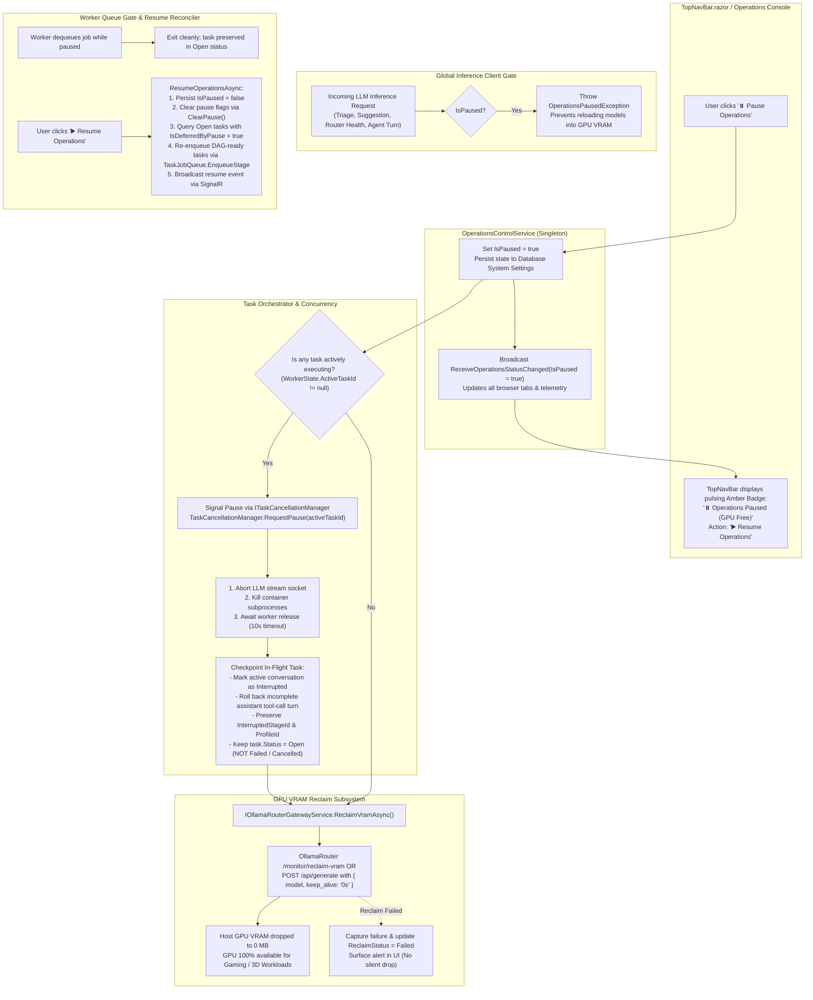

# ⏸️ Step 11.29: Global Operations Pause & GPU VRAM Eviction (Gamer / Dedicated Workload Mode)

> **Phase 11 Implementation Step (Post-MVP - Queue Control, Hardware Resource Management & Developer Ergonomics)**  
> *Parent Plan:* [Phase 11 Master Plan](../11_EXTEND_FEATURES.md)  
> *Project Target:* `src/NightCodeForge.Core`, `src/NightCodeForge.Infrastructure`, `src/NightCodeForge.Web`, `tests/NightCodeForge.Core.Tests`, `tests/NightCodeForge.Infrastructure.Tests`, `tests/NightCodeForge.Web.Tests`  
> *Status:* Proposed / Specified | *Target Framework:* .NET 10 (C# 13)

---

## 1. Executive Summary & Problem Statement

NightCodeForge orchestrates automated software development using local LLM inference engines (via **OllamaRouter** or native **Ollama**) and background worker queues (**Hangfire**). Active background pipelines consume substantial local compute resources:
1. **GPU VRAM Allocation:** Resident models (such as Qwen 2.5 Coder 32B, DeepSeek-R1 32B, Llama 3.3 70B quantizations) hold between 14 GB and 32+ GB of dedicated GPU VRAM continuously via default `keep_alive` timeouts.
2. **GPU & CPU Compute Saturation:** When an agentic turn or deterministic test gate executes, local GPU shaders, CUDA cores, CPU threads, and memory bandwidth are heavily utilized.

### 1.1 The "Gamer Problem" & Workstation Resource Contention

Developer workstations running NightCodeForge are frequently shared dual-use systems: developers write and orchestrate code during working hours, and use the same workstation hardware for gaming, 3D graphics, video rendering, or other VRAM-intensive workloads during breaks or evenings.

Currently, if a developer wants to play a video game on the host machine:
- Background Hangfire workers continue polling and picking up queued tasks.
- Resident models remain pinned in GPU VRAM, causing video games to stutter, drop frames severely, or crash instantly with `DXGI_ERROR_DEVICE_RESET` / CUDA out-of-memory errors.
- The developer's only recourse is to terminate the web process (`ncf-web.cmd`), which risks dirty Git worktree states, ungraceful task aborts, and requires manual service startup later.

### 1.2 Proposed Solution: Global "Pause Operations" & VRAM Reclaim

Step 11.29 introduces a first-class, one-click **"Pause Operations"** toggle in the global navigation bar and operations console:
- **Immediate In-Flight Task Suspension:** Gracefully interrupts active task execution without failing or cancelling the task, checkpointing the active stage so execution can resume seamlessly.
- **Immediate GPU VRAM Eviction:** Instantly unloads resident models from the host GPU using [IOllamaRouterGatewayService.ReclaimVramAsync](file:///c:/Users/Julien/source/repos/jetelain/NightCodeForge/src/NightCodeForge.Core/Interfaces/IOllamaRouterGatewayService.cs#L51) (setting `keep_alive: 0`), dropping host GPU VRAM consumption to 0 MB.
- **Queue Gatekeeping:** Prevents Hangfire workers from starting any new inference or deterministic tasks while operations remain paused.
- **Instant Resume:** Clicking **"▶️ Resume Operations"** restores worker queue consumption immediately without requiring application restart or re-configuration.

---

## 2. Architecture & Operational Workflow

### 2.1 Global Pause & Resume Flow



---

## 3. Detailed Specifications

### 3.1 Domain Contracts & Service Abstractions

1. **Domain Enums & Extensions:**
   - **`OperationsReclaimStatus` Enum:**
     Add domain enum in `src/NightCodeForge.Core/Domain/OperationsReclaimStatus.cs`:
     ```csharp
     namespace NightCodeForge.Core.Domain;

     public enum OperationsReclaimStatus
     {
         Idle = 0,
         Evicting = 1,
         Evicted = 2,
         Failed = 3
     }
     ```
   - **`StageExecutionStatus.Interrupted`:**
     Extend [StageExecutionStatus](file:///c:/Users/Julien/source/repos/jetelain/NightCodeForge/src/NightCodeForge.Core/Domain/Enums.cs#L92-L101) to support pause-interrupted stage sessions without marking them `Failed`:
     ```csharp
     public enum StageExecutionStatus
     {
         Pending = 0,
         Running = 1,
         Completed = 2,
         Failed = 3,
         Skipped = 4,
         WaitingForHuman = 5,
         Cancelled = 6,
         Superseded = 7,
         Interrupted = 8
     }
     ```
   - **`AgentRunStatus.Interrupted`:**
     Extend [AgentRunStatus](file:///c:/Users/Julien/source/repos/jetelain/NightCodeForge/src/NightCodeForge.Core/Domain/AgentRunResult.cs#L6-L12):
     ```csharp
     public enum AgentRunStatus
     {
         Completed = 0,
         WaitingForHuman = 1,
         Failed = 2,
         Cancelled = 3,
         Interrupted = 4
     }
     ```

2. **Persistence Abstraction (`IOperationsStateStore.cs`):**
   In accordance with the clean architecture layering rule (`NightCodeForge.Core` has no direct EF Core dependency), define a state store contract in `src/NightCodeForge.Core/Interfaces/IOperationsStateStore.cs`:
   ```csharp
   namespace NightCodeForge.Core.Interfaces;

   public interface IOperationsStateStore
   {
       Task<bool> GetIsPausedAsync(CancellationToken cancellationToken = default);
       Task SetIsPausedAsync(bool isPaused, CancellationToken cancellationToken = default);
   }
   ```
   Implemented in `src/NightCodeForge.Infrastructure/Data/OperationsStateStore.cs` using `IDbContextFactory<AppDbContext>` to persist into the existing `SystemSettings` table with key `"Operations.IsPaused"`.

3. **`IOperationsControlService` Interface:**
   Add domain interface in `src/NightCodeForge.Core/Interfaces/IOperationsControlService.cs`:
   ```csharp
   namespace NightCodeForge.Core.Interfaces;

   /// <summary>
   /// Controls global execution state across all background inference and deterministic queues,
   /// coordinating graceful task suspension, GPU VRAM eviction, and resumption reconciliation.
   /// </summary>
   public interface IOperationsControlService
   {
       /// <summary>
       /// Indicates whether background operations are currently paused by the user.
       /// </summary>
       bool IsPaused { get; }

       /// <summary>
       /// Current status of host GPU VRAM eviction.
       /// </summary>
       OperationsReclaimStatus ReclaimStatus { get; }

       /// <summary>
       /// Last error message if VRAM reclaim failed.
       /// </summary>
       string? LastReclaimError { get; }

       /// <summary>
       /// Suspends background operations, checkpointing in-flight tasks and unloading GPU VRAM.
       /// </summary>
       Task<bool> PauseOperationsAsync(string reason = "User initiated pause (Gamer / Dedicated Workload Mode)", CancellationToken cancellationToken = default);

       /// <summary>
       /// Resumes background operations, clears pause tracking, and re-enqueues waiting and interrupted tasks.
       /// </summary>
       Task<bool> ResumeOperationsAsync(CancellationToken cancellationToken = default);

       /// <summary>
       /// Event triggered whenever the global operations pause or reclaim status changes.
       /// </summary>
       event Action<bool>? OnOperationsStateChanged;
   }
   ```

4. **`OperationsControlService` Concrete Implementation:**
   Implement in `src/NightCodeForge.Core/Services/OperationsControlService.cs`, registered as a **Singleton**:
   - **Concurrency Serialization:** Uses a `SemaphoreSlim(1, 1)` (`_operationsLock`) to serialize `PauseOperationsAsync` and `ResumeOperationsAsync` executions, preventing overlapping state mutations or premature VRAM eviction.
   - **Dependency Lifetime Management:** Because `OperationsControlService` is a singleton, resolving scoped dependencies (`ITaskRepository`, `IWorkflowPipelineProvider`, `ITaskJobQueue`, `IDependencyResolutionEngine`, `IExecutionEnvironmentProvider`) directly in the constructor would produce captive dependencies. Therefore, `IServiceScopeFactory` is injected alongside singletons (`IOperationsStateStore`, `IOllamaRouterGatewayService`, `IWorkerStateService`, `ITaskCancellationManager`, `ILogger<OperationsControlService>`). Required scoped dependencies are resolved via `_scopeFactory.CreateScope()` per pause/resume cycle.
   - **Canonical Worker State:** `TelemetryWorkerStateService` in `NightCodeForge.Infrastructure` is the single canonical implementation of `IWorkerStateService` across both Web and background processing.
   - **Constructor Rule Adherence:** All service dependencies are **required parameters** with null-checks; optional parameters or fallback default values are strictly forbidden. Startup database exceptions rethrow to fail fast.
   - **Startup Recovery Interplay:**
     In [StartupRecoveryService.cs](file:///c:/Users/Julien/source/repos/jetelain/NightCodeForge/src/NightCodeForge.Core/Services/StartupRecoveryService.cs), inject `IOperationsControlService` as a required constructor dependency.
      If `_operationsControlService.IsPaused` is true on boot, Git locks, Ext4 mirrors, and container cleanup are reconciled normally, but active/orphaned tasks are checkpointed with `InterruptedStageId`, marked with `IsDeferredByPause = true`, and held in `Open` status without enqueuing to Hangfire. They will be dispatched when `ResumeOperationsAsync` is called.
    - **Persistence Failure & Rollback Semantics (No Half-Applied State):**
      - In `PauseOperationsAsync`: active task pause is requested (`RequestPause`), then state persistence `SetIsPausedAsync(true)` is called. If persistence throws, the pause request is rolled back via `ClearPause`, in-memory states (`_isPaused`, `ReclaimStatus`) remain untouched, and `InvalidOperationException` is thrown.
      - In `ResumeOperationsAsync`: state persistence `SetIsPausedAsync(false)` is called *before* changing in-memory state. If persistence throws, `_isPaused` remains `true`, no tasks are re-enqueued, and `InvalidOperationException` is thrown.
   - **SignalR State Broadcasting:**
     `SignalRActivityBridgeService` subscribes to `IOperationsControlService.OnOperationsStateChanged` and broadcasts `ReceiveOperationsStatusChanged(isPaused, reclaimStatus, lastReclaimError)` to all connected SignalR clients.
   - **Blazor UI Lifecycle & Disposal Rule:**
     Components subscribing to `OnOperationsStateChanged` must dispatch UI updates using `await InvokeAsync(StateHasChanged)` and must implement `IDisposable` to unsubscribe when torn down.

---

### 3.2 In-Flight Task Suspension & Cancellation Precedence

1. **`ITaskCancellationManager` Contract Extension:**
   In [ITaskCancellationManager.cs](file:///c:/Users/Julien/source/repos/jetelain/NightCodeForge/src/NightCodeForge.Core/Interfaces/ITaskCancellationManager.cs), add:
   ```csharp
   void RequestPause(int taskId);
   bool IsPauseRequested(int taskId);
   void ClearPause(int taskId);
   void ClearAllPauses();
   ```
   `ClearAllPauses()` clears all tracked pause states on resume, while `Unregister(taskId, cts)` cleans up task pause registrations upon task completion or cancellation.

2. **Cancellation vs. Pause Precedence in `TaskOrchestrator.ProcessTaskAsync`:**
   Inject `IOperationsControlService` as a required constructor dependency of `TaskOrchestrator`.
   - **Pause Signal Before Flag Set:** `PauseOperationsAsync` signals active task pauses (`RequestPause`) before setting `_isPaused = true`, eliminating the race window where inference throws `OperationsPausedException` before pause is recorded.
   - **Completed Stage Handling:** If a stage completes successfully before pause is acknowledged, `TaskOrchestrator` checkpoints the *next* stage in the pipeline (or `TargetRoutingStageId`), preventing completed stages from re-executing upon resume.
   - **Preserving Interrupted Stage Id:** `ResumeOperationsAsync` leaves `task.InterruptedStageId` intact when re-enqueuing. `TaskOrchestrator` uses `InterruptedStageId` to detect `isResumedRun`, ensuring uncommitted disk edits are preserved via `SyncAllTasksFromDiskAsync` and the conflict-resolution budget is reset. `TaskOrchestrator` clears `InterruptedStageId` on entry.
   - **Catch and Handlers:**
   ```csharp
   if (_cancellationManager.IsCancelRequested(taskId))
   {
       // 1. Explicit user cancellation: task is terminated
       _logger.LogInformation("Task #{TaskId} execution cancelled by user.", taskId);
       task.Status = TaskOverallStatus.Cancelled;
       await CloseActiveConversationsAsync(taskId, StageExecutionStatus.Cancelled, "Task cancelled by user.");
       await _taskRepository.UpdateWithHistoryAsync(task, changedBy: AuditActors.User, reason: "Cancelled by user.");
       return;
   }

   if (_cancellationManager.IsPauseRequested(taskId) || _operationsControlService.IsPaused)
   {
       // 2. Operational pause: task is checkpointed for seamless resumption
       _logger.LogInformation("Task #{TaskId} paused due to global operations suspension.", taskId);

       await CloseActiveConversationsAsync(taskId, StageExecutionStatus.Interrupted, "Operations paused by user (GPU VRAM reclaimed).");

       task.Status = TaskOverallStatus.Open;
       task.InterruptedStageId = stage.StageId;
       task.InterruptedAgentProfileId = profile?.Id;
       task.IsWaitingForHuman = false;
        task.IsDeferredByPause = true;

       await _taskRepository.UpdateWithHistoryAsync(
           task,
           changedBy: AuditActors.User,
           reason: "Operations paused by user (GPU reclaimed).",
           cancellationToken: ct);
       return;
   }
   ```
    - The task is **never marked `Failed` or `Cancelled`** on pause. It remains in `Open` status with `InterruptedStageId` checkpointed and `IsDeferredByPause = true`.
   - **Atomic Non-Cancellable Critical Sections:** Critical Git operations (committing merge resolutions, squash merges, pushing to `host-origin`) execute using `CancellationToken.None` (or non-cancellable wrapper) so that pause interruption never leaves a dirty, unfinalized Git index mid-commit.

---

### 3.3 Crucible Agent Harness Suspension & Turn Sanitization

When an active task is suspended mid-flight in [CrucibleAgentHarness.cs](file:///c:/Users/Julien/source/repos/jetelain/NightCodeForge/src/NightCodeForge.Agents/Crucible/CrucibleAgentHarness.cs):

1. **Pause vs. Cancellation Distinction:**
   - Detect `_cancellationManager.IsPauseRequested(taskId)` or `_operationsControlService.IsPaused`.
   - When paused, invoke `SuspendOnPauseAsync()` instead of `AbortOnCancellationAsync()`.
   - Mark the conversation with `StageExecutionStatus.Interrupted` and save run as `AgentRunStatus.Interrupted`.
   - Broadcast `AgentActivityKind.Interrupted` (never `AgentActivityKind.Error`).

2. **In-Flight Turn Sanitization (Clean Rollback):**
   - **The Vulnerability:** An assistant message with `tool_calls` that has not received matching tool responses violates OpenAI/Ollama chat protocol specifications, causing HTTP 400 Bad Request on resume.
   - **Rule:** If the last assistant message has tool calls that did not receive execution results:
     - Roll back and remove the incomplete assistant turn from `chatHistory`.
     - When the task resumes, the agent starts cleanly from the prior prompt turn and re-evaluates the action without orphan `tool_call_id` syntax errors.

3. **Subprocess & Container Process Termination:**
   - To ensure host CPU and memory are 100% freed for gaming and the worker releases immediately, long-running processes (tests, builds) inside the task sandbox must be actively aborted.
   - The harness signals `interruptionCts.Cancel()` to the local runner, and for container executions, terminates the container process tree (e.g. `docker kill --signal=SIGTERM` or stops the container) before concluding suspension.

4. **Inference Socket Teardown Timing:**
   - The streaming HTTP socket (`agent.RunStreamingAsync`) aborts and closes before `ReclaimVramAsync` executes, preventing token generation in the background.

---

### 3.4 Hardware VRAM Reclamation (`IOllamaRouterGatewayService.ReclaimVramAsync`)

1. **Sequenced Execution on Pause:**
   `OperationsControlService.PauseOperationsAsync` coordinates hardware release in strict order:
   ```csharp
   // 1. Set paused flag immediately to block new requests
   _isPaused = true;
   ReclaimStatus = OperationsReclaimStatus.Evicting;
   OnOperationsStateChanged?.Invoke(true);

   // 2. Signal pause to any active task and abort running processes
   var activeTaskId = _workerStateService.ActiveTaskId;
   if (activeTaskId.HasValue)
   {
       _cancellationManager.RequestPause(activeTaskId.Value);
       // Wait for worker release up to 10 seconds
       await WaitForWorkerIdleAsync(TimeSpan.FromSeconds(10), cancellationToken);
   }

   // 3. Trigger GPU VRAM unload
   try
   {
       var success = await _ollamaRouterGatewayService.ReclaimVramAsync(cancellationToken);
       ReclaimStatus = success ? OperationsReclaimStatus.Evicted : OperationsReclaimStatus.Failed;
       if (!success)
       {
           LastReclaimError = "OllamaRouter reported VRAM reclaim failure or endpoint unavailable.";
       }
   }
   catch (Exception ex)
   {
       _logger.LogError(ex, "Failed to reclaim GPU VRAM during operations pause.");
       ReclaimStatus = OperationsReclaimStatus.Failed;
       LastReclaimError = ex.Message;
   }
   ```
2. **Reclaim Strategy:**
   - **Primary:** POST `/monitor/reclaim-vram?disableTarget=false` to OllamaRouter.
   - **Fallback:** Query resident models via GET `/api/ps` and post `keep_alive: "0s"` to `/api/generate` for every resident model.
   - **Verification:** Host GPU VRAM drops to baseline idle, leaving the GPU free for 3D games or graphic software. If eviction fails, the UI surfaces the error rather than failing silently.

---

### 3.5 Global Inference Client Gatekeeping (`OperationsPausedException`)

To guarantee models are not accidentally re-loaded into GPU VRAM while the operator is gaming:
1. In `src/NightCodeForge.Core/Exceptions/OperationsPausedException.cs`:
   ```csharp
   namespace NightCodeForge.Core.Exceptions;

   public class OperationsPausedException : InvalidOperationException
   {
       public OperationsPausedException(string message = "LLM inference is disabled while global operations are paused.")
           : base(message) { }
   }
   ```
2. **Inference Gate Architecture:**
   - All agentic, review, suggestion, and tool inference goes through `IChatClient` instances created by the client factory.
   - `OperationsPauseGatingChatClient` wraps `IChatClient`, checking `_operationsControlService.IsPaused` prior to every streaming or non-streaming chat completion, throwing `OperationsPausedException` if paused.
   - JIT model preloading in `OllamaModelPreloadService` similarly inspects `_operationsControlService.IsPaused` and aborts preloads when paused.
   - `OllamaRouterGatewayService` provides status monitoring, resident model introspection, and VRAM eviction (`ReclaimVramAsync` posting `keep_alive: "0s"`), not inference generation.
   - Both `CrucibleAgentHarness` and `TaskOrchestrator` catch `OperationsPausedException` and handle it as an operational pause/suspension (marking conversations `Interrupted` rather than failing the task).

---

### 3.6 Resumption Reconciler & Worker Queue Management

1. **Worker Queue Gate Ordering:**
   At the entry of [TaskOrchestrator.ProcessTaskAsync](file:///c:/Users/Julien/source/repos/jetelain/NightCodeForge/src/NightCodeForge.Core/Workflow/TaskOrchestrator.cs):
   - The task is fetched and checked for existence (`task == null` logs error and exits).
   - The task is checked for terminal status (`Cancelled`, `Closed`, `Rejected`). If in terminal status, it exits immediately without setting any pause flags. This prevents cancelled or closed tasks dequeued during a pause from being flagged as deferred and auto-starting if later reopened.
   - Only after terminal status checks, if operations are paused (`_operationsControlService.IsPaused`), the gate intercepts execution:
     ```csharp
     if (_operationsControlService.IsPaused)
     {
         _logger.LogInformation("Task #{TaskId} execution deferred: operations are globally paused.", taskId);
         if (task.Status == TaskOverallStatus.Open)
         {
             task.IsDeferredByPause = true;
             await _taskRepository.UpdateAsync(task, cancellationToken: cancellationToken);
         }
         return;
     }
     ```
   - Only tasks in `TaskOverallStatus.Open` are flagged with `IsDeferredByPause = true`.

2. **Resumption Reconciliation (`ResumeOperationsAsync`):**
   When the user clicks **"▶️ Resume Operations"**:
   - If `_isPaused` is true:
     - Persist `_stateStore.SetIsPausedAsync(false)` to database first (fails fast and rolls back if database throws).
     - Set in-memory `_isPaused = false` and `ReclaimStatus = OperationsReclaimStatus.Idle`.
     - Clear all pause flags across all tasks via `_cancellationManager.ClearAllPauses()`.
   - If `_isPaused` is already false:
     - Check if any open tasks remain deferred (`!t.IsWaitingForHuman && t.IsDeferredByPause`).
     - If none remain, exit early returning `true`.
     - If deferred tasks remain (e.g. from a prior transient re-enqueue error or retry request), proceed with reconciliation retry rather than short-circuiting.
   - **Re-enqueue In-Flight / Paused Tasks with DAG Validation:**
     Query `taskRepository` specifically for tasks deferred by pause:
     `t.Status == TaskOverallStatus.Open && !t.IsWaitingForHuman && t.IsDeferredByPause`
     For each candidate task:
     - Wrap dispatch in individual `try/catch` block to guarantee subsequent tasks are still processed if one encounters an error.
     - Verify DAG readiness via `await _dependencyEngine.IsReadyForExecutionAsync(task.Id, cancellationToken)`.
     - **Clearing Pause Flag on Unready Dependent Tasks:** If `IsReadyForExecutionAsync` returns `false`, `task.IsDeferredByPause` is explicitly cleared to `false` and persisted, skipping Hangfire dispatch. Because operations are now unpaused, the task is no longer deferred by pause—it is simply waiting on prerequisite completion according to standard DAG rules. When its prerequisites merge, `ResolveCascadeUnblockedTasksAsync` will naturally enqueue it; if prerequisites complete through alternate channels (e.g. manual closure, rejection, or cancellation), the task is not left with a stuck `IsDeferredByPause` flag.
     - Resolve target stage definition from workflow: uses `task.InterruptedStageId ?? task.CurrentStageId`, falling back to `pipeline.InitialStage`.
     - Preserves `task.InterruptedStageId` so `TaskOrchestrator` detects `isResumedRun` (reserving uncommitted disk edits and resetting the conflict budget).
     - Sets `task.IsDeferredByPause = false` and updates database.
     - Enqueue via `_taskJobQueue.EnqueueStage(task.Id, targetStage.QueueTier, task.Priority)`.
   - Notify subscribers via `OnOperationsStateChanged?.Invoke(false)` and broadcast SignalR activity event via `ReceiveOperationsStatusChanged`.
   - If any candidate task failed to re-enqueue, throw `AggregateException` to report the failures to caller/UI.

3. **DAG Cascade Unblocking & Manual Retry Guarantees:**
   - **Automatic Cascade Unblocking on Prerequisite Merge:** When a prerequisite task completes and squash-merges ([TaskOrchestrator.cs](file:///c:/Users/Julien/source/repos/jetelain/NightCodeForge/src/NightCodeForge.Core/Workflow/TaskOrchestrator.cs#L2224)), `_dependencyEngine.ResolveCascadeUnblockedTasksAsync(task.Id)` queries all dependent tasks whose prerequisites are now closed. For each unblocked task, `TaskOrchestrator` explicitly sets `unblockedTask.IsDeferredByPause = false`, enqueues its initial stage, and updates the repository. Thus, dependent tasks never remain stuck deferred once prerequisites merge.
   - **UI "Retry N Deferred Tasks" Action:** When operations are active (`!IsPaused`) but deferred tasks remain (e.g. due to a transient re-enqueue exception), `TopNavBar.razor` renders `#nav-btn-retry-deferred` ("🔄 Retry Deferred (N)") and `ActiveOperationsHero.razor` renders `#deferred-tasks-retry-card` with an explicit dispatch retry button, calling `ResumeOperationsAsync()` to re-attempt reconciliation without requiring a full pause/resume cycle.
   - **Intended Granular Recovery in DevQueue:** In [DevQueueService.cs](file:///c:/Users/Julien/source/repos/jetelain/NightCodeForge/src/NightCodeForge.Web/Services/DevQueueService.cs), `RequeueJobAsync`, `RetryStageAsync`, and `RestartPipelineAsync` (via `TaskOrchestrator.RestartTaskPipelineAsync`) all explicitly clear `task.IsDeferredByPause = false`, giving operators direct UI controls to re-dispatch or retry any task individually.

---

### 3.7 Web UI & Presentation Separation

1. **Top Navigation Bar (`TopNavBar.razor`):**
   - **When Running:**
     - Button: `⏸️ Pause Operations` (or `⏸️ Pause`)
     - Class: `forge-btn forge-btn-secondary btn-sm`
     - Tooltip: *"Pause background operations & unload GPU VRAM for gaming or dedicated workloads"*
   - **When Running with Deferred Tasks Remaining (Pending Retry):**
     - Button: `🔄 Retry Deferred (N)` (`#nav-btn-retry-deferred`)
     - Class: `forge-btn forge-btn-warning btn-sm`
     - Clicking executes `ResumeOperationsAsync()` to re-attempt reconciliation.
   - **When Paused:**
     - Button: `▶️ Resume Operations`
     - Class: `forge-btn forge-btn-warning btn-sm btn-pulse-amber`
     - Tooltip: *"Operations paused. Host GPU VRAM is free. Click to resume operations."*
   - **When VRAM Reclaim Failed:**
     - Render warning badge adjacent to button: `⚠️ GPU Reclaim Incomplete` with tooltip showing `LastReclaimError`.

2. **Operations Telemetry Console (`ActiveOperationsHero.razor` / `/monitoring`):**
   - High-visibility amber status card explaining Gamer / Dedicated Workload Mode when paused.
   - Shows VRAM eviction status (`Evicted` vs `Failed`).
   - High-visibility alert card (`#deferred-tasks-retry-card`) when running with deferred tasks remaining, providing one-click "🔄 Retry Dispatch (N)".

3. **Kanban & DevQueue Awareness:**
   - [DevQueueTable.razor](file:///c:/Users/Julien/source/repos/jetelain/NightCodeForge/src/NightCodeForge.Web/Components/DevQueue/DevQueueTable.razor) and [Backlog.razor](file:///c:/Users/Julien/source/repos/jetelain/NightCodeForge/src/NightCodeForge.Web/Components/Pages/Backlog.razor) display a paused warning banner indicating that queue advancement is suspended.

---

## 4. Test Strategy & Quality Verification

### 4.1 Unit & Integration Tests

1. **`NightCodeForge.Core.Tests/OperationsControlServiceTests.cs`:**
   - `PauseOperationsAsync_SetsIsPausedTrue_AndTriggersVramReclaim`:
     - Verify `IsPaused` transitions to `true`.
     - Verify `IOllamaRouterGatewayService.ReclaimVramAsync` is called after active task pause.
     - Verify `OnOperationsStateChanged` event is fired with `true`.
   - `PauseOperationsAsync_WhenReclaimFails_SetsStatusFailedWithoutSilentDrop`:
     - Mock `ReclaimVramAsync` failure.
     - Assert `ReclaimStatus == OperationsReclaimStatus.Failed` and `LastReclaimError` is populated.
   - `ResumeOperationsAsync_ReEnqueuesOpenTasks_OnlyWhenDagReady`:
     - Set up tasks in `Open` status with `InterruptedStageId`.
     - Mock `_dependencyEngine.IsReadyForExecutionAsync` returning `true` for task A and `false` for task B (dependencies unmerged).
     - Call `ResumeOperationsAsync`.
     - Verify only task A is re-enqueued via `ITaskJobQueue.EnqueueStage` with correct tier and priority.
     - Verify `ClearPause` is invoked.

2. **`NightCodeForge.Core.Tests/TaskOrchestratorPauseTests.cs`:**
   - `ProcessTaskAsync_WhenExplicitCancelRequested_CancelsTask`:
     - Assert task marked `Cancelled` (not `Open`).
   - `ProcessTaskAsync_WhenPauseRequested_CheckpointsTaskAsOpen`:
     - Trigger pause.
     - Assert `task.Status == TaskOverallStatus.Open`.
     - Assert `task.InterruptedStageId` equals the active stage.
     - Assert conversation marked as `StageExecutionStatus.Interrupted`.
   - `CriticalGitSection_DoesNotAbortMidCommit_OnPause`:
     - Verify Git commit/merge operations execute to completion before pause suspension.

3. **`NightCodeForge.Agents.Tests/Crucible/CrucibleAgentHarnessPauseTests.cs`:**
   - `RunStageAsync_WhenPauseRequested_SavesInterruptedStatusWithoutError`:
     - Verify `AgentActivityKind.Interrupted` broadcast (not `AgentActivityKind.Error`).
     - Verify conversation status is saved as `StageExecutionStatus.Interrupted` and run as `AgentRunStatus.Interrupted`.
   - `RunStageAsync_WhenPausedMidToolCall_RollsBackIncompleteAssistantTurn`:
     - Trigger pause while assistant has streamed `tool_calls` without tool results.
     - Assert incomplete assistant message is rolled back from saved chat history.
     - Assert resumption from saved checkpoint succeeds without syntax errors.

4. **`NightCodeForge.Infrastructure.Tests/Inference/InferencePauseGateTests.cs`:**
   - `GenerateAsync_WhenOperationsPaused_ThrowsOperationsPausedException`:
     - Set `OperationsControl.IsPaused = true`.
     - Attempt inference call.
     - Assert `OperationsPausedException` is thrown and zero network calls made to Ollama.

5. **`NightCodeForge.Core.Tests/StartupRecoveryServicePauseTests.cs`:**
   - `ReconcileWorkspacesAsync_WhenOperationsPaused_ReconcilesLocks_WithoutEnqueuingTasks`:
     - Verify worktrees and locks are reconciled.
     - Verify no tasks are enqueued to Hangfire queues until operations resume.

6. **`NightCodeForge.Web.Tests/TopNavBarTests.cs`:**
   - `RendersPauseButton_WhenOperationsRunning` / `RendersResumeButton_WhenOperationsPaused`.
   - `SubscribesAndUnsubscribes_OnOperationsStateChanged`:
     - Verify `IDisposable` unsubscribes cleanly to avoid memory leaks.

---

## 5. Acceptance Criteria Checklist

- [ ] `OperationsReclaimStatus` enum defined in `NightCodeForge.Core.Domain`.
- [ ] `StageExecutionStatus.Interrupted` defined in `NightCodeForge.Core.Domain.Enums`.
- [ ] `AgentRunStatus.Interrupted` defined in `NightCodeForge.Core.Domain.AgentRunResult`.
- [ ] `OperationsPausedException` defined in `NightCodeForge.Core.Exceptions`.
- [ ] `IOperationsStateStore` contract defined in Core and implemented in Infrastructure using `SystemSettings`.
- [ ] `IOperationsControlService` defined and implemented in Core as a Singleton with persistent state store backing.
- [ ] Primary constructor injection used without optional parameters across `TaskOrchestrator` and `StartupRecoveryService`.
- [ ] `ITaskCancellationManager` extended with `RequestPause`, `IsPauseRequested`, and `ClearPause`.
- [ ] Precedence logic in `TaskOrchestrator`: explicit cancellation sets `Cancelled`; pause checkpoints `InterruptedStageId` with `Open`.
- [ ] Atomic non-cancellable wrapper protects critical Git operations (merge, commit, squash).
- [ ] In-flight assistant turns with pending tool calls rolled back in Crucible on pause.
- [ ] Active container child processes terminated upon pause signal.
- [ ] Streaming inference sockets closed before GPU VRAM unload begins.
- [ ] VRAM eviction triggered via `ReclaimVramAsync`; failures captured and surfaced in UI.
- [ ] Global inference client gate throws `OperationsPausedException` when paused, preventing out-of-band model reloads.
- [ ] `ResumeOperationsAsync` verifies DAG readiness via `IDependencyResolutionEngine` before re-enqueuing to `TaskJobQueue.EnqueueStage`.
- [ ] `StartupRecoveryService` respects `IsPaused` on boot without dispatching active tasks.
- [ ] `TopNavBar.razor` displays one-click toggle with visual pulse, and surfaces reclaim failure alerts.
- [ ] Razor components marshal state updates via `InvokeAsync` and implement `IDisposable`.
- [ ] All unit and integration tests passing (`dotnet test --filter "Category!=Acceptance&Category!=E2E"`).


