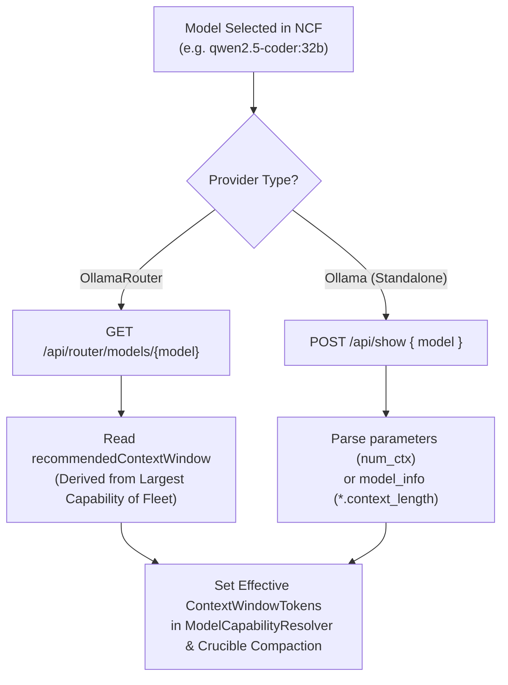

# ⚡ Step 11.33: Unified LLM Provider Architecture (Standalone Ollama vs OllamaRouter), Auto Context Window Discovery, & Dynamic Fleet Telemetry

> **Phase 11 Implementation Step (Post-MVP - Real-Project Hardening, Token Efficiency & Agent Ergonomics)**  
> *Parent Plan:* [Phase 11 Master Plan](../11_EXTEND_FEATURES.md)  
> *Project Target:* [`src/NightCodeForge.Core`](file:///c:/Users/Julien/source/repos/jetelain/NightCodeForge/src/NightCodeForge.Core), [`src/NightCodeForge.Agents`](file:///c:/Users/Julien/source/repos/jetelain/NightCodeForge/src/NightCodeForge.Agents), [`src/NightCodeForge.Infrastructure`](file:///c:/Users/Julien/source/repos/jetelain/NightCodeForge/src/NightCodeForge.Infrastructure), [`src/NightCodeForge.Web`](file:///c:/Users/Julien/source/repos/jetelain/NightCodeForge/src/NightCodeForge.Web), [`tests/NightCodeForge.Agents.Tests`](file:///c:/Users/Julien/source/repos/jetelain/NightCodeForge/tests/NightCodeForge.Agents.Tests), [`tests/NightCodeForge.Infrastructure.Tests`](file:///c:/Users/Julien/source/repos/jetelain/NightCodeForge/tests/NightCodeForge.Infrastructure.Tests)  
> *Status:* Implemented | *Target Framework:* .NET 10 (C# 13)  
> *Dependencies / OllamaRouter Backend Tasks:* [OllamaRouter Task #17: Router Identity, Health & Fleet Hardware Topology API](file:///C:/Users/Julien/source/repos/jetelain/OllamaRouter/docs/tasks/2026-10-26-router-identity-health-fleet-hardware-topology-api.md), [OllamaRouter Task #16: Model Capabilities, Dynamic Context Sizing & Routing Preview API](file:///C:/Users/Julien/source/repos/jetelain/OllamaRouter/docs/tasks/2026-10-26-model-capabilities-dynamic-context-sizing-routing-preview-api.md), [OllamaRouter Task #18: Fleet VRAM Management & Reclaim API](file:///C:/Users/Julien/source/repos/jetelain/OllamaRouter/docs/tasks/2026-10-26-fleet-vram-management-reclaim-api.md), [OllamaRouter Task #21: Session Affinity Header & 32 GB Server-Class Hardware Ceiling](file:///C:/Users/Julien/source/repos/jetelain/OllamaRouter/docs/tasks/2026-10-26-session-affinity-header-and-32gb-server-class-hardware-ceiling.md)  
> *Aligns With:* [AGENTS.md](../../../AGENTS.md), [docs/PLAN.md](../../PLAN.md)

---

## 1. Executive Summary & Motivation

### 1.1 The Standalone Ollama Principle (Zero Router Burden for Single GPUs)
Currently, NightCodeForge assumes an OllamaRouter proxy topology with three hardcoded targets (`Local`, `Remote`, `Cloud`). Target pinning selectors (`X-OllamaRouter-Target`) are displayed across agent profiles, and the gateway service queries `/monitor/api` (an endpoint designed for the terminal/HTML monitor).

However:
1. **Single-GPU Developers:** Users operating on a single workstation or laptop have no need for a reverse proxy or multi-node routing daemon. Imposing OllamaRouter on single-GPU users creates unnecessary setup complexity, port forwarding conflicts, and maintenance friction. They must be able to use **standalone Ollama directly**.
2. **Direct Per-Stage Configuration:** Instead of an error-prone top-level role architecture override layer that attempts to synchronize or overwrite models across stages, configuration is streamlined and direct:
   - **Provider Connection:** `Ollama` (Direct Standalone) or `OllamaRouter` (Extensible Multi-Node Fleet), with status dot, diagnostic auto-detection, and model catalog refresh.
   - **Per-Stage Profile Cards:** Each stage (Stage 0 `triage`, `ideation`, Stage 1 `task-review`, Stage 3 `implementation`, Stage 5 `code-review-fix`) directly configures its own model, thinking effort, target pinning (under OllamaRouter), and execution limits.
3. **Automatic Context Window Discovery Based on Fleet Capabilities:** Context window sizes should never be manually guessed or hardcoded to static 128k fallbacks. Context capacities must be automatically read from Ollama (via Modelfile `num_ctx` and GGUF metadata) or OllamaRouter (via `recommendedContextWindow`). In a multi-node fleet, compaction `ContextWindowTokens` must be sized to the **largest capability of the fleet** (the maximum context ceiling across capable targets or cloud overflow), ensuring conversations are not compacted prematurely while high-capacity nodes (e.g. dedicated GPU servers or cloud overflow) can service extended context.
4. **Clean API Integration:** Replace scraping of legacy `/monitor/api` with dedicated, high-performance REST APIs ([OllamaRouter Task #17](file:///C:/Users/Julien/source/repos/jetelain/OllamaRouter/docs/tasks/2026-10-26-router-identity-health-fleet-hardware-topology-api.md): `GET /api/router/info`, `GET /api/router/fleet`; [OllamaRouter Task #16](file:///C:/Users/Julien/source/repos/jetelain/OllamaRouter/docs/tasks/2026-10-26-model-capabilities-dynamic-context-sizing-routing-preview-api.md): `GET /api/router/models`; [OllamaRouter Task #18](file:///C:/Users/Julien/source/repos/jetelain/OllamaRouter/docs/tasks/2026-10-26-fleet-vram-management-reclaim-api.md): `POST /api/router/vram/reclaim`), dynamically rendering arbitrary fleet topologies (Desktop 16 GB, Laptop 8 GB, AI Server 1 96 GB, AI Server 2 64 GB, Cloud Overflow).
5. **Multi-Agent KV-Cache & Session Affinity in Fleet Mode ([OllamaRouter Task #21](file:///C:/Users/Julien/source/repos/jetelain/OllamaRouter/docs/tasks/2026-10-26-session-affinity-header-and-32gb-server-class-hardware-ceiling.md)):** When multiple agents (e.g. Architect and Developer, or concurrent background workers) execute against OllamaRouter, prompts must not bounce haphazardly across capable nodes (e.g., oscillating between Desktop, AI Server 1, and AI Server 2). Because `llama.cpp` prompt prefix evaluation is cached in host memory, bouncing between nodes destroys prompt KV-cache reuse and imposes severe 10–30s re-evaluation penalties on every turn. NightCodeForge must propagate a session identifier (`X-OllamaRouter-Session-Id` derived from the active `ConversationId` or `AgentId`/`TaskId`) with every inference call to ensure each agent sticks to its assigned node and reuses prompt prefix KV cache seamlessly.

---

## 2. Architectural Specifications

### 2.1 Provider Selection & Simplified Configuration Schema

In `LlmProviderOptions` and Global Settings:
```csharp
public enum LlmProviderType
{
    /// <summary>Direct connection to standard Ollama instance (single host GPU).</summary>
    Ollama,

    /// <summary>Connection to OllamaRouter reverse proxy (multi-node LAN fleet + cloud overflow).</summary>
    OllamaRouter
}

public class LlmProviderOptions
{
    public const string SectionName = "LlmProvider";

    public LlmProviderType ProviderType { get; set; } = LlmProviderType.OllamaRouter;
    public string Endpoint { get; set; } = "http://localhost:11434";
    public double RequestTimeoutMinutes { get; set; } = 15;

    public const int DefaultContextWindowTokens = 131072;
    public const int DefaultMaxOutputTokens = 8192;

    /// <summary>Baseline context window in tokens (used as fallback when provider discovery is unavailable).</summary>
    public int ContextWindowTokens { get; set; } = DefaultContextWindowTokens;

    /// <summary>Output token budget reserved from the context window.</summary>
    public int MaxOutputTokens { get; set; } = DefaultMaxOutputTokens;

    // Unified baseline configuration (Standardized identifier replacing legacy ModelId under Clean Break Policy)
    public string DefaultModelId { get; set; } = "Qwen3.8-27B:latest";
    public ThinkingEffort DefaultThinkingEffort { get; set; } = ThinkingEffort.Medium;

    // Optional role differentiation (CoderModelId ?? DefaultModelId strategy for initial setup;
    // UI checks effective state of agent profiles directly without a separate boolean flag)
    // Coder role (Implementation stage)
    public string? CoderModelId { get; set; }
    public ThinkingEffort? CoderThinkingEffort { get; set; }

    // Architect role (Triage, Ideation, Task Review, Code Review & Fix)
    public string? ArchitectModelId { get; set; }
    public ThinkingEffort? ArchitectThinkingEffort { get; set; }

    /// <summary>
    /// Per-model capability overrides and effort maps (e.g. Qwen 3.8 mapping "high" to "xhigh").
    /// </summary>
    public Dictionary<string, ModelCapabilityProfile> ModelProfiles { get; set; } = CreateDefaultModelProfiles();

    public static Dictionary<string, ModelCapabilityProfile> CreateDefaultModelProfiles()
    {
        ModelCapabilityProfile Qwen38() => new()
        {
            SupportedEfforts = ["low", "medium", "xhigh"],
            EffortMap = new Dictionary<string, string>(StringComparer.OrdinalIgnoreCase) { ["high"] = "xhigh" },
            DefaultEffort = "xhigh"
        };

        return new Dictionary<string, ModelCapabilityProfile>(StringComparer.OrdinalIgnoreCase)
        {
            ["qwen3.8"] = Qwen38(),
            ["qwen-3.8"] = Qwen38(),
            ["Qwen3.8-27B:latest"] = Qwen38()
        };
    }
}
```

### 2.1.1 Layered User Configuration Pattern (Factory Defaults vs. config/config.json Overlay)

To avoid user manual configuration editing and ensure user settings survive binary updates:
- **Factory Settings (`appsettings.json`):** Treated strictly as **read-only factory defaults** shipped with the application binary or container image. Users must **never** be instructed to edit `appsettings.json` directly.
- **Persistent User Overlay (`config/config.json`):** User configuration is loaded via `builder.Configuration.AddJsonFile("config/config.json", optional: true, reloadOnChange: true)`. This file resides in the persistent user directory and overlays factory settings without being overwritten by future software updates.
- **Provisioned by Step 12.18 OOBE Wizard:** Web UI configuration is not required for Step 11.33 because the initial provider selection, endpoint, and hardware-calibrated model selection are automatically configured by the [Step 12.18 OOBE Setup Wizard](../phase-12/STEP_12_18_CROSS_PLATFORM_DESKTOP_INSTALLER_AND_ENVIRONMENT_WIZARD.md), which populates `config/config.json` directly during installation:
  ```json
  // config/config.json (User Overlay)
  {
    "LlmProvider": {
      "ProviderType": "Ollama",
      "Endpoint": "http://localhost:11434",
      "DefaultModelId": "jetelain/qwen3.6-35b-a3b:latest",
      "DefaultThinkingEffort": "Medium",
      "ContextWindowTokens": 131072
    }
  }
  ```

#### Provider Auto-Detection (Encapsulated in `ILlmGatewayService.DetectProviderAsync`)
To adhere to the `AGENTS.md` presentation-logic separation rule, auto-detection logic lives strictly within `ILlmGatewayService` (or `IOllamaRouterGatewayService.DetectProviderAsync`), never directly inside Razor `@code` blocks:
On startup or when clicking **"Detect Provider"** in the Web UI:
1. Issue `GET /api/router/info` (timeout: 2s):
   - If HTTP 200 returned with `{ "isRouter": true }` $\rightarrow$ Provider is **OllamaRouter**.
2. If HTTP 404 or connection failed, issue `GET /api/version` (timeout: 2s):
   - If HTTP 200 returned with `{ "version": "..." }` $\rightarrow$ Provider is **Ollama**.
3. If both fail $\rightarrow$ Endpoint is offline (returns null/offline status, failing fast on actual inference attempts).

#### 2.1.2 Provider Fixed at Startup (Restart Required)

Switching between `Ollama` and `OllamaRouter` requires an application restart. The provider is read once from `LlmProvider:ProviderType` at startup (`Program.cs`) and passed to `AddNightCodeForgeInference(providerType)` (Infrastructure) and `AddNightCodeForgeAgents(providerType)` (Agents), which register **dedicated implementation classes** for the chosen provider (gateway, model catalog, chat client factory). Services never branch on `ProviderType` at runtime.
- `LlmEndpointOptions { Endpoint, ContextWindowTokens }` (Infrastructure) is bound from the same `LlmProvider` section as `LlmProviderOptions` so both layers share one endpoint.
- The Settings UI shows the active provider read-only. **Detect Provider** is a diagnostic only: on mismatch with the configured provider it warns to set `LlmProvider:ProviderType` and restart.

---

### 2.2 Standalone Ollama Mode Operation

When `ProviderType == LlmProviderType.Ollama`:
1. **Target Pinning & Session Headers Suppressed:** The `X-OllamaRouter-Target` and `X-OllamaRouter-Session-Id` headers are never attached to outbound HTTP requests (`OllamaChatClient.cs`). The target pinning dropdowns in `AgentProfilesTab.razor` are completely hidden.
2. **Clean Single-Host Inspector:** The `/settings` and `/monitoring` tabs display a streamlined single-host GPU card:
   - Host Ollama version and latency from `GET /api/version`.
   - Resident GPU models in local memory from `GET /api/ps`.
3. **Direct VRAM Reclamation:** Invoking VRAM reclamation sends `keep_alive: 0` via `POST /api/generate` for all resident models discovered from `/api/ps`, instantly freeing local GPU memory without requiring router intervention.

---

### 2.3 Automatic Context Window Discovery & 32 GB Server-Class Tiering

Context window tokens are dynamically resolved to ensure the [CrucibleCompactionStrategy](file:///c:/Users/Julien/source/repos/jetelain/NightCodeForge/src/NightCodeForge.Agents/Inference/ModelCapabilityResolver.cs) and [SessionTranscriptService](file:///c:/Users/Julien/source/repos/jetelain/NightCodeForge/src/NightCodeForge.Agents/Transcripts/SessionTranscriptService.cs) compact conversations at the exact mathematical boundary:



#### Discovery Mechanics:
1. **OllamaRouter:** Calls `GET /api/router/models/{name}`. The router dynamically returns `recommendedContextWindow`, which represents the **largest capability across all capable nodes in the fleet** (`max(target.contextCeiling)` for capable targets, or cloud overflow ceiling).
   - **Crucible Compaction Fleet Rule:** Context compaction (`CrucibleCompactionOptions.ContextWindowTokens`) MUST be sized to the fleet's maximum context capability, not constrained to the smallest node. Because OllamaRouter dynamically routes requests exceeding smaller nodes' VRAM to higher-tier nodes (e.g. Server) or cloud overflow, sizing compaction to the largest capability ensures conversations are never compacted prematurely when the cluster has the hardware capacity to handle extended context.
   - **Server-Class 32 GB Threshold ([OllamaRouter Task #21](file:///C:/Users/Julien/source/repos/jetelain/OllamaRouter/docs/tasks/2026-10-26-session-affinity-header-and-32gb-server-class-hardware-ceiling.md)):** OllamaRouter partitions target classes as:
     - **Small (< 12 GB):** Laptop (8 GB) — MoE & SmallDense offload.
     - **Desktop (12 GB – 32 GB):** Desktop (16 GB) — capped at 48k context (`49,152` tokens).
     - **Server (≥ 32 GB):** AI Server 2 (64 GB) & AI Server 1 (96 GB) — full 260k context (`262,144` tokens) and Server LargeDense role matching.
     In a fleet containing AI Server 1 or 2, `recommendedContextWindow` for `Qwen3.8-27B:latest` will correctly resolve to **262,144 tokens**.
2. **Standalone Ollama (and router fallback when a model is unknown to `/api/router/models`):** Calls `POST /api/show`:
   - Reads `parameters`: searches for `num_ctx <int>` in Modelfile.
   - If absent, reads `model_info`: searches for keys ending with `.context_length` (e.g. `qwen2.context_length: 32768`).
   - If absent, falls back to the standard Ollama default (4,096 tokens). This fallback is **not cached** so a later call can retry.
   - `capabilities` containing `thinking` drives `AvailableModelInfo.SupportsReasoning`.
3. **Caching & Lifecycle Integration:** Discovered context windows are cached in memory by the gateway (`ResolveContextWindowAsync`), keyed by model id; the catalog returns them in `AvailableModelInfo.ContextWindowTokens`. When an agent stage initializes or an agent profile is instantiated, the harness or stage runner calls `await gateway.ResolveContextWindowAsync(modelId, ct)` and supplies the discovered integer as `explicitContextWindowTokens` to `ModelCapabilityResolver.BuildCompactionStrategy(..., explicitContextWindowTokens: discoveredTokens)`. This bridges the asynchronous discovery engine with the synchronous Crucible compaction boundary cleanly.

---

### 2.4 Dynamic Fleet Topology & Clean Gateway Service

#### Refactored `IOllamaRouterGatewayService`
```csharp
public static class FleetLiveness { public const string Online = "Online", Offline = "Offline", Probing = "Probing"; } // router wire values

public record FleetTargetHardware(
    string? HardwareHint, string GpuVendor, IReadOnlyList<string> Devices,
    int? MaxVramMB, int? MaxParallel, double? SpeedFactor = null);

public record FleetTargetExecution(int InFlightRequests, string? ActiveModel, string? ContextAllocation);

public record FleetTargetStatus(
    string Name, string? Url, bool Enabled, string Liveness, long? LatencyMs,
    FleetTargetHardware Hardware, FleetTargetExecution Execution)
{
    // Derived: Disabled (not enabled) / Offline / Available (Probing) / Busy (inFlight > 0) / Active (online idle)
    public TargetBackendState State { get; }
}

public record GatewayStatusReport(
    bool IsConnected, LlmProviderType ProviderType, string BaseUrl, string Version,
    IReadOnlyList<FleetTargetStatus> FleetTargets);

public interface IOllamaRouterGatewayService
{
    LlmProviderType ProviderType { get; }   // fixed by the concrete class, not by configuration lookups at call time
    Task<LlmProviderType?> DetectProviderAsync(CancellationToken cancellationToken = default); // diagnostic only
    Task<GatewayStatusReport> GetGatewayStatusAsync(CancellationToken cancellationToken = default);
    Task<IReadOnlyList<ResidentModelInfo>> GetResidentModelsAsync(CancellationToken cancellationToken = default);
    Task<int> ResolveContextWindowAsync(string modelName, CancellationToken cancellationToken = default);
    Task<bool> ReclaimVramAsync(CancellationToken cancellationToken = default);
    Task<bool> ReclaimVramAsync(string? targetName, CancellationToken cancellationToken = default);
}
```

#### Dedicated implementations (no `ProviderType` conditions)
`OllamaGatewayServiceBase` holds the shared logic (`DetectProviderAsync`, `/api/ps`, `ResolveContextWindowAsync`); `OllamaGatewayService` (standalone: single host target from `/api/version` + `/api/ps`, reclaim via `keep_alive: 0`) and `OllamaRouterGatewayService` (status from concurrent `GET /api/router/info` + `GET /api/router/fleet`; **any number of targets is mapped dynamically**, nothing assumed client-side; reclaim via `POST /api/router/vram/reclaim` body `{target}`) derive from it. A malformed router payload is treated as disconnected with an empty fleet.

#### UI Presentation in Web Dashboard
1. **OllamaRouter Gateway Card (`OllamaRouterGatewayCard.razor`):**
   - Renders dynamic cards for every node in `FleetTargets` (e.g., `Desktop (16 GB)`, `Laptop (8 GB)`, `Server 1 (96 GB)`, `Server 2 (64 GB)`, `Cloud Overflow`).
   - Displays real-time latency, active model, hardware tier (Desktop vs Server), and in-flight load per node.
2. **Cluster Monitor (`OllamaRouterClusterMonitor.razor`):**
   - Shows active fleet execution state without requiring heavy monitoring telemetry overhead.

---

### 2.5 Provider-Agnostic Model Catalog & Unified Chat Client Factory Abstractions

Currently, `AgentProfilesTab.razor` and `WizardStep3Environment.razor` inject `IOllamaModelCatalogService`, directly coupling the UI to Ollama-specific concepts (`OllamaModelInfo`, `Size`, `Digest`, and `/api/tags`). Furthermore, the inference client factory is named `IOllamaChatClientFactory`.

Under the **Clean Break Policy** ([AGENTS.md](../../../AGENTS.md)):
1. We replace `IOllamaModelCatalogService` with a clean, provider-agnostic abstraction in `NightCodeForge.Core.Interfaces`:
   ```csharp
   namespace NightCodeForge.Core.Interfaces;

   public record AvailableModelInfo(
       string ModelId,
       string DisplayName,
       int? ContextWindowTokens = null,
       long? SizeBytes = null,
       LlmProviderType ProviderType = LlmProviderType.Ollama,
       bool SupportsReasoning = false,
       IReadOnlyDictionary<string, object?>? Metadata = null)
   {
       /// <summary>Formatted badge for UI dropdowns (e.g. "19.8 GB" or "128k ctx").</summary>
       public string FormattedBadge => ContextWindowTokens.HasValue
           ? $"{ContextWindowTokens.Value / 1024}k ctx"
           : (SizeBytes.HasValue ? $"{SizeBytes.Value / (1024.0 * 1024 * 1024):F1} GB" : string.Empty);
   }

   public interface ILlmModelCatalogService
   {
       Task<IReadOnlyList<AvailableModelInfo>> GetAvailableModelsAsync(CancellationToken cancellationToken = default);
       Task RefreshAsync(CancellationToken cancellationToken = default);
   }
   ```
2. **Preserve `IOllamaModelPreloadService`:** `IOllamaModelPreloadService` is extracted into its own dedicated file `NightCodeForge.Core.Interfaces.IOllamaModelPreloadService.cs` so JIT model warmup capabilities (used in Phase 12 Step 12.5) remain intact.
3. **Unified Chat Client Factory (`ILlmChatClientFactory`):**
   Rename `IOllamaChatClientFactory` $\rightarrow$ `ILlmChatClientFactory`. The session overloads are required members; the session-less overloads are conveniences:
   ```csharp
   public interface ILlmChatClientFactory
   {
       IChatClient CreateClient(string? modelId = null);
       IChatClient CreateClient(string? modelId, OllamaRoutingTarget routingTarget);
       IChatClient CreateClient(AgentProfile? profile);
       IChatClient CreateClient(string? modelId, OllamaRoutingTarget routingTarget, string? sessionId);
       IChatClient CreateClient(AgentProfile? profile, string? sessionId);
   }
   ```
   Implementations are provider-specific classes sharing `LlmChatClientFactoryBase` (`OllamaRouterChatClientFactory`, `StandaloneOllamaChatClientFactory`); `DefaultLlmChatClientFactory` does not exist.
4. **Dedicated Catalog Implementations:** `LlmModelCatalogServiceBase` (lists `GET /api/tags`, enriches each model via `POST /api/show`: context window from `num_ctx`/`*.context_length`, `SupportsReasoning` from the `capabilities` array containing `thinking`; no model-name heuristics) with `OllamaModelCatalogService` and `OllamaRouterModelCatalogService` (context window overridden by `GET /api/router/models`: `recommendedContextWindow`, else `nativeContextWindow`).

#### Integration with UI:
- `AgentProfilesTab.razor` injects `ILlmModelCatalogService ModelCatalogService`.
- Model selection dropdowns render `@m.DisplayName (@m.FormattedBadge)` and bind to `@m.ModelId`.
- Eliminates Ollama-specific error strings and UI leaks across agent profile configuration and workspace creation wizards.

---

### 2.6 Multi-Agent Session Affinity & KV-Cache Stickiness

In multi-agent environments where NightCodeForge runs multiple concurrent or interleaved agent workflows:
1. **Outbound Header Injection via Session-Bound Clients:**
   - `ILlmChatClientFactory` takes an explicit `sessionId`; the router factory attaches `X-OllamaRouter-Session-Id: {sessionId}` to the client's default request headers. **Crucible always sets it** (`LlmSessionIds.ForStage(taskId, stageId)`, stable across attempts of a stage to maximise affinity/KV-cache reuse); Ideation passes its session id.
   - **Caching:** only session-less clients are cached (by `model:routingTarget`). Session-bound clients are created per call because session ids are unbounded; they are cheap since all share the factory's single `SocketsHttpHandler` (connection pool, TCP keepalive, DNS refresh), so there is no socket exhaustion risk. No sliding-expiration cache is needed.
   - Under standalone `Ollama` mode the `StandaloneOllamaChatClientFactory` sends no `X-OllamaRouter-*` header (dedicated class, no runtime condition).
2. **Router-Side Target Binding:**
   - OllamaRouter awards a `SessionAffinityBonus (+150)` in Stage 2 candidate scoring, ensuring consecutive turns from the same agent stick to the same physical node.
   - **KV-Cache Preservation:** Consecutive turns hit the node holding the prompt's pre-computed KV cache, eliminating prompt evaluation latency spikes.
   - **Isolation:** Agent 1 (e.g. Architect) naturally binds to `aiserver1` (or Desktop), while Agent 2 (e.g. Developer) binds to `aiserver2` (or Laptop), avoiding eviction contention and queueing.
3. **Resilience & Failover:**
   - If the assigned node goes offline or exceeds failure streak limits, OllamaRouter breaks the lease and rebinds the session to the next best candidate automatically. NightCodeForge remains completely decoupled from physical node management.

---

## 3. Implementation Checklist & Deliverables

### Phase 1: Core Domain & Abstractions
- [x] Add `LlmProviderType` enum (`Ollama`, `OllamaRouter`) in `NightCodeForge.Core.Domain`.
- [x] Update `LlmProviderOptions` with unified baseline (`DefaultModelId`, `DefaultThinkingEffort`), preserved `ModelProfiles`, and optional role differentiation settings.
- [x] Extract `IOllamaModelPreloadService` into its own file.
- [x] Introduce `AvailableModelInfo` and `ILlmModelCatalogService` (replacing legacy `IOllamaModelCatalogService`, deleted).
- [x] `ILlmChatClientFactory` with required `sessionId` overloads (`IOllamaChatClientFactory` kept as an empty derived interface).
- [x] Enhance `IOllamaRouterGatewayService` with `GatewayStatusReport`, `FleetTargetStatus`, `ProviderType`, `DetectProviderAsync`, `ResolveContextWindowAsync`.

### Phase 2: Dedicated Provider Implementations
- [x] `OllamaGatewayServiceBase` + `OllamaGatewayService` + `OllamaRouterGatewayService` driven by `/api/router/info`, `/api/router/fleet`, `/api/router/models/{name}`, `/api/router/vram/reclaim`; standalone via `/api/version`, `/api/ps`, `/api/show`, `/api/generate`.
- [x] `LlmModelCatalogServiceBase` + `OllamaModelCatalogService` + `OllamaRouterModelCatalogService`.
- [x] `LlmChatClientFactoryBase` + `OllamaRouterChatClientFactory` (target + session headers) + `StandaloneOllamaChatClientFactory` (no router headers); shared `SocketsHttpHandler`; session-less clients cached, session-bound created per call.
- [x] Startup wiring by provider (`AddNightCodeForgeInference`, `AddNightCodeForgeAgents`, `LlmEndpointOptions` bound from `LlmProvider`).
- [x] Crucible sets the session id (`LlmSessionIds.ForStage`); Ideation passes its session id.

### Phase 3: Web UI & Settings Ergonomics
- [x] Migrate `AgentProfilesTab.razor` and `WizardStep3Environment.razor` to `ILlmModelCatalogService` (`@m.DisplayName (@m.FormattedBadge)`).
- [x] `AgentProfilesTab.razor`: Provider connection strip with active provider status, diagnostic Auto-Detect, and model refresh. Each agent reasoning profile card directly configures model, thinking effort, target pinning (hidden under standalone Ollama), and parameters.
- [x] `OllamaRouterGatewayCard.razor` and `OllamaRouterClusterMonitor.razor` render arbitrary fleet targets.

### Phase 4: Automated Testing
- [x] Unit tests for `OllamaRouterGatewayService` (dynamic N targets, state derivation, detect, context, reclaim) and `OllamaGatewayService` (single host, offline, `keep_alive: 0` reclaim).
- [x] Unit tests for the catalogs (`/api/show` enrichment, router overrides, soft failure).
- [x] Unit tests for the chat client factories (router headers, no headers for standalone, session-less caching only) and `LlmSessionIds`.
- [x] Component tests for Settings, Profile and Monitoring pages.

## 4. Acceptance Criteria

1. **Standalone Ollama Verification:** When pointed to a vanilla Ollama instance without OllamaRouter, NightCodeForge connects cleanly, reports `Provider: Ollama (Single Host)`, lists resident models from `/api/ps`, hides target pinning, and automatically discovers context window size via `POST /api/show`.
2. **OllamaRouter Multi-Node Verification:** When pointed to OllamaRouter, NightCodeForge connects cleanly, reports `Provider: OllamaRouter`, queries `GET /api/router/fleet`, renders all configured fleet machines (Desktop 16 GB, Laptop 8 GB, Server 1 96 GB, Server 2 64 GB), and routes requests with dynamic context sizing.
3. **Context Window Accuracy & Fleet Compaction Sizing:** Selecting a model (e.g. `qwen2.5-coder:32b` or `Qwen3.8-27B:latest`) dynamically retrieves its safe context window from the provider and caches it in memory. In a multi-node fleet with Server-class nodes (≥ 32 GB), `ContextWindowTokens` for compaction is sized according to the **largest capability of the fleet** (262,144 tokens for 27B on Server), ensuring conversations are not compacted prematurely while high-capacity nodes can handle extended context.
4. **Session Affinity & KV-Cache Stickiness:** When NightCodeForge runs multiple agents concurrently against OllamaRouter, each agent transmits its distinct `X-OllamaRouter-Session-Id`. Consecutive LLM turns for Agent A stick to Agent A's node (e.g. `aiserver1`), and turns for Agent B stick to Agent B's node (e.g. `aiserver2` or `desktop`), avoiding cross-node bouncing and preserving prompt prefix KV-cache evaluation speed.
5. **VRAM Reclaim:** Triggering VRAM reclamation cleanly evicts models in both standalone Ollama and OllamaRouter modes.

---

## 5. Implementation Nuances & Gaps to Watch

1. **Service Constructor Discipline ([AGENTS.md](../../../AGENTS.md)):**
   - All services (`OllamaGatewayService`, `OllamaRouterGatewayService`, `OllamaModelCatalogService`, `OllamaRouterModelCatalogService`, the chat client factories) inject every dependency via constructors without default or optional parameters (`HttpClient`, `IOptions<LlmEndpointOptions>` / `IOptions<LlmProviderOptions>`, `ILogger`, ...). A missing/invalid endpoint configuration fails fast.

2. **Auto-Detection Probe Latency & Timeout Boundaries:**
   - When auto-detecting the provider (`GET /api/router/info` followed by `GET /api/version`), use a strict, short HTTP timeout (e.g. 2 seconds via a linked `CancellationTokenSource`). This ensures startup probes and the Web UI "Detect Provider" button never block or freeze the UI if an endpoint is offline or firewalled. The probe logic is strictly encapsulated in `IOllamaRouterGatewayService.DetectProviderAsync` rather than Razor component `@code`.

3. **Session ID Propagation via Dedicated Factories:**
   - To avoid mutable ambient `AsyncLocal` state, the session id is an explicit argument of `ILlmChatClientFactory.CreateClient(..., sessionId)`. **Callers running multi-turn conversations MUST pass it** (Crucible: `LlmSessionIds.ForStage(taskId, stageId)`; Ideation: its ideation session id). The session overloads are abstract members of the interface (no default implementation dropping the id).
   - `OllamaRouterChatClientFactory` sets `X-OllamaRouter-Session-Id` (and `X-OllamaRouter-Target` when pinned); `StandaloneOllamaChatClientFactory` sends no router headers. Both derive from `LlmChatClientFactoryBase`, which shares a single `SocketsHttpHandler`. There is no runtime `ProviderType` condition.

4. **Model Profiles & Effort Mapping Retention:**
   - [LlmProviderOptions](file:///c:/Users/Julien/source/repos/jetelain/NightCodeForge/src/NightCodeForge.Agents/Inference/LlmProviderOptions.cs) retains `ModelProfiles` (e.g., mapping Qwen 3.8 requested effort `"high"` to `"xhigh"`). Dynamic context discovery replaces the static fallback `DefaultContextWindowTokens = 131072`, but effort mapping logic must be retained to ensure models with non-standard effort scales (like Qwen 3.8) receive valid parameters.

5. **In-Flight Compaction Fleet Sizing Invariant:**
   - Crucible turn compaction (`CrucibleCompactionOptions.ContextWindowTokens` in [ModelCapabilityResolver](file:///c:/Users/Julien/source/repos/jetelain/NightCodeForge/src/NightCodeForge.Agents/Inference/ModelCapabilityResolver.cs)) must be sized to `max(target.contextCeiling)` across all capable nodes in the cluster (or cloud overflow ceiling), as returned by OllamaRouter (`recommendedContextWindow`). Sizing compaction to the smallest node would trigger premature compaction, destroying reasoning context when higher-tier nodes (e.g., 64 GB or 96 GB servers) are available to handle large context windows.

6. **Boundary Division with Step 12.5 (Dual Model Roles):**
   - Step 11.33 introduces the configuration schema (`LlmProviderOptions`) and baseline profile generation in `AgentProfile.CreateStandardGlobalProfiles`. Settings UI directly configures each individual agent reasoning profile card without an overriding role architecture layer. Full dynamic runtime stage dispatching, difficulty-based escalation (escalating difficult tasks to Architect models during implementation), and deterministic stage JIT warmup (`PreloadModelAsync`) are the explicit responsibility of [Phase 12 Step 12.5](../phase-12/STEP_12_5_DUAL_MODEL_ROLE_CONFIGURATION_AND_DIFFICULTY_ESCALATION.md).

