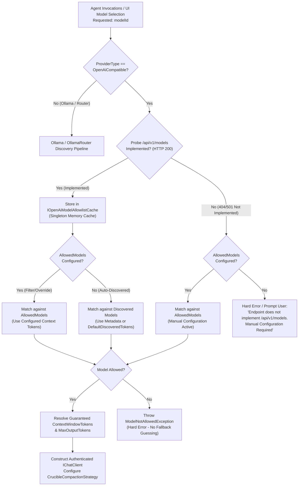

# 🌐 Step 11.35: OpenAI-Compatible LLM Provider Integration, Dynamic Endpoint Probing & Conditional Model Allowlist

> **Phase 11 Implementation Step (Post-MVP - Real-Project Hardening, Token Efficiency & Agent Ergonomics)**  
> *Parent Plan:* [Phase 11 Master Plan](../11_EXTEND_FEATURES.md)  
> *Target Framework:* .NET 10 (C# 13) | *Status:* Proposed  
> *Target Projects:* [`src/NightCodeForge.Core`](file:///c:/Users/Julien/source/repos/jetelain/NightCodeForge/src/NightCodeForge.Core), [`src/NightCodeForge.Agents`](file:///c:/Users/Julien/source/repos/jetelain/NightCodeForge/src/NightCodeForge.Agents), [`src/NightCodeForge.Infrastructure`](file:///c:/Users/Julien/source/repos/jetelain/NightCodeForge/src/NightCodeForge.Infrastructure), [`src/NightCodeForge.Web`](file:///c:/Users/Julien/source/repos/jetelain/NightCodeForge/src/NightCodeForge.Web), [`tests/NightCodeForge.Agents.Tests`](file:///c:/Users/Julien/source/repos/jetelain/NightCodeForge/tests/NightCodeForge.Agents.Tests), [`tests/NightCodeForge.Infrastructure.Tests`](file:///c:/Users/Julien/source/repos/jetelain/NightCodeForge/tests/NightCodeForge.Infrastructure.Tests), [`tests/NightCodeForge.Web.Tests`](file:///c:/Users/Julien/source/repos/jetelain/NightCodeForge/tests/NightCodeForge.Web.Tests)  
> *Dependencies:* [Step 11.33: Unified LLM Provider Architecture (Standalone Ollama vs OllamaRouter)](STEP_11_33_UNIFIED_LLM_PROVIDER_DYNAMIC_CONTEXT_AND_FLEET_INTEGRATION.md)  
> *Aligns With:* [AGENTS.md](../../../AGENTS.md), [docs/PLAN.md](../../PLAN.md)

---

> **Alignment with Step 11.33 (provider fixed at startup):** The provider is selected once at startup (`LlmProvider:ProviderType`, restart required to change). Every `if (ProviderType == ...)` snippet below illustrates the *behaviour* only; the implementation MUST register dedicated provider-specific implementations via `AddNightCodeForgeInference(providerType)` and `AddNightCodeForgeAgents(providerType)`:
> 1. A dedicated gateway ([`OpenAiCompatibleGatewayService`](#26-dedicated-gateway-service--jit-preload-no-op)),
> 2. A dedicated model catalog ([`OpenAiCompatibleModelCatalogService`](#25-model-catalog-integration-apiv1models-probing--first-class-model-metadata)),
> 3. A dedicated chat client factory ([`OpenAiCompatibleChatClientFactory`](#24-client-lifecycle-authentication--header-hygiene)), and
> 4. A no-op preload service ([`NoOpModelPreloadService`](#26-dedicated-gateway-service--jit-preload-no-op)).
>
> Services must never branch on `ProviderType` at runtime. Chat clients must still receive the session id ([`ILlmChatClientFactory.CreateClient(..., sessionId)`](file:///c:/Users/Julien/source/repos/jetelain/NightCodeForge/src/NightCodeForge.Agents/Inference/ILlmChatClientFactory.cs)).


## 1. Executive Summary & Motivation

### 1.1 The Need for OpenAI-Compatible Endpoints
Following the unified LLM provider architecture established in [Step 11.33](STEP_11_33_UNIFIED_LLM_PROVIDER_DYNAMIC_CONTEXT_AND_FLEET_INTEGRATION.md) (which decoupled NightCodeForge from mandatory OllamaRouter proxying and introduced direct standalone Ollama support), developers frequently require connectivity to inference endpoints adhering to the de facto industry standard: the **OpenAI Chat Completions API (`/v1/chat/completions`)**.

These endpoints include:
1. **Local Self-Hosted Runtimes:** vLLM, LM Studio, llama.cpp server (`llama-server`), LocalAI, Jan, TabbyAPI, and Text Generation WebUI (oobabooga).
2. **Dedicated Cloud Gateways & Aggregators:** OpenRouter, DeepSeek, Groq, Mistral AI, Together AI, Fireworks AI, Cerebras, Azure OpenAI, and official OpenAI (`api.openai.com`).
3. **Enterprise Proxies & Caching Layers:** LiteLLM, Portkey, Cloudflare AI Gateway.

### 1.2 Dynamic Discovery via `/api/v1/models` Probing & Conditional Manual Configuration
Unlike native Ollama instances (which expose `POST /api/show` to inspect Modelfiles and GGUF metadata) or OllamaRouter clusters (which dynamically report `recommendedContextWindow` via `GET /api/router/models/{name}`):

1. **Endpoint Model Probing (`/api/v1/models`):** The vast majority of OpenAI-compatible inference servers and cloud gateways (OpenRouter, LiteLLM, vLLM, LM Studio, Groq, Ollama `/v1`) implement a model listing endpoint at `GET /api/v1/models` (or standard `GET /v1/models`). When queried, these endpoints return the list of installed or available models, and many modern gateways (such as OpenRouter and LiteLLM) even return rich metadata including `context_length`.
2. **Minimal & Custom Proxies (Unimplemented Endpoints):** Certain stripped-down forward proxies or minimal local runtimes (e.g. lightweight `llama-server` builds or single-purpose corporate gateways) do not implement `/api/v1/models`, returning HTTP 404 Not Found or HTTP 501 Not Implemented.
3. **Ergonomic Principle (Ask for Manual Configuration ONLY If Endpoint Is Not Implemented):** Developers should never be forced into tedious manual entry of model identifiers and context ceilings when the remote endpoint already publishes its model catalog. NightCodeForge systematically **probes `/api/v1/models` (and `/v1/models`)**. If the endpoint is implemented (HTTP 200), models are discovered dynamically without requiring manual configuration. **NightCodeForge asks for manual model configuration (`AllowedModels`) only if the `/api/v1/models` endpoint is not implemented**, or if the administrator explicitly chooses to restrict or override the available models.
4. **Context Window Safety & Determinism:** When models are discovered without explicit context metadata, a safe default context limit (`DefaultDiscoveredContextTokens`, default 128k) or manual model override is applied. This guarantees mathematical precision for Crucible turn compaction without risking prompt truncation or runaway out-of-bounds context errors.

### 1.3 Architectural Solution
NightCodeForge introduces **`LlmProviderType.OpenAiCompatible`** as a first-class inference provider:
- **Polymorphism and Interface-Driven Provider Isolation:** Following clean architecture, non-specialized consumers (`CrucibleAgentHarness`, `IdeationService`, `DeterministicBuildStage`, `OperationsControlService`, `ModelCapabilityResolver`) never execute procedural provider checks (such as `if (isOpenAi)` or `if (ProviderType == OpenAiCompatible)`). Provider behavior is isolated behind clear interfaces and polymorphic implementations:
  - `ILlmCapabilityResolver` (`OllamaCapabilityResolver`, `OpenAiCapabilityResolver`): Polymorphically resolves thinking parameters, reasoning effort normalization, and `ChatOptions`.
  - `ILlmGatewayService` (`OllamaRouterGatewayService` / `OllamaGatewayServiceBase`, `OpenAiCompatibleGatewayService`): Encapsulates context window resolution, resident models, and VRAM reclamation.
  - `ILlmModelPreloadService` (`OllamaModelPreloadService`, `NoOpModelPreloadService`): Polymorphically handles model warm-up without provider branching in workflow stages.
  - `IDefaultModelSelector` (`OllamaDefaultModelSelector`, `OpenAiDefaultModelSelector`): Polymorphically evaluates candidate models for default selection in catalogs.
- **Probing-First Catalog Discovery:** Probes `GET /api/v1/models` (with `/v1/models` relative fallback) upon connection. If implemented (HTTP 200), available models and their metadata (such as `context_length` and pricing) are ingested automatically into the model catalog.
- **Automatic Default Model Resolution (`IDefaultModelSelector`):** If `DefaultModelId` is omitted (null or empty), the system resolves the default model automatically according to provider strategy:
  - **OpenAI-Compatible (`OpenAiDefaultModelSelector`):** Lowest prompt cost first (if pricing data is available), then completion cost, then alphabetical order.
  - **Ollama / OllamaRouter (`OllamaDefaultModelSelector`):** Most capable model: largest context window first (`ContextWindowTokens` descending, e.g. 128k > 64k > 32k), then Dense architecture over Mixture of Experts (MoE) for maximum reasoning depth and stability, then size/capacity (`SizeBytes`), and alphabetical order as tie-breaker.
- **Conditional Manual Configuration (`AllowedModels`):** Manual model entry is only required if `/api/v1/models` is not implemented (HTTP 404 / 501), or when administrators explicitly specify custom allowed models and context overrides.
- **Fail-Fast Validation:** If `/api/v1/models` is not implemented and no models are configured manually, startup and UI validation fail fast with an actionable diagnostic prompting manual setup. Attempting to invoke an unlisted model fails fast with a dedicated domain exception (`ModelNotAllowedException`), adhering strictly to `AGENTS.md` ("No silent failures... Avoid creating synthetic values for something that should exist in database, make a hard error").
- **Deterministic Crucible Compaction:** The `ModelCapabilityResolver` operates purely on integer context windows and model substring profiles to compute Pi-style compaction budgeting math, completely decoupled from provider-specific logic.
- **Clean Header & Protocol Hygiene:** Outbound HTTP requests use standard `Authorization: Bearer <ApiKey>` authentication, standard OpenAI streaming tool call protocols, and strictly suppress Ollama-specific headers (`X-OllamaRouter-Target`, `X-OllamaRouter-Session-Id`).
- **Complete Provider Trifecta (Gateway, Catalog, Factory):** Adhering to the architecture established in Step 11.33, OpenAI-compatible mode registers a dedicated gateway (`OpenAiCompatibleGatewayService`), a catalog (`OpenAiCompatibleModelCatalogService`), and a factory (`OpenAiCompatibleChatClientFactory`), ensuring dependent services such as `OperationsControlService` and `IdeationService` resolve seamlessly without DI errors or runtime branching.

---

## 2. Architectural Specifications

### 2.1 Provider Enumeration & Extended Configuration Schema

Extend `LlmProviderType` in `NightCodeForge.Core.Domain`:

```csharp
namespace NightCodeForge.Core.Domain;

public enum LlmProviderType
{
    /// <summary>Direct connection to standard Ollama instance (single host GPU).</summary>
    Ollama,

    /// <summary>Connection to OllamaRouter reverse proxy (multi-node LAN fleet + cloud overflow).</summary>
    OllamaRouter,

    /// <summary>Connection to generic OpenAI-compatible chat completions endpoint (vLLM, LM Studio, OpenRouter, DeepSeek, OpenAI).</summary>
    OpenAiCompatible
}
```

Define central compile-time model defaults in `NightCodeForge.Core.Domain` to eliminate magic strings:

```csharp
namespace NightCodeForge.Core.Domain;

public static class KnownDefaultModels
{
    /// <summary>
    /// Factory baseline model identifier applied when no default model is specified
    /// and dynamic catalog probing is unavailable or returns an empty catalog.
    /// </summary>
    public const string DefaultBaseline = "Qwen3.8-27B:latest";

    /// <summary>
    /// Fallback dummy API key used for unauthenticated local endpoints (LM Studio, local vLLM)
    /// to satisfy SDK ApiKeyCredential validation without throwing ArgumentException.
    /// </summary>
    public const string LocalAuthBypassKey = "local-auth-bypass";
}
```

Extend `LlmProviderOptions` in `NightCodeForge.Agents.Inference`:

```csharp
namespace NightCodeForge.Agents.Inference;

public class OpenAiAllowedModel
{
    /// <summary>
    /// Exact model identifier required by the remote endpoint (e.g. "deepseek-chat", "gpt-4o", "meta-llama/llama-3.1-70b-instruct").
    /// </summary>
    public string ModelId { get; set; } = string.Empty;

    /// <summary>
    /// Human-friendly display label rendered in UI dropdowns and badges (e.g. "DeepSeek-V3 (64k)").
    /// If null or empty, defaults to ModelId.
    /// </summary>
    public string? DisplayName { get; set; }

    /// <summary>
    /// Safe context window in tokens, used directly to size Crucible in-loop compaction.
    /// </summary>
    public int ContextWindowTokens { get; set; } = 131072;

    /// <summary>
    /// Maximum output token budget reserved from the context window (default: 8192).
    /// </summary>
    public int MaxOutputTokens { get; set; } = 8192;

    /// <summary>
    /// Indicates whether the model supports chain-of-thought or reasoning parameters (e.g. OpenAI o1/o3-mini, DeepSeek-R1).
    /// </summary>
    public bool SupportsReasoning { get; set; } = false;

    /// <summary>
    /// Default thinking effort level if reasoning is enabled (Low, Medium, High).
    /// </summary>
    public ThinkingEffort DefaultThinkingEffort { get; set; } = ThinkingEffort.Medium;

    /// <summary>
    /// Optional prompt pricing per million tokens (e.g. 0.14 for $0.14/M tokens), used to determine lowest cost default model.
    /// </summary>
    public decimal? PromptCostPerMillion { get; set; }

    /// <summary>
    /// Optional completion pricing per million tokens, used for cost evaluation.
    /// </summary>
    public decimal? CompletionCostPerMillion { get; set; }
}

public class OpenAiCompatibleOptions
{
    /// <summary>
    /// Base URL of the OpenAI-compatible API (e.g. "http://localhost:1234/v1", "https://openrouter.ai/api/v1", "https://api.openai.com/v1").
    /// </summary>
    public string Endpoint { get; set; } = "https://api.openai.com/v1";

    /// <summary>
    /// Optional API key for authenticated endpoints. Can be injected via environment variable (e.g. OPENAI_API_KEY).
    /// May be omitted or empty for unauthenticated local endpoints (e.g. LM Studio, local vLLM).
    /// </summary>
    public string? ApiKey { get; set; }

    /// <summary>
    /// Optional organization identifier for multi-tenant OpenAI accounts.
    /// </summary>
    public string? OrganizationId { get; set; }

    /// <summary>
    /// Explicit allowlist / manual models configuration.
    /// Only required if the remote endpoint does not implement /api/v1/models (HTTP 404/501),
    /// or when an administrator explicitly restricts the discovered models or overrides context parameters.
    /// </summary>
    public List<OpenAiAllowedModel> AllowedModels { get; set; } = [];

    /// <summary>
    /// Default context window tokens used for discovered models if the endpoint returns model IDs
    /// without context_length metadata and no manual override is configured (default: 131,072).
    /// </summary>
    public int DefaultDiscoveredContextTokens { get; set; } = 131072;
}
```

Integration into root `LlmProviderOptions`:

```csharp
public class LlmProviderOptions : ILlmProviderOptions
{
    public const string SectionName = "LlmProvider";

    public LlmProviderType ProviderType { get; set; } = LlmProviderType.OllamaRouter;
    public string Endpoint { get; set; } = "http://localhost:11434";
    public double RequestTimeoutMinutes { get; set; } = 15;

    /// <summary>
    /// Resolves the effective base endpoint URI based on the active provider.
    /// Prevents endpoint configuration disconnect between root and provider-specific sections.
    /// </summary>
    public string EffectiveEndpoint =>
        ProviderType == LlmProviderType.OpenAiCompatible && !string.IsNullOrWhiteSpace(OpenAiCompatible.Endpoint)
            ? OpenAiCompatible.Endpoint
            : Endpoint;

    // Standardized default model identifier across pipeline stages.
    // Optional: if omitted (null or empty), the system automatically selects the default model via DefaultModelResolver.
    public string? DefaultModelId { get; set; } = KnownDefaultModels.DefaultBaseline;
    public ThinkingEffort DefaultThinkingEffort { get; set; } = ThinkingEffort.Medium;

    // Optional role differentiation (Step 11.33)
    public string? CoderModelId { get; set; }
    public ThinkingEffort? CoderThinkingEffort { get; set; }
    public string? ArchitectModelId { get; set; }
    public ThinkingEffort? ArchitectThinkingEffort { get; set; }

    // OpenAI Compatible provider settings
    public OpenAiCompatibleOptions OpenAiCompatible { get; set; } = new();
}
```

Update `ILlmProviderOptions` in `NightCodeForge.Core.Interfaces`:

```csharp
namespace NightCodeForge.Core.Interfaces;

public interface ILlmProviderOptions
{
    LlmProviderType ProviderType { get; }
    string? DefaultModelId { get; }
    ThinkingEffort DefaultThinkingEffort { get; }
    string? CoderModelId { get; }
    ThinkingEffort? CoderThinkingEffort { get; }
    string? ArchitectModelId { get; }
    ThinkingEffort? ArchitectThinkingEffort { get; }
}
```

In `AgentProfile.CreateStandardGlobalProfiles`, ensure that if `options.DefaultModelId` is null or empty, it falls back safely to `KnownDefaultModels.DefaultBaseline`:
```csharp
var defaultModel = !string.IsNullOrWhiteSpace(options.DefaultModelId) 
    ? options.DefaultModelId 
    : KnownDefaultModels.DefaultBaseline;
var coderModel = !string.IsNullOrWhiteSpace(options.CoderModelId) ? options.CoderModelId : defaultModel;
var archModel = !string.IsNullOrWhiteSpace(options.ArchitectModelId) ? options.ArchitectModelId : defaultModel;
```

---

### 2.1.1 Layered User Configuration Pattern & Configuration Persistence (`ILlmConfigurationWriter`)

To avoid manual configuration file editing and ensure user settings survive binary updates:
- **Factory Settings (`appsettings.json`):** Shipped directly with the binary distribution, treated as **read-only factory defaults**. Users must **never** be asked to edit `appsettings.json` directly.
- **Persistent User Overlay (`config/config.json`):** User configuration is loaded via `HostConfigurationSources.AddUserConfiguration` (`config/config.json`). This file resides in the persistent user directory and overlays factory settings without being overwritten by future software updates.
- **Configuration Persistence Service (`ILlmConfigurationWriter`):**
  To strictly honor `AGENTS.md` ("UI and Presentation separation: Keep Razor components focused on presentation... non-trivial logic must not live directly in @code blocks"), configuration saving is encapsulated in a dedicated service in `NightCodeForge.Infrastructure.Configuration`:

```csharp
namespace NightCodeForge.Infrastructure.Configuration;

public interface ILlmConfigurationWriter
{
    Task SaveProviderConfigurationAsync(Action<LlmProviderOptions> updateAction, CancellationToken cancellationToken = default);
    Task SaveAllowedModelsAsync(IEnumerable<OpenAiAllowedModel> allowedModels, CancellationToken cancellationToken = default);
}
```

The implementation (`LlmConfigurationWriter`):
1. Reads existing `config/config.json` (or initializes `{}` if absent) using `System.Text.Json.Nodes.JsonObject`.
2. Updates only the mutated properties within the `"LlmProvider"` section (preserving all other user configurations intact).
3. Writes the updated JSON back to `config/config.json` with indentation.
4. Registers as a Singleton in `InferenceServiceCollectionExtensions`.

---

### 2.2 Probing Flow, Model Allowlist, Thread-Safe Singleton Cache & Fail-Fast Validation



#### DI Captive Dependency Guard & `IOpenAiModelAllowlistCache`:
`ILlmChatClientFactory` is registered as a **Singleton**, whereas `ILlmModelCatalogService` is registered via `AddHttpClient` (**Transient**). A singleton cannot inject a transient typed HTTP client without triggering an invalid captive dependency.

To solve this cleanly without captive dependencies or blocking `.GetAwaiter().GetResult()` calls:
1. Define a thread-safe singleton cache `IOpenAiModelAllowlistCache` in `NightCodeForge.Core.Interfaces`:
```csharp
namespace NightCodeForge.Core.Interfaces;

public interface IOpenAiModelAllowlistCache
{
    bool IsModelAllowed(string modelId);
    bool TryGetModel(string modelId, out AvailableModelInfo? modelInfo);
    void SetDiscoveredModels(IEnumerable<AvailableModelInfo> discoveredModels);
    IReadOnlyList<AvailableModelInfo> GetDiscoveredModels();
}
```
2. When `OpenAiCompatibleModelCatalogService` probes the endpoint, it stores discovered models in `IOpenAiModelAllowlistCache`.
3. `OpenAiCompatibleChatClientFactory` (Singleton) injects `IOpenAiModelAllowlistCache` and checks model validity synchronously.

#### Validation Rules & Hard Errors:
1. **Startup & Configuration Validation:**
   - If `ProviderType == LlmProviderType.OpenAiCompatible`:
     - System probes candidate paths (`/api/v1/models`, `/v1/models`).
     - **If `/api/v1/models` is implemented (HTTP 200):**
       - Model discovery succeeds dynamically. `AllowedModels` is optional (used only for administrator overrides/allowlisting).
       - If `AllowedModels` is empty, all models discovered via `/api/v1/models` are available.
     - **If `/api/v1/models` is NOT implemented (HTTP 404 / 501):**
       - Manual configuration is required: `OpenAiCompatible.AllowedModels` must not be empty.
       - If `AllowedModels` is empty, validation records a clear error: `"The remote OpenAI-compatible endpoint does not implement /api/v1/models. Please manually configure allowed models and context window sizes under Settings."`
     - **Default Model Resolution (`DefaultModelId`):**
       - If `DefaultModelId` is explicitly specified, it must match a discovered model or a configured `ModelId` in `AllowedModels`.
       - **If `DefaultModelId` is omitted (null, empty, or whitespace):** The system automatically resolves the default model via `DefaultModelResolver`.
2. **Runtime Execution Verification:**
   - When `ILlmChatClientFactory` receives a request to create a client for `modelId`:
     - If `modelId` is not found in `IOpenAiModelAllowlistCache` or `AllowedModels`, the factory immediately throws `ModelNotAllowedException`:
       ```csharp
       namespace NightCodeForge.Core.Exceptions;

       public class ModelNotAllowedException : InvalidOperationException
       {
           public ModelNotAllowedException(string modelId, LlmProviderType providerType)
               : base($"Model '{modelId}' is not available in the model catalog for provider '{providerType}'. Verify endpoint model discovery or configure the model and its context size under Settings.")
           {
               ModelId = modelId;
               ProviderType = providerType;
           }

           public string ModelId { get; }
           public LlmProviderType ProviderType { get; }
       }
       ```
     - No default synthetic model or implicit context is created on the fly.

---

### 2.3 Context Window Resolution, Compaction Integration & Default Model Selection

#### Provider-Tailored Default Model Selection (`IDefaultModelSelector` & `ILlmModelCatalogService.GetDefaultModelAsync`)
The default model selection strategy is defined by the `IDefaultModelSelector` interface in `NightCodeForge.Core.Interfaces`:

```csharp
namespace NightCodeForge.Core.Interfaces;

public interface IDefaultModelSelector
{
    AvailableModelInfo? SelectDefaultModel(IEnumerable<AvailableModelInfo> candidates, string? explicitDefaultModelId = null);
}
```

Concrete provider strategies implement this interface polymorphically without procedural branching:
- **`OpenAiDefaultModelSelector` (`NightCodeForge.Core.Inference`):** Economic efficiency strategy. When no explicit default model is configured, prioritizes models with lowest prompt cost first, then lowest completion cost, and alphabetical order as tie-breaker.
- **`OllamaDefaultModelSelector` (`NightCodeForge.Core.Inference`):** Capability strategy. When no explicit default model is configured, prioritizes largest context window (`ContextWindowTokens` descending), Dense architectures over Mixture of Experts (MoE), model size (`SizeBytes` descending), and alphabetical order.

`LlmModelCatalogServiceBase` injects `IDefaultModelSelector` directly via constructor DI, delegating default model selection cleanly:
```csharp
public virtual async Task<AvailableModelInfo?> GetDefaultModelAsync(CancellationToken cancellationToken = default)
{
    var models = await GetAvailableModelsAsync(cancellationToken);
    return _defaultModelSelector.SelectDefaultModel(models, DefaultModelId);
}
```

A static facade `DefaultModelResolver` remains available for backward compatibility and test convenience, delegating to the appropriate `IDefaultModelSelector` instance based on `LlmProviderType`.

#### Database Seeding & Startup Edge-Case Handling (Pre-OOBE Setup Wizard)
During initial application bootstrap (prior to Step 12.18 OOBE Wizard completion), standard global agent profiles must be seeded into `AppDbContext` (`EnsureDefaultGlobalAgentProfilesAsync`). Because agent profiles require a valid `ModelName`, startup seeding in `Program.cs` resolves the default model with strict preservation of explicit user configuration:

1. **Explicit Configuration Check:** If `llmOptions.DefaultModelId` is already populated (via `DefaultModelId` or `ModelId` in `appsettings.json`), auto-detection is bypassed entirely and the configured model is preserved.
2. **Catalog Probe (Auto-Detection when Unconfigured):** If `llmOptions.DefaultModelId` is null or empty, `Program.cs` requests `ILlmModelCatalogService` and calls `await catalogService.GetDefaultModelAsync(cancellationToken)`.
3. **Resolution Hierarchy:**
   - **Configured Option (Highest):** If `DefaultModelId` or `ModelId` is specified in `appsettings.json`, it is always used directly.
   - **Detected Model (Preferred Auto-Fallback):** If unconfigured and `GetDefaultModelAsync()` resolves a model, its `ModelId` is assigned to `llmOptions.DefaultModelId` to seed standard global profiles.
   - **Factory Baseline Fallback:** If the endpoint is offline or unreachable on first developer boot (e.g. Ollama daemon not started, remote OpenAI key not yet entered), startup falls back to the compile-time baseline constant (`KnownDefaultModels.DefaultBaseline`).
4. **Transition to OOBE Wizard (Step 12.18):**
   - Once Step 12.18 is installed, the desktop environment wizard runs before first application boot and writes the calibrated model directly to `config/config.json`, making the factory baseline fallback strictly an offline/development safety net.

#### Context Window Resolution (`ILlmGatewayService`)
Context capacity is resolved through `ILlmGatewayService.ResolveContextWindowAsync`, preventing agent harnesses and compaction builders from coupling to provider-specific discovery:
1. **Determine Effective Model ID:** Explicit requested `modelId` $\rightarrow$ Configured `DefaultModelId` $\rightarrow$ Default baseline.
2. **OpenAI Gateway Sequence (`OpenAiCompatibleGatewayService`):**
   - **Priority 1 (Manual Configuration Override):** Check `OpenAiCompatible.AllowedModels`. If an entry matches the effective model ID, return its configured `ContextWindowTokens`.
   - **Priority 2 (Discovered Metadata):** Check discovered models from `/api/v1/models` probing in `IOpenAiModelAllowlistCache`. If the model includes explicit context metadata (e.g. OpenRouter `context_length`), return it.
   - **Priority 3 (Default Discovered Tokens):** If the model was discovered but lacks explicit context metadata, return `DefaultDiscoveredContextTokens` (131,072 fallback).
3. **Crucible Compaction Decoupling:** `ModelCapabilityResolver.BuildCompactionStrategy` receives the resolved integer context window from `ILlmGatewayService` as `explicitContextWindowTokens`, performing purely mathematical budget calculations without provider checks or allowlist cache dependencies. Allowlist validation for execution fails fast in `OpenAiCompatibleChatClientFactory.CreateClient` with `ModelNotAllowedException`.

---

### 2.4 Client Lifecycle, Authentication & Header Hygiene

#### Refactoring `LlmChatClientFactoryBase`:
In [`LlmChatClientFactories.cs`](file:///c:/Users/Julien/source/repos/jetelain/NightCodeForge/src/NightCodeForge.Agents/Inference/LlmChatClientFactories.cs), decouple raw client instantiation from the Ollama helper:

```csharp
public abstract class LlmChatClientFactoryBase : ILlmChatClientFactory, IDisposable
{
    // ... Existing constructor, SocketsHttpHandler, and client caching ...

    private IChatClient BuildClient(LlmProviderOptions options, string effectiveModel, OllamaRoutingTarget routingTarget, string? sessionId)
    {
        var rawClient = CreateRawChatClient(options, effectiveModel, routingTarget, sessionId, _sharedSocketsHandler);
        var telemetryClient = new TelemetryChatClient(rawClient, _telemetryService, effectiveModel, routingTarget.ToString(), _loggerFactory.CreateLogger<TelemetryChatClient>(), options.EffectiveEndpoint);
        return new OperationsPauseGatingChatClient(telemetryClient, _operationsControlService);
    }

    /// <summary>
    /// Creates the provider-specific raw IChatClient instance (OllamaApiClient or OpenAIClient).
    /// </summary>
    protected abstract IChatClient CreateRawChatClient(
        LlmProviderOptions options,
        string effectiveModel,
        OllamaRoutingTarget routingTarget,
        string? sessionId,
        SocketsHttpHandler socketsHandler);
}
```

#### Dedicated `OpenAiCompatibleChatClientFactory`:
```csharp
namespace NightCodeForge.Agents.Inference;

public sealed class OpenAiCompatibleChatClientFactory : LlmChatClientFactoryBase
{
    private readonly IOpenAiModelAllowlistCache _allowlistCache;

    public OpenAiCompatibleChatClientFactory(
        IOptions<LlmProviderOptions> options,
        ILoggerFactory loggerFactory,
        IOperationsTelemetryService telemetryService,
        IOperationsControlService operationsControlService,
        TimeProvider timeProvider,
        IOptions<RetryPolicyOptions> retryOptions,
        IOpenAiModelAllowlistCache allowlistCache)
        : base(options, loggerFactory, telemetryService, operationsControlService, timeProvider, retryOptions)
    {
        _allowlistCache = allowlistCache ?? throw new ArgumentNullException(nameof(allowlistCache));
    }

    protected override IChatClient CreateRawChatClient(
        LlmProviderOptions options,
        string effectiveModel,
        OllamaRoutingTarget routingTarget,
        string? sessionId,
        SocketsHttpHandler socketsHandler)
    {
        // 1. Fail-fast allowlist check
        ValidateModelAllowed(options, effectiveModel);

        // 2. Unauthenticated local runtimes handling:
        // OpenAIClient's ApiKeyCredential throws ArgumentException on null/empty strings.
        // For local endpoints (vLLM, LM Studio) without auth, inject KnownDefaultModels.LocalAuthBypassKey.
        var apiKey = !string.IsNullOrWhiteSpace(options.OpenAiCompatible.ApiKey)
            ? options.OpenAiCompatible.ApiKey
            : KnownDefaultModels.LocalAuthBypassKey;

        var clientOptions = new OpenAIClientOptions
        {
            Endpoint = new Uri(options.EffectiveEndpoint.TrimEnd('/') + "/")
        };

        if (!string.IsNullOrWhiteSpace(options.OpenAiCompatible.OrganizationId))
        {
            clientOptions.OrganizationId = options.OpenAiCompatible.OrganizationId;
        }

        // Configure pipeline transport using shared sockets handler and transient retry handler
        var retryHandler = new TransientHttpErrorRetryHandler(
            socketsHandler,
            _loggerFactory.CreateLogger("OpenAiApiClient"),
            _timeProvider,
            _retryOptions.Value);

        var httpClient = new HttpClient(retryHandler, disposeHandler: false)
        {
            Timeout = TimeSpan.FromMinutes(Math.Max(1, options.RequestTimeoutMinutes))
        };

        // Strict header hygiene: suppress X-OllamaRouter-* headers
        clientOptions.Transport = new HttpClientPipelineTransport(httpClient);

        var openAiClient = new OpenAIClient(new ApiKeyCredential(apiKey), clientOptions);
        return openAiClient.AsChatClient(effectiveModel);
    }

    private void ValidateModelAllowed(LlmProviderOptions options, string modelId)
    {
        // If manual AllowedModels configured, model must exist in AllowedModels
        if (options.OpenAiCompatible.AllowedModels.Count > 0)
        {
            if (!options.OpenAiCompatible.AllowedModels.Any(m => string.Equals(m.ModelId, modelId, StringComparison.OrdinalIgnoreCase)))
            {
                throw new ModelNotAllowedException(modelId, LlmProviderType.OpenAiCompatible);
            }
            return;
        }

        // Otherwise check dynamic discovery cache
        if (!_allowlistCache.IsModelAllowed(modelId))
        {
            throw new ModelNotAllowedException(modelId, LlmProviderType.OpenAiCompatible);
        }
    }
}
```

---

### 2.5 Model Catalog Integration, `/api/v1/models` Probing & First-Class Model Metadata

Extend `AvailableModelInfo` in `NightCodeForge.Core.Interfaces` to hold first-class pricing and architecture metadata:

```csharp
namespace NightCodeForge.Core.Interfaces;

public record AvailableModelInfo(
    string ModelId,
    string DisplayName,
    int? ContextWindowTokens = null,
    long? SizeBytes = null,
    LlmProviderType ProviderType = LlmProviderType.Ollama,
    bool SupportsReasoning = false,
    IReadOnlyDictionary<string, object?>? Metadata = null,
    decimal? PromptCostPerMillion = null,
    decimal? CompletionCostPerMillion = null,
    bool IsMoE = false)
{
    public string FormattedBadge => ContextWindowTokens.HasValue
        ? $"{ContextWindowTokens.Value / 1024}k ctx"
        : (SizeBytes.HasValue ? $"{SizeBytes.Value / (1024.0 * 1024 * 1024):F1} GB" : string.Empty);
}
```

Define `EndpointVerificationResult` in `NightCodeForge.Core.Interfaces`:

```csharp
namespace NightCodeForge.Core.Interfaces;

public record EndpointVerificationResult(
    bool IsSuccess,
    bool IsDiscoveryImplemented,
    int DiscoveredCount = 0,
    IReadOnlyList<AvailableModelInfo>? VerifiedModels = null,
    string? WarningMessage = null,
    string? ErrorMessage = null);
```

Extend `ILlmModelCatalogService`:

```csharp
public interface ILlmModelCatalogService
{
    Task<IReadOnlyList<AvailableModelInfo>> GetAvailableModelsAsync(CancellationToken cancellationToken = default);
    Task<AvailableModelInfo?> GetDefaultModelAsync(CancellationToken cancellationToken = default);
    Task<EndpointVerificationResult> VerifyEndpointAsync(CancellationToken cancellationToken = default);
    Task RefreshAsync(CancellationToken cancellationToken = default);
}
```

#### `OpenAiCompatibleModelCatalogService`:
1. Probes candidate routes relative to `options.EffectiveEndpoint`: `api/v1/models`, `v1/models`, `models`.
2. Ingests JSON (`data[]` list of models), extracting `id`, optional `context_length` (e.g. OpenRouter / LiteLLM), and pricing (`pricing.prompt`, `pricing.completion`).
3. Updates `IOpenAiModelAllowlistCache` with the discovered models.
4. If the endpoint returns HTTP 404/501: records discovery as unimplemented, returns manual `AllowedModels` (if populated), or yields an empty list.

---

### 2.6 Dedicated Gateway Service & JIT Preload No-Op

To avoid DI resolution errors and runtime branching in shared services (`OperationsControlService`, `IdeationService`, `DeterministicBuildStage`), register dedicated services for `OpenAiCompatible`:

#### 1. `OpenAiCompatibleGatewayService : IOllamaRouterGatewayService`:
```csharp
namespace NightCodeForge.Infrastructure.Inference;

public sealed class OpenAiCompatibleGatewayService : IOllamaRouterGatewayService
{
    private readonly HttpClient _httpClient;
    private readonly IOptions<LlmProviderOptions> _options;
    private readonly IOpenAiModelAllowlistCache _allowlistCache;
    private readonly ILogger<OpenAiCompatibleGatewayService> _logger;

    public OpenAiCompatibleGatewayService(
        HttpClient httpClient,
        IOptions<LlmProviderOptions> options,
        IOpenAiModelAllowlistCache allowlistCache,
        ILogger<OpenAiCompatibleGatewayService> logger)
    {
        _httpClient = httpClient ?? throw new ArgumentNullException(nameof(httpClient));
        _options = options ?? throw new ArgumentNullException(nameof(options));
        _allowlistCache = allowlistCache ?? throw new ArgumentNullException(nameof(allowlistCache));
        _logger = logger ?? throw new ArgumentNullException(nameof(logger));
    }

    public LlmProviderType ProviderType => LlmProviderType.OpenAiCompatible;

    public Task<LlmProviderType?> DetectProviderAsync(CancellationToken cancellationToken = default) =>
        Task.FromResult<LlmProviderType?>(LlmProviderType.OpenAiCompatible);

    public async Task<GatewayStatusReport> GetGatewayStatusAsync(CancellationToken cancellationToken = default)
    {
        var target = new FleetTargetStatus(
            Name: new Uri(_options.Value.EffectiveEndpoint).Authority,
            Url: _options.Value.EffectiveEndpoint,
            Enabled: true,
            Liveness: FleetLiveness.Online,
            LatencyMs: null,
            Hardware: new FleetTargetHardware(null, "Cloud / External Gateway", [], null, null),
            Execution: new FleetTargetExecution(0, null, null));

        return new GatewayStatusReport(true, ProviderType, _options.Value.EffectiveEndpoint, "v1", [target]);
    }

    public Task<IReadOnlyList<ResidentModelInfo>> GetResidentModelsAsync(CancellationToken cancellationToken = default) =>
        Task.FromResult<IReadOnlyList<ResidentModelInfo>>(Array.Empty<ResidentModelInfo>());

    public Task<int> ResolveContextWindowAsync(string modelName, CancellationToken cancellationToken = default)
    {
        // 1. Manual AllowedModels
        var manual = _options.Value.OpenAiCompatible.AllowedModels
            .FirstOrDefault(m => string.Equals(m.ModelId, modelName, StringComparison.OrdinalIgnoreCase));
        if (manual != null && manual.ContextWindowTokens > 0)
        {
            return Task.FromResult(manual.ContextWindowTokens);
        }

        // 2. Discovered cache
        if (_allowlistCache.TryGetModel(modelName, out var discovered) && discovered?.ContextWindowTokens is { } tokens && tokens > 0)
        {
            return Task.FromResult(tokens);
        }

        // 3. Default discovered tokens
        return Task.FromResult(_options.Value.OpenAiCompatible.DefaultDiscoveredContextTokens);
    }

    public Task<bool> ReclaimVramAsync(CancellationToken cancellationToken = default) =>
        ReclaimVramAsync(null, cancellationToken);

    public Task<bool> ReclaimVramAsync(string? targetName, CancellationToken cancellationToken = default)
    {
        // OpenAI-compatible endpoints do not support GPU memory eviction.
        _logger.LogDebug("VRAM reclaim invoked for OpenAI-compatible endpoint; operation is a no-op.");
        return Task.FromResult(true);
    }
}
```

#### 2. `NoOpModelPreloadService : IOllamaModelPreloadService`:
```csharp
namespace NightCodeForge.Infrastructure.Inference;

public sealed class NoOpModelPreloadService : IOllamaModelPreloadService
{
    public Task<bool> PreloadModelAsync(string modelName, string keepAlive = "15m", CancellationToken cancellationToken = default) =>
        Task.FromResult(true);
}
```

#### 3. Wiring in `InferenceServiceCollectionExtensions`:
```csharp
switch (providerType)
{
    case LlmProviderType.Ollama:
        services.AddHttpClient<IOllamaRouterGatewayService, OllamaGatewayService>().AddTransientHttpErrorRetry();
        services.AddHttpClient<ILlmModelCatalogService, OllamaModelCatalogService>().AddTransientHttpErrorRetry();
        services.AddHttpClient<IOllamaModelPreloadService, OllamaModelPreloadService>().AddTransientHttpErrorRetry();
        break;
    case LlmProviderType.OllamaRouter:
        services.AddHttpClient<IOllamaRouterGatewayService, OllamaRouterGatewayService>().AddTransientHttpErrorRetry();
        services.AddHttpClient<ILlmModelCatalogService, OllamaRouterModelCatalogService>().AddTransientHttpErrorRetry();
        services.AddHttpClient<IOllamaModelPreloadService, OllamaModelPreloadService>().AddTransientHttpErrorRetry();
        break;
    case LlmProviderType.OpenAiCompatible:
        services.AddHttpClient<IOllamaRouterGatewayService, OpenAiCompatibleGatewayService>().AddTransientHttpErrorRetry();
        services.AddHttpClient<ILlmModelCatalogService, OpenAiCompatibleModelCatalogService>().AddTransientHttpErrorRetry();
        services.TryAddSingleton<IOllamaModelPreloadService, NoOpModelPreloadService>();
        break;
    default:
        throw new ArgumentOutOfRangeException(nameof(providerType), providerType, "Unsupported LLM provider type.");
}

services.TryAddSingleton<IOpenAiModelAllowlistCache, OpenAiModelAllowlistCache>();
services.TryAddSingleton<ILlmConfigurationWriter, LlmConfigurationWriter>();
```

---

### 2.7 Web UI & Developer Ergonomics

In `Settings.razor` (and `AgentProfilesTab.razor`), the interface adapts based on whether `/api/v1/models` is implemented:

#### Scenario A: Remote Endpoint Implements `/api/v1/models` (Automatic Discovery)
```
+-----------------------------------------------------------------------------------+
| LLM Provider Selection:  ( ) Standalone Ollama   ( ) OllamaRouter   (*) OpenAI Compatible |
+-----------------------------------------------------------------------------------+
| Endpoint: [ https://openrouter.ai/api/v1                                      ]   |
| API Key:  [ sk-or-v1-**************************************** ] [👁️ Show]         |
| Organization (Optional): [                                                    ]   |
+-----------------------------------------------------------------------------------+
|  [✓ Probed /api/v1/models: 24 models discovered automatically]                    |
+-----------------------------------------------------------------------------------+
| Default Model: [ deepseek/deepseek-chat (65,536 tokens)                     v ]   |
| [ ] Differentiate Implementation & Review Roles                                   |
|     Coder Model:     [ qwen/qwen-2.5-coder-32b (131,072 tokens)             v ]   |
|     Architect Model: [ deepseek/deepseek-chat (65,536 tokens)               v ]   |
+-----------------------------------------------------------------------------------+
| > Custom Model Overrides & Explicit Restrictions (Optional - Click to expand)      |
+-----------------------------------------------------------------------------------+
| [🔌 Test Connection & Verify Models]                                              |
+-----------------------------------------------------------------------------------+
```

#### Scenario B: Remote Endpoint Does NOT Implement `/api/v1/models` (Manual Configuration Required)
```
+-----------------------------------------------------------------------------------+
| LLM Provider Selection:  ( ) Standalone Ollama   ( ) OllamaRouter   (*) OpenAI Compatible |
+-----------------------------------------------------------------------------------+
| Endpoint: [ http://localhost:8080/v1                                          ]   |
| API Key:  [                                                   ] [👁️ Show]         |
| Organization (Optional): [                                                    ]   |
+-----------------------------------------------------------------------------------+
|  [⚠️ /api/v1/models not implemented (HTTP 404). Manual model configuration required.] |
+-----------------------------------------------------------------------------------+
| 📋 Allowed Models & Context Sizing (Mandatory):                                   |
| + Add Allowed Model                                                               |
|-----------------------------------------------------------------------------------|
| Model Identifier          | Display Name      | Context Limit | Max Output | Actions |
|---------------------------+-------------------+---------------+------------+---------|
| local-qwen-32b            | Qwen 2.5 32B      | 131,072 tokens| 8,192      | [✏️] [🗑️] |
+-----------------------------------------------------------------------------------+
| Default Model: [ local-qwen-32b (131,072 tokens)                            v ]   |
| [ ] Differentiate Implementation & Review Roles                                   |
|     Coder Model:     [ local-qwen-32b (131,072 tokens)                      v ]   |
|     Architect Model: [ local-qwen-32b (131,072 tokens)                      v ]   |
+-----------------------------------------------------------------------------------+
| [🔌 Test Connection & Verify Models]                                              |
+-----------------------------------------------------------------------------------+
```

#### UI Behavior:
1. **Dynamic Discovery vs. Manual Fallback:** If `/api/v1/models` probe succeeds, model dropdowns across the application are populated automatically from discovered models. The user is **never prompted to manually configure models** unless `/api/v1/models` returns HTTP 404 or 501.
2. **Context Window Badges:** Every model item displays its configured or discovered context window size as a visible badge (e.g. `⚡ 131,072 tokens`), providing immediate operator clarity.
3. **Quick Preset Chips in Manual Model Modal:**
   When adding or editing an allowed model manually in `AllowedModelsTable.razor`, provide one-click token preset chips:
   - `32k` (32,768)
   - `64k` (65,536)
   - `128k` (131,072)
   - `200k` (200,000)
4. **Conditional Surface Rendering:**
   - Target Pinning selectors (`Local`, `Remote`, `Cloud`) are completely hidden.
   - Ollama Modelfile inspection cards and OllamaRouter dynamic cluster hardware cards are hidden.
   - **VRAM Reclaim Strictly Hidden:** In OpenAI-compatible mode, GPU VRAM Reclaim controls and actions are completely hidden from the user interface:
     - Suppressed from `TopNavBar.razor` (no VRAM reclaim error pill).
     - Suppressed from `ActiveOperationsHero.razor` (no GPU VRAM status badge).
     - Suppressed from `OllamaRouterGatewayCard.razor` and `OllamaRouterClusterMonitor.razor`.

---

### 2.8 Operations Telemetry & Health Checks

1. **Connectivity & Models Probing:** Clicking **"Test Connection & Verify Models"** (or auto-probing during setup):
   - Dispatches to `ILlmModelCatalogService.VerifyEndpointAsync(cancellationToken)` (strictly encapsulating HTTP transport outside Razor `@code`).
   - Sends `GET /api/v1/models` (and `/v1/models`) with the configured Bearer token.
   - If `/api/v1/models` is implemented (HTTP 200), returns `EndpointVerificationResult(IsSuccess: true, IsDiscoveryImplemented: true, DiscoveredCount: N, VerifiedModels: [...])` and highlights discovered models in a green alert.
   - If `/api/v1/models` is not implemented (HTTP 404/501), returns `EndpointVerificationResult(IsSuccess: true, IsDiscoveryImplemented: false, WarningMessage: "Remote endpoint does not implement /api/v1/models. Manual model configuration is active.")`.
   - If network or authentication failure occurs, returns `EndpointVerificationResult(IsSuccess: false, ...)` with an actionable diagnostic.
2. **Live Telemetry Hero (`/monitoring`):**
   - Active LLM card displays `Provider: OpenAI Compatible`.
   - Displays real-time streaming tokens/sec, input context size, and output tokens.
3. **VRAM Eviction Handling & UI Suppression:**
   - In OpenAI-compatible mode, VRAM reclaim actions are not supported and are never exposed to the user in the UI.
   - Invoking global operations pause (Step 11.29) gracefully halts queue execution without triggering any remote VRAM eviction calls.

---

### 2.9 Polymorphic Architecture & Interface Contracts

To adhere strictly to clean code and avoid procedural provider branching (`if (isOpenAi)` or `if (ProviderType == OpenAiCompatible)`), provider capabilities are isolated behind first-class polymorphic interfaces:

#### 1. Polymorphic Capability Resolution (`ILlmCapabilityResolver`)
Classes that execute agent turns or ideation sessions (`CrucibleAgentHarness`, `IdeationService`) must remain completely provider-agnostic. They inject `ILlmCapabilityResolver` in `NightCodeForge.Agents.Inference`:

```csharp
namespace NightCodeForge.Agents.Inference;

public interface ILlmCapabilityResolver
{
    string ResolveReasoningEffort(string? modelId, string? requestedEffort = null);
    AdditionalPropertiesDictionary BuildReasoningProperties(string? modelId, string? requestedEffort = null);
    ChatOptions CreateChatOptions(AgentProfile? profile, string? modelId = null);
}
```

- **`OllamaCapabilityResolver` (`NightCodeForge.Agents.Inference`):** Specializes in Ollama and OllamaRouter. Sets `think: true` in `AdditionalProperties` and maps thinking effort to Ollama/Qwen supported levels ("low", "medium", "xhigh").
- **`OpenAiCapabilityResolver` (`NightCodeForge.Agents.Inference`):** Specializes in OpenAI-compatible gateways. Maps reasoning effort strictly to standard `reasoning_effort` ("high", "medium", "low"), normalizes "xhigh" down to "high", and strictly omits the Ollama-specific `think: true` property.

#### 2. Polymorphic Gateway & Preload Services (`ILlmGatewayService` & `ILlmModelPreloadService`)
- **`ILlmGatewayService` (`NightCodeForge.Core.Interfaces`):** Unifies context window resolution, provider detection, fleet resident models, and VRAM management across providers. `IOllamaRouterGatewayService` extends `ILlmGatewayService`.
  - `OllamaGatewayServiceBase` / `OllamaRouterGatewayService`: Interacts with Ollama daemon `/api/ps` and router fleet endpoints.
  - `OpenAiCompatibleGatewayService`: Resolves context windows from manual models, discovered cache, or default tokens, and treats VRAM reclamation as a safe no-op.
- **`ILlmModelPreloadService` (`NightCodeForge.Core.Interfaces`):** Unifies model warm-up ahead of execution. `IOllamaModelPreloadService` extends `ILlmModelPreloadService`.
  - `OllamaModelPreloadService`: Sends `keep_alive` warmup requests to Ollama.
  - `NoOpModelPreloadService`: Implements preload as a non-blocking no-op returning `true` for cloud/remote gateways.

#### 3. Polymorphic Default Model Selection (`IDefaultModelSelector`)
- **`IDefaultModelSelector` (`NightCodeForge.Core.Interfaces`):** Strategy for picking the default model from a candidate list.
  - `OllamaDefaultModelSelector`: Capability strategy (largest context window, dense over MoE, size, alphabetical).
  - `OpenAiDefaultModelSelector`: Economy strategy (lowest prompt cost, completion cost, alphabetical).

---

## 3. Implementation Checklist & Deliverables

### Phase 1: Core Domain, Schemas, Validation & Caches
- [x] Add `Microsoft.Extensions.AI.OpenAI` package reference to `NightCodeForge.Agents.csproj`.
- [x] Add `LlmProviderType.OpenAiCompatible` to `NightCodeForge.Core.Domain.LlmProviderType`.
- [x] Define `KnownDefaultModels` in `NightCodeForge.Core.Domain` (`DefaultBaseline = "Qwen3.8-27B:latest"`, `LocalAuthBypassKey = "local-auth-bypass"`).
- [x] Extend `AvailableModelInfo` in `NightCodeForge.Core.Interfaces` with `PromptCostPerMillion`, `CompletionCostPerMillion`, and `IsMoE`.
- [x] Define `EndpointVerificationResult` in `NightCodeForge.Core.Interfaces`.
- [x] Define `IOpenAiModelAllowlistCache` in `NightCodeForge.Core.Interfaces` and implement thread-safe `OpenAiModelAllowlistCache` in `NightCodeForge.Infrastructure.Inference`.
- [x] Implement `OpenAiAllowedModel` and `OpenAiCompatibleOptions` in `NightCodeForge.Agents.Inference` (including `DefaultDiscoveredContextTokens = 131072`, `PromptCostPerMillion`, `CompletionCostPerMillion`).
- [x] Add `EffectiveEndpoint` property to `LlmProviderOptions`.
- [x] Update `ILlmProviderOptions.DefaultModelId` to `string?` and update `AgentProfile.CreateStandardGlobalProfiles` to fall back to `KnownDefaultModels.DefaultBaseline`.
- [x] Implement pure static `DefaultModelResolver` supporting lowest cost (OpenAI) and most capable (Ollama / OllamaRouter: context descending, Dense over MoE, size, alphabetical).
- [x] Add `ModelNotAllowedException` in `NightCodeForge.Core.Exceptions`.
- [x] Implement `ILlmConfigurationWriter` in `NightCodeForge.Infrastructure.Configuration` for atomic mutations of `config/config.json`.
- [x] Unit tests in `NightCodeForge.Agents.Tests` verifying `DefaultModelResolver`, allowlist validation, and hard errors on unlisted models.

### Phase 2: Client Construction, Gateway, Preload & Model Catalog
- [x] Extend `ILlmModelCatalogService` with `GetDefaultModelAsync` and `VerifyEndpointAsync`.
- [x] Define `IDefaultModelSelector` and implement `OpenAiDefaultModelSelector` (economy: lowest cost) and `OllamaDefaultModelSelector` (capability: largest context, dense over MoE, size, alphabetical).
- [x] Implement `OpenAiCompatibleModelCatalogService` in `NightCodeForge.Infrastructure.Inference` (derived from `LlmModelCatalogServiceBase`):
  - Proactive probing of `/api/v1/models` and `/v1/models`.
  - JSON parser extracting model IDs, `context_length`, pricing, and populating `IOpenAiModelAllowlistCache`.
  - Fallback to manual `AllowedModels` on HTTP 404/501.
  - Implement `GetDefaultModelAsync` delegating to `IDefaultModelSelector`.
  - Implement `VerifyEndpointAsync`.
- [x] Define `ILlmGatewayService` (unifying `IOllamaRouterGatewayService`) and `ILlmModelPreloadService` (unifying `IOllamaModelPreloadService`).
- [x] Implement `OpenAiCompatibleGatewayService : ILlmGatewayService, IOllamaRouterGatewayService`:
  - `ProviderType = LlmProviderType.OpenAiCompatible`.
  - `ReclaimVramAsync` as no-op returning `true`.
  - `GetResidentModelsAsync` returning `[]`.
  - `ResolveContextWindowAsync` using `AllowedModels`, cache, or default tokens.
  - `GetGatewayStatusAsync` returning OpenAI status report.
- [x] Implement `NoOpModelPreloadService : ILlmModelPreloadService, IOllamaModelPreloadService`.
- [x] Define `ILlmCapabilityResolver` and implement `OllamaCapabilityResolver` and `OpenAiCapabilityResolver`:
  - Decouple agent harnesses (`CrucibleAgentHarness`) and `IdeationService` from provider branching.
  - Polymorphically build reasoning properties and `ChatOptions` (suppressing `think: true` for OpenAI-compatible endpoints).
- [x] Refactor `LlmChatClientFactoryBase` with `protected abstract IChatClient CreateRawChatClient(...)`.
- [x] Implement `OpenAiCompatibleChatClientFactory` (derived from `LlmChatClientFactoryBase`):
  - Handle null/empty `ApiKey` using `KnownDefaultModels.LocalAuthBypassKey`.
  - Pipeline transport with `HttpClientPipelineTransport(httpClient)`.
  - Organization ID header support.
  - Strict suppression of `X-OllamaRouter-Target` and `X-OllamaRouter-Session-Id` headers.
  - Synchronous allowlist check via `IOpenAiModelAllowlistCache` and `AllowedModels`.
- [x] Register all provider services in `AddNightCodeForgeInference` and `AddNightCodeForgeAgents`.
- [x] Update `Program.cs` startup database initialization to resolve `ILlmModelCatalogService.GetDefaultModelAsync()` for seeding global agent profiles only if `DefaultModelId` is null/empty, strictly preserving explicit configuration.
- [x] Refactor `ModelCapabilityResolver` to remain provider-agnostic, computing Pi-style compaction budgets purely from integer context windows and substring profiles.
- [x] Unit tests for probing, 404/501 fallback, header hygiene, polymorphic capability resolvers, default model selectors, and retry behavior.

### Phase 3: Web UI, Settings Ergonomics & Configuration Persistence
- [x] Ensure `AgentProfilesTab.razor` populates profile model dropdowns from `ILlmModelCatalogService.GetAvailableModelsAsync()`.
- [x] Update `Settings.razor`:
  - Add `OpenAI Compatible` provider selection option.
  - Render Endpoint, API Key, and Organization ID configuration fields.
  - Display automatic discovery status badge.
  - Render `AllowedModelsTable.razor` as mandatory only when `/api/v1/models` is not implemented (optional override when discovered).
  - Use `ILlmConfigurationWriter` to persist settings to `config/config.json`.
  - Conditionally hide OllamaRouter target pinning, cluster topology cards, and VRAM Reclaim controls.
- [x] Wire "Test Connection & Verify Models" action to `ILlmModelCatalogService.VerifyEndpointAsync` and render verification report.
- [x] Hide VRAM Reclaim controls in `TopNavBar.razor`, `ActiveOperationsHero.razor`, and monitoring components when provider is `OpenAiCompatible`.
- [x] Author bUnit / component tests for automatic discovery display, manual fallback, and provider switching.

### Phase 4: Telemetry, Regression & Hardening
- [x] Update `TelemetryChatClient` to label provider as `OpenAI Compatible` in telemetry feeds.
- [x] Run full test suite without E2E tests (`dotnet test --filter "Category!=Acceptance&Category!=E2E"`) ensuring 100% pass rate.
- [x] Run end-to-end tests and fix any regressions.

---

## 4. Acceptance Criteria

1. **Automatic Discovery via `/api/v1/models` Probing:** When `ProviderType == OpenAiCompatible`, NightCodeForge proactively probes `/api/v1/models`. When the endpoint implements this route (HTTP 200), available models are ingested automatically into the catalog and cache without requiring manual user entry.
2. **Conditional Manual Configuration:** NightCodeForge asks the user for manual model configuration (`AllowedModels`) only if the remote endpoint does not implement `/api/v1/models` (returning HTTP 404 or 501), or if the administrator explicitly chooses to configure custom overrides.
3. **Context Window Precision:** Context limits are resolved from discovered metadata (`context_length`), explicit `AllowedModels` configuration, or `DefaultDiscoveredContextTokens` (128k), ensuring deterministic Crucible turn compaction.
4. **Hard Error on Unlisted / Unconfigured Models:** Invoking inference with an unlisted model or attempting to run an OpenAI-compatible provider when `/api/v1/models` is unimplemented and `AllowedModels` is empty throws `ModelNotAllowedException` and fails fast.
5. **Header & Protocol Hygiene:** Requests sent to the OpenAI-compatible endpoint include the configured `Bearer` token (or bypass key if unauthenticated) and standard OpenAI chat completion JSON payloads. No `X-OllamaRouter-*` headers are transmitted.
6. **UI & Configuration Persistence:** Endpoint settings, API key, and manual models (when configured) persist cleanly in `config/config.json` via `ILlmConfigurationWriter`, and the settings UI reflects probing and verification status in real time without executing file I/O in Razor `@code`.
7. **Complete Provider Trifecta (Gateway, Catalog, Factory):** DI cleanly registers `OpenAiCompatibleGatewayService`, `OpenAiCompatibleModelCatalogService`, `OpenAiCompatibleChatClientFactory`, and `NoOpModelPreloadService`. All dependent services (`OperationsControlService`, `IdeationService`, `DeterministicBuildStage`) resolve without errors.
8. **Captive Dependency Prevention:** `OpenAiCompatibleChatClientFactory` (Singleton) accesses discovered models via thread-safe singleton cache `IOpenAiModelAllowlistCache` without injecting transient HTTP clients.
9. **Telemetry Parity:** Active inference calls to OpenAI-compatible endpoints appear in the `/monitoring` hero card with real-time tokens/sec, elapsed time, and token counts.
10. **Automatic Default Model Selection & Startup Seeding:** If `DefaultModelId` is omitted (null or empty), the system automatically resolves the default model via `ILlmModelCatalogService.GetDefaultModelAsync()`:
    - For **OpenAI-Compatible**: lowest prompt cost first (if pricing reported), then alphabetical order.
    - For **Ollama / OllamaRouter**: most capable model by largest context window first (`ContextWindowTokens` descending), Dense models over Mixture of Experts (MoE), size (`SizeBytes` descending), and alphabetical order.
    - At startup, standard global agent profiles are seeded using this detected default model, falling back to `KnownDefaultModels.DefaultBaseline` only if the endpoint is offline.

---

## 5. Implementation Nuances & Gaps to Watch

1. **Standard .NET AI SDK vs Custom Streaming Parser:**
   - Rather than manually implementing Server-Sent Events (SSE) stream parsing for `/v1/chat/completions`, leverage `Microsoft.Extensions.AI.OpenAI` (v10.10.0+). These packages natively handle delta token assembly, streaming tool/function calls (`tool_calls`), and reasoning chunk formatting across various OpenAI-compatible implementations.

2. **Standard API Conformance (No Heterogeneous Reasoning Hacks):**
   - Heterogeneous reasoning parsing hacks (such as custom regex extraction for inline `<think>` tags) are intentionally ignored and rejected. We strictly require a compliant OpenAI API implementation (latest versions of vLLM cleanly handle chat completions, tool calling, and reasoning natively). Where supported, `ThinkingEffort` maps directly to the standard `reasoning_effort` request parameter.

3. **Unauthenticated Local Endpoints & `ApiKeyCredential`:**
   - `ApiKeyCredential` from the OpenAI SDK throws `ArgumentException` if given `null`, `string.Empty`, or whitespace. When connecting to local endpoints without authentication (LM Studio, local vLLM), substitute `KnownDefaultModels.LocalAuthBypassKey` (`"local-auth-bypass"`). Local servers ignore bearer tokens, preventing client initialization crashes.

4. **Probing `/api/v1/models` & Handling Unimplemented Endpoints Gracefully:**
   - The probe checks candidate paths (`api/v1/models`, `models`, `v1/models`) relative to `options.EffectiveEndpoint`.
   - If the endpoint returns HTTP 404 Not Found or HTTP 501 Not Implemented, NightCodeForge recognizes that model discovery is unimplemented by the remote server and smoothly activates **manual model configuration mode**, prompting the operator to configure `AllowedModels`.
   - Connection or authorization failures (connection refused, DNS failure, 401 Unauthorized) are reported as connection errors rather than being mistaken for unimplemented endpoints.

5. **UI Presentation Separation ([AGENTS.md](../../../AGENTS.md)):**
   - `AllowedModelsTable.razor` and `Settings.razor` remain purely presentational. JSON serialization, atomic writes to `config/config.json`, preset token mappings, and endpoint verification must be executed by dedicated services (`ILlmConfigurationWriter`, `ILlmModelCatalogService`), never in Razor `@code` blocks.

6. **VRAM Reclaim Completely Hidden in UI:**
   - Remote OpenAI endpoints, proxies, and cloud aggregators do not support client-managed GPU memory eviction. In OpenAI-compatible mode, VRAM Reclaim actions and buttons must NOT be exposed to the user anywhere in the UI (Settings, TopNavBar, Monitoring). When entering Global Operations Pause (Step 11.29), queues pause gracefully without attempting any VRAM eviction.

7. **JIT Preload No-Op:**
   - In `DeterministicBuildStage`, model warmup requests must not issue `POST /api/generate` to OpenAI endpoints. Registering `NoOpModelPreloadService : IOllamaModelPreloadService` prevents failing network calls.

8. **Provider-Specific Default Model Selection Nuances:**
   - **OpenAI-Compatible Gateways:** Some gateways (such as OpenRouter) return a `pricing` object with `prompt` and `completion` costs in their `/api/v1/models` payload. `OpenAiModelsResponseParser` extracts this metadata into `PromptCostPerMillion`. When `DefaultModelId` is omitted, `DefaultModelResolver` uses this pricing data to automatically pick the most economical model. For local endpoints (vLLM, LM Studio) that do not report pricing data, `PromptCostPerMillion` is null, and the resolver cleanly falls back to alphabetical order without failing.
   - **Ollama / OllamaRouter Clusters:** Local and fleet deployments do not have token financial costs. Instead, capability is the driving metric: maximizing context window headroom and prioritizing Dense models over MoE architectures (e.g. prioritizing `qwen3.8-27b` over `qwen3.6-35b-a3b` when default is unpinned) ensures consistent reasoning depth and reduces routing complexity. MoE detection uses GGUF metadata (`expert_count > 1`) from `POST /api/show` or model tags (`-a3b`, `moe`, `mixtral`).
