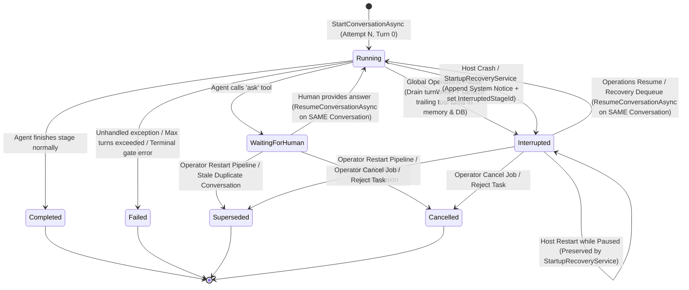

# 🔁 Step 11.36: Unified In-Place Conversation Resumption on Global Pause/Resume & Crash Recovery

> **Phase 11 Implementation Step (Post-MVP - Real-Project Hardening, Token Efficiency & Agent Ergonomics)**  
> *Parent Plan:* [Phase 11 Master Plan](../11_EXTEND_FEATURES.md)  
> *Target Framework:* .NET 10 (C# 13) | *Status:* Implemented  
> *Target Projects:* [`src/NightCodeForge.Core`](file:///c:/Users/Julien/source/repos/jetelain/NightCodeForge/src/NightCodeForge.Core), [`src/NightCodeForge.Agents`](file:///c:/Users/Julien/source/repos/jetelain/NightCodeForge/src/NightCodeForge.Agents), [`src/NightCodeForge.Infrastructure`](file:///c:/Users/Julien/source/repos/jetelain/NightCodeForge/src/NightCodeForge.Infrastructure), [`src/NightCodeForge.Web`](file:///c:/Users/Julien/source/repos/jetelain/NightCodeForge/src/NightCodeForge.Web), [`tests/NightCodeForge.Core.Tests`](file:///c:/Users/Julien/source/repos/jetelain/NightCodeForge/tests/NightCodeForge.Core.Tests), [`tests/NightCodeForge.Agents.Tests`](file:///c:/Users/Julien/source/repos/jetelain/NightCodeForge/tests/NightCodeForge.Agents.Tests), [`tests/NightCodeForge.Infrastructure.Tests`](file:///c:/Users/Julien/source/repos/jetelain/NightCodeForge/tests/NightCodeForge.Infrastructure.Tests), [`tests/NightCodeForge.Web.Tests`](file:///c:/Users/Julien/source/repos/jetelain/NightCodeForge/tests/NightCodeForge.Web.Tests)  
> *Dependencies:* [Step 11.29: Global Operations Pause & GPU VRAM Reclamation](STEP_11_29_GLOBAL_OPERATIONS_PAUSE_AND_GPU_VRAM_RECLAMATION.md), [Step 11.32: Synthetic Conversation Priming & Human Answer Hygiene](STEP_11_32_SYNTHETIC_CONVERSATION_PRIMING_AND_HUMAN_ANSWER_HYGIENE.md)  
> *Aligns With:* [AGENTS.md](../../../AGENTS.md), [docs/PLAN.md](../../PLAN.md)

---

## 1. Executive Summary & Root Cause Analysis

### 1.1 Live Production Incident (Task #35 & Wider Database Evidence)
In the live NightCodeForge instance (`nightcodeforge.db`), **Task #35** was running in the `implementation` stage when Global Operations were paused, the application was restarted, and operations were subsequently resumed. Instead of resuming its existing 96-turn conversation, Task #35 discarded all prior work and started a brand-new conversation from Turn 0 (`BootstrapPrompt`).

Forensic inspection of `nightcodeforge.db` revealed that this issue affected not only Task #35, but every task subjected to Global Operations Pause/Resume or multi-step Crash Recovery:

| Task | Stage | Conversation Sequence in `nightcodeforge.db` | Observed Defect |
| :--- | :--- | :--- | :--- |
| **Task #35** | `implementation` | **Conv #264** (`Attempt=1`, `Status=8 Interrupted`, **96 turns**, `20:17 -> 20:58`) $\rightarrow$ App restarted while paused (`20:59:49`) $\rightarrow$ Resumed (`20:59:54`) $\rightarrow$ **Conv #265** (`Attempt=1`, `Status=1 Running`, **51 turns**) | All 96 turns of Conv #264 were ignored on resume; Conv #265 started from Turn 0 (`"Let's start by reading the specification document..."`). |
| **Task #28** | `implementation` | **Conv #246** (`Attempt=1`, `Status=3 Failed`, **123 turns**) crashed $\rightarrow$ recovered into **Conv #247** (`Attempt=1`, `Status=8 Interrupted`, **1 turn**), paused 1 min later $\rightarrow$ **Conv #248** (`Attempt=1`, `Status=8 Interrupted`, **352 turns**), paused $\rightarrow$ **Conv #249** (`Attempt=1`, `Status=3 Failed`, **52 turns**), crashed $\rightarrow$ **Conv #250** (`Attempt=1`, `Status=2 Completed`, **376 turns**) | 1. Conv #246's 123 turns were loaded into in-memory `DataBag[RecoveredSerializedMemory]` and immediately deleted when Conv #247 started; when Conv #247 was paused after 1 turn, **all 123 turns were permanently lost**. 2. Conv #248 ran for ~2 hours (352 turns) and was paused; on resume, **all 352 turns were discarded**. 3. Five fragmented `Attempt=1` conversations were created for a single stage attempt. |
| **Task #20** | `task-review` | **Conv #193** (`Attempt=1`, `Status=8 Interrupted`, **46 turns**) $\rightarrow$ **Conv #194** (`Attempt=1`, `Status=8 Interrupted`, **1 turn**) $\rightarrow$ **Conv #196** (`Attempt=1`, `Status=2 Completed`, **100 turns**) | Pause discarded 46 turns of Conv #193, created a 1-turn stub Conv #194 on brief resume/pause, then restarted from Turn 0 in Conv #196. |
| **Task #21** | `task-review` | **Conv #185** (`Attempt=2`, `Status=8 Interrupted`, **83 turns**) $\rightarrow$ **Conv #186** (`Attempt=2`, `Status=8 Interrupted`, **1 turn**) $\rightarrow$ **Conv #187** (`Attempt=2`, `Status=2 Completed`, **26 turns**) | Same pattern: 83 turns lost on pause, followed by a 1-turn stub on brief resume/pause, then restarted from scratch. |
| **Task #7** | `implementation` & `code-review-fix` | `implementation` `Attempt=1`: **Conv #116** (27 turns, `Interrupted`), **Conv #117** (47 turns, `Cancelled`), **Conv #119** (77 turns, `Interrupted`), **Conv #120** (3 turns, `Interrupted`), **Conv #121** (3 turns, `Cancelled`), **Conv #126** (335 turns, `Completed`). `Attempt=2`: **Conv #129** (76 turns, `Interrupted`) $\rightarrow$ **Conv #130** (64 turns, `Failed`) $\rightarrow$ **Conv #131** (237 turns, `Completed`). `code-review-fix` `Attempt=2`: **Conv #135** (3 turns, `Interrupted`) $\rightarrow$ **Conv #136** (78 turns, `Completed`). | Repeated pauses created 6 separate `Attempt=1` conversations and discarded prior turns each time. |
| **Task #2** & **Task #12** | `task-review` & `implementation` | **Task #2:** Conv #32 (70 turns, crashed) $\rightarrow$ Conv #33 (27 turns) / Conv #34 (54 turns, crashed) $\rightarrow$ Conv #35 (32 turns). **Task #12:** Conv #156 (352 turns, crashed) $\rightarrow$ Conv #157 (1867 turns, `Completed`). | Creating a new conversation on crash recovery only writes Turn 0 + delta turns to the new `ConversationTurns` rows in SQLite, fragmenting the transcript across multiple conversations and losing all pre-crash turns if a second crash or pause occurs. |

### 1.2 Three Interlocking Root Causes

1. **Root Cause 1 — Pause/Resume (Even Without Host Restart) Never Persists Checkpoint Memory or Resumes `Interrupted` Conversations:**
   - In [`CrucibleAgentHarness.SuspendOnPauseAsync`](file:///c:/Users/Julien/source/repos/jetelain/NightCodeForge/src/NightCodeForge.Agents/Crucible/CrucibleAgentHarness.cs#L842-L870), when Global Operations Pause triggers, the harness sanitizes in-flight tool calls in `chatHistory`, marks the active `Conversation` as `StageExecutionStatus.Interrupted` (`8`), and then [`CrucibleAgentHarness.RunStageAsync`](file:///c:/Users/Julien/source/repos/jetelain/NightCodeForge/src/NightCodeForge.Agents/Crucible/CrucibleAgentHarness.cs#L1089-L1098) **rethrows `OperationCanceledException`**.
   - Because `RunStageAsync` throws instead of returning an `AgentRunResult`, [`TaskOrchestrator.ProcessTaskAsync`](file:///c:/Users/Julien/source/repos/jetelain/NightCodeForge/src/NightCodeForge.Core/Workflow/TaskOrchestrator.cs#L913-L918) never receives `runResult.UpdatedState`, never populates `PipelineDataBagKeys.SerializedMemory` or `RecoveredSerializedMemory`, and never saves a `StageCheckpoint` in its `if (isPause)` catch block.
   - When `ResumeOperationsAsync` re-enqueues the task, [`TaskOrchestrator.ProcessTaskAsync`](file:///c:/Users/Julien/source/repos/jetelain/NightCodeForge/src/NightCodeForge.Core/Workflow/TaskOrchestrator.cs#L853-L862) checks only `RecoveredSerializedMemory` and `StageCheckpoints` (both empty), and [`CrucibleAgentHarness.RunStageAsync`](file:///c:/Users/Julien/source/repos/jetelain/NightCodeForge/src/NightCodeForge.Agents/Crucible/CrucibleAgentHarness.cs#L119-L159) only looks up conversations in `StageExecutionStatus.WaitingForHuman` when `PendingHumanAnswer` is non-empty. It completely ignores `StageExecutionStatus.Interrupted` conversations and creates a brand-new `Conversation` from Turn 0.

2. **Root Cause 2 — `StartupRecoveryService` Ignores `StageExecutionStatus.Interrupted` Conversations on Host Restart While Paused:**
   - In [`StartupRecoveryService.ReconcileWorkspacesAsync`](file:///c:/Users/Julien/source/repos/jetelain/NightCodeForge/src/NightCodeForge.Core/Services/StartupRecoveryService.cs#L233-L237), active conversations are queried with:
     `c.StageId == stage.StageId && (c.Status == StageExecutionStatus.Running || c.Status == StageExecutionStatus.WaitingForHuman)`
   - Because Task #35's Conv #264 was already in `StageExecutionStatus.Interrupted` (`8`) when the app restarted, `activeConv` evaluated to `null`. `StartupRecoveryService` fell into the `else` branch, stripped `RecoveredSerializedMemory` from the `DataBag`, and held the task without any recovery state.

3. **Root Cause 3 — Creating a New `Conversation` on Crash Recovery Causes Chained-Interruption Data Loss and Transcript Fragmentation:**
   - Currently, when [`StartupRecoveryService`](file:///c:/Users/Julien/source/repos/jetelain/NightCodeForge/src/NightCodeForge.Core/Services/StartupRecoveryService.cs#L254-L287) recovers an orphaned `Running` conversation, it marks that conversation as `StageExecutionStatus.Failed` (`3`) and serializes its turns into `DataBag[RecoveredSerializedMemory]`.
   - When the stage resumes, [`TaskOrchestrator`](file:///c:/Users/Julien/source/repos/jetelain/NightCodeForge/src/NightCodeForge.Core/Workflow/TaskOrchestrator.cs#L855-L858) immediately deletes `RecoveredSerializedMemory` from `DataBag` before calling `RunStageAsync`, and `CrucibleAgentHarness` creates a **new** `Conversation` row in SQLite containing only Turn 0 (`BootstrapPrompt`) plus new delta turns, while holding the recovered history solely in in-memory `chatHistory`.
   - **Consequence A (Total Loss on Pause/Crash Before First Turn):** If the resumed session is paused or crashes before completing a turn (as happened in **Task #28 Conv #246 $\rightarrow$ #247**), `RecoveredSerializedMemory` is already deleted from `DataBag`, the old conversation is closed as `Failed`, and the new conversation in SQLite has only 1 turn (`BootstrapPrompt`). All 123 recovered turns are permanently lost.
   - **Consequence B (Partial Loss on Subsequent Crash/Pause):** Even after $K$ new turns, the new conversation's `ConversationTurns` table only contains Turn 0 + $K$ delta turns; a second crash or pause loses all turns from the original conversation (as seen in **Task #2 Conv #32 $\rightarrow$ #34 $\rightarrow$ #35**).
   - **Consequence C (Duplicate Synthetic Priming & UI Fragmentation):** Resuming in a new conversation re-runs Step 11.32 synthetic conversation priming on top of already-recovered history and clutters `StageRunSelector.razor` with multiple fragmented `"Run 1"` pills for a single logical stage execution.

---

## 2. Architectural Solution: Unified In-Place Conversation Continuity

### 2.1 Core Architectural Principle: Resume the Same `Conversation` In-Place
NightCodeForge already resumes the **same** `Conversation` row in-place when an agent pauses for human clarification (`StageExecutionStatus.WaitingForHuman` $\rightarrow$ `ResumeConversationAsync` $\rightarrow$ `StageExecutionStatus.Running`).

This exact in-place resumption model must be unified across all **non-terminal stage interruptions**:
1. **Human Clarification (`StageExecutionStatus.WaitingForHuman`):** Agent calls `ask`; conversation transitions to `WaitingForHuman`. When human answers, the **same** `Conversation` row transitions back to `Running` and appends the tool answer and subsequent turns.
2. **Global Operations Pause / Resume (`StageExecutionStatus.Interrupted`):** Operator pauses operations; conversation drains `turnWriter`, sanitizes any incomplete in-flight tool call in memory (`SanitizeInFlightTurns`) and rolls back any unanswered trailing `StageTurnRole.Tool` turns in SQLite (`SanitizeTrailingInterruptedTurnsAsync`), and transitions to `Interrupted`. When operations resume (whether in the same process lifetime or after one or more host restarts), the **same** `Conversation` row transitions back to `Running`, rehydrates `chatHistory` directly from its persisted `ConversationTurns`, and continues seamlessly from the next turn index.
3. **Host Crash / Reboot Recovery (`StageExecutionStatus.Running` $\rightarrow$ `StageExecutionStatus.Interrupted`):** On startup, `StartupRecoveryService` finds any orphaned `Running` (or already `Interrupted` / `WaitingForHuman`) conversation for the task's current stage. Instead of marking `Running` conversations as `Failed` and spawning a second conversation, `StartupRecoveryService`:
   - Appends the `[System Notice: Host restarted unexpectedly; workspace restored; resuming from previous conversation turn]` turn directly to the existing conversation (only when the conversation was `Running` and had $\ge 1$ turn, and never duplicating the notice if already present). Any dangling `StageTurnRole.Tool` turn without a matching `StageTurnRole.ToolResult` turn immediately before the `StageTurnRole.System` recovery notice is automatically closed with `ConversationHistorySerializer.InterruptedToolResult` during `ConversationHistorySerializer.Serialize`, preserving crash-mid-tool visibility for the LLM.
   - Transitions the conversation status to `StageExecutionStatus.Interrupted` (preserving `WaitingForHuman` if it was waiting for a human answer) and sets `task.InterruptedStageId = stage.StageId` so `TaskOrchestrator` preserves uncommitted worktree task markdown edits before resuming.
   - When the stage runs, `CrucibleAgentHarness` resumes that **exact same `Conversation` row** in-place via `ResumeConversationAsync`.

Conversely, a **new `Conversation` row** (with incremented `AttemptIndex`) is created **only** when starting a genuinely new stage execution attempt:
- Initial entry into a stage where no resumable (`WaitingForHuman` or `Interrupted`) conversation exists (or where an orphaned 0-turn `Running` conversation was closed as `Cancelled` on crash recovery).
- Loopback from a downstream quality gate or review stage (where the previous conversation finished as `Completed` or `Failed`).
- Explicit operator-initiated `RestartTaskPipelineAsync` or `RejectTaskAsync` / `CancelJobAsync` (which explicitly marks any prior `Running`, `WaitingForHuman`, or `Interrupted` conversation as `Superseded` or `Cancelled`).

---

## 3. Detailed Behavioral & Component Specifications

### 3.1 Repository Layer (`ITaskRepository`, `EfCoreTaskRepository`, `InMemoryTaskRepository`, Test Fakes)

1. **Resumable Conversation Lookup (`GetResumableConversationAsync`):**
   - Provide a repository query for `(int taskId, string stageId, CancellationToken cancellationToken = default)` that returns the most recent `Conversation` (ordered by `StartedAt` descending, including `Turns` ordered by `TurnIndex` ascending) whose `Status` is either `StageExecutionStatus.WaitingForHuman` or `StageExecutionStatus.Interrupted`.
   - `GetWaitingConversationAsync` may remain for targeted callers, while `CrucibleAgentHarness` uses `GetResumableConversationAsync` to locate either a `WaitingForHuman` or `Interrupted` conversation.

2. **In-Place Conversation Resumption (`ResumeConversationAsync`):**
   - In [`EfCoreTaskRepository.ResumeConversationAsync`](file:///c:/Users/Julien/source/repos/jetelain/NightCodeForge/src/NightCodeForge.Infrastructure/Data/Repositories/EfCoreTaskRepository.cs#L636-L654) (and `InMemoryTaskRepository`), when transitioning a conversation back to `StageExecutionStatus.Running`:
     - Set `Status = StageExecutionStatus.Running`.
     - Clear `CompletedAt = null` and `Summary = null` so a previously paused or recovered conversation does not retain stale completion timestamps or `"Operations paused..."` summaries while actively running.

3. **Non-Terminal Interruption Timestamp Hygiene (`CompleteConversationAsync`):**
   - In [`EfCoreTaskRepository.CompleteConversationAsync`](file:///c:/Users/Julien/source/repos/jetelain/NightCodeForge/src/NightCodeForge.Infrastructure/Data/Repositories/EfCoreTaskRepository.cs#L656-L674), when `status` is a non-terminal suspension status (`StageExecutionStatus.WaitingForHuman` or `StageExecutionStatus.Interrupted`), set `CompletedAt = null` (whereas terminal statuses `Completed`, `Failed`, `Cancelled`, `Superseded`, `Skipped` stamp `CompletedAt = DateTimeOffset.UtcNow`).

4. **Database Turn Sanitization on Mid-Tool Pause (`SanitizeTrailingInterruptedTurnsAsync`) & Monotonic `TurnIndex`:**
   - **Actual `ConversationTurn` Schema:** In [`ConversationTurn.cs`](file:///c:/Users/Julien/source/repos/jetelain/NightCodeForge/src/NightCodeForge.Core/Domain/ConversationTurn.cs), tool calls and tool results are persisted as **separate rows**:
     - Before a tool executes, `ThinkingAndActivityTracingChatClient` (via [`CrucibleAgentHarness.cs`](file:///c:/Users/Julien/source/repos/jetelain/NightCodeForge/src/NightCodeForge.Agents/Crucible/CrucibleAgentHarness.cs#L583-L619)) persists optional `StageTurnRole.Thinking` / `StageTurnRole.Assistant` rows and one or more `StageTurnRole.Tool` rows with `MetadataJson = {"CallId": "<id>"}` and `ToolResult = null`.
     - After a tool completes, [`CrucibleAgentHarness.ProcessUpdateAsync`](file:///c:/Users/Julien/source/repos/jetelain/NightCodeForge/src/NightCodeForge.Agents/Crucible/CrucibleAgentHarness.cs#L951-L961) persists a separate `StageTurnRole.ToolResult` row with `MetadataJson = {"CallId": "<id>"}` and `ToolResult = resultStr`.
   - If Global Pause cancels execution while a non-`ask` tool is in flight, `CrucibleAgentHarness.SanitizeInFlightTurns(chatHistory)` rolls back the unanswered assistant tool-call message in memory so the tool will be cleanly re-invoked upon resume. To keep SQLite in 100% parity with `SanitizeInFlightTurns(chatHistory)`, provide `SanitizeTrailingInterruptedTurnsAsync(int conversationId, CancellationToken cancellationToken = default)`:
     - Inspect the conversation's `Turns` ordered by `TurnIndex` ascending.
     - Collect the set of answered `CallId`s from all `StageTurnRole.ToolResult` turns (extracted via `ConversationHistorySerializer.ExtractCallId(turn.MetadataJson)`).
     - Walk backward from the end of `Turns`: while the trailing turn is an unanswered `StageTurnRole.Tool` turn (`CallId` not in answered `CallId`s, and `ToolName != AskTool.ToolName`), remove that `StageTurnRole.Tool` turn; also remove any immediately preceding `StageTurnRole.Thinking` or tool-call-accompanying `StageTurnRole.Assistant` turn from that same aborted step if no answered tool calls remain in that step.
   - **Monotonic `TurnIndex` Calculation in `AddConversationTurnAsync`:**
     - In [`EfCoreTaskRepository.AddConversationTurnAsync`](file:///c:/Users/Julien/source/repos/jetelain/NightCodeForge/src/NightCodeForge.Infrastructure/Data/Repositories/EfCoreTaskRepository.cs#L604-L624) and `InMemoryTaskRepository.AddConversationTurnAsync`, compute `TurnIndex` as `Max(t => (int?)t.TurnIndex) + 1 ?? 0` rather than `CountAsync()` so that deleting trailing turns or supplying explicit turn indices never creates duplicate `TurnIndex` values.

### 3.2 `CrucibleAgentHarness` In-Place Resumption & Priming Guards

1. **Unified Resumption of `WaitingForHuman` and `Interrupted` Conversations:**
   - In [`CrucibleAgentHarness.RunStageAsync`](file:///c:/Users/Julien/source/repos/jetelain/NightCodeForge/src/NightCodeForge.Agents/Crucible/CrucibleAgentHarness.cs#L119-L170):
     - Query `_taskRepository.GetResumableConversationAsync(context.ForgeTask.Id, context.StageId, cancellationToken)`.
     - **Case A — `WaitingForHuman`:** Resumed when `!string.IsNullOrWhiteSpace(context.PendingHumanAnswer)`. Calls `ResumeConversationAsync`, rehydrates `chatHistory` (from `context.SerializedStateJson` if provided, or directly from `ConversationHistorySerializer.Serialize(conversation.Turns)` if `SerializedStateJson` is null/empty), and injects the human answer into the pending `ask` tool call. (If `conversation.Status == StageExecutionStatus.WaitingForHuman` but `PendingHumanAnswer` is empty—e.g. a force-rerun without answering—do not resume it as `WaitingForHuman`; start a new conversation or handle as before.)
     - **Case B — `Interrupted`:** Resumed unconditionally when the stage executes. Calls `ResumeConversationAsync`, sets `turnIndex = conversation.Turns.Count > 0 ? conversation.Turns.Max(t => t.TurnIndex) + 1 : 0`, and rehydrates `chatHistory`:
       - If `!string.IsNullOrWhiteSpace(context.SerializedStateJson)` is present, deserialize from `context.SerializedStateJson`.
       - Otherwise, if `conversation.Turns.Count > 0`, reconstruct the serialized state directly via `ConversationHistorySerializer.Serialize(conversation.Turns)` and deserialize it into `chatHistory`.
       - If the `Interrupted` conversation had 0 persisted turns (e.g. paused during model preload before Turn 0 was written), write Turn 0 (`BootstrapPrompt`) to `chatHistory` and persist Turn 0 into that same conversation.
     - **Case C — No Resumable Conversation:** Start a new `Conversation` via `StartConversationAsync` as before.

2. **Pre-Populating `writtenToolCallIds` on Resumption:**
   - In [`CrucibleAgentHarness.RunStageAsync`](file:///c:/Users/Julien/source/repos/jetelain/NightCodeForge/src/NightCodeForge.Agents/Crucible/CrucibleAgentHarness.cs#L367-L382), `writtenToolCallIds` is currently only populated inside `if (isResumingWaitingConversation)` using `ExtractCallId(turn)`.
   - Expand this to run whenever resuming **any** existing conversation (`isResumingWaitingConversation || isResumingInterruptedConversation`) so all existing `StageTurnRole.Tool` call IDs (`ExtractCallId(turn)`) are registered in `writtenToolCallIds` and `ThinkingAndActivityTracingChatClient` never duplicates prior tool call turns in SQLite.

3. **Guard Synthetic Conversation Priming (`Step 11.32`) on Resumed Conversations:**
   - In [`CrucibleAgentHarness.RunStageAsync`](file:///c:/Users/Julien/source/repos/jetelain/NightCodeForge/src/NightCodeForge.Agents/Crucible/CrucibleAgentHarness.cs#L384-L433), synthetic priming (`context.SyntheticPriming`) currently checks `if (!isResumingWaitingConversation && string.IsNullOrWhiteSpace(context.SerializedStateJson) && context.SyntheticPriming is { Count: > 0 })`.
   - Guard this block so synthetic priming is also skipped whenever resuming an `Interrupted` conversation that already has persisted turns (`!isResumingWaitingConversation && !(isResumingInterruptedConversation && conversation.Turns.Count > 0)`), preventing primed `bash` turns from being injected mid-conversation on resume.

4. **Pause Suspension Synchronization (`SuspendOnPauseAsync`):**
   - In [`CrucibleAgentHarness.SuspendOnPauseAsync`](file:///c:/Users/Julien/source/repos/jetelain/NightCodeForge/src/NightCodeForge.Agents/Crucible/CrucibleAgentHarness.cs#L842-L870) and [`RunStageAsync`](file:///c:/Users/Julien/source/repos/jetelain/NightCodeForge/src/NightCodeForge.Agents/Crucible/CrucibleAgentHarness.cs#L1089-L1098):
     - Ensure `await turnWriter.DrainAsync()` completes **before** sanitizing SQLite turns so no queued `StageTurnRole.Tool` write lands after sanitization.
     - Call `SanitizeInFlightTurns(chatHistory)` in memory and `await _taskRepository.SanitizeTrailingInterruptedTurnsAsync(conversation.Id, CancellationToken.None)` in SQLite.
     - Await `_taskRepository.CompleteConversationAsync(conversation.Id, StageExecutionStatus.Interrupted, "Operations paused (GPU VRAM reclaimed)", CancellationToken.None)`.

### 3.3 `StartupRecoveryService` Crash & Pause-Across-Restart Continuity

In [`StartupRecoveryService.ReconcileWorkspacesAsync`](file:///c:/Users/Julien/source/repos/jetelain/NightCodeForge/src/NightCodeForge.Core/Services/StartupRecoveryService.cs#L230-L375):

1. **Include `StageExecutionStatus.Interrupted` in Active Conversation Discovery:**
   - Query conversations for `stage.StageId` matching:
     `c.Status == StageExecutionStatus.Running || c.Status == StageExecutionStatus.WaitingForHuman || c.Status == StageExecutionStatus.Interrupted`
   - Order by `StartedAt` descending; select the most recent as `activeConv`.
   - Mark any older dangling conversations in that set (`c.Id != activeConv.Id`) as `StageExecutionStatus.Superseded` with summary `"Superseded by newer conversation during crash recovery."`.

2. **Transition `Running` Conversations to `Interrupted` Without Closing as `Failed`:**
   - Load `convWithTurns` (`GetConversationWithTurnsAsync(activeConv.Id, cancellationToken)`).
   - **If `activeConv.Status == StageExecutionStatus.Running`:**
     - **Case 2a (`convWithTurns.Turns.Count > 0`):**
       - Check whether the last turn in `convWithTurns.Turns` is already a `StageTurnRole.System` turn containing `RecoveryNoticeContent`. If not, append the `StageTurnRole.System` turn with `RecoveryNoticeContent` (`"[System Notice: Host restarted unexpectedly; workspace restored; resuming from previous conversation turn]"`).
       - Note: Do **not** delete trailing unanswered `StageTurnRole.Tool` turns on a **crash**—`ConversationHistorySerializer.Serialize` automatically emits `ConversationHistorySerializer.InterruptedToolResult` (`"[System Error: Tool execution was interrupted by an unexpected host restart...]"` ) whenever a `StageTurnRole.Tool` turn has no matching `StageTurnRole.ToolResult` turn before the `StageTurnRole.System` recovery notice (verified by `ResilientCrashRecoveryTests.AgenticStage_CrashBetweenToolCallAndResult_ClosesDanglingCallWithInterruptedResult`).
       - Transition `activeConv` to `StageExecutionStatus.Interrupted` (instead of `StageExecutionStatus.Failed`!) with summary `"Interrupted by host restart; session will resume in this conversation."`.
     - **Case 2b (`convWithTurns.Turns.Count == 0`):**
       - If the host crashed before Turn 0 was ever written (`Turns.Count == 0`), close `activeConv` as `StageExecutionStatus.Cancelled` with summary `"Aborted due to host restart (0 turns recorded)."` and clear `RecoveredSerializedMemory` so the stage starts cleanly with Turn 0 and synthetic priming on recovery.
   - **If `activeConv.Status == StageExecutionStatus.Interrupted`:**
     - Do **not** append a crash recovery notice (the conversation was cleanly paused before restart, or already recovered on a prior restart) and keep its status as `StageExecutionStatus.Interrupted`.
   - **If `activeConv.Status == StageExecutionStatus.WaitingForHuman`:**
     - Preserve its status as `StageExecutionStatus.WaitingForHuman` and do not append a crash recovery notice.

3. **Populate `RecoveredSerializedMemory` & `task.InterruptedStageId` Safely:**
   - When `allTurns.Count > 0` (and `activeConv.Status != StageExecutionStatus.WaitingForHuman`), set `bag.Set(PipelineDataBagKeys.RecoveredSerializedMemory, ConversationHistorySerializer.Serialize(allTurns))`.
   - Whenever an agentic stage has an active recovered conversation (`convWithTurns.Turns.Count > 0` or `activeConv.Status == StageExecutionStatus.Interrupted`), set `task.InterruptedStageId = stage.StageId` (not only when `_operationsControlService.IsPaused` is true!) so [`TaskOrchestrator.ProcessTaskAsync`](file:///c:/Users/Julien/source/repos/jetelain/NightCodeForge/src/NightCodeForge.Core/Workflow/TaskOrchestrator.cs#L361) sets `isResumedRun = true` and preserves uncommitted worktree task markdown edits (`PreserveEditsBeforeResumeReason`) before resuming.

### 3.4 `TaskOrchestrator` & `DevQueueService` Lifecycle & Hygiene

1. **Preserve `DataBag` & Skip Post-Stage Disk Sync When Stage Execution Is Cancelled/Paused:**
   - In [`TaskOrchestrator.ProcessTaskAsync`](file:///c:/Users/Julien/source/repos/jetelain/NightCodeForge/src/NightCodeForge.Core/Workflow/TaskOrchestrator.cs#L853-L862), `RecoveredSerializedMemory` is currently removed from `pipelineContext.DataBag` *before* `RunStageAsync` executes (`pipelineContext.DataBag.Remove(PipelineDataBagKeys.RecoveredSerializedMemory)`).
   - Remove `RecoveredSerializedMemory` only **after** `RunStageAsync` completes without pause/cancellation, or inside the non-cancelled post-stage path.
   - **Critical Post-Stage Fallthrough Fix in `ProcessTaskAsync`:**
     - Currently, when `harness.RunStageAsync` throws `OperationCanceledException` on pause, the inner `catch (OperationCanceledException)` at [line 1045](file:///c:/Users/Julien/source/repos/jetelain/NightCodeForge/src/NightCodeForge.Core/Workflow/TaskOrchestrator.cs#L1045-L1054) catches it and sets `result = StageExecutionResult.Cancelled(...)`. Execution then falls through to [line 1306](file:///c:/Users/Julien/source/repos/jetelain/NightCodeForge/src/NightCodeForge.Core/Workflow/TaskOrchestrator.cs#L1306), which calls `SyncAllTasksFromDiskAsync(targetSyncPath, ..., cancellationToken)` with the **already-cancelled `cancellationToken`** (throwing `OperationCanceledException` when `targetSyncPath` exists on disk), and at [line 1500](file:///c:/Users/Julien/source/repos/jetelain/NightCodeForge/src/NightCodeForge.Core/Workflow/TaskOrchestrator.cs#L1484-L1503) calls `pipelineContext.SyncDataBagToTask()` (which mutates `task.PipelineDataJson`, *not* `currentTask.PipelineDataJson`!) before saving `currentTask`.
     - Fix this in `ProcessTaskAsync`:
       - Guard proposal creation ([line 1276](file:///c:/Users/Julien/source/repos/jetelain/NightCodeForge/src/NightCodeForge.Core/Workflow/TaskOrchestrator.cs#L1276)) and post-stage `SyncAllTasksFromDiskAsync` ([line 1306](file:///c:/Users/Julien/source/repos/jetelain/NightCodeForge/src/NightCodeForge.Core/Workflow/TaskOrchestrator.cs#L1306)) with `if (!result.IsCancelled)` so a paused/cancelled stage does not run post-stage disk sync with a cancelled token.
       - In the `if (result.IsCancelled)` branch ([line 1480](file:///c:/Users/Julien/source/repos/jetelain/NightCodeForge/src/NightCodeForge.Core/Workflow/TaskOrchestrator.cs#L1480-L1515)) and outer `catch (OperationCanceledException)` ([line 2154](file:///c:/Users/Julien/source/repos/jetelain/NightCodeForge/src/NightCodeForge.Core/Workflow/TaskOrchestrator.cs#L2154-L2195)), sync `pipelineContext.SyncDataBagToTask()` and copy `currentTask.PipelineDataJson = task.PipelineDataJson` onto `currentTask` before calling `_taskRepository.UpdateWithHistoryAsync`.

2. **Deterministic Stage Conversations on Pause / Crash:**
   - Unlike agentic stages (`CrucibleAgentHarness`), deterministic stages (`PreImplementationBaseline`, `PostImplementationGates`, `PostReviewVerification`) execute fast atomic CLI commands (`git merge`, `dotnet build`, `dotnet test`) and are re-run from the beginning of the deterministic command sequence when resumed.
   - When `StartupRecoveryService` recovers a task whose interrupted stage is deterministic (`!stage.IsAgentic`), any orphaned `Running` deterministic log conversation continues to be closed as `StageExecutionStatus.Cancelled` so the deterministic stage starts a fresh log conversation when re-run.

3. **Explicit Operator Reset / Cancel Actions Must Supersede or Cancel `Interrupted` Conversations:**
   - Update [`TaskOrchestrator.RestartTaskPipelineAsync`](file:///c:/Users/Julien/source/repos/jetelain/NightCodeForge/src/NightCodeForge.Core/Workflow/TaskOrchestrator.cs#L3424-L3436) to mark conversations in `StageExecutionStatus.Running`, `StageExecutionStatus.WaitingForHuman`, or `StageExecutionStatus.Interrupted` as `StageExecutionStatus.Superseded`.
   - Update [`TaskOrchestrator.RejectTaskAsync`](file:///c:/Users/Julien/source/repos/jetelain/NightCodeForge/src/NightCodeForge.Core/Workflow/TaskOrchestrator.cs#L2682-L2732) and [`DevQueueService.CancelJobAsync`](file:///c:/Users/Julien/source/repos/jetelain/NightCodeForge/src/NightCodeForge.Web/Services/DevQueueService.cs#L244-L340) to cancel any conversation in `StageExecutionStatus.Running`, `StageExecutionStatus.WaitingForHuman`, or `StageExecutionStatus.Interrupted` as `StageExecutionStatus.Cancelled` when an operator cancels or rejects a paused/waiting task.

### 3.5 Web UI & Presentation Layer (`StageConversationParser`, `StageRunSelector.razor`, `PipelineStepper.razor`, `TaskExecutionInspector.razor`)

Per `AGENTS.md` UI and Presentation separation rules:
1. **[`StageConversationParser.cs`](file:///c:/Users/Julien/source/repos/jetelain/NightCodeForge/src/NightCodeForge.Web/Services/StageConversationParser.cs#L151-L164):**
   - Update `GetStatusClass(StageExecutionStatus status)` to map `StageExecutionStatus.Interrupted => "status-interrupted"` (or `"status-waiting"`), `StageExecutionStatus.Cancelled => "status-cancelled"`, and `StageExecutionStatus.Superseded => "status-superseded"`.
2. **[`StageRunSelector.razor`](file:///c:/Users/Julien/source/repos/jetelain/NightCodeForge/src/NightCodeForge.Web/Components/Monitoring/StageRunSelector.razor#L135-L144):**
   - Update `GetStatusBadge(Conversation conv)` to explicitly map:
     - `StageExecutionStatus.Interrupted => ("⏸️", "badge-amber")`
     - `StageExecutionStatus.Cancelled => ("🚫", "badge-zinc")`
     - `StageExecutionStatus.Superseded => ("🔄", "badge-zinc")`
     instead of falling through to the `_ => ("⏭️", "badge-zinc")` skipped icon.
3. **[`PipelineStepper.razor`](file:///c:/Users/Julien/source/repos/jetelain/NightCodeForge/src/NightCodeForge.Web/Components/Monitoring/PipelineStepper.razor#L186-L197) & [`TaskExecutionInspector.razor`](file:///c:/Users/Julien/source/repos/jetelain/NightCodeForge/src/NightCodeForge.Web/Components/Monitoring/TaskExecutionInspector.razor#L545-L558):**
   - Update `GetStageStatus` in `PipelineStepper.razor` so `StageExecutionStatus.Interrupted` is recognized alongside `Completed`, `Failed`, `WaitingForHuman`, and `Running`, rendering an appropriate paused/interrupted visual state on the active stage step when operations are paused.
   - Update `GetStatusBadgeClass` in `TaskExecutionInspector.razor` so `StageExecutionStatus.Interrupted` maps to `"badge-warning"` alongside `WaitingForHuman`.

---

## 4. Verification & Test Strategy

### 4.1 Unit & Integration Tests to Add / Update
1. **`CrucibleAgentHarnessPauseTests` ([`tests/NightCodeForge.Agents.Tests/CrucibleAgentHarnessPauseTests.cs`](file:///c:/Users/Julien/source/repos/jetelain/NightCodeForge/tests/NightCodeForge.Agents.Tests/CrucibleAgentHarnessPauseTests.cs)):**
   - Verify that when a stage is paused via `OperationsControlService.PauseOperationsAsync()` after Turn $N$ and subsequently resumed via `ResumeOperationsAsync()`, `CrucibleAgentHarness.RunStageAsync` **resumes the exact same `Conversation` ID** (calling `ResumeConversationAsync`), preserves all prior turns (`0 .. N`), does not re-inject `BootstrapPrompt` or duplicate `context.SyntheticPriming` turns, and continues numbering turns at `N + 1`.
   - Verify that if pause occurs while a tool call (`bash`) has been written as a `StageTurnRole.Tool` row to `ConversationTurns` without a corresponding `StageTurnRole.ToolResult` row, `SanitizeTrailingInterruptedTurnsAsync` removes the trailing unanswered tool turn from the repository so resumption does not leave an orphan tool call in SQLite.
2. **`TaskOrchestratorPauseTests` ([`tests/NightCodeForge.Core.Tests/TaskOrchestratorPauseTests.cs`](file:///c:/Users/Julien/source/repos/jetelain/NightCodeForge/tests/NightCodeForge.Core.Tests/TaskOrchestratorPauseTests.cs)) & `StartupRecoveryServicePauseTests` ([`tests/NightCodeForge.Core.Tests/StartupRecoveryServicePauseTests.cs`](file:///c:/Users/Julien/source/repos/jetelain/NightCodeForge/tests/NightCodeForge.Core.Tests/StartupRecoveryServicePauseTests.cs)):**
   - Verify end-to-end `ProcessTaskAsync` pause $\rightarrow$ resume cycle preserves `DataBag` state across pause and completes the stage within a single `Conversation` record.
   - Verify Pause $\rightarrow$ `StartupRecoveryService.ReconcileWorkspacesAsync()` (simulating app restart while paused) $\rightarrow$ `ResumeOperationsAsync()` resumes the existing `Interrupted` conversation with all prior turns intact (exact reproduction of the **Task #35** bug).
3. **`ResilientCrashRecoveryTests` ([`tests/NightCodeForge.Core.Tests/ResilientCrashRecoveryTests.cs`](file:///c:/Users/Julien/source/repos/jetelain/NightCodeForge/tests/NightCodeForge.Core.Tests/ResilientCrashRecoveryTests.cs)) & `TaskOrchestratorConversationResumptionTests` ([`tests/NightCodeForge.Core.Tests/TaskOrchestratorConversationResumptionTests.cs`](file:///c:/Users/Julien/source/repos/jetelain/NightCodeForge/tests/NightCodeForge.Core.Tests/TaskOrchestratorConversationResumptionTests.cs)):**
   - Update crash recovery assertions to verify that an orphaned `Running` conversation with turns is transitioned to `StageExecutionStatus.Interrupted` (instead of `Failed`), receives the `[System Notice: Host restarted unexpectedly...]` turn in-place, sets `task.InterruptedStageId`, and when resumed by `CrucibleAgentHarness`, reuses the **same `Conversation` row** (resulting in 1 unified conversation instead of 2 fragmented conversations).
   - Verify that a crash mid-tool-call (`StageTurnRole.Tool` without `StageTurnRole.ToolResult`) followed by the `StageTurnRole.System` recovery notice still closes the dangling tool call with `ConversationHistorySerializer.InterruptedToolResult` upon serialization.
   - Update `StartupRecoveryService_WhenWaitingForHumanConversationLeftDangling_ClosesItAsFailed` in `TaskOrchestratorConversationResumptionTests` so it verifies that `WaitingForHuman` conversations are preserved across startup recovery (and older duplicate conversations are marked `Superseded`).
   - Verify **chained interruption resilience** (reproduction of **Task #28**): Crash at turn 5 $\rightarrow$ Startup Recovery $\rightarrow$ Pause before next turn completes $\rightarrow$ App Restart $\rightarrow$ Resume $\rightarrow$ Verify all 5 original turns + system notice are still 100% intact in the single `Conversation`.
4. **UI Component & Service Tests ([`tests/NightCodeForge.Web.Tests`](file:///c:/Users/Julien/source/repos/jetelain/NightCodeForge/tests/NightCodeForge.Web.Tests)):**
   - Verify `StageRunSelector` renders the `⏸️` (`badge-amber`) badge for `StageExecutionStatus.Interrupted` conversations and `StageConversationParser.GetStatusClass` maps `StageExecutionStatus.Interrupted` properly.

---

## 5. Definition of Done (DoD) Checklist

- [x] Add `GetResumableConversationAsync` and `SanitizeTrailingInterruptedTurnsAsync` to `ITaskRepository`, `EfCoreTaskRepository`, `InMemoryTaskRepository`, and test repository doubles, and ensure `AddConversationTurnAsync` computes `TurnIndex` monotonically (`Max + 1`).
- [x] Update `EfCoreTaskRepository.ResumeConversationAsync` and `CompleteConversationAsync` so non-terminal statuses (`WaitingForHuman`, `Interrupted`) keep `CompletedAt = null` and resuming clears `CompletedAt` and `Summary`.
- [x] Update `CrucibleAgentHarness.RunStageAsync` to resume `StageExecutionStatus.Interrupted` conversations in-place, rehydrate `chatHistory` from `ConversationHistorySerializer.Serialize(conversation.Turns)` when `SerializedStateJson` is empty, populate `writtenToolCallIds` for all resumed conversations, and skip `context.SyntheticPriming` when resuming a conversation that already has turns.
- [x] Update `CrucibleAgentHarness.SuspendOnPauseAsync` (after draining `turnWriter`) to call `SanitizeTrailingInterruptedTurnsAsync` on the repository upon pause.
- [x] Update `StartupRecoveryService.ReconcileWorkspacesAsync` to include `StageExecutionStatus.Interrupted` in active conversation lookup, transition crashed `Running` conversations with turns to `StageExecutionStatus.Interrupted` (rather than `Failed`), set `task.InterruptedStageId`, avoid duplicate recovery notices on paused conversations, and mark older duplicate conversations as `Superseded`.
- [x] Update `TaskOrchestrator` (`ProcessTaskAsync`, `RestartTaskPipelineAsync`, `RejectTaskAsync`) and `DevQueueService` (`CancelJobAsync`) to skip post-stage disk sync on pause/cancel, sync `DataBag` to `currentTask.PipelineDataJson` on pause, and include `StageExecutionStatus.Interrupted` when superseding/cancelling conversations on manual restart, cancel, or reject.
- [x] Update `StageConversationParser.cs`, `StageRunSelector.razor`, `PipelineStepper.razor`, and `TaskExecutionInspector.razor` to handle `StageExecutionStatus.Interrupted` with appropriate pause badges.
- [x] Add and update automated tests in `CrucibleAgentHarnessPauseTests`, `TaskOrchestratorPauseTests`, `StartupRecoveryServicePauseTests`, `ResilientCrashRecoveryTests`, `TaskOrchestratorConversationResumptionTests`, and Web tests; ensure full test suite passes.

