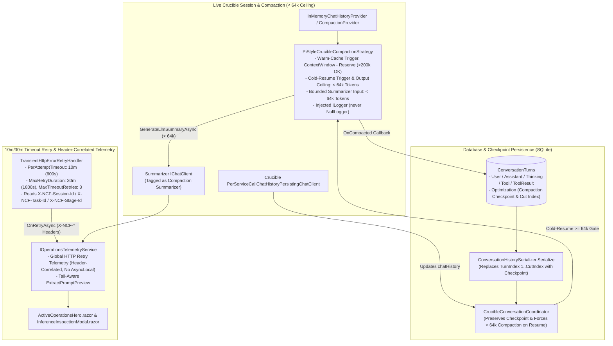

# 🛡️ Step 11.47: Compaction Checkpoint Persistence, `< 64k` Cold-Resume & Compaction Ceiling, 10m/30m Timeout Retry & Global Correlation Telemetry

> **Bug Fix, State Persistence, Resilience & Observability Step (Lossless Compaction Resumption, `< 64k` Post-Compaction & Cold-Resume Ceiling, 10m/30m Timeout Retry for Cloud Overflow, Tail-Aware Previews & Header-Correlated Retry Telemetry)**  
> *Parent Plan:* [Phase 11 Archive](../11_EXTEND_FEATURES.md)  
> *Target Framework:* .NET 10 (C# 13) | *Status:* Completed  
> *Target Projects:* [`src/NightCodeForge.Core`](../../../src/NightCodeForge.Core), [`src/NightCodeForge.Agents`](../../../src/NightCodeForge.Agents), [`src/NightCodeForge.Infrastructure`](../../../src/NightCodeForge.Infrastructure), [`src/NightCodeForge.Web`](../../../src/NightCodeForge.Web), [`tests/NightCodeForge.Core.Tests`](../../../tests/NightCodeForge.Core.Tests), [`tests/NightCodeForge.Agents.Tests`](../../../tests/NightCodeForge.Agents.Tests), [`tests/NightCodeForge.Web.Tests`](../../../tests/NightCodeForge.Web.Tests)  
> *Dependencies:* [Step 11.44: `web_search` Capping & Timeout Retry Resilience](STEP_11_44_WEB_SEARCH_RESULT_CAPPING_TMP_OFFLOAD_AND_TIMEOUT_RETRY_RESILIENCE.md), [Step 11.45: Measured-Token Compaction Trigger & `Pmad.AI` Estimator](STEP_11_45_MEASURED_TOKEN_COMPACTION_TRIGGER_AND_PMAD_AI_ESTIMATOR.md)  
> *Aligns With:* [AGENTS.md](../../../AGENTS.md), [docs/PLAN.md](../../PLAN.md)

> This document is a **specification**: it states required behaviors and constraints, not implementations. Implementation choices (signatures, code structure) are left to the implementer, within the constraints of the documents.

---

## 1. Executive Summary & Root Cause Analysis

### 1.1 Live Production Incident (ForgeTask #61 — `implementation` Stage, `Conversation 546`)
In the live instance (`C:\Users\Julien\AppData\Local\NightCodeForge\data`), during the `implementation` stage of ForgeTask #61 (*"Implement heterogeneous target fleet configuration and dual-path YARP/Converter dispatching"*, `Conversation.Id = 546`, model `Qwen3.8-27B:latest`, transcript `2026-11-07-task-61-implementation-interrupted.md`), four anomalies were observed:
1. The stage was stuck on an LLM call for **~1,341 seconds** (`12:24:15` $\to$ `12:46:36 UTC`).
2. The **In-Flight LLM Inference** card in `ActiveOperationsHero.razor` displayed `"[CONTEXT COMPACTION CHECKPOINT] The conversation history prior to this point was compacted..."` as the prompt preview while the context size was **`166.3k` tokens**.
3. On the `OllamaRouter` side, there were **two** `166.3k`-token requests during that window: the first timed out after **900s** (15 minutes), and the second ran for **439s** until operations were paused.
4. After pausing operations (which reclaimed GPU VRAM and evicted the KV cache) and resuming, the very next request sent to `OllamaRouter` was **`67.1k` tokens** (an unbounded compaction summarization call), before normal implementation turns resumed at `12:58:45 UTC`.

Cross-referencing `nightcodeforge.db` (`Conversations`, `ConversationTurns`, `StageExecutionRecords`, `StageCheckpoints`, `ExecutionLogs`) and the saved session transcript established the exact 5-part causal chain:

| # | Symptom / Failure Link | Root Cause in Current Codebase | Observed Telemetry on ForgeTask #61 (`Conversation 546`) |
| :--- | :--- | :--- | :--- |
| **1** | **In-Memory Compaction Is Never Persisted to `ConversationTurns`, Resurrecting All Pre-Compaction Turns on Resume** | 1. When [`PiStyleCrucibleCompactionStrategy.CompactCoreAsync`](../../../src/NightCodeForge.Agents/Compaction/PiStyleCrucibleCompactionStrategy.cs) compacted Call 58 (`115` $\to$ `28` messages), [`PerServiceCallChatHistoryPersistingChatClient`](../../../src/NightCodeForge.Agents/Crucible/ChatClients/PerServiceCallChatHistoryPersistingChatClient.cs) updated the in-memory `chatHistory` list, but nothing was written to `ConversationTurns` in SQLite. 2. On pause, [`CrucibleAgentHarness.SuspendOnPauseAsync`](../../../src/NightCodeForge.Agents/Crucible/CrucibleAgentHarness.cs) computed `latestSerializedState` locally and rethrew `OperationCanceledException`, discarding the compacted in-memory `chatHistory`. 3. Even when `context.SerializedStateJson` is present, [`CrucibleConversationCoordinator.ResolveSerializedState`](../../../src/NightCodeForge.Agents/Crucible/CrucibleConversationCoordinator.cs) checks `if (turnsHistory.Count >= stateHistory.Count)` and overwrites `stateHistory` with `ConversationHistorySerializer.Serialize(conversation.Turns)`—which is always larger because `conversation.Turns` is uncompacted and stores `Thinking`, `Assistant`, and `Tool` as separate rows. | On Call 58, compaction summarized `TurnIndex 1..150` (`744,255` chars) into a checkpoint, and Calls 58–156 added `TurnIndex 171..537` (`552,529` chars, reaching `166.3k` tokens). When paused at `12:46:36` and resumed, `BeginAsync` reconstructed `chatHistory` from all **538 uncompacted DB turns** (`1,296,784` chars $\approx 400\text{k}$ tokens $> 253,952$ threshold). |
| **2** | **Cold-Cache Resumption & Compaction Requests Exceed `64k` Tokens (`67.1k` Summarizer Prompt & `166.3k` Cold-Resume Context)** | While warm-cache incremental turns work smoothly even above `200k` tokens, resuming a session after pause/VRAM reclaim (or sending a compaction summarizer prompt) hits a **cold KV cache**. Currently: 1. [`ConversationSerializer.SerializeConversation`](../../../src/NightCodeForge.Agents/Compaction/ConversationSerializer.cs) clamps individual tool results to `2,000` chars but enforces **no total token ceiling** on `<conversation>...</conversation>`, allowing the summarizer prompt itself to exceed `64k` tokens. 2. `PiStyleCrucibleCompactionStrategy` does not enforce a `< 64k` token ceiling on the post-compaction result (`Anchor + Summary + KeepRecent`) or trigger cold-start compaction when resuming a paused conversation whose accumulated post-checkpoint context is `>= 64k` tokens (such as `166.3k` tokens at Call 157). | Upon resume, compacting all 538 resurrected turns produced a `378,468`-character `<conversation>` payload (**`67.1k` tokens** on `OllamaRouter`). Had `chatHistory` been restored at `166.3k` tokens without compacting on resume, prefilling `166.3k` tokens into a cold KV cache after VRAM reclaim would also have stalled and timed out. |
| **3** | **`In-Flight LLM Inference` Card Displays Stale `[CONTEXT COMPACTION CHECKPOINT]` Preview for All Post-Compaction Tool Calls** | [`TelemetryChatClient.ExtractPromptPreview`](../../../src/NightCodeForge.Agents/Inference/TelemetryChatClient.cs) selects `messages.LastOrDefault(m => m.Role == ChatRole.User)`. Because `PiStyleCrucibleCompactionStrategy` injects the compaction checkpoint as a `ChatRole.User` message at index `1`, and all subsequent turns in an autonomous tool loop are `ChatRole.Assistant` (tool calls) and `ChatRole.Tool` (tool results), `LastOrDefault(m => m.Role == ChatRole.User)` matches the checkpoint message at index `1` for the remainder of the stage. | After Call 58 injected `[CONTEXT COMPACTION CHECKPOINT]`, every single tool-loop call from Call 58 through Call 157 (99 consecutive calls over 100 minutes, including the `166.3k`-token Call 157) displayed `"[CONTEXT COMPACTION CHECKPOINT]..."` in `ActiveOperationsHero.razor` and `InferenceInspectionModal.razor`. |
| **4** | **15-Minute Per-Attempt Timeout Delays Cloud Overflow & HTTP Retries Lack Global Telemetry Correlation** | 1. [`LlmProviderOptions.RequestTimeoutMinutes`](../../../src/NightCodeForge.Core/Inference/LlmProviderOptions.cs) defaults to `15` minutes (`900s`) and [`LlmRetryPolicyOptions.DefaultLlmMaxTimeoutRetries`](../../../src/NightCodeForge.Core/Resilience/LlmRetryPolicyOptions.cs) is `1` within a `30`-minute `MaxRetryDuration`. A stalled local prefill waits a full 15 minutes before its first retry, leaving insufficient attempts within the 30-minute window for `OllamaRouter`'s repeated-failure detection to overflow the request to Cloud. 2. When [`TransientHttpErrorRetryHandler`](../../../src/NightCodeForge.Core/Resilience/TransientHttpErrorRetryHandler.cs) retries at the HTTP layer, `IOperationsTelemetryService` has no global HTTP retry telemetry correlated via the existing [`LlmCorrelationHeaders`](../../../src/NightCodeForge.Agents/Inference/LlmCorrelationHeaders.cs) (`X-NCF-Session-Id`, `X-NCF-Task-Id`, `X-NCF-Stage-Id`). 3. [`CrucibleAgentHarness`](../../../src/NightCodeForge.Agents/Crucible/CrucibleAgentHarness.cs) recorded `PromptTokens = 0, CompletionTokens = 0` in `StageExecutionRecord #572` and the interrupted transcript despite 156 completed model calls. | Call 157 started at `12:24:15`. Attempt 1 timed out at `12:39:15` (`900s`), waited `~2s` backoff, and Attempt 2 ran for `439s` until pause at `12:46:36`. NightCodeForge UI showed a single call running for `1,341s` with no HTTP retry indicator in `ActiveOperationsHero.razor`, and `StageExecutionRecord #572` recorded `0` tokens. |
| **5** | **Compaction `ILogger` Logs Are Swallowed by `NullLogger`** | `Microsoft.Agents.AI.HarnessAgent` wires both `InMemoryChatHistoryProvider` (`ChatReducer = CompactionStrategy.AsChatReducer()`, `BeforeMessagesRetrieval`) and `CompactionProvider`. On every turn, `InMemoryChatHistoryProvider` runs *first* and calls `CompactionStrategyChatReducer.ReduceAsync`, which hardcodes `_strategy.CompactAsync(index, logger: null, cancellationToken)`. Because `logger` is `null`, `CompactionStrategy` substitutes `NullLogger.Instance`, and the subsequent `CompactionProvider` sees an already-compacted index. | Neither Call 58's compaction nor the post-resume compaction emitted any `ILogger` messages (`"Pi-style context compaction succeeded..."`). |

---

## 2. Architecture & Data Flow

---

## 3. Detailed Behavioral & Component Specifications

### 3.1 Persist Compaction Checkpoints & Preserve Compacted History Across Pause, Resume, Clarification & Recovery

1. **Persist Compaction Checkpoints in `ConversationTurns`:**
   - Whenever [`PiStyleCrucibleCompactionStrategy`](../../../src/NightCodeForge.Agents/Compaction/PiStyleCrucibleCompactionStrategy.cs) completes a compaction pass (or when the compacted history containing a new/updated `[CONTEXT COMPACTION CHECKPOINT]` message is observed by the Crucible conversation persistence layer), persist a `StageTurnRole.Optimization` turn in `ConversationTurns` for the active `Conversation`.
   - The persisted compaction turn must record:
     - **`Content`**: The full `[CONTEXT COMPACTION CHECKPOINT]\n...` message text injected by compaction.
     - **`MetadataJson`**: Structured metadata identifying the turn as a compaction checkpoint, including the cut boundary (e.g., the number of kept-recent messages or the `TurnIndex` / `CallId` of the first kept-recent turn preserved after the checkpoint), the number of summarized messages/groups, and pre/post-compaction token counts.

2. **Compaction-Aware `ConversationHistorySerializer.Serialize`:**
   - Update [`ConversationHistorySerializer.Serialize(IEnumerable<ConversationTurn> turns)`](../../../src/NightCodeForge.Core/Workflow/ConversationHistorySerializer.cs) to honor persisted compaction checkpoint turns (`StageTurnRole.Optimization` carrying a compaction checkpoint):
     - When one or more compaction checkpoint turns exist in `orderedTurns`, locate the **latest** compaction checkpoint turn and its cut boundary.
     - Preserve the initial task anchor turn(s) at the start of the conversation (`TurnIndex 0` initial `StageTurnRole.User` bootstrap prompt).
     - Emit the latest `[CONTEXT COMPACTION CHECKPOINT]` message as a `RoleUser` (`ChatRole.User`) item immediately after the task anchor.
     - Exclude all conversational turns (`Thinking`, `Assistant`, `Tool`, `ToolResult`, `User`, `System`) that preceded the compaction cut boundary (i.e., turns already summarized into the checkpoint), and replay only the kept-recent turns at/after the cut boundary plus all turns recorded after the compaction checkpoint.
     - Ensure tool-call / tool-result pairing invariants (`FlushPendingCalls`) remain strictly valid across the cut boundary so no orphan tool call or orphan tool result is ever emitted.

3. **Preserve Compacted State in `CrucibleConversationCoordinator.ResolveSerializedState`:**
   - Update [`CrucibleConversationCoordinator.ResolveSerializedState`](../../../src/NightCodeForge.Agents/Crucible/CrucibleConversationCoordinator.cs) so that a compacted `stateHistory` (`context.SerializedStateJson`) is **never** discarded simply because `turnsHistory.Count >= stateHistory.Count`.
   - When `ConversationHistorySerializer.Serialize(conversation.Turns)` honors persisted compaction checkpoint turns, both `turnsHistory` and `stateHistory` will reflect the compacted checkpoint plus any subsequent turns.

---

### 3.2 Enforce `< 64k` Token Ceiling on Compaction Output, Summarizer Input & Cold-Cache Resumption

> **Design Constraint:** During normal continuous execution (warm KV cache), models operate reliably at `> 200k` context; the model's `ContextWindowTokens` and normal `TriggerThresholdTokens` (`ContextWindowTokens - ReserveTokens`) must **not** be artificially lowered. However, any **compaction output**, **compaction summarizer request**, or **resumed session (cold KV cache)** must be strictly bounded below **`64k` tokens (`65,536` tokens)**.

1. **`< 64k` Token Ceiling on Post-Compaction Output (`MaxCompactedContextTokens`):**
   - Add a configurable ceiling (default **`65,536` tokens** / `64k`, with a target post-compaction budget of e.g. `<= 48,000` tokens after safety margin) on [`CrucibleCompactionOptions`](../../../src/NightCodeForge.Agents/Compaction/CrucibleCompactionOptions.cs) governing the maximum allowed context size immediately after compaction.
   - In [`PiStyleCrucibleCompactionStrategy.CalculateEffectiveKeepRecentTokens`](../../../src/NightCodeForge.Agents/Compaction/PiStyleCrucibleCompactionStrategy.cs):
     - Ensure `AnchorTokens + SummaryBudget + EffectiveKeepRecentTokens + SafetyMarginTokens <= Math.Min(TriggerThresholdTokens, MaxCompactedContextTokens)` so that the resulting compacted conversation (`index.GetIncludedMessages()`) is always strictly **below `64k` tokens** (even when `TriggerThresholdTokens` is `253,952`).
     - If an individual kept-recent turn or anchor contains oversized tool output that would push the post-compaction total above `64k` tokens, clamp its tool result content so the post-compaction context never exceeds `64k` tokens.

2. **`< 64k` Token Ceiling on the Compaction Summarizer Request (`GenerateLlmSummaryAsync`):**
   - In [`ConversationSerializer.SerializeConversation`](../../../src/NightCodeForge.Agents/Compaction/ConversationSerializer.cs) and [`PiStyleCrucibleCompactionStrategy.GenerateLlmSummaryAsync`](../../../src/NightCodeForge.Agents/Compaction/PiStyleCrucibleCompactionStrategy.cs):
     - Bound the total token count of the summarization request (`SummarizationSystemPrompt` + `<conversation>` + `<previous-summary>` + `SummarizationPromptTemplate`) so it never exceeds **`60,000` tokens** (strictly `< 64k` tokens, estimated via `ModelCalibratedTokenEstimator`).
     - When `messagesToSummarize` would produce a `<conversation>` transcript exceeding the summarizer token budget (as happened in Task #61 when 499 turns produced `67.1k` tokens), progressively reduce per-tool-result/argument character limits or elide the oldest middle tool payloads (while preserving all `FileOperationTracker` `<read-files>` / `<modified-files>` tracking and the newest turns being summarized) so the summarizer LLM call itself always stays well below `64k` tokens.

3. **Cold-Cache Compaction Gate on Session Resumption (`< 64k` Tokens on Resume):**
   - When a Crucible stage resumes an existing conversation (after global/task Pause where VRAM/KV cache was reclaimed, `WaitingForHuman` clarification, conversational remediation, or startup crash recovery) and the restored `ChatHistory` has `>= 64,000` estimated tokens (`MaxCompactedContextTokens`):
     - Arm `PiStyleCrucibleCompactionStrategy` to compact the restored history **before** the first resumed LLM call even if the total tokens (e.g., `166.3k` tokens in Task #61) are below the warm-cache `TriggerThresholdTokens` (`253,952`).
     - If the restored history is already `< 64k` tokens (for example, it was compacted shortly before pause and remained at `~30k` tokens), resume directly **without** triggering a redundant compaction call.

---

### 3.3 Adjust Single LLM Call Timeout to 10 Minutes & 30-Minute Retry Window for Cloud Overflow

1. **10-Minute Per-Attempt Timeout (`RequestTimeoutMinutes = 10`):**
   - Update [`LlmProviderOptions.RequestTimeoutMinutes`](../../../src/NightCodeForge.Core/Inference/LlmProviderOptions.cs) default from `15` minutes (`900s`) to **`10` minutes (`600s`)**.
   - Keep [`LlmRetryPolicyOptions.DefaultLlmMaxRetryDurationSeconds`](../../../src/NightCodeForge.Core/Resilience/LlmRetryPolicyOptions.cs) at **`1800.0` seconds (30 minutes)** and increase `DefaultLlmMaxTimeoutRetries` from `1` to **`3`** so that up to 3 timeout retries of 10 minutes each can execute within the 30-minute retry budget.
   - Rationale: When a local LLM node stalls on a heavy prefill or GPU contention, timing out Attempt 1 at 10 minutes and retrying within the 30-minute window allows `OllamaRouter`'s repeated-failure policy to overflow subsequent retry attempts to Cloud, unsticking the pipeline while the local LLM warms its KV cache.

2. **Global HTTP Retry Telemetry Correlated via `X-NCF-*` HTTP Headers (No `AsyncLocal`):**
   - Leverage the existing [`LlmCorrelationHeaders`](../../../src/NightCodeForge.Agents/Inference/LlmCorrelationHeaders.cs) (`X-NCF-Session-Id`, `X-NCF-Task-Id`, `X-NCF-Stage-Id` / `X-OllamaRouter-Session`) already attached to `HttpClient` requests and already passed via `RetryNotificationContext.Headers` into [`LlmChatClientFactoryBase.BroadcastRetryNoticeAsync`](../../../src/NightCodeForge.Agents/Inference/LlmChatClientFactories.cs) (`OnRetryAsync`).
   - Extend [`IOperationsTelemetryService`](../../../src/NightCodeForge.Core/Interfaces/IOperationsTelemetryService.cs) / [`OperationsTelemetryService`](../../../src/NightCodeForge.Infrastructure/Telemetry/OperationsTelemetryService.cs) with a global HTTP retry notification method (e.g., `RecordLlmCallRetry(RetryNotificationContext context, int? taskId, string? stageId, string? sessionId)` or equivalent structured retry telemetry) invoked from `BroadcastRetryNoticeAsync` **without using `AsyncLocal`**:
     - Update the active in-flight `LlmCallRecord` (or record the failed/timed-out attempt in `RecentLlmCalls` and reset the active `LlmCallRecord`'s attempt counter, `StartTime`, and last retry error/timeout reason) and broadcast the update via SignalR to `OperationsTelemetryUiService`.
     - Display the retry attempt badge and last retry reason (e.g., `Retry 1/3 — Timed out after 600s`) on the **In-Flight LLM Inference** card in [`ActiveOperationsHero.razor`](../../../src/NightCodeForge.Web/Components/Monitoring/ActiveOperationsHero.razor) and [`InferenceInspectionModal.razor`](../../../src/NightCodeForge.Web/Components/Monitoring/InferenceInspectionModal.razor).

---

### 3.4 Tail-Aware In-Flight Prompt Previews & Compaction Logging / Token Accounting

1. **Tail-Aware `TelemetryChatClient.ExtractPromptPreview`:**
   - Update [`TelemetryChatClient.ExtractPromptPreview(IReadOnlyList<ChatMessage> messages)`](../../../src/NightCodeForge.Agents/Inference/TelemetryChatClient.cs) so it inspects the **active tail** of `messages` (`messages[^1]` backwards) instead of `messages.LastOrDefault(m => m.Role == ChatRole.User)`:
     - Skip `[CONTEXT COMPACTION CHECKPOINT]` messages unless the checkpoint is literally the last message in `messages`.
     - When the tail of `messages` is a `ChatRole.Tool` result or `ChatRole.Assistant` tool call, format a concise preview of that latest tool result or tool call (e.g., `[Tool Result] ...` or `[Tool Call: bash] ...`, truncated to 500 characters).
     - When `messages` is a compaction summarization request (contains `PiStyleCrucibleCompactionStrategy.SummarizationSystemPrompt`), prefix `PromptPreview` with `"[Context Compaction Summarizer] "`.

2. **Injected `ILogger` & Activity Notices in `PiStyleCrucibleCompactionStrategy`:**
   - Inject an `ILogger` into [`PiStyleCrucibleCompactionStrategy`](../../../src/NightCodeForge.Agents/Compaction/PiStyleCrucibleCompactionStrategy.cs) via [`HarnessAgentFactory`](../../../src/NightCodeForge.Agents/Inference/HarnessAgentFactory.cs) / [`ModelCapabilityResolver`](../../../src/NightCodeForge.Agents/Inference/ModelCapabilityResolver.cs) and prefer it over the `logger` parameter in `CompactCoreAsync` so compaction logs are never swallowed when `CompactionStrategyChatReducer` passes `logger: null`.
   - Broadcast `AgentActivityKind.Notice` activity events when compaction starts and completes (reporting pre/post-compaction token counts, summarized message count, and duration).

3. **Reliable Stage Token Accumulation in `CrucibleAgentHarness`:**
   - Ensure [`CrucibleAgentHarness`](../../../src/NightCodeForge.Agents/Crucible/CrucibleAgentHarness.cs) accumulates cumulative `PromptTokens` and `CompletionTokens` across all streaming tool-loop calls (using `ThinkingAndActivityTracingChatClient` measured usage when intermediate tool-loop updates from `ChatClientAgent` do not carry `UsageContent`, without double-counting) so `StageExecutionRecord` and session transcripts never report `0` tokens after multi-turn runs.

---

## 4. Verification & Test Strategy

1. **Compaction Checkpoint Persistence, `< 64k` Ceiling & Cold-Resume Integration Tests (`NightCodeForge.Agents.Tests`):**
   - **`CrucibleCompactionPauseResumeIntegrationTests`:**
     - **Case 1 (Already Compacted `< 64k` Before Pause):** Run a multi-turn stage that compacts down to `< 64k` tokens, executes 2 small turns (staying `< 64k`), pauses, and resumes. Assert that `ConversationTurns` contains the `StageTurnRole.Optimization` checkpoint, pre-compaction turns are not resurrected, and resuming does **not** trigger a redundant compaction LLM call.
     - **Case 2 (Grew Above `>= 64k` Before Pause, Below `256k` Warm Threshold):** Run a stage with a `262,144` context window that grows to `~100k` tokens (`>= 64k` cold-resume ceiling, `< 253,952` warm trigger), pauses, and resumes. Assert that upon resume, cold-resume compaction triggers before the first resumed agent turn and produces a post-compaction prompt strictly `< 64k` tokens.
     - **Case 3 (Bounded Summarizer Prompt `< 64k`):** Compact a massive history (`> 1,000,000` chars across 500 turns) and verify the `<conversation>` prompt sent to `_summarizerClient` is strictly `< 64,000` estimated tokens.
2. **`ConversationHistorySerializer` Compaction Tests (`NightCodeForge.Core.Tests`):**
   - **`ConversationHistorySerializerTests`:**
     - Verify `Serialize` with one or multiple `StageTurnRole.Optimization` compaction checkpoint turns excludes pre-cut turns (except `TurnIndex 0`), injects `[CONTEXT COMPACTION CHECKPOINT]` at index `1`, and preserves kept-recent and subsequent turns without orphan tool calls/results.
3. **10m/30m Timeout Retry & Header-Correlated Retry Telemetry Tests (`NightCodeForge.Agents.Tests` & `NightCodeForge.Web.Tests`):**
   - Verify `LlmProviderOptions.RequestTimeoutMinutes` defaults to `10` and `LlmRetryPolicyOptions` defaults to `MaxRetryDuration = 30m` and `MaxTimeoutRetries = 3`.
   - Verify that when `TransientHttpErrorRetryHandler` triggers `OnRetryAsync` on a request carrying `X-NCF-Session-Id` / `X-NCF-Task-Id` / `X-NCF-Stage-Id`, `LlmChatClientFactoryBase` correlates the retry via headers (without `AsyncLocal`), updates `IOperationsTelemetryService`, and `ActiveOperationsHero.razor` renders the retry status/attempt on the in-flight LLM card.
4. **Tail-Aware Prompt Preview, Compaction Logging & Token Accounting Tests (`NightCodeForge.Agents.Tests`):**
   - Verify `TelemetryChatClient.ExtractPromptPreview` returns the latest tool result/call preview instead of `[CONTEXT COMPACTION CHECKPOINT]`, and prefixes summarizer calls with `"[Context Compaction Summarizer]"`.
   - Verify `PiStyleCrucibleCompactionStrategy` logs to its injected `ILogger` when invoked via `AsChatReducer()` (`logger: null`), and verify `CrucibleAgentHarness` records non-zero cumulative `PromptTokens` and `CompletionTokens` across multi-turn streaming tool loops.

---

## 5. Definition of Done (DoD) Checklist

- [x] Persist compaction checkpoints as `StageTurnRole.Optimization` turns in `ConversationTurns` and update `ConversationHistorySerializer.Serialize` and `CrucibleConversationCoordinator.ResolveSerializedState` to reconstruct compacted history without resurrecting summarized pre-compaction turns.
- [x] Enforce a `< 64k` token (`65,536`) ceiling on post-compaction context size (`CalculateEffectiveKeepRecentTokens` + tool clamping), bound the compaction summarizer `<conversation>` prompt to `< 64k` tokens, and trigger compaction on session resumption whenever the restored history is `>= 64k` tokens (while keeping normal warm-cache `ContextWindowTokens > 200k` untouched).
- [x] Change `LlmProviderOptions.RequestTimeoutMinutes` default from `15` to `10` minutes and `LlmRetryPolicyOptions.DefaultLlmMaxTimeoutRetries` from `1` to `3` (within the 30-minute `MaxRetryDuration`) to enable `OllamaRouter` repeated-failure Cloud overflow.
- [x] Add global HTTP retry telemetry on `IOperationsTelemetryService` correlated via `LlmCorrelationHeaders` (`X-NCF-Session-Id`, `X-NCF-Task-Id`, `X-NCF-Stage-Id`) in `LlmChatClientFactoryBase.BroadcastRetryNoticeAsync` (without `AsyncLocal`) and surface retry attempt/reason in `ActiveOperationsHero.razor` and `InferenceInspectionModal.razor`.
- [x] Update `TelemetryChatClient.ExtractPromptPreview` to inspect the active tail of `messages` (ignoring stale `[CONTEXT COMPACTION CHECKPOINT]` messages) and label compaction summarizer calls with `"[Context Compaction Summarizer]"`.
- [x] Inject `ILogger` into `PiStyleCrucibleCompactionStrategy` (preventing `NullLogger` under `CompactionStrategyChatReducer`), broadcast compaction activity notices, and accumulate cumulative `PromptTokens`/`CompletionTokens` across streaming tool loops in `CrucibleAgentHarness`.
- [x] Add unit and integration tests in `NightCodeForge.Core.Tests`, `NightCodeForge.Agents.Tests`, and `NightCodeForge.Web.Tests`, and verify all non-E2E tests pass via `dotnet test --filter "Category!=Acceptance&Category!=E2E"`.

