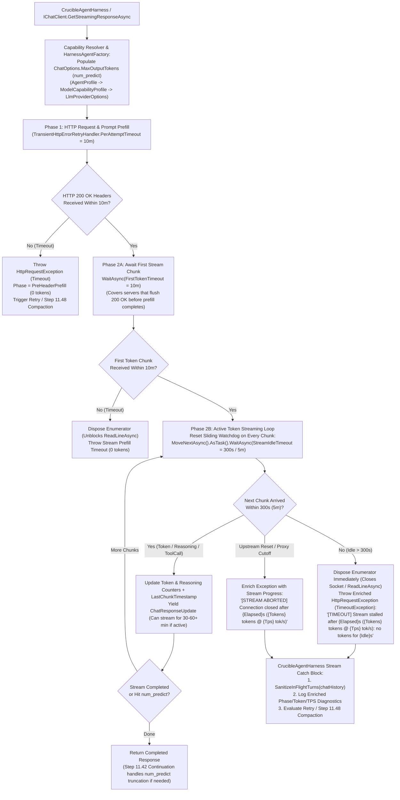

# 🛡️ Step 11.49: Two-Phase Streaming Idle Watchdog, Output Token Cap (`MaxOutputTokens` / `num_predict`) & Mid-Stream Timeout Diagnostics

> **Parent Plan:** [Phase 11 Master Plan](../11_EXTEND_FEATURES.md)  
> **Target Framework:** .NET 10 (C# 13)  
> **Status:** Completed  
> **Target Projects:** `NightCodeForge.Core`, `NightCodeForge.Agents`, `NightCodeForge.Agents.Tests`, `NightCodeForge.Core.Tests`  
> **Dependencies:** Step 11.37A (`TransientHttpErrorRetryHandler`), Step 11.42 (`CrucibleAgentHarness` Continuation & Stream Retry), Step 11.47 (Compaction Checkpoints & In-Flight Telemetry), Step 11.48 (Large-Context Timeout KV-Cache Compaction Recovery)  
> **Aligns With:** `AGENTS.md`, `docs/PLAN.md`

> [!IMPORTANT]
> **Specification Disclaimer:** This document is a behavioral specification. It defines required behaviors, architectural invariants, configuration bounds, and verification criteria. Specific method signatures, internal helper class names, and implementation details remain at the discretion of the implementer within these constraints.

---

## 1. Executive Summary & Incident Root Cause Analysis

During long-context coding sessions on `aiserver2` (`Qwen3.8-27B:latest`, `context_length: 131,072`, `think: "xhigh"`), `NightCodeForge` experienced three consecutive mid-stream request aborts after 15 to 24.5 minutes of active token generation:

| Request Window (UTC) | Prompt Tokens | Generated Tokens | Generation Rate | Total Duration | Outcome |
| :--- | :--- | :--- | :--- | :--- | :--- |
| `04:33:16` $\to$ `04:51:06` | `107,516` | **`16,575`** | ~`17.5 tok/s` | **17m 50s** (`1,070s`) | `Canceled` (mid-stream) |
| `04:51:07` $\to$ `05:15:37` | `107,937` | **`15,926`** | ~`17.5 tok/s` | **24m 30s** (`1,470s`) | `Canceled` (mid-stream) |
| `05:16:08` $\to$ `05:31:08` | `110,112` | **`15,815`** | ~`17.5 tok/s` | **15m 00s** (`900s`) | `Canceled` (mid-stream) |

At a sustained generation speed of ~`17.5 tokens/sec` for a 27B parameter model with a `110k`-token KV cache:

$$\frac{16,000 \text{ tokens}}{17.5 \text{ tokens/sec}} \approx 914.3 \text{ seconds} \approx \mathbf{15.24 \text{ minutes}}$$

Combined with initial prompt prefill (`30s` warm KV cache up to `500s` after a KV cache reload), generating a single `16,000`-token response takes **15 to 24.5 minutes** of healthy, continuous streaming.

Codebase investigation revealed four architectural gaps in `NightCodeForge` that caused or exacerbated this failure mode:

### 1.1 Root Cause 1: Single-Phase HTTP Timeout vs. Active Stream Body Reading (and `OllamaSharp` Uncancellable `ReadLineAsync`)
1. **Wall-Clock Cutoff vs. Unbounded Post-Header Stream Reads:**
   - In `OllamaChatClientFactory` and `OpenAiCompatibleChatClientFactory`, `HttpClient.Timeout` is set to `Timeout.InfiniteTimeSpan` when `TransientHttpErrorRetryHandler.PerAttemptTimeout` (`TimeSpan.FromMinutes(options.RequestTimeoutMinutes)`, currently **10 minutes / 600s**) is configured.
   - Inside `TransientHttpErrorRetryHandler.SendAsync`, `attemptTimeoutCts` (`PerAttemptTimeout`) wraps `base.SendAsync(request, cancellationToken)` and is **disposed in a `finally` block as soon as `base.SendAsync` returns**.
   - For non-streaming requests (`HttpCompletionOption.ResponseContentRead`), `PerAttemptTimeout` acts as a rigid wall-clock cap (10 minutes) over the entire generation—meaning any turn generating more than $600 \times 17.5 = 10,500$ tokens is guaranteed to be killed mid-generation!
   - Conversely, for streaming requests (`HttpCompletionOption.ResponseHeadersRead`, used by `OllamaSharp.OllamaApiClient.ChatAsync`), `base.SendAsync` returns as soon as the HTTP `200 OK` response headers arrive. Once `SendAsync` returns, `attemptTimeoutCts` is disposed, leaving the subsequent NDJSON/SSE stream body consumption (`IAsyncEnumerable<ChatResponseUpdate>`) with **no client-side inactivity watchdog at all** (relying entirely on upstream reverse-proxy wall-clock timeouts such as 15m/900s or TCP socket closure).
2. **`OllamaSharp` Token-Less `StreamReader.ReadLineAsync()` & C# Async Iterator `DisposeAsync()` Trap:**
   - `OllamaSharp.OllamaApiClient.ProcessStreamedChatResponseAsync` reads the NDJSON response stream via `await reader.ReadLineAsync().ConfigureAwait(false)` **without passing the `CancellationToken`** to `ReadLineAsync()`, checking `!cancellationToken.IsCancellationRequested` only between lines. Consequently, `StreamReader` calls `responseStream.ReadAsync(buffer, CancellationToken.None)`.
   - Worse yet, in a C# compiler-generated `async IAsyncEnumerable<T>` state machine (`OllamaApiClient.GetStreamingResponseAsync` $\to$ `ChatAsync` $\to$ `ProcessStreamedChatResponseAsync`), while `MoveNextAsync()` is still suspended inside `await reader.ReadLineAsync()` (`<>1__state >= 0`, rather than suspended at a `yield return` where `<>1__state < -2`), calling `enumerator.DisposeAsync()` **does not execute the `using` blocks** inside the iterator and instead throws `System.NotSupportedException`!
   - Therefore, unblocking a stalled `ReadLineAsync()` requires **both**: (a) wrapping the HTTP response content stream so `Stream.ReadAsync` links the request's `CancellationToken` (and closes/disposes the underlying stream when cancelled) even when `StreamReader.ReadLineAsync()` passes `CancellationToken.None`, and (b) cancelling a linked per-stream `CancellationTokenSource` in `TelemetryChatClient` when the watchdog fires and awaiting the faulted `MoveNextAsync()` task before disposing the enumerator.

### 1.2 Root Cause 2: Uncapped Output Generation (`MaxOutputTokens` / `num_predict` Never Wired to `ChatOptions`)
- Although `LlmProviderOptions.MaxOutputTokens` (`DefaultMaxOutputTokens = 8192`), `ModelCapabilityProfile.MaxOutputTokens`, and `OpenAiAllowedModel.MaxOutputTokens` are defined in configuration models, **none of them are ever read or assigned to `ChatOptions.MaxOutputTokens` at runtime** in `OllamaCapabilityResolver`, `OpenAiCapabilityResolver`, or `HarnessAgentFactory`.
- Both `OllamaSharp` (`AbstractionMapper.ToOllamaSharpChatRequest`, which maps `ChatOptions.MaxOutputTokens` to Ollama's `options.num_predict`) and `Microsoft.Extensions.AI.OpenAI` (which maps `ChatOptions.MaxOutputTokens` to `max_tokens` / `max_completion_tokens`) natively honor `ChatOptions.MaxOutputTokens`.
- Because `ChatOptions.MaxOutputTokens` was left `null`, local models with `think: "xhigh"` generated 16,000+ token monologues and full-file rewrites in a single turn without any output ceiling.

### 1.3 Root Cause 3: Mid-Stream Retry Amplification & Unsanitized In-Flight History
- Inside `CrucibleAgentHarness`, a single `agent.RunStreamingAsync` call may execute one or more tool calls (persisted to `chatHistory` by `PerServiceCallChatHistoryPersistingChatClient`, which explains why the prompt grew from `107,516` to `107,937` to `110,112` tokens across the three attempts) before a subsequent model call in the same loop aborts mid-stream.
- When `enumerator.MoveNextAsync()` throws a transient error mid-stream, `CrucibleAgentHarness` retries `agent.RunStreamingAsync(chatHistory.ToList(), ...)` **without calling `SanitizeInFlightTurns(chatHistory)`**, risking dangling tool-call turns or partial state in `chatHistory`, and immediately re-submits the 110k-token context without accounting for whether tokens were already being actively streamed.

### 1.4 Root Cause 4: Ambiguous Timeout Telemetry & Error Diagnostics
- `TransientHttpErrorRetryHandler` and `HttpErrorDetailHelper` format all timeout exceptions with a generic message (`"LLM inference request timed out after X seconds. The prompt context may be too large or the inference server is overloaded."`).
- Operators and automated recovery policies (such as Step 11.48's KV-cache compaction recovery) cannot distinguish from logs or exception metadata between:
  1. **Phase 1 Pre-Header / Prefill Timeout:** `0` tokens received before `PerAttemptTimeout` expired (cold KV-cache prefill stall or server queue saturation).
  2. **Phase 2 Mid-Stream Idle Stall:** The stream yielded $N$ tokens over $M$ seconds, then went completely silent for longer than the stream inactivity window (`StreamIdleTimeoutSeconds`).
  3. **Phase 2 Mid-Stream Upstream / Proxy Abort:** The stream was actively generating tokens at $R\text{ tok/s}$ ($N$ tokens over $M$ seconds) when the connection was reset or closed prematurely by an upstream proxy/server wall-clock timeout.

---

## 2. Architecture & Data Flow

The following diagram illustrates the **Two-Phase Streaming Timeout & Output Token Cap** lifecycle across `TransientHttpErrorRetryHandler`, `TelemetryChatClient`, and `CrucibleAgentHarness`:

---

## 3. Detailed Behavioral Specifications

### 3.1 Two-Phase Streaming Timeout & Sliding Inactivity Watchdog

Instead of applying a single rigid wall-clock deadline to an entire generation (which kills healthy 15–25 minute generations) or leaving post-header stream reads completely unguarded (which hangs forever when `OllamaSharp` calls `StreamReader.ReadLineAsync()` without a `CancellationToken`), streaming inference MUST enforce a **two-phase timeout model**:

1. **Configuration (`LlmProviderOptions` & `LlmRetryPolicyOptions`):**
   - Retain `RequestTimeoutMinutes` (default `10` minutes / `600s`) as the **Pre-Header / First-Token (Prefill) Timeout**, which bounds connection establishment, queue wait, and cold KV-cache prompt prefill.
   - Add `StreamIdleTimeoutSeconds` (default `300` seconds / **5 minutes**, configurable via `LlmProviderOptions` and propagated to `LlmRetryPolicyOptions` / `TelemetryChatClient`) to bound the **maximum silence interval between consecutive streamed chunks** once token generation has started. A generous 5-minute default safely accommodates server-side buffered tool-call JSON parsing, grammar-constrained decoding pauses, or temporary GPU scheduling delays without false-positive aborts.
2. **Phase 1 — Pre-Header Timeout (`TransientHttpErrorRetryHandler`):**
   - `TransientHttpErrorRetryHandler` continues to enforce `PerAttemptTimeout` (`TimeSpan.FromMinutes(RequestTimeoutMinutes)`) across `base.SendAsync(request, cancellationToken)`.
3. **Phase 2A — First-Chunk Prefill Window (`FirstTokenTimeout`):**
   - Some OpenAI-compatible servers and reverse proxies flush HTTP `200 OK` headers immediately upon accepting a request—*before* prompt prefill completes—and only emit the first SSE/NDJSON chunk after prefill finishes.
   - Therefore, while awaiting the **very first non-empty chunk** from the `IAsyncEnumerable<ChatResponseUpdate>` enumerator, the timeout window MUST use the prefill budget (`FirstTokenTimeout = PerAttemptTimeout`, default `10` minutes), not the 5-minute inter-token idle timeout.
4. **Phase 2B — Sliding Inter-Token Idle Watchdog (`StreamIdleTimeoutSeconds`):**
   - Once the first chunk has been received, every subsequent `enumerator.MoveNextAsync()` call MUST be guarded by a sliding timeout of `StreamIdleTimeoutSeconds` (default `300s` / 5 minutes), driven by `TimeProvider` (e.g., via `.AsTask().WaitAsync(idleTimeout, timeProvider, cancellationToken)`).
   - Every received chunk resets the `300s` timer. As long as the inference server continues emitting at least one chunk every `5` minutes, **there is no total wall-clock cap on the stream**, allowing legitimate 15–60 minute deep-reasoning or large refactoring turns to finish uninterrupted.
5. **Deterministic Teardown of `OllamaSharp`'s Token-Less `ReadLineAsync()` (Preventing State-Machine `NotSupportedException`):**
   - *Note (Temporary Workaround):* `StreamingCancellationScope` and `CancellationAwareStream` / `CancellationAwareHttpContent` are a temporary workaround required until upstream `OllamaSharp` PR [awaescher/OllamaSharp#400](https://github.com/awaescher/OllamaSharp/pull/400) (scoped to `.NET 7+`, which covers `NightCodeForge` on `.NET 10`) is released and referenced (tracked in [docs/fixes/OLLAMASHARP_STREAMING_CANCELLATION_PR_SPEC.md](../../fixes/OLLAMASHARP_STREAMING_CANCELLATION_PR_SPEC.md)).
   - At the HTTP transport layer (`TransientHttpErrorRetryHandler` or a response `HttpContent` / `Stream` wrapper), wrap streaming response streams so that every `Stream.ReadAsync` call links the request's `CancellationToken` (and disposes the inner response stream when cancelled), even when `OllamaSharp`'s `StreamReader.ReadLineAsync()` passes `CancellationToken.None`.
   - In `TelemetryChatClient.GetStreamingResponseAsync`, create a linked `CancellationTokenSource` (`streamCts`) and pass `streamCts.Token` to `base.GetStreamingResponseAsync(messagesList, options, streamCts.Token)`.
   - When the Phase 2A (`FirstTokenTimeout`) or Phase 2B (`StreamIdleTimeout`) watchdog fires (`TimeoutException` from `moveNextTask.WaitAsync(timeout, _timeProvider, cancellationToken)`), the wrapper MUST:
     1. Cancel `streamCts` immediately (which aborts the wrapped HTTP response `Stream.ReadAsync` and unblocks `OllamaSharp.ReadLineAsync()`),
     2. Await/observe `moveNextTask` (suppressing the expected cancellation/IO fault from the aborted read) so the C# async iterator state machine completes its in-flight step and runs its internal `using` blocks (`StreamReader`, `Stream`, `HttpResponseMessage`) cleanly before `await using` calls `enumerator.DisposeAsync()` (preventing `NotSupportedException`), and
     3. Throw an enriched `HttpRequestException` with `InnerException = TimeoutException` (so `TransientErrorDetector.IsHttpTimeout` and Step 11.48 recognize it as a timeout).

---

### 3.2 Turn-Level Output Token Cap (`MaxOutputTokens` / `num_predict`) & Diff-First Directives

To prevent unbounded single-turn outputs (16k–32k+ tokens of circular `<think>` monologues or full-file rewrites) while still giving reasoning models (`think: "xhigh"`) enough headroom to think and emit tool calls:

1. **Default Output Token Ceiling (`LlmProviderOptions.DefaultMaxOutputTokens`):**
   - Increase `LlmProviderOptions.DefaultMaxOutputTokens` from `8192` to **`16384`** (`16,384` tokens).
   - *Rationale:* In reasoning models like `Qwen3.8-27B` with `think: "xhigh"`, `MaxOutputTokens` (`num_predict`) covers the sum of `<think>` reasoning tokens and visible response/tool-call tokens. An `8,192`-token ceiling can truncate a deep reasoning chain before the model emits its tool call, whereas `16,384` tokens provides ample budget for both `xhigh` reasoning and multi-hunk `edit` calls while preventing runaway 32k–64k generation loops. (And with the Phase 2B sliding idle watchdog in place, a `16,384`-token turn at `17.5 tok/s` taking ~15.6 minutes will no longer be killed by the 10-minute prefill timeout.)
2. **Runtime Resolution & Wiring to `ChatOptions.MaxOutputTokens`:**
   - Support an optional `MaxOutputTokens` override on `AgentProfile` (`int? MaxOutputTokens`) in addition to the existing `ModelCapabilityProfile.MaxOutputTokens`, `OpenAiAllowedModel.MaxOutputTokens`, and `LlmProviderOptions.MaxOutputTokens`.
   - Resolve the effective `MaxOutputTokens` using the precedence chain:
     $$\text{AgentProfile.MaxOutputTokens} \;\to\; \text{ModelCapabilityProfile.MaxOutputTokens / OpenAiAllowedModel.MaxOutputTokens} \;\to\; \text{LlmProviderOptions.MaxOutputTokens}$$
   - In `OllamaCapabilityResolver.CreateChatOptions`, `OpenAiCapabilityResolver.CreateChatOptions`, and `HarnessAgentFactory`, always populate `chatOptions.MaxOutputTokens` (and `HarnessAgentOptions.MaxOutputTokens` when positive) with the resolved positive value.
   - Because `OllamaSharp` maps `ChatOptions.MaxOutputTokens` directly to `options.num_predict` and `Microsoft.Extensions.AI.OpenAI` maps it to `max_tokens` / `max_completion_tokens`, every inference request will carry an explicit output token ceiling.
3. **Bounded Output Tokens for Compaction Summarizer Calls:**
   - Ensure `PiStyleCrucibleCompactionStrategy.GenerateLlmSummaryAsync` enforces an explicit bounded `ChatOptions.MaxOutputTokens` (e.g., `8192` or `Math.Min(8192, Math.Max(1024, (int)(_options.ReserveTokens * 0.8)))`) and low/disabled reasoning effort (`AdditionalProperties["think"] = false` / `"low"`) when invoking the LLM for context compaction summaries so a summarization call can never enter a runaway `<think>` generation loop.
4. **Interaction with Step 11.42 Stream Continuation & Diff-First Prompt Guidance:**
   - If a turn legitimately reaches `MaxOutputTokens` (`FinishReason == ChatFinishReason.Length` or an unclosed code/tool block), Step 11.42's `InterruptedGenerationDetector` and conversational continuation loop (`CrucibleAgentHarness`) already detect the interruption and prompt the model to continue in the next turn.
   - Reinforce the implementation/coding prompt instructions in `PromptPrefixStabilizer` (or stage directives) to explicitly instruct agents to make incremental, targeted `edit` tool calls rather than dumping entire multi-thousand-line files in a single turn.

---

### 3.3 Mid-Stream Retry Sanitization in `CrucibleAgentHarness`

When a streaming inference call fails mid-stream inside `CrucibleAgentHarness`:

1. **Mandatory `SanitizeInFlightTurns(chatHistory)` Before Retry:**
   - In `CrucibleAgentHarness`'s streaming retry catch block (`catch (Exception ex) when (streamRetries < maxStreamRetries && !ct.IsCancellationRequested && IsTransientStreamError(ex))`), invoke `SanitizeInFlightTurns(chatHistory)` before starting the next retry attempt.
   - This guarantees that if `FunctionInvokingChatClient` or `PerServiceCallChatHistoryPersistingChatClient` appended an assistant `FunctionCallContent` turn without a matching `FunctionResultContent` (or any partial in-flight message) prior to the mid-stream abort, the orphaned turn is stripped before re-sending `chatHistory`.
2. **Accurate Partial Progress Accounting:**
   - When logging the retry warning and broadcasting the `[RETRY]` status notice to `ICrucibleImmediateEventSink`, include the number of tokens (`accumulatedText.Length` / `accumulatedReasoning.Length` or stream telemetry metadata) and elapsed time already spent in the aborted attempt so operators can see immediately whether the failure happened during prefill (`0` tokens) or mid-generation.

---

### 3.4 Differentiated Timeout & Mid-Stream Abort Diagnostics

To eliminate ambiguity between prefill timeouts, mid-stream silence stalls, and upstream proxy cutoffs:

1. **Structured Stream Timeout Context:**
   - Define a strongly-typed diagnostic metadata model or exception enrichment mechanism (e.g., on `HttpRequestException.Data` or a dedicated `LlmStreamTimeoutException : HttpRequestException`) that records:
     - `TimeoutPhase`: `PreHeaderPrefill`, `FirstTokenPrefill`, `MidStreamIdleStall`, or `MidStreamConnectionClosed`
     - `ElapsedSeconds`: Total wall-clock seconds elapsed for the attempt
     - `ConfiguredTimeoutSeconds`: The timeout threshold that was exceeded (`PerAttemptTimeout` vs. `StreamIdleTimeoutSeconds`)
     - `GeneratedTokens`: Total completion + reasoning chunks/tokens received before the failure
     - `TokensPerSecond`: Sustained generation rate prior to the failure
2. **Actionable Log & UI Error Formatting (`TelemetryChatClient` & `HttpErrorDetailHelper.FormatLlmInvocationError`):**
   - When structured stream timeout metadata is present on the exception chain, `HttpErrorDetailHelper.FormatLlmInvocationError(ex)` formats:
     - **Pre-Header / First-Token Prefill Timeout (`GeneratedTokens == 0`):**
       > `"[TIMEOUT] LLM request aborted by client after {Elapsed:F1}s prefill timeout (0 tokens received; configured prefill timeout: {Timeout}s). The prompt context may be too large (cold KV cache) or the inference server queue is saturated."`
     - **Mid-Stream Idle Stall (`TimeoutPhase == MidStreamIdleStall`, `GeneratedTokens > 0`):**
       > `"[TIMEOUT] LLM stream stalled after {Elapsed:F1}s ({Tokens:N0} tokens generated at {Tps:F1} tok/s): no tokens received for {IdleTimeout}s."`
     - **Mid-Stream Upstream / Proxy Abort (`TimeoutPhase == MidStreamConnectionClosed`, `GeneratedTokens > 0`):**
       > `"[STREAM ABORTED] LLM stream closed prematurely by upstream server/proxy after {Elapsed:F1}s while actively generating ({Tokens:N0} tokens generated at {Tps:F1} tok/s). Check upstream reverse-proxy timeout settings (e.g., OllamaRouter / Nginx proxy_read_timeout)."`
   - When no structured stream timeout metadata is attached (e.g., generic `TimeoutException` or `TaskCanceledException` in unit tests), `HttpErrorDetailHelper.FormatLlmInvocationError(ex)` preserves its existing baseline message format.
3. **Compatibility with `TransientErrorDetector.IsHttpTimeout` and Step 11.48:**
   - Ensure `TransientErrorDetector.IsHttpTimeout(ex)` returns `true` for all three timeout phases (`PreHeaderPrefill`, `FirstTokenPrefill`, and `MidStreamIdleStall`) so existing transient retry policies and Step 11.48's pre-abandonment KV-cache compaction recovery trigger seamlessly.

---

## 4. Configuration & Component Summary

| Component / Class | Project | Required Changes |
| :--- | :--- | :--- |
| `LlmProviderOptions` | `NightCodeForge.Core` | Change `DefaultMaxOutputTokens` to `16384`. Add `DefaultStreamIdleTimeoutSeconds = 300` (5 minutes) and `StreamIdleTimeoutSeconds` property. |
| `LlmRetryPolicyOptions` | `NightCodeForge.Core` | Add `StreamIdleTimeout` (`TimeSpan`, default `5 minutes`) alongside `PerAttemptTimeout` (`10 minutes`). |
| `AgentProfile` | `NightCodeForge.Core` | Add optional `int? MaxOutputTokens { get; set; }` override (and include in cloning/serialization if applicable). |
| `OllamaCapabilityResolver` & `OpenAiCapabilityResolver` | `NightCodeForge.Agents` | Resolve `MaxOutputTokens` (`ModelCapabilityProfile` / `OpenAiAllowedModel` $\to$ `LlmProviderOptions`) and set `ChatOptions.MaxOutputTokens`. |
| `HarnessAgentFactory` | `NightCodeForge.Agents` | Apply `AgentProfile.MaxOutputTokens` override (if set) or resolved `ChatOptions.MaxOutputTokens` to `chatOptions.MaxOutputTokens` and `HarnessAgentOptions.MaxOutputTokens`. |
| `LlmChatClientFactoryBase` & `TelemetryChatClient` | `NightCodeForge.Agents` | Pass `_timeProvider` and resolved `FirstTokenTimeout` / `StreamIdleTimeout` from `LlmChatClientFactoryBase` into `TelemetryChatClient` (without optional constructor parameters and keeping constructor parameters $\le 10$). Enforce Phase 2A (`FirstTokenTimeout`) and Phase 2B (`StreamIdleTimeout`) via `TimeProvider`-aware `WaitAsync`, cancel linked `streamCts` and observe the faulted `MoveNextAsync` task on timeout to deterministically unblock `OllamaSharp.ReadLineAsync()` without state-machine `NotSupportedException`, and attach structured stream progress metadata (`TimeoutPhase`, `GeneratedTokens`, `TokensPerSecond`, `ElapsedSeconds`) on failure. |
| `HttpErrorDetailHelper` & `TransientHttpErrorRetryHandler` | `NightCodeForge.Core` | Wrap streaming `HttpResponseMessage.Content` streams so `Stream.ReadAsync` honors the request `CancellationToken` even when `OllamaSharp`'s `StreamReader.ReadLineAsync()` passes `CancellationToken.None`. Format differentiated `[TIMEOUT]` and `[STREAM ABORTED]` messages in `HttpErrorDetailHelper.FormatLlmInvocationError` using the structured timeout phase and token progress metadata. |
| `CrucibleAgentHarness` | `NightCodeForge.Agents` | Call `SanitizeInFlightTurns(chatHistory)` in the streaming retry catch block before retrying, and include partial token/elapsed diagnostics in retry telemetry. |
| `PiStyleCrucibleCompactionStrategy` | `NightCodeForge.Agents` | Set bounded `ChatOptions.MaxOutputTokens` on compaction summary requests. |

---

## 5. Acceptance Criteria & Verification Strategy

### 5.1 Core Acceptance Criteria

1. **Default 10-Minute First-Token Timeout (`RequestTimeoutMinutes = 10`):**
   - By default, a streaming inference call waits **up to 10 minutes (`600s`)** from request start to receive the **first token** (covering TCP connection, HTTP `200 OK` headers, and initial cold KV-cache prompt prefill before the first chunk is emitted).
   - If the first token arrives at `9m 30s`, the request succeeds into active streaming even though `9m 30s` exceeds the 5-minute inter-token idle window.
   - If no token arrives after `10m 00s` (whether stalled before HTTP headers or after HTTP `200 OK` headers before the first chunk), the attempt is deterministically aborted with a prefill timeout (`0` tokens generated).
2. **Default 5-Minute Mid-Stream Pause Timeout (`StreamIdleTimeoutSeconds = 300`):**
   - Once the first token has been received, the watchdog waits **up to 5 minutes (`300s`)** between consecutive token chunks.
   - If token generation pauses for `4m 30s` mid-stream and then resumes emitting tokens, the stream continues uninterrupted and resets the 5-minute timer on every chunk.
   - Because each received token resets the 5-minute timer, a stream that continuously emits tokens (e.g., every few milliseconds or seconds) can run for **20, 30, or 60+ minutes** (well beyond the 10-minute first-token timeout) without being aborted.
   - If token generation pauses completely for `5m 00s` after already emitting $N > 0$ tokens, the watchdog immediately aborts the stream, disposes the enumerator/HTTP response stream (unblocking `OllamaSharp`'s token-less `StreamReader.ReadLineAsync()`), and throws an enriched timeout exception recording $N$ generated tokens and `TimeoutPhase == MidStreamIdleStall`.
3. **Explicit `MaxOutputTokens` (`num_predict`) Ceiling:**
   - Every chat request created via `OllamaCapabilityResolver`, `OpenAiCapabilityResolver`, and `HarnessAgentFactory` carries a non-null `ChatOptions.MaxOutputTokens` (defaulting to `16,384` tokens unless overridden by `AgentProfile.MaxOutputTokens` or model capability config).

### 5.2 Unit & Fake-`HttpClient` Integration Tests

1. **Fake `HttpClient` / `HttpMessageHandler` End-to-End Streaming Pipeline Integration Tests (with Lower Ceilings) (`NightCodeForge.Agents.Tests`):**
   - Construct the real client pipeline (`OllamaChatClientFactory` / `OpenAiCompatibleChatClientFactory` $\to$ `TransientHttpErrorRetryHandler` $\to$ `OllamaApiClient` $\to$ `TelemetryChatClient`) backed by a fake `HttpMessageHandler` (`HttpClient`) serving a chunked/streamed NDJSON (`application/x-ndjson`) response body with scaled-down timeout ceilings (e.g., `FirstTokenTimeout = 300ms`, `StreamIdleTimeout = 120ms`):
     - **Scenario A (Slow First Token Within `FirstTokenTimeout`, Then Active Stream Beyond `FirstTokenTimeout`):** Fake HTTP handler delays `200ms` (`> StreamIdleTimeout` of `120ms`, but `< FirstTokenTimeout` of `300ms`) before flushing the first NDJSON token, then emits 10 NDJSON tokens spaced `50ms` apart (total stream duration `700ms > FirstTokenTimeout` of `300ms`). Verify all 11 tokens are received without error.
     - **Scenario B (First Token Exceeds `FirstTokenTimeout`):** Fake HTTP handler flushes `200 OK` headers immediately (or delays headers) and waits `500ms` (`> FirstTokenTimeout` of `300ms`) before emitting any NDJSON line. Verify the call aborts at ~`300ms` with `GeneratedTokens == 0` (`FirstTokenPrefill` / `PreHeaderPrefill`) and does not hang in `OllamaSharp`'s `ReadLineAsync()`.
     - **Scenario C (Mid-Stream Pause Within `StreamIdleTimeout` Resumes Cleanly):** Fake HTTP handler emits 3 NDJSON tokens, pauses for `70ms` (`< StreamIdleTimeout` of `120ms`), and then emits the remaining tokens + `done: true`. Verify the stream completes normally.
     - **Scenario D (Mid-Stream Pause Exceeds `StreamIdleTimeout` Unblocks `ReadLineAsync`):** Fake HTTP handler emits 3 NDJSON tokens and then holds the response `Stream.ReadAsync` open indefinitely without closing the connection. Verify the watchdog aborts at ~`120ms` after the 3rd token, disposes the response stream (cancelling/closing the pending `Stream.ReadAsync` inside `OllamaSharp.ReadLineAsync()`), and throws an `HttpRequestException` (recognized by `TransientErrorDetector.IsHttpTimeout`) with `TimeoutPhase == MidStreamIdleStall` and `GeneratedTokens == 3`.
2. **Deterministic `FakeTimeProvider` Watchdog Unit Tests (`NightCodeForge.Agents.Tests`):**
   - Verify the exact default ceilings (`10 minutes` for the first token, `5 minutes` for mid-stream pauses, and `25+ minutes` of continuous streaming) using `FakeTimeProvider` without real wall-clock sleeps.
3. **`MaxOutputTokens` (`num_predict`) Resolution & Wire-Format Verification (`NightCodeForge.Agents.Tests`):**
   - Verify `OllamaCapabilityResolver.CreateChatOptions` and `OpenAiCapabilityResolver.CreateChatOptions` populate `ChatOptions.MaxOutputTokens` from `LlmProviderOptions.MaxOutputTokens` (`16384` default) when model capability profile leaves it null, from `ModelCapabilityProfile.MaxOutputTokens` when configured, and that `HarnessAgentFactory` honors `AgentProfile.MaxOutputTokens` when overridden.
   - Using the fake `HttpMessageHandler`, inspect the serialized outbound JSON request body sent by `OllamaApiClient` and verify `"num_predict": 16384` is present in `"options"`.
4. **Mid-Stream Retry Sanitization Tests (`NightCodeForge.Agents.Tests`):**
   - Simulate a multi-turn streaming execution in `CrucibleAgentHarness` where an assistant `FunctionCallContent` is appended to `chatHistory` followed by a mid-stream `HttpRequestException` timeout before completion. Verify `SanitizeInFlightTurns(chatHistory)` strips the dangling tool call before the retry attempt runs.
5. **Differentiated Timeout Formatting Tests (`NightCodeForge.Core.Tests`):**
   - Verify `HttpErrorDetailHelper.FormatLlmInvocationError` outputs distinct, accurate messages for `PreHeaderPrefill` / `FirstTokenPrefill` (`0` tokens), `MidStreamIdleStall` ($N$ tokens, $R$ tok/s, idle $I$s), and `MidStreamConnectionClosed` ($N$ tokens, $R$ tok/s), while preserving baseline formatting for unenriched `TimeoutException` instances.

### 5.3 Definition of Done (DoD) Checklist

- [x] Add `StreamIdleTimeoutSeconds` (default `300` / 5 minutes) and update `DefaultMaxOutputTokens` to `16384` on `LlmProviderOptions`; add `StreamIdleTimeout` (`5 minutes` default) to `LlmRetryPolicyOptions`.
- [x] Wire `ChatOptions.MaxOutputTokens` (`num_predict` / `max_tokens`) across `OllamaCapabilityResolver`, `OpenAiCapabilityResolver`, `HarnessAgentFactory` (with optional `AgentProfile.MaxOutputTokens` override), and `PiStyleCrucibleCompactionStrategy`.
- [x] Implement the `TimeProvider`-driven two-phase streaming watchdog (10-minute `FirstTokenTimeout` for the first chunk, 5-minute sliding `StreamIdleTimeout` for subsequent chunks) with immediate enumerator disposal on timeout so `OllamaSharp`'s token-less `ReadLineAsync()` is deterministically unblocked.
- [x] Enrich streaming timeout and premature stream-abort exceptions with `TimeoutPhase`, elapsed duration, generated token count, and tok/s rate, and surface differentiated diagnostics in `TelemetryChatClient` and `HttpErrorDetailHelper`.
- [x] Invoke `SanitizeInFlightTurns(chatHistory)` inside `CrucibleAgentHarness`'s streaming retry catch block before re-running the stream.
- [x] Add fake-`HttpClient` (`HttpMessageHandler`) streaming integration tests with lower timeout ceilings covering all 4 streaming scenarios (slow first token within budget + long active stream beyond `FirstTokenTimeout`, first-token timeout, mid-stream pause within budget, and mid-stream pause exceeding `StreamIdleTimeout` unblocking `OllamaSharp.ReadLineAsync()`) plus outbound `"num_predict"` payload verification.
- [x] Add unit tests in `NightCodeForge.Agents.Tests` and `NightCodeForge.Core.Tests` covering default 10m/5m ceilings with `FakeTimeProvider`, `MaxOutputTokens` resolution precedence, mid-stream retry sanitization, and differentiated timeout messages.
- [x] Verify all non-E2E tests pass via `dotnet test --filter "Category!=Acceptance&Category!=E2E"`.

