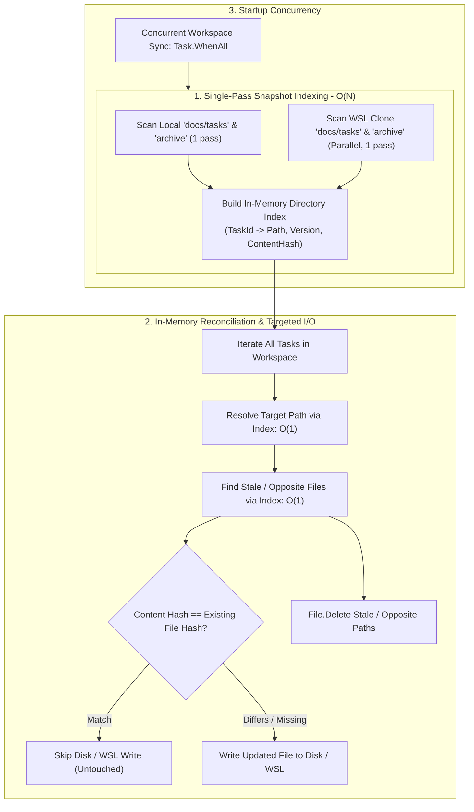

# ⚡ Step 11.50: TaskDiskSyncCoordinator & Markdown Sync Performance Hardening ($O(N^2) \to O(N)$ In-Memory Indexing, Hash Diffing & WSL UNC Parallelism)

> **Performance, Scalability & Startup Resiliency Specification**  
> *Parent Plan:* [Phase 11 Master Plan](../11_EXTEND_FEATURES.md)  
> *Target Framework:* .NET 10 (C# 13) | *Status:* Completed  
> *Target Projects:* [`src/NightCodeForge.Core`](../../../src/NightCodeForge.Core), [`src/NightCodeForge.Web`](../../../src/NightCodeForge.Web), [`tests/NightCodeForge.Core.Tests`](../../../tests/NightCodeForge.Core.Tests), [`tests/NightCodeForge.Web.Tests`](../../../tests/NightCodeForge.Web.Tests)  
> *Dependencies:* [Step 11.23: Backlog Rejection & Kanban Hygiene](STEP_11_23_BACKLOG_REJECTION_KANBAN_HYGIENE_AND_SHELL_ERGONOMICS.md), [Step 11.33: Unified LLM Provider & Dynamic Context](STEP_11_33_UNIFIED_LLM_PROVIDER_DYNAMIC_CONTEXT_AND_FLEET_INTEGRATION.md)  
> *Aligns With:* [AGENTS.md](../../../AGENTS.md), [docs/PLAN.md](../../PLAN.md)

> This document is a **specification**: it states required behaviors and constraints, not implementations. Implementation choices (signatures, code structure) are left to the implementer, within the constraints of the documents.

---

## 1. Executive Summary & Problem Analysis

### 1.1 Problem Statement: Startup Paralysis and $O(N^2)$ File I/O Explosion
During application startup and workspace task synchronization, [`TaskDiskSyncCoordinator`](file:///c:/Users/Julien/source/repos/jetelain/NightCodeForge/src/NightCodeForge.Web/Services/TaskDiskSyncCoordinator.cs) orchestrates a bidirectional sync between SQLite task records and disk markdown files in `docs/tasks/*.md`, mirroring results to the agent's WSL ext4 working clone (`\\wsl.localhost\Ubuntu\...`).

In real-world environments, this operation causes severe latency that blocks application startup:
```text
[2026-11-10 19:20:41.963 +01:00 INF] Initiating immediate docs/tasks sync for workspace #1 (OllamaRouter) at 'C:\Users\Julien\source\repos\jetelain\OllamaRouter'
[2026-11-10 19:21:36.586 +01:00 INF] Completed docs/tasks sync for workspace #1: 15 processed from disk, 75 mirrored to disk (clone: \\wsl.localhost\Ubuntu\home\gruearbre\.nightcodeforge\wks\1\clone).
[2026-11-10 19:21:36.597 +01:00 INF] Initiating immediate docs/tasks sync for workspace #2 (ComicGenCLI) at 'C:\Users\Julien\source\repos\ComicGenCLI'
[2026-11-10 19:21:46.574 +01:00 INF] Completed docs/tasks sync for workspace #2: 2 processed from disk, 31 mirrored to disk (clone: \\wsl.localhost\Ubuntu\home\gruearbre\.nightcodeforge\wks\2\clone).
```

- **Workspace #1 (75 tasks):** Took **54.6 seconds**.
- **Workspace #2 (31 tasks):** Took **10.0 seconds**.
- Total web application startup was blocked synchronously for **over 65 seconds** before Kestrel could start listening for incoming requests.

### 1.2 Quantitative Root Cause Analysis

The root cause stems from three compounding bottlenecks in [`TaskMarkdownSyncService.SyncAllTasksToDiskAsync`](file:///c:/Users/Julien/source/repos/jetelain/NightCodeForge/src/NightCodeForge.Core/Services/TaskMarkdownSyncService.cs#L483-L635):

1. **Quadratic $O(N^2)$ Directory Re-Scanning & Parsing:**
   Inside `SyncAllTasksToDiskAsync`, a sequential `foreach (var task in allTasks)` iterates over every task ($N=75$). For **each individual task**:
   - `ResolveTargetFilePathAsync` issues `Directory.GetFiles()` on the target directory and fallback directories (`docs/tasks` and `docs/tasks/archive`), reads every file from disk (`File.ReadAllTextAsync`), and runs YAML frontmatter parsing.
   - `CleanupOtherFilesForTaskIdAsync` issues `Directory.GetFiles()` again on both active and archive directories, reads every file again, and parses YAML frontmatter to find duplicates.
   - **Local disk penalty:** $75 \times 75 \times 2 = \mathbf{11{,}250\text{ file reads and YAML parsing passes}}$.

2. **Cross-Boundary WSL UNC Latency Amplification:**
   When mirroring to the WSL clone (`\\wsl.localhost\Ubuntu\...`), `CleanupOtherFilesForTaskIdAsync` is invoked on the clone directories:
   - For every task, it scans `clone/docs/tasks` and `clone/docs/tasks/archive` over the Windows-to-WSL 9P/SMB network protocol, reading and parsing each file.
   - **WSL UNC penalty:** $75 \times 75 = \mathbf{5{,}625\text{ remote file reads over WSL network UNC share}}$.
   - With network latency of ~8–12 ms per remote file read, $5{,}625 \times 10\text{ ms} \approx \mathbf{56\text{ seconds}}$, matching the observed ~55-second delay exactly.

3. **Unconditional Rewriting of Untouched Tasks:**
   Even when database tasks and markdown files on disk and WSL are 100% identical, `SyncAllTasksToDiskAsync` unconditionally writes every task to disk and WSL clone via `File.WriteAllTextAsync`. For 75 tasks, this produces 150 unnecessary write operations.

4. **Head-of-Line Startup Blocking in `Program.cs`:**
   In [`Program.cs`](file:///c:/Users/Julien/source/repos/jetelain/NightCodeForge/src/NightCodeForge.Web/Program.cs#L237-L251), workspaces are synced sequentially in a `foreach` loop. $M$ workspaces compound the total delay sequentially before the server starts.

---

## 2. Proposed Architecture & Key Concepts



### Core Design Principles
1. **$O(N)$ In-Memory Indexing:** Directories are read at most **once** per sync run. Filename matching, ID resolution, and duplicate cleanup operate entirely against in-memory dictionary lookups.
2. **Hash-Diffed Write Avoidance:** DiskWrites only occur when the generated task markdown hash differs from the existing file hash. Startup sync of untouched workspaces incurs **zero** file writes.
3. **WSL Bounded Concurrency:** Remote WSL directory scans and writes utilize bounded parallelism (`Parallel.ForEachAsync` with bounded concurrency), hiding network latency.
4. **Non-Blocking Startup:** Startup workspace synchronization runs concurrently across all registered workspaces.

---

## 3. Detailed Technical Requirements

### 3.1 In-Memory Directory Task Index (`DirectoryTaskIndex`)
1. Introduce an internal or private helper structure/class (e.g. `DirectoryTaskSnapshot` or `DirectoryTaskIndex`) within `NightCodeForge.Core.Services`:
   - Scans a specified folder (e.g. `docs/tasks` or `docs/tasks/archive`) once.
   - Stores parsed entries containing:
     - `FilePath` (absolute string)
     - `FileName` (string)
     - `TaskId` (nullable `int`)
     - `Version` (nullable `int`)
     - `ContentHash` (string)
     - `Frontmatter` (`TaskFrontmatter`)
     - `PreferredSlug` (string)
   - Provides $O(1)$ lookups and in-memory mutations:
     - `GetFilesByTaskId(int taskId)`: returns all existing files mapped to a given task ID.
     - `TryGetEntryByFileName(string fileName, out ...)`: checks if a filename is already claimed in the directory (and by which `TaskId`).
     - `TryGetFileHash(string filePath)`: returns the cached content hash.
     - `UpsertEntry(...)` / `RemoveEntry(string filePath)`: updates the in-memory index when files are written, claimed, or deleted during the batch loop so subsequent tasks in the same batch observe newly claimed filenames and removed duplicates without touching the disk.

2. In [`TaskMarkdownSyncService.SyncAllTasksToDiskAsync`](file:///c:/Users/Julien/source/repos/jetelain/NightCodeForge/src/NightCodeForge.Core/Services/TaskMarkdownSyncService.cs) and [`TaskMarkdownSyncService.SyncAllTasksFromDiskAsync`](file:///c:/Users/Julien/source/repos/jetelain/NightCodeForge/src/NightCodeForge.Core/Services/TaskMarkdownSyncService.cs):
   - At the beginning of `SyncAllTasksToDiskAsync`, populate the directory index for:
     - `tasksDir` and `archiveDir`
     - `hostTasksDir` and `hostArchiveDir` (when `hostRepositoryPath` is distinct from `targetDirectory`)
     - `cloneTasksDir` and `cloneArchiveDir` (if clone mirroring is active)
   - In `SyncAllTasksFromDiskAsync`, reuse the upfront-parsed active and archive file snapshots for archived dependency resolution and in-loop archive/host cleanup instead of re-invoking `Directory.GetFiles()` / `File.ReadAllTextAsync()` per task.
   - Do **not** call `Directory.GetFiles()` or `File.ReadAllTextAsync()` repeatedly inside the task iteration loops.

### 3.2 Instant $O(1)$ Filename Resolution and Cleanup
1. **Target Path Resolution & Candidate Ranking Parity:**
   - Gather candidate files for `task.Id` from the target directory index (`IsInTargetDir = true`) and fallback directory indices (`oppositeTasksDir`, `effectiveHostDir`, `oppositeHostDir` with `IsInTargetDir = false`).
   - A fallback candidate's filename is eligible only if that filename in the target directory index does not exist or is already associated with the same `task.Id`.
   - Preserve exact candidate ranking parity: order candidates by `Version` descending, then `MatchesPreferredName` descending, then `IsInTargetDir` descending.
   - If no existing candidate is found, generate the preferred name `${datePrefix}-${slug}.md`. If the target index indicates the filename is claimed by another task (`existingTaskId != task.Id`), increment suffix (`-2.md`, `-3.md`) using in-memory index checks without disk reads.
   - Immediately record/upsert the resolved target filename for `task.Id` in the target directory index so sibling tasks with identical titles/dates in the same batch properly increment their suffix (`-2.md`).

2. **Duplicate and Stale Opposite Cleanup:**
   - Query `index.GetFilesByTaskId(task.Id)` across target and opposite directory indices.
   - If any file path in the index does not match the chosen target path:
     - Delete the physical file via `File.Delete(stalePath)`.
     - Remove the entry from the in-memory index.
   - No disk reads or YAML parsing are performed during cleanup.

### 3.3 Content Hash Comparison & Write Elimination
1. When generating markdown for a task:
   - Compute `hash = ComputeContentHash(markdown)` (and construct or reuse the `TaskFrontmatter` without re-parsing the generated markdown via YAML deserialization).
   - If the chosen `targetFile` already exists in the target index and its `ContentHash` equals `hash`:
     - Skip `File.WriteAllTextAsync(targetFile, ...)`.
     - Register `writtenPaths[task.Id] = targetFile` and populate `baseline[task.Id]` directly from the generated/cached frontmatter.
   - Otherwise, register `_suppressedHashes[hash] = 1`, write `targetFile`, and update the target index entry.
2. For distinct host directory (`effectiveHostDir`) and clone directory (`effectiveCloneDir`) mirroring:
   - If the corresponding host or clone file already exists in its respective directory index with matching `ContentHash`:
     - Skip `File.WriteAllTextAsync(...)`.
   - If the file does not exist or has a different hash:
     - Register `_suppressedHashes[hash] = 1`, write the file, and update the respective index.

### 3.4 Bounded Concurrency for WSL Operations
1. In WSL clone directory indexing:
   - When reading files across `\\wsl.localhost\...`, use bounded concurrency (`Parallel.ForEachAsync` with `MaxDegreeOfParallelism = 8` or `16`) to read file contents concurrently.
   - Handle and log any transient I/O exceptions gracefully as debug log events without breaking the primary host sync.

### 3.5 Startup Concurrency in [`Program.cs`](file:///c:/Users/Julien/source/repos/jetelain/NightCodeForge/src/NightCodeForge.Web/Program.cs)
1. Replace the sequential `foreach (var ws in workspaces)` loop with concurrent execution across workspaces.
2. **Scoped Dependency Isolation:** Because [`ITaskDiskSyncCoordinator`](file:///c:/Users/Julien/source/repos/jetelain/NightCodeForge/src/NightCodeForge.Web/Services/TaskDiskSyncCoordinator.cs) and `ITaskRepository` (backed by EF Core `AppDbContext`) are registered as **Scoped** services, each concurrent workspace task **must** create its own `IServiceScope` rather than sharing the outer startup scope's `diskSyncCoordinator` instance:
   ```csharp
   await Task.WhenAll(workspaces.Select(async ws =>
   {
       if (!string.IsNullOrWhiteSpace(ws.RepositoryPath) && Directory.Exists(ws.RepositoryPath))
       {
           markdownSync.StartWatching(ws.Id, ws.RepositoryPath);
           try
           {
               using var wsScope = app.Services.CreateScope();
               var wsDiskSyncCoordinator = wsScope.ServiceProvider.GetRequiredService<ITaskDiskSyncCoordinator>();
               await wsDiskSyncCoordinator.SyncWorkspaceDocsTasksAsync(ws);
           }
           catch (Exception ex)
           {
               Log.Warning(ex, "Failed to synchronize docs/tasks for workspace #{WorkspaceId} ({WorkspaceName}) during startup.", ws.Id, ws.Name);
           }
       }
   }));
   ```

---

## 4. Performance Targets

| Metric | Baseline (Current) | Target (Optimized) |
| :--- | :--- | :--- |
| **WSL remote reads (75 tasks)** | 5,625 calls | $\le 75$ calls (parallelized) |
| **Local disk reads (75 tasks)** | 11,250 calls | $\le 75$ calls |
| **DiskWrites on untouched sync** | 150 writes | **0 writes** |
| **Workspace #1 Sync Time** | **54.6 s** | **$< 300\text{ ms}$** |
| **Workspace #2 Sync Time** | **10.0 s** | **$< 100\text{ ms}$** |
| **Overall Startup Delay (2 workspaces)** | **65.0 s** | **$< 350\text{ ms}$** |

---

## 5. Testing & Verification Strategy

### 5.1 Unit & Integration Tests
1. **Behavioral Parity:**
   - Verify all existing tests in `TaskMarkdownSyncTests.cs` and `TaskDiskSyncCoordinatorTests.cs` continue to pass without modification.
   - Verify terminal tasks move cleanly to `archive/` and active tasks move to `docs/tasks/`.
   - Verify stale files with matching task IDs in opposite folders are deleted cleanly.
   - Verify clone directories contain exact mirrors of active and archive folders.

2. **Write Elimination & I/O Reduction Verification:**
   - Add a test verifying that calling `SyncAllTasksToDiskAsync` twice consecutively on the same workspace does not re-write or alter the `LastWriteTimeUtc` of unchanged files on disk.
   - Add a benchmark/test verifying file operations scale linearly $O(N)$ with task count rather than quadratically $O(N^2)$.

3. **Startup Concurrency Test:**
   - Verify multi-workspace startup sync executes concurrently and catches/logs per-workspace errors without failing the overall startup.

---

## 6. Definition of Done (DoD) Checklist

- [x] Implement upfront directory indexing in `TaskMarkdownSyncService.cs` (`DirectoryTaskIndex` / snapshot) with in-memory mutation support.
- [x] Refactor `SyncAllTasksToDiskAsync` and `SyncAllTasksFromDiskAsync` to resolve filenames and detect duplicate/stale files in $O(1)$ from the index.
- [x] Implement write-skipping when generated markdown hash matches the existing index hash across primary, host, and clone targets.
- [x] Parallelize remote WSL clone directory reading with bounded concurrency.
- [x] Refactor workspace startup sync loop in `Program.cs` to run concurrently with `Task.WhenAll`, using an isolated `IServiceScope` per workspace.
- [x] Ensure all unit tests in `NightCodeForge.Core.Tests` and `NightCodeForge.Web.Tests` pass.
- [x] Verify test suite passes with `dotnet test --filter "Category!=Acceptance&Category!=E2E"`.

