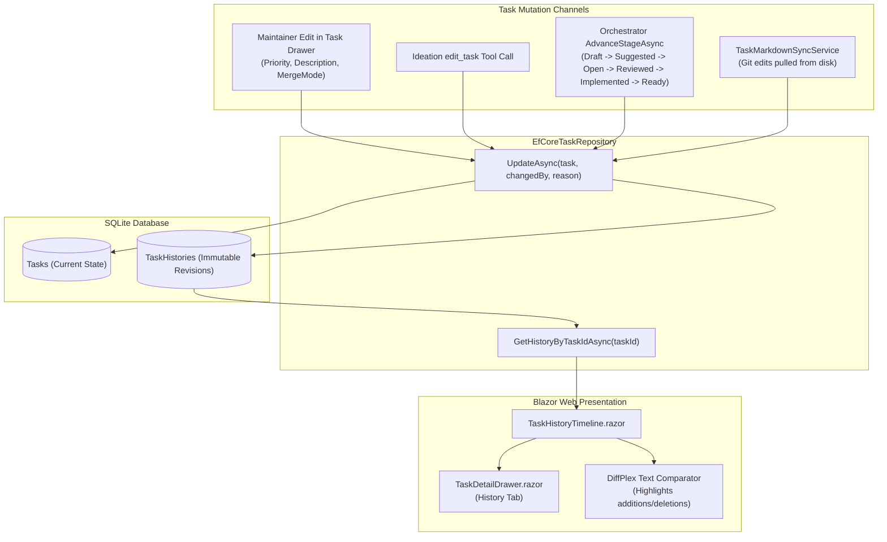

# 🕰️ Step 11.7: Task State History & Temporal Snapshot Audit Trail

> **Phase 11 Implementation Step (Post-MVP - Top Priority)**  
> *Parent Plan:* [Phase 11 Master Plan](../11_EXTEND_FEATURES.md)  
> *Project Target:* `src/NightCodeForge.Web/Components/Backlog`, `src/NightCodeForge.Web/Components/Pages`, `src/NightCodeForge.Infrastructure/Data`, `tests/NightCodeForge.Web.Tests` | *Status:* Completed

---

## 1. Executive Objective

As developers onboard active real-world projects (**OllamaRouter** and **ComicGenCLI**) and iteratively refine backlogs with both human and agent edits, having full transparency into what changed, who changed it, and why is vital.

This step delivers a complete, temporal audit history for all [ForgeTask](file:///c:/Users/Julien/source/repos/jetelain/NightCodeForge/src/NightCodeForge.Core/Domain/ForgeTask.cs) entities:
1. **Historical Snapshot Storage (`TaskHistories` table):**
   - *Status: Backend Implemented.* The [ForgeTaskHistory](file:///c:/Users/Julien/source/repos/jetelain/NightCodeForge/src/NightCodeForge.Core/Domain/ForgeTaskHistory.cs) domain entity and EF Core `TaskHistories` table store immutable point-in-time snapshots with monotonically increasing `Version` numbers.
2. **Comprehensive Mutation Attribution:**
   - Every modification channel—manual maintainer edits in the Web UI, agent updates in Ideation (`edit_task`), stage lifecycle transitions in [TaskOrchestrator](file:///c:/Users/Julien/source/repos/jetelain/NightCodeForge/src/NightCodeForge.Core/Workflow/TaskOrchestrator.cs), triage proposals, and markdown disk synchronizations—records explicit attribution (`ChangedBy`, `ChangeReason`).
3. **Interactive Revision Timeline & Diff View (UI):**
   - Provide a dedicated `TaskHistoryTimeline.razor` component embedded in [TaskDetailDrawer.razor](file:///c:/Users/Julien/source/repos/jetelain/NightCodeForge/src/NightCodeForge.Web/Components/Backlog/TaskDetailDrawer.razor) and [TaskExecutionInspector.razor](file:///c:/Users/Julien/source/repos/jetelain/NightCodeForge/src/NightCodeForge.Web/Components/Monitoring/TaskExecutionInspector.razor).
   - Display a vertical visual timeline of task revisions with side-by-side or inline text diffs using `DiffPlex` showing changes to Title, Description, Acceptance Criteria, Priority, Status, and Dependencies.

---

## 2. Architecture & Data Flow



---

## 3. UI Component: `TaskHistoryTimeline.razor`

### 3.1 Visual Design & Interactions
Embedded as a dedicated "Revisions / History" tab inside [TaskDetailDrawer.razor](file:///c:/Users/Julien/source/repos/jetelain/NightCodeForge/src/NightCodeForge.Web/Components/Backlog/TaskDetailDrawer.razor):

```
● Version 3 (2 minutes ago) by User
  Reason: "Updated Priority to Critical and clarified acceptance criteria"
  Changes: Priority: Normal -> Critical | Description modified (+24 lines, -8 lines)
  [Toggle Diff]
  -------------------------------------------------------------
  [DiffPlex Inline Diff View: Red deletions, Green additions]
  -------------------------------------------------------------

● Version 2 (15 minutes ago) by IdeationAgent
  Reason: "Decomposed task into sub-tasks and linked prerequisite #101"
  Changes: Status: Draft -> Suggested | Dependencies: None -> [#101]

● Version 1 (30 minutes ago) by Creator (User)
  Reason: "Initial Task Creation"
```

### 3.2 Diff Comparison Capabilities
- **Field-level change badges:** Highlights changes to `Status`, `Priority`, `MergeMode`, or `BaseBranch` in compact pill badges.
- **Rich Markdown diff:** Compares `Description` across adjacent versions using `DiffPlex` inline character/word-level diff highlighting.

---

## 4. Implementation Checklist & Deliverables

- [x] **Domain Entity & EF Core Migration:** *(Completed)*
  - `ForgeTaskHistory` entity defined with `Version`, `ChangedBy`, `ChangeReason`.
  - EF Core table `TaskHistories` configured with unique index on `(TaskId, Version)`.
- [x] **Repository Data Access:** *(Completed)*
  - `ITaskRepository.GetHistoryByTaskIdAsync` and `EfCoreTaskRepository` snapshot capture logic.
- [x] **Change Attribution Wiring:** *(Completed)*
  - Verify that `TaskDetailDrawer.razor` supplies `AuditActors.User` and descriptive `changeReason` when saving title, description, priority, and merge mode edits.
  - Verify that Ideation task proposals pass `AuditActors.IdeationAgent` (and future `edit_task` tool will pass `AuditActors.IdeationAgent`).
  - Verify that `TaskOrchestrator` logs stage transitions, failures, and cancellations with `AuditActors.TaskOrchestrator` or `AuditActors.User`.
- [x] **Blazor UI Components:** *(Completed)*
  - Build `TaskHistoryTimeline.razor` with vertical timeline styling and collapsible diff sections.
  - Embed into [TaskDetailDrawer.razor](file:///c:/Users/Julien/source/repos/jetelain/NightCodeForge/src/NightCodeForge.Web/Components/Backlog/TaskDetailDrawer.razor) and [TaskExecutionInspector.razor](file:///c:/Users/Julien/source/repos/jetelain/NightCodeForge/src/NightCodeForge.Web/Components/Monitoring/TaskExecutionInspector.razor).
  - Integrate `DiffPlex` rendering for description diffs.
- [x] **Tests:** *(Completed)*
  - bUnit tests for `TaskHistoryTimeline.razor` rendering versions and diff toggles.
  - Integration tests verifying history snapshots on manual drawer edits and status transitions.
