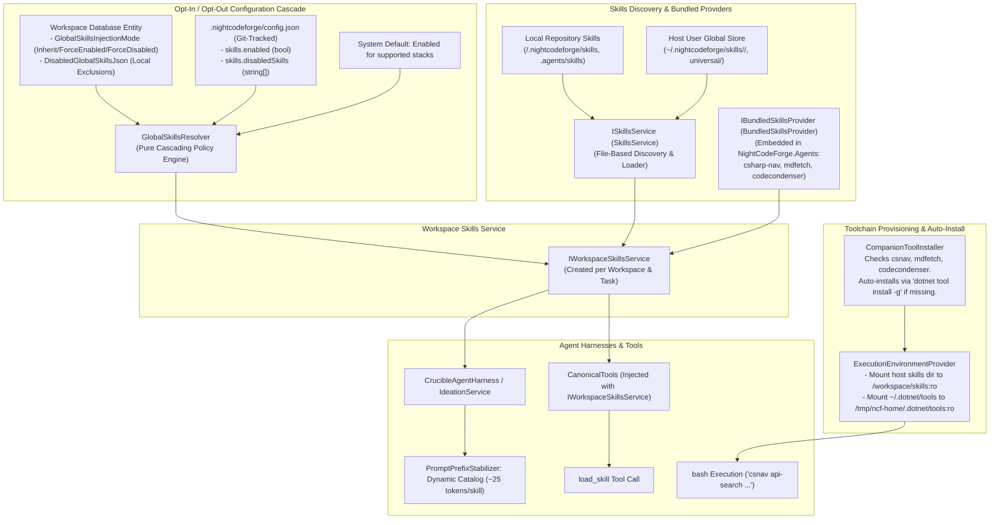

# 📦 Step 12.14: Global Skills Injection & Stack-Specific Tool Provisioning (csnav, mdfetch, codecondenser)

> **Phase 12 Implementation Step (Extend Features & Integrations - Developer Tools & Sandbox Ergonomics)**  
> *Parent Plan:* [Phase 12 Master Plan](../12_EXTEND_FEATURES.md)  
> *Project Target:* `src/NightCodeForge.Core`, `src/NightCodeForge.Infrastructure`, `src/NightCodeForge.Agents`, `src/NightCodeForge.Cli`, `src/NightCodeForge.Web`, `tests/NightCodeForge.Core.Tests`, `tests/NightCodeForge.Agents.Tests`, `tests/NightCodeForge.Web.Tests`  
> *Status:* Completed | *Target Framework:* .NET 10 (C# 13)  
> *Companion Tools:* [csnav (PmadCSharpNav)](https://github.com/jetelain/PmadCSharpNav), [mdfetch (MarkdownFetch)](https://github.com/jetelain/MarkdownFetch), [codecondenser (PmadCodeCondenser)](https://github.com/jetelain/PmadCodeCondenser)

---

## 1. Executive Summary & Problem Statement

During live validation on real codebases (e.g. `OllamaRouter`, `ComicGenCLI`), agents frequently encounter tasks requiring capabilities beyond basic bash and file editing:
1. **API & Signature Blindness:** Integrating with external NuGet or BCL packages (e.g., `Yarp.ReverseProxy`, `Microsoft.AspNetCore`) without symbol navigation causes agents to enter futile 45-minute decompilation loops with `strings .../lib/...dll | grep`, guessing signatures and hallucinating APIs.
2. **External Documentation Access:** Agents implementing integrations often lack current markdown documentation for external libraries, APIs, or architectural references.
3. **Structural Analysis & Duplication Hygiene:** Long-running refactoring tasks require structural clone detection and comment condensation to preserve token budgets.

To address these needs, dedicated companion tools have been authored:
* **`csnav` ([PmadCSharpNav](https://github.com/jetelain/PmadCSharpNav)):** High-performance C# navigation engine for AI agents and developers. Supports finding references, searching public APIs, exploring type hierarchies and members, and decompiling external BCL & NuGet assemblies directly to C# signatures.
* **`mdfetch` ([MarkdownFetch](https://github.com/jetelain/MarkdownFetch)):** High-fidelity documentation scraper converting web pages, technical articles, and GitHub references into clean LLM-ready markdown.
* **`codecondenser` ([PmadCodeCondenser](https://github.com/jetelain/PmadCodeCondenser)):** C# static code analysis, structural code clone detection, LLM-based verbose comment condensation, and CI incremental checking.

### The Architectural Problem: Repository Pollution vs Manual Friction
Today, agent skills in NightCodeForge are distributed per-repository into `.agents/skills/<skill-name>/` (via `ncf init` in [Step 11.13](../phase-11/STEP_11_13_PROJECT_PREPAREDNESS_AND_ONBOARDING.md)). This presents major operational drawbacks:
- Requiring repository maintainers to commit `.agents/skills/*` pollutes customer Git histories with orchestrator-specific tooling.
- Updating a skill requires running updates across every individual repository.
- Non-C# projects receive unnecessary C# tools, while C# projects miss essential navigation capabilities.

### The Solution: Workspace Skills Service, Auto-Installed Tools & Intuitive Mounting
NightCodeForge implements a **Unified Global Stack-Specific Skills Injection System**:
1. **Workspace Skills Service (`IWorkspaceSkillsService`):** Agent harnesses (`CrucibleAgentHarness`, `IdeationService`, and `CanonicalTools`) interact exclusively with an `IWorkspaceSkillsService` instantiated for the active workspace context. The service combines:
   - File-based skill discovery (local repository roots + user global skills store via `ISkillsService`),
   - Bundled companion skills (`csharp-nav`, `mdfetch`, `codecondenser` via `IBundledSkillsProvider`),
   - Cascading configuration resolution (Workspace DB entity > repository `config.json` > system defaults).
2. **Zero-Pollution Delivery:** Worktrees remain 100% clean. Skills resolve dynamically on the host orchestrator without fragile symlinks or junctions.
3. **Companion Tool Auto-Installation (`ICompanionToolInstaller`):** When launching containers or verifying host environments, missing companion tools (`csnav`, `mdfetch`, `codecondenser`) are automatically installed via `dotnet tool install -g` (using WSL execution if WSL is targeted) before mounting, ensuring zero manual friction and avoiding Docker creating empty root-owned directories.
4. **Host-to-Container Mounting with WSL Translation:** In container mode, the host global skills directory is converted to a proper container mount (`-v <hostSkillsDir>:/workspace/skills:ro`) using path conversion (e.g. Windows drive `C:\...` mapped to `/mnt/c/...` in WSL), and `~/.dotnet/tools` is mounted read-only into `/tmp/ncf-home/.dotnet/tools:ro`.
5. **Intuitive In-Container Inspection:** Inside the container, `/workspace/skills:ro` provides an intuitive read-only directory for bash commands, while `load_skill` resolves reliably through the orchestrator facade.
6. **Developer Opt-In / Opt-Out UI:** Managed centrally in `Settings.razor` (Global Skills Store) and locally per repository in `WorkspaceSettingsTab.razor` with zero Git diffs.

---

## 2. Architecture & Workflow

### 2.1 Workspace Skills Architecture



---

## 3. Technical Specifications

### 3.1 Stack-Specific Skill Matrix & Custom Stack Skills

#### 3.1.1 Built-In Companion Skill Matrix
Based on workspace technology stack resolution (`CodeStackPreset` in [`src/NightCodeForge.Core/Domain/CodeStack.cs`](file:///c:/Users/Julien/source/repos/jetelain/NightCodeForge/src/NightCodeForge.Core/Domain/CodeStack.cs)):

| Skill Identifier | Companion CLI | NuGet Package | Applicable Stacks | Capabilities Provided |
| :--- | :--- | :--- | :--- | :--- |
| `csharp-nav` | `csnav` | `Pmad.CSharpNav` | `dotnet`, `csharp` | Assembly decompilation, NuGet/BCL public API search, symbol hierarchy, reference finder. |
| `mdfetch` | `mdfetch` | `MarkdownFetch` | Universal (all stacks) | URL-to-markdown documentation fetcher, external library reference scraping. |
| `codecondenser` | `codecondenser` | `Pmad.CodeCondenser` | `dotnet`, `csharp` | Structural clone detection, comment condensation, duplicate suppression. |

In [`src/NightCodeForge.Core/Domain/CodeStack.cs`](file:///c:/Users/Julien/source/repos/jetelain/NightCodeForge/src/NightCodeForge.Core/Domain/CodeStack.cs), `CodeStackPreset` is extended with:
```csharp
public IReadOnlyList<string> DefaultSkills { get; init; } = Array.Empty<string>();
```
- `DotNet` preset: `["csharp-nav", "codecondenser", "mdfetch"]`
- `Node`, `Python`, `Rust`, `Go` presets: `["mdfetch"]`

#### 3.1.2 Developer Custom Stack Skills
Developers can add custom global skills to their host environment that automatically apply to all workspaces matching a given technology stack:

1. **Directory-Based Stack Scoping:**
   Skills placed in stack subdirectories under `~/.nightcodeforge/skills/`:
   ```text
   ~/.nightcodeforge/skills/
   ├── dotnet/
   │   ├── csharp-nav/
   │   ├── codecondenser/
   │   └── efcore-assistant/        <-- Automatically available to all .NET workspaces
   ├── universal/
   │   └── mdfetch/                 <-- Available to all workspaces regardless of stack
   ├── python/
   │   └── poetry-workflow/         <-- Automatically available to all Python workspaces
   └── node/
       └── prisma-toolkit/          <-- Automatically available to all Node workspaces
   ```

2. **YAML Frontmatter Scoping:**
   In any `SKILL.md`, developers can declare stack applicability via `stack`:
   ```markdown
   ---
   name: efcore-assistant
   description: Manage EF Core database migrations, snapshot models, and schema updates.
   stack: dotnet
   ---
   # EF Core Assistant Skill Instructions...
   ```
   *Accepted values:* `dotnet` (or `csharp`), `node` (or `typescript`), `python`, `rust`, `go`, or `universal` (default when omitted or in `universal/`).

3. **Stack Matching Logic:**
   A skill is eligible for a workspace if:
   - Its directory matches the workspace stack (e.g. `~/.nightcodeforge/skills/dotnet/` for a `dotnet` workspace), OR
   - Its frontmatter `stack` matches the workspace stack, OR
   - Its directory or frontmatter is `universal` / unspecified.

---

### 3.2 Tool Binaries, Auto-Installation & Host-to-Container Mounting

#### 3.2.1 Companion Tool Auto-Installer (`ICompanionToolInstaller`)
To prevent manual setup friction and avoid Docker creating empty root-owned directories on missing host paths, NightCodeForge introduces `ICompanionToolInstaller`:

```csharp
namespace NightCodeForge.Core.Interfaces;

public record CompanionToolSpec(
    string ToolCommand,
    string PackageId,
    IReadOnlyList<string> ApplicableStacks);

public interface ICompanionToolInstaller
{
    IReadOnlyList<CompanionToolSpec> KnownTools { get; }
    Task<bool> IsToolInstalledAsync(string command, bool useWsl = false, string? wslDistribution = null, CancellationToken ct = default);
    Task EnsureToolsInstalledAsync(string stack, bool useWsl = false, string? wslDistribution = null, CancellationToken ct = default);
}
```

**Auto-Installation Execution:**
- **Host Mode (Windows Native BareHost):**
  Executes `dotnet tool install -g <package>` (or skips if already present).
- **WSL / Container Mode:**
  When sandboxes run via WSL2/Docker, ELF binaries inside WSL are required. The installer executes:
  `wsl -d <distro> dotnet tool install -g <package>`
  ensuring binaries exist under `/home/<wslUser>/.dotnet/tools`.
- **Pre-Flight Hook:** Called during `ExecutionEnvironmentProvider.GetEnvironment` before constructing `ContainerExecutorOptions`, guaranteeing that binaries exist before Docker creates volume mounts.

#### 3.2.2 Container Launch Mounting & Path Translation
When `ExecutionEnvironmentProvider` configures `ContainerExecutorOptions`:
1. **Host Skills Directory Mount:**
   - Source host directory: `Path.Combine(Environment.GetFolderPath(Environment.SpecialFolder.UserProfile), ".nightcodeforge", "skills")`.
   - Host directory is pre-created if absent (`Directory.CreateDirectory(hostSkillsDir)`).
   - In `ContainerExecutorOptions`, the path is passed as an absolute path. When `UseWsl == true`, `NightCodeForgeContainerExecutor.ResolveHostPath` translates Windows drive paths (`C:\...`) to `/mnt/c/...` via `WslPathConverter`, ensuring the container mounts the exact host directory edited by the Web UI.
   - Destination container path: `/workspace/skills:ro`.
2. **Companion Tools Mount:**
   - Source host path: `~/.dotnet/tools`.
   - When `UseWsl == true` and `ExpandTildeInMounts == true`, expands to `/home/<wslUser>/.dotnet/tools`.
   - Only added if the directory exists (ensured by `CompanionToolInstaller`).
   - Destination container path: `/tmp/ncf-home/.dotnet/tools:ro` (which is already on container `$PATH`).

---

### 3.3 Configuration, Opt-In / Opt-Out & Cascading Resolution

#### 3.3.1 Repository Configuration Schema (`.nightcodeforge/config.json`)
Committed in the repository to define baseline tooling policies:

```csharp
namespace NightCodeForge.Core.Domain;

public class WorkspaceProjectConfig
{
    // Existing fields: CodeStack, BuildCommand, TestCommand, etc.
    public WorkspaceSkillsConfig? Skills { get; set; }
}

public class WorkspaceSkillsConfig
{
    /// <summary>Master switch for global skills injection. Default: true when omitted.</summary>
    public bool? Enabled { get; set; }

    /// <summary>List of skill identifiers explicitly disabled for this repository.</summary>
    public List<string>? DisabledSkills { get; set; }
}
```

#### 3.3.2 Workspace Database Entity Schema (`Workspace`)
Stored locally in the NightCodeForge SQLite database with **zero Git repository modifications**:

```csharp
namespace NightCodeForge.Core.Domain;

public enum GlobalSkillsInjectionMode
{
    Inherit = 0,      // Follows repository config; defaults to enabled if omitted
    ForceEnabled = 1, // Injects skills regardless of repository config
    ForceDisabled = 2 // Suppresses injection regardless of repository config
}

public class Workspace
{
    // Existing fields...
    public GlobalSkillsInjectionMode GlobalSkillsInjectionMode { get; set; } = GlobalSkillsInjectionMode.Inherit;
    public string? DisabledGlobalSkillsJson { get; set; } // JSON array of locally disabled skill IDs
}
```

*EF Core Mapping (`AppDbContext.cs`):*
```csharp
b.Property(w => w.GlobalSkillsInjectionMode)
    .HasConversion<int>()
    .HasDefaultValue(GlobalSkillsInjectionMode.Inherit);
b.Property(w => w.DisabledGlobalSkillsJson)
    .HasMaxLength(4096);
```

*EF Core Migration:* `AddWorkspaceGlobalSkillsSettings` in `src/NightCodeForge.Infrastructure/Migrations/`.

#### 3.3.3 Cascading Resolution Engine (`GlobalSkillsResolver`)
In `src/NightCodeForge.Core/Workflow/GlobalSkillsResolver.cs`:
Pure policy evaluation without direct file I/O:

```csharp
public record GlobalSkillsResolutionResult(
    bool IsEnabled,
    IReadOnlySet<string> ActiveSkills,
    SkillsResolutionSource Source,
    IReadOnlyList<string> ExcludedSkills);

public enum SkillsResolutionSource
{
    LocalDatabaseOverride,
    RepositoryConfig,
    SystemDefault
}

public static class GlobalSkillsResolver
{
    public static GlobalSkillsResolutionResult Resolve(
        Workspace workspace,
        WorkspaceProjectConfig? projectConfig,
        IReadOnlyList<string> candidateSkillNames)
    {
        // 1. Evaluate Master Enablement
        bool isEnabled;
        SkillsResolutionSource source;

        if (workspace.GlobalSkillsInjectionMode == GlobalSkillsInjectionMode.ForceDisabled)
        {
            return new GlobalSkillsResolutionResult(false, new HashSet<string>(), SkillsResolutionSource.LocalDatabaseOverride, Array.Empty<string>());
        }
        else if (workspace.GlobalSkillsInjectionMode == GlobalSkillsInjectionMode.ForceEnabled)
        {
            isEnabled = true;
            source = SkillsResolutionSource.LocalDatabaseOverride;
        }
        else // Inherit
        {
            if (projectConfig?.Skills?.Enabled.HasValue == true)
            {
                isEnabled = projectConfig.Skills.Enabled.Value;
                source = SkillsResolutionSource.RepositoryConfig;
            }
            else
            {
                isEnabled = true; // System default: enabled
                source = SkillsResolutionSource.SystemDefault;
            }
        }

        if (!isEnabled)
        {
            return new GlobalSkillsResolutionResult(false, new HashSet<string>(), source, Array.Empty<string>());
        }

        // 2. Evaluate Exclusions
        var exclusions = new HashSet<string>(StringComparer.OrdinalIgnoreCase);
        if (projectConfig?.Skills?.DisabledSkills != null)
        {
            foreach (var s in projectConfig.Skills.DisabledSkills) exclusions.Add(s);
        }

        if (!string.IsNullOrWhiteSpace(workspace.DisabledGlobalSkillsJson))
        {
            try
            {
                var localDisabled = JsonSerializer.Deserialize<List<string>>(workspace.DisabledGlobalSkillsJson);
                if (localDisabled != null)
                {
                    foreach (var s in localDisabled) exclusions.Add(s);
                }
            }
            catch { /* Ignore malformed JSON fallback */ }
        }

        var active = candidateSkillNames
            .Where(s => !exclusions.Contains(s))
            .ToHashSet(StringComparer.OrdinalIgnoreCase);

        return new GlobalSkillsResolutionResult(true, active, source, exclusions.ToList());
    }
}
```

---

### 3.4 The Workspace Skills Service (`IWorkspaceSkillsService`) & `ISkillsService`

To decouple agent harnesses from multi-root file discovery, bundled embedded resources, and cascading policy filtering, NightCodeForge introduces the **Workspace Skills Service**:

#### 3.4.1 Interface Specification
```csharp
namespace NightCodeForge.Core.Interfaces;

public interface ISkillsService
{
    Task<IReadOnlyList<SkillDescriptor>> DiscoverSkillsAsync(
        string workspaceRoot,
        string? globalSkillsDirectory = null,
        CancellationToken cancellationToken = default);

    Task<string> LoadSkillAsync(
        string workspaceRoot,
        string skillName,
        CancellationToken cancellationToken = default);

    string FormatSkillsCatalogPrompt(IReadOnlyList<SkillDescriptor> skills);
}

public interface IWorkspaceSkillsService
{
    /// <summary>
    /// Returns the active skill descriptors available for this workspace context,
    /// filtered by stack applicability and cascading opt-in/opt-out configuration.
    /// </summary>
    Task<IReadOnlyList<SkillDescriptor>> GetActiveSkillsAsync(CancellationToken cancellationToken = default);

    /// <summary>
    /// Formats the lean skills catalog prompt (~25 tokens/skill) for active skills.
    /// </summary>
    Task<string> GetSkillsCatalogPromptAsync(CancellationToken cancellationToken = default);

    /// <summary>
    /// Loads the full instructions/content of a skill by name. Resolves from local repository skills,
    /// bundled skills, or custom global skills.
    /// </summary>
    Task<string> LoadSkillAsync(string skillName, CancellationToken cancellationToken = default);
}

public interface IWorkspaceSkillsServiceFactory
{
    IWorkspaceSkillsService Create(Workspace workspace, string workspacePath, int? taskId = null);
}
```

#### 3.4.2 Resolution & Precedence Order
When `IWorkspaceSkillsService.LoadSkillAsync(skillName)` is called:
1. **Policy Verification:** If the skill is excluded by effective workspace policy, returns:
   `"Error: Skill '{skillName}' is disabled by workspace configuration."`
2. **Local Repository Override (Highest Precedence):** If `<worktree>/.nightcodeforge/skills/<skillName>` or `<worktree>/.agents/skills/<skillName>` exists, loads content from the repository worktree via `ISkillsService`.
3. **Bundled Companion Skills:** If `skillName` matches a bundled tool (`csharp-nav`, `mdfetch`, `codecondenser`), loads content directly from `IBundledSkillsProvider`.
4. **Host User Global Store:** Loads content from `~/.nightcodeforge/skills/<stack>/<skillName>/SKILL.md` or `~/.nightcodeforge/skills/universal/<skillName>/SKILL.md`.
5. **Not Found Fallback:** Returns an informative message listing all currently active skills.

#### 3.4.3 Constructor Injection into `CanonicalTools` & Agent Harnesses
Per [AGENTS.md](../../AGENTS.md) ("In service constructors, avoid using optional parameters. You should require all services you need in order to work properly"):
- `CanonicalTools` requires `IWorkspaceSkillsService` in its constructor:
  ```csharp
  public CanonicalTools(
      string workspaceRoot,
      IWorkspacePathResolver pathResolver,
      IExecutionEnvironment executionEnv,
      IEditorConfigService editorConfigService,
      IEditorConfigFileApplier editorConfigFileApplier,
      IWebSearchService webSearchService,
      IWorkspaceSkillsService skillsService, // Required non-null service
      ILogger<CanonicalTools> logger,
      int? buildTimeoutSeconds,
      int? testTimeoutSeconds,
      int? workspaceId,
      int? taskId,
      bool isReadOnly = false)
  ```
- `CanonicalTools.LoadSkillAsync`:
  ```csharp
  public async Task<string> LoadSkillAsync(string skillName, CancellationToken cancellationToken = default)
  {
      if (string.IsNullOrWhiteSpace(skillName))
      {
          return "Error: skill_name parameter is required.";
      }
      return await _skillsService.LoadSkillAsync(skillName, cancellationToken);
  }
  ```
- `CanonicalAIFunctionFactory` remains a static factory method accepting `CanonicalTools` without requiring DI changes.
- `CrucibleAgentHarness` and `IdeationService` inject `IWorkspaceSkillsServiceFactory` and pass the created `IWorkspaceSkillsService` into `CanonicalTools`.

---

### 3.5 Bundled Skills Provider & Embedded Resources (`NightCodeForge.Agents`)

#### 3.5.1 Bundled Skills Architecture
- Built-in companion skills (`csharp-nav`, `mdfetch`, `codecondenser`) are stored as embedded resources in `NightCodeForge.Agents` under `Skills/Bundled/`:
  - `Skills/Bundled/dotnet/csharp-nav/SKILL.md`
  - `Skills/Bundled/dotnet/codecondenser/SKILL.md`
  - `Skills/Bundled/universal/mdfetch/SKILL.md`
- `IBundledSkillsProvider` in `NightCodeForge.Agents.Skills` reads embedded markdown content and frontmatter metadata in-memory on demand.
- Because `IWorkspaceSkillsService` resolves bundled skills directly from `IBundledSkillsProvider`, disk seeding is not required, eliminating unnecessary disk I/O and potential state desynchronization.

---

### 3.6 Global Skills Store Management UI (`Settings.razor` → Global System Settings)

#### 3.6.1 Global Skills Store Tab (`GlobalSkillsManagementTab.razor`)
* **Location:** Accessible under [`Settings.razor`](file:///c:/Users/Julien/source/repos/jetelain/NightCodeForge/src/NightCodeForge.Web/Components/Pages/Settings.razor) when `_activeScope == SettingsScope.Global`. A new tab button: **"🧰 Global Skills Store"**.
* **Categorized Skills View:**
  - Displays all discovered global skills grouped by stack:
    - 🟣 **.NET / C# Skills** (`csharp-nav`, `codecondenser`, and user-authored .NET skills)
    - 🌐 **Universal Skills** (`mdfetch`, and user-authored general skills)
    - 🟢 **Other Stacks** (`node`, `python`, `rust`, `go`)
  - Badges distinguish **Built-In Tooling** (system-provided, read-only) from **Custom Skills** (user-defined, editable/deletable).
* **"➕ Add Custom Global Skill" Modal:**
  - Unique identifier slug, target tech stack dropdown, 1-2 sentence description, and markdown instructions editor.
* **Separation of Concerns:** `GlobalSkillsManagementTab.razor` delegates all disk I/O and parsing to `IGlobalSkillsManagerService` in `src/NightCodeForge.Web/Services/`:
  - `Task<IReadOnlyList<GlobalSkillViewModel>> GetGlobalSkillsAsync(CancellationToken ct)`
  - `Task CreateCustomSkillAsync(CreateSkillRequest request, CancellationToken ct)`
  - `Task UpdateCustomSkillAsync(string skillName, UpdateSkillRequest request, CancellationToken ct)`
  - `Task DeleteCustomSkillAsync(string skillName, CancellationToken ct)`

---

### 3.7 Workspace-Level UI Integration (`WorkspaceSettingsTab.razor`)

Managed within [`WorkspaceSettingsTab.razor`](file:///c:/Users/Julien/source/repos/jetelain/NightCodeForge/src/NightCodeForge.Web/Components/Workspaces/WorkspaceSettingsTab.razor):
1. **Mode Selection:** Segmented control or dropdown bound to `ws.GlobalSkillsInjectionMode` (`Inherit`, `ForceEnabled`, `ForceDisabled`).
2. **Resolution Source Badge:** Visual indicator showing effective status (`🟢 Active via System Default`, `🟡 Inherited from .nightcodeforge/config.json`, `🔵 Local Workspace Override`).
3. **Candidate Skill Checkboxes:** Enumerates candidate skills for the workspace stack. Toggling checkboxes updates `ws.DisabledGlobalSkillsJson`.
4. **UI Separation:** Mapping between candidate skills and `DisabledGlobalSkillsJson` is encapsulated in a dedicated UI helper/service (`WorkspaceSkillsUiHelper`), keeping the `.razor` `@code` block clean.
5. **Persistence:** Persisted to SQLite when clicking **"💾 Save Workspace Settings"**, with **zero Git diffs** in the target repository.

---

### 3.8 Companion Skill Specifications & Instructions

#### 3.8.1 `csharp-nav` Skill Specification
* **SKILL.md Frontmatter Description:**
  ```yaml
  ---
  name: csharp-nav
  description: C# navigation engine, public API search, and assembly decompiler. Use csnav for NuGet/BCL signature inspection instead of guessing signatures or inspecting binaries with strings.
  stack: dotnet
  ---
  ```
* **Commands:**
  - `csnav api-search <query>`: Search public types and members across all solution projects and referenced NuGet packages.
  - `csnav decompile <assembly-path> --type <TypeName>`: Decompile external assembly types directly to C# interface/method signatures.
  - `csnav find-references <symbol>`: Locate all references and call sites across the solution.
  - `csnav type-hierarchy <symbol>`: View base classes, derived types, and interface implementations.
* **KV Cache Friendly:** Guidance is embedded in `csharp-nav`'s frontmatter description, maintaining universal byte-identical prefixes in `CanonicalRulesPrompt`.

#### 3.8.2 `mdfetch` Skill Specification
* **SKILL.md Frontmatter Description:**
  ```yaml
  ---
  name: mdfetch
  description: Web documentation and GitHub reference fetcher. Converts online technical docs to clean LLM-ready markdown.
  stack: universal
  ---
  ```
* **Commands:**
  - `mdfetch <url>`: Fetches and converts web content into clean markdown, stripping HTML noise.

#### 3.8.3 `codecondenser` Skill Specification
* **SKILL.md Frontmatter Description:**
  ```yaml
  ---
  name: codecondenser
  description: C# structural clone detection, comment condensation, and duplication hygiene.
  stack: dotnet
  ---
  ```
* **Commands:**
  - `codecondenser analyze`: Runs structural clone detection across solution files.
  - `codecondenser condense`: Condenses verbose comments while preserving technical directives.

---

## 4. Verification & Testing Strategy

### 4.1 Unit Tests
1. **Cascading Configuration Resolution Tests (`GlobalSkillsResolverTests`):**
   - Verify `ForceDisabled` suppresses all skills regardless of repo config.
   - Verify `ForceEnabled` activates skills even if repo config specifies `enabled: false`.
   - Verify `Inherit` respects repo config and defaults to `true` when omitted.
   - Verify repo exclusions and local database exclusions merge correctly.
2. **Workspace Skills Service Tests (`WorkspaceSkillsServiceTests`):**
   - Verify repository-level skill overrides global/bundled skill with the same name.
   - Verify bundled skills resolve even when no global skills directory exists on disk.
   - Verify `LoadSkillAsync` returns disabled message when skill is excluded by configuration.
3. **Bundled Skills Provider Tests (`BundledSkillsProviderTests`):**
   - Verify built-in companion tools are correctly loaded from embedded resources.
   - Verify skill content retrieval and case-insensitive matching.
4. **Companion Tool Auto-Installer Tests (`CompanionToolInstallerTests`):**
   - Verify installer detects missing tools and generates correct `dotnet tool install -g` commands.
   - Verify WSL command formatting (`wsl -d <distro> dotnet tool install -g ...`) when targeting WSL.
5. **Global Skills Manager Service Tests (`GlobalSkillsManagerServiceTests`):**
   - Verify CRUD operations for custom skills in `~/.nightcodeforge/skills/<stack>/`.
   - Verify built-in skills cannot be deleted or overwritten.
   - Verify path traversal attempts are rejected with security exceptions.
6. **CanonicalTools & Harness DI Tests:**
   - Verify `CanonicalTools` invokes service's `LoadSkillAsync`.
   - Verify `TestCanonicalToolsBuilder` provides mock `IWorkspaceSkillsService`.

### 4.2 Integration & Simulation Tests
1. **Container Toolchain Mount Simulation:**
   - Verify `ExecutionEnvironmentProvider` correctly resolves host user profile path to WSL `/mnt/c/...` when `UseWsl` is true.
   - Verify `~/.dotnet/tools` is only mounted if it exists.
2. **Assembly Decompilation Simulation:**
   - Verify `csnav decompile` produces valid C# interface signatures for external NuGet packages in $< 1\text{s}$.
3. **Opt-Out Simulation:**
   - Disable `codecondenser` in Workspace Settings; verify catalog excludes `codecondenser` while retaining `csharp-nav` and `mdfetch`.

---

## 5. Deliverables & Implementation Checklist

- [x] **EF Core Migration & Entity Updates:** Add `GlobalSkillsInjectionMode` and `DisabledGlobalSkillsJson` to `Workspace` in `src/NightCodeForge.Core/Domain/Workspace.cs`, configure mappings in `src/NightCodeForge.Infrastructure/Data/AppDbContext.cs`, and create migration `AddWorkspaceGlobalSkillsSettings`.
- [x] **Config Schema & Preset Updates:** Add `WorkspaceSkillsConfig` to `WorkspaceProjectConfig` and update presets with `DefaultSkills` in `src/NightCodeForge.Core/Domain/CodeStack.cs`.
- [x] **Cascading Resolution Engine:** Implement `GlobalSkillsResolver` in `src/NightCodeForge.Core/Workflow/GlobalSkillsResolver.cs`.
- [x] **Companion Tool Auto-Installer:** Implement `ICompanionToolInstaller` in `src/NightCodeForge.Infrastructure/Execution/CompanionToolInstaller.cs` and wire into `ExecutionEnvironmentProvider.cs`.
- [x] **Bundled Skills Provider:** Add embedded skill resources under `src/NightCodeForge.Agents/Skills/Bundled/`, and implement `IBundledSkillsProvider` in `NightCodeForge.Agents.Skills`.
- [x] **Workspace Skills Service & ISkillsService:** Implement `ISkillsService` in `src/NightCodeForge.Core/Interfaces/ISkillsService.cs`, implement `IWorkspaceSkillsService` and `IWorkspaceSkillsServiceFactory` in `src/NightCodeForge.Agents/Skills/WorkspaceSkillsService.cs`.
- [x] **Harness & CanonicalTools Refactoring:** Inject `IWorkspaceSkillsService` into `CanonicalTools.cs`, update `CrucibleAgentHarness.cs` and `IdeationService.cs` to use the service, and update `TestCanonicalToolsBuilder.cs`.
- [x] **Container Mounting & Path Translation:** Update `ExecutionEnvironmentProvider.cs` to mount host skills directory to `/workspace/skills:ro` and `~/.dotnet/tools` to `/tmp/ncf-home/.dotnet/tools:ro` with WSL path translation.
- [x] **Host Tool Discovery & Readiness:** Extend `HostSdkDiscoveryService.ProbeScript` to probe `csnav`, `mdfetch`, and `codecondenser`, and update `HostSdkInspectorTab.razor` with status badges and auto-install trigger.
- [x] **Global Skills Store UI:** Implement `IGlobalSkillsManagerService` in `src/NightCodeForge.Web/Services/` and create `GlobalSkillsManagementTab.razor` under Global System Settings in `Settings.razor`.
- [x] **Workspace Settings UI Integration:** Add Global Skills controls and candidate skill toggles to `WorkspaceSettingsTab.razor` using a UI helper class.
- [x] **CLI Audit Integration:** Update `ncf audit` Pillar 5 in `src/NightCodeForge.Cli/Commands/AuditCommand.cs` to validate `skills` configuration and companion tool readiness.
- [x] **Unit & Integration Tests:** Add comprehensive tests across `NightCodeForge.Core.Tests`, `NightCodeForge.Agents.Tests`, and `NightCodeForge.Web.Tests`.
