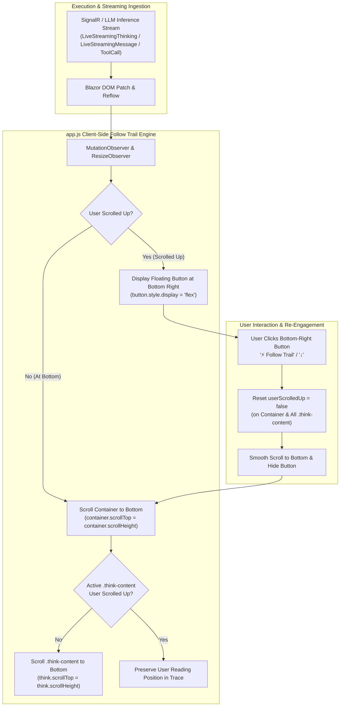

# 📜 Step 12.17: Follow Trail Auto-Scroll & Bottom-Right Action in Task Execution Inspector & Reasoning Trace

> **Phase 12 Implementation Step (Extend Features & Developer Ergonomics)**  
> *Parent Plan:* [Phase 12 Master Plan](../12_EXTEND_FEATURES.md) | [docs/PLAN.md](../../PLAN.md)  
> *Project Target:* `src/NightCodeForge.Web`, `tests/NightCodeForge.Web.Tests`  
> *Status:* Completed | *Target Framework:* .NET 10 (C# 13)

---

## 1. Executive Summary & Problem Statement

Real-time visibility into agentic and deterministic execution is a foundational pillar of NightCodeForge. Developers observe execution through two primary conversational interfaces: the **Ideation Chat** (`/ideation`) and the **Task Execution Inspector** (`/inspector/{taskId}`).

Recent real-world project trials and developer feedback revealed two related usability bottlenecks in real-time execution monitoring:

1. **Reasoning Trace Truncation in Ideation Chat ("Lacks Follow Trail in Reasoning Trace"):**
   - The Ideation Chat implements a client-side follow-trail auto-scroll engine (`NightCodeForge.initAutoScroll` in `app.js`) that pins the main messages container (`#chatMessagesContainer`) to the bottom as new chunks stream in, accompanied by a floating bottom-right scroll-to-bottom button (`#chatScrollToBottomBtn`).
   - However, when the Architect Agent deliberates with extended reasoning, the reasoning trace (`
` -> `
`) is rendered inside an internal scroll container with `max-height: 220px; overflow-y: auto;`.
   - As thinking tokens stream in, `.think-content` quickly exceeds 220px and overflows. Because `initAutoScroll` only adjusts the `scrollTop` of the outer chat container, `.think-content` remains scrolled at `scrollTop = 0`.
   - Consequently, developers only see the first few lines of reasoning. The active thinking trail, cursor, and newest tokens are pushed below the fold inside the thinking box, forcing repetitive manual mouse scrolling inside the tiny container.

2. **Missing Follow Trail & Bottom-Right Action in Task Execution Inspector:**
   - In the Task Execution Inspector (`TaskExecutionInspector.razor` / `StageConversationViewer.razor`), developers inspect live stage conversations as SignalR events deliver real-time thinking (`LiveStreamingThinking`), agent response tokens (`LiveStreamingMessage`), running tool calls, and stage transitions.
   - Unlike Ideation Chat, `StageConversationViewer` does not initialize `initAutoScroll` or mount a floating follow-trail button at the bottom right.
   - When a stage executes, the conversation stream expands, but the viewport does not follow the execution trail. Operators must manually scroll down repeatedly to observe streaming progress.
   - Furthermore, the reasoning traces within the inspector (`.think-content`) suffer from the exact same internal truncation issue.

---

## 2. Architectural Design & Interaction Model

### 2.1 Dual-Tier Follow-Trail Synchronization
Auto-scrolling operates seamlessly at two nested tiers:
1. **Tier 1 (Conversation Stream Container):** Pins the main scrollable turns stream to the latest turn, live thinking bubble, or tool execution card. Supports both bounded internal scroll containers (Ideation `#chatMessagesContainer`) and page-level canvas scrolling (`.forge-main-content` in Task Execution Inspector).
   - *Decoupled Viewport & Mutation Boundary:* The client engine decouples the observed content root (`el`, where DOM mutations, new turns, and streaming tokens occur) from the actual scrolling container (`scrollContainer`, which carries the scrollbar, measures `scrollHeight`/`clientHeight`/`scrollTop`, and listens for scroll gestures).
2. **Tier 2 (Active Reasoning Trace Elements):** Detects actively streaming or mutating `
` elements (e.g. inside `.turn-live-thinking` or the newest streaming turn). If the user has not scrolled up within that specific thinking box, automatically scrolls it so live deliberation tokens and the streaming cursor remain continuously visible. Historical, completed thinking traces from earlier turns remain untouched to preserve developer reading state.

### 2.2 Non-Intrusive Decoupling Policy
If a developer explicitly scrolls up—either in the conversation container to re-read past turns, or inside a specific `.think-content` box to review earlier thoughts—the engine must immediately decouple and pause auto-scrolling for that element. Auto-scrolling must **never** yank the scroll position away while the developer is reading history.

### 2.3 Default Auto-Scroll Policy by Interface
- **Ideation Chat (`/ideation`):** Auto-scroll is **ON by default** (`autoScrollOnByDefault: true`). Users enter the chat to compose prompts and observe active generation at the bottom of the transcript.
- **Task Execution Inspector (`/inspector/{taskId}`):** Auto-scroll is **OFF by default** (`autoScrollOnByDefault: false`). Developers navigating into a stage run inspect metadata, stage definitions, directives, and initial turns from the top without the viewport auto-scrolling away. When the stage content is scrollable, the floating follow-trail button is visible at the bottom-right; clicking it smoothly scrolls to the bottom and engages live follow-trail auto-scrolling. Switching stages or runs resets auto-scroll to the default (off).

---

## 3. Specifications & Required Behaviors

### 3.1 Task Execution Inspector Follow-Trail Button
- **Placement & Layout Mechanics:** Positioned at the bottom-right of the conversation viewing area (`StageConversationViewer.razor`), matching the ergonomic placement of the floating button in Ideation Chat.
  - In `StageConversationViewer`, where vertical scrolling is driven by the parent layout canvas (`.forge-main-content`) alongside a sticky `StageRunSelector`, the floating button uses sticky positioning (`position: sticky; bottom: 1.5rem; float: right; margin-top: -46px; margin-right: 0.5rem; z-index: 25;`) so that it remains persistently visible inside the viewport when the user is scrolled up, rather than sitting off-screen at the card footer.
  - To prevent timing pitfalls where `Conversation == null` during initial load/render, the follow-trail button is mounted at the component level within `StageConversationViewer.razor` (or lazily bound by `app.js` when rendered), ensuring it is reliably present in the DOM when needed.
- **Visual Appearance:** Consistent with NightCodeForge design system: elevated surface (`var(--bg-surface)` / `var(--bg-elevated)`), accent border, subtle shadow, and responsive hover transition.
- **Behavior:**
  - When the viewport is at the bottom, the button remains hidden.
  - When the developer scrolls up by more than 100px while viewing conversation turns, the button smoothly appears.
  - Clicking the button re-engages follow-trail, smoothly scrolls both the conversation stream and any open reasoning trace to the bottom, and hides the button.
  - Accessible via keyboard with proper `aria-label`, `title`, and `role="button"`.

### 3.2 Universal Reasoning Trace Follow-Trail
- In both **Ideation Chat** (`Ideation.razor`) and **Task Execution Inspector** (`StageConversationViewer.razor`), the client runtime automatically observes `.think-content` elements.
- **Targeting Active vs Historical Traces:**
  - Auto-scroll during token streaming strictly targets **active / currently mutating** reasoning traces (e.g. within `.turn-live-thinking` or the active turn).
  - Completed historical thinking traces that the user manually expands for inspection are **not** auto-scrolled by token arrivals in later turns, preventing disruption of reading history.
- **Non-Leaking Event Delegation via Capture Phase:**
  - Instead of attaching individual listeners to every `.think-content` element (which would require complex diffing and risk memory leaks during Blazor DOM patches), `app.js` captures scroll events on the parent container using `{ capture: true, passive: true }`. When an event target matches `.think-content`, its per-trace scroll offset is recorded directly on the element (`thinkEl._userScrolledUp`).
- When thinking text is streaming in the active trace:
  - If `userScrolledUp == false` on the parent container and `_userScrolledUp == false` on that thinking box, `thinkEl.scrollTop` is kept pinned to `thinkEl.scrollHeight`.
  - If the user scrolls up inside `.think-content` (distance from bottom > 40px), auto-scroll for that specific thinking box pauses.
  - When the user scrolls back near the bottom of `.think-content`, auto-scroll resumes.
  - Clicking the bottom-right follow-trail button resets `_userScrolledUp = false` on all open thinking boxes and smoothly scrolls them to the bottom.

### 3.3 UI and Presentation Separation Invariant
In accordance with `AGENTS.md`:
- Razor components (`StageConversationViewer.razor`, `Ideation.razor`) must remain strictly focused on markup, presentation layout, and high-level JS interop invocations.
- DOM measurements, mutation observations, scroll calculations, and event binding must not live in Razor `@code` blocks; they belong in `app.js`.
- Component IDs, button titles, and CSS class bindings must be centralized in `ChatPresentationHelper.cs`.

---

## 4. Implementation Steps & Action Items

### Action 4.1: Upgrade `app.js` with Universal Reasoning Trace Follow-Trail & rAF Batching
- Update `window.NightCodeForge.initAutoScroll(elementId, scrollBtnId, options)`:
  - **Decoupled Scroll Container Discovery:** Accept an optional `options.scrollContainerSelector` (e.g. `'.forge-main-content'`) or auto-detect whether `element` scrolls internally (`scrollHeight > clientHeight`); if not, resolve the nearest scrollable ancestor. Store `state.scrollContainer = scrollContainer || el`.
  - **Unified Viewport Operations:** Direct all scroll listeners, `scrollTop`/`scrollHeight`/`clientHeight` calculations, smooth scrolling, and cleanup to `state.scrollContainer`, while `MutationObserver` and `ResizeObserver` continue watching the content container `el`.
  - **Lazy Button Resolution:** In `updateScrollBtn()`, resolve `state.scrollBtn = state.scrollBtn || (scrollBtnId ? document.getElementById(scrollBtnId) : null)`. When the button becomes available, attach its click handler dynamically so components mounting content asynchronously never miss button binding.
  - **Capturing Scroll Delegation for `.think-content`:** Attach a single capturing listener on `el` (`el.addEventListener('scroll', handler, { capture: true, passive: true })`). When `e.target` has class `think-content`, calculate `distanceFromBottom` and record `thinkEl._userScrolledUp = (distanceFromBottom > 40)`.
  - **Active Reasoning Trace Pinning:** When mutations occur inside a `.think-content` (or within active bubbles like `.turn-live-thinking` or `.chat-bubble.streaming`), pin `thinkEl.scrollTop = thinkEl.scrollHeight` if `!thinkEl._userScrolledUp`.
  - **Layout Thrashing Protection (rAF Batching):** High-speed LLM streaming (60–100+ tokens/sec) triggers frequent `MutationObserver` events. Batch all scroll calculations, `scrollTop` assignments, and button visibility toggles using a scheduled `requestAnimationFrame` handle (`state.rafPending`) to eliminate layout thrashing and stutter.
  - **Unified Reset on Scroll to Bottom:** In `scrollToBottom(elementId, force = true)` and the button click handler, reset scroll states (`userScrolledUp = false` on container and open thinking boxes), scroll `state.scrollContainer` to bottom, and scroll active `.think-content` elements to bottom.
  - **Comprehensive Cleanup in `disposeAutoScroll`:** Cleanly unbind listeners and observers from both `el` and `state.scrollContainer`.

### Action 4.2: Equip `StageConversationViewer.razor` with Follow-Trail Button & Auto-Scroll Lifecycle
- **Unconditional Root Container Binding:** Set `id="@ChatPresentationHelper.StageConversationContainerId"` on the outermost root element of `StageConversationViewer.razor`, ensuring `document.getElementById` reliably succeeds on `firstRender` even if `Conversation == null` initially.
- **Mount Follow-Trail Button:** Mount the floating follow-trail button within the component using `ChatPresentationHelper` constants for ID, aria-label, and tooltip, styled with `stage-scroll-bottom-btn`.
- **Implement `@implements IAsyncDisposable`:**
  - In `OnAfterRenderAsync(firstRender)`: invoke `NightCodeForge.initAutoScroll` on the conversation container, passing the button ID and `options: { scrollContainerSelector: ChatPresentationHelper.MainContentScrollSelector }`.
  - In `DisposeAsync()`: invoke `NightCodeForge.disposeAutoScroll` to cleanly unbind observers and listeners.
  - Guard JS interop calls against disconnected circuits (`catch (Exception ex) when (ex is JSDisconnectedException or InvalidOperationException or TaskCanceledException)`) to guarantee non-interactive / headless resilience without bare catch blocks per `AGENTS.md`.
- **Stage & Run Switching:** In `OnParametersSet()`, detect when `Conversation?.Id` changes (user selecting a different stage or run in `StageRunSelector`). Set a flag to trigger `scrollToBottom` in `OnAfterRenderAsync` to reset scroll position cleanly to the bottom of the newly selected conversation.

### Action 4.3: Refine CSS Styles in `app.css`
- Ensure `.chat-scroll-bottom-btn` works both within fixed-height containers (Ideation) and inside `.stage-conversation-viewer`.
- Implement sticky floating styling for inspector contexts (`.stage-scroll-bottom-btn` with `position: sticky; bottom: 1.5rem; float: right; margin-top: -46px; margin-right: 0.5rem; z-index: 25;`) so the button floats gracefully above turns in the visible viewport without obstructing turn content, code blocks, or human question cards.
- Add smooth transitions, shadow elevation, and clear hover/focus states consistent with the NightCodeForge design system.

### Action 4.4: Presentation Helper Constants in `ChatPresentationHelper.cs`
- Add canonical constants and helper methods for:
  - Container and button element IDs (`StageConversationScrollBtnId`, `StageConversationContainerId`, `ChatScrollToBottomBtnId`, `ChatMessagesContainerId`).
  - Viewport scroll selector (`MainContentScrollSelector = ".forge-main-content"`).
  - Button labels, tooltips, and accessibility strings (`FollowTrailTooltip`, `FollowTrailAriaLabel`).

### Action 4.5: Unit & Integration Test Suite (`NightCodeForge.Web.Tests`)
- Update `TaskExecutionInspectorComponentTests.cs`:
  - Verify that `StageConversationViewer` renders the follow-trail button with appropriate ID, CSS class, and accessibility attributes.
  - Verify that `initAutoScroll` is invoked via `IJSRuntime` on initial render with the correct container, button, and scroll selector options.
  - Verify that `disposeAutoScroll` is invoked when the component is disposed.
  - Verify headless resilience: component renders and disposes cleanly without crashing when JS runtime is loose or disconnected.
- Update `TranscriptComponentTests.cs` and `IdeationSessionPersistenceTests.cs` to confirm zero regressions.
- Execute full test suite: `dotnet test --filter "Category!=Acceptance&Category!=E2E"`.

---

## 5. Verification Matrix & Acceptance Criteria

| ID | Test Scenario | Expected Outcome | Verification Method |
| :--- | :--- | :--- | :--- |
| **AC-1** | Live Token Streaming in Ideation Chat | As reasoning tokens stream in, active `.think-content` automatically scrolls to bottom, keeping cursor and latest text in view. | Manual / Headless browser check |
| **AC-2** | User Scrolled Up in Ideation Chat Reasoning Trace | Scrolling up inside `.think-content` pauses auto-scroll in that thinking box; reading position is preserved. | Browser subagent |
| **AC-3** | Follow Trail Button in Task Execution Inspector | Floating button rendered at bottom right of `StageConversationViewer` (floating via sticky positioning) when user scrolls up in `.forge-main-content`. | bUnit Test / DOM assert |
| **AC-4** | Re-Engaging Follow Trail via Button in Inspector | Clicking bottom-right button scrolls conversation turns and active `.think-content` to bottom, hiding button. | bUnit mock / Browser verification |
| **AC-5** | Non-Interactive & Headless Resilience | In testing environments without JS runtime, `initAutoScroll` and `disposeAutoScroll` handle disconnected or mock JS runtimes cleanly without crashing the component. | bUnit tests in CI |
| **AC-6** | Full Regression Suite | All 2,804+ existing unit and integration tests continue to pass with zero failures. | `dotnet test` |
