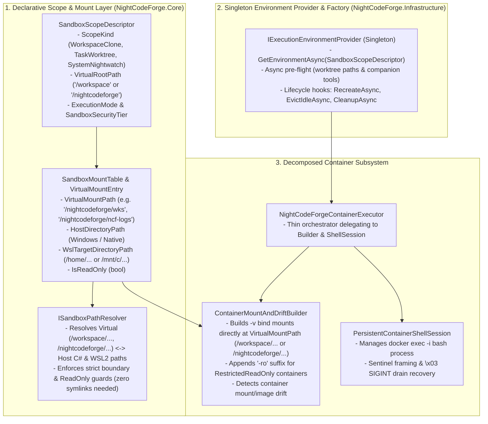

# 🧱 Step 12.36A: Declarative Sandbox Mount Table, Async Environment Provisioning & Container Lifecycle Redesign

> **Architecture & Foundation Refactoring Specification (Part 1 of 2 — Execution Environments, Virtual Mounts & Container Decomposition)**  
> *Parent Plan:* [Phase 12 Master Plan](../12_EXTEND_FEATURES.md)  
> *Companion Step:* [Step 12.36B: `CanonicalTools` Modular Decomposition, Composable Tool Modules & Unified Interruption Pipeline](STEP_12_36B_CANONICAL_TOOLS_MODULAR_DECOMPOSITION_AND_INTERRUPTION_PIPELINE.md)  
> *Unblocks & De-Risks:* [Step 12.22A: Diagnostic Shell & Environment Doctor](../../features/STEP_12_22A_DIAGNOSTIC_SHELL_SERVICE_AND_CONTAINER_SIGINT_RECOVERY.md) | [Step 12.31: Interactive Ideation Warm Execution Context](../../features/STEP_12_31_INTERACTIVE_IDEATION_AGENT_COORDINATOR_AND_WARM_EXECUTION_CONTEXT.md) | [Step 12.34A: Nightwatch Ledger, Virtual Root & Triage](../../features/STEP_12_34A_NIGHTWATCH_DOMAIN_LEDGER_AND_ORCHESTRATOR_REACTIVE_TRIAGE.md) | [Step 12.34B: Agent Nightwatch SOS Tool](../../features/STEP_12_34B_AGENT_NIGHTWATCH_SOS_TOOL_AND_ENVIRONMENT_REMEDIATION.md) | [Step 12.35B: Nightwatch Idle Deep Analysis](../../features/STEP_12_35B_NIGHTWATCH_IDLE_DEEP_ANALYSIS_AND_LEGACY_DIAGNOSTIC_REPLACEMENT.md) | [Step 12.2A/B: Attachments Mounts & Tools](../../features/STEP_12_2A_ATTACHMENTS_STORE_INTAKE_AND_MARKITDOWN.md)  
> *Source Policy:* [AGENTS.md](../../../AGENTS.md) | [docs/ARCHITECTURE.md](../../ARCHITECTURE.md)  
> *Target Projects:* `src/NightCodeForge.Core`, `src/NightCodeForge.Infrastructure`, `src/NightCodeForge.Agents`, `tests/NightCodeForge.Core.Tests`, `tests/NightCodeForge.Infrastructure.Tests`, `tests/NightCodeForge.Agents.Tests` | *Status:* Completed | *Target Framework:* .NET 10 (C# 13)

> This document is a **specification**: it states required behaviors and constraints, not implementations. Implementation choices (signatures, code structure) are left to the implementer, within the constraints of the documents.

---

## 1. Problem Statement & Motivation

Before introducing Warm Ideation Sessions ([Step 12.31](../../features/STEP_12_31_INTERACTIVE_IDEATION_AGENT_COORDINATOR_AND_WARM_EXECUTION_CONTEXT.md)), the Container Diagnostic Shell ([Step 12.22A](../../features/STEP_12_22A_DIAGNOSTIC_SHELL_SERVICE_AND_CONTAINER_SIGINT_RECOVERY.md)), Attachments (`12.2A/B`), and the multi-workspace Nightwatch Virtual Root (`/nightcodeforge/` in [Step 12.34A](../../features/STEP_12_34A_NIGHTWATCH_DOMAIN_LEDGER_AND_ORCHESTRATOR_REACTIVE_TRIAGE.md) & [Step 12.35B](../../features/STEP_12_35B_NIGHTWATCH_IDLE_DEEP_ANALYSIS_AND_LEGACY_DIAGNOSTIC_REPLACEMENT.md)), the current execution environment and container management layer has four structural bottlenecks that make extensions high-risk:

1. **Three Disconnected Path & Mount Systems (Host C# vs. WSL2 `bash` vs. Docker Bind Mounts):**
   - `WorkspacePathResolver`, `CanonicalTools.ResolveFullPath`, `ContainerEnvironmentFactory`, and `NightCodeForgeContainerExecutor` each compute paths and mounts independently, hardcoding `/workspace` as the only possible virtual root.
   - Attempting to expose external directories (such as `wks/`, `ncf-logs/`, `router-logs/`, `ncf-config/`, or `ncf-source/`) via on-disk Linux symlinks in `~/.nightcodeforge/` does not work reliably because Windows `.NET` over `\\wsl.localhost\...` (9P) cannot traverse Linux symlinks pointing to `/mnt/c/...`, and Docker containers cannot follow symlinks outside their mount namespace.
   - Instead of fragile on-disk symlinks, we need a pure **Declarative `SandboxMountTable`** with configurable virtual roots (`/workspace/` for workspace/task scopes and `/nightcodeforge/` for the Nightwatch scope) that resolves virtual paths deterministically across Host C# (`read`), WSL2 `bash` path rewriting, and Docker `-v ...:/nightcodeforge/<subpath>:ro` bind mounts.
2. **Workspace-Only Coupling in `IExecutionEnvironmentProvider`:**
   - `ExecutionEnvironmentProvider` keys environments exclusively by `(int WorkspaceId, SandboxSecurityTier SecurityTier, int? TaskId)` and requires a `Workspace` entity.
   - System-level agents like **Nightwatch** (rooted at `/nightcodeforge/` across all workspaces and host logs) cannot request an `IExecutionEnvironment` without fabricating a synthetic `Workspace` entity (which violates `AGENTS.md`).
3. **Synchronous Blocking I/O Inside `GetEnvironment()` & `CreateContainerEnvironment()`:**
   - `ExecutionEnvironmentProvider.GetEnvironment()` and `ContainerEnvironmentFactory.CreateContainerEnvironment()` invoke `Task.Run(...).GetAwaiter().GetResult()` for `EnsureWorktreeRelativePathsAsync` and `CompanionToolInstaller.EnsureToolsInstalledAsync`, risking thread-pool starvation and slowing down UI/Ideation warmup.
4. **Monolithic `NightCodeForgeContainerExecutor` (2,164 Lines) & Shared Container Name Collisions:**
   - `NightCodeForgeContainerExecutor.cs` combines persistent bash session framing, sentinel recovery, Docker CLI invocation, Dockerfile image building, volume mount assembly, drift inspection, and process-kill whitelisting in a single 2,164-line class.
   - Furthermore, `Standard` and `RestrictedReadOnly` tiers with `TaskId == null` currently compute the exact same base container name (`ncf-ws-{id}`), causing container drift recreation whenever a read-only agent (Ideation, Triage, or Nightwatch) runs alongside a standard stage.

---

## 2. Target Architecture

---

## 3. Detailed Requirements & Specifications

### 3.1 Declarative `SandboxScopeDescriptor`, `SandboxMountTable` & `ISandboxPathResolver` (`NightCodeForge.Core`)

1. **`SandboxScopeKind` & `SandboxScopeDescriptor`:**
   - Replace ad-hoc `(Workspace, SecurityTier, TaskId)` tuple plumbing with a strongly-typed `SandboxScopeDescriptor`:
     - `ScopeKind`: `WorkspaceClone = 0`, `TaskWorktree = 1`, `SystemNightwatch = 2`.
     - `ScopeCacheKey` (`string` — deterministic key, e.g., `"ws:1:tier:Standard"`, `"ws:1:task:42:tier:Standard"`, `"ws:1:tier:RestrictedReadOnly"`, `"system:nightwatch:tier:RestrictedReadOnly"`).
     - `WorkspaceId` (`int?`), `TaskId` (`int?`), `ExecutionMode` (`ExecutionMode`), `SecurityTier` (`SandboxSecurityTier`), `WslDistribution` (`string?`).
     - `VirtualRootPath` (`string` — `/workspace` for `WorkspaceClone` and `TaskWorktree`; `/nightcodeforge` for `SystemNightwatch`).
     - `DefaultWorkingDirectory` (`string` — defaults to `VirtualRootPath`).
     - `MountTable` (`SandboxMountTable`).
2. **`SandboxMountTable` & `VirtualMountEntry` (Zero On-Disk Symlinks Required):**
   - Each `VirtualMountEntry` maps a virtual path directly to its backing host and WSL2 directories:
     - `VirtualSubPath` (`string` — relative to `VirtualRootPath`, e.g., `""` for root in `/workspace`, or `"wks"`, `"ncf-config"`, `"ncf-logs"`, `"router-logs"`, `"ncf-source"` under `/nightcodeforge`).
     - `VirtualMountPath` (`string` — e.g., `/workspace` or `/nightcodeforge/wks`, `/nightcodeforge/ncf-logs`).
     - `HostDirectoryPath` (`string` — native Windows/host path used directly by C# `File.*` operations).
     - `WslTargetDirectoryPath` (`string` — `/home/...` or `/mnt/c/...` path used when rewriting virtual paths in non-container WSL2 `bash` commands).
     - `IsReadOnly` (`bool`).
3. **Unified Virtual Path Resolution & Boundary Guard (`ISandboxPathResolver`):**
   - Used by `CanonicalTools` ([Step 12.36B](STEP_12_36B_CANONICAL_TOOLS_MODULAR_DECOMPOSITION_AND_INTERRUPTION_PIPELINE.md)) to resolve any agent-supplied path (relative to `VirtualRootPath`, absolute `/workspace/...`, `/nightcodeforge/...`, or `/tmp/...`) without needing any on-disk symlinks:
     - **Longest-Prefix Virtual Mount Matching (Host C# `read`/`write`/`edit`):** Normalizes relative paths against `VirtualRootPath`, matches the longest `VirtualMountPath` in `SandboxMountTable`, and translates the remainder directly to `HostDirectoryPath` on the host.
     - **Virtual-to-WSL Command Path Rewriting & Non-Container Working Directory (`WslDirect` / `BareHost` `bash`):**
       - In `ContainerSandbox` mode, Docker mounts each `VirtualMountPath` natively at `/workspace/...` or `/nightcodeforge/<subpath>:ro` with `-w {VirtualRootPath}`, so zero command path rewriting is needed inside the container.
       - When `ExecutionMode != ContainerSandbox` (where `/workspace` or `/nightcodeforge` is not a Linux mount-namespace root on disk), `ISandboxPathResolver` translates explicit virtual path prefixes (`/workspace/...` or `/nightcodeforge/<subpath>/...`) in `SandboxBashToolModule` commands and `workingDirectory` arguments to their corresponding `WslTargetDirectoryPath` (or `HostDirectoryPath` on `BareHost`). For `SystemNightwatch` scopes that have no single root mount, the default initial `bash` working directory resolves to a dedicated empty/marker host directory (`~/.nightcodeforge/nightwatch-root/`) so `cd` never fails with `No such file or directory`, and system prompts instruct Nightwatch to use explicit `/nightcodeforge/<subpath>/...` paths in `bash`.
     - **Strict Boundary & Write Validation:** Verifies that the resolved path stays strictly within the allowed `HostDirectoryPath` of the matched mount (or sandbox `/tmp`), rejects unmapped paths under `/nightcodeforge/` (when no root catch-all mount is defined), and rejects write/edit operations if `Scope.IsReadOnly` or `matchedMount.IsReadOnly` is `true`.
4. **`SystemNightwatch` Execution Mode Resolution:**
   - Because `SystemNightwatch` is not tied to a `Workspace` entity, `SandboxScopeDescriptor` accepts explicit `ExecutionMode`, `WslDistribution`, and optional `ContainerImage` parameters (populated from `NightwatchOptions` in [Step 12.34A](../../features/STEP_12_34A_NIGHTWATCH_DOMAIN_LEDGER_AND_ORCHESTRATOR_REACTIVE_TRIAGE.md), defaulting to `ContainerSandbox` when Docker is available, or falling back to `WslDirect` on Windows / `BareHost` on Linux/macOS).

---

### 3.2 Singleton `IExecutionEnvironmentProvider` & Clean-Break Async Provisioning (`NightCodeForge.Infrastructure` & Callers)

1. **Singleton Registration & Clean-Break `GetEnvironmentAsync` Migration:**
   - Register `IExecutionEnvironmentProvider` as a **Singleton** in `Infrastructure/ServiceCollectionExtensions.cs`.
   - Under the `AGENTS.md` Clean Break policy, **replace** synchronous `IExecutionEnvironmentProvider.GetEnvironment(...)` and `IContainerEnvironmentFactory.CreateContainerEnvironment(...)` with async `GetEnvironmentAsync(SandboxScopeDescriptor scope, CancellationToken ct = default)` (plus convenience overload `GetEnvironmentAsync(Workspace workspace, SandboxSecurityTier securityTier = SandboxSecurityTier.Standard, int? taskId = null, CancellationToken ct = default)`) and `CreateContainerEnvironmentAsync(...)`:
     - Performs worktree path normalization (`EnsureWorktreeRelativePathsAsync`) and once-per-stack companion tool verification (`EnsureToolsInstalledAsync`, cached in memory per `(CodeStack, UseWsl, Distro)`) **asynchronously** without `.GetAwaiter().GetResult()` blocking.
     - Uses per-key async locking (`SemaphoreSlim` per `ScopeCacheKey`) so concurrent warm-up and turn requests for the same `ScopeCacheKey` await the same initialization task (and failed initializations are not permanently cached).
     - Update all existing callers (`CanonicalToolsetFactory`, `AcpHostRpcHandler`, `ConflictResolutionVerifier`, `DeterministicBuildStage`, `DeterministicTestStage`, `DeterministicFormatStage`, `DeterministicSastStage`, `DeterministicScriptStage`, and `SingleExecutionEnvironmentProvider`) to `GetEnvironmentAsync`, and align `AcpHostRpcHandler` file/cwd resolution with `ISandboxPathResolver`.
2. **First-Class `-ro` Container Isolation:**
   - Whenever `SecurityTier == SandboxSecurityTier.RestrictedReadOnly`, `ContainerEnvironmentFactory` appends `-ro` to the container name (`ncf-ws-{id}-ro`, `ncf-ws-{id}-task-{taskId}-ro`, or `ncf-nightwatch-ro` for `SystemNightwatch`).
   - All container lifecycle methods (`CleanupTaskContainerAsync`, `CleanupWorkspaceContainersAsync`, `RecreateEnvironmentContainerAsync`, `EvictIdleWorkspaceContainersAsync`) handle both standard and `-ro` containers cleanly.

---

### 3.3 Decomposing `NightCodeForgeContainerExecutor`

Refactor `NightCodeForgeContainerExecutor` into three focused, single-responsibility classes in `NightCodeForge.Infrastructure/Execution/`:

1. **`ContainerMountAndDriftBuilder`:**
   - Translates a `SandboxScopeDescriptor` and its `SandboxMountTable` (plus SDK mounts and package cache mounts) into `IReadOnlyList<ContainerVolumeMount>` (`-v "{WslTargetDirectoryPath}:{VirtualMountPath}:ro|rw"`) and `docker run -w {VirtualRootPath}` arguments.
   - Implements `DetectContainerDriftAsync` comparing running container bind mounts and image against expected `ContainerVolumeMount` entries.
2. **`PersistentContainerShellSession`:**
   - Manages the persistent `docker exec -i` bash process, command framing, `HeadTailBuffer` output capture, sentinel drain, and `\x03` (`SIGINT`) cancellation recovery (ensuring that a cancelled command drains its sentinel or restarts the shell process before releasing `_execLock`).
3. **`NightCodeForgeContainerExecutor`:**
   - Coordinates container startup/reuse (via `ContainerMountAndDriftBuilder`) and command execution (via `PersistentContainerShellSession`), staying concise, readable, and within `AGENTS.md` constructor rules.

---

## 4. Definition of Done (DoD) Checklist

- [x] Define `SandboxScopeKind`, `SandboxScopeDescriptor` (`VirtualRootPath = "/workspace"` or `"/nightcodeforge"`), `SandboxMountTable`, `VirtualMountEntry`, and `ISandboxPathResolver` (`SandboxPathResolver`) in `NightCodeForge.Core` / `NightCodeForge.Infrastructure`.
- [x] Implement virtual mount resolution in `SandboxPathResolver` for Host C# file operations and non-container WSL2 `bash` path translation, plus direct `-v "{WslTargetDirectoryPath}:{VirtualMountPath}:ro"` Docker bind mounts in `ContainerMountAndDriftBuilder` (requiring zero on-disk symlinks).
- [x] Promote `IExecutionEnvironmentProvider` to a **Singleton**, replace synchronous `GetEnvironment` / `CreateContainerEnvironment` with async `GetEnvironmentAsync` / `CreateContainerEnvironmentAsync` across all callers (`CanonicalToolsetFactory`, `AcpHostRpcHandler`, `ConflictResolutionVerifier`, and `Deterministic*Stage`, eliminating `.GetAwaiter().GetResult()` calls and caching companion tool checks per stack/distro), align `AcpHostRpcHandler` with `ISandboxPathResolver`, and support `SandboxScopeKind.SystemNightwatch` without requiring a synthetic `Workspace`.
- [x] Enforce `-ro` container name isolation (`{baseName}-ro`, `ncf-nightwatch-ro`) for `SandboxSecurityTier.RestrictedReadOnly`.
- [x] Decompose `NightCodeForgeContainerExecutor` by extracting `ContainerMountAndDriftBuilder` and `PersistentContainerShellSession` (including `\x03` `SIGINT` sentinel recovery on cancellation).
- [x] Add unit tests in `NightCodeForge.Core.Tests` and `NightCodeForge.Infrastructure.Tests` covering `/nightcodeforge/` and `/workspace/` `SandboxMountTable` longest-prefix host path resolution, WSL2 virtual path translation, read-only mount enforcement, `-ro` container naming, async environment caching, and `PersistentContainerShellSession` `SIGINT` recovery.
