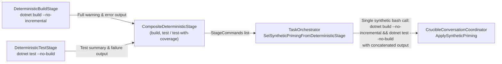

# 🔧 Step 12.42: Non-Incremental Deterministic Build (`--no-incremental`) & Combined Build+Test Conversation Seed

> **Feature Implementation Step (Accurate Warning Counting in Deterministic Gates & Combined `build && test` Synthetic Priming)**  
> *Parent Plan:* [Features & Integrations Roadmap](../../features/README.md)  
> *Target Components:* `src/NightCodeForge.Core`, `src/NightCodeForge.Agents`, `tests/NightCodeForge.Core.Tests`, `tests/NightCodeForge.Cli.Tests`, `tests/NightCodeForge.Agents.Tests` | *Status:* Completed | *Target Framework:* .NET 10 (C# 13)  
> *Aligns With:* [AGENTS.md](../../../AGENTS.md), [docs/PLAN.md](../../PLAN.md)
>
> This document is a **specification**: it states required behaviors and constraints, not implementations. Implementation choices (signatures, code structure) are left to the implementer, within the constraints of the documents.

---

## 1. Problem Statement & Motivation

Two related issues currently affect deterministic verification gates and downstream agent conversation priming:

1. **Undercounted Warnings on Incremental Builds:**  
   `DeterministicBuildStage` (`DeterministicStageConstants.DefaultBuildCommand` and `CodeStackPresets.DotNet.BuildCommand`) currently defaults to `dotnet build`. Because MSBuild performs incremental builds by default, projects whose inputs did not change since the previous build (for example, after an agent already ran `dotnet build` during `Implementation`) are skipped, and their compiler/analyzer warnings are not re-emitted to stdout. As a result, `DeterministicBuildStage` undercounts `WarningsCurrentTotal`, `WarningsBaselineTotal`, and `WarningsNew`, which can corrupt warning-ratchet comparisons.
2. **Model Confusion from `--no-build` in Synthetic Conversation Priming:**  
   When `CompositeDeterministicStage` executes `build,test` (or `build,test-with-coverage`), `TaskOrchestrator.SetSyntheticPrimingFromDeterministicStage` currently selects only the `test` (or `test-with-coverage`) `StageCommandExecution` for `PendingSyntheticPriming`. Downstream agents (such as `Implementation` on loopback or `CodeReview` on forward pass) therefore receive a synthetic `bash` tool call in their conversation seed showing only `dotnet test --no-build`. Seeing `--no-build` without the preceding build command and output leads models to doubt whether their changes were compiled or to waste turns re-running `dotnet build`.

---

## 2. Architecture & Data Flow

---

## 3. Detailed Requirements & Specifications

### 3.1 Non-Incremental Deterministic Build Gate (`dotnet build --no-incremental`)

1. **Default .NET Build Command:**
   - Update the default .NET deterministic build command in `DeterministicStageConstants.DefaultBuildCommand`, `DeterministicBuildStage.DefaultBuildCommand`, and `CodeStackPresets.DotNet.BuildCommand` from `"dotnet build"` to `"dotnet build --no-incremental"`.
   - Preserve explicit per-workspace/per-stack overrides: if a workspace or project configuration explicitly specifies a custom `BuildCommand`, that configured command continues to take precedence.
   - Update any dependent tests asserting the default `.NET` preset build command (across `NightCodeForge.Core.Tests` and `NightCodeForge.Cli.Tests`) to reflect `"dotnet build --no-incremental"`.
2. **Warning Count Integrity:**
   - Running `dotnet build --no-incremental` ensures MSBuild recompiles targets and re-emits all active compiler and analyzer warnings on every deterministic build gate execution, keeping `WarningsCurrentTotal`, `WarningsBaselineTotal`, and `WarningsNew` accurate across both initial baseline runs and post-implementation verification runs.
   - `DeterministicTestStage` continues to use `dotnet test --no-build` by default because the preceding deterministic build gate has just produced a clean, non-incremental build.

### 3.2 Combined `build && test` Synthetic Conversation Priming

1. **Single Chained Synthetic Tool Call:**
   - When `TaskOrchestrator.SetSyntheticPrimingFromDeterministicStage` constructs `PendingSyntheticPriming` from a deterministic stage that recorded `StageCommandExecution` entries (e.g., `CompositeDeterministicStage` running `build` and `test` / `test-with-coverage`):
     - Instead of picking only the `test` sub-stage on success or only the last failed sub-stage on failure, combine **all executed shell sub-stages** in execution order into a **single** `SyntheticPrimingExecution`.
     - Set `Command` to the chained command string (e.g., `dotnet build --no-incremental && dotnet test --no-build`), joining each executed shell sub-stage's command with ` && `.
     - Exclude skipped, unavailable, or ignored-failure placeholders (e.g., `sast (skipped)`, `format (skipped)`, `... (unavailable)`, `... (failed, ignored)`) and non-shell in-process sub-stages (e.g., `ratchet` / `DeterministicWarningRatchetStage`) from the chained `bash` `Command` string. If a non-shell sub-stage (such as `ratchet`) fails, its failure reason and diagnostics must still be preserved in the combined output while keeping `Command` limited to actually executed shell commands (falling back to existing command resolution if none ran).
     - If execution stopped early on a failed sub-stage (e.g., `build` failed with `FailOnError = true` before `test` ran), only the sub-stages that actually executed are included.
2. **Concatenated Output & Per-Command Filtering:**
   - Concatenate the outputs of all included sub-stages in execution order (with clear sub-stage separation/headers so the model can distinguish build output from test output).
   - When smart CLI output filtering is applied during priming, filter each sub-stage's output using its own sub-stage command and success status **before** concatenating, so command-specific filters (build vs. test) match accurately rather than being confused by the chained `&&` command string.
   - Preserve the `Exit Code: 0` / `Exit Code: 1` prefix, quality-gate failure reason, `[Compiler Diagnostics]`, `[Failed Tests]`, and `WorkflowDefaults.TruncateStageOutput` length bounds on the combined result.
   - Compute `DurationMs` as the sum of the executed sub-stages' durations (falling back to `stageDurationMs` when individual durations are unavailable).
3. **Downstream Conversation Seed & No Double-Filtering:**
   - `CrucibleConversationCoordinator.ApplySyntheticPriming` continues to inject a single synthetic `bash` `FunctionCallContent` / `FunctionResultContent` pair (and corresponding persisted `StageTurnRole.Tool` / `StageTurnRole.ToolResult` turns), now showing the full chained `build && test` command and combined output so the model clearly sees that the build ran before `--no-build` tests.
   - Because `TaskOrchestrator.SetSyntheticPrimingFromDeterministicStage` already filters each sub-stage individually before concatenating, `CrucibleConversationCoordinator.FilterSyntheticPriming` must **not** re-run a single command filter over an already-combined multi-stage priming output (which could otherwise strip sub-stage headers or sections when individual sub-stage outputs did not start with `[This is a simplified output]`), while still enforcing the `WorkflowDefaults.MaxToolInlineChars` inline cap.

---

## 4. Definition of Done (DoD) Checklist

- [x] `DeterministicStageConstants.DefaultBuildCommand`, `DeterministicBuildStage.DefaultBuildCommand`, and `CodeStackPresets.DotNet.BuildCommand` default to `"dotnet build --no-incremental"`, while preserving explicit custom `BuildCommand` overrides.
- [x] `TaskOrchestrator.SetSyntheticPrimingFromDeterministicStage` emits a single `SyntheticPrimingExecution` with chained `&&` commands (excluding skipped/non-shell sub-stages such as `sast (skipped)` and `ratchet`) and concatenated (per-command filtered) outputs covering both build and test sub-stages on both success and failure.
- [x] `CrucibleConversationCoordinator.FilterSyntheticPriming` preserves all sub-stage sections of combined priming output without double-filtering/stripping while enforcing `WorkflowDefaults.MaxToolInlineChars`.
- [x] Unit tests in `tests/NightCodeForge.Core.Tests`, `tests/NightCodeForge.Cli.Tests`, and `tests/NightCodeForge.Agents.Tests` verify the `--no-incremental` default build command, updated preset assertions, combined `build && test` priming (including skipped/non-shell sub-stage exclusion), and non-stripped coordinator priming output.
- [x] All unit and integration tests pass (`dotnet test --filter "Category!=Acceptance&Category!=E2E"`).
