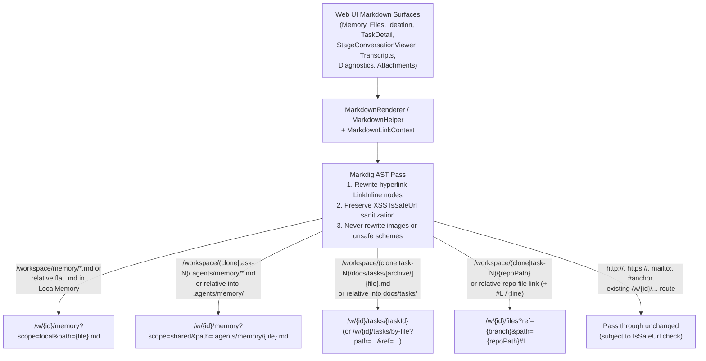

# 🔗 Step 12.46B: Context-Aware Markdown Link Builder & Unified UI Integration

> **Feature Implementation Step (Part 2 of 2 — Unified Context-Aware Link Resolution Across All Markdown Rendering Surfaces)**  
> *Parent Plan:* [Features & Integrations Roadmap](../../features/README.md)  
> *Prerequisite Steps:* [Step 12.46A: Git Branch Repository File Viewer (`/files`)](STEP_12_46A_GIT_BRANCH_FILE_VIEWER.md) | [Step 12.41: Full-Page Agent Memory Explorer](STEP_12_41_WORKSPACE_MEMORY_PAGE_AND_IDEATION_CLEANUP_PROMPTS.md)  
> *Related Steps:* [Step 12.39: Two-Tier Agent Memory Management & UI Notifications](STEP_12_39_TWO_TIER_AGENT_MEMORY_MANAGEMENT_AND_UI_NOTIFICATIONS.md)  
> *Target Components:* `src/NightCodeForge.Core`, `src/NightCodeForge.Web`, `tests/NightCodeForge.Web.Tests` | *Status:* Completed | *Target Framework:* .NET 10 (C# 13)  
> *Aligns With:* [AGENTS.md](../../../AGENTS.md), [docs/PLAN.md](../../PLAN.md)
>
> This document is a **specification**: it states required behaviors and constraints, not implementations. Implementation choices (signatures, code structure) are left to the implementer, within the constraints of the documents.

---

## 1. Problem Statement & Motivation

Markdown is rendered across nearly every surface in NightCodeForge's Web UI: Agent Memory previews (`Memory.razor`), Ideation chat & task proposal cards (`Ideation.razor`, `IdeationProposalCard.razor`), Task specifications & Q&A (`TaskDetail.razor`, `TaskDetailDrawer.razor`, `TaskExecutionInspector.razor`, `CreateTask.razor`), live and historical stage conversations (`StageConversationViewer.razor`, `Transcripts.razor`), diagnostics (`DiagnosticsModal.razor`), attachment previews (`AttachmentUiService.cs`), and the repository file viewer ([Step 12.46A](STEP_12_46A_GIT_BRANCH_FILE_VIEWER.md)).

Currently, [`MarkdownHelper`](../../../src/NightCodeForge.Web/Services/MarkdownHelper.cs) renders Markdown without any awareness of the active workspace, branch, or document origin. As a result, links authored by agents or developers routinely break or point to non-existent relative HTTP URLs:
1. **Agent Memory Cross-Links Fail:** Inside `/workspace/memory/MEMORY.md`, a standard Markdown link such as `[Config file decisions](config-file-decisions.md)` resolves in the browser to `/w/{id}/config-file-decisions.md` (404) instead of opening `config-file-decisions.md` inside the Agent Memory Explorer (`/w/{id}/memory?scope=local&path=config-file-decisions.md`). Likewise, sandbox paths like `/workspace/memory/notes.md` or `/workspace/clone/.agents/memory/conventions.md` are unusable as hrefs.
2. **Task File Links Fail:** Links targeting `/workspace/clone/docs/tasks/2026-11-26-my-task.md`, `/workspace/task-42/docs/tasks/archive/2026-11-20-old-task.md`, or relative links to `docs/tasks/...` do not navigate to the corresponding task in NightCodeForge.
3. **Repository File & Line Links Fail:** Links targeting `/workspace/clone/src/Foo.cs#L10-L25`, `/workspace/task-42/src/Bar.cs:42`, or relative links inside a repository Markdown document (e.g., `docs/PLAN.md` linking to `features/STEP_12_46A_GIT_BRANCH_FILE_VIEWER.md`) do not open in the Git Branch File Viewer ([Step 12.46A](STEP_12_46A_GIT_BRANCH_FILE_VIEWER.md)).

This step introduces a **context-aware Markdown link builder** inside `MarkdownHelper` / `MarkdownRenderer.razor`, a lightweight task-file resolver route for task markdown filenames, and consistent context propagation across every Markdown rendering surface in `NightCodeForge.Web`.

---

## 2. Architecture & Link Resolution Flow

---

## 3. Detailed Requirements & Specifications

### 3.1 Context Model & Synchronous Rendering Contract

1. **Structured Render Context (`MarkdownLinkContext`):**
   - Represent the rendering context as an immutable value/record model carrying:
     - `WorkspaceId` *(optional `int?`)*: Active workspace ID; when null, workspace-scoped rewrites are skipped safely.
     - `DocumentScope` *(enum)*: Origin of the Markdown being rendered — e.g., `GeneralWorkspace` (Ideation / diagnostics / attachments), `Task` (task description, Q&A, stage run), `LocalMemory` (Tier 2 `/workspace/memory/*.md`), `SharedRepositoryMemory` (Tier 1 `.agents/memory/*.md` or `AGENTS.md`), and `RepositoryFile` (arbitrary file viewed in `Files.razor`).
     - `ActiveBranchOrRef` *(optional `string?`)*: Git branch or commit ref associated with the context (e.g., `feature/task-42` for a task context, `Workspace.DefaultBaseBranch` for general workspace/ideation contexts, or the currently selected ref in `Files.razor`).
     - `TaskId` *(optional `int?`)*: Associated task ID when rendering inside a task context.
     - `CurrentDocumentPath` *(optional `string?`)*: Normalized document path relative to its root (for example `MEMORY.md` in `LocalMemory`, `.agents/memory/architecture.md` in `SharedRepositoryMemory`, or `docs/PLAN.md` in `RepositoryFile`) used to resolve relative links.
     - `TaskPathLookup` *(optional pre-resolved lookup/dictionary)*: Optional synchronous in-memory map from task markdown filename or canonical slug/relative path to `TaskId` when the caller already has workspace tasks loaded, allowing direct `/w/{id}/tasks/{taskId}` links without extra redirects. Note that `ForgeTask` does not persist a markdown filename column in the database, so `TaskPathLookup` is strictly an optimization; when omitted, links route cleanly through `/tasks/by-file`.
2. **Synchronous, Thread-Safe Markdig Pipeline Contract:**
   - Markdown rendering must remain **purely synchronous and thread-safe**, because Blazor renders Markdown directly in Razor markup — including high-frequency token-by-token streaming updates in `Ideation.razor` and `StageConversationViewer.razor`.
   - **Never** mutate a shared static `MarkdownPipeline` instance's event handlers per render call, and **never** perform database or Git CLI I/O inside `MarkdownHelper.ToHtml` / `ToMarkupString`.
   - **Pipeline Execution Ordering (Critical):** Currently, [`MarkdownHelper`](../../../src/NightCodeForge.Web/Services/MarkdownHelper.cs) hooks `SanitizeDocument` onto `MarkdownPipelineBuilder.DocumentProcessed`, which executes during `Markdown.Parse` and strips any URL whose first `:` precedes `/` (`IsSafeUrl`) — which would prematurely destroy root-level colon-line links such as `README.md:42` or `Program.cs:10-20` before rewriting runs. Use a shared immutable parse pipeline (with `.DisableHtml()` and `GenericAttributesExtension` removed, without premature `DocumentProcessed` URL stripping) and perform context-aware AST rewriting followed by final `IsSafeUrl` sanitization in a deterministic per-render pass on the parsed `MarkdownDocument` before emitting HTML.
3. **XSS & Sanitization Preservation:**
   - Retain all existing [`MarkdownHelper`](../../../src/NightCodeForge.Web/Services/MarkdownHelper.cs) security invariants: `.DisableHtml()`, removal of `GenericAttributesExtension`, and `IsSafeUrl` validation across both `LinkInline` and `AutolinkInline` nodes.
   - Apply `IsSafeUrl` validation **both** before accepting input URLs (for explicit URI schemes) and as a final safety guarantee after link rewriting so obfuscated unsafe schemes (`javascript:`, `data:`, `vbscript:`, HTML entity / control-character tricks) are always neutralized.
   - Rewrite **hyperlink** nodes (`LinkInline` where `!link.IsImage`) only; never rewrite image `src` links (`link.IsImage`) or `AutolinkInline` nodes into HTML page routes (while still sanitizing both with `IsSafeUrl`), and always clear `link.GetDynamicUrl = null` whenever a `LinkInline` URL is rewritten or stripped.
   - Properly URL-encode all generated query parameter values (`Uri.EscapeDataString`) and fragment anchors.

### 3.2 Deterministic Link Classification & Resolution Rules

Before classifying a target URL, strip surrounding whitespace and normalize path separators (`\` $\rightarrow$ `/`). Apply rules in the following deterministic order:

1. **Scheme Validation, External URLs, Pure Fragments & Internal App Routes:**
   - Decode HTML entities and strip control/whitespace characters when inspecting schemes to defeat obfuscation (such as `java\tscript:` or `&#106;avascript:`).
   - Unconditionally neutralize explicit unsafe schemes (`javascript:`, `data:`, `vbscript:`, `file:`, `blob:`, etc. — even when followed by digits such as `javascript:42`) before `:line` extraction.
   - Empty URLs, pure fragment anchors (`#section-name`), already-resolved app routes (`/w/{id}/...`), and explicit safe schemes (`http://`, `https://`, `mailto:`) pass through unchanged (verified by `IsSafeUrl`).
2. **Line & Range Suffix Extraction (`#L42`, `#L42-L58`, `:42`, `:42-58`):**
   - Extract optional line or range suffixes prior to path classification:
     - GitHub-style fragment anchors: `#L42` or `#L42-L58` (also accept `#L42-58`, case-insensitive `L`), normalizing the output fragment to `#L42` or `#L42-L58`.
     - Colon line suffixes: `path/to/file.cs:42` or `path/to/file.cs:42-58`, extracting trailing `:\d+(-\d+)?` only when the prefix represents a file path (distinct from URI schemes already handled in Rule 1 and single-letter Windows drive prefixes like `C:/...`).
   - Preserve non-line heading fragments (such as `#31-context-model`) on Markdown file targets when routing to `Files.razor` or `Memory.razor`.
3. **Rooted Virtual & Host Path Normalization (`/workspace/...` and `~/.nightcodeforge/wks/{id}/...`):**
   - Safely percent-decode path segments (`Uri.UnescapeDataString`) before normalization and traversal checks so encoded escapes (`%2e%2e`) are caught and already-encoded spaces (`%20`) are not double-encoded into `%2520` when building target query parameters.
   - Recognize virtual container paths (`/workspace/...`, `workspace/...`) and NightCodeForge host/WSL workspace paths (`~/.nightcodeforge/wks/{id}/...`, `.../.nightcodeforge/wks/{id}/...`, or Windows WSL UNC paths such as `\\wsl.localhost\...\home\...\.nightcodeforge\wks\{id}\...` normalized via `\` $\rightarrow$ `/`) as follows:
     - **Cross-Workspace Isolation:** If a host/WSL path embeds a workspace ID (`.../wks/{otherId}/...`) that does not match `context.WorkspaceId`, neutralize the link rather than rewriting it into the active workspace.
     - `/workspace/memory/<file>.md` (flat markdown filename, no subdirectory traversal) $\rightarrow$ **Tier 2 Local Memory target** (`<file>.md`).
     - `/workspace/clone` or `/workspace/clone/<subpath>` $\rightarrow$ **Repository target** on `DefaultBranch` (or context default base branch) with `<subpath>` (empty path opening the repository root directory view).
     - `/workspace/task-{nnn}` or `/workspace/task-{nnn}/<subpath>` $\rightarrow$ **Repository target** on `feature/task-{nnn}` (with `taskId = nnn` hint for [Step 12.46A](STEP_12_46A_GIT_BRANCH_FILE_VIEWER.md) fallback if the branch was squash-merged/deleted) with `<subpath>` (empty path opening the repository root directory view).
   - Reject any path containing `..` segments that traverse above its root (`/workspace/memory/../clone/...`, `../../etc/passwd`), neutralizing the link rather than emitting a broken or escaping route.
4. **Relative Path Resolution (Based on `DocumentScope` & `CurrentDocumentPath`):**
   - When the link is a relative path (not starting with `/`, `~`, scheme, or `#`):
     - **`LocalMemory` scope (e.g., inside `MEMORY.md` or `topic.md`):**
       - Normalize relative `./` segments. If the resolved path is a flat `.md` filename (e.g., `[Config file decisions](config-file-decisions.md)` or `./config-file-decisions.md`), resolve it as a **Tier 2 Local Memory target**.
       - Any relative link attempting directory traversal (`../...` or nested `sub/file.md`) inside flat local memory is neutralized rather than leaking out of `/workspace/memory/`.
     - **`SharedRepositoryMemory` scope (e.g., `AGENTS.md`, `.agents/AGENTS.md`, or `.agents/memory/topic.md`):**
       - Resolve relative to the directory of `CurrentDocumentPath` inside the repository root (e.g., `sibling.md` inside `.agents/memory/index.md` resolves to `.agents/memory/sibling.md`; `../../docs/PLAN.md` resolves to `docs/PLAN.md`).
       - Reject paths escaping above repository root.
     - **`RepositoryFile` scope (viewing `<CurrentDocumentPath>` in `Files.razor`):**
       - Resolve relative to the directory of `CurrentDocumentPath` on the **same** `ActiveBranchOrRef` (and `TaskId` if present). For example, viewing `docs/PLAN.md` on `feature/task-12` and clicking `[12.46A](features/STEP_12_46A_GIT_BRANCH_FILE_VIEWER.md)` resolves to `docs/features/STEP_12_46A_GIT_BRANCH_FILE_VIEWER.md` on `feature/task-12`.
       - Reject paths escaping above repository root.
     - **`GeneralWorkspace` / `Task` scope:**
       - Bare repository-relative paths (e.g., `docs/tasks/2026-11-26-foo.md`, `.agents/memory/rules.md`, `src/Core/Foo.cs#L10-L20`) resolve from repository root on the context's `ActiveBranchOrRef` (or `DefaultBranch` when unset).
5. **Target Classification & Generated URLs:**
   - **Agent Memory Targets (via [`AgentMemoryPathClassifier`](../../../src/NightCodeForge.Core/Memory/AgentMemory.cs) & [`MemoryPresentationHelper`](../../../src/NightCodeForge.Web/Services/MemoryPresentationHelper.cs)):**
     - Tier 2 Local Memory (`<file>.md`) $\rightarrow$ `/w/{WorkspaceId}/memory?scope=local&path={Uri.EscapeDataString(fileName)}` (+ preserved non-line `#anchor` if any).
     - Tier 1 Shared Repository Memory (`AGENTS.md`, `.agents/AGENTS.md`, and `.agents/memory/<file>.md`, classified via `AgentMemoryPathClassifier`) $\rightarrow$ `/w/{WorkspaceId}/memory?scope=shared&path={Uri.EscapeDataString(canonicalSharedPath)}` (+ preserved non-line `#anchor` if any).
       - *Deterministic Exception — Route to Step 12.46A File Viewer Instead:* When the link carries a line/range anchor (`#L...` or `:line`, since `Memory.razor` has no line-numbered viewer), **or** when the link explicitly targets a task-specific branch/worktree (`/workspace/task-{nnn}/...`), **or** when navigating inside `Files.razor` (`RepositoryFile`) on a branch/ref different from the workspace default branch, route to `/w/{WorkspaceId}/files` on that target ref so the user inspects the exact line/branch snapshot.
   - **Task Markdown Targets (`docs/tasks/[archive/]<filename>.md`):**
     - Match normalized repository paths of the form `docs/tasks/<filename>.md` or `docs/tasks/archive/<filename>.md` (case-insensitive, flat `.md` file inside `docs/tasks/` or `docs/tasks/archive/`).
     - If `TaskPathLookup` in `MarkdownLinkContext` resolves the filename/path synchronously to a known `TaskId`, emit `/w/{WorkspaceId}/tasks/{TaskId}` directly.
     - Otherwise emit the lightweight task-file resolver route:
       `/w/{WorkspaceId}/tasks/by-file?path={Uri.EscapeDataString(repoRelativeTaskPath)}[&ref={Uri.EscapeDataString(targetRef)}][&taskId={hintTaskId}]`.
     - **Task-File Resolver Page/Route Behavior (`/tasks/by-file` and `/w/{WorkspaceId:int}/tasks/by-file`):**
       - Register both `@page "/tasks/by-file"` and `@page "/w/{WorkspaceId:int}/tasks/by-file"` (consistent with all other pages in `NightCodeForge.Web` and non-conflicting with `/tasks/{TaskId:int}`).
       - Resolve the task asynchronously in deterministic order:
         1. Validate the requested `path` is strictly a flat `.md` under `docs/tasks/` or `docs/tasks/archive/` (rejecting traversal).
         2. Attempt to read YAML frontmatter `id` from the target file via the [Step 12.46A](STEP_12_46A_GIT_BRANCH_FILE_VIEWER.md) Git file reader (at `ref` or `DefaultBaseBranch`), falling back to reading the synced host/clone task markdown file under `docs/tasks/[archive/]` with strict containment and `AgentMemoryReparseGuard` symlink checks (so newly synced, uncommitted task files resolve cleanly). Verify any resolved `ForgeTask` belongs to `WorkspaceId`.
         3. Fall back to matching filename/slug/date/archive status across workspace tasks in `ITaskRepository.GetByWorkspaceIdAsync(WorkspaceId)` reusing `NormalizeDependencyKey`, `GenerateSlug`, `TryExtractDateFromPath`, and `IsArchivedStatus` from [`TaskMarkdownSyncService`](../../../src/NightCodeForge.Core/Services/TaskMarkdownSyncService.cs).
       - When a matching `ForgeTask` is found in the workspace, redirect (`NavigationManager.NavigateTo(..., replace: true)`) to `/w/{WorkspaceId}/tasks/{TaskId}`.
       - When no matching DB task exists (e.g., an external/un-ingested `.md` under `docs/tasks/` on a branch), redirect cleanly to `/w/{WorkspaceId}/files?ref=...&path=...` if the file exists in Git, or display a clear inline not-found state with a link back to `/w/{WorkspaceId}/backlog`.
   - **Arbitrary Repository File Targets ([Step 12.46A](STEP_12_46A_GIT_BRANCH_FILE_VIEWER.md)):**
     - Any other valid normalized repository path (excluding `.` segments; empty repo root from `/workspace/clone` or `/workspace/task-{nnn}` and directory paths open the directory view in `Files.razor`) $\rightarrow$ `/w/{WorkspaceId}/files?ref={Uri.EscapeDataString(targetRef)}&path={Uri.EscapeDataString(repoRelativePath)}[&taskId={taskId}][#L{start}[-L{end}]]`.
     - When a link has no line anchor (`#L...` or `:line`) but carries a non-line fragment (e.g., `#overview`), preserve the fragment on the generated URL.
6. **Workspace-Less Behavior (`WorkspaceId == null`):**
   - Keep external `http`/`https`/`mailto` and `#fragment` links working, and neutralize workspace/repository paths cleanly without throwing exceptions.

### 3.3 Unifying All Markdown Rendering Call Sites in `NightCodeForge.Web`

Migrate all Markdown rendering surfaces in `NightCodeForge.Web` to pass an explicit `MarkdownLinkContext` through [`MarkdownRenderer.razor`](../../../src/NightCodeForge.Web/Components/Common/MarkdownRenderer.razor) (or the context-aware `MarkdownHelper` overload):

| UI Component / Service | `DocumentScope` | `ActiveBranchOrRef` | `CurrentDocumentPath` & Extras |
| :--- | :--- | :--- | :--- |
| **[`Memory.razor`](../../../src/NightCodeForge.Web/Components/Pages/Memory.razor)** | `LocalMemory` or `SharedRepositoryMemory` (matching `_selectedScope`) | `Workspace.DefaultBaseBranch` | `_selectedPath` (e.g., `MEMORY.md`, `.agents/memory/rules.md`). Preserve `#memory-rendered` and synchronize the browser URL query parameters (`replace: true`) on sidebar selection so clicking in-page cross-file links (`[Config file decisions](config-file-decisions.md)`) always triggers navigation/reload cleanly without going stale against `_lastDeepLinkKey`. |
| **`Files.razor`** ([Step 12.46A](STEP_12_46A_GIT_BRANCH_FILE_VIEWER.md)) | `RepositoryFile` | Currently selected Git ref/SHA | Current file's repo-relative `path` + optional `taskId` hint. |
| **`Ideation.razor` & [`IdeationProposalCard.razor`](../../../src/NightCodeForge.Web/Components/Ideation/IdeationProposalCard.razor)** | `GeneralWorkspace` | `Workspace.DefaultBaseBranch` | No `CurrentDocumentPath`; resolves `/workspace/memory/*`, `/workspace/clone/...`, `docs/tasks/*`, and repo paths. Handle null `WorkspaceStateService` in `IdeationProposalCard` (matching its existing `ServiceProvider.GetService` pattern) by falling back to workspace-less context. |
| **`TaskDetail.razor`, `TaskDetailDrawer.razor`, `TaskExecutionInspector.razor`, `StageConversationViewer.razor`** | `Task` | `task.FeatureBranch` (fallback `task.BaseBranch` / `DefaultBaseBranch`) | `TaskId = task.Id`; stage summaries, streaming assistant turns, tool outputs, task descriptions, and Q&A answers all inherit task context. |
| **`CreateTask.razor`** | `GeneralWorkspace` | `Workspace.DefaultBaseBranch` | Live preview of task description in active workspace context. |
| **[`Transcripts.razor`](../../../src/NightCodeForge.Web/Components/Pages/Transcripts.razor) & [`DiagnosticsModal.razor`](../../../src/NightCodeForge.Web/Components/Transcripts/DiagnosticsModal.razor)** | `Task` (when `Metadata.TaskId > 0`) or `GeneralWorkspace` | `$"feature/task-{Metadata.TaskId}"` (when `TaskId > 0`) or `Workspace.DefaultBaseBranch` | Because `TranscriptSummary.TaskId` is non-nullable `int` (`> 0` when linked to a task), supply `TaskId = Metadata.TaskId` when `> 0` so historical transcripts resolve `task-{id}` links cleanly via Step 12.46A fallback. |
| **[`AttachmentUiService.cs`](../../../src/NightCodeForge.Web/Services/AttachmentUiService.cs)** | `GeneralWorkspace` | `workspace?.DefaultBaseBranch` | Markdown attachment preview passes `WorkspaceId = attachment.WorkspaceId` and `workspace?.DefaultBaseBranch` to `MarkdownHelper.ToHtml(markdownContent, context)`. |

> [!IMPORTANT]
> Update [`WorkspaceUrlHelper.cs`](../../../src/NightCodeForge.Web/Services/WorkspaceUrlHelper.cs) so `GetTargetUrlForWorkspaceSwitch` maps `tasks/by-file` to `backlog` (stripping query/fragment parameters) when switching workspaces — `TryExtractTaskRoute` only matches integer task IDs, so `tasks/by-file` requires an explicit rule.

### 3.4 UI & Presentation Separation & `AGENTS.md` Constraints

- Keep all Razor components strictly focused on layout, rendering, and user interaction per [AGENTS.md](../../../AGENTS.md).
- Keep all link classification, path normalization, relative path resolution, line-range extraction, AST rewriting, and URL building inside dedicated testable services/helpers in `src/NightCodeForge.Web/Services/` (zero link-rewriting logic inside `.razor` `@code` blocks).
- Adhere to all [AGENTS.md](../../../AGENTS.md) standards: named constants/enums (no magic strings), $\le 10$ required constructor parameters, no optional constructor parameters, no bare `catch { }` blocks, and no synthetic fallback DB entities.

---

## 4. Definition of Done (DoD) Checklist

- [x] Define `MarkdownLinkContext` (and `MarkdownDocumentScope` enum) and implement a thread-safe, synchronous context-aware Markdig link builder in `MarkdownHelper` / `MarkdownRenderer.razor` using a shared immutable parse pipeline (without premature `DocumentProcessed` colon-scheme stripping, without mutating any shared pipeline, preserving `.DisableHtml()`, `GenericAttributesExtension` removal, `AutolinkInline` sanitization, `GetDynamicUrl` clearing, and pre/post `IsSafeUrl` XSS sanitization).
- [x] Implement deterministic link classification and URL generation for:
  - Tier 2 Local Memory (`/workspace/memory/*.md` and relative flat `.md` links inside `LocalMemory`, e.g., `[Config file decisions](config-file-decisions.md)` in `MEMORY.md`).
  - Tier 1 Shared Repository Memory (`AGENTS.md`, `.agents/AGENTS.md`, `/workspace/(clone|task-{nnn})/.agents/memory/*.md`, and relative `.agents/memory/*.md` links, routing to `Files.razor` when line anchors, explicit task refs, or non-default `Files.razor` branches are involved).
  - Task Markdown files (`/workspace/(clone|task-{nnn})/docs/tasks/[archive/]*.md` and relative `docs/tasks/` links), plus dual `@page "/tasks/by-file"` and `@page "/w/{WorkspaceId:int}/tasks/by-file"` resolver routes with frontmatter/slug resolution and fallback to Step 12.46A File Viewer.
  - Arbitrary repository files on branches/worktrees (`/workspace/clone/...`, `/workspace/task-{nnn}/...`, WSL UNC / host paths matching `context.WorkspaceId`, and relative repo links) with `#L42`, `#L42-L58`, and `:42` / `:42-58` line-range anchor normalization, percent-decoding, cross-workspace isolation, and traversal-escape neutralization.
- [x] Update `WorkspaceUrlHelper.GetTargetUrlForWorkspaceSwitch` for `tasks/by-file` and migrate all listed Markdown rendering surfaces (`Memory.razor` including URL sync on sidebar click, `Files.razor`, `Ideation.razor`, `IdeationProposalCard.razor`, `TaskDetail.razor`, `TaskDetailDrawer.razor`, `TaskExecutionInspector.razor`, `StageConversationViewer.razor`, `CreateTask.razor`, `Transcripts.razor`, `DiagnosticsModal.razor`, `AttachmentUiService.cs`) to supply `MarkdownLinkContext`.
- [x] Add comprehensive unit tests in `NightCodeForge.Web.Tests` (all link target categories, relative resolution across scopes, `#L` / `:line` extraction including root `README.md:42` vs `javascript:42`, `SharedRepository` line-anchor / task-ref routing to `Files.razor`, percent-encoded paths, cross-workspace host-path neutralization, traversal rejection, XSS scheme stripping under context-aware mode, thread-safe concurrent rendering, `WorkspaceUrlHelper`) and bUnit tests (in-page `Memory.razor` cross-file link navigation after sidebar selection, `Files.razor` relative Markdown links, task-file resolver redirects/fallbacks), then run the full test suite per [AGENTS.md](../../../AGENTS.md).
