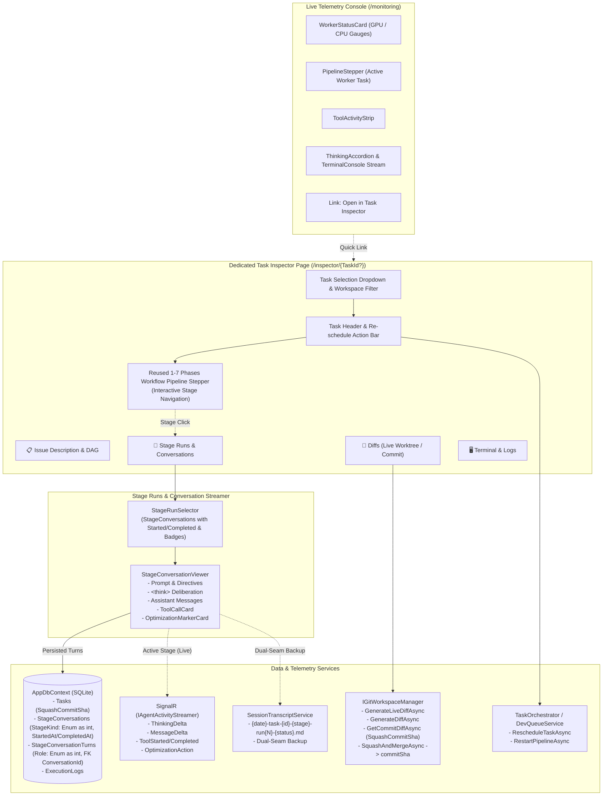

# ⚡ Step 5.13: Task Execution Inspector, Stage Conversations & Optimization Markers

> **Phase 5 Implementation Step**  
> *Parent Plan:* [Phase 5 Master Plan](../05_BLAZOR_WEB_UI_AND_TELEMETRY.md) | *Preceding Step:* [Step 5.12: Dev Queue & Lock Inspector](STEP_5_12_DEV_QUEUE_AND_LOCK_INSPECTOR.md)  
> *Project Target:* `src/NightCodeForge.Web/Components/Pages/TaskInspector.razor`, `src/NightCodeForge.Web/Components/Monitoring`, `Pages/Monitoring.razor`, `NightCodeForge.Core`, `NightCodeForge.Agents`, `NightCodeForge.Infrastructure` | *Status:* Complete

---

## 1. Executive Objective

Replace the lossy, volatile terminal console and ephemeral thought stream with a persistent, high-fidelity **Task Execution Inspector & Conversation Room**, delivered as a **dedicated page (`/inspector/{TaskId?}`)** alongside the real-time **Live Telemetry & Monitoring Console (`/monitoring`)**. 

The dedicated page decouples historical task inspection from active worker stream telemetry and prominently **reuses the 1-7 phases workflow pipeline graph (`PipelineStepper`)** for the inspected task:

1. **Dedicated Task Inspector Page (`Pages/TaskInspector.razor` @ `/inspector/{TaskId:int?}`):**
   - Independent route and top-level sidebar navigation under *Execution* (`🔎 Task Inspector`).
   - Task switcher toolbar with dropdown of all tasks, workspace filter, and quick shortcut to switch to the active running task.
   - Clean decoupling from `Monitoring.razor`, which remains purely focused on real-time active worker gauges, live tool activity, reasoning deliberation, and streaming terminal output.
2. **Reused 1-7 Phases Workflow Pipeline Graph (`PipelineStepper`):**
   - Reused directly inside the task inspector, reflecting the task's progress across all 7 stages (ForgeTask Review, Pre-Impl Baseline, Implementation, Post-Impl Gates, Code Review, Post-Review Verification, Merge Resolution).
   - Dynamically renders status for historical, finished (`Closed`/`Ready`), failed, or in-flight tasks based on task overall status and `StageConversations`.
   - Interactive stage selection: clicking any stage on the 1-7 stepper automatically navigates to that stage's conversation in the viewer.
3. **Relational Database Persistence for Conversations & Runs (`StageConversation` & `StageConversationTurn` in SQLite):**
   - Clean, normalized domain model with `StageConversation` representing each stage attempt with `StartedAt` and `CompletedAt` timestamps.
   - Strongly typed enums stored as integers in SQLite: `WorkflowStageKind` (`Agentic = 0, Deterministic = 1`) on `StageConversation` and `StageTurnRole` (`User = 0, Assistant = 1...`) on `StageConversationTurn`.
   - `StageConversationTurn` simplified with a direct foreign key to `ConversationId` and `TurnIndex`.
   - Complete historical inspectability across application restarts, worker restarts, or browser reloads.
4. **Full Issue Specification & DAG Context:** Markdown task description, acceptance criteria, branch tracking, and dependency readiness.
5. **Multi-Attempt Stage Runs & Turn-by-Turn Conversations:**
   - Sequential stage run hierarchy tracking each attempt (e.g., `Implementation [Run 1] -> Review Rejected -> Implementation [Run 2]`).
   - Turn-by-turn conversation viewer rendering prompt, thinking deliberation (`<think>` trace), assistant markdown, tool invocations, and optimization markers.
   - Deterministic stages modeled as synthetic single-turn conversations (`exec_command`, CLI output, metrics).
6. **Live & Historical Diff Viewer:**
   - Worktree diff against base branch for running tasks; full cumulative squash commit diff (`SquashCommitSha`) for finished tasks.
7. **Actionable Task Re-scheduling & Recovery:**
   - One-click task retry/re-enqueue to `ITaskJobQueue` / Hangfire.
   - Restart from Stage 1 or reset dirty worktree state.

---

## 2. Root Cause Analysis of Terminal Stream Loss

Audit of `Monitoring.razor`, `TerminalConsole.razor`, and `CrucibleAgentHarness.cs` identified four distinct failure points:

| Issue | Root Cause | Impact |
| :--- | :--- | :--- |
| **`TaskId = 0` in Tracing Client** | `CrucibleAgentHarness.cs` initialized `new ThinkingAndActivityTracingChatClient(baseClient)` without passing `taskId`, defaulting to `0`. | SignalR events routed to `task-0`; UI listening to `task-{id}` received nothing. |
| **Volatile In-Memory UI State & No DB Persistence for Turns** | `TerminalConsole.razor` kept logs in private field `List<TerminalLog> _logs`. `ThinkingAccordion.razor` kept thoughts in `string _content`. Neither persisted conversation turns to EF Core. | Any component re-render, filter switch, or route change completely wiped logs. |
| **Discarded Assistant Tokens** | `ThinkingAccordion.AppendToken` toggled `_isStreaming = false` when `isThinking == false` without appending text tokens anywhere. | Agent responses were completely dropped in the UI. |
| **Worker Idle Flip Filter Gap** | When Hangfire completed a stage and queued the next, worker transitioned to `Idle` (`ActiveTaskId = null`), causing `Monitoring.razor` to filter out or reset terminal buffers. | Logs vanished between stages during normal autonomous execution. |

---

## 3. Architecture & Data Flow



---

## 4. Technical Design Specifications

### 4.1 Database & Domain Layer (`NightCodeForge.Core` & `NightCodeForge.Infrastructure`)

1. **Enums (`NightCodeForge.Core/Domain/Enums.cs`):**
   - Existing: `public enum WorkflowStageKind { Agentic = 0, Deterministic = 1 }`
   - New:
     ```csharp
     /// <summary>
     /// Categorical role of an event or message within a stage conversation.
     /// </summary>
     public enum StageTurnRole
     {
         User = 0,
         Assistant = 1,
         Thinking = 2,
         Tool = 3,
         ToolResult = 4,
         Optimization = 5,
         System = 6
     }
     ```

2. **New Database Entity: `StageConversation` (`NightCodeForge.Core/Domain/StageConversation.cs`):**
   ```csharp
   public class StageConversation
   {
       public int Id { get; set; }
       public int TaskId { get; set; }
       public string StageId { get; set; } = string.Empty;
       public WorkflowStageKind StageKind { get; set; } = WorkflowStageKind.Agentic; // Enum stored as int
       public int AttemptIndex { get; set; } = 1;
       public string? AgentProfileId { get; set; }
       public string? HarnessId { get; set; }
       public string? ModelName { get; set; }
       public DateTime StartedAt { get; set; } = DateTime.UtcNow;
       public DateTime? CompletedAt { get; set; }
       public StageExecutionStatus Status { get; set; } = StageExecutionStatus.Pending;
       public string? Summary { get; set; }
       public string? TranscriptFileName { get; set; }

       public ForgeTask? ForgeTask { get; set; }
       public ICollection<StageConversationTurn> Turns { get; set; } = new List<StageConversationTurn>();
   }
   ```

3. **New Database Entity: `StageConversationTurn` (`NightCodeForge.Core/Domain/StageConversationTurn.cs`):**
   ```csharp
   public class StageConversationTurn
   {
       public int Id { get; set; }
       public int ConversationId { get; set; }
       public int TurnIndex { get; set; }
       public StageTurnRole Role { get; set; } = StageTurnRole.User; // Enum stored as int
       public string Content { get; set; } = string.Empty;
       public string? ThinkingTrace { get; set; }
       public string? ToolName { get; set; }
       public string? ToolArguments { get; set; }
       public string? ToolResult { get; set; }
       public int? DurationMs { get; set; }
       public bool IsError { get; set; }
       public string? MetadataJson { get; set; }
       public DateTime Timestamp { get; set; } = DateTime.UtcNow;

       public StageConversation? Conversation { get; set; }
   }
   ```

4. **Entity Updates:**
   - In `ForgeTask.cs`:
     - Add `public ICollection<StageConversation> StageConversations { get; set; } = new List<StageConversation>();`
     - Add `public string? SquashCommitSha { get; set; }` to remember the commit ID generated by squash & merge for finished tasks.

5. **EF Core Configuration (`AppDbContext.cs`):**
   - Add `public DbSet<StageConversation> StageConversations => Set<StageConversation>();`
   - Add `public DbSet<StageConversationTurn> StageConversationTurns => Set<StageConversationTurn>();`
   - Configure conversions:
     - `b.Property(c => c.StageKind).HasConversion<int>();`
     - `b.Property(t => t.Role).HasConversion<int>();`
     - `b.Property(i => i.SquashCommitSha).HasMaxLength(64);`
   - Configure foreign keys with cascade delete:
     - Index on `(ConversationId, TurnIndex)`.
     - Index on `(TaskId, StageId, AttemptIndex)`.

6. **Repository Extensions (`ITaskRepository.cs` & `EfCoreTaskRepository.cs`):**
   - `Task<StageConversation> StartStageConversationAsync(int taskId, string stageId, WorkflowStageKind stageKind, int attemptIndex, string? profileId = null, string? harnessId = null, string? modelName = null, CancellationToken cancellationToken = default);`
   - `Task CompleteStageConversationAsync(int conversationId, StageExecutionStatus status, string? summary = null, string? transcriptFileName = null, CancellationToken cancellationToken = default);`
   - `Task<StageConversationTurn> AddConversationTurnAsync(int conversationId, StageTurnRole role, string? content = null, string? thinkingTrace = null, string? toolName = null, string? toolArguments = null, string? toolResult = null, long? durationMs = null, bool isError = false, string? metadataJson = null, CancellationToken cancellationToken = default);`
   - `Task<IReadOnlyList<StageConversation>> GetStageConversationsAsync(int taskId, CancellationToken cancellationToken = default);`
   - `Task<StageConversation?> GetStageConversationWithTurnsAsync(int conversationId, CancellationToken cancellationToken = default);`

7. **`AgentActivityKind` Enum Extension:**
   Add `OptimizationAction` to represent context compactions, tool result pruning, and loop interventions.

8. **`IGitWorkspaceManager` Live & Finished Diff Contracts:**
   ```csharp
   Task<string> GenerateLiveDiffAsync(Workspace workspace, int taskId, string baseBranch, CancellationToken cancellationToken = default);
   Task<string> GetCommitDiffAsync(Workspace workspace, string commitSha, CancellationToken cancellationToken = default);
   Task<string> SquashAndMergeAsync(Workspace workspace, int taskId, string baseBranch, string commitMessage, CancellationToken cancellationToken = default);
   ```

### 4.2 Agent Harness & Optimization Instrumentation (`NightCodeForge.Agents`)

1. **Tracing ChatClient Initialization:**
   In `CrucibleAgentHarness.cs` (and `PiRpcAgentHarness`, `AcpAgentHarness`):
   ```csharp
   var tracingClient = new ThinkingAndActivityTracingChatClient(
       baseClient,
       onEntry: null,
       activityStreamer: _activityStreamer,
       sessionId: sessionId,
       taskId: context.ForgeTask.Id,
       stageId: context.StageId);
   ```

2. **Stage Lifecycle & Real-Time Turn Persistence:**
   - At stage start: `var conversation = await _taskRepository.StartStageConversationAsync(context.ForgeTask.Id, context.StageId, WorkflowStageKind.Agentic, attemptIndex, ...)`.
   - As each turn completes in the agent loop or when tool results return:
     - Persist `StageConversationTurn` linked to `conversation.Id` with `Role = StageTurnRole.Assistant`, `StageTurnRole.Tool`, etc.
   - When an optimization action occurs (tool result truncation, thinking trace pruning):
     - Broadcast `OptimizationAction` via `IAgentActivityStreamer`.
     - Persist an `OPTIMIZATION` turn (`Role = StageTurnRole.Optimization`) in `StageConversationTurns`.
   - At stage completion: `await _taskRepository.CompleteStageConversationAsync(conversation.Id, ...)`.

3. **Deterministic Stage Persistence:**
   In `DeterministicBuildStage`, `DeterministicTestStage`, `DeterministicCoverageGate`, etc.:
   - Start `StageConversation` (`StageKind = WorkflowStageKind.Deterministic`).
   - Persist a `USER` prompt turn (`Role = StageTurnRole.User`, "Execute project build and quality checks").
   - Persist a `TOOL` turn (`Role = StageTurnRole.Tool`, tool name `exec_command`, CLI command arguments, stdout/stderr result, exit code, and execution time).
   - Persist an `ASSISTANT` turn (`Role = StageTurnRole.Assistant`, extracted compiler diagnostics or test summary).
   - Complete `StageConversation`.

### 4.3 SignalR Telemetry Bridge (`NightCodeForge.Infrastructure`)

1. **`IOrchestratorHubClient`:**
   Add `ReceiveOptimizationAction(int taskId, string stageId, string actionType, string description, DateTime timestamp)`.
2. **`SignalRActivityBridgeService`:**
   Route `AgentActivityKind.OptimizationAction` to task group SignalR clients.

### 4.4 Web UI Components (`NightCodeForge.Web`)

1. **`Pages/TaskInspector.razor` (Dedicated Inspector Page @ `/inspector/{TaskId:int?}`):**
   - Independent page component under `src/NightCodeForge.Web/Components/Pages/TaskInspector.razor`.
   - Top action toolbar with task selector dropdown, active running task shortcut button (`⚡ Switch to Running Task`), and workspace context pill.
   - Synchronizes URL route `/inspector/{TaskId}` with selected task.
   - Embeds `<TaskExecutionInspector TaskId="_inspectedTaskId.Value" />` for full interactive inspection.
2. **`Components/Monitoring/PipelineStepper.razor` (Reused 1-7 Phases Workflow Graph):**
   - Reused inside both `Monitoring.razor` (for active worker stream) and `TaskExecutionInspector.razor` (for historical/inspected tasks).
   - Enhanced with `OverallStatus` (`TaskOverallStatus?`), `Conversations` (`IEnumerable<StageConversation>?`), and `OnStageSelected` (`EventCallback<string>`).
   - Automatically maps finished tasks (`Closed` -> all 7 completed, `Ready` -> 1..6 completed, 7 gate passed), failed tasks, and attempts from SQLite conversations.
   - Interactive stage navigation: clicking any stage step raises `OnStageSelected`, switching the inspector directly to that stage's conversation in the viewer.
3. **`Components/Monitoring/TaskExecutionInspector.razor`:**
   Master inspector layout for the selected task:
   - **Header Bar**: Task Title, Status, Priority, Feature/Base Branches, Squash Commit SHA, and Action Buttons (`Retry Stage`, `Restart Pipeline`, `Refresh`).
   - **1-7 Phases Workflow Pipeline Stepper**: Reused `<PipelineStepper>` embedded directly under the header bar with interactive stage navigation.
   - **Tab 1: Stage Runs & Conversations**:
     - `StageRunSelector.razor`: Vertical stepper of all stage attempts (`Run 1`, `Run 2`...) loaded from `StageConversations` in SQLite with `StartedAt` / `CompletedAt` and outcome badges.
     - `StageConversationViewer.razor`: Turn-by-turn conversation loaded from `StageConversationTurns` in SQLite, updated via SignalR when active:
       - User prompt bubble.
       - Collapsible `<think>` deliberation trace with live typing cursor.
       - Markdown assistant messages.
       - `ToolCallCard.razor`.
       - `OptimizationMarkerCard.razor`.
   - **Tab 2: Overview & Issue**: Full markdown description, acceptance criteria, clarification questions & answers.
   - **Tab 3: Diff & Changed Files**:
     - Live worktree diff (if running) or squashed commit diff (if finished) powered by `DiffViewer.razor`.
   - **Tab 4: Terminal & Logs**:
     - Embedded `TerminalConsole.razor` hydrated from `task.ExecutionLogs` and streaming live orchestrator/tool events.
4. **`Components/Monitoring/OptimizationMarkerCard.razor`:**
   Distinctive card rendering optimization interventions (Tool Compaction, Thinking Trace Pruning, Circuit Breaker).
5. **Sidebar Navigation & Deep Linking:**
   - Dedicated `Task Inspector` entry in `NavMenu.razor` under the *Execution* section.
   - Deep-link "Inspect Execution" buttons on `TaskDetailDrawer.razor`, `QuestionCard.razor`, `DevQueueTable.razor`, and `FailedJobsTable.razor` routed directly to `/inspector/{TaskId}`.
   - Quick-link on `Monitoring.razor` header to jump into Task Inspector for the currently executing task.

---

## 5. Verification & Test Plan

1. **Database & Repository Tests:**
   - `AppDbContextTests`: Verify `StageConversations` and `StageConversationTurns` table creation, integer conversions for `WorkflowStageKind` and `StageTurnRole`, foreign keys, and cascade deletion.
   - `TaskRepositoryTests`: Verify `StartStageConversationAsync`, `AddConversationTurnAsync`, `CompleteStageConversationAsync`, and query filtering.
2. **Unit Tests:**
   - `CrucibleAgentHarnessTests`: Verify `TaskId` propagates to `ThinkingAndActivityTracingChatClient`, stage conversation and turns are saved to DB with `StageTurnRole` and `WorkflowStageKind` enums, and SignalR activity events fire.
   - `ToolResultCompactorTests`: Verify optimization callback triggers when tools exceed verbatim count and saves `StageTurnRole.Optimization` turn.
   - `GitWorkspaceManagerTests`: Verify `GenerateLiveDiffAsync` returns uncommitted worktree changes.
   - `TaskOrchestratorTests`: Verify `RescheduleTaskAsync` resets status and re-enqueues to `ITaskJobQueue`.
3. **Component Tests (BUnit):**
   - `TaskInspectorPageTests`: Verify dedicated page rendering, route parameter binding `/inspector/{TaskId}`, task selector dropdown switching, active task resolution, and empty state.
   - `TaskExecutionInspectorTests`: Verify rendering of 1-7 PipelineStepper, tab switching between Conversations, Overview, Diff, and Terminal, and stage click navigation.
   - `StageRunSelectorTests`: Verify rendering of multi-run stage hierarchy from `StageConversations`.
   - `StageConversationViewerTests`: Verify turns, live token streaming, and optimization marker display.
   - `MonitoringPageTests`: Verify all 5 core live telemetry components (WorkerStatusCard, PipelineStepper, ToolActivityStrip, ThinkingAccordion, TerminalConsole) remain functional without embedded inspector clutter.
4. **E2E Integration Validation:**
   - Execute an end-to-end task run with an intentional quality-gate loopback (e.g. Implementation Run 1 -> Deterministic Build Fails -> Implementation Run 2 -> Build Passes).
   - Verify both attempts appear as distinct conversations in the UI and are fully preserved in SQLite with proper start/end timestamps and on disk.
