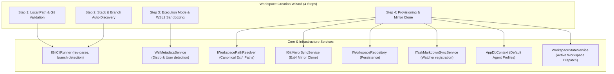

# 🧙 Step 5.1b: Workspace Provisioning & Creation Wizard

> **Phase 5 Implementation Step**  
> *Parent Plan:* [Phase 5 Master Plan](../05_BLAZOR_WEB_UI_AND_TELEMETRY.md) | *Preceding Step:* [Step 5.1: Design System & Layout](STEP_5_1_DESIGN_SYSTEM_AND_LAYOUT.md) | *Next Step:* [Step 5.2: SignalR Telemetry](STEP_5_2_SIGNALR_TELEMETRY_INFRASTRUCTURE.md)  
> *Project Target:* `src/NightCodeForge.Web/Components/Workspaces` & `src/NightCodeForge.Web/Services` | *Status:* Completed

---

## 1. Executive Objective & The "Blank Slate" Problem

Provide a streamlined, developer-grade **Workspace Creation & Onboarding Wizard** that guides users through configuring new or existing software repositories into NightCodeForge.

### The "Blank Slate" Gap:
On a fresh installation with an empty SQLite database:
1. `WorkspaceState.ActiveWorkspace` is `null`.
2. The TopNavBar workspace selector displays a disabled `No Workspaces Found` placeholder with no action to add one.
3. Every downstream page (`/ideation`, `/backlog`, `/monitoring`, `/review`) is non-functional or disabled because all orchestrator pipelines, ideation chats, and git worktrees require an active workspace context.

Creating a workspace in NightCodeForge is **not a simple database insert**: it requires probing local repository capabilities, configuring cross-platform execution boundaries (WSL2 on Windows), cloning an isolated Ext4 mirror at `~/.nightcodeforge/wks/{id}`, creating the `docs/tasks/` folder, spinning up the markdown sync watcher, and seeding baseline `AgentProfile`s.



---

## 2. Core Capabilities & Step Decomposition

### Step 1: Repository Path & Git Validation
- **Local Directory Probe:** User inputs or browses to a local repository path (e.g. `C:\Users\Julien\source\repos\my-app` or `/home/user/repos/my-app`).
- **Live Git Verification:** Checks if the directory exists and contains a valid Git repository (`.git` directory or `git rev-parse --is-inside-work-tree`).
- **Init Option:** If the directory exists but has no Git repository, offers a one-click `Initialize Git Repository` (`git init`) action.
- **Friendly Name Suggestion:** Defaults the workspace name to the folder name (e.g. `my-app`).

### Step 2: Stack & Branch Auto-Discovery
- **Default Base Branch Discovery:** Probes active git branches (`main`, `master`, `develop`) and selects the default base branch.
- **Code Stack & Toolchain Heuristics:** Scans root project descriptors to identify the technology stack and suggest default test/build timeouts:
  - `.sln` / `*.csproj` $\rightarrow$ **.NET / C#** (Build: `dotnet build`, Test: `dotnet test`, Timeout: 180s)
  - `package.json` $\rightarrow$ **Node.js / TypeScript** (Build: `npm run build`, Test: `npm test`, Timeout: 120s)
  - `Cargo.toml` $\rightarrow$ **Rust** (Build: `cargo build`, Test: `cargo test`, Timeout: 240s)
  - `pyproject.toml` / `requirements.txt` $\rightarrow$ **Python** (Test: `pytest`, Timeout: 90s)
  - `go.mod` $\rightarrow$ **Go** (Build: `go build ./...`, Test: `go test ./...`, Timeout: 90s)
- **Guideline Discovery:** Checks for existing `AGENTS.md`, `.agents/AGENTS.md`, or `CLAUDE.md` to indicate agent awareness.

### Step 3: Execution Mode & Environment Configuration
- **Host Platform Analysis:** Evaluates operating system:
  - **On Windows:** Enforces mandatory WSL2 for Unix agent confinement. Displays probed default WSL2 distribution (e.g. `Ubuntu`) via `IWslMetadataService`.
- **Execution Mode Selection:**
  - `ContainerSandbox` (Recommended / Default): Ephemeral container with read-only host mounts and bind-mounted package caches (`~/.nuget`, `~/.npm`).
  - `WslDirect`: Direct bash execution in targeted WSL2 distribution (`wsl.exe -d Ubuntu`).
  - `BareHost`: Direct host CLI (with prominent warning if on Windows due to POSIX agent requirements).
- **Timeouts:** Customizable `BuildTimeoutSeconds` and `TestTimeoutSeconds` (default: 180s).
- **Dedicated Agent Profiles Opt-In (Checkbox):**
  - `[ ] Configure dedicated agent profiles for this workspace` (Default: **Unchecked**).
  - **By default**, the workspace inherits the **Global System Agent Profiles** (`WorkspaceId == null`). No private profile rows are created in the database.
  - **If checked (opt-in)**: An expandable card allows specifying a dedicated model (pre-filled with `appsettings.json` or selected via `IOllamaModelCatalogService`) to clone dedicated workspace-scoped profiles (`WorkspaceId = workspace.Id`).

### Step 4: Automated Provisioning & Mirror Clone
Upon clicking **"Provision Workspace"**, an asynchronous progress stepper executes:
1. **Database Persistence:** Inserts the `Workspace` entity into SQLite via `IWorkspaceRepository.CreateAsync()`.
2. **Canonical Ext4 Mirror Setup:** Calls `IGitMirrorSyncService.InitializeMirrorAsync(workspace, targetMirrorDir)` to clone the isolated working clone into `~/.nightcodeforge/wks/{workspaceId}` (inside WSL2 on Windows) and sets `checkout.defaultRemote` to `host-origin`.
3. **Directory Scaffolding:** Creates `<WorkspaceRoot>/docs/tasks/` if not present.
4. **Markdown Watcher Registration:** Registers the repository path with `ITaskMarkdownSyncService.StartWatching(workspace.Id, workspace.RepositoryPath)`.
5. **Global / Dedicated Profile Resolution:**
   - Verifies that the 5 global standard profiles (`triage`, `ideation`, `task-review`, `implementation`, `code-review-fix` with `WorkspaceId == null`) exist in SQLite. If missing (e.g. fresh database), seeds them using `LlmProvider:ModelId` from `appsettings.json`.
   - **Only if `UseDedicatedAgentProfiles == true`**: Seeds dedicated workspace copies (`WorkspaceId = workspace.Id`) customized with the user's selected model.
6. **Active Workspace Dispatch:** Sets the new workspace as active in `WorkspaceStateService` and emits toast confirmation.

---

## 3. Global-First Profile Architecture & UI Tuning

### 3.1 Global-First Resolution Hierarchy
Agent profiles are **global by default**. When a pipeline stage or service resolves an agent profile:

```mermaid
flowchart TD
    Start["Stage Execution (e.g. 'implementation')"] --> CheckDedicated{"Workspace has dedicated\nprofile for stage?"}
    CheckDedicated -->|Yes (Opt-in)| UseDedicated["Use Workspace Profile\n(WorkspaceId == ws.Id)"]
    CheckDedicated -->|No (Default)| CheckGlobal{"Global profile exists\nfor stage?"}
    CheckGlobal -->|Yes| UseGlobal["Use Global System Profile\n(WorkspaceId == null)"]
    CheckGlobal -->|No| HardcodedFallback["Fallback to hardcoded defaults"]
```

1. **Workspace-Specific Override:** Looks in `workspace.AgentProfiles` where `WorkspaceId == workspace.Id` and `Id` matches the stage.
2. **Global System Profile:** Falls back to the global profile where `WorkspaceId == null` and `Id` matches the stage.
3. **Hardcoded Fallback:** Baseline emergency profile if the database table is completely unseeded.

### 3.2 The 5 Standard System Profiles
The system maintains 5 standard stage-matched profiles:

| Profile ID (`Id`) | Stage Name | Mode | Sandbox Security Tier | Permitted Tools | Optimization Flags |
| :--- | :--- | :--- | :--- | :--- | :--- |
| **`triage`** | Stage 0 Untrusted Intake Triage | `ReadOnly` | `RestrictedReadOnly` (`:ro`, `--network none`) | `read`, `bash`, `web_search`, `propose_tasks` | Baseline |
| **`ideation`** | Ideation & Discovery Chat | `ReadOnly` | `Standard` | `read`, `bash`, `web_search`, `propose_tasks` | Baseline |
| **`task-review`** | Issue / ForgeTask Review | `ReadOnly` | `Standard` | `read`, `bash`, `propose_tasks` | `ThinkingTraceCompaction`, `DeterministicSymbolMap` |
| **`implementation`** | Code & Test Implementation | `Full` | `Standard` | `read`, `write`, `edit`, `bash`, `ask` | All 7 `LocalOptimizationFlags` |
| **`code-review-fix`** | Post-Implementation Review | `Full` | `Standard` | `read`, `write`, `edit`, `bash`, `ask` | All 7 `LocalOptimizationFlags` |

### 3.3 UI Profile Tuning & Scope Switching (`Settings.razor` -> Step 5.8)
In **Step 5.8: Settings, Host SDKs & A/B Testing** ([`STEP_5_8_SETTINGS_HOST_SDKS_AND_AB_TESTING.md`](STEP_5_8_SETTINGS_HOST_SDKS_AND_AB_TESTING.md)), the `AgentProfilesTab.razor` UI provides:
- **Scope Toggle:**
  - 🌐 **Global System Defaults** *(Default)*: Changes made here (model, temperature, thinking budget, optimization toggles) immediately apply across all workspaces that use global profiles.
  - 🏢 **Workspace Overrides ({ActiveWorkspace.Name})**: Allows developers to detach from the global defaults and customize dedicated profiles for the active repository, or click `"Revert to Global Defaults"` to delete dedicated overrides.
- **Model Tuning:** Dropdown dynamically populated with installed models via `IOllamaModelCatalogService.GetAvailableModelsAsync()`.
- **7 Optimization Toggles:** Independent reactive switches for each local LLM optimization flag.

---

## 4. Data Contracts & Models

### 4.1 Workspace Creation Form Model (`Models/WorkspaceCreationModel.cs`)

```csharp
using System.ComponentModel.DataAnnotations;
using NightCodeForge.Core.Domain;

namespace NightCodeForge.Web.Models;

public class WorkspaceCreationModel
{
    [Required(ErrorMessage = "Workspace name is required")]
    [StringLength(100, MinimumLength = 2, ErrorMessage = "Name must be between 2 and 100 characters")]
    public string Name { get; set; } = string.Empty;

    [Required(ErrorMessage = "Repository directory path is required")]
    public string RepositoryPath { get; set; } = string.Empty;

    [Required(ErrorMessage = "Default base branch is required")]
    public string DefaultBaseBranch { get; set; } = "main";

    public ExecutionMode ExecutionMode { get; set; } = ExecutionMode.ContainerSandbox;

    public string? ContainerImage { get; set; } = "nightcodeforge-agent:latest";

    public string? WslDistribution { get; set; }

    [Range(30, 1800, ErrorMessage = "Build timeout must be between 30 and 1800 seconds")]
    public int BuildTimeoutSeconds { get; set; } = 180;

    [Range(30, 1800, ErrorMessage = "Test timeout must be between 30 and 1800 seconds")]
    public int TestTimeoutSeconds { get; set; } = 180;

    /// <summary>
    /// If false (default), the workspace inherits global system agent profiles (WorkspaceId == null).
    /// If true, creates dedicated workspace-scoped profiles (WorkspaceId == workspace.Id).
    /// </summary>
    public bool UseDedicatedAgentProfiles { get; set; } = false;

    /// <summary>
    /// Custom model name override if UseDedicatedAgentProfiles is true.
    /// </summary>
    public string? DedicatedModelName { get; set; }
}
```

### 4.2 Repository Probe Result (`Models/RepositoryProbeResult.cs`)

```csharp
namespace NightCodeForge.Web.Models;

public record RepositoryProbeResult(
    bool Exists,
    bool IsGitRepository,
    string? SuggestedName,
    IReadOnlyList<string> AvailableBranches,
    string DetectedBaseBranch,
    string DetectedTechStack,
    bool HasAgentsMarkdown,
    string? WarningMessage);
```

### 4.3 Workspace Provisioning Service Interface (`Services/IWorkspaceProvisioningService.cs`)

```csharp
using NightCodeForge.Core.Domain;
using NightCodeForge.Web.Models;

namespace NightCodeForge.Web.Services;

public interface IWorkspaceProvisioningService
{
    /// <summary>
    /// Probes a local file system path for Git repository structure, branches, and tech stack markers.
    /// </summary>
    Task<RepositoryProbeResult> ProbeRepositoryAsync(string directoryPath, CancellationToken cancellationToken = default);

    /// <summary>
    /// Initializes a Git repository in an existing directory if one does not exist.
    /// </summary>
    Task<bool> InitializeGitRepositoryAsync(string directoryPath, CancellationToken cancellationToken = default);

    /// <summary>
    /// Executes the complete workspace onboarding pipeline: persistence, Ext4 mirror clone,
    /// directory scaffolding, default agent profiles, and markdown watcher startup.
    /// </summary>
    Task<Workspace> ProvisionWorkspaceAsync(
        WorkspaceCreationModel model, 
        IProgress<string>? progress = null, 
        CancellationToken cancellationToken = default);
}
```

---

## 5. Component Specification & UI Layout

### 5.1 Component Tree & File Placements

```text
src/NightCodeForge.Web/
├── Components/
│   ├── Workspaces/
│   │   ├── WorkspaceCreationWizardModal.razor       # Full 4-step wizard modal
│   │   ├── WorkspaceEmptyStateHero.razor            # First-run CTA banner when no workspaces exist
│   │   └── Steps/
│   │       ├── WizardStep1PathProbe.razor           # Directory & git probe
│   │       ├── WizardStep2StackBranch.razor         # Stack & branch detection
│   │       ├── WizardStep3Environment.razor         # Execution mode & WSL2
│   │       └── WizardStep4Provisioning.razor        # Async progress & summary
│   └── Layout/
│       └── TopNavBar.razor                          # "+ New Workspace" action button
└── Services/
    ├── IWorkspaceProvisioningService.cs
    └── WorkspaceProvisioningService.cs
```

### 4.2 Modal UI Wireframe (`WorkspaceCreationWizardModal.razor`)

```razor
@using NightCodeForge.Core.Domain
@using NightCodeForge.Web.Models
@using NightCodeForge.Web.Services
@inject IWorkspaceProvisioningService ProvisioningService
@inject WorkspaceStateService WorkspaceState
@inject ToastService ToastService

@if (IsOpen)
{
    <div class="forge-modal-backdrop" @onclick="HandleBackdropClick">
        <div class="forge-modal-card wizard-card" @onclick:stopPropagation>
            <!-- Wizard Header & Step Indicator -->
            <div class="wizard-header">
                <div class="wizard-header-title">
                    <span class="wizard-title-icon">🧙</span>
                    <div>
                        <h3>Workspace Provisioning Wizard</h3>
                        <p class="text-secondary">Onboard a local Git repository into NightCodeForge.</p>
                    </div>
                </div>
                <button type="button" class="forge-btn-close" @onclick="Close">✕</button>
            </div>

            <!-- Stepper Progress Header -->
            <div class="wizard-stepper">
                <div class="step-node @(_currentStep >= 1 ? "active" : "") @(_currentStep > 1 ? "completed" : "")">
                    <span class="step-num">1</span>
                    <span class="step-label">Repository</span>
                </div>
                <div class="step-connector @(_currentStep > 1 ? "completed" : "")"></div>
                <div class="step-node @(_currentStep >= 2 ? "active" : "") @(_currentStep > 2 ? "completed" : "")">
                    <span class="step-num">2</span>
                    <span class="step-label">Stack &amp; Branch</span>
                </div>
                <div class="step-connector @(_currentStep > 2 ? "completed" : "")"></div>
                <div class="step-node @(_currentStep >= 3 ? "active" : "") @(_currentStep > 3 ? "completed" : "")">
                    <span class="step-num">3</span>
                    <span class="step-label">Environment</span>
                </div>
                <div class="step-connector @(_currentStep > 3 ? "completed" : "")"></div>
                <div class="step-node @(_currentStep >= 4 ? "active" : "") @(_currentStep > 4 ? "completed" : "")">
                    <span class="step-num">4</span>
                    <span class="step-label">Provision</span>
                </div>
            </div>

            <!-- Wizard Step Body -->
            <div class="wizard-body">
                @switch (_currentStep)
                {
                    case 1:
                        <WizardStep1PathProbe Model="_model" 
                                              ProbeResult="_probeResult" 
                                              IsProbing="_isProbing"
                                              OnProbeRequested="HandleProbeAsync" 
                                              OnInitGitRequested="HandleInitGitAsync" />
                        break;
                    case 2:
                        <WizardStep2StackBranch Model="_model" 
                                                ProbeResult="_probeResult" />
                        break;
                    case 3:
                        <WizardStep3Environment Model="_model" />
                        break;
                    case 4:
                        <WizardStep4Provisioning ProgressMessage="_provisioningMessage" 
                                                 IsComplete="_isProvisioningComplete"
                                                 CreatedWorkspace="_createdWorkspace"
                                                 ErrorMessage="_provisioningError" />
                        break;
                }
            </div>

            <!-- Wizard Action Footer -->
            <div class="wizard-footer">
                @if (_currentStep > 1 && _currentStep < 4)
                {
                    <button type="button" class="forge-btn forge-btn-secondary" @onclick="GoPrevious">
                        ← Back
                    </button>
                }
                <div class="flex-spacer"></div>
                @if (_currentStep < 3)
                {
                    <button type="button" 
                            class="forge-btn forge-btn-primary" 
                            @onclick="GoNext" 
                            disabled="@(!CanProceedFromStep(_currentStep))">
                        Continue →
                    </button>
                }
                else if (_currentStep == 3)
                {
                    <button type="button" 
                            class="forge-btn forge-btn-primary font-bold" 
                            @onclick="ExecuteProvisioningAsync">
                        🚀 Provision Workspace
                    </button>
                }
                else if (_isProvisioningComplete)
                {
                    <button type="button" class="forge-btn forge-btn-primary" @onclick="FinishAndOpenWorkspace">
                        Open Workspace in Forge ➔
                    </button>
                }
            </div>
        </div>
    </div>
}
```

---

## 6. UI Triggers & Integration Points

### 6.1 Top Navigation Bar Trigger (`Components/Layout/TopNavBar.razor`)
Add a persistent `[➕ New Workspace]` button immediately adjacent to the dropdown selector:

```razor
<div class="workspace-select-wrapper">
    <span class="workspace-select-icon">📁</span>
    <select class="workspace-dropdown" value="@(WorkspaceState.ActiveWorkspaceId?.ToString() ?? "")" @onchange="OnWorkspaceSelected">
        @if (_workspaces.Count == 0)
        {
            <option value="" disabled selected>No Workspaces Found</option>
        }
        else
        {
            @foreach (var ws in _workspaces)
            {
                <option value="@ws.Id">@ws.Name</option>
            }
        }
    </select>
    <button type="button" 
            class="forge-btn-icon-addon" 
            title="Create or onboard a new workspace" 
            @onclick="() => _showWizard = true">
        ➕
    </button>
</div>
```

### 6.2 First-Run Empty State Hero (`Components/Workspaces/WorkspaceEmptyStateHero.razor`)
When `WorkspaceState.ActiveWorkspace == null` (e.g. on `/` Home or `/ideation`):
Display a glassmorphic hero banner:

> **✨ Welcome to NightCodeForge**  
> No workspace is currently selected or configured. Onboard your local code repository to begin autonomous software engineering, interactive ideation, and visual DAG dependency planning.  
> `[🧙 Launch Workspace Creation Wizard]`

---

## 7. Verification & Test Plan

### 7.1 Unit & Integration Tests (`tests/NightCodeForge.Web.Tests/WorkspaceProvisioningServiceTests.cs`)
1. **Probe Non-Existent Directory:**
   - Call `ProbeRepositoryAsync` with an invalid directory path.
   - Assert `Exists == false` and descriptive warning returned.
2. **Probe Non-Git Directory:**
   - Call `ProbeRepositoryAsync` on a directory without `.git`.
   - Assert `IsGitRepository == false` and suggestion to initialize Git.
3. **Probe .NET Repository:**
   - Call `ProbeRepositoryAsync` on a directory with `.sln`.
   - Assert `DetectedTechStack == ".NET / C#"` and default branch resolved.
4. **End-to-End Workspace Provisioning:**
   - Call `ProvisionWorkspaceAsync` with valid `WorkspaceCreationModel`.
   - Verify `Workspace` record persisted to SQLite.
   - Verify Ext4 working mirror directory initialized.
   - Verify `docs/tasks/` folder created.
   - Verify default `AgentProfile`s created with workspace foreign key.
   - Verify `ITaskMarkdownSyncService.StartWatching` called.

---

## 8. Definition of Done (DoD) Checklist

- [x] `WorkspaceCreationModel.cs`, `RepositoryProbeResult.cs`, and `IWorkspaceProvisioningService` created.
- [x] `WorkspaceProvisioningService.cs` implemented and registered in `Program.cs`.
- [x] `WorkspaceCreationWizardModal.razor` created with 4-step stepper and live validation.
- [x] `TopNavBar.razor` updated with `[➕]` new workspace button that opens the wizard.
- [x] `WorkspaceEmptyStateHero.razor` created and displayed on `/` and `/ideation` when `_workspaces.Count == 0`.
- [x] Settings tab (`WorkspaceSettingsTab.razor`) provides a direct shortcut to launch the wizard.
- [x] Unit tests in `WorkspaceProvisioningServiceTests.cs` pass with 100% assertions satisfied.
