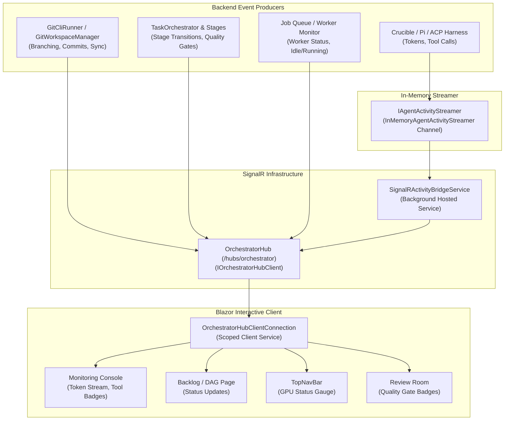

# ⚡ Step 5.2: SignalR Real-Time Telemetry Hub & Streaming Infrastructure

> **Phase 5 Implementation Step**  
> *Parent Plan:* [Phase 5 Master Plan](../05_BLAZOR_WEB_UI_AND_TELEMETRY.md) | *Preceding Step:* [Step 5.1b: Workspace Provisioning & Creation Wizard](STEP_5_1B_WORKSPACE_PROVISIONING_AND_CREATION_WIZARD.md) | *Next Step:* [Step 5.3: Ideation & Discovery Chat](STEP_5_3_IDEATION_AND_DISCOVERY_CHAT.md)  
> *Project Target:* `src/NightCodeForge.Infrastructure/Hubs` & `src/NightCodeForge.Web/Services` | *Status:* Completed

---

## 1. Executive Objective

Provide a robust, low-latency, bidirectional real-time communication pipeline connecting the backend orchestrator, Git runner, quality gate evaluators, and LLM agent harnesses directly to the Blazor interactive client components.

### Core Capabilities:
1. **Strongly Typed Hub Contract (`IOrchestratorHubClient`):** Eliminates stringly-typed client invocation mistakes. All telemetry events are typed records.
2. **Channel-to-SignalR Reactive Bridge:** A background hosted bridge that consumes events from `IAgentActivityStreamer` (the in-memory fan-out channel) and pushes them to SignalR clients and targeted task groups.
3. **Targeted Group Subscriptions:** Blazor pages subscribe to specific task streams (`JoinTaskGroup(taskId)`) to avoid inundating inactive views with high-frequency LLM token deltas, while broadcasting global worker state changes globally.
4. **Resilient Client Connection Wrapper (`OrchestratorHubClientConnection`):** Provides automated reconnection with exponential backoff, circuit breaking, connection state tracking (`Connected`, `Reconnecting`, `Disconnected`), and easy C# event delegates for Blazor components.

---

## 2. Event Flow & Architecture



---

## 3. Data Contracts & Interfaces

### 3.1 Hub Client Contract (`NightCodeForge.Infrastructure/Hubs/IOrchestratorHubClient.cs`)

```csharp
namespace NightCodeForge.Infrastructure.Hubs;

public interface IOrchestratorHubClient
{
    /// <summary>
    /// Live streaming of model reasoning thoughts (<think>) or answer text.
    /// </summary>
    Task ReceiveTokenDelta(int taskId, string token, bool isThinking);

    /// <summary>
    /// Tool execution notification (e.g. read, write, edit, bash, ask).
    /// </summary>
    Task ReceiveToolExecution(int taskId, string toolName, string arguments, string status, int? durationMs);

    /// <summary>
    /// Git operation telemetry (e.g. branch creation, WIP commit, fetch, push).
    /// </summary>
    Task ReceiveGitProgress(int taskId, string operation, string message);

    /// <summary>
    /// Global worker state change (Idle, Running, WaitingForHuman, Blocked).
    /// </summary>
    Task ReceiveWorkerStatus(string status, int? activeTaskId, string? stageId, string hardwareTarget);

    /// <summary>
    /// Pipeline advancement across agentic and deterministic stages.
    /// </summary>
    Task ReceiveStageTransition(int taskId, string stageId, string stageKind, string status);

    /// <summary>
    /// Differential quality gate outcomes (Coverage delta, Warning ratchet delta, Test assertions).
    /// </summary>
    Task ReceiveDeterministicGateResult(int taskId, string gateName, bool passed, string metricsSummary);

    /// <summary>
    /// Developer host tree dirty alert preventing push/merge.
    /// </summary>
    Task ReceiveHostDirtyAlert(int taskId, string branchName);

    /// <summary>
    /// Execution log line for real-time terminal streaming.
    /// </summary>
    Task ReceiveExecutionLog(int taskId, string stageId, string level, string message, DateTime timestamp);
}
```

### 3.2 SignalR Hub Implementation (`NightCodeForge.Infrastructure/Hubs/OrchestratorHub.cs`)

```csharp
using Microsoft.AspNetCore.SignalR;

namespace NightCodeForge.Infrastructure.Hubs;

public class OrchestratorHub : Hub<IOrchestratorHubClient>
{
    public static string GetTaskGroupName(int taskId) => $"task-{taskId}";

    public async Task JoinTaskGroup(int taskId)
    {
        await Groups.AddToGroupAsync(Context.ConnectionId, GetTaskGroupName(taskId));
    }

    public async Task LeaveTaskGroup(int taskId)
    {
        await Groups.RemoveFromGroupAsync(Context.ConnectionId, GetTaskGroupName(taskId));
    }
}
```

### 3.3 Activity Channel to SignalR Bridge (`NightCodeForge.Infrastructure/Hubs/SignalRActivityBridgeService.cs`)

A background `IHostedService` that subscribes to `IAgentActivityStreamer` and distributes events to `IHubContext<OrchestratorHub, IOrchestratorHubClient>`:

```csharp
using Microsoft.AspNetCore.SignalR;
using Microsoft.Extensions.Hosting;
using Microsoft.Extensions.Logging;
using NightCodeForge.Core.Streaming;

namespace NightCodeForge.Infrastructure.Hubs;

public class SignalRActivityBridgeService : BackgroundService
{
    private readonly IAgentActivityStreamer _streamer;
    private readonly IHubContext<OrchestratorHub, IOrchestratorHubClient> _hubContext;
    private readonly ILogger<SignalRActivityBridgeService> _logger;

    public SignalRActivityBridgeService(
        IAgentActivityStreamer streamer,
        IHubContext<OrchestratorHub, IOrchestratorHubClient> hubContext,
        ILogger<SignalRActivityBridgeService> logger)
    {
        _streamer = streamer;
        _hubContext = hubContext;
        _logger = logger;
    }

    protected override async Task ExecuteAsync(CancellationToken stoppingToken)
    {
        _logger.LogInformation("SignalRActivityBridgeService starting event subscription loop.");

        while (!stoppingToken.IsCancellationRequested)
        {
            try
            {
                await foreach (var evt in _streamer.SubscribeAsync(cancellationToken: stoppingToken))
                {
                    var groupName = OrchestratorHub.GetTaskGroupName(evt.TaskId);

                    switch (evt.Kind)
                    {
                        case AgentActivityKind.ThinkingDelta:
                            await _hubContext.Clients.Group(groupName)
                                .ReceiveTokenDelta(evt.TaskId, evt.Content, isThinking: true);
                            break;

                        case AgentActivityKind.MessageDelta:
                            await _hubContext.Clients.Group(groupName)
                                .ReceiveTokenDelta(evt.TaskId, evt.Content, isThinking: false);
                            break;

                        case AgentActivityKind.ToolStarted:
                            var toolName = evt.Metadata?.GetValueOrDefault("ToolName")?.ToString() ?? "tool";
                            await _hubContext.Clients.Group(groupName)
                                .ReceiveToolExecution(evt.TaskId, toolName, evt.Content, "Running", null);
                            break;

                        case AgentActivityKind.ToolCompleted:
                            var completedTool = evt.Metadata?.GetValueOrDefault("ToolName")?.ToString() ?? "tool";
                            var dur = evt.Metadata?.GetValueOrDefault("DurationMs") as int?;
                            await _hubContext.Clients.Group(groupName)
                                .ReceiveToolExecution(evt.TaskId, completedTool, evt.Content, "Completed", dur);
                            break;

                        case AgentActivityKind.StageStarted:
                        case AgentActivityKind.StageCompleted:
                            var status = evt.Kind == AgentActivityKind.StageStarted ? "Running" : "Completed";
                            var kind = evt.Metadata?.GetValueOrDefault("StageKind")?.ToString() ?? "Agentic";
                            await _hubContext.Clients.All
                                .ReceiveStageTransition(evt.TaskId, evt.StageId, kind, status);
                            break;

                        case AgentActivityKind.Interrupted:
                            await _hubContext.Clients.All
                                .ReceiveWorkerStatus("WaitingForHuman", evt.TaskId, evt.StageId, "Local GPU");
                            break;
                    }
                }
            }
            catch (OperationCanceledException) when (stoppingToken.IsCancellationRequested)
            {
                break;
            }
            catch (Exception ex)
            {
                _logger.LogError(ex, "Error occurred in SignalRActivityBridgeService; retrying in 2 seconds.");
                await Task.Delay(2000, stoppingToken);
            }
        }
    }
}
```

---

## 4. Client-Side Blazor SignalR Service (`NightCodeForge.Web/Services/OrchestratorHubClientConnection.cs`)

Manages the SignalR connection lifecycle in the Blazor server app:

```csharp
using Microsoft.AspNetCore.Components;
using Microsoft.AspNetCore.SignalR.Client;

namespace NightCodeForge.Web.Services;

public class OrchestratorHubClientConnection : IAsyncDisposable
{
    private readonly NavigationManager _navigationManager;
    private HubConnection? _hubConnection;

    public HubConnectionState State => _hubConnection?.State ?? HubConnectionState.Disconnected;

    public event Action<int, string, bool>? OnTokenDeltaReceived;
    public event Action<int, string, string, string, int?>? OnToolExecutionReceived;
    public event Action<int, string, string>? OnGitProgressReceived;
    public event Action<string, int?, string?, string>? OnWorkerStatusReceived;
    public event Action<int, string, string, string>? OnStageTransitionReceived;
    public event Action<int, string, bool, string>? OnDeterministicGateResultReceived;
    public event Action<int, string>? OnHostDirtyAlertReceived;
    public event Action<int, string, string, string, DateTime>? OnExecutionLogReceived;
    public event Action<HubConnectionState>? OnConnectionStateChanged;

    public OrchestratorHubClientConnection(NavigationManager navigationManager)
    {
        _navigationManager = navigationManager;
    }

    public async Task StartAsync()
    {
        if (_hubConnection != null && _hubConnection.State == HubConnectionState.Connected)
            return;

        var hubUrl = _navigationManager.ToAbsoluteUri("/hubs/orchestrator");
        _hubConnection = new HubConnectionBuilder()
            .WithUrl(hubUrl)
            .WithAutomaticReconnect(new[] { TimeSpan.Zero, TimeSpan.FromSeconds(2), TimeSpan.FromSeconds(5), TimeSpan.FromSeconds(10) })
            .Build();

        RegisterHandlers(_hubConnection);

        _hubConnection.Reconnecting += _ => { OnConnectionStateChanged?.Invoke(HubConnectionState.Reconnecting); return Task.CompletedTask; };
        _hubConnection.Reconnected += _ => { OnConnectionStateChanged?.Invoke(HubConnectionState.Connected); return Task.CompletedTask; };
        _hubConnection.Closed += _ => { OnConnectionStateChanged?.Invoke(HubConnectionState.Disconnected); return Task.CompletedTask; };

        await _hubConnection.StartAsync();
        OnConnectionStateChanged?.Invoke(HubConnectionState.Connected);
    }

    public async Task JoinTaskGroupAsync(int taskId)
    {
        if (_hubConnection?.State == HubConnectionState.Connected)
        {
            await _hubConnection.InvokeAsync("JoinTaskGroup", taskId);
        }
    }

    public async Task LeaveTaskGroupAsync(int taskId)
    {
        if (_hubConnection?.State == HubConnectionState.Connected)
        {
            await _hubConnection.InvokeAsync("LeaveTaskGroup", taskId);
        }
    }

    private void RegisterHandlers(HubConnection hub)
    {
        hub.On<int, string, bool>("ReceiveTokenDelta", (taskId, token, isThinking) =>
            OnTokenDeltaReceived?.Invoke(taskId, token, isThinking));

        hub.On<int, string, string, string, int?>("ReceiveToolExecution", (taskId, tool, args, status, dur) =>
            OnToolExecutionReceived?.Invoke(taskId, tool, args, status, dur));

        hub.On<int, string, string>("ReceiveGitProgress", (taskId, op, msg) =>
            OnGitProgressReceived?.Invoke(taskId, op, msg));

        hub.On<string, int?, string?, string>("ReceiveWorkerStatus", (status, taskId, stageId, target) =>
            OnWorkerStatusReceived?.Invoke(status, taskId, stageId, target));

        hub.On<int, string, string, string>("ReceiveStageTransition", (taskId, stageId, kind, status) =>
            OnStageTransitionReceived?.Invoke(taskId, stageId, kind, status));

        hub.On<int, string, bool, string>("ReceiveDeterministicGateResult", (taskId, gate, passed, summary) =>
            OnDeterministicGateResultReceived?.Invoke(taskId, gate, passed, summary));

        hub.On<int, string>("ReceiveHostDirtyAlert", (taskId, branch) =>
            OnHostDirtyAlertReceived?.Invoke(taskId, branch));

        hub.On<int, string, string, string, DateTime>("ReceiveExecutionLog", (taskId, stage, lvl, msg, ts) =>
            OnExecutionLogReceived?.Invoke(taskId, stage, lvl, msg, ts));
    }

    public async ValueTask DisposeAsync()
    {
        if (_hubConnection != null)
        {
            await _hubConnection.DisposeAsync();
        }
    }
}
```

---

## 5. Wiring & Program.cs Setup

In `NightCodeForge.Web/Program.cs`:
```csharp
// Register SignalR
builder.Services.AddSignalR();
builder.Services.AddHostedService<SignalRActivityBridgeService>();
builder.Services.AddScoped<OrchestratorHubClientConnection>();

// In middleware configuration:
app.MapHub<OrchestratorHub>("/hubs/orchestrator");
```

---

## 6. Verification & Test Plan

1. **Hub Connectivity & Reconnect:**
   - Client connects to `/hubs/orchestrator` and receives `HubConnectionState.Connected`.
   - Temporary server restart triggers automatic reconnect with state transitions.
2. **Channel to SignalR Bridge Broadcasting:**
   - Publish `AgentActivityEvent` to `IAgentActivityStreamer`.
   - Verify client receives `ReceiveTokenDelta` and `ReceiveToolExecution` for joined group.
3. **Group Isolation:**
   - Client A joined to `task-1` does NOT receive tokens for `task-2`.
   - Global status events (`ReceiveWorkerStatus`) are broadcast to all clients regardless of group.
4. **Unit & Integration Tests:**
   - `OrchestratorHubTests`: verify group management methods.
   - `SignalRActivityBridgeServiceTests`: verify event mapping from `AgentActivityEvent` to SignalR client calls using mock `IHubContext`.

---

## 7. Definition of Done (DoD) Checklist

- [x] `IOrchestratorHubClient` interface defined with all 8 real-time callback methods.
- [x] `OrchestratorHub` created and mapped to `/hubs/orchestrator`.
- [x] `SignalRActivityBridgeService` hosted service running and forwarding `IAgentActivityStreamer` channel events.
- [x] `OrchestratorHubClientConnection` implemented with auto-reconnection and typed event delegates.
- [x] DI configuration in `NightCodeForge.Infrastructure` and `NightCodeForge.Web` wired.
- [x] Integration tests verify message dispatch and group filtering.
