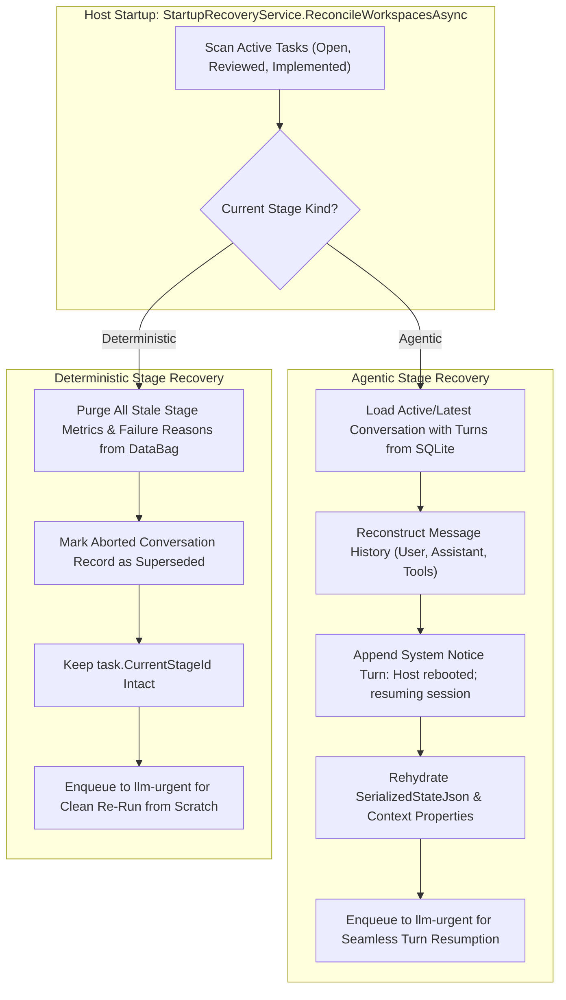

# 🔄 Step 9.9: Resilient Crash Recovery, Database Conversation Rehydration & State Persistence

> **Phase 9 Implementation Step**  
> *Parent Plan:* [Phase 9 Master Plan](../09_CODEBASE_REMEDIATION_AND_ROBUSTNESS.md)  
> *Source Policy:* [AGENTS.md](../../../AGENTS.md)  
> *Status:* Complete | *Target Framework:* .NET 10 (C# 13)

---

## 1. Objective

Upgrade [`StartupRecoveryService`](file:///c:/Users/Julien/source/repos/jetelain/NightCodeForge/src/NightCodeForge.Core/Services/StartupRecoveryService.cs) to provide full, lossless crash recovery following unexpected host terminations (e.g. process abort, power loss, Windows Update reboot).
1. **Agentic Stages:** Rehydrate interrupted agent sessions directly from database-persisted [`Conversation`](file:///c:/Users/Julien/source/repos/jetelain/NightCodeForge/src/NightCodeForge.Core/Domain/Conversation.cs) and [`ConversationTurn`](file:///c:/Users/Julien/source/repos/jetelain/NightCodeForge/src/NightCodeForge.Core/Domain/ConversationTurn.cs) records, injecting a recovery notice turn so the agent resumes reasoning where it was interrupted instead of restarting from scratch.
2. **Deterministic Stages:** Treat deterministic verifications as idempotent steps; completely purge dirty/partial metrics from [`PipelineDataBag`](file:///c:/Users/Julien/source/repos/jetelain/NightCodeForge/src/NightCodeForge.Core/Workflow/PipelineDataBag.cs), mark aborted conversation runs as superseded, and cleanly re-run the stage from scratch.
3. **Database State Persistence:** Persist [`PipelineDataBag`](file:///c:/Users/Julien/source/repos/jetelain/NightCodeForge/src/NightCodeForge.Core/Workflow/PipelineDataBag.cs) and mutable [`AgentSessionContext`](file:///c:/Users/Julien/source/repos/jetelain/NightCodeForge/src/NightCodeForge.Core/Domain/AgentSessionContext.cs) properties to the database across execution turns so no mid-stage state is lost upon an abrupt crash.

---

## 2. Analysis of Current Crash Recovery Flaws

### 2.1 Flaw 1: Agentic Memory Relies on Empty Checkpoints Instead of Database Turns
* **Current Behavior:** In [`StartupRecoveryService.cs`](file:///c:/Users/Julien/source/repos/jetelain/NightCodeForge/src/NightCodeForge.Core/Services/StartupRecoveryService.cs#L106-L115):
  ```csharp
  var lastCheckpoint = task.Checkpoints?.OrderByDescending(c => c.CreatedAt).FirstOrDefault();
  var memory = lastCheckpoint?.SerializedMemory ?? string.Empty;
  var notice = "[System Notice: Host restarted unexpectedly; workspace restored]";
  var restoredMemory = string.IsNullOrWhiteSpace(memory)
      ? notice
      : $"{memory}\n{notice}";
  bag.Set(PipelineDataBagKeys.SerializedMemory, restoredMemory);
  ```
* **The Flaw:** Checkpoints are only created on stage completion (where `SerializedMemory` is set to `string.Empty`) or on human question interruptions. Mid-session turns are never captured in `StageCheckpoints`.
* **The Reality:** All prompt messages, assistant thoughts, tool calls, and tool outputs are actively persisted to the [`Conversations`](file:///c:/Users/Julien/source/repos/jetelain/NightCodeForge/src/NightCodeForge.Core/Domain/Conversation.cs) and [`ConversationTurns`](file:///c:/Users/Julien/source/repos/jetelain/NightCodeForge/src/NightCodeForge.Core/Domain/ConversationTurn.cs) tables in SQLite. Ignoring them forces the agent to restart from turn 0, losing all completed work and context.

### 2.2 Flaw 2: Deterministic Stages Do Not Purge Stale Metrics
* **Current Behavior:** In [`StartupRecoveryService.cs`](file:///c:/Users/Julien/source/repos/jetelain/NightCodeForge/src/NightCodeForge.Core/Services/StartupRecoveryService.cs#L120):
  ```csharp
  bag.Remove(PipelineDataBagKeys.DeterministicMetrics);
  ```
* **The Flaw:** `DeterministicMetrics` is a non-existent phantom key. Actual stage metrics (`TestsCurrentTotal`, `WarningsCurrentTotal`, `CoverageCurrentLineRate`, `CompilerErrors`, `FailedTests`, failure reasons) remain dirty in the DataBag, which can corrupt subsequent gate evaluations and UI reports.

### 2.3 Flaw 3: In-Flight DataBag State Discarded on Crash
* **Current Behavior:** `task.PipelineDataJson` is only synced to SQLite at stage boundaries or when entering `WaitingForHuman`.
* **The Flaw:** If an agentic session runs 30 tool turns and updates proposals, discovered symbols, or DataBag flags, an abrupt crash discards all state accumulated after the last stage transition.

---

## 3. Technical Specifications & Architecture



### 3.1 Agentic Stage Resumption from Database Conversation
1. **Query Database Conversation:**
   In [`StartupRecoveryService`](file:///c:/Users/Julien/source/repos/jetelain/NightCodeForge/src/NightCodeForge.Core/Services/StartupRecoveryService.cs), query [`ITaskRepository`](file:///c:/Users/Julien/source/repos/jetelain/NightCodeForge/src/NightCodeForge.Core/Repositories/ITaskRepository.cs) for the latest conversation belonging to `task.Id` and `stage.StageId` where `Status == StageExecutionStatus.Running`:
   ```csharp
   var convs = await _taskRepository.GetConversationsAsync(task.Id, cancellationToken);
   var activeConv = convs
       .Where(c => c.StageId == stage.StageId && c.Status == StageExecutionStatus.Running)
       .OrderByDescending(c => c.AttemptIndex)
       .ThenByDescending(c => c.StartedAt)
       .FirstOrDefault();
   ```
2. **Reconstruct Conversational History:**
   If `activeConv != null`, load full turns via `_taskRepository.GetConversationWithTurnsAsync(activeConv.Id, cancellationToken)`:
   * Build the structured chat turn list from `activeConv.Turns.OrderBy(t => t.TurnIndex)`.
   * Append a recovery notice turn to SQLite:
     ```csharp
     await _taskRepository.AddConversationTurnAsync(
         activeConv.Id,
         StageTurnRole.System,
         content: "[System Notice: Host restarted unexpectedly; workspace restored; resuming from previous conversation turn]",
         cancellationToken: cancellationToken);
     ```
   * Reconstruct the serialized history. Turns are replayed via `ConversationHistorySerializer`:
     * Tool calls are correlated with their results by `CallId` (stored in `ConversationTurn.MetadataJson`, recorded from `FunctionCallContent.CallId` / `FunctionResultContent.CallId`).
     * A tool call with no persisted result (crash between the two) is closed with a synthetic `InterruptedToolResult` so the history stays valid for the model.
     * The recovery notice is replayed with the `user` role: Qwen/Gemma chat templates reject or reorder system messages that are not first.
     * Malformed JSON is a hard error (`JsonException`), never an empty history.
     ```csharp
     var reconstructedHistory = ConversationHistorySerializer.Serialize(allTurns);
     bag.Set(PipelineDataBagKeys.RecoveredSerializedMemory, reconstructedHistory);
     ```
   * The harness resumes in a **new** `Conversation` (a new attempt record), so the interrupted conversation is completed as `Failed` ("Session resumed in a new conversation") to avoid leaving it `Running` and being re-picked by the next recovery.
   * If no `Running` conversation exists for the stage, nothing is rehydrated (no synthetic notice, no checkpoint string concatenation): `RecoveredSerializedMemory` is dropped and the orchestrator falls back to the last stage checkpoint, if any.
3. **Seamless Resumption in Agent Harness:**
   [`TaskOrchestrator`](file:///c:/Users/Julien/source/repos/jetelain/NightCodeForge/src/NightCodeForge.Core/Workflow/TaskOrchestrator.cs) reads `RecoveredSerializedMemory` **once** (removing it from the bag so a later failed/cancelled run cannot replay it), falling back to the checkpoint memory, and populates [`AgentSessionContext.SerializedStateJson`](file:///c:/Users/Julien/source/repos/jetelain/NightCodeForge/src/NightCodeForge.Core/Domain/AgentSessionContext.cs#L19).
   * `CrucibleAgentHarness` deserializes it into its `ChatMessage` history.
   * `PiRpcAgentHarness` and `AcpAgentHarness` have no native history import: when `ConversationHistorySerializer.IsSerializedHistory(...)` is true they flatten it with `FormatForPrompt` into the prompt (an ACP value that is not a history is still an opaque session id and goes through `session/resume`).
   * **Known limitations:** the recovered history is not re-recorded as turns of the new conversation, so a second crash before the stage completes rebuilds only from the new conversation's turns. The flattened prompt for Pi/Acp is not size-capped.

### 3.2 Deterministic Stage Clean Re-Run
1. **Purge Stale Metrics from DataBag:**
   ```csharp
   var deterministicKeys = new[]
   {
       PipelineDataBagKeys.TestsCurrentTotal,
       PipelineDataBagKeys.TestsCurrentPassed,
       PipelineDataBagKeys.TestsCurrentFailed,
       PipelineDataBagKeys.TestsCurrentDurationMs,
       PipelineDataBagKeys.CoverageCurrentLineRate,
       PipelineDataBagKeys.WarningsCurrentTotal,
       PipelineDataBagKeys.WarningsNew,
       PipelineDataBagKeys.FailedTests,
       PipelineDataBagKeys.BuildFailureReason,
       PipelineDataBagKeys.TestFailureReason,
       PipelineDataBagKeys.CoverageFailureReason,
       PipelineDataBagKeys.SastFailureReason,
       PipelineDataBagKeys.RatchetFailureReason,
       PipelineDataBagKeys.StageCommand(stage.StageId),
       PipelineDataBagKeys.StageOutput(stage.StageId)
   };

   foreach (var key in deterministicKeys)
   {
       bag.Remove(key);
   }
   ```
2. **Supersede Incomplete Conversation Run:**
   If a running conversation exists for that deterministic stage:
   ```csharp
   await _taskRepository.CompleteConversationAsync(
       activeConv.Id,
       StageExecutionStatus.Failed,
       summary: "Process terminated unexpectedly mid-execution. Stage reset for clean re-run.",
       cancellationToken: cancellationToken);
   ```
3. **Re-enqueue for Clean Execution:**
   Leave `task.CurrentStageId = stage.StageId` and enqueue to `_jobQueue.EnqueueUrgent(task.Id)`. When the worker executes the stage, it runs cleanly with no stale outputs or contaminated metrics.

### 3.3 Mid-Session State & DataBag Persistence
1. **Turn-Level DataBag Sync:**
   In [`CrucibleAgentHarness.cs`](file:///c:/Users/Julien/source/repos/jetelain/NightCodeForge/src/NightCodeForge.Agents/Crucible/CrucibleAgentHarness.cs), after every tool result:
   * `PendingProposals` (always, so an emptied list overwrites a stale one), `OptimizationFlags` and `DiscoveredSymbols` (new keys in `PipelineDataBagKeys`) are mirrored into `pipelineContext.DataBag`, and `task.PipelineDataJson` is committed through the ordered turn writer.
   * The conversation history itself is deliberately **not** mirrored into the bag: it is already persisted turn by turn and rebuilt by recovery (avoids rewriting the full history into `PipelineDataJson` on every turn).
   * `TaskOrchestrator` seeds `AgentSessionContext.OptimizationFlags` / `DiscoveredSymbols` from these keys on resume.
2. **Tool-Result Metadata:**
   Each `ToolResult` turn stores `{ CallId, ToolName, OptimizationFlags, PendingProposalsCount }` in `ConversationTurn.MetadataJson`. `CallId` is required for recovery; the rest is diagnostic. (Tool duration and discovery deltas from the original draft were not implemented.)

---

## 4. Definition of Done (DoD) Checklist

- [x] `StartupRecoveryService` queries `ITaskRepository` for active `Conversation` and turns on agentic stages.
- [x] Agentic recovery reconstructs message history, appends a system notice turn, and rehydrates `SerializedStateJson` in `AgentSessionContext`.
- [x] Agent harnesses (`Crucible`, `PiRpc`, `Acp`) resume from rehydrated conversation history without restarting from turn 0.
- [x] Deterministic recovery purges all stale metric keys from `PipelineDataBag` and supersedes interrupted conversation records.
- [x] `PipelineDataBag` and mutable `AgentSessionContext` properties are committed to `task.PipelineDataJson` across execution turns.
- [x] Comprehensive recovery tests:
  - Agentic mid-session crash simulation: verifies all turns are rehydrated and session resumes.
  - Deterministic crash simulation: verifies metrics are purged and stage executes cleanly from scratch.
  - Full test suite passes: `dotnet test --filter "Category!=Acceptance&Category!=E2E"`.
