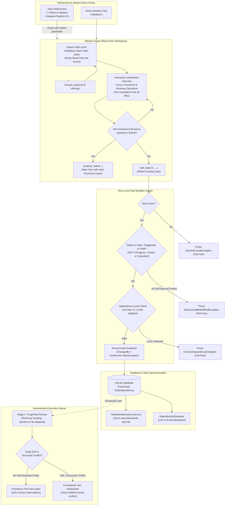

# 📋 Step 12.13: Conversational Backlog Management, Task Refinement & Scoped Mutation Tools in Ideation

> **Phase 12 Implementation Step (Extend Features - Backlog Management & Dependencies)**  
> *Parent Plan:* [Features & Integrations Roadmap](README.md)  
> *Target Components:* `src/NightCodeForge.Agents/Ideation`, `src/NightCodeForge.Agents/Tools`, `src/NightCodeForge.Core/Domain`, `src/NightCodeForge.Core/Interfaces`, `src/NightCodeForge.Core/Services`, `src/NightCodeForge.Web/Components/Ideation`, `src/NightCodeForge.Web/Components/Pages`, `src/NightCodeForge.Web/Components/Backlog`, `skills/ncf-backlog`, `tests/NightCodeForge.Agents.Tests`, `tests/NightCodeForge.Web.Tests` | *Status:* Planned | *Target Framework:* .NET 10 (C# 13)  
> *Related Steps:* [Step 11.7 (Task State History & Audit Trail)](../archive/phase-11/STEP_11_7_TASK_STATE_HISTORY_AND_AUDIT_TRAIL.md), [Step 12.1 (Intelligent Task Dependency Detection)](STEP_12_1_INTELLIGENT_TASK_DEPENDENCY_DETECTION.md), [Step 12.4 (Ideation Quick Notes & Suggestions)](STEP_12_4_IDEATION_QUICK_NOTES_SUGGESTIONS_AND_REFINEMENT.md)

> This document is a **specification**: it states required behaviors and constraints, not implementations. Implementation choices (signatures, code structure) are left to the implementer, within the constraints of the documents.

---

## 1. Executive Objective

In software engineering workflows, ideation is rarely a one-way street where an agent simply generates brand new task proposals from scratch. Backlog management is an iterative, conversational lifecycle where developers and agents:
1. **Explore and decompose new capabilities:** Brainstorm architecture, explore repository code, and formulate coherent, PR-sized tasks.
2. **Discuss and refine existing backlog tasks:** Revisit tasks in `Suggested` or `Open` states to clarify architectural decisions, add concrete sub-tasks or implementation checklists, specify edge cases, document acceptance criteria, and resolve open questions.
3. **Rework backlog priorities:** Dynamically elevate or deprioritize tasks based on shifting project goals (e.g. promote a critical bugfix to P1 and move an optimization to P4).
4. **Safely prune obsolete or duplicate tasks:** Remove or cancel tasks that are no longer relevant, with dependency validation preventing broken DAG links.

### 1.1 The Read-Only Workspace Dilemma
To maintain strict system safety and prevent code corruption outside of formal workflow pipelines, the Ideation Agent operates within a **strictly read-only workspace** (`isReadOnly = true`). The agent cannot invoke file-modifying tools (`edit`, `write`) on repository source files. 

While task specifications are mirrored on disk as Markdown documents in `docs/tasks/task-{id}.md`, the agent **must not** directly edit or delete these files via filesystem commands. Furthermore, the true source of truth for task state, dependencies, and priority is the SQLite database (`ForgeTask`, `TaskDependency`).

### 1.2 The Solution: Scoped Host-Level Mutation Tools
This step equips the Ideation Agent with dedicated, host-level backlog management tools:
- `get_task(task_id)`: Fetches complete task details on demand without bloating the conversational context prompt.
- `edit_task(task_id, title?, description?, priority?, depends_on_ids?, merge_mode?, base_branch?)`: Updates unstarted tasks (`Suggested`, `Open`, `Draft`), performs circular dependency validation, logs audit snapshots attributed to `AuditActors.IdeationAgent`, and triggers host-level markdown disk synchronization.
- `set_task_priority(task_id, priority)` / `rework_priorities(updates)`: Updates priority tiers across one or multiple backlog items.
- `remove_task(task_id, reason)`: Safely deletes or cancels unstarted tasks with dependency cascade guards.

### 1.3 Upfront Ambiguity Resolution ("Zero-Surprise Scheduling")
Previously, the ideation agent prompt permitted offloading unresolved questions to downstream execution stages ("*A task may have open questions! ... These open questions will be answered in the task review process (Stage 1: ForgeTask Review)*").

In practice, this creates friction: when a task is scheduled into the autonomous execution queue, pausing execution (`IsWaitingForHuman = true`) for basic design and requirements questions disrupts the automated pipeline.

**This step mandates a strict behavioral shift in Ideation:**
- **Ideation focuses on functional and business requirements:** The Ideation Agent **must** conduct an interactive interview with the maintainer to resolve all open **functional and business questions** (user intent, product behavior, capability scope, business rules, edge cases, and acceptance criteria) **before** proposing or creating the task.
- **Ideation is NOT mandated to identify all technical impacts (e.g. files):** Ideation is an exploratory requirement elicitation and brainstorming session, not a low-level compiler or symbol indexer. The agent should **not** be burdened with identifying all technical impacts, mapping every internal file path, or designing low-level class plumbing. Technical scoping, file identification, and architectural symbol mapping are the explicit responsibility of downstream **Stage 1 (ForgeTask Review)**.
- When a task is created or scheduled, **all obvious functional and business questions are already solved**. The task specification contains concrete, agreed-upon functional scope and acceptance criteria rather than vague placeholders.
- **Stage 1 (ForgeTask Review) transitions to a technical verification and drift guard.** Because all functional and business questions were resolved upfront during ideation, Stage 1 will **unlikely ask new questions**. Stage 1 performs deep codebase symbol analysis, identifies affected files, and creates the technical architecture. It preserves the `ask` tool solely as an exceptional guardrail for two scenarios:
  1. **Codebase Drift:** The codebase has evolved significantly since the task was ideated (e.g. concurrent PRs merged, classes renamed, conflicting schema migrations).
  2. **Structural / Technical Conflicts:** Deep codebase exploration reveals unforeseen structural constraints, subtle dependency cycles, or breaking technical invariants that necessitate maintainer input.

### 1.4 Direct Refinement Entry Point from Task Detail
Developers frequently review tasks from the **Task Detail** page ([TaskDetail.razor](file:///c:/Users/Julien/source/repos/jetelain/NightCodeForge/src/NightCodeForge.Web/Components/Pages/TaskDetail.razor)) or the backlog drawer ([TaskDetailDrawer.razor](file:///c:/Users/Julien/source/repos/jetelain/NightCodeForge/src/NightCodeForge.Web/Components/Backlog/TaskDetailDrawer.razor)) and realize that a task's scope is unclear or needs technical refinement.

This step introduces a dedicated **"💡 Refine in Ideation"** action button on task detail views. Clicking this button transitions directly into an Ideation chat session pre-seeded with the task's context and ID, where the agent inspects the existing specification via `get_task`, questions the maintainer on missing details, and updates the task specification via `edit_task`.

---

## 2. Architecture & Lifecycle Invariants



### Critical Invariants:
1. **Workspace Filesystem Read-Only Protection:**
   The agent's sandbox and file access tools remain strictly read-only. File modification tools (`edit`, `write`) remain disabled in ideation. Task mutations occur strictly through structured domain tools executing host-side database transactions and markdown sync services.
2. **Lifecycle State Guardrails:**
   - **Permitted States:** Tasks in [TaskOverallStatus.Draft](file:///c:/Users/Julien/source/repos/jetelain/NightCodeForge/src/NightCodeForge.Core/Domain/Enums.cs), [TaskOverallStatus.Suggested](file:///c:/Users/Julien/source/repos/jetelain/NightCodeForge/src/NightCodeForge.Core/Domain/Enums.cs), and [TaskOverallStatus.Open](file:///c:/Users/Julien/source/repos/jetelain/NightCodeForge/src/NightCodeForge.Core/Domain/Enums.cs) (and not currently claimed or executing in a pipeline stage) may be edited, reprioritized, or removed.
   - **Forbidden States:** Tasks that are currently active in the pipeline ([TaskOverallStatus.InProgress](file:///c:/Users/Julien/source/repos/jetelain/NightCodeForge/src/NightCodeForge.Core/Domain/Enums.cs), or currently running Stage 1/2/3 in a dedicated worktree) **must never** be mutated by ideation chat. Attempting to edit an in-progress task throws a hard domain exception (`TaskCannotBeModifiedException`).
   - **Immutable History:** Tasks in terminal states ([TaskOverallStatus.Closed](file:///c:/Users/Julien/source/repos/jetelain/NightCodeForge/src/NightCodeForge.Core/Domain/Enums.cs), [TaskOverallStatus.Rejected](file:///c:/Users/Julien/source/repos/jetelain/NightCodeForge/src/NightCodeForge.Core/Domain/Enums.cs)) are historically sealed and cannot be modified via ideation.
3. **Deterministic Failure & No Silent Failures:**
   Following the repository's core guidelines, looking up or modifying a non-existent task must throw `TaskNotFoundException` immediately. No synthetic default tasks or fallback records may be generated on the fly.
4. **Attribution & Audit Trail:**
   All mutations performed by the ideation agent must record an explicit entry in `TaskStateHistory` with `ChangedBy = AuditActors.IdeationAgent` and a descriptive `ChangeReason` detailing the conversational action.
5. **Bidirectional Disk Synchronization:**
   Every successful task mutation must immediately invoke [ITaskMarkdownSyncService.SyncTaskToDiskAsync](file:///c:/Users/Julien/source/repos/jetelain/NightCodeForge/src/NightCodeForge.Core/Services/ITaskMarkdownSyncService.cs), ensuring `docs/tasks/task-{id}.md` in the repository root stays perfectly synchronized with the database.
6. **Functional & Business Ambiguity Resolution Policy (Zero Open Business Questions):**
   The Ideation Agent is strictly mandated to solve all functional and business questions with the maintainer prior to task proposal or update. The agent is **not mandated to identify all technical impacts (e.g. files)**. Downstream Stage 1 (Task Review) is responsible for detailed file impact analysis and technical symbol mapping, and will only prompt the maintainer if the codebase drifted or structural conflicts emerged.
7. **Task Detail Refinement Round-Trip:**
   When navigating to `/ideation?taskId={id}`, the ideation session automatically initializes a focused conversation, loads the task's full specification via `get_task`, and prompts the maintainer to collaboratively resolve any functional ambiguities or refine sub-tasks.

---

## 3. Scoped Agent Tools Specification

The canonical ideation toolset is expanded to include the following four domain tools, registered in [CanonicalAIFunctionFactory.cs](file:///c:/Users/Julien/source/repos/jetelain/NightCodeForge/src/NightCodeForge.Agents/Tools/CanonicalAIFunctionFactory.cs) and enabled for profiles operating in `AgentMode.ReadOnly` or ideation discovery:

### 3.1 `get_task`
Inspects the full specification of any existing task in the workspace.
- **Parameters:**
  - `taskId` (integer, required): The ID of the task to retrieve.
- **Behavior:**
  - Queries `ITaskRepository.GetByIdWithDependenciesAsync(taskId)`.
  - If not found, throws `TaskNotFoundException`.
  - Returns a structured JSON summary containing: `id`, `title`, `description`, `status`, `priority`, `mergeMode`, `baseBranch`, `prerequisites` (list of dependency IDs and titles), and `dependentTaskIds`.
- **Token Efficiency:** Enables the agent to inspect specific tasks on demand without needing every task description injected into the bootstrap prompt.

### 3.2 `edit_task`
Modifies an existing unstarted task's title, description, priority, dependencies, or configuration.
- **Parameters:**
  - `taskId` (integer, required): Target task ID.
  - `title` (string, optional): Updated task title.
  - `description` (string, optional): Updated Markdown specification (scope, sub-tasks, testing plan, acceptance criteria).
  - `priority` (integer, optional): Updated priority tier (`1` Critical, `2` High, `3` Normal, `4` Low, `5` Trivial).
  - `dependsOnIds` (array of integers, optional): Explicit list of prerequisite task IDs.
  - `mergeMode` (string, optional): `Automatic` or `ManualReviewRequired`.
  - `baseBranch` (string, optional): Target base branch.
- **Behavior:**
  - Verifies target task exists and is in an editable status (`Draft`, `Suggested`, or `Open` without active running execution).
  - If `dependsOnIds` is provided, executes cycle detection against `ITaskDependencyStore`. If a cycle would be introduced, throws `CircularDependencyException`.
  - Updates the [ForgeTask](file:///c:/Users/Julien/source/repos/jetelain/NightCodeForge/src/NightCodeForge.Core/Domain/ForgeTask.cs) record in SQLite.
  - Records an audit snapshot via `TaskStateHistoryService` with `AuditActors.IdeationAgent`.
  - Syncs the updated specification to `docs/tasks/task-{id}.md` via [ITaskMarkdownSyncService](file:///c:/Users/Julien/source/repos/jetelain/NightCodeForge/src/NightCodeForge.Core/Services/ITaskMarkdownSyncService.cs).
  - Broadcasts an `AgentActivityEvent` to update the Blazor UI in real-time.

### 3.3 `set_task_priority` & `rework_priorities`
Allows the developer and agent to reorganize backlog scheduling and priorities conversationally.
- **Parameters (`set_task_priority`):**
  - `taskId` (integer, required): Target task ID.
  - `priority` (integer, required): Priority value between `1` (Critical) and `5` (Trivial).
- **Parameters (`rework_priorities`):**
  - `updates` (array of objects, required): Array of `{ taskId: int, priority: int }` updates.
- **Behavior:**
  - Validates priority values against the `TaskPriority` enum.
  - Updates task priority values in SQLite.
  - Re-syncs markdown files for affected tasks.
  - Returns a clear confirmation summarizing the revised priority order.

### 3.4 `remove_task`
Deletes or cancels an unstarted task from the workspace.
- **Parameters:**
  - `taskId` (integer, required): Target task ID.
  - `reason` (string, optional): Rationale for removal (e.g. "Duplicate of #12", "No longer required").
- **Behavior:**
  - Verifies task exists and is not currently running or closed.
  - Checks if other active tasks depend on `taskId`. If active dependent tasks exist:
    - Fails fast with a descriptive domain error: `"Cannot delete task #{taskId} because active tasks [{dependentIds}] depend on it. Please update or remove those dependencies first."`
  - Deletes or marks `ForgeTask` as cancelled, detaches dependencies, deletes or archives `docs/tasks/task-{id}.md`, and logs audit trail.

---

## 4. Prompt Engineering & Ideation Agent Guidance

The system prompt and guidance in [IdeationService.cs](file:///c:/Users/Julien/source/repos/jetelain/NightCodeForge/src/NightCodeForge.Agents/Ideation/IdeationService.cs) and [AgentProfile.cs](file:///c:/Users/Julien/source/repos/jetelain/NightCodeForge/src/NightCodeForge.Core/Domain/AgentProfile.cs) are overhauled to reflect the **Functional & Business Ambiguity Resolution Mandate** and the scoped backlog mutation tools.

### 4.1 Updated Base Persona Guidance (`AgentProfile.CreateDefaultIdeationProfile`)
The base persona string is updated to focus on functional/business requirements without mandating low-level technical impact mapping:
```csharp
Avoid over-decomposing into micro-tasks; structure cohesive PR-sized tasks with concrete functional scope. Focus on functional and business requirements: solve all user-facing, behavioral, and acceptance criteria questions with the maintainer in chat before formulating tasks so that tasks enter the execution queue fully determined. You are not mandated to identify all technical impacts (e.g. files); downstream review stages handle technical scoping.
```

### 4.2 Updated `<task_planning_guidelines>` in `IdeationService.cs`
The previous clause allowing open questions in proposed tasks is completely replaced:

```xml
<task_planning_guidelines>
When proposing implementation tasks to the developer, adhere to the following rules:
1. PULL-REQUEST / MERGE-REQUEST SIZING:
   - Each task in NightCodeForge represents a full, independent 'pull-request' / 'merge-request' (PR/MR).
   - Each task automatically passes through rigorous pipeline gates: Stage 1 (ForgeTask Review & technical scoping), Pre-Implementation Baseline build & test gates, Stage 2 (Implementation), Post-Implementation Ratchet build & test gates, Stage 3 (Code Review & automated fix gate), and a Merge Gate.
   - Each task will have its own tests (unit, integration, or functional tests) verifying the implementation.
   - DO NOT over-decompose into excessively small or trivial micro-tasks. Group related functional changes into cohesive PR-sized units.

2. SUB-TASKS WITHIN A TASK:
   - A task may have sub-tasks! Group related functional steps together into a single cohesive task.
   - Detail these sub-tasks as a checklist inside the task's 'description'.
   - The downstream Implementation Agent will execute all sub-tasks together within the single PR/task lifecycle.

3. MANDATORY UPFRONT FUNCTIONAL & BUSINESS RESOLUTION (ZERO OPEN BUSINESS QUESTIONS):
   - You MUST solve all functional and business questions WITH THE MAINTAINER in chat BEFORE proposing any task.
   - Focus on: user problems, capability goals, expected behaviors, edge-case scenarios, and verifiable acceptance criteria.
   - You are NOT mandated to identify all technical impacts (e.g. exhaustive lists of affected files or low-level internal plumbing). Detailed technical scoping, file identification, and symbol mapping are the responsibility of downstream Stage 1 (ForgeTask Review).
   - Conduct an interactive interview: ask the maintainer clarifying questions to decide on functional scope, user-facing behavior, and business rules.
   - When a task is proposed, its functional description must be comprehensive, unambiguous, and fully agreed upon.
   - When tasks are scheduled into the execution pipeline, all obvious functional questions must already be resolved. Downstream Stage 1 (ForgeTask Review) will unlikely ask new questions; it will only prompt the maintainer if the codebase has evolved/drifted since ideation or if structural changes/conflicts are uncovered.

4. TASK PROPOSAL INVOCATION:
   - When you recommend one or more implementation tasks, do NOT output markdown JSON codeblocks in your response text.
   - Instead, invoke the 'propose_tasks' tool with your proposed tasks (each having title, description, and optional priority).
   - Structure each task's description with clear Markdown sections (## Summary, ## Functional Scope / Sub-tasks, ## Acceptance Criteria, ## Verification Strategy). Mentioning specific files is optional if obvious, but NOT required.
   - If multiple tasks are proposed, order them logically or link dependencies (via dependsOnTitles).

5. EXISTING BACKLOG & ISSUE AWARENESS:
   - Existing backlog tasks are maintained in SQLite and synchronized in 'docs/tasks/'.
   - Before proposing new tasks, inspect existing tasks using 'get_task' or 'docs/tasks/' to avoid duplicate work.
</task_planning_guidelines>
```

### 4.3 Injected `<backlog_management_guidelines>` in `IdeationService.cs`
Instructs the agent how to inspect and refine existing tasks and reorganize priorities:

```xml
<backlog_management_guidelines>
You have first-class tools to inspect and manage existing backlog tasks directly in the database:
1. INSPECTING EXISTING TASKS:
   - When the developer refers to an existing task (e.g., "Let's review task #14" or when arriving from the "Refine in Ideation" button), invoke 'get_task(taskId)' to inspect its full description, scope, and dependencies.
   - Do NOT guess or hallucinate task requirements when you can read the authoritative record using 'get_task'.

2. REFINING FUNCTIONAL SCOPE ON EXISTING TASKS:
   - When refining an existing task, focus on resolving functional and business questions with the maintainer.
   - Actively identify any vague requirements, unstated assumptions, or open functional questions in the current specification.
   - You are NOT mandated to identify all technical impacts or files; keep the focus on clear functional scope and acceptance criteria.
   - Once all functional questions are resolved, invoke 'edit_task' with the updated, comprehensive description.
   - Keep the description structured with standard Markdown headers: ## Summary, ## Functional Scope / Sub-tasks, ## Acceptance Criteria, ## Verification Strategy.
   - Do NOT create duplicate tasks for work that should be added as sub-tasks to an existing task.

3. REWORKING PRIORITIES:
   - When the developer wants to reorder the backlog or change urgency, invoke 'set_task_priority' or 'rework_priorities'.
   - Valid priority levels: 1 = Critical, 2 = High, 3 = Normal (default), 4 = Low, 5 = Trivial.

4. REMOVING OBSOLETE TASKS:
   - If a task is rendered obsolete or identified as a duplicate, call 'remove_task' with an explicit explanation.

5. SAFETY & READ-ONLY WORKSPACE:
   - Your filesystem workspace is intentionally read-only to safeguard source code. You cannot modify code outside of formal workflow pipelines.
   - All task modifications MUST be performed using these domain tools ('edit_task', 'set_task_priority', 'remove_task'), which will automatically synchronize changes to the database and docs/tasks/.
</backlog_management_guidelines>
```

---

## 5. UI Presentation, Navigation & Ergonomics

### 5.1 "Refine in Ideation" Button on Task Detail Views
Adhering to the repository's **UI and Presentation separation** rule, navigation and action triggers are clean and lightweight:
1. **Task Detail Page ([TaskDetail.razor](file:///c:/Users/Julien/source/repos/jetelain/NightCodeForge/src/NightCodeForge.Web/Components/Pages/TaskDetail.razor)):**
   - In the header action bar (alongside `Live Inspector`, `Dependencies`, and `Reject`), add a prominent button for unstarted tasks:
     ```razor
     @if (_task.Status == TaskOverallStatus.Suggested || _task.Status == TaskOverallStatus.Open || _task.Status == TaskOverallStatus.Draft)
     {
         <a href="/ideation?taskId=@_task.Id" class="forge-btn forge-btn-secondary" id="btn-refine-ideation" title="Refine task specification and resolve open questions in Ideation chat">
             💡 Refine in Ideation
         </a>
     }
     ```
2. **Task Detail Drawer ([TaskDetailDrawer.razor](file:///c:/Users/Julien/source/repos/jetelain/NightCodeForge/src/NightCodeForge.Web/Components/Backlog/TaskDetailDrawer.razor)):**
   - In the drawer top header (next to `Inspect`), add a matching compact button:
     ```razor
     @if (Task.Status == TaskOverallStatus.Suggested || Task.Status == TaskOverallStatus.Open || Task.Status == TaskOverallStatus.Draft)
     {
         <a href="/ideation?taskId=@Task.Id" class="forge-btn forge-btn-secondary btn-xs" id="btn-drawer-refine-ideation" title="Refine in Ideation">
             💡 Refine
         </a>
     }
     ```

### 5.2 Ideation Page Scoped Task Initialization ([Ideation.razor](file:///c:/Users/Julien/source/repos/jetelain/NightCodeForge/src/NightCodeForge.Web/Components/Pages/Ideation.razor))
1. **Query Parameter Binding:**
   `Ideation.razor` declares:
   ```csharp
   [SupplyParameterFromQuery(Name = "taskId")]
   public int? TaskId { get; set; }
   ```
2. **Refinement Session Auto-Seeding:**
   When `TaskId` is provided in the URL and the workspace is active:
   - The page checks if an ideation conversation specifically titled or tagged for Task #{TaskId} already exists; if not, it calls `TaskRepository.StartIdeationConversationAsync(workspaceId, $"Refining Task #{task.Id}: {task.Title}")`.
   - Pre-seeds the conversation with a targeted refinement prompt:
     `"Let's refine Task #{task.Id} ('{task.Title}'). Please inspect its current specification with get_task({task.Id}), identify any open questions or missing details, and let's resolve them before updating the task."`
   - Automatically kicks off the first turn or places the pre-filled prompt into the chat input for the maintainer to review and send.

### 5.3 Rich Tool Execution Badges & Live SignalR Broadcast
In the ideation chat stream ([Ideation.razor](file:///c:/Users/Julien/source/repos/jetelain/NightCodeForge/src/NightCodeForge.Web/Components/Pages/Ideation.razor)), tool calls for backlog mutation render compact, distinctive UI cards:
- 📖 **Loaded Task #14:** Displays compact title and current priority.
- 📝 **Updated Task #14:** Highlights modified fields (e.g. "Description updated with 4 sub-tasks", "Priority: P3 -> P2") with a direct link to open the Task Detail view.
- 🏷️ **Reprioritized Backlog:** Shows chip updates for affected tasks.
- 🗑️ **Removed Task #18:** Shows grayed-out removal badge with reason.

All mutations broadcast `AgentActivityEvent` through [IAgentActivityStreamer](file:///c:/Users/Julien/source/repos/jetelain/NightCodeForge/src/NightCodeForge.Core/Streaming/IAgentActivityStreamer.cs), dynamically refreshing open Kanban boards, backlog lists, and task detail drawers without requiring manual page reloads.

---

## 6. Impact on Provided Skills (`skills/ncf-backlog`)

NightCodeForge provides official skills for external AI harnesses (Antigravity IDE, Claude Code, Cursor, CLI agents) operating directly on the repository. The core backlog management skill ([skills/ncf-backlog/SKILL.md](file:///c:/Users/Julien/source/repos/jetelain/NightCodeForge/skills/ncf-backlog/SKILL.md)) is updated to reflect this functional and business focus:

1. **Mandatory Interactive Interview on Functional & Business Requirements (Mode A):**
   - External harnesses must actively interview the developer on functional goals, user requirements, business rules, edge cases, and acceptance criteria.
   - **No requirement for exhaustive technical impact mapping:** External agents in ideation are **not** mandated to enumerate every affected file or design low-level code mechanics. Mentioning obvious files is optional, but the focus remains on the "what and why" rather than low-level plumbing.
   - **Strict prohibition on lazy "Open Questions" sections:** Tasks authored by external agents into `docs/tasks/*.md` must not contain unresolved business questions or "TBD" blocks. Obvious functional questions must be solved in conversation with the maintainer before authoring the markdown file.
2. **Deterministic Functional Specifications:**
   - The task specification requires clear Functional Scope / Sub-tasks, Business Rules, and Acceptance Criteria.
   - Downstream Stage 1 (Task Review) performs the deep technical scoping and symbol mapping, freeing ideation to move quickly without guessing file structures.
3. **Refinement Workflow Guidance:**
   - The skill provides guidance for modifying existing tasks: when asked to refine an existing task file in `docs/tasks/`, the agent inspects the functional requirements, discusses open business questions with the maintainer, and directly updates the functional checklist and acceptance criteria in-place.

---

## 7. Implementation Checklist & Deliverables

- [ ] **Domain Exceptions & Interfaces (`NightCodeForge.Core`):**
  - [ ] Define `TaskCannotBeModifiedException` for attempts to edit in-flight or closed tasks.
  - [ ] Verify `TaskNotFoundException` is thrown when task ID does not exist.
  - [ ] Add `GetByIdWithDependenciesAsync` to `ITaskRepository` if missing.
  - [ ] Add `UpdateTaskSpecificationAsync` and `BatchUpdatePrioritiesAsync` to `ITaskRepository` / `ITaskService`.
- [ ] **Agent Tools Implementation (`NightCodeForge.Agents`):**
  - [ ] Implement `get_task` tool in `CanonicalTools` and register in `CanonicalAIFunctionFactory`.
  - [ ] Implement `edit_task` tool in `CanonicalTools` supporting title, description, priority, and dependency updates.
  - [ ] Implement `set_task_priority` and `rework_priorities` tools in `CanonicalTools`.
  - [ ] Implement `remove_task` tool in `CanonicalTools` with active dependent validation.
  - [ ] Ensure all mutation tools record audit entries via `AuditActors.IdeationAgent`.
  - [ ] Ensure all mutation tools trigger `ITaskMarkdownSyncService.SyncTaskToDiskAsync`.
- [ ] **Prompt Engineering & Ideation Agent Guidance (`NightCodeForge.Agents` & `NightCodeForge.Core`):**
  - [ ] Update `AgentProfile.CreateDefaultIdeationProfile()` system prompt to mandate upfront functional/business resolution without requiring exhaustive technical file mapping.
  - [ ] Overhaul `<task_planning_guidelines>` in `IdeationService.cs` to focus on functional/business questions (zero open business questions at proposal).
  - [ ] Inject `<backlog_management_guidelines>` into `IdeationService.cs` instructing the agent on `get_task`, `edit_task`, `set_task_priority`, and `remove_task`.
  - [ ] Enable the new mutation tools in `IdeationService` permitted tools.
- [ ] **Provided Skills Updates (`skills/ncf-backlog`):**
  - [ ] Update [skills/ncf-backlog/SKILL.md](file:///c:/Users/Julien/source/repos/jetelain/NightCodeForge/skills/ncf-backlog/SKILL.md) to mandate upfront functional/business interview, clarify that file mapping is not mandated in ideation, and forbid authored tasks with unresolved open questions.
- [ ] **Web UI Navigation & Task Detail Entry Point (`NightCodeForge.Web`):**
  - [ ] Add "💡 Refine in Ideation" button to [TaskDetail.razor](file:///c:/Users/Julien/source/repos/jetelain/NightCodeForge/src/NightCodeForge.Web/Components/Pages/TaskDetail.razor) header action bar for unstarted tasks.
  - [ ] Add "💡 Refine" button to [TaskDetailDrawer.razor](file:///c:/Users/Julien/source/repos/jetelain/NightCodeForge/src/NightCodeForge.Web/Components/Backlog/TaskDetailDrawer.razor) header actions.
  - [ ] Add `[SupplyParameterFromQuery(Name = "taskId")] public int? TaskId { get; set; }` in [Ideation.razor](file:///c:/Users/Julien/source/repos/jetelain/NightCodeForge/src/NightCodeForge.Web/Components/Pages/Ideation.razor).
  - [ ] Implement automated conversation initialization / pre-seeding when navigating to `/ideation?taskId={id}`.
  - [ ] Add compact presentation cards in `Ideation.razor` for task mutation tool calls (`get_task`, `edit_task`, `set_task_priority`, `remove_task`).
  - [ ] Refresh Kanban board and backlog views dynamically on task mutation SignalR events.
- [ ] **Automated Unit & Integration Tests (`tests/NightCodeForge.Agents.Tests` & `tests/NightCodeForge.Web.Tests`):**
  - [ ] Test `get_task`: returns full task details; throws `TaskNotFoundException` on missing ID.
  - [ ] Test `edit_task`: modifies `Open` and `Suggested` tasks; updates SQLite and calls markdown sync.
  - [ ] Test `edit_task`: fails fast with `TaskCannotBeModifiedException` when task is `InProgress` or `Closed`.
  - [ ] Test `edit_task`: fails fast with `CircularDependencyException` when a cycle is introduced.
  - [ ] Test `set_task_priority`: updates priority and syncs to disk.
  - [ ] Test `remove_task`: deletes unstarted task; fails if active dependents exist.
  - [ ] Test `IdeationService` system prompt contains upfront ambiguity resolution guidelines.
  - [ ] Test `TaskDetail` and `TaskDetailDrawer` render "Refine in Ideation" button for unstarted tasks.
  - [ ] Test `Ideation.razor` handles `?taskId={id}` query parameter and initializes refinement session.
  - [ ] Run test suite: `dotnet test --filter "Category!=Acceptance&Category!=E2E"`.
