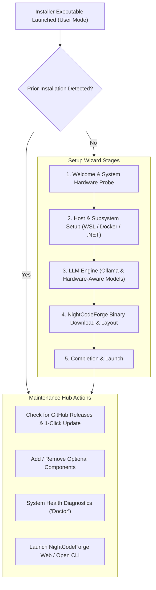

# 🖥️ Step 12.18: Cross-Platform Desktop Installer, Updater & Setup Wizard

> **Phase 12 Implementation Step (Extend Features - Distribution & Desktop Experience)**  
> *Parent Plan:* [Features & Integrations Roadmap](README.md)  
> *Related Steps:* [Step 12.14: Global Skills & Stack Tooling](../archive/phase-12/STEP_12_14_GLOBAL_SKILLS_INJECTION_AND_STACK_TOOLING.md) | [Step 12.15: Deep OllamaRouter Fleet Provisioning](STEP_12_15_DEEP_OLLAMAROUTER_FLEET_PROVISIONING_AND_IN_APP_SETUP.md) | [Step 12.16: Remote Tailscale Mesh Access](STEP_12_16_TAILSCALE_REMOTE_ACCESS.md)  
> *Source Policy:* [AGENTS.md](../../AGENTS.md)  
> *Project Target:* `src/NightCodeForge.Installer`, `tests/NightCodeForge.Installer.Tests` | *Status:* Planned | *Target Framework:* .NET 10 (C# 13, Avalonia UI 11+)

> This document is a **specification**: it states required behaviors and constraints, not implementations. Implementation choices (signatures, code structure) are left to the implementer, within the constraints of the documents.

---

## 1. Executive Objective

1. **Zero-Clone, Zero-Scripting Desktop Experience:** Provide a first-class, standalone, self-contained desktop application (`NightCodeForge.Installer`) for Windows, Linux, and macOS. End-users do not need to clone the repository, install PowerShell on Linux/macOS, or manually orchestrate command-line scripts to get started.
2. **Binary GitHub Release Provisioning:** Fetch and unpack pre-built, production-ready binaries for `NightCodeForge.Web` and the `ncf` global CLI tool directly from GitHub Releases (`jetelain/NightCodeForge`), eliminating compile-time toolchain requirements for end-users.
3. **Automated Host & Subsystem Provisioning:**
   - **Windows:** Detect, enable, and configure WSL2, provision the default or selected Linux distribution (e.g. Ubuntu), and configure the Windows host .NET 10 SDK and PATH.
   - **Linux / WSL (Unix side):** Automatically install and configure .NET 10 SDK, Docker Engine (with non-root user permissions / daemon verification), and essential companion tools (`ripgrep`, `git`, `libicu`).
   - **macOS:** Verify/install host prerequisites via Homebrew or direct binaries (Docker Desktop / Colima, .NET 10 SDK).
4. **Hardware-Aware AI Provisioning & Setup Micro-Benchmark (Curated `jetelain` Models with Unsloth Dynamics & Min 128k Context):** Standardize on curated models from `https://ollama.com/jetelain`, utilizing Unsloth Dynamic Quantization for superior quality and perplexity retention at low bitrates:
   - **Coder / Implementation:** `jetelain/qwen3.6-35b-a3b` (MoE with Active 3B, ~16 GB in Dynamic Q4, targeting 32 GB RAM + $\ge 6$ GB VRAM for high-speed patch generation)
   - **Architect / Reviewer:** `jetelain/qwen3.8-27b` (Dense reasoning in Dynamic Q4 or compact Dynamic Q3 to fit $\le 16$ GB VRAM envelopes with 128k context)
   - **Auxiliary / Entry Tier:** `jetelain/qwen3.5-9b` (Dynamic Q4, lightweight for workstations with $< 32$ GB RAM and fast pre-processing)
   Execute an automated in-wizard micro-benchmark measuring token throughput, prompt evaluation latency, and VRAM offload to find the "perfect" mix and context size on target hardware, strictly enforcing a **minimum of 128k context (`num_ctx >= 131,072`) for every agent role**. Configure optional multi-node OllamaRouter mesh endpoints.
5. **Just-in-Time (JIT) Privilege Elevation:** Launch unprivileged by default. System-level modifications (WSL feature installation, Docker daemon setup, firewall rules) trigger isolated, platform-native privilege elevation (Windows UAC, Linux `pkexec` / `sudo`, macOS `osascript`) only when strictly necessary.
6. **Dual-Mode Lifecycle (Setup Wizard & Maintenance Hub):** Functions as a smooth Out-of-the-Box Experience (OOBE) setup wizard on first run, and transitions into a desktop Maintenance & Software Updater Hub for updating NightCodeForge, managing optional components, monitoring service health, and launching the application.

---

## 2. Problem Statement & Motivation

### 2.1 The Friction of Script-Based Bootstrapping
Currently, onboarding NightCodeForge requires running [install.ps1](file:///c:/Users/Julien/source/repos/jetelain/NightCodeForge/install.ps1), which:
- Assumes a Git checkout exists or invokes `git clone`.
- Relies on PowerShell script execution policies, which are frequently blocked or restricted on Windows workstations.
- Requires building from source (`dotnet publish`, `dotnet pack`) on the developer machine, requiring immediate .NET SDK installation before the user can even evaluate the tool.
- Provides limited visual progress feedback during multi-gigabyte downloads (e.g. Docker images, Ollama models, SDK tarballs).

### 2.2 Cross-Platform Parity
Developers use diverse environments:
- Windows developers rely heavily on WSL2 for isolated Linux container sandboxes and Ext4 filesystem performance.
- Linux developers run Docker directly on the host kernel and manage systemd services.
- macOS developers run Apple Silicon unified memory with Metal acceleration and container runtimes (OrbStack / Colima / Docker Desktop).
A unified desktop application built on **Avalonia UI** provides a 100% native Skia-rendered GUI across all three operating systems while sharing core C# provisioning logic.

### 2.3 Post-Install Maintenance & Feature Management
After initial installation, users need a straightforward way to:
- Detect and apply new NightCodeForge updates from GitHub Releases without re-running CLI scripts.
- Add or remove features (e.g., install OllamaRouter, download additional LLM weights, configure Tailscale mesh access).
- Run a "Doctor / Health Check" diagnostic to identify broken Docker daemons, unreachable WSL distributions, or stopped Ollama services.

---

## 3. High-Level Architecture & Lifecycle



---

## 4. Technical Specifications & Functional Requirements

### 4.1 Project & Solution Layout
The installer project resides within the primary NightCodeForge solution:
- **Project File:** `src/NightCodeForge.Installer/NightCodeForge.Installer.csproj`
- **Target Framework:** `net10.0`
- **UI Framework:** Avalonia UI 11+ with MVVM pattern (`CommunityToolkit.Mvvm`)
- **Supported RIDs (Runtime Identifiers):**
  - Windows: `win-x64`, `win-arm64`
  - Linux: `linux-x64`, `linux-arm64`
  - macOS: `osx-x64`, `osx-arm64`
- **Publish Profile:** Self-contained, single-file executable (`PublishSingleFile=true`, `SelfContained=true`, `IncludeNativeLibrariesForSelfExtract=true`).

---

### 4.2 Hardware Capabilities Detection (`IHardwareInspectorService`)
Before recommending models or configuration, the application inspects the host hardware:

| Metric | Windows Detection | Linux Detection | macOS Detection |
| :--- | :--- | :--- | :--- |
| **CPU Architecture** | `RuntimeInformation.ProcessArchitecture` | `RuntimeInformation.ProcessArchitecture` | `RuntimeInformation.ProcessArchitecture` |
| **Logical Cores** | `Environment.ProcessorCount` | `Environment.ProcessorCount` | `Environment.ProcessorCount` |
| **System RAM** | `GlobalMemoryStatusEx` (Win32 P/Invoke) | `/proc/meminfo` (`MemTotal`) | `sysctl hw.memsize` |
| **GPU Vendor & VRAM** | DXGI / NVML P/Invoke or `nvidia-smi` | `/proc/driver/nvidia` or `rocm-smi` | Apple Silicon Unified Memory via `sysctl` |

#### Standard Curated Qwen3 Model Suite (Unsloth Dynamics):
NightCodeForge standardizes on curated models hosted at [https://ollama.com/jetelain](https://ollama.com/jetelain), packaged using **Unsloth Dynamic Quantization (Unsloth Dynamics)**. Unsloth Dynamics dynamically allocates higher precision to critical attention and MLP layers while compressing non-critical weights, yielding significantly superior quality, reasoning coherence, and perplexity retention at low bitrates compared to traditional static quantizations:

1. **`jetelain/qwen3.6-35b-a3b` (Coder / Implementation Role):** 
   - **Architecture:** Mixture-of-Experts (MoE) activating only 3B parameters per token.
   - **Quantization & Footprint:** Dynamic Q4 (`jetelain/qwen3.6-35b-a3b:latest` / `:q4_k_m`), requiring ~16 GB in memory. Targets workstations with **32 GB System RAM and $\ge 6$ GB VRAM**.
   - **Performance Characteristic:** High token generation throughput even on modest VRAM (active 3B layers and KV cache offloaded to GPU, expert weights held in RAM without memory bandwidth choke).
2. **`jetelain/qwen3.8-27b` (Architect / Reviewer Role):** 
   - **Architecture:** Dense 27B reasoning model for architectural breakdown, multi-file analysis, and adversarial code reviews.
   - **Supported Quantizations (Dynamic Q4 & Dynamic Q3):**
     - **Dynamic Q4 (`jetelain/qwen3.8-27b:q4_k_m`):** Full-fidelity dynamic quant requiring ~17 GB VRAM. Ideal for multi-GPU or $\ge 24$ GB VRAM hosts.
     - **Dynamic Q3 (`jetelain/qwen3.8-27b:q3_k_m`):** Compact dynamic quant requiring only ~12–13 GB. Specifically enables 16 GB GPUs (RTX 4080, RTX 4070 Ti Super, RTX 3090, Apple Silicon) to fit the full 27B model **alongside a 128k context window** without spilling into system RAM!
3. **`jetelain/qwen3.5-9b` (Entry Tier / Auxiliary Role):** 
   - **Architecture:** Dense 9B lightweight model in Dynamic Q4 (`jetelain/qwen3.5-9b:latest`, ~6 GB footprint) for untrusted issue triage, fast pre-processing, or primary execution on workstations with $< 32$ GB RAM.

#### Setup Micro-Benchmark Suite (`IHardwareMicroBenchmarkService`):
Rather than relying on static heuristic assumptions, the setup wizard runs an automated **micro-benchmark** on the user's active hardware:
1. **Mandatory 128k Context Rule:** Every agent role **must operate with a minimum context window of 128k (`num_ctx >= 131,072`)**. The benchmark verifies that KV cache allocation at 128k succeeds without GPU out-of-memory errors.
2. **KV Cache & Model Quantization Probing:** Evaluates whether `jetelain/qwen3.8-27b` should use Dynamic Q4 or Dynamic Q3, and tests FP16 vs quantized KV cache (`q4_0` / `q8_0` supported by Ollama / llama.cpp) to guarantee 128k context in local VRAM.
3. **Throughput & Latency Evaluation:**
   - Measures prompt evaluation speed (prompt tokens/sec) on standardized context payloads.
   - Measures token generation throughput (eval tokens/sec).
   - Measures PCIe bus transfer speed when weights or context partially spill into System RAM.
4. **Residency & Concurrency Analysis:**
   - Tests whether Architect (`jetelain/qwen3.8-27b`) and Coder (`jetelain/qwen3.6-35b-a3b`) can reside concurrently in memory with 128k context.
   - If concurrent residency is not possible, checks whether JIT swapping during deterministic build/test stages provides acceptable performance, or whether `jetelain/qwen3.6-35b-a3b` should be unified across both roles, or whether `jetelain/qwen3.5-9b` should be selected.

#### Hardware-Tier Classification & Optimal Mix Matrix:
The benchmark calculates the "perfect mix" based on measured performance:

| Hardware Tier | Memory & Acceleration Profile | Architect / Reviewer Role (Min 128k) | Coder / Implementation Role (Min 128k) | Execution Mode |
| :--- | :--- | :--- | :--- | :--- |
| **Enthusiast / Multi-GPU** | $\ge 64$ GB Unified Memory or $\ge 48$ GB VRAM (Dual GPU / RTX 4090 / Mac Studio) | `jetelain/qwen3.8-27b` (Dynamic Q4, 128k FP16 KV) | `jetelain/qwen3.8-27b` (Max Reasoning) or `jetelain/qwen3.6-35b-a3b` (Max Throughput) | Concurrent Full VRAM Offload (Zero Swap Latency) |
| **High Performance (16–24 GB VRAM)** | 32 GB – 64 GB RAM + 16 GB – 24 GB VRAM (RTX 4080 / 3090, Mac M3/M4 Pro 36GB) | `jetelain/qwen3.8-27b` (Dynamic Q3 or Q4, 128k KV `q4_0`) | `jetelain/qwen3.6-35b-a3b` (Dynamic Q4, 128k KV `q4_0`) | Deterministic Stage JIT Swap or Dynamic Q3 Full Fit |
| **Mainstream MoE Target (6–12 GB VRAM)** | 32 GB System RAM + 6 GB – 12 GB VRAM (RTX 4060 / 3070 / 4070) | `jetelain/qwen3.6-35b-a3b` (Dynamic Q4, 128k KV `q4_0`) | `jetelain/qwen3.6-35b-a3b` (Dynamic Q4, 128k KV `q4_0`) | Unified MoE (Single Model for Both Roles, Zero Swapping) |
| **Entry / Constrained** | $< 32$ GB RAM (e.g. 16 GB RAM) or VRAM $< 6$ GB (Mac Mini 16GB, Laptop) | `jetelain/qwen3.5-9b` (Dynamic Q4, 128k context) | `jetelain/qwen3.5-9b` (Dynamic Q4, 128k context) | Unified Local Run (128k preserved) or Remote Mesh |
| **Cloud / Mesh Offload** | Any Hardware | Routed to LAN OllamaRouter Mesh Node | Routed to LAN OllamaRouter Mesh Node | Remote Execution (Zero Local GPU Load) |

---

### 4.3 Subsystem & Environment Provisioning (`IEnvironmentProvisioner`)

#### A. Windows Subsystem for Linux (WSL2)
1. **Status Probe:** Runs `wsl --status` and `wsl --list --verbose` via standard process execution.
2. **JIT Elevation:** If WSL is not installed or enabled:
   - Spawns an elevated command (`powershell.exe -Command "Start-Process wsl -ArgumentList '--install --no-launch' -Verb RunAs -Wait"`).
   - Prompts the user with an explicit explanation before elevation.
   - Detects reboot requirements (Exit code `3010`) and displays a clear "Reboot Required to Complete WSL Installation" dialog with resume instructions.
3. **Distribution Management:**
   - Detects default distribution or provisions `Ubuntu` (`wsl --install -d Ubuntu`).
   - Executes initialization scripts inside WSL via `wsl -d <distro> -- useradd ...` or default non-root user.

#### B. Unix Toolchain & Sandboxing (WSL / Native Linux)
1. **.NET 10 SDK:** Checks `dotnet --list-sdks`. If .NET 10 is missing, runs `dotnet-install.sh --channel 10.0` inside the environment and configures `/etc/profile.d/dotnet.sh` or `~/.bashrc`.
2. **Docker Engine:**
   - Detects if Docker daemon is responsive (`docker info`).
   - If missing on Ubuntu/Debian: provisions official Docker repositories, installs `docker-ce`, `docker-ce-cli`, `containerd.io`, and adds the target user to the `docker` group (`usermod -aG docker $USER`).
   - On systemd distros: enables and starts `docker.service`.
3. **Companion CLI Tools:**
   - Installs `ripgrep` (`rg`), `git`, `libicu-dev`, and standard utilities (`curl`, `ca-certificates`).
   - Installs official companion global tools (e.g. `ncf` CLI tool, DevSkim).

#### C. macOS Host Environment
1. Verifies Docker runtime availability (Docker Desktop or Colima).
2. Sets up .NET 10 SDK via official package or Homebrew.
3. Configures local environment paths and permissions.

---

### 4.4 Local AI & Mesh Routing Provisioning (`IOllamaManager`)

1. **Ollama Setup:**
   - Windows: Installs native Ollama for Windows (`OllamaSetup.exe /silent` from official release).
   - Linux: Installs via official install script (`curl -fsSL https://ollama.com/install.sh | sh`) or systemd service setup.
   - macOS: Installs Ollama.app or binary.
   - Verifies service heartbeat on `http://127.0.0.1:11434/api/tags`.
2. **Automated Setup Micro-Benchmark:**
   - Executes non-intrusive micro-benchmarks on candidate models (`Qwen3.6 35B A3B`, `Qwen3.8 27B`, `Qwen3.5 9B`).
   - Evaluates token generation speed (tokens/sec), prompt evaluation latency, and VRAM offload ratio.
   - Validates that context allocation $\ge 128\text{k}$ tokens (`num_ctx >= 131,072`) succeeds without out-of-memory or PCIe degradation.
   - Displays real-time graphical meters in the Avalonia wizard (tokens/sec, VRAM utilization, context safety badge).
3. **Model Selection & Pulling:**
   - Presents the recommended role assignment matrix for confirmation or user override:
     - **Architect / Reviewer Role:** `Qwen3.8 27B` (or `Qwen3.6 35B A3B Q4` on Mainstream MoE systems to avoid dense memory bandwidth choke; or fallback `Qwen3.5 9B` on $< 32$ GB RAM devices, preserving 128k context).
     - **Coder / Implementation Role:** `Qwen3.6 35B A3B Q4` (or `Qwen3.8 27B` on Multi-GPU / high-capacity systems for maximum deductive reasoning; or fallback `Qwen3.5 9B` on $< 32$ GB RAM devices, preserving 128k context).
   - Displays real-time download progress streams (`/api/pull` streaming JSON: `total`, `completed`, percentage, ETA).
   - Offers "Download Now" or "Defer Download to First Run" to allow instant setup completion.
4. **Optional OllamaRouter Provisioning:**
   - Downloads the latest OllamaRouter binary release.
   - Configures mesh node endpoints (LAN IPs, ports, and priorities).
   - Conducts live pre-flight latency tests (`GET /api/tags` on remote nodes).

---

### 4.5 Binary Release Delivery & Directory Layout (`IReleaseManager`)

The installer does not require `git` clone or compilation toolchains on the host:
1. **GitHub Releases Client:**
   - Communicates with `https://api.github.com/repos/jetelain/NightCodeForge/releases/latest` (or release tags).
   - Resolves appropriate asset zip/tarball:
     - `NightCodeForge-Web-{rid}.zip`
     - `NightCodeForge-Cli-{rid}.zip`
   - Downloads assets with resumable streaming and SHA-256 checksum verification.
2. **Standard Installation Paths:**
   - **Windows:** `%LOCALAPPDATA%\Programs\NightCodeForge\`
   - **Linux:** `~/.local/share/nightcodeforge/`
   - **macOS:** `~/Applications/NightCodeForge/`
   - **Global User State & Workspaces:** `~/.nightcodeforge/` (shared across all runs).
3. **System & Shell Integration:**
   - Creates application shortcut on Desktop and Start Menu / Application menu with official icon.
   - Registers `ncf` CLI binary into user `PATH` environment variable.
   - Configures optional autostart / background service (Windows Task Scheduler, systemd user service `nightcodeforge.service`, or launchd agent).

---

### 4.6 Dual-Mode UX & Screen Flow (Avalonia UI)

#### 1. Setup Wizard Mode (OOBE)
- **Step 1: Welcome & EULA/License:** Product introduction, terms, and hardware scan overview.
- **Step 2: Environment Check & Plan:** Displays detected hardware (CPU, RAM, GPU), OS capabilities, and planned provisioning steps with individual toggle options.
- **Step 3: Host & Subsystem Provisioning:** Visual stepper with real-time log terminal and progress bar for WSL/Docker/.NET installation.
- **Step 4: AI & Micro-Benchmark Optimization:** Executes automated benchmark to find the perfect mix of `Qwen3.6 35B A3B`, `Qwen3.8 27B`, and `Qwen3.5 9B`, enforces $\ge 128\text{k}$ context, and initiates model weights streaming.
- **Step 5: Software Download & Configuration Layout:** Downloads and extracts NightCodeForge Web and CLI binaries from GitHub Releases with live download speed and ETA. Automatically writes the hardware-calibrated user configuration into the durable `config/config.json` user overlay (configuring LLM provider settings for [Step 11.33](../archive/phase-11/STEP_11_33_UNIFIED_LLM_PROVIDER_DYNAMIC_CONTEXT_AND_FLEET_INTEGRATION.md), OpenAI compatible endpoints for [Step 11.35](../archive/phase-11/STEP_11_35_OPENAI_COMPATIBLE_LLM_PROVIDER.md), and optional Tailscale mesh settings for [Step 12.16](STEP_12_16_TAILSCALE_REMOTE_ACCESS.md)), keeping `appsettings.json` as read-only factory defaults.
- **Step 6: Ready to Forge:** Summary screen with "Launch NightCodeForge Web" and "Open Documentation" buttons.

#### 2. Maintenance & Updater Hub Mode (Launched Post-Install)
When the executable is launched after initial installation, it displays the **Forge Hub**:
- **Application Status Card:** Current installed version vs. latest release on GitHub, service running status (Running on port 5270 / Stopped).
- **1-Click Update:** "Update to vX.Y.Z" button with automatic binary replacement, preserving the durable `config/config.json` overlay and database so user configurations survive updates.
- **Component Manager:** Add/reconfigure features:
  - Download additional Ollama models.
  - Reconfigure OllamaRouter fleet nodes.
  - Reconfigure WSL distribution or Docker settings.
  - Enable/disable Tailscale remote mesh access ([Step 12.16](STEP_12_16_TAILSCALE_REMOTE_ACCESS.md)).
- **Forge Doctor (System Diagnostics):** 1-click self-test verifying WSL responsiveness, Docker daemon access, Ollama heartbeat, port 5270 availability (or configured `Urls`), and database connectivity.
- **Quick Actions:** "Start Server", "Stop Server", "Open Web UI in Browser", "Open CLI Terminal".

---

## 5. Domain Models & Service Contracts

```csharp
namespace NightCodeForge.Installer.Core.Models;

public enum HostPlatformType
{
    Windows,
    Linux,
    MacOS
}

public enum ProvisioningStatus
{
    NotStarted,
    InProgress,
    Completed,
    RebootRequired,
    Failed,
    Skipped
}

public sealed record HardwareProfile(
    HostPlatformType Platform,
    string CpuArchitecture,
    int LogicalCores,
    long TotalSystemMemoryBytes,
    string? GpuDescription,
    long? DedicatedGpuMemoryBytes,
    bool HasHardwareAcceleration);

public sealed record ComponentReleaseAsset(
    string ComponentName,
    string Version,
    string DownloadUrl,
    string Sha256Checksum,
    long FileSizeBytes);

public sealed record ModelBenchmarkMetrics(
    string ModelTag,
    int ContextWindowTokens,
    double PromptEvalTokensPerSecond,
    double GenerationTokensPerSecond,
    long PeakVramBytes,
    long SystemMemorySpillBytes,
    bool MeetsMinimumContextConstraint);

public sealed record ModelRoleAssignment(
    string ArchitectModelTag,
    int ArchitectContextTokens,
    string CoderModelTag,
    int CoderContextTokens,
    string AuxiliaryModelTag,
    int AuxiliaryContextTokens,
    bool RequiresDeterministicJitSwap,
    string Rationale);
```

```csharp
namespace NightCodeForge.Installer.Core.Services;

public interface IHardwareInspectorService
{
    Task<HardwareProfile> InspectSystemAsync(CancellationToken cancellationToken = default);
}

public interface IHardwareMicroBenchmarkService
{
    Task<ModelBenchmarkMetrics> RunModelMicroBenchmarkAsync(
        string modelTag,
        int targetContextTokens = 131072,
        IProgress<BenchmarkProgress>? progress = null,
        CancellationToken cancellationToken = default);

    Task<ModelRoleAssignment> DetermineOptimalModelMixAsync(
        HardwareProfile hardware,
        IReadOnlyList<ModelBenchmarkMetrics> benchmarkResults,
        CancellationToken cancellationToken = default);
}

public interface IEnvironmentProvisioner
{
    Task<ProvisioningStatus> CheckPrerequisitesAsync(CancellationToken cancellationToken = default);
    Task ProvisionSubsystemAsync(IProgress<ProvisioningProgress> progress, CancellationToken cancellationToken = default);
}

public interface IReleaseManager
{
    Task<IReadOnlyList<ComponentReleaseAsset>> CheckLatestReleasesAsync(CancellationToken cancellationToken = default);
    Task DownloadAndInstallAsync(ComponentReleaseAsset asset, string installDirectory, IProgress<DownloadProgress> progress, CancellationToken cancellationToken = default);
}

public interface IOllamaManager
{
    Task<bool> EnsureOllamaInstalledAsync(IProgress<ProvisioningProgress> progress, CancellationToken cancellationToken = default);
    Task PullModelAsync(string modelTag, IProgress<DownloadProgress> progress, CancellationToken cancellationToken = default);
}
```

---

## 6. Security, Resilience & Safety Invariants

1. **JIT Privilege Escalation Only:** The main installer executable must never require running as Administrator/root by default. Elevation is strictly sandboxed to individual platform commands that modify system features.
2. **No Data Loss on Updates:** The update routine only updates binary directories (`bin/`). User configuration, SQLite database (`data.db`), workspace worktrees, and attachments stored in `~/.nightcodeforge/` remain completely untouched across updates.
3. **Atomic Binary Swaps & Rollback:** Before unpacking an update, the current version is renamed to `.backup`. If unpacking fails or checksum validation errors occur, the backup is restored automatically.
4. **Resumable Downloads:** Large downloads (Ollama models, SDK archives, release zips) use HTTP range requests or temporary `.part` files so network interruptions do not require downloading from zero.
5. **No Silent Failures:** In accordance with [AGENTS.md](../../AGENTS.md), all failed shell commands and API calls must fail fast, log detailed standard error, and provide actionable resolution guidance to the user.

---

## 7. Testing & Quality Strategy

1. **Unit Tests (`tests/NightCodeForge.Installer.Tests`):**
   - Hardware detection parsing across simulated Win32, `/proc`, and `sysctl` outputs.
   - Model recommendation tiering logic for diverse RAM/VRAM combinations with `Qwen3.6 35B A3B`, `Qwen3.8 27B`, and `Qwen3.5 9B`.
   - Strict validation of the **minimum 128k context constraint (`num_ctx >= 131,072`)**: tests verify that model mix algorithms fail fast or fall back to `Qwen3.5 9B` / remote mesh if a model configuration cannot support 128k context without crashing.
   - Micro-benchmark result evaluation and KV cache quantization decision logic (`q4_0` vs `q8_0` vs FP16).
   - Release archive unpacking and checksum validation.
   - Idempotent provisioning state machines and error recovery.
2. **Mocking & Platform Isolation:**
   - Command runners and HTTP clients mocked via Moq/NSubstitute to ensure all wizard steps and transitions are testable without executing real system modifications.
3. **Packaging Verification:**
   - Multi-platform GitHub Actions matrix workflow verifying self-contained single-file publish on `windows-latest`, `ubuntu-latest`, and `macos-latest`.
