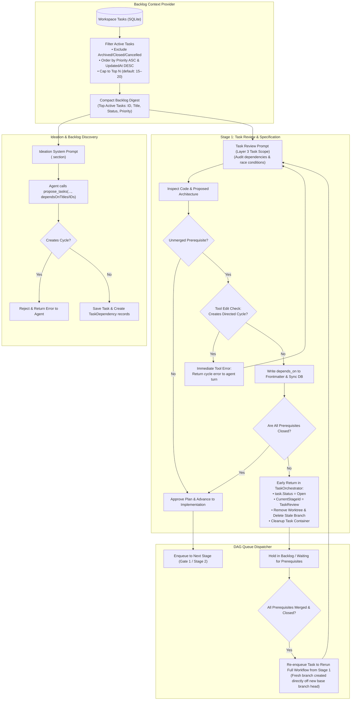

# 🔗 Step 12.1: Intelligent Task Dependency Detection in Ideation & Review Agents

> **Phase 12 Implementation Step (Extend Features - Backlog Management & Dependencies)** *(formerly Step 11.14)*  
> *Parent Plan:* [Features & Integrations Roadmap](README.md)  
> *Target Components:* `src/NightCodeForge.Agents/Ideation`, `src/NightCodeForge.Agents/Crucible`, `src/NightCodeForge.Core/Workflow`, `src/NightCodeForge.Core/Services`, `src/NightCodeForge.Web/Components/Backlog`, `src/NightCodeForge.Web/Services` | *Status:* Planned

---

## 1. Executive Objective

In real-world repositories with active backlogs (such as **OllamaRouter** and **ComicGenCLI**), tasks are rarely completely independent. If tasks that modify the same subsystem or depend on new interfaces run concurrently or out of order, merge conflicts, compiler breaks, and wasted LLM inference cycles inevitably occur.

While NightCodeForge's database and queue orchestrator already support DAG-based execution via [TaskDependency](file:///c:/Users/Julien/source/repos/jetelain/NightCodeForge/src/NightCodeForge.Core/Domain/TaskDependency.cs), agents currently operate mostly in isolation without proactive awareness of other tasks in the workspace.

This step instructs and equips both the **Ideation Agent** and the **Stage 1 (Task Review) Agent** to:
1. **Understand Workspace Backlog Context:**
   - Ingest a lightweight, token-optimized summary of active workspace tasks (capped at top 15–20 tasks ordered by priority, strictly excluding archived/closed tasks).
   - Position the context within **Layer 3 (Task Scope)** of [PromptPrefixStabilizer](file:///c:/Users/Julien/source/repos/jetelain/NightCodeForge/src/NightCodeForge.Agents/Optimizations/PromptPrefixStabilizer.cs) to prevent invalidating the 90%+ KV cache hit rate across local LLM inference engines.
2. **Detect Semantic & Architectural Dependencies in Ideation:**
   - Automatically analyze newly proposed tasks against existing backlog items.
   - Populate `dependsOnTitles` or numeric task IDs in [TaskProposal](file:///c:/Users/Julien/source/repos/jetelain/NightCodeForge/src/NightCodeForge.Core/Domain/ForgeTask.cs) / `propose_tasks` calls, resolving both titles and integer task IDs (`#101`, `101`) in [IdeationSessionState](file:///c:/Users/Julien/source/repos/jetelain/NightCodeForge/src/NightCodeForge.Web/Services/IdeationSessionState.cs).
3. **Verify & Enforce Dependencies in Stage 1 (Task Review):**
   - The Task Review agent explicitly inspects whether the task relies on APIs, models, or schema changes from another task that is not yet merged.
   - Proactively updates frontmatter `depends_on: [...]` and documents architectural rationale under `## Dependencies`.
4. **Detect & Reject Circular Dependencies Fail-Fast (In-Tool Interception):**
   - Prohibit circular dependency links (`A -> B -> A`). Intercept modifications to `docs/tasks/*.md` in [CanonicalTools](file:///c:/Users/Julien/source/repos/jetelain/NightCodeForge/src/NightCodeForge.Agents/Tools/CanonicalTools.cs) before disk writes to immediately return an in-turn tool error to the agent, enabling self-correction before stage completion.
5. **Dynamic Task Suspension, Resource Cleanup & Clean Workflow Reset:**
   - If an unclosed prerequisite is detected during Stage 1, [TaskOrchestrator](file:///c:/Users/Julien/source/repos/jetelain/NightCodeForge/src/NightCodeForge.Core/Workflow/TaskOrchestrator.cs) executes an immediate early return: suspends execution, sets `task.Status = TaskOverallStatus.Open`, resets `task.CurrentStageId = StandardStageIds.TaskReview`, and records `cohortExitReason = CohortExitReason.Yielded` (or `Suspended`).
   - Clean up execution resources: remove the task worktree via [RemoveWorktreeAsync](file:///c:/Users/Julien/source/repos/jetelain/NightCodeForge/src/NightCodeForge.Infrastructure/Git/GitWorkspaceManager.cs#L311-L325), clean up the container via `CleanupTaskContainerAsync`, and **delete or reset the feature branch** `feature/task-{taskId}` so that when the prerequisite merges, the task is re-branched cleanly from the updated base branch head.
   - Once all prerequisites reach `Closed` (merged), the task is automatically re-enqueued via DAG cascade to rerun from Stage 1 against the updated codebase.
6. **Surface Dependencies & Suspension Clearly in UI (Presentation Separation):**
   - Encapsulate blocker resolution and suspension logic in a dedicated presentation service/helper in `NightCodeForge.Web.Services` (per [AGENTS.md](file:///c:/Users/Julien/source/repos/jetelain/NightCodeForge/AGENTS.md)), keeping [KanbanCard.razor](file:///c:/Users/Julien/source/repos/jetelain/NightCodeForge/src/NightCodeForge.Web/Components/Backlog/KanbanCard.razor) and [TaskDetailDrawer.razor](file:///c:/Users/Julien/source/repos/jetelain/NightCodeForge/src/NightCodeForge.Web/Components/Backlog/TaskDetailDrawer.razor) strictly focused on markup and user interaction.
   - Display clickable dependency badges ("Depends on #12", "Blocks #15") and distinctive `⏸️ Blocked on #101` suspension indicators.

---

## 2. Dependency Discovery & Enforcement Pipeline



---

## 3. Backlog Context Injection

### 3.1 Backlog Scalability, Archival Filtering & Active Task Capping
In real-world projects with active backlogs (e.g., OllamaRouter, ComicGenCLI), repositories can easily accumulate hundreds of tasks over time if historical, completed, or rejected items are retained. Blindly injecting all workspace tasks into agent prompts would cause massive context bloat, degrade LLM instruction-following, and waste inference tokens.

To keep the backlog context lean (~250–350 tokens total) and sharply focused on actionable work, the following ingestion policy is enforced:

1. **Strict Exclusion of Archived & Terminal Tasks:**
   - Tasks in terminal states (`TaskOverallStatus.Closed`, `TaskOverallStatus.Rejected`, `TaskOverallStatus.Cancelled`) are **excluded entirely**.
   - **Rationale:** Code from `Closed` (merged) tasks already exists directly in the repository filesystem on disk. Agents can and should inspect the codebase using standard tools (`read`, `grep`, `bash`). Ingesting closed or cancelled tasks adds no actionable dependency information and clutters the prompt.

2. **Active Task Selection & Priority Ordering:**
   - Only active tasks are considered (`TaskOverallStatus.Suggested`, `Open`, `Reviewed`, `Implemented`, `Ready`).
   - Active candidates are ordered deterministically by:
     1. `Priority ASC` (`TaskPriority.Critical` [1] $\rightarrow$ `TaskPriority.High` [2] $\rightarrow$ `TaskPriority.Normal` [3] $\rightarrow$ `TaskPriority.Low` [4] $\rightarrow$ `TaskPriority.Trivial` [5]).
     2. `UpdatedAt DESC` (most recently modified tasks within the same priority tier).

3. **Configurable Cap (15–20 Tasks):**
   - The digest caps active tasks to a maximum limit (default: **20 tasks**, configurable e.g. 15 or 20 via options).
   - If the workspace has more active tasks than the cap, an explicit overflow notice is appended to the digest indicating how many tasks were omitted:
     ```xml
     <!-- Showing top 20 of 64 active tasks by priority order (P1 Critical -> P5 Trivial). Lower-priority tasks omitted. -->
     ```
   - This ensures the agent is aware that additional lower-priority tasks exist while guaranteeing the prompt token footprint remains predictable and compact.

### 3.2 Compact Backlog Digest Format
To minimize token consumption (~12–15 tokens per task), a lean XML block is injected into the agent's instructions. Note that [ForgeTask](file:///c:/Users/Julien/source/repos/jetelain/NightCodeForge/src/NightCodeForge.Core/Domain/ForgeTask.cs) stores `Id`, `Title`, `Priority`, and `Status` directly:

```xml
<existing_workspace_tasks>
<!-- Showing top 3 of 14 active tasks by priority order (excluding archived/closed tasks) -->
- #101 [P1/Critical - Ready]: Core LLM HTTP client abstractions
- #102 [P2/High - Open]: Implement Ollama streaming response parser
- #103 [P3/Normal - Suggested]: Add CLI command for model benchmarking
</existing_workspace_tasks>
```
*(If affected file hints are present in the task description or specification, they may optionally be appended as a short suffix `(Files: ...)` on a best-effort basis, but are not required for core digest operation).*

### 3.3 KV Cache Protection via Prompt Layering
NightCodeForge uses a strict 3-layer prompt structure in [PromptPrefixStabilizer](file:///c:/Users/Julien/source/repos/jetelain/NightCodeForge/src/NightCodeForge.Agents/Optimizations/PromptPrefixStabilizer.cs) to maximize KV cache hit rates (>90%) on local LLMs:
- **Layer 1 (Global Rules):** Shared across all stages and tasks.
- **Layer 2 (Stage Persona):** Shared across all tasks for a given stage.
- **Layer 3 (Task Scope):** Task-specific execution context and environment.

> [!IMPORTANT]
> Because `<existing_workspace_tasks>` changes whenever any backlog task is created, reprioritized, or transitioned, placing it in Layer 1 or Layer 2 would invalidate the prefix cache across the entire workspace on every task change.
> 
> Therefore, for Stage 1 (Task Review), `<existing_workspace_tasks>` **MUST be injected strictly within Layer 3 (Task Scope)** (appended to `taskScopeAndPlan` in `BuildLayer3TaskScope`). For Ideation, it is placed in the task guidance / workspace context section.

---

## 4. Agent Instructions & Stage Directives

### 4.1 Ideation Stage Guidance (`IdeationService.cs`)
Updated task planning guidelines in [IdeationService](file:///c:/Users/Julien/source/repos/jetelain/NightCodeForge/src/NightCodeForge.Agents/Ideation/IdeationService.cs):
```markdown
<dependency_identification_rules>
When planning or proposing tasks:
1. Cross-reference your ideas against the `<existing_workspace_tasks>` list above (which contains top active backlog tasks ordered by priority).
2. DO NOT propose duplicate tasks for capabilities already captured in existing tasks or already merged in the codebase.
3. If your proposed task builds on, calls, or extends interfaces or data models introduced in an existing open/suggested task, you MUST set 'dependsOnTitles' in your 'propose_tasks' call with the title or numeric ID (e.g., '#101' or '101') of the prerequisite task.
4. Explain to the developer why this dependency exists and the recommended order of execution.
5. AVOID CIRCULAR DEPENDENCIES: Ensure your dependencies form a strict acyclic graph. Circular dependencies will be rejected with an error.
</dependency_identification_rules>
```

In addition, [IdeationProposalViewModel.ResolveDependencies](file:///c:/Users/Julien/source/repos/jetelain/NightCodeForge/src/NightCodeForge.Web/Services/IdeationSessionState.cs#L192-L211) is updated to support parsing integer task IDs (e.g. `101`, `#101`) in addition to string title matching.

### 4.2 Stage 1: Task Review Directive (`CrucibleAgentHarness.cs`)
Updated `StandardStageIds.TaskReview` directive in [CrucibleAgentHarness](file:///c:/Users/Julien/source/repos/jetelain/NightCodeForge/src/NightCodeForge.Agents/Crucible/CrucibleAgentHarness.cs):
```csharp
StandardStageIds.TaskReview or "stage-1" =>
    "You are a Staff Software Architect & Requirements Investigator. " +
    "1. Thoroughly investigate the task requirements and inspect the codebase using 'read' and 'bash'. " +
    "2. BACKLOG DEPENDENCY AUDIT: Inspect the <existing_workspace_tasks> list (top active tasks by priority). Determine whether this task depends on any unmerged tasks (e.g. shared database migrations, missing models, interface definitions). If a prerequisite is found, record it in the YAML frontmatter under 'depends_on: [ ... ]' (using prerequisite task ID or title) and document the architectural rationale under '## Dependencies' in the markdown body. " +
    "3. CIRCULAR DEPENDENCY PREVENTION: Never introduce a circular dependency (e.g. A depends on B when B already depends on A). Cycles are rejected immediately by the edit tool. If an edit fails with a circular dependency error, re-check your assumptions and resolve the link. " +
    "4. WORKFLOW SUSPENSION AWARENESS: Note that if you declare a dependency on a task that is not yet merged/closed, this task will be suspended and reset to 'Open' until the prerequisite is completed, after which the full workflow will rerun from Stage 1 with the updated code. " +
    "5. MANDATORY FILE EDIT: Edit the task specification document on disk in docs/tasks/ using 'edit' or 'write' with updated frontmatter (including 'depends_on'), approved architecture, affected files, technical plan, dependencies, and acceptance criteria. " +
    "6. Gather all questions and ambiguities into a single 'ask' call using the question list. Do not guess. " +
    "7. Do not write production code.",
```

---

## 5. Specification Markdown Synchronization for Dependencies

When the Stage 1 review agent updates `docs/tasks/{id}-{slug}.md`, it records dependencies in two complementary locations:

### 5.1 Machine-Readable Frontmatter (`depends_on`)
The primary source of truth for automated DAG dependency synchronization is the YAML frontmatter:

```yaml
---
id: 102
title: "Implement Ollama streaming response parser"
status: "Open"
priority: 2
depends_on: [ 101 ]
---
```
*(Supports numeric task IDs like `[ 101, 103 ]` or string titles/slugs like `[ "Core LLM HTTP client abstractions" ]`)*.

### 5.2 Architectural Context Section (`## Dependencies`)
In the markdown body, the agent documents human-readable technical rationale explaining why the ordering is necessary:

```markdown
## Dependencies
- Depends on: #101 (Core LLM HTTP client abstractions) - requires `IHttpClient` interface definitions before parser implementation.
```

### 5.3 Automated Sync & Normalization
Upon file save on disk, [TaskMarkdownSyncService](file:///c:/Users/Julien/source/repos/jetelain/NightCodeForge/src/NightCodeForge.Core/Services/TaskMarkdownSyncService.cs) immediately:
1. Deserializes the YAML frontmatter `depends_on` list.
2. Resolves any string titles, slugs, or filenames to canonical task IDs.
3. Validates DAG acyclicity via `IDependencyResolutionEngine.HasCycle`.
4. Automatically creates, updates, or deletes the corresponding [TaskDependency](file:///c:/Users/Julien/source/repos/jetelain/NightCodeForge/src/NightCodeForge.Core/Domain/TaskDependency.cs) database records with full audit trail attribution (`AuditActors.User`, `TaskSyncConstants.DiskModificationsSync`).
5. Normalizes `depends_on` in the markdown file in-place to canonical integer IDs.

### 5.4 In-Tool Cycle Detection & Agent Self-Correction Loopback
To ensure the agent can self-correct within its active turn instead of failing post-stage after the turn has already ended:
1. When [CanonicalTools.EditAsync](file:///c:/Users/Julien/source/repos/jetelain/NightCodeForge/src/NightCodeForge.Agents/Tools/CanonicalTools.cs#L262) or `WriteAsync` targets a task specification file under `docs/tasks/*.md`, it parses the prospective YAML frontmatter `depends_on` field.
2. If new dependencies are declared, it tests the prospective edges against the workspace graph using [IDependencyResolutionEngine.HasCycle](file:///c:/Users/Julien/source/repos/jetelain/NightCodeForge/src/NightCodeForge.Core/Dependencies/IDependencyResolutionEngine.cs#L11).
3. If a cycle is detected:
   - The tool rejects the edit **in-place without writing to disk**.
   - It returns an immediate, model-visible error message:
     ```text
     [ERROR] Circular dependency detected: Task #{id} -> #{prereqId} creates a directed graph cycle.
     The dependency update was rejected and the file was not modified. Re-check your dependency graph and resolve the circular link.
     ```
   - Because the agent remains in its active LLM turn, it reads this tool result and issues a corrected edit to resolve the cycle.
4. As a defense-in-depth safety net, `TaskMarkdownSyncService.SyncAllTasksFromDiskAsync` also validates DAG acyclicity during post-stage synchronization.

---

## 6. Dynamic Task Suspension & Full Workflow Reset Protocol

### 6.1 Rationale for Suspension & Full Reset
When a task begins execution at Stage 1 (Task Review), the scheduler had dispatched it because it had zero unsatisfied prerequisites at that moment.

If the Task Review agent uncovers an unmerged prerequisite task (e.g. #101) that is currently `Open`, `Reviewed`, `Implemented`, or `Ready`:
- **Implementation Cannot Proceed:** Stage 2 / Stage 3 agents cannot write implementation code or tests against APIs, database tables, or contracts that only exist in an unmerged branch or proposal.
- **Workflow Must Reset to Stage 1:** When prerequisite #101 is eventually completed and merged into the base branch, the codebase will have changed (new files, modified types, new commits). The review specifications, architectural design, and affected file list established *before* #101 merged are likely stale or invalid. Therefore, the task must not merely pause mid-pipeline; it must **reset to Stage 1** so that once unblocked, the review agent re-investigates the task against the actual merged code on disk.

### 6.2 Orchestration Flow in `TaskOrchestrator`
Upon completion of Stage 1 (`StandardStageIds.TaskReview`) and post-stage disk synchronization:
1. **Unclosed Prerequisite Audit:**
   - [TaskOrchestrator](file:///c:/Users/Julien/source/repos/jetelain/NightCodeForge/src/NightCodeForge.Core/Workflow/TaskOrchestrator.cs) reloads the task's dependencies from the database.
   - It checks whether all prerequisite tasks are in `TaskOverallStatus.Closed`:
     ```csharp
     var unclosedPrerequisites = task.Dependencies
         .Where(d => d.DependsOnTask == null || d.DependsOnTask.Status != TaskOverallStatus.Closed)
         .Select(d => d.DependsOnTaskId)
         .ToList();
     ```
2. **Suspension, Resource Cleanup & State Reset Action:**
   - If `unclosedPrerequisites.Count > 0`:
     - **Status Reset:** `task.Status = TaskOverallStatus.Open`.
     - **Stage Reset:** `task.CurrentStageId = StandardStageIds.TaskReview`.
     - **Early Return:** Exit `ProcessTaskAsync` immediately. Do **not** evaluate `pipeline.GetNextStage(...)` (which would otherwise advance to Gate 1 / Implementation). Set `cohortExitReason = CohortExitReason.Yielded` (or dedicated `Suspended` exit reason).
     - **Worktree, Container & Branch Cleanup:**
       1. Remove worktree: `await _gitWorkspaceManager.RemoveWorktreeAsync(workspace, task.Id, cancellationToken)`.
       2. Clean up task container: `await _environmentProvider.CleanupTaskContainerAsync(workspace, task.Id, cancellationToken)`.
       3. **Delete/Reset Task Branch:** Invoke `_gitWorkspaceManager.DeleteTaskBranchAsync(workspace, task.Id, cancellationToken)` (or execute `git branch -D feature/task-{task.Id}`) in the canonical clone. This guarantees that when the prerequisite merges and unblocks this task, `EnsureWorktreeAsync` will provision a **brand-new branch created directly off the freshly updated base branch head**, avoiding the stale branch trap.
     - **Audit Logging:** Save task with `reason: $"Task suspended: waiting for unclosed prerequisites [{string.Join(", ", unclosedPrerequisites)}]; workflow reset to Open; worktree and stale branch cleaned up."` and actor `AuditActors.System`.
     - **Dependency Store Sync:** Notify `_dependencyStore.UpdateTaskStatusAsync(task.Id, task.Status)`.
     - **Execution Log:** Log an informational entry: `Task #{task.Id} suspended due to unclosed dependencies [{string.Join(", ", unclosedPrerequisites)}]. Worktree and branch removed; workflow will rerun from Stage 1 once prerequisites are Closed.`
     - Gracefully finish the current Hangfire job without error.
3. **Automatic Resumption via DAG Cascade:**
   - When the prerequisite tasks reach `TaskOverallStatus.Closed` (e.g. via PR merge or manual review approval), `TaskOrchestrator.CompleteMergeAsync` executes its DAG cascade unblocking check via `_dependencyEngine.ResolveCascadeUnblockedTasksAsync(task.Id)`.
   - Finding all dependencies now satisfied, the orchestrator automatically re-enqueues the unblocked task into the Hangfire queue (`_jobQueue.EnqueueStage(unblockedTask.Id, initialStage.QueueTier, unblockedTask.Priority)`).
   - The worker executes the task starting cleanly from Stage 1 (Task Review) with a fresh worktree branched off the updated base branch containing the prerequisite commits.

---

## 7. UI Presentation: Interactive Dependency Badges & Suspension States

### 7.1 Presentation Separation Architecture
In accordance with the architecture rule in [AGENTS.md](file:///c:/Users/Julien/source/repos/jetelain/NightCodeForge/AGENTS.md) (*Keep Razor components focused on presentation, layout, and user interaction*), all dependency status evaluation, blocker calculation, and badge styling logic is extracted into a dedicated helper service:
- Implement `TaskDependencyPresentationHelper` (or `ITaskDependencyPresentationService`) in `NightCodeForge.Web.Services`.
- Exposes pure, unit-testable methods:
  - `IsSuspended(ForgeTask task, IReadOnlyList<int> prerequisiteIds, IReadOnlyList<ForgeTask> allTasks)`
  - `GetUnclosedBlockers(IReadOnlyList<int> prerequisiteIds, IReadOnlyList<ForgeTask> allTasks)`
  - `FormatBlockerTooltip(...)`
- Razor components (`KanbanCard.razor`, `TaskDetailDrawer.razor`) consume this helper for binding, keeping `@code` blocks clean and uncluttered.

### 7.2 Kanban Cards ([KanbanCard.razor](file:///c:/Users/Julien/source/repos/jetelain/NightCodeForge/src/NightCodeForge.Web/Components/Backlog/KanbanCard.razor))
- Shows interactive chips:
  - 🔗 `Prereq: #101` (hover shows title and status; clicking navigates to or opens task drawer for #101).
  - ⚠️ Amber indicator if an upstream prerequisite failed or is blocked.
  - ⏸️ **Suspended Badge (`⏸️ Blocked on #101`):** When a task is in `Status == TaskOverallStatus.Open` but has unclosed dependencies, render a distinctive amber/slate suspended pill so developers immediately understand why the card is not currently executing or enqueued in DevQueue.

### 7.3 Task Detail Drawer ([TaskDetailDrawer.razor](file:///c:/Users/Julien/source/repos/jetelain/NightCodeForge/src/NightCodeForge.Web/Components/Backlog/TaskDetailDrawer.razor))
- Displays "Dependencies & Blockers" card:
  - Lists **Prerequisite Tasks** (tasks this task depends on) with status pills and completion state.
  - If any prerequisite is unclosed, displays an alert banner: `⏸️ Task execution is suspended awaiting completion of #101. Worktree will automatically initialize when unblocked.`
  - Lists **Downstream Blocked Tasks** (tasks waiting on this task).
  - Quick **Add/Remove Dependency** button linking to [DependencyLinkingModal.razor](file:///c:/Users/Julien/source/repos/jetelain/NightCodeForge/src/NightCodeForge.Web/Components/Backlog/DependencyLinkingModal.razor).

---

## 8. Implementation Checklist & Deliverables

- [ ] **Backlog Context Builder:**
  - Implement `IWorkspaceBacklogSummaryService` generating compact `<existing_workspace_tasks>` digests.
  - Filter out archived and terminal tasks (`Closed`, `Rejected`, `Cancelled`).
  - Sort active tasks by `Priority ASC` (`TaskPriority.Critical` $\rightarrow$ `Trivial`) then `UpdatedAt DESC`, capped to configurable limit (default: 20, e.g. 15–20 tasks).
  - Include overflow notice when total active tasks exceed the limit.
  - Inject summary into [IdeationService](file:///c:/Users/Julien/source/repos/jetelain/NightCodeForge/src/NightCodeForge.Agents/Ideation/IdeationService.cs) system prompt.
  - Inject summary into Stage 1 Task Review stage prompt in [PromptPrefixStabilizer](file:///c:/Users/Julien/source/repos/jetelain/NightCodeForge/src/NightCodeForge.Agents/Optimizations/PromptPrefixStabilizer.cs) strictly within **Layer 3 (Task Scope)** to preserve KV prefix cache hit rates.
- [ ] **Stage Directives & Ideation Numeric ID Updates:**
  - Update Stage 1 directive in [CrucibleAgentHarness](file:///c:/Users/Julien/source/repos/jetelain/NightCodeForge/src/NightCodeForge.Agents/Crucible/CrucibleAgentHarness.cs) to instruct agents to edit `depends_on` in YAML frontmatter, prohibit circular dependencies, and explain suspension on unclosed prerequisites.
  - Update Ideation task planning guidelines to require `dependsOnTitles` on overlapping work and forbid circular dependencies.
  - Update `IdeationProposalViewModel.ResolveDependencies` in [IdeationSessionState](file:///c:/Users/Julien/source/repos/jetelain/NightCodeForge/src/NightCodeForge.Web/Services/IdeationSessionState.cs) to support parsing numeric IDs (e.g. `101`, `#101`) in addition to titles.
- [ ] **In-Tool Cycle Detection & Agent Error Loopback:**
  - Add frontmatter dependency validation in [CanonicalTools](file:///c:/Users/Julien/source/repos/jetelain/NightCodeForge/src/NightCodeForge.Agents/Tools/CanonicalTools.cs) for `edit` and `write` targeting `docs/tasks/*.md` using [IDependencyResolutionEngine.HasCycle](file:///c:/Users/Julien/source/repos/jetelain/NightCodeForge/src/NightCodeForge.Core/Dependencies/IDependencyResolutionEngine.cs#L11).
  - Return immediate in-turn error message `[ERROR] Circular dependency detected...` without saving the invalid file, allowing the agent to self-correct during the active turn.
- [ ] **Dynamic Task Suspension, Branch Cleanup & Workflow Reset:**
  - Update [TaskOrchestrator](file:///c:/Users/Julien/source/repos/jetelain/NightCodeForge/src/NightCodeForge.Core/Workflow/TaskOrchestrator.cs) upon Stage 1 completion: if newly added dependencies are not `Closed`, suspend execution, reset `task.Status = TaskOverallStatus.Open`, reset `task.CurrentStageId = StandardStageIds.TaskReview`, and execute an immediate early return from `ProcessTaskAsync` without routing to Stage 2.
  - Remove task worktree (`RemoveWorktreeAsync`), clean up container (`CleanupTaskContainerAsync`), and delete or reset feature branch `feature/task-{task.Id}` via [GitWorkspaceManager](file:///c:/Users/Julien/source/repos/jetelain/NightCodeForge/src/NightCodeForge.Infrastructure/Git/GitWorkspaceManager.cs).
  - Verify that the existing DAG unblocking cascade in `TaskOrchestrator.CompleteMergeAsync` re-enqueues the task to rerun from Stage 1 with a fresh worktree branched off the updated base branch once prerequisites reach `Closed`.
- [ ] **UI Dependency Presentation Helper & Enhancements:**
  - Create `TaskDependencyPresentationHelper` in `NightCodeForge.Web.Services` for blocker and suspension state calculations.
  - Render prerequisite and downstream chips in [KanbanCard.razor](file:///c:/Users/Julien/source/repos/jetelain/NightCodeForge/src/NightCodeForge.Web/Components/Backlog/KanbanCard.razor).
  - Render distinctive `⏸️ Suspended (Waiting on #X)` pill on Kanban cards and drawer when an Open task has unclosed prerequisites.
  - Add dependency section with link modal in [TaskDetailDrawer.razor](file:///c:/Users/Julien/source/repos/jetelain/NightCodeForge/src/NightCodeForge.Web/Components/Backlog/TaskDetailDrawer.razor).
- [ ] **Tests:**
  - Unit test verifying backlog summary filters out archived, closed, rejected, and cancelled tasks.
  - Unit test verifying active task capping (e.g. max 15 or 20 tasks) and strict priority ordering (`Priority ASC`, then `UpdatedAt DESC`) with overflow notice.
  - Unit test verifying `<existing_workspace_tasks>` is stabilized in Layer 3 and does not alter Layer 1/2 hash.
  - Unit test verifying `CanonicalTools` file edit on `docs/tasks/*.md` rejects circular dependencies in-tool with an actionable error.
  - Unit test verifying task suspension and reset: Stage 1 adding unclosed dependency resets task to `Open` / `TaskReview`, deletes stale feature branch, and halts progression.
  - Integration test verifying that closing the prerequisite task cascades to re-enqueue the suspended task to execute Stage 1 with a clean branch off the updated base branch.
