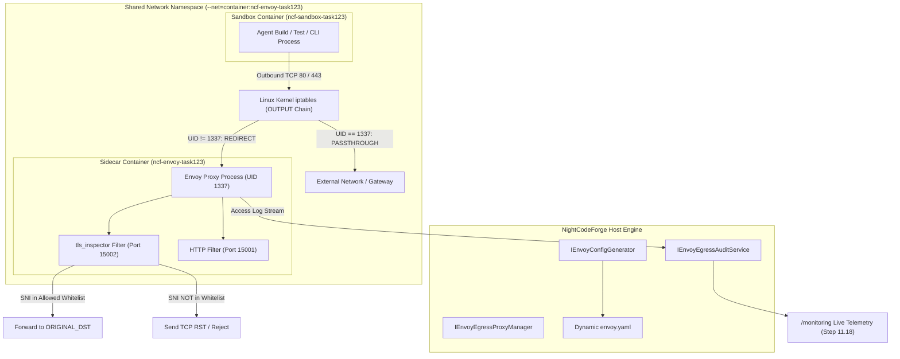

# 🛡️ Step 12.21: Container Sandbox Egress Filtering & Envoy Proxy (Istio-Style Transparent Redirection & Domain Whitelisting)

> **Phase 12 Implementation Step (Extend Features - Deep Integrations & Remote Experience - Container Security)**  
> *Parent Plan:* [Features & Integrations Roadmap](README.md)  
> *Related Steps:* [Step 12.10: MCP HTTP & Container Sandbox Integration](STEP_12_10_MCP_HTTP_AND_CONTAINER_SANDBOX_INTEGRATION.md) | [Step 12.19: Air-Gapped Offline Web App Hardening](../archive/phase-12/STEP_12_19_AIR_GAPPED_OFFLINE_WEB_APP_HARDENING.md) | [Step 12.20: Air-Gapped Search Deactivation & mdfetch Whitelisting](STEP_12_20_AIR_GAPPED_SEARCH_DEACTIVATION_AND_MDFETCH_WHITELISTING.md)  
> *Source Policy:* [AGENTS.md](../../AGENTS.md)  
> *Project Target:* `src/NightCodeForge.Core`, `src/NightCodeForge.Web`, `tests/NightCodeForge.Core.Tests`, `tests/NightCodeForge.Web.Tests` | *Status:* Planned | *Target Framework:* .NET 10 (C# 13)

> This document is a **specification**: it states required behaviors and constraints, not implementations. Implementation choices (signatures, code structure) are left to the implementer, within the constraints of the documents.

---

## 1. Executive Objective

1. **Unbypassable Outbound Network Governance for Sandboxes:** Enforce strict, deterministic domain whitelisting on all outbound traffic initiated from Docker container sandboxes executing agent-generated builds, tests, untrusted scripts, and CLI tools.
2. **Istio-Style Transparent Egress Redirection (Mode 1 - Primary):**
   - Implement kernel-level packet redirection using Linux `iptables` within a shared container network namespace (`--net=container:ncf-envoy-task<id>`), exactly mirroring the proven sidecar injection pattern of Istio service meshes.
   - Eliminate reliance on conventional `HTTP_PROXY` / `HTTPS_PROXY` environment variables, ensuring that rogue binaries, custom compilers, or compiled C/Go/Rust tools cannot bypass the proxy by ignoring environment variables or making raw TCP socket calls.
3. **Zero-Decryption TLS SNI Domain Filtering via Envoy `tls_inspector`:**
   - Deploy Envoy Proxy (`envoyproxy/envoy:v1.31-latest` or distroless slim image) configured with the `tls_inspector` listener filter.
   - Inspect the Server Name Indication (SNI) from the TLS `ClientHello` handshake on port 443 **without terminating or decrypting TLS sessions**.
   - No custom corporate root CAs or TLS certificate bundles need to be injected into sandbox containers.
   - Allowed domains are transparently forwarded to their original destination (`ORIGINAL_DST` cluster); unapproved domains receive an immediate TCP RST (or HTTP 403 Forbidden for plaintext HTTP on port 80).
4. **Fallback Explicit Proxy Mode (Mode 2):**
   - For host environments where Linux capabilities like `--cap-add=NET_ADMIN` are restricted by security policy or Docker daemon configurations (e.g., rootless Docker, restricted CI runners), provide a seamless fallback to explicit proxying via standard environment variables (`http_proxy`, `https_proxy`, `ALL_PROXY`, `no_proxy`) pointing to `http://ncf-egress-proxy:10001` on the dedicated bridge network `ncf-sandbox-net`.
5. **Pre-Configured Governance Profiles & In-App UI:**
   - In `/settings` (Container Egress Whitelist tab), provide curated outbound profiles:
     - **Strict Air-Gapped:** Zero outbound traffic allowed (all external packets dropped).
     - **Package Registries Only:** Pre-approved package ecosystems (`*.nuget.org`, `registry.npmjs.org`, `pypi.org`, `repo.maven.apache.org`, `crates.io`).
     - **Enterprise Intranet Only:** Company-internal mirrors and artifact registries (`*.corp.internal`, `artifactory.lan`).
     - **Custom Rules:** User-defined list of fully qualified domain names (FQDN) and wildcard subdomains.
6. **Real-Time Egress Audit & Security Telemetry:**
   - Stream Envoy access logs directly into NightCodeForge's live operations telemetry ([Step 11.18](../archive/phase-11/STEP_11_18_LIVE_OPERATIONS_TELEMETRY.md)) and `/monitoring` dashboard.
   - Provide immediate visual alerts when a container sandbox attempts an unauthorized outbound connection, surfacing the blocked domain, destination IP, timestamp, and triggering task ID.
7. **Strict Architectural Separation:** Comply with [AGENTS.md](../../AGENTS.md) clean presentation rules: Razor components handle only layout and user interaction; proxy lifecycle, docker command generation, YAML generation, and log parsing reside in dedicated services in `NightCodeForge.Core`.

---

## 2. Problem Statement & Threat Model

### 2.1 The Vulnerability of Unconstrained Container Sandboxes
When NightCodeForge executes autonomous workflows (Stage 2 Coder, deterministic test runners, or MCP container sandboxes), it runs compilers (`dotnet build`, `npm install`, `pip install`, `cargo build`) and user tests inside Docker containers.

Without outbound egress filtering:
1. **Supply-Chain Dependency Attacks:** A compromised open-source dependency or typosquatted package can execute post-install scripts that exfiltrate environment variables, source code, or SSH keys to an attacker's server.
2. **Untrusted Code Execution:** An LLM-generated script or malicious pull request being triaged could attempt to establish reverse shells or connect to external command-and-control (C2) servers.
3. **Air-Gap Compliance Failure:** In regulated defense, banking, or healthcare environments, any unapproved outbound packet from a computing node constitutes a compliance violation.

### 2.2 Why `HTTP_PROXY` is Insufficient on Its Own
Conventional container proxying relies on setting:
```bash
HTTP_PROXY=http://proxy:8080
HTTPS_PROXY=http://proxy:8080
```
While standard tools like `curl` or `npm` respect these variables:
- Many build tools (e.g. Go custom binaries, raw socket calls in Python/C, custom rust crates) completely ignore `HTTP_PROXY`.
- A malicious payload can deliberately unset `HTTP_PROXY` in a subshell or make a direct `socket.connect((ip, 443))` call, completely bypassing filtering.
- **The Solution:** True Istio-style kernel redirection via `iptables` inside a shared network namespace forces **every single TCP packet** through Envoy Proxy, making egress filtering physically unbypassable from user space.

---

## 3. Architecture & Technical Specification



---

### 3.1 Transparent Redirection Mechanism (Mode 1: Primary)

#### 3.1.1 Shared Network Namespace
When launching a task execution in `NightCodeForgeContainerExecutor`:
1. `IEnvoyEgressProxyManager` launches the sidecar container first:
   ```bash
   docker run -d \
     --name ncf-envoy-task<id> \
     --cap-add=NET_ADMIN \
     -v <generated_envoy.yaml>:/etc/envoy/envoy.yaml:ro \
     envoyproxy/envoy:v1.31-latest
   ```
2. The sidecar entrypoint runs an `iptables` initialization script that configures the shared network namespace:
   ```bash
   # Create user-defined chain
   iptables -t nat -N NCF_EGRESS

   # Ignore local loopback
   iptables -t nat -A NCF_EGRESS -o lo -j RETURN

   # Ignore traffic originating from Envoy itself (UID 1337) to prevent infinite loops
   iptables -t nat -A NCF_EGRESS -m owner --uid-owner 1337 -j RETURN

   # Redirect outbound HTTP (80) to Envoy HTTP port (15001)
   iptables -t nat -A NCF_EGRESS -p tcp --dport 80 -j REDIRECT --to-ports 15001

   # Redirect outbound HTTPS (443) to Envoy TLS inspector port (15002)
   iptables -t nat -A NCF_EGRESS -p tcp --dport 443 -j REDIRECT --to-ports 15002

   # Hook into OUTPUT chain
   iptables -t nat -A OUTPUT -p tcp -j NCF_EGRESS
   ```
3. The actual worker sandbox is launched attached directly to the sidecar's network namespace:
   ```bash
   docker run \
     --name ncf-sandbox-task<id> \
     --net=container:ncf-envoy-task<id> \
     -v <workspace>:/workspace \
     <sandbox_image> <command>
   ```
4. **Key Benefit:** The worker sandbox requires **zero special privileges** (no `--cap-add=NET_ADMIN`), cannot see or tamper with the `iptables` rules, and cannot route any TCP packet to port 80 or 443 without Envoy intercepting it.

---

### 3.2 Envoy Configuration & Zero-Decryption SNI Filtering

`IEnvoyConfigGenerator` dynamically renders the `envoy.yaml` specification based on the active whitelist rules:

```yaml
static_resources:
  listeners:
  # Port 15002: Transparent HTTPS (TLS SNI Inspection)
  - name: transparent_https_egress
    address:
      socket_address: { address: 0.0.0.0, port_value: 15002 }
    listener_filters:
    - name: envoy.filters.listener.original_dst
    - name: envoy.filters.listener.tls_inspector
    filter_chains:
    # Match allowed domains from SNI
    - filter_chain_match:
        server_names:
        - "api.nuget.org"
        - "*.nuget.org"
        - "registry.npmjs.org"
        - "*.github.com"
        - "github.com"
        - "*.corp.internal"
      filters:
      - name: envoy.filters.network.tcp_proxy
        typed_config:
          "@type": type.googleapis.com/envoy.extensions.filters.network.tcp_proxy.v3.TcpProxy
          stat_prefix: egress_allowed_tls
          cluster: original_dst_cluster
          access_log:
          - name: envoy.access_loggers.stdout
            typed_config:
              "@type": type.googleapis.com/envoy.extensions.access_loggers.stream.v3.StdoutAccessLog
              log_format:
                json_format:
                  timestamp: "%START_TIME%"
                  protocol: "TLS"
                  sni: "%REQUESTED_SERVER_NAME%"
                  destination: "%DOWNSTREAM_DIRECT_REMOTE_ADDRESS%"
                  action: "ALLOWED"

    # Default deny chain (any unapproved SNI or non-matching domain)
    - filter_chain_match: {}
      filters:
      - name: envoy.filters.network.tcp_proxy
        typed_config:
          "@type": type.googleapis.com/envoy.extensions.filters.network.tcp_proxy.v3.TcpProxy
          stat_prefix: egress_denied_tls
          cluster: blackhole_cluster
          access_log:
          - name: envoy.access_loggers.stdout
            typed_config:
              "@type": type.googleapis.com/envoy.extensions.access_loggers.stream.v3.StdoutAccessLog
              log_format:
                json_format:
                  timestamp: "%START_TIME%"
                  protocol: "TLS"
                  sni: "%REQUESTED_SERVER_NAME%"
                  destination: "%DOWNSTREAM_DIRECT_REMOTE_ADDRESS%"
                  action: "BLOCKED"

  # Port 15001: Transparent HTTP (Host Header Inspection)
  - name: transparent_http_egress
    address:
      socket_address: { address: 0.0.0.0, port_value: 15001 }
    listener_filters:
    - name: envoy.filters.listener.original_dst
    - name: envoy.filters.listener.http_inspector
    filter_chains:
    - filters:
      - name: envoy.filters.network.http_connection_manager
        typed_config:
          "@type": type.googleapis.com/envoy.extensions.filters.network.http_connection_manager.v3.HttpConnectionManager
          stat_prefix: egress_http
          route_config:
            name: egress_http_routes
            virtual_hosts:
            - name: allowed_hosts
              domains: ["*.nuget.org", "registry.npmjs.org", "*.corp.internal"]
              routes:
              - match: { prefix: "/" }
                route: { cluster: original_dst_cluster }
            - name: deny_all
              domains: ["*"]
              routes:
              - match: { prefix: "/" }
                direct_response: { status: 403, body: { inline_string: "Blocked by NightCodeForge Egress Policy" } }

  clusters:
  - name: original_dst_cluster
    type: ORIGINAL_DST
    lb_policy: CLUSTER_PROVIDED
    connect_timeout: 3s

  - name: blackhole_cluster
    type: STATIC
    connect_timeout: 0.25s
    lb_policy: ROUND_ROBIN
    hosts: []
```

---

### 3.3 Explicit Proxy Fallback Mode (Mode 2)

If the host environment does not permit `--cap-add=NET_ADMIN` on the sidecar:
1. `IEnvoyEgressProxyManager` runs a single shared Envoy proxy on the Docker network `ncf-sandbox-net` listening on port `10001` (HTTP CONNECT forward proxy mode).
2. When launching the sandbox container, `NightCodeForgeContainerExecutor` injects standard proxy environment variables:
   ```bash
   -e HTTP_PROXY=http://ncf-egress-proxy:10001 \
   -e HTTPS_PROXY=http://ncf-egress-proxy:10001 \
   -e ALL_PROXY=http://ncf-egress-proxy:10001 \
   -e NO_PROXY=localhost,127.0.0.1
   ```
3. Envoy inspects the `CONNECT` hostname for HTTPS requests and the `Host` header for HTTP requests, applying the exact same domain whitelist.

---

### 3.4 In-App Settings & Telemetry Management

#### 3.4.1 Configuration UI (`/settings` -> Container Egress Whitelist)
Build `src/NightCodeForge.Web/Components/Settings/ContainerEgressSettingsTab.razor`:
- **Mode Selector:**
  - Radio buttons: `Transparent (Istio-style iptables, Recommended)` vs `Explicit HTTP_PROXY (Fallback)`.
  - Status indicator showing whether host Docker daemon supports `--cap-add=NET_ADMIN`.
- **Profile Selector & Domain List:**
  - Presets: "Strict Air-Gapped", "Standard Developer (NuGet + npm + PyPI + GitHub)", "Enterprise Mirror Only", "Custom".
  - Interactive table of allowed domain patterns with wildcard support (`*.nuget.org`, `github.com`).
  - "Test Domain" utility to simulate whether a given FQDN would be allowed or dropped.
- **Audit Stream:**
  - Live table of recent outbound connections parsed by `IEnvoyEgressAuditService`, highlighting blocked connections in red.

#### 3.4.2 Integration with Live Telemetry ([Step 11.18](../archive/phase-11/STEP_11_18_LIVE_OPERATIONS_TELEMETRY.md))
- Envoy stdout JSON logs are captured by `IEnvoyEgressAuditService`.
- If an outbound attempt is `BLOCKED`, a high-priority telemetry alert event is dispatched over SignalR to `/monitoring` and the active task execution view, notifying the user:
  `"⚠️ Blocked outbound connection from sandbox: Attempted to reach 'malicious-domain.com:443' (not in allowed whitelist)."`

---

## 4. Definition of Done (DoD) Checklist

- [ ] **Core Contracts & Configuration:**
  - [ ] Define `ContainerEgressOptions`, `EgressProfile`, and `EgressRedirectionMode` in `NightCodeForge.Core`.
  - [ ] Implement `IEnvoyConfigGenerator` generating dynamic `envoy.yaml` with `tls_inspector` and `original_dst` clusters.
  - [ ] Implement `IEnvoyEgressProxyManager` handling sidecar container lifecycle, `--net=container` attachment, and cleanup.
  - [ ] Implement `IEnvoyEgressAuditService` parsing structured JSON access logs from Envoy stdout.
- [ ] **Docker Execution Integration:**
  - [ ] Update `NightCodeForgeContainerExecutor.BuildDockerRunArgs` to support:
    - Mode 1: Transparent `--net=container:ncf-envoy-task<id>`.
    - Mode 2: Explicit `--network ncf-sandbox-net` + `HTTP_PROXY` env injection.
  - [ ] Implement automatic capability probing to detect if host supports `NET_ADMIN`.
- [ ] **Web Presentation & Settings UI:**
  - [ ] Create `ContainerEgressSettingsTab.razor` adhering strictly to presentation separation (no raw Docker or socket calls in `@code`).
  - [ ] Support profile switching (Strict Air-Gapped, Standard Developer, Enterprise, Custom).
  - [ ] Add domain test verification widget.
  - [ ] Connect blocked egress alerts to `/monitoring` and `LiveOperationsTelemetryHub`.
- [ ] **Testing & Quality Assurance:**
  - [ ] Unit tests for `EnvoyConfigGenerator` asserting valid YAML generation for various whitelist combinations.
  - [ ] Unit tests for `EnvoyEgressAuditService` parsing JSON logs and detecting blocked events.
  - [ ] Integration / mock tests for container argument generation in `NightCodeForgeContainerExecutor`.
  - [ ] Verify test suite passes with `dotnet test --filter "Category!=Acceptance&Category!=E2E"`.

---

## 5. Verification & Test Matrix

| Test ID | Area | Execution | Expected Invariant |
| :--- | :--- | :--- | :--- |
| **TC-12.21-01** | YAML Generation | Generate config with `*.nuget.org` and `github.com` | `envoy.yaml` contains `tls_inspector`, correct `server_names`, `ORIGINAL_DST` cluster, and blackhole cluster. |
| **TC-12.21-02** | Transparent Redirection Args | Call `BuildDockerRunArgs` with Mode = Transparent | Returns args containing `--net=container:ncf-envoy-task...`; zero `HTTP_PROXY` env vars injected. |
| **TC-12.21-03** | Explicit Proxy Fallback Args | Call `BuildDockerRunArgs` with Mode = Explicit | Returns args containing `--network ncf-sandbox-net`, `HTTP_PROXY`, `HTTPS_PROXY`. |
| **TC-12.21-04** | Egress Log Parsing | Feed Envoy JSON log line with `action: "BLOCKED"` to `IEnvoyEgressAuditService` | Emits structured `EgressBlockedEvent` with destination SNI and timestamp. |
| **TC-12.21-05** | Strict Air-Gapped Profile | Select "Strict Air-Gapped" profile | Whitelist contains 0 allowed domains; all outbound TCP 80/443 traffic routed to blackhole. |
