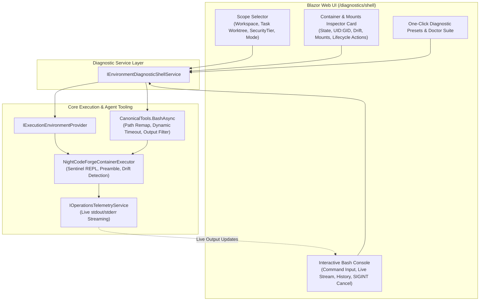

# 🖥️ Step 12.22: Interactive Container & Execution Environment Diagnostic Bash Console

> **Phase 12 Implementation Step (Extend Features - Diagnostics, Sandboxing & Developer Ergonomics)**  
> *Parent Plan:* [Features & Integrations Roadmap](README.md)  
> *Related Steps:* [Step 11.18: Live Operations Telemetry](../archive/phase-11/STEP_11_18_LIVE_OPERATIONS_TELEMETRY_LLM_SHELL_AND_ROUTER.md) | [Step 11.21: Container ICU & Dynamic Timeouts](../archive/phase-11/STEP_11_21_CONTAINER_ICU_DYNAMIC_TIMEOUTS_AND_REVIEW_TESTS.md) | [Step 11.22: Container Git Worktree Relative Paths](../archive/phase-11/STEP_11_22_CONTAINER_GIT_WORKTREE_RELATIVE_PATHS.md) | [Step 11.26: Container Reuse Validation & Cleanup](../archive/phase-11/STEP_11_26_CONTAINER_REUSE_VALIDATION_AND_TASK_CLEANUP.md) | [Step 12.14: Global Skills Injection & Stack Tooling](../archive/phase-12/STEP_12_14_GLOBAL_SKILLS_INJECTION_AND_STACK_TOOLING.md) | [Step 12.21: Container Sandbox Egress Filtering](STEP_12_21_CONTAINER_SANDBOX_EGRESS_FILTERING_AND_ENVOY_PROXY.md)  
> *Source Policy:* [AGENTS.md](../../AGENTS.md)  
> *Project Target:* `src/NightCodeForge.Core`, `src/NightCodeForge.Infrastructure`, `src/NightCodeForge.Agents`, `src/NightCodeForge.Web`, `tests/NightCodeForge.Infrastructure.Tests`, `tests/NightCodeForge.Web.Tests` | *Status:* Planned | *Target Framework:* .NET 10 (C# 13)

> This document is a **specification**: it states required behaviors and constraints, not implementations. Implementation choices (signatures, code structure) are left to the implementer, within the constraints of the documents.

---

## 1. Executive Objective

1. **Agent-Identical "Bash" Tool Diagnostic Page (`/diagnostics/shell`):** Provide a dedicated interactive diagnostic page in `NightCodeForge.Web` that allows developers to execute arbitrary `bash` commands inside a workspace's or task's execution environment (`ContainerSandbox`, `WslDirect`, or `BareHost`) using the **exact same execution pipeline, volume mounts, environment variables, `PATH` synthesis, user identity (`uid:gid`), and sentinel REPL session** as an autonomous agent's `bash` tool.
2. **Dual Execution Modes (Raw Environment vs. Canonical Agent `bash` Tool):**
   - **Agent `bash` Tool Mode (Default):** Invokes commands directly through `CanonicalTools.BashAsync(...)`, exercising path remapping (`/workspace/...`), read-only command validation (`ReadOnlyCommandValidator` when `RestrictedReadOnly`), dynamic build/test timeout escalation, `HeadTailBuffer` truncation, and compiler/test output processing.
   - **Raw Execution Environment Mode:** Invokes `IExecutionEnvironment.ExecuteAsync(...)` directly on the resolved `NightCodeForgeContainerExecutor` (or WSL/Host runner) with exact working directory and timeout overrides (bypassing `CanonicalTools` minimum timeout clamping and `ReadOnlyCommandValidator` so OS/container-level enforcement can be probed directly).
3. **Target Scope & Security Tier Selection:** Allow switching between:
   - **Workspace Canonical Scope (`TaskId = null`):** Targets the workspace-level sandbox (`/workspace/clone` or `/workspace`).
   - **Task Worktree Scope (`TaskId = N`):** Targets a specific task's isolated container (`ncf-sandbox-task-{id}`) and worktree mount (`/workspace/task-{id}` with layered read-only canonical clone protection `/workspace/clone:ro` and `/workspace/clone/.git:rw`, or `/clone:ro` and `/clone/.git:rw` when mounted outside `/workspace`).
   - **Sandbox Security Tier:** Toggle between `SandboxSecurityTier.Standard` (read-write workspace, network enabled, host UID/GID) and `SandboxSecurityTier.RestrictedReadOnly` (`--network none`, `:ro` workspace, `--read-only` rootfs, `1000:1000`, scrubbed env vars, distinct `-ro` container name suffix to avoid destroying the active `Standard` container session).
4. **Live Environment & Container Mount Inspector:** Display real-time metadata of the resolved environment: container name, image, running state, WSL2 bridge status, resolved `uid:gid`, synthesized `PATH`, active volume mounts (`HostPath -> ContainerPath (:ro/:rw)`), and container configuration drift status (`DetectContainerDrift`).
5. **One-Click Diagnostic Presets & Automated "Environment Doctor":** Provide curated 1-click diagnostic commands and a structured multi-check "Doctor" runner to immediately verify toolchains (`dotnet`, `git`, `rg`, `node`, `python3`, `csnav`, `mdfetch`, `codecondenser`), writable directories (`$HOME`, `/tmp`, `/cache/*`, `/workspace`), Git worktree relative pointers, and locale/ICU settings.
6. **Strict UI & Presentation Separation (`AGENTS.md` Compliance):** Keep the Razor page strictly focused on layout and user interaction; encapsulate all environment resolution, container inspection, command execution, and doctor checks in a dedicated service (`IEnvironmentDiagnosticShellService`).

---

## 2. Problem Statement & Motivation

### 2.1 The "Blind Box" Container Debugging Problem
When an agent executes commands via the `bash` tool in `ContainerSandbox` or `WslDirect` mode, `NightCodeForgeContainerExecutor` and `ExecutionEnvironmentProvider` perform non-trivial environment orchestration:
- Dynamic bind-mounting of host SDKs (`/usr/share/dotnet`, `/usr/lib/x86_64-linux-gnu`, `/usr/lib/jvm`, `/etc/ssl/certs`), package caches (`/cache/nuget`, `/cache/npm`, `/cache/uv`), companion tools (`/opt/ncf-dotnet-tools`), global skills (`/workspace/skills`), and shared `/tmp`.
- Layered worktree protection (`/workspace/task-{id}` RW, `/clone` RO, `/clone/.git` RW) and relative Git worktree pointer rewriting.
- Per-command shell preamble exporting synthesized deduplicated `PATH`, `HOME` fallback (`/ncf-home` vs `/tmp/ncf-home-$(id -u)`), `DOTNET_SYSTEM_GLOBALIZATION_INVARIANT=0`, `LANG=en_US.UTF-8`, and `git config --global --add safe.directory '*'`.

When something fails in this setup—such as a missing shared library (`libicu`, `libunwind`), a read-only `$HOME/.dotnet` lock, a broken worktree `.git` relative path, a missing companion tool on `PATH`, or a stale container with drifted volume mounts—diagnosing the problem currently requires either:
1. Triggering a full LLM agent stage and hoping the agent runs diagnostic commands, wasting time and tokens; or
2. Manually running `docker exec` from a host terminal, which **does not** reproduce the exact preamble, `PATH` synthesis, `CanonicalTools` path remapping, or persistent sentinel REPL state used by `NightCodeForgeContainerExecutor`.

### 2.2 Instant Verification of Environment Fixes
A built-in diagnostic console that runs commands through the exact `IExecutionEnvironmentProvider` + `CanonicalTools` pipeline lets developers:
- Reproduce any failing agent `bash` command in milliseconds.
- Inspect the exact `env`, `PATH`, mount table, and UID/GID inside the persistent shell session.
- Force container recreation or shell process restart with a single click when testing infrastructure changes.

---

## 3. Architecture & Technical Specification



### 3.1 Diagnostic Service Contract (`IEnvironmentDiagnosticShellService`)

All non-trivial logic—resolving environments, inspecting container state, running commands, and evaluating health checks—must live in a dedicated service so Razor components remain presentational:

```csharp
namespace NightCodeForge.Core.Interfaces;

public enum DiagnosticExecutionPipeline
{
    /// <summary>
    /// Executes via CanonicalTools.BashAsync, matching the exact agent 'bash' tool behavior
    /// (including /workspace path remapping, dynamic timeouts, and tool output formatting).
    /// </summary>
    AgentBashTool = 0,

    /// <summary>
    /// Executes directly via IExecutionEnvironment.ExecuteAsync on the underlying runner.
    /// </summary>
    RawExecutionEnvironment = 1
}

public record EnvironmentDiagnosticTarget(
    int WorkspaceId,
    int? TaskId = null,
    SandboxSecurityTier SecurityTier = SandboxSecurityTier.Standard,
    DiagnosticExecutionPipeline Pipeline = DiagnosticExecutionPipeline.AgentBashTool,
    string? WorkingDirectoryOverride = null,
    int? TimeoutSecondsOverride = null);

public record EnvironmentMountInfo(
    string HostPath,
    string ContainerPath,
    bool IsReadOnly);

public record EnvironmentInspectionSnapshot(
    int WorkspaceId,
    string WorkspaceName,
    ExecutionMode ConfiguredMode,
    ExecutionTier ResolvedTier,
    int? TaskId,
    SandboxSecurityTier SecurityTier,
    string DefaultWorkingDirectory,
    string? ContainerName,
    string? ContainerImage,
    bool? IsContainerRunning,
    string? DriftDescription,
    string? UserUidGid,
    bool UseWsl,
    string? WslDistribution,
    string SynthesizedPath,
    IReadOnlyList<EnvironmentMountInfo> ConfiguredMounts);

public record DiagnosticCommandResult(
    string CommandLine,
    string EffectiveWorkingDirectory,
    int ExitCode,
    string Output,
    string Error,
    TimeSpan Duration,
    bool IsTruncated,
    DateTimeOffset ExecutedAt);

public enum DoctorCheckStatus
{
    Passed,
    Warning,
    Failed
}

public record EnvironmentDoctorCheckItem(
    string Category,
    string Name,
    DoctorCheckStatus Status,
    string Summary,
    string? DiagnosticOutput);

public interface IEnvironmentDiagnosticShellService
{
    Task<EnvironmentInspectionSnapshot> InspectEnvironmentAsync(
        EnvironmentDiagnosticTarget target,
        CancellationToken cancellationToken = default);

    Task<DiagnosticCommandResult> ExecuteCommandAsync(
        EnvironmentDiagnosticTarget target,
        string command,
        CancellationToken cancellationToken = default);

    Task<IReadOnlyList<EnvironmentDoctorCheckItem>> RunEnvironmentDoctorAsync(
        EnvironmentDiagnosticTarget target,
        CancellationToken cancellationToken = default);

    Task RecreateEnvironmentContainerAsync(
        EnvironmentDiagnosticTarget target,
        CancellationToken cancellationToken = default);
}
```

### 3.2 Exposing Container Inspection, Lifecycle, & Cancellation Hooks on `NightCodeForgeContainerExecutor`

To support accurate diagnostics without duplicating Docker CLI logic in the UI layer:
1. Expose a read-only inspection method on `NightCodeForgeContainerExecutor` (or via an interface `IInspectableExecutionEnvironment`) returning:
   - Resolved `ContainerExecutorOptions` (`ContainerNameOrId`, `ContainerImage`, `DefaultWorkingDirectory`, `UserUidGid`, `UseWsl`, `WslDistribution`).
   - Synthesized `PATH` via `NightCodeForgeContainerExecutor.ComputePathEnvironmentVariable(options)`.
   - Configured volume mounts via `NightCodeForgeContainerExecutor.BuildVolumeMounts(options)` (ensuring layered canonical clone protection mounts `/workspace/clone:ro` and `/workspace/clone/.git:rw` are included even when `CanonicalClonePath` is a subdirectory of `HostWorkspacePath`).
   - Current container running state and drift report (`DetectContainerDrift()`).
2. **Distinct `RestrictedReadOnly` Container Naming:**
   - In `ExecutionEnvironmentProvider.GetEnvironment(...)`, append a `-ro` suffix to `containerName` when `securityTier == SandboxSecurityTier.RestrictedReadOnly` (e.g., `ncf-sandbox-1-ro` or `ncf-sandbox-1-task-42-ro`). This prevents toggling between `Standard` and `RestrictedReadOnly` in the diagnostic UI (or during read-only agent stages) from triggering `DetectContainerDrift()` and destroying the active `Standard` container and its live REPL session.
3. **Explicit `CancellationToken` SIGINT Recovery in `NightCodeForgeContainerExecutor.ExecuteAsync`:**
   - Currently, `NightCodeForgeContainerExecutor.ExecuteAsync` only sends `\x03` (`SIGINT`) + 2-second sentinel drain + `ForceRestartShellProcess()` inside `catch (TimeoutException)`.
   - Update `ExecuteAsync` so that when `OperationCanceledException` is thrown while `ReadUntilSentinelAsync` is awaiting command completion, the executor also sends `\x03` (`SIGINT`) and drains the sentinel (with a 2-second grace window, falling back to `ForceRestartShellProcess()`) before releasing `_execLock` and rethrowing `OperationCanceledException`. Without this, cancelling a running command leaves the child process running inside the persistent bash session and corrupts subsequent commands.
4. Support explicit **Recreate / Reset Container** from the diagnostic service:
   - Disposes the cached shell session for `(WorkspaceId, SecurityTier, TaskId)` in `ExecutionEnvironmentProvider`.
   - Removes the container (`docker rm -f <containerName>`) if in `ContainerSandbox` mode.
   - Re-provisions the environment cleanly on the next command or "Ensure Running" action.

### 3.3 Built-In Diagnostic Presets & "Environment Doctor" Suite

#### 3.3.1 One-Click Preset Commands
The UI provides quick-action preset buttons that populate and/or immediately execute common diagnostic probes:

| Preset Name | Command | Purpose |
| :--- | :--- | :--- |
| **Identity & Directories** | `id && pwd && echo "HOME=$HOME" && ls -la` | Verifies UID/GID mapping, working directory, `$HOME` fallback, and file ownership. |
| **Environment & PATH** | `echo "PATH=$PATH" && env \| sort` | Inspects deduplicated `PATH`, locale (`LANG`, `LC_ALL`), ICU, and cache env vars. |
| **SDKs & Companion Tools** | `for cmd in git rg dotnet node npm python3 csnav mdfetch codecondenser; do printf "%-15s: %s\n" "$cmd" "$(which $cmd 2>/dev/null \|\| echo MISSING)"; done` | Checks availability of all core toolchains and Phase 12 companion tools on `PATH`. |
| **Mount & Write Probe** | `df -h && for dir in /workspace /workspace/clone "$HOME" /tmp /cache/nuget /cache/npm /opt/ncf-dotnet-tools /workspace/skills; do [ -e "$dir" ] && ([ -w "$dir" ] && echo "RW: $dir" \|\| echo "RO: $dir") \|\| echo "MISSING: $dir"; done` | Verifies which mounted directories exist and whether they are writable (`RW`) or read-only (`RO`). |
| **Git & Worktree Status** | `git status && git rev-parse --git-dir --git-common-dir && git branch -a && git worktree list` | Diagnoses Git repository validity, relative worktree pointers, `/workspace/clone/.git` (or `/clone/.git`) access, and `safe.directory`. |
| **.NET & ICU Probe** | `dotnet --info` | Verifies mounted host `.NET` SDKs, runtime packs, and `libicu` globalization readiness. |

#### 3.3.2 Automated "Run Environment Doctor"
Clicking **🩺 Run Environment Doctor** executes a structured diagnostic script via the underlying `IExecutionEnvironment` in a single round-trip and parses the results into a checklist of `EnvironmentDoctorCheckItem` cards (`Passed`, `Warning`, `Failed`):
1. **User Identity & Writable `$HOME`:** Confirms `id -u` matches expected UID (`1000` in `RestrictedReadOnly`, host UID in `Standard`) and `$HOME` (and `$HOME/.dotnet`) is writable.
2. **Writable `/tmp` & Package Caches:** Confirms `/tmp` is writable (`mktemp` test) and `/cache/nuget`, `/cache/npm`, `/cache/uv` are accessible in `Standard` tier.
3. **Workspace & Clone Mount Integrity:** Confirms `/workspace` (or `/workspace/task-{id}`) exists, is writable in `Standard` tier (or read-only in `RestrictedReadOnly` tier), and the canonical clone directory (`/workspace/clone` or `/clone` per `ConfiguredMounts`) is protected read-only while its `.git` directory (`/workspace/clone/.git` or `/clone/.git`) is writable for task worktrees in `Standard` tier.
4. **Git Worktree & Branch Resolution:** Confirms `git status` exits with `0` without `dubious ownership` or broken `.git` gitdir pointer errors.
5. **Toolchain & Companion CLI Availability:** Checks `git`, `rg`, stack SDK (`dotnet` / `node` / `python3`), and companion tools (`csnav`, `mdfetch`, `codecondenser`).
6. **Globalization / ICU Support:** Confirms `DOTNET_SYSTEM_GLOBALIZATION_INVARIANT=0` works without crashing on `libicu`.

### 3.4 Blazor Page UX (`EnvironmentDiagnosticShell.razor`)

Route: `@page "/diagnostics/shell"` (also accessible from `NavMenu.razor` under `Execution` or `System` as **🐚 Container Shell** and linked from `Live Telemetry` / `Git & Host Sync`).

1. **Top Control Bar (Target Context):**
   - **Workspace Selector:** Synchronized with `WorkspaceState`, allowing selection of any registered workspace.
   - **Target Scope Dropdown:**
     - `Workspace Canonical (/workspace/clone)` (`TaskId = null`)
     - Active / Recent Tasks (`Task #{id}: {Title} (/workspace/task-{id})`)
   - **Security Tier Selector:** `Standard (Read/Write)` vs `RestrictedReadOnly (Isolated)`
   - **Execution Pipeline Toggle:**
     - `Agent 'bash' Tool (CanonicalTools)`: Exercises `CanonicalTools.BashAsync` (including `ReadOnlyCommandValidator` in `RestrictedReadOnly` tier, `/workspace` path resolution, and agent build/test minimum timeout escalation).
     - `Raw IExecutionEnvironment`: Invokes `IExecutionEnvironment.ExecuteAsync` directly, honoring exact `TimeoutSecondsOverride` and bypassing `ReadOnlyCommandValidator` so OS/container-level `:ro` mounts and `--network none` can be tested directly.
   - **Working Directory & Timeout Inputs:** Optional override fields (placeholder shows resolved default working directory, e.g. `/workspace/task-42`, and default timeout `300s`).
2. **Collapsible Environment & Mounts Inspector Drawer/Card:**
   - Displays badges for `ExecutionTier`, `ContainerName`, `ContainerImage`, `Running / Stopped`, `UID:GID`, and `WSL2 Distro`.
   - Alerts with a warning banner if `DriftDescription != null` (e.g., mount or image drift detected).
   - Expandable table of `ConfiguredMounts` (`HostPath` $\rightarrow$ `ContainerPath`, `RO`/`RW` badge) and synthesized `PATH` entries.
   - Action buttons: **🔄 Refresh Inspection**, **🩺 Run Environment Doctor**, **♻️ Recreate Container / Reset Shell**.
3. **Interactive Terminal & Command History Panel:**
   - Multi-line / single-line monospace command input (`Enter` to run, `Shift+Enter` for newline, `Up`/`Down` to cycle command history).
   - **Run Command (`▶ Execute`)** and **Cancel (`⏹ Stop / SIGINT`)** buttons.
   - Live streaming output viewer subscribing to `IOperationsTelemetryService` shell output events filtered to the in-flight diagnostic command (and indicating if `_execLock` is waiting on an active background agent command), so long-running commands (`dotnet build`, `apt-cache`) stream line-by-line in real time.
   - Session transcript log showing executed commands in chronological order with exit code badge (`0` emerald / non-zero coral), execution duration (`ms`), effective working directory, and a **Copy Output** / **Clear Console** button.

---

## 4. Definition of Done (DoD) Checklist

- [ ] **Core Contracts & Service Layer:**
  - [ ] Define `IEnvironmentDiagnosticShellService`, `EnvironmentDiagnosticTarget`, `EnvironmentInspectionSnapshot`, `DiagnosticCommandResult`, and `EnvironmentDoctorCheckItem` in `NightCodeForge.Core`.
  - [ ] Implement `EnvironmentDiagnosticShellService` orchestrating `IExecutionEnvironmentProvider`, `CanonicalTools.BashAsync`, container drift inspection, and structured Environment Doctor probes.
  - [ ] Expose container inspection metadata and container reset/recreation helpers on `NightCodeForgeContainerExecutor` and `IExecutionEnvironmentProvider` (including `-ro` container name isolation for `RestrictedReadOnly` tier and layered `/workspace/clone:ro` + `/workspace/clone/.git:rw` mount protection when `CanonicalClonePath` resides under `HostWorkspacePath`).
  - [ ] Update `NightCodeForgeContainerExecutor.ExecuteAsync` so `CancellationToken` cancellation sends `\x03` (`SIGINT`) and drains the sentinel (or restarts the shell process) before releasing `_execLock`.
- [ ] **Blazor Web UI (`/diagnostics/shell`):**
  - [ ] Create `src/NightCodeForge.Web/Components/Pages/EnvironmentDiagnosticShell.razor` adhering strictly to `AGENTS.md` presentation separation rules.
  - [ ] Implement target scope selector (Workspace vs Task Worktree, `Standard` vs `RestrictedReadOnly`, `AgentBashTool` vs `RawExecutionEnvironment`).
  - [ ] Render the Environment & Volume Mounts Inspector panel with container drift warnings and **Recreate Container** action.
  - [ ] Implement 1-click diagnostic presets and the visual **Environment Doctor** report card.
  - [ ] Implement the interactive bash terminal with live output streaming via `IOperationsTelemetryService`, command history, exit code badges, and cancellation (`SIGINT`).
  - [ ] Add navigation link in `NavMenu.razor` (`🐚 Container Shell`).
- [ ] **Automated Tests:**
  - [ ] Unit tests in `NightCodeForge.Infrastructure.Tests` / `NightCodeForge.Web.Tests` for `EnvironmentDiagnosticShellService` covering both `AgentBashTool` and `RawExecutionEnvironment` pipelines, `CancellationToken` SIGINT recovery, doctor check parsing, and container reset.
  - [ ] bUnit component tests in `NightCodeForge.Web.Tests` verifying preset execution, inspection rendering, doctor results display, and command execution UI states.
  - [ ] Verify all non-E2E tests pass with `dotnet test --filter "Category!=Acceptance&Category!=E2E"`.

---

## 5. Verification & Test Matrix

| Test ID | Scenario | Method | Expected Outcome |
| :--- | :--- | :--- | :--- |
| **TC-12.22-01** | Agent `bash` Tool Parity | Execute `pwd && env` in `AgentBashTool` mode for Task #N | Runs through `CanonicalTools.BashAsync` inside `/workspace/task-N` with full container preamble and returns formatted output and exit code `0`. |
| **TC-12.22-02** | Restricted Read-Only Sandbox Probe | Switch Security Tier to `RestrictedReadOnly` (`-ro` container) and run **Mount & Write Probe** preset in `RawExecutionEnvironment` mode (and write attempt in `AgentBashTool` mode) | In `RawExecutionEnvironment`, `/workspace` and rootfs report `RO`, `id` reports `1000:1000`, and sensitive env vars are scrubbed without destroying the `Standard` container; in `AgentBashTool`, write commands return `[READ-ONLY VIOLATION]`. |
| **TC-12.22-03** | Automated Environment Doctor | Click **🩺 Run Environment Doctor** on a configured workspace | Evaluates identity, writable `$HOME` & `/tmp`, mounts (`/workspace/clone:ro` & `.git:rw`), Git worktree status, SDKs/tools, and ICU, rendering individual `Passed`/`Warning`/`Failed` cards. |
| **TC-12.22-04** | Container Recreate & Drift Recovery | Click **♻️ Recreate Container** when a container is running or drifted | Terminates existing shell session, removes container via Docker CLI, and spawns a fresh container on next command execution. |
| **TC-12.22-05** | Runaway Command Cancellation (`SIGINT`) | Execute `sleep 60` and click **⏹ Stop / SIGINT** after 2 seconds | Cancels execution token, triggers `NightCodeForgeContainerExecutor` `\x03` SIGINT + sentinel drain recovery on `OperationCanceledException`, and keeps the shell session responsive for subsequent commands. |

