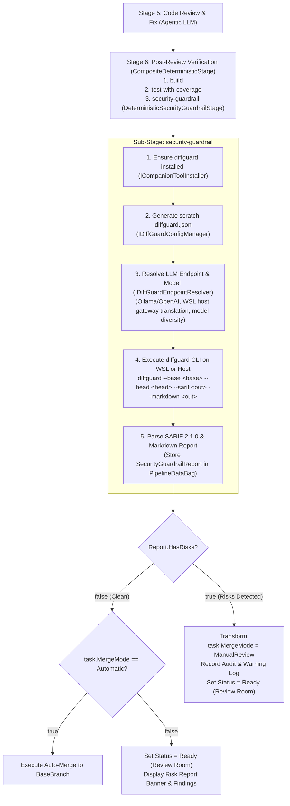

# 🛡️ Step 12.28A: DiffGuard CLI Security Scanner, Endpoint Wiring & Post-Review Guardrail Stage

> **Feature Implementation Step (Part 1 of 2 — `Pmad.AI.DiffGuard` CLI Integration, Configuration, Endpoint Wiring, Post-Review Guardrail Stage & Auto-Merge Downgrade)**  
> *Parent Plan:* [Features & Integrations Roadmap](README.md)  
> *CLI Tool Package:* [`Pmad.AI.DiffGuard` on NuGet](https://www.nuget.org/packages/Pmad.AI.DiffGuard/)  
> *Companion Step:* [Step 12.28B: Review Room Risk Report UI & Security Guardrail Settings](STEP_12_28B_REVIEW_ROOM_RISK_REPORT_AND_GUARDRAIL_SETTINGS_UI.md)  
> *Source Policy:* [AGENTS.md](../../AGENTS.md)  
> *Project Target:* [`src/NightCodeForge.Core`](../../src/NightCodeForge.Core), [`src/NightCodeForge.Infrastructure`](../../src/NightCodeForge.Infrastructure), [`src/NightCodeForge.Agents`](../../src/NightCodeForge.Agents), [`tests/NightCodeForge.Core.Tests`](../../tests/NightCodeForge.Core.Tests), [`tests/NightCodeForge.Agents.Tests`](../../tests/NightCodeForge.Agents.Tests)  
> *Status:* Planned | *Target Framework:* .NET 10 (C# 13)

> This document is a **specification**: it states required behaviors and constraints, not implementations. Implementation choices (signatures, code structure) are left to the implementer, within the constraints of the documents.

---

## 1. Executive Objective & Threat Model

Recent empirical studies show that open-weight coding models can inadvertently introduce subtle backdoors, covert payloads, unverified external dependencies, or excessive blast-radius edits during autonomous task execution.

NightCodeForge delegates Git diff security screening and backdoor auditing to the dedicated CLI tool **`diffguard`** ([`Pmad.AI.DiffGuard`](https://www.nuget.org/packages/Pmad.AI.DiffGuard/)).

`diffguard` executes directly inside the target execution environment (**WSL2** or **bare Unix host**, as well as host Windows when configured). It unifies two critical audit layers into a single CLI execution:
1. **Deterministic Static Analysis:** Instantaneous rule-based scanning for public IPs, non-allowlisted network endpoints, secrets, high Shannon entropy, Base64/Hex decoders, Unicode BiDi Trojan Source obfuscation (`CVE-2021-42574`), non-image binaries (with strict magic-byte validation), unverified package dependencies, version downgrades, blast-radius thresholds, and context-aware test tolerance.
2. **Cross-Model LLM Security Judge:** Stateless semantic evaluation of diff hunks using an independent model family (e.g. [`jetelain/Flint`](https://ollama.com/jetelain/Flint) or [`jetelain/Gemma-4-26B-A4B`](https://ollama.com/jetelain/Gemma-4-26B-A4B)) via Ollama or OpenAI endpoints, detecting intentional backdoors, logic bombs, and weakened access controls.

> [!IMPORTANT]
> **Scope Exclusion:** Prompt injection detection rules (`PI001`–`PI013`) are explicitly disabled (`--no-prompt-injection` or `"enablePromptInjectionRules": false`) for code changes produced by the coding agent, keeping the scan strictly focused on executable code, dependencies, and diff blast radius.

---

## 2. Pipeline Architecture & Workflow



---

## 3. Technical Specification

### 3.1 Companion Tool Auto-Provisioning (`ICompanionToolInstaller`)

1. **Tool Registration:**
   - Register `Pmad.AI.DiffGuard` in [`CompanionToolInstaller.cs`](../../src/NightCodeForge.Infrastructure/Execution/CompanionToolInstaller.cs) as a universal companion tool:
     ```csharp
     new CompanionToolSpec(
         ToolCommand: "diffguard",
         PackageId: "Pmad.AI.DiffGuard",
         ApplicableStacks: new[] { CodeStack.Universal })
     ```
2. **Environment Verification:**
   - Before executing diff scans, check whether `diffguard` is available in the target environment via `ICompanionToolInstaller.IsToolInstalledAsync("diffguard", ...)`.
   - If not installed, run `EnsureToolInstalledAsync("diffguard", ...)` to auto-install via `dotnet tool install -g Pmad.AI.DiffGuard` (or `dotnet tool update -g Pmad.AI.DiffGuard`) on the host or inside the active WSL distribution.

---

### 3.2 Domain Models & Configuration (`SecurityGuardrailOptions`)

Define strongly-typed configuration and finding models in `NightCodeForge.Core`:

1. **`SecurityRiskCategory` Enum:**
   - `HardcodedNetworkEndpoint` (`NET-*`)
   - `BackdoorPattern` (`BD-*`, `LLM-*`)
   - `SuspiciousPayload` (`PAY-*` secrets, entropy, hex/base64, unicode)
   - `BinaryArtifact` (`PAY-BIN-*` non-image binaries or disguised files)
   - `UnverifiedDependency` (`DEP-NEW-*`)
   - `DependencyDowngrade` (`DEP-DOWN-*`)
   - `ExcessiveBlastRadius` (`SCOPE-*`)

2. **`SecurityRiskSeverity` Enum:**
   - `Low = 0`, `Medium = 1`, `High = 2`, `Critical = 3`

3. **`SecurityRiskFinding` Record:**
   - `string RuleId` (e.g. `NET-IP-001`, `PAY-SEC-001`, `DEP-NEW-001`, `SCOPE-PCT-001`, `LLM-JUDGE-001`)
   - `string Title`
   - `SecurityRiskCategory Category`
   - `SecurityRiskSeverity Severity`
   - `string? FilePath` (workspace-relative path)
   - `int? LineNumber`
   - `string Description`
   - `string? Snippet`

4. **`SecurityGuardrailReport` Record:**
   - `bool HasRisks => Findings.Count > 0;`
   - `bool AutoMergeDowngraded { get; set; }`
   - `string? JudgeModelId { get; init; }`
   - `int ScannedFilesCount { get; init; }`
   - `int AddedLinesCount { get; init; }`
   - `int DeletedLinesCount { get; init; }`
   - `double CodebaseImpactPercent { get; init; }`
   - `double DurationMs { get; init; }`
   - `List<SecurityRiskFinding> Findings { get; init; } = [];`
   - `string MarkdownSummary { get; init; } = string.Empty;`

5. **`SecurityGuardrailOptions` (Configurable Settings & Allowlists):**
   ```csharp
   public class SecurityGuardrailOptions
   {
       public bool Enabled { get; set; } = true;
       public SecurityRiskSeverity MinimumRiskSeverity { get; set; } = SecurityRiskSeverity.Medium;

       // Blast Radius Thresholds
       public double MaxCodebaseImpactPercent { get; set; } = 10.0;
       public double MaxFileImpactPercent { get; set; } = 15.0;
       public int MaxChangedFiles { get; set; } = 25;
       public int MaxChangedLines { get; set; } = 1_500;

       // Payload, Entropy & Obfuscation Thresholds
       public double ShannonEntropyThreshold { get; set; } = 4.50;
       public int EntropyMinStringLength { get; set; } = 20;
       public int MinSuspiciousBase64Length { get; set; } = 64;
       public int MinSuspiciousHexLength { get; set; } = 64;
       public int MaxLineLength { get; set; } = 500;

       // Allowlists & Exclusions
       public List<string> WellKnownSafeDomains { get; set; } =
       [
           "localhost", "127.0.0.1", "[::1]",
           "schemas.microsoft.com", "*.w3.org", "json-schema.org", "example.com", "*.example.com",
           "github.com", "*.github.com", "*.githubusercontent.com", "nuget.org", "*.nuget.org",
           "npmjs.org", "*.npmjs.org", "pypi.org", "*.pypi.org", "crates.io", "*.crates.io",
           "pkg.go.dev", "ollama.com", "*.ollama.com", "microsoft.com", "*.microsoft.com", "dotnet.microsoft.com"
       ];

       public List<string> AllowedIpAddresses { get; set; } = ["127.0.0.1", "0.0.0.0", "::1"];
       public List<string> WellKnownSafePackages { get; set; } =
       [
           "Microsoft.*", "System.*", "Azure.*", "xunit*", "Moq", "bunit*",
           "FluentAssertions", "AwesomeAssertions", "CliWrap", "DiffPlex", "Hangfire*",
           "OllamaSharp", "StreamJsonRpc", "Pmad.*", "ModelContextProtocol*", "OpenAI",
           "playwright", "@playwright/*", "pytest", "requests", "pydantic"
       ];

       public List<string> ExcludedFileGlobs { get; set; } = [".scratch/**", "docs/tasks/**", "docs/transcripts/**"];
       public List<string> TestFileGlobs { get; set; } = ["test/**", "tests/**", "src/*.Tests/**"];
       public bool EnableTestTolerance { get; set; } = true;
       public bool FlagPrivateNetworkIps { get; set; } = false;

       // LLM Judge Settings
       public bool EnableLlmJudge { get; set; } = true;
       public List<string> PreferredJudgeModels { get; set; } = ["jetelain/Flint", "jetelain/Gemma-4-26B-A4B"];
       public string? ExplicitJudgeModelId { get; set; }
       public int MaxJudgeChunkBytes { get; set; } = 120_000;
       public bool FilterDeletedLines { get; set; } = true;
   }
   ```

---

### 3.3 Configuration Management (`IDiffGuardConfigManager`)

To prevent repository workspace pollution and avoid triggering `diffguard`'s repository configuration tampering check (`BD-CONFIG-001`), NightCodeForge generates a runtime configuration file in the task's execution scratch folder (e.g. `.scratch/diffguard.config.json`):

1. **Mapping `SecurityGuardrailOptions` to `.diffguard.json` Schema:**
   - Serializes thresholds, allowlists, test file globs, test tolerance toggle, and `enablePromptInjectionRules: false`.
2. **Scratch Lifecycle:** Passed explicitly via `--config <scratchPath>` to each `diffguard` execution.

---

### 3.4 Inference Endpoint Wiring & WSL Host Gateway Translation (`IDiffGuardEndpointResolver`)

`IDiffGuardEndpointResolver` prepares the inference flags for `diffguard` based on NightCodeForge's active provider settings (`LlmProviderOptions`):

1. **Ollama / OllamaRouter Provider:**
   - Provider argument: `--llm-provider ollama`
   - Model: `--llm-model <ResolvedJudgeModel>`
   - Endpoint: `--llm-endpoint <EffectiveEndpoint>`
   - **WSL Host Gateway Resolution:**
     - When `diffguard` is executed inside WSL2 (`Tier == ExecutionTier.WslDirect`) and the configured endpoint is loopback (`http://localhost:11434`, `http://127.0.0.1:11434`), WSL cannot connect to a Windows host service on `127.0.0.1` under NAT networking.
     - The resolver resolves the Windows host IP (via WSL default gateway `ip route show default | awk '{print $3}'`, `/etc/resolv.conf` nameserver, or `host.docker.internal`).
     - Replaces `localhost`/`127.0.0.1` with the Windows host IP (e.g. `http://172.x.x.1:11434`) so `diffguard` inside WSL communicates directly with the Windows Ollama instance.
2. **OpenAI-Compatible Provider:**
   - Provider argument: `--llm-provider openai`
   - Model: `--llm-model <ResolvedJudgeModel>`
   - Endpoint: `--llm-endpoint <OpenAiEndpoint>`
   - Credentials: Pass API key via environment variable `DIFFGUARD_API_KEY` (or `--llm-api-key`) in the execution environment process specification to avoid leaking API tokens in process listings.
3. **Cross-Model Selection & Model Diversity:**
   - Candidate priority order:
     1. If `SecurityGuardrailOptions.ExplicitJudgeModelId` is configured, use it.
     2. Otherwise, query available models via `ILlmModelCatalogService` and select the first matching model from `PreferredJudgeModels` (`jetelain/Flint`, `jetelain/Gemma-4-26B-A4B`).
     3. If neither preferred judge model is installed and no override is provided:
        - When `options.EnableLlmJudge == true`, emit a finding (`LLM-JUDGE-UNAVAILABLE`, `Category = BackdoorPattern`, `Severity = Medium`) warning the maintainer in the Review Room that cross-model LLM judge verification could not run. This also prevents unverified automatic merge.
   - If the resolved judge model family matches the task's primary `Implementation` model family, record a warning notice on `SecurityGuardrailReport`.

---

### 3.5 DiffGuard CLI Runner Execution (`IDiffRiskScanner` / `DiffGuardCliRunner`)

`IDiffRiskScanner` coordinates the execution of `diffguard` via `IExecutionEnvironment`:

1. **Path Resolution & Command Assembly:**
   - Working Directory: Target git repository worktree.
   - For WSL2 environments, convert Windows scratch and repo paths using `IWorkspacePathResolver` (e.g. `/mnt/c/...`).
   - Command Arguments:
     ```bash
     diffguard \
       --base <baseBranch> \
       --head <targetShaOrHead> \
       --config <scratchConfigPath> \
       --sarif <scratchSarifPath> \
       --markdown <scratchMarkdownPath> \
       --format console \
       --min-severity Medium \
       --no-prompt-injection \
       [--llm-provider <ollama|openai> --llm-model <modelId> --llm-endpoint <endpoint> --filter-deleted-lines --max-chunk-bytes 120000]
     ```
     *(If `options.EnableLlmJudge == false`, pass `--no-llm` instead).*
2. **Exit Code Semantics:**
   - **`0` (Success / Clean):** No findings meeting or exceeding `MinimumRiskSeverity`.
   - **`2` (Risks Detected):** One or more findings met or exceeded `MinimumRiskSeverity`. Findings are captured in the SARIF file.
   - **`1` (Error):** CLI error, invalid configuration, or Git execution failure. Must throw a domain `SecurityGuardrailExecutionException` to fail fast.
   - **`130` (Canceled):** Operation was aborted via cancellation token.

---

### 3.6 SARIF 2.1.0 Ingestion & Domain Mapping

1. **SARIF Parsing:**
   - Read the generated SARIF file (`<scratchSarifPath>`).
   - Map SARIF rule ID prefixes to `SecurityRiskCategory`:
     - `NET-*` $\rightarrow$ `SecurityRiskCategory.HardcodedNetworkEndpoint`
     - `BD-*`, `LLM-*` $\rightarrow$ `SecurityRiskCategory.BackdoorPattern`
     - `PAY-BIN-*` $\rightarrow$ `SecurityRiskCategory.BinaryArtifact`
     - `PAY-*` $\rightarrow$ `SecurityRiskCategory.SuspiciousPayload`
     - `DEP-NEW-*` $\rightarrow$ `SecurityRiskCategory.UnverifiedDependency`
     - `DEP-DOWN-*` $\rightarrow$ `SecurityRiskCategory.DependencyDowngrade`
     - `SCOPE-*` $\rightarrow$ `SecurityRiskCategory.ExcessiveBlastRadius`
   - Map SARIF level to `SecurityRiskSeverity`:
     - `error` $\rightarrow$ `SecurityRiskSeverity.High` (or `Critical` for critical rule IDs such as `NET-URL-002`, `PAY-UNI-001`, `PAY-BIN-002`)
     - `warning` $\rightarrow$ `SecurityRiskSeverity.Medium`
     - `note` $\rightarrow$ `SecurityRiskSeverity.Low`
   - Map location to `FilePath`, `LineNumber`, `Snippet`, and `Description`.

---

### 3.7 Post-Review Guardrail Stage (`DeterministicSecurityGuardrailStage`)

1. **Stage Registration & Standard Workflow Definition:**
   - Add stage constants:
     - `DeterministicStageConstants.SecurityGuardrailSubStage = "security-guardrail";`
     - `StageImplementationTypes.DeterministicSecurityGuardrail = "deterministic-security-guardrail";`
   - Register in `WorkflowStageRegistry`.
   - Update `StandardStageIds.PostReviewVerification` in `StandardWorkflowDefinitions.cs` so Stage 6 runs:
     `"ExtraParameters": {"Stages": "build,test-with-coverage,security-guardrail"}`
2. **Execution Behavior:**
   - Resolves target execution environment for the task workspace.
   - Ensures `diffguard` is installed via `ICompanionToolInstaller`.
   - Generates scratch `.diffguard.json` configuration.
   - Resolves LLM judge endpoint and model (if enabled).
   - Executes `diffguard` via `IExecutionEnvironment.ExecuteAsync`, streaming console output live to `IAgentActivityStreamer`.
   - Reads SARIF and Markdown report files into `SecurityGuardrailReport`.
   - Stores report in `context.DataBag.Set(PipelineDataBagKeys.SecurityGuardrailReport, report)`.
   - Stores Markdown summary in `PipelineDataBagKeys.StageOutput(StageId)` for inspection in the Task Execution Inspector.
   - Returns `StageExecutionResult.Success()` so the pipeline advances directly to the Review Room / merge gate without looping back to the coding agent.

---

### 3.8 Automatic Downgrade from `MergeMode.Automatic` to `MergeMode.ManualReview` (`TaskOrchestrator`)

In `TaskOrchestrator.cs`, in the pipeline completion handler immediately prior to auto-merge evaluation:

1. Inspect `pipelineContext.DataBag.Get<SecurityGuardrailReport>(PipelineDataBagKeys.SecurityGuardrailReport)`.
2. If `report is { HasRisks: true }`:
   - If `task.MergeMode == MergeMode.Automatic`:
     - Mutate `task.MergeMode = MergeMode.ManualReview`.
     - Set `report.AutoMergeDowngraded = true` and update `PipelineDataBagKeys.SecurityGuardrailReport` in `pipelineContext.DataBag`.
     - Log a warning and record an execution log entry:
       `"🛡️ Security guardrail detected {report.Findings.Count} risk(s). Downgraded MergeMode from Automatic to ManualReview for human inspection."`
   - The task transitions to `TaskOverallStatus.Ready`, halting before merge and appearing in the **Review Room** with all detected findings attached.

---

## 4. Definition of Done (DoD) Checklist

- [ ] Add `Pmad.AI.DiffGuard` to `CompanionToolInstaller.DefaultKnownTools` with auto-installation via `dotnet tool install -g Pmad.AI.DiffGuard` on host and WSL.
- [ ] Define `SecurityRiskCategory`, `SecurityRiskSeverity`, `SecurityRiskFinding`, `SecurityGuardrailReport`, and `SecurityGuardrailOptions` in `NightCodeForge.Core`.
- [ ] Implement `IDiffGuardConfigManager` in `NightCodeForge.Infrastructure` to serialize `SecurityGuardrailOptions` into a valid `.diffguard.json` scratch file.
- [ ] Implement `IDiffGuardEndpointResolver` in `NightCodeForge.Infrastructure` / `NightCodeForge.Agents` resolving Ollama and OpenAI provider options, credentials, and WSL host IP gateway translation.
- [ ] Implement cross-model judge candidate resolution selecting from `PreferredJudgeModels` (`jetelain/Flint`, `jetelain/Gemma-4-26B-A4B`) and handling missing judge models with `LLM-JUDGE-UNAVAILABLE` findings.
- [ ] Implement `DiffGuardCliRunner` / `IDiffRiskScanner` in `NightCodeForge.Infrastructure` / `NightCodeForge.Agents` using `IExecutionEnvironment` to invoke `diffguard` with `--base`, `--head`, `--config`, `--sarif`, `--markdown`, `--no-prompt-injection`, and LLM flags.
- [ ] Implement SARIF 2.1.0 parser mapping `diffguard` SARIF output to `IReadOnlyList<SecurityRiskFinding>`.
- [ ] Implement `DeterministicSecurityGuardrailStage` (`security-guardrail`), registering it in `WorkflowStageRegistry` and including it in Stage 6 (`PostReviewVerification`) in `StandardWorkflowDefinitions`.
- [ ] Update `TaskOrchestrator` to automatically downgrade `task.MergeMode` from `Automatic` to `ManualReview` when `SecurityGuardrailReport.HasRisks == true` and transition to `Ready` without loopback.
- [ ] Write unit and integration tests in `NightCodeForge.Core.Tests` and `NightCodeForge.Agents.Tests` covering configuration generation, CLI argument assembly, SARIF deserialization, endpoint resolution (including WSL host IP translation), judge model resolution, and `TaskOrchestrator` auto-merge downgrade logic.
- [ ] Verify all non-E2E tests pass via `dotnet test --filter "Category!=Acceptance&Category!=E2E"`.

