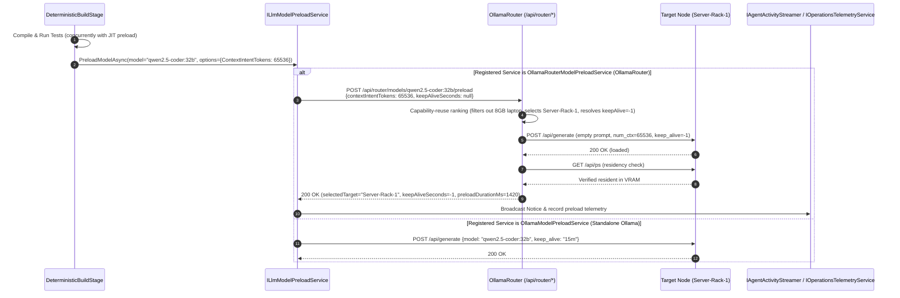

# 🚀 Step 12.29: Smart OllamaRouter Model Preload & Context-Intent Warmup

> **Phase 12 Feature Specification (Fleet Optimization, Latency Hiding & Placement Telemetry)**  
> *Parent Plan:* [Features & Integrations Roadmap](README.md)  
> *Target Projects:* [`src/NightCodeForge.Core`](file:///c:/Users/Julien/source/repos/jetelain/NightCodeForge/src/NightCodeForge.Core), [`src/NightCodeForge.Infrastructure`](file:///c:/Users/Julien/source/repos/jetelain/NightCodeForge/src/NightCodeForge.Infrastructure), [`src/NightCodeForge.Web`](file:///c:/Users/Julien/source/repos/jetelain/NightCodeForge/src/NightCodeForge.Web), [`tests/NightCodeForge.Core.Tests`](file:///c:/Users/Julien/source/repos/jetelain/NightCodeForge/tests/NightCodeForge.Core.Tests), [`tests/NightCodeForge.Infrastructure.Tests`](file:///c:/Users/Julien/source/repos/jetelain/NightCodeForge/tests/NightCodeForge.Infrastructure.Tests), [`tests/NightCodeForge.Web.Tests`](file:///c:/Users/Julien/source/repos/jetelain/NightCodeForge/tests/NightCodeForge.Web.Tests)  
> *Status:* Planned | *Target Framework:* .NET 10 (C# 13)  
> *Dependencies & OpenAPI References:* [Step 11.33: Unified LLM Provider & Dynamic Fleet Integration](../archive/phase-11/STEP_11_33_UNIFIED_LLM_PROVIDER_DYNAMIC_CONTEXT_AND_FLEET_INTEGRATION.md), [Step 12.15: Deep OllamaRouter Fleet Provisioning](STEP_12_15_DEEP_OLLAMAROUTER_FLEET_PROVISIONING_AND_IN_APP_SETUP.md), [Step 12.5: Dual Model Role Configuration](STEP_12_5_DUAL_MODEL_ROLE_CONFIGURATION_AND_DIFFICULTY_ESCALATION.md), [OllamaRouter OpenAPI 3.1.1 Spec](http://localhost:11434/api/router/openapi.json)  
> *Aligns With:* [AGENTS.md](../../AGENTS.md), [docs/PLAN.md](../PLAN.md)

> This document is a **specification**: it states required behaviors and constraints, not implementations. Implementation choices (signatures, code structure) are left to the implementer, within the constraints of the documents.

---

## 1. Executive Summary & Problem Statement

### 1.1 The Limitations of Naive Preloading
During automated pipeline execution, NightCodeForge executes deterministic stages (such as `Stage 2: DeterministicBuildStage` or post-implementation lint/format checks) before invoking long-running LLM agent stages (`implementation` or `code-review-fix`). When the `JitModelPreload` optimization flag is enabled, NightCodeForge attempts to warm up the upcoming stage's model concurrently in the background while compilation and tests run.

Currently, `OllamaModelPreloadService` invokes standard Ollama `POST /api/generate` with an empty prompt:
```csharp
var payload = new { model = modelName, keep_alive = keepAlive };
await _httpClient.PostAsJsonAsync(OllamaApiPaths.Generate, payload, ct);
```

When routed through **OllamaRouter**, this naive approach exhibits two critical shortcomings:
1. **Blind Target Selection (Lack of Context Intent):**  
   The naive call provides no context sizing information. OllamaRouter must guess how much context memory is required. If a smaller target (such as an 8 GB laptop node) is idle, OllamaRouter might preload a 32B model there with an 8k context lease. When the subsequent `implementation` agent turn arrives requiring 64k or 128k context, the small node is disqualified, forcing a slow mid-pipeline reload onto a high-VRAM server node—completely defeating JIT latency hiding.
2. **Zero Residency Confirmation & Blind Outcome:**  
   Standard `POST /api/generate` returns a bare HTTP status code without reporting *which* node in the fleet received the model, whether `/api/ps` confirmed active GPU residency, or how many milliseconds the warm-up took.

### 1.2 Objective: Smart Context-Intent Preload
OllamaRouter introduces a specialized model preload endpoint in its **OpenAPI 3.1.1 specification**:
- **`POST /api/router/models/{*tail}` with `/preload` suffix** (e.g. `POST /api/router/models/{modelName}/preload`):  
  Selects the optimal fleet target using capability-reuse ranking (idle-first, server-class first for large context, least-busy), issues a bounded keep_alive-aware load with explicit `contextIntentTokens`, confirms GPU residency via `/api/ps`, and returns a detailed `RouterModelPreloadResponse`.

**By simply triggering `POST /api/router/models/{model}/preload` with our context intent (`contextIntentTokens`), NightCodeForge lets OllamaRouter make the best placement choice autonomously**:
1. Passes `contextIntentTokens` (and optional pinned `target`) derived from the upcoming stage profile or task difficulty tier, while leaving `keepAliveSeconds = null` by default so OllamaRouter applies its per-node class policy (`-1` indefinite retention on server-class nodes $\ge$ 32 GB VRAM, `900s` on desktop nodes).
2. Lets OllamaRouter evaluate candidate targets, select the ideal node, and warm the model with an appropriately sized KV cache lease.
3. Captures target node assignment, applied context leases (`numCtx`), keep-alive policy (`keepAliveSeconds`), and load duration in `IAgentActivityStreamer` and `IOperationsTelemetryService`.
4. Uses startup polymorphic DI registration in `InferenceServiceCollectionExtensions` (`OllamaRouterModelPreloadService` for `OllamaRouter`, `OllamaModelPreloadService` for standalone `Ollama`, and `NoOpModelPreloadService` for `OpenAiCompatible`) with zero runtime branching on `LlmProviderType`.

---

## 2. OllamaRouter Smart Preload API Specification

### 2.1 Preload Route (`POST /api/router/models/{*tail}`)

Registered on the catch-all template `/api/router/models/{*tail}`. The router extracts the model name by stripping the mandatory trailing `/preload` suffix (supporting namespaced models such as `jetelain/qwen3.5-9b` via `/api/router/models/jetelain/qwen3.5-9b/preload`).

#### Request Parameters & Body
Parameters may be passed via query string and/or an optional JSON body (JSON body values take precedence):

```json
{
  "keepAliveSeconds": null,
  "contextIntentTokens": 65536,
  "target": null
}
```

- `keepAliveSeconds` (*int?*): `-1` for indefinite retention (recommended for server-class nodes), positive integer for seconds (e.g. `900` for 15m; `0` or `<= -2` returns `400 Bad Request`). When omitted (`null`), OllamaRouter's `PreloadKeepAlivePolicy` resolves the target node's default policy automatically: target-specific `KeepAliveSeconds` override if configured, `-1` (indefinite) for server/cloud-class nodes ($\ge$ 32 GB VRAM), or `900s` (15m) for desktop/laptop nodes.
- `contextIntentTokens` (*int?*): `>= 1` (`< 1` returns `400 Bad Request`), represents the expected prompt + completion context window required by the upcoming stage.
  - **Hard vs. Soft Context Intent & Fit Margin (`contextFitMarginTokens`):** In OllamaRouter (`ModelCapabilityEngine.EvaluateClientContext`), when `contextIntentTokens` is explicitly specified (`softIntent == false`), candidate eligibility enforces `contextIntentTokens + contextFitMarginTokens <= target.ContextCeiling` (where `contextFitMarginTokens` defaults to `8,192` tokens). When `contextIntentTokens` is `null` (`softIntent == true`), OllamaRouter uses the model's `recommendedContextWindow` (`max(target.ContextCeiling)` across hardware-capable targets) *without* adding the 8,192-token margin above the ceiling, while still preferring server-class targets whenever `intent >= 65,536`.
- `target` (*string?*): Optional target node name to pin placement (bypasses capability-reuse ranking, subject to target existence and eligibility).

#### Response Payload (`RouterModelPreloadResponse`, `200 OK`)
The endpoint is **fail-soft** once a candidate target is selected: daemon load failures return HTTP `200 OK` with `loadAccepted: false`, never `5xx`.

```json
{
  "model": "qwen2.5-coder:32b",
  "selectedTarget": "Server-Rack-1",
  "keepAliveSeconds": -1,
  "numCtx": 65536,
  "contextIntentTokens": 65536,
  "loadAccepted": true,
  "residencyConfirmed": true,
  "preloadDurationMs": 1420,
  "candidates": [
    {
      "target": "Server-Rack-1",
      "eligible": true,
      "inFlightRequests": 0,
      "isResident": true,
      "contextCeiling": 131072,
      "serverClass": true,
      "busy": false,
      "skipReason": null
    },
    {
      "target": "Laptop-Workstation",
      "eligible": false,
      "inFlightRequests": 0,
      "isResident": false,
      "contextCeiling": 16384,
      "serverClass": false,
      "busy": false,
      "skipReason": "Target context ceiling (16,384) below context intent (65,536)"
    }
  ],
  "reason": "Server-class target selected with existing residency and 0 in-flight requests"
}
```

#### Status Codes
- `200 OK`: Candidate target selected and model load attempted (inspect `loadAccepted` and `residencyConfirmed` for outcome).
- `400 Bad Request`: Invalid `keepAliveSeconds` (`0` or `<= -2`) or `contextIntentTokens` (`< 1`).
- `404 Not Found`: Missing `/preload` route suffix, empty model segment, model not found in the fleet catalog, or pinned `target` does not exist.
- `503 Service Unavailable`: Model exists in the catalog, but no candidate target is currently online and eligible for the requested `contextIntentTokens` (response body is still `RouterModelPreloadResponse` with `loadAccepted: false` and `candidates` carrying per-target `skipReason`).

---

## 3. NightCodeForge System Architecture & Implementation



### 3.1 Preload Service Abstraction (`ILlmModelPreloadService`)

Update `ILlmModelPreloadService` in `NightCodeForge.Core.Interfaces`:

```csharp
public record ModelPreloadOptions(
    int? KeepAliveSeconds = null,
    int? ContextIntentTokens = null,
    string? Target = null);

public record ModelPreloadCandidate(
    string Target,
    bool Eligible,
    int InFlightRequests,
    bool IsResident,
    int ContextCeiling,
    bool ServerClass,
    bool Busy,
    string? SkipReason);

public record ModelPreloadResult(
    bool Success,
    string Model,
    string? SelectedTarget,
    int? KeepAliveSeconds,
    int? NumCtx,
    int? ContextIntentTokens,
    bool? LoadAccepted,
    bool? ResidencyConfirmed,
    long? PreloadDurationMs,
    IReadOnlyList<ModelPreloadCandidate> Candidates,
    string? Reason);

public interface ILlmModelPreloadService
{
    Task<ModelPreloadResult> PreloadModelAsync(
        string modelName,
        ModelPreloadOptions? options = null,
        CancellationToken cancellationToken = default);
}
```

- **Pause Guard:** Both `OllamaRouterModelPreloadService` and `OllamaModelPreloadService` must check `IOperationsControlService.IsPaused` before issuing HTTP requests and throw `OperationsPausedException` if global operations are paused.
- **Keep-Alive Resolution:**
  - `OllamaRouterModelPreloadService` forwards `options?.KeepAliveSeconds` as-is (`null` by default, letting OllamaRouter apply `PreloadKeepAlivePolicy`: `-1` on server-class nodes, `900s` on desktop nodes).
  - `OllamaModelPreloadService` (standalone Ollama) formats `options?.KeepAliveSeconds` as seconds (`"{seconds}s"` or `-1`) when provided, or falls back to `WorkflowDefaults.ModelPreloadKeepAlive` (`"15m"`) when `null`.
- **Success Semantics:** For `OllamaRouterModelPreloadService`, `ModelPreloadResult.Success` is `true` if and only if the HTTP status is `200 OK` and `response.LoadAccepted == true`.

### 3.2 Context-Intent Resolution in Stages

In `DeterministicBuildStage` (and deterministic post-review quality gate stages):
1. **Optimization Flag Check & Effective Profile Resolution:**
   - Resolve the upcoming stage's effective `ModelProfile` (falling back to the global profile if the stage-specific profile is null, and applying Step 12.5 difficulty escalation when `TaskDifficulty` is `Difficult` or `Expert`).
   - Only trigger background preload when `effectiveProfile.OptimizationFlags.JitModelPreload` is `true` and the resolved model name is non-empty.
2. **Context Intent & Fit-Margin Safety:**
   - Determine desired context intent from:
     1. Explicit `effectiveProfile.ContextWindowTokens` if configured on the profile (`> 0`).
     2. Or `TaskDifficulty` tier when specified: `Standard` $\to$ `32,768`, `Difficult` $\to$ `65,536`, `Expert` $\to$ `null` (soft intent, using OllamaRouter's `recommendedContextWindow` so `131,072` ceilings are not disqualified by the additive `8,192`-token `contextFitMarginTokens` gate).
     3. Or `null` (soft intent) when using default/dynamic context sizing so OllamaRouter selects the highest hardware-supported `recommendedContextWindow` (which automatically triggers `>= 65,536` server-class preference).
   - If an explicit `ContextIntentTokens` request returns `503 Service Unavailable` because of OllamaRouter's additive `contextFitMarginTokens` (`8,192`) or lower fleet ceiling, `OllamaRouterModelPreloadService` retries once with `contextIntentTokens = null` (soft intent, using the fleet's `recommendedContextWindow`) before reporting qualification failure.
3. **Target Pinning:** Pass `Target = effectiveProfile.RoutingTarget` when a specific routing target is pinned on the profile.

### 3.3 Gateway & Telemetry Integration

1. **Activity Stream & Telemetry Broadcasting:** When `PreloadModelAsync` completes:
   - On success (`LoadAccepted == true`): broadcast `AgentActivityEvent` (`AgentActivityKind.Notice` or `AgentActivityKind.OptimizationAction`) via `IAgentActivityStreamer` and record preload status in `IOperationsTelemetryService`:
     `"JIT Model Preload: 'qwen2.5-coder:32b' resident on node 'Server-Rack-1' (65,536 tokens, keep-alive: -1, 1,420 ms)"`.
   - On `503 Service Unavailable` or `LoadAccepted == false`: broadcast a structured warning notice including the router's `reason` and candidate `skipReason`s, alerting operators that execution may overflow to cloud or clamp context.
2. **Monitoring UI & Presentation Separation (`AGENTS.md`):**
   - In `/monitoring`: display a "JIT Warmup" indicator on `ActiveOperationsHero.razor` and `WorkerStatusCard.razor` showing active background preloads and confirmed resident target nodes.
   - Per `AGENTS.md`, formatting and state projection for preload telemetry must live in `OperationsTelemetryUiService` rather than inside `.razor` `@code` blocks.

---

## 4. Definition of Done (DoD) Checklist

- [ ] **Phase 1: Domain Models & Gateway Contracts in `NightCodeForge.Core`:**
  - [ ] Add `ModelPreloadOptions`, `ModelPreloadCandidate`, and `ModelPreloadResult` records to `NightCodeForge.Core.Interfaces` (or `NightCodeForge.Core.Domain`).
  - [ ] Update `ILlmModelPreloadService.PreloadModelAsync` signature to accept `ModelPreloadOptions?` and return `Task<ModelPreloadResult>`.
  - [ ] Update `DeterministicBuildStage` (and post-review deterministic quality gate lookahead) to check `OptimizationFlags.JitModelPreload`, resolve the upcoming stage's effective model/target/context intent, and pass `ModelPreloadOptions`.

- [ ] **Phase 2: Infrastructure Implementation in `NightCodeForge.Infrastructure`:**
  - [ ] Implement `OllamaRouterModelPreloadService` for `LlmProviderType.OllamaRouter` invoking `POST /api/router/models/{model}/preload`, parsing `RouterModelPreloadResponse` (including `503` response bodies and soft-intent fallback when explicit intent exceeds `ContextCeiling - 8192`), and enforcing `IOperationsControlService.IsPaused`.
  - [ ] Update `OllamaModelPreloadService` for standalone `LlmProviderType.Ollama` (`POST /api/generate` with `{ model, keep_alive }`) and `NoOpModelPreloadService` for `LlmProviderType.OpenAiCompatible` to return `ModelPreloadResult`.
  - [ ] Update `InferenceServiceCollectionExtensions.AddNightCodeForgeInference` to register `OllamaRouterModelPreloadService` when `providerType == LlmProviderType.OllamaRouter`, `OllamaModelPreloadService` when `LlmProviderType.Ollama`, and `NoOpModelPreloadService` when `LlmProviderType.OpenAiCompatible` (preserving polymorphic startup registration with zero runtime `ProviderType` branching).
  - [ ] Wire `IAgentActivityStreamer` and `IOperationsTelemetryService` notifications upon preload completion.
  - [ ] Author unit tests in `NightCodeForge.Infrastructure.Tests` and `NightCodeForge.Core.Tests` covering smart preload path, pause guard (`OperationsPausedException`), namespaced model path construction, candidate parsing, `503` qualification fallback/reporting, and standalone Ollama preload.

- [ ] **Phase 3: Web UI & Monitoring in `NightCodeForge.Web`:**
  - [ ] Extend `OperationsTelemetryUiService` and `/monitoring` components (`ActiveOperationsHero.razor` and `WorkerStatusCard.razor`) to surface live preload state and target residency.
  - [ ] Author unit tests in `NightCodeForge.Web.Tests`.
