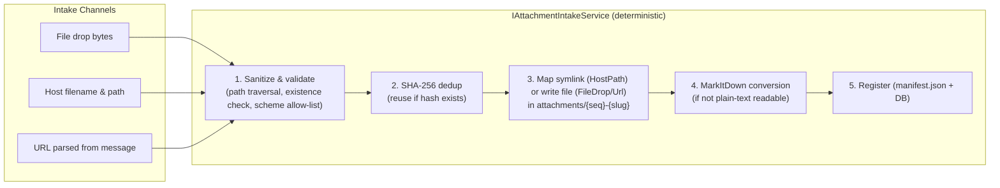

# 📎 Step 12.2A: Attachments Store, Intake Service & MarkItDown Conversion (Core & Infrastructure)

> **Feature Implementation Step (Part 1 of 3 — Persistence, Intake Pipeline & Docker Mount)**  
> *Parent Plan:* [Features & Integrations Roadmap](README.md)  
> *Companion Steps:* [Step 12.2B: Agent Attachment Tools & Prompt Digest](STEP_12_2B_AGENT_ATTACHMENT_TOOLS_AND_PROMPT_DIGEST.md) | [Step 12.2C: Attachments Web UI & Task Picker](STEP_12_2C_ATTACHMENTS_WEB_UI_AND_TASK_PICKER.md)  
> *Target Components:* `src/NightCodeForge.Core` (Domain, Interfaces, Services), `src/NightCodeForge.Infrastructure/Data`, `src/NightCodeForge.Infrastructure/Execution` | *Status:* Planned | *Target Framework:* .NET 10 (C# 13)  
> *Aligns With:* [AGENTS.md](../../AGENTS.md), [docs/PLAN.md](../PLAN.md)

> This document is a **specification**: it states required behaviors and constraints, not implementations. Implementation choices (signatures, code structure) are left to the implementer, within the constraints of the documents.

---

## 1. Executive Objective

When designing tasks, developers regularly need to ground the agent in **prior work and external context**: a proof-of-concept script, an API specification PDF, an architecture doc, or an RFC URL.

This step (Part 1 of Step 12.2) builds the core persistence, intake pipeline, `Pmad.Markitdown` conversion, and read-only Docker mount for the **workspace-level Attachments store**:
1. **Dedicated attachments directory** per workspace, a sibling of the canonical clone and task worktrees at `~/.nightcodeforge/wks/{workspaceId}/attachments/` — always available, **read-only for all agents**, and **outside the repository** (never committed to any branch or worktree).
2. **Three Intake Channels in `IAttachmentIntakeService`:**
   - **File drop** (uploaded bytes).
   - **System host filename & path mapping (WSL2-only symlinks, no NTFS symlinks):** On Windows, NightCodeForge workloads run exclusively inside WSL2. When users cite a host path (`C:\dev\poc\router-spikes.md`) or specify a host filename, the path is translated to its WSL2 mount point (`/mnt/c/dev/poc/router-spikes.md`) and mapped as a **POSIX symbolic link strictly inside WSL2** (`attachments/{seq}-{slug}.{ext}` $\rightarrow$ `/mnt/c/...`).
   - **URL capture:** External `http(s)` pages are downloaded with SSRF guards, converted to markdown, and stored with provenance metadata.
3. **Automatic markdown companions via `Pmad.Markitdown`:** Any file that is not plain text (PDF, Office docs, HTML, images) gets a companion `*.md` generated using the [`Pmad.Markitdown`](https://www.nuget.org/packages/Pmad.Markitdown) .NET library directly in `attachments/`.
4. **Content-addressed deduplication & host integrity:** SHA-256 deduplication reuses existing attachments; deleting an attachment only removes the symlink/companion inside `attachments/`, leaving the original host file untouched.
5. **Docker Sandbox Read-Only Mount (`:ro`):** In `ExecutionMode.ContainerSandbox`, `NightCodeForgeContainerExecutor` bind-mounts `~/.nightcodeforge/wks/{workspaceId}/attachments/` strictly read-only (`:ro`) at `/workspace/attachments`.

*(Agent tools `list_attachments`/`read_attachment` and prompt digest injection are specified in [Step 12.2B](STEP_12_2B_AGENT_ATTACHMENT_TOOLS_AND_PROMPT_DIGEST.md); Web UI drop zones, drawers, and `/tasks/new` picker are specified in [Step 12.2C](STEP_12_2C_ATTACHMENTS_WEB_UI_AND_TASK_PICKER.md).)*

---

## 2. Storage Layout & Database Registry

### 2.1 Directory Layout
```
~/.nightcodeforge/wks/{workspaceId}/
├── clone/                         # forked repo files
├── attachments/                   # NEW — workspace attachments store (read-only for agents)
│   ├── manifest.json              # NEW — machine-readable attachment registry
│   ├── 001-poc-router-spikes.md   # SYMLINK -> /mnt/c/dev/poc/router-spikes.md
│   ├── 002-openai-api-spec.pdf    # SYMLINK -> /mnt/c/specs/openai-api-spec.pdf (or uploaded binary)
│   ├── 002-openai-api-spec.md     # MarkItDown companion (agent-consumable, generated in attachments/)
│   └── 003-rfc-9110.html.md       # URL capture (markdown only, URL in frontmatter)
└── task-{taskId}/                 # ephemeral ForgeTask worktrees
```

**ContainerSandbox Mapping (Docker):**
```
/workspace/
├── clone/                         # forked repo files (read-only, except .git)
├── task-{taskId}/                 # worktree files (read-write)
└── attachments/                   # READ-ONLY BIND-MOUNT (:ro)
```

### 2.2 Database Registry
New EF Core table `TaskAttachments` (mirrors `manifest.json`):

| Column | Description |
| :--- | :--- |
| `Id` | integer PK (the `{seq}` in the file name) |
| `WorkspaceId` | owning workspace |
| `Title` | display title (original file name or page `<title>`) |
| `Slug` | kebab-case identifier |
| `RelativePath` | path inside `attachments/` (e.g. `002-openai-api-spec.pdf` — direct file or symlink) |
| `MarkdownPath` | companion markdown path, or same as `RelativePath` for plain text |
| `SourceKind` | enum: `FileDrop` \| `HostPath` \| `UrlCapture` |
| `SourceRef` | canonical host path (target of symlink) or source URL |
| `IsSymlink` | boolean flag (`true` when `RelativePath` is a symbolic link to a host file) |
| `Sha256` | content hash of the primary artifact (hashed from host file target or upload) |
| `SizeBytes` | size of the primary artifact in bytes |
| `CreatedAt` | UTC timestamp |

New EF Core table `TaskAttachmentLinks` (join `TaskId` × `TaskAttachmentId`, unique per pair). Unique constraints are enforced on `(WorkspaceId, Sha256)` for attachment deduplication and `(TaskId, TaskAttachmentId)` for links.

> Per repository policy, no synthetic attachment is ever fabricated: reading a missing, broken symlink, or corrupt attachment is a hard error (`AttachmentNotFoundException` / `AttachmentTargetNotFoundException`), never a silently generated placeholder.

---

## 3. Intake Pipeline (`IAttachmentIntakeService`)



### 3.1 Channel 1: File Drop
- Uploaded bytes are written directly to `attachments/{seq:000}-{slug}.{ext}`.

### 3.2 Channel 2: System Host Filename & Path Mapping (WSL2 Symlink)
- **Intake Avenues:**
  - **Chat Message Citation:** Extracts absolute/relative host paths from user messages (regex over Windows drive paths `C:\...`, UNC shares `\\server\share`, POSIX absolute paths `/home/...`, and tilde paths `~/...`).
  - **Explicit Host Filename Input:** Direct system host filename input.
- **Validation & WSL2 Path Translation:**
  - When a Windows host path is cited (e.g. `C:\dev\poc\router-spikes.md`), the intake service translates it to its canonical WSL2 mount point (`/mnt/c/dev/poc/router-spikes.md`) and validates that it exists and is readable.
  - **Fail fast:** A cited host path that does not exist throws a dedicated domain exception naming the path — never a silent skip or placeholder.
- **Symlink Creation in WSL2 Attachment Area:**
  - Creates a **POSIX symbolic link** in the WSL2 workspace attachments area (`attachments/{seq:000}-{slug}.{ext}`) pointing directly to `/mnt/<drive>/...`.
  - **Zero NTFS Symlinks:** Absolutely no symbolic links are created on Windows NTFS.
- **Integrity & Host Safety:**
  - Deleting an attachment unlinks the symlink from `attachments/` in WSL2 and purges any companion `*.md`; it **strictly never modifies or deletes the original host file**.

### 3.3 Channel 3: URL Capture
- `http(s)` URLs are fetched and converted to markdown via MarkItDown with provenance frontmatter (`source`, `capturedAt`, `title`).
- **Security constraints:**
  - Only `http` and `https` schemes; `file://`, `ftp://`, etc. are rejected.
  - Local/loopback/private-network targets are rejected (SSRF guard) unless an explicit workspace opt-in allows internal-network captures.
  - Download size cap and fetch timeout are named constants; over-limit content is a hard error.

### 3.4 `Pmad.Markitdown` Conversion Rules
- Files with a plain-text, agent-readable extension (`.md`, `.txt`, `.cs`, `.py`, `.json`, `.yaml`, …) bypass `Pmad.Markitdown` (`MarkdownPath = RelativePath`).
- All other formats (PDF, DOCX, PPTX, XLSX, HTML, images) go through [`Pmad.Markitdown`](https://www.nuget.org/packages/Pmad.Markitdown); the original binary/symlink is kept alongside the generated `*.md` companion.
- Conversion failure is a hard error reported to the user with the file name and flagged `conversionFailed` in the registry; agents never see a half-converted companion.

### 3.5 Docker ContainerSandbox Read-Only Mount
- `ContainerExecutorOptions` includes an `AttachmentsPath` property.
- `ExecutionEnvironmentProvider.GetEnvironment` sets `AttachmentsPath` using `IWorkspacePathResolver.GetAttachmentsPath(workspace.Id)`.
- `NightCodeForgeContainerExecutor.BuildVolumeMounts(options)` appends a read-only mount (`-v "{hostAttachmentsPath}:/workspace/attachments:ro"`).

---

## 4. Implementation Checklist & Deliverables

- [ ] **Domain & Persistence:**
  - [ ] `TaskAttachment` + `TaskAttachmentLink` entities, `TaskAttachmentSourceKind` enum, `IsSymlink` property, `AttachmentNotFoundException`, and `AttachmentTargetNotFoundException` in `NightCodeForge.Core`.
  - [ ] EF Core tables + migration with unique constraints on `(WorkspaceId, Sha256)` and `(TaskId, TaskAttachmentId)`.
  - [ ] `manifest.json` writer/reader recording symlink metadata (`isSymlink`, `targetPath`), kept in sync with the database.
- [ ] **Intake Service:**
  - [ ] Implement `IAttachmentIntakeService` (host-path parser, explicit host filename input handler, URL parser, sanitization, SHA-256 dedup, WSL2 POSIX symlink creation with `/mnt/c/...` path translation, `Pmad.Markitdown` conversion, registry update, and safe symlink-only deletion).
  - [ ] Integrate `Pmad.Markitdown` NuGet package; define plain-text passthrough extensions and size/count/timeout constants.
- [ ] **Docker & Infrastructure Layer:**
  - [ ] Extend `ContainerExecutorOptions` with `AttachmentsPath` and update `ExecutionEnvironmentProvider` + `NightCodeForgeContainerExecutor.BuildVolumeMounts` to mount `/workspace/attachments:ro`.
- [ ] **Tests:**
  - [ ] Unit tests: intake pipeline (dedup by hash, WSL2 symlink mapping with `/mnt/c/...` translation, companion generation via `Pmad.Markitdown` fixtures, path-traversal rejection, SSRF rejection, size caps), registry/manifest synchronization, and host file preservation on delete.
  - [ ] Unit tests in `NightCodeForge.Infrastructure.Tests` verifying `BuildVolumeMounts` and `BuildDockerRunArgs` produce `-v "{hostAttachments}:/workspace/attachments:ro"`.

