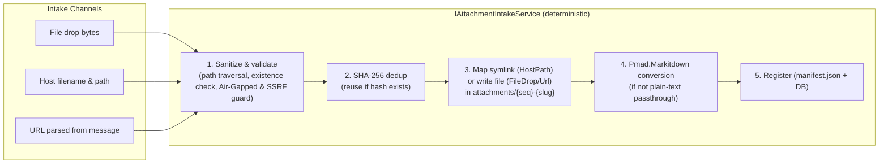

# 📎 Step 12.2A: Attachments Store, Intake Service & MarkItDown Conversion (Core & Infrastructure)

> **Feature Implementation Step (Part 1 of 4 — Persistence, Intake Pipeline & Declarative Sandbox Mount)**  
> *Parent Plan:* [Features & Integrations Roadmap](README.md)  
> *Companion Steps:* [Step 12.2B: `/workspace/attachments` Read/Bash Access & Prompt Digest](STEP_12_2B_AGENT_ATTACHMENT_TOOLS_AND_PROMPT_DIGEST.md) | [Step 12.2C: Attachments Web UI & Task Picker](STEP_12_2C_ATTACHMENTS_WEB_UI_AND_TASK_PICKER.md) | [Step 12.2D: Multimodal Vision & In-Loop Image Inspection](STEP_12_2D_MULTIMODAL_VISION_AND_IN_LOOP_IMAGE_INSPECTION.md)  
> *Related Architecture:* [Step 12.20A: Air-Gapped Mode](../archive/phase-12/STEP_12_20A_AIR_GAPPED_MODE_AND_WEB_SEARCH_DEACTIVATION.md) | [Step 12.36A: Declarative Sandbox Mount Table](../archive/phase-12/STEP_12_36A_DECLARATIVE_SANDBOX_MOUNT_TABLE_AND_CONTAINER_LIFECYCLE_REDESIGN.md)  
> *Target Components:* `src/NightCodeForge.Core` (Domain, Exceptions, Interfaces, Repositories, Services), `src/NightCodeForge.Infrastructure/Data`, `src/NightCodeForge.Infrastructure/Execution`, `src/NightCodeForge.Infrastructure/Git`, `tests/NightCodeForge.Core.Tests`, `tests/NightCodeForge.Infrastructure.Tests` | *Status:* Completed | *Target Framework:* .NET 10 (C# 13)  
> *Aligns With:* [AGENTS.md](../../AGENTS.md), [docs/PLAN.md](../PLAN.md)
>
> This document is a **specification**: it states required behaviors and constraints, not implementations. Implementation choices (signatures, code structure) are left to the implementer, within the constraints of the documents.

---

## 1. Executive Objective

When designing tasks, developers regularly need to ground the agent in **prior work and external context**: a proof-of-concept script, an API specification PDF, an architecture doc, or an RFC URL.

This step (Part 1 of Step 12.2) builds the core persistence, intake pipeline, `Pmad.Markitdown` conversion, and read-only sandbox mount for the **workspace-level Attachments store**:
1. **Dedicated attachments directory** per workspace, a sibling of the canonical clone and task worktrees at `~/.nightcodeforge/wks/{workspaceId}/attachments/` — always available, **read-only for all agents**, and **outside the repository** (never committed to any branch or worktree).
2. **Three Intake Channels in `IAttachmentIntakeService`:**
   - **File drop** (uploaded bytes).
   - **System host filename & path mapping (WSL2-only symlinks, no NTFS symlinks):** On Windows, NightCodeForge workloads run inside WSL2. When users cite a host path (`C:\dev\poc\router-spikes.md`) or specify a host filename, the path is translated to its WSL2 mount point (`/mnt/c/dev/poc/router-spikes.md`) and mapped as a **POSIX symbolic link strictly inside WSL2** (`attachments/{seq}-{slug}.{ext}` $\rightarrow$ `/mnt/c/...`).
   - **URL capture:** External `http(s)` pages are downloaded with Air-Gapped and SSRF guards, converted to markdown, and stored with provenance metadata.
3. **Automatic markdown companions via `Pmad.Markitdown` & image passthrough:** Convertible rich-document formats (PDF, DOCX, HTML) receive a companion `*.md` generated using the [`Pmad.Markitdown`](https://www.nuget.org/packages/Pmad.Markitdown) (`0.0.2`) .NET library directly in `attachments/`; plain-text/source-code files and supported image formats (`.png`, `.jpg`, `.jpeg`, `.webp`, `.gif`, stored with `ContentKind = Image`, `MediaType`, and parsed `WidthPx` / `HeightPx` metadata for [Step 12.2D](STEP_12_2D_MULTIMODAL_VISION_AND_IN_LOOP_IMAGE_INSPECTION.md)) pass through directly without conversion, and unsupported/corrupt binary formats fail fast.
4. **Content-addressed deduplication & host integrity:** SHA-256 deduplication reuses existing attachments; deleting an attachment only removes the entry/symlink and companion inside `attachments/`, leaving the original host file untouched.
5. **Declarative Sandbox & Docker Read-Only Mount (`:ro`):** Aligned with [Step 12.36A](../archive/phase-12/STEP_12_36A_DECLARATIVE_SANDBOX_MOUNT_TABLE_AND_CONTAINER_LIFECYCLE_REDESIGN.md), `~/.nightcodeforge/wks/{workspaceId}/attachments/` is registered in `SandboxMountTable` / `ISandboxPathResolver` and bind-mounted strictly read-only (`:ro`) at `/workspace/attachments` in `ExecutionMode.ContainerSandbox`.

*(Canonical `read`/`bash` access on `/workspace/attachments`, `@attachment:{id}` citation linking, and prompt digest injection are specified in [Step 12.2B](STEP_12_2B_AGENT_ATTACHMENT_TOOLS_AND_PROMPT_DIGEST.md); Web UI drop zones, drawers, and `/tasks/new` picker are specified in [Step 12.2C](STEP_12_2C_ATTACHMENTS_WEB_UI_AND_TASK_PICKER.md); native multimodal vision inspection via canonical `read` and in-loop `DataContent` injection are specified in [Step 12.2D](STEP_12_2D_MULTIMODAL_VISION_AND_IN_LOOP_IMAGE_INSPECTION.md).)*

---

## 2. Storage Layout, Path Resolution & Database Registry

### 2.1 Directory Layout & Path Resolution
```
~/.nightcodeforge/wks/{workspaceId}/
├── clone/                         # forked repo files
├── attachments/                   # NEW — workspace attachments store (read-only for agents)
│   ├── manifest.json              # NEW — machine-readable attachment registry
│   ├── 001-poc-router-spikes.md   # SYMLINK -> /mnt/c/dev/poc/router-spikes.md
│   ├── 002-openai-api-spec.pdf    # SYMLINK -> /mnt/c/specs/openai-api-spec.pdf (or uploaded binary)
│   ├── 002-openai-api-spec.md     # MarkItDown companion (agent-consumable, generated in attachments/)
│   └── 003-rfc-9110.html.md       # URL capture (markdown only, URL in frontmatter)
└── task-{taskId}/                 # ephemeral ForgeTask worktrees
```

**ContainerSandbox Mapping (Docker):**
```
/workspace/
├── clone/                         # forked repo files (read-only, except .git)
├── task-{taskId}/                 # worktree files (read-write)
└── attachments/                   # READ-ONLY BIND-MOUNT (:ro)
```

**Path Resolution Contracts ([`IWorkspacePathResolver`](../../src/NightCodeForge.Core/Interfaces/IWorkspacePathResolver.cs) & [`WorkspacePathResolver`](../../src/NightCodeForge.Infrastructure/Execution/WorkspacePathResolver.cs)):**
- `IWorkspacePathResolver` exposes `GetAttachmentsPath(int workspaceId)` with a default interface method returning `$"{GetAgentWorkspaceRootPath(workspaceId)}/attachments"` so existing test fakes continue to compile, implemented on `WorkspacePathResolver`.
- `WorkspacePathResolver.ResolveCruciblePath` maps `/workspace/attachments` and `/workspace/attachments/...` (as well as `.nightcodeforge/wks/{workspaceId}/attachments/...`) to the sibling `attachments` directory under the workspace root (`parentDir`), never inside `clone/` or `task-{id}/`.

### 2.2 Database Registry & Domain Exceptions
New EF Core tables in [`AppDbContext`](../../src/NightCodeForge.Infrastructure/Data/AppDbContext.cs) (`TaskAttachments` mirroring `manifest.json`, and `TaskAttachmentLinks`):

| Column (`TaskAttachments`) | Description |
| :--- | :--- |
| `Id` | integer PK (the `{seq}` in the file name) |
| `WorkspaceId` | owning workspace (FK $\rightarrow$ `Workspaces` with cascade delete) |
| `Title` | display title (original file name or page `<title>`) |
| `Slug` | kebab-case identifier |
| `RelativePath` | path inside `attachments/` (e.g. `002-openai-api-spec.pdf` — direct file or symlink) |
| `MarkdownPath` | companion markdown path, same as `RelativePath` for plain text, or `null` for `Image` attachments |
| `ContentKind` | enum `TaskAttachmentContentKind`: `PlainText` \| `RichDocument` \| `Image` |
| `MediaType` | normalized MIME type (e.g., `text/markdown`, `application/pdf`, `image/png`) |
| `WidthPx` | nullable integer image width in pixels (`Image` attachments only) |
| `HeightPx` | nullable integer image height in pixels (`Image` attachments only) |
| `SourceKind` | enum `TaskAttachmentSourceKind`: `FileDrop` \| `HostPath` \| `UrlCapture` |
| `SourceRef` | canonical host path (target of symlink) or source URL |
| `IsSymlink` | boolean flag (`true` when `RelativePath` is a symbolic link to a host file) |
| `Sha256` | content hash of the primary artifact (hashed from host file target or upload) |
| `SizeBytes` | size of the primary artifact in bytes |
| `CreatedAt` | UTC timestamp |

- **Join table & navigation properties:** Add `TaskAttachmentLinks` (join `TaskId` $\times$ `TaskAttachmentId`, cascade delete from `ForgeTask` and `TaskAttachment`), plus navigation properties on `ForgeTask` and `Workspace`.
- **Unique indexes:** Enforced on `(WorkspaceId, Sha256)` for content-addressed deduplication and `(TaskId, TaskAttachmentId)` for link uniqueness.
- **EF Core migration & baselining:** Generate an EF Core migration for `TaskAttachments` and `TaskAttachmentLinks`, add its migration identifier constant to [`AppDbContext`](../../src/NightCodeForge.Infrastructure/Data/AppDbContext.cs), and add a pre-migration `sqlite_master` table existence check in `AppDbContext.BaselineExistingPreMigrationDatabaseAsync` so `EnsureCreatedAsync` test databases transition cleanly.
- **Repository persistence abstraction:** Provide a clean repository contract (`ITaskAttachmentRepository` with EF Core and in-memory implementations, or cohesive extensions on `ITaskRepository` / [`EfCoreTaskRepository`](../../src/NightCodeForge.Infrastructure/Data/Repositories/EfCoreTaskRepository.cs) / `InMemoryTaskRepository`) supporting attachment CRUD, workspace hash lookup by `(WorkspaceId, Sha256)`, and task-attachment link queries/updates (`GetByTaskIdAsync`, `GetLinkedTaskIdsAsync`, `SetTaskAttachmentLinksAsync`).
- **Fail-fast domain exceptions (no synthetic values):** Define dedicated exceptions in `NightCodeForge.Core.Exceptions` — `AttachmentNotFoundException`, `AttachmentTargetNotFoundException`, and `AttachmentConversionException`. Reading a missing, broken symlink, or corrupt attachment is always a hard error, never a silently generated placeholder.

---

## 3. Intake Pipeline (`IAttachmentIntakeService`)

> **Service Design & Constructor Constraint ([AGENTS.md](../../AGENTS.md)):** All new and modified services must require all collaborators (no optional constructor parameters, no silent fallbacks or bare `catch { }` blocks), never exceed **10 constructor parameters**, and define named constants/enums instead of magic numbers or strings.



### 3.1 Channel 1: File Drop
- Uploaded bytes are validated against named size-cap constants and written directly to `attachments/{seq:000}-{slug}.{ext}`.
- Content is hashed with SHA-256 and deduplicated within the workspace by `(WorkspaceId, Sha256)` before writing duplicate artifacts.

### 3.2 Channel 2: System Host Filename & Path Mapping (WSL2 Symlink)
- **Intake Avenues:**
  - **Chat Message Citation:** Extracts host file paths from user messages (regex over Windows drive paths `C:\...`, UNC shares `\\server\share\...`, WSL UNC paths `\\wsl.localhost\...` / `\\wsl$\...`, POSIX absolute paths `/home/...` or `/mnt/...`, and tilde paths `~/...`).
  - **Explicit Host Filename Input:** Direct system host filename/path input.
- **Validation & Traversal Guard:**
  - Rejects relative path-traversal segments (`..`), paths resolving inside the workspace's own `attachments/` store, and missing or unreadable host files by failing fast with `AttachmentTargetNotFoundException` naming the path — never a silent skip or placeholder.
- **WSL2 Path Translation & POSIX Symlink Creation:**
  - When a Windows drive path is cited (e.g. `C:\dev\poc\router-spikes.md`) on a workspace running in WSL2 (`WslDirect` or `ContainerSandbox` on Windows), the intake service translates it to its canonical WSL2 mount point (`/mnt/c/dev/poc/router-spikes.md`) via [`WslPathConverter.ToWslPath`](../../src/NightCodeForge.Infrastructure/Git/WslPathConverter.cs) (or extracts the Linux path for `\\wsl.localhost\...` paths) and verifies existence/readability.
  - Creates a **POSIX symbolic link** (`ln -sfn` via `IProcessRunner` in WSL2, or native POSIX symlink on Linux/macOS) in the workspace `attachments/` directory (`attachments/{seq:000}-{slug}.{ext}` $\rightarrow$ `/mnt/<drive>/...`).
  - **Zero NTFS Symlinks:** Absolutely no symbolic links are created on Windows NTFS.
- **Hashing & Companion Generation:**
  - Computes `Sha256` and `SizeBytes` from the resolved host target file, deduplicates by `(WorkspaceId, Sha256)`, and generates any companion `.md` inside `attachments/` while leaving the host directory completely untouched.
- **Integrity & Host Safety:**
  - Deleting an attachment unlinks the symlink from `attachments/` and purges any companion `*.md` (along with the DB row and `manifest.json` entry); it **strictly never modifies or deletes the original host file**.

### 3.3 Channel 3: URL Capture
- **Air-Gapped Guard:** When `SecurityOptions.AirGappedMode` is enabled ([Step 12.20A](../archive/phase-12/STEP_12_20A_AIR_GAPPED_MODE_AND_WEB_SEARCH_DEACTIVATION.md)), URL capture fails fast with `AirGappedOperationException`.
- `http(s)` URLs are fetched, converted to markdown via `Pmad.Markitdown`, and written to `attachments/{seq:000}-{slug}.html.md` with provenance frontmatter (`source`, `capturedAt`, `title`, `sha256`).
- **SSRF & Size Security Constraints:**
  - Only `http` and `https` schemes are allowed; `file://`, `ftp://`, `gopher://`, etc. are rejected.
  - DNS resolution is validated before connecting, blocking loopback (`127.0.0.0/8`, `::1`, `localhost`), link-local / cloud metadata (`169.254.0.0/16`, `169.254.169.254`, `fe80::/10`), and private network ranges (`10.0.0.0/8`, `172.16.0.0/12`, `192.168.0.0/16`, `fc00::/7`) unless an explicit workspace opt-in permits internal-network captures; every HTTP redirect target is re-validated against the same SSRF rules.
  - Download byte cap, max redirect count, and fetch timeout are named constants; over-limit or timed-out content is a hard error.

### 3.4 `Pmad.Markitdown` (`0.0.2`) Conversion & Image Passthrough Rules
Conversion aligns with the actual capabilities of [`Pmad.Markitdown`](https://www.nuget.org/packages/Pmad.Markitdown) (`IMarkitdown` / `Markitdown`, NuGet package `0.0.2`):
- **Plain-Text & Source-Code Passthrough Extensions (`TaskAttachmentContentKind.PlainText`):** Plain-text, config, and source-code extensions (`.md`, `.markdown`, `.txt`, `.text`, `.log`, `.json`, `.xml`, `.yaml`, `.yml`, `.csv`, `.tsv`, `.cs`, `.razor`, `.csproj`, `.slnx`, `.sln`, `.props`, `.targets`, `.js`, `.ts`, `.tsx`, `.jsx`, `.py`, `.sh`, `.ps1`, `.sql`, `.css`, `.scss`, `.toml`, `.ini`, `.cfg`) bypass conversion (`MarkdownPath = RelativePath`).
- **Supported Image Passthrough Formats (`TaskAttachmentContentKind.Image`):** Image extensions (`.png`, `.jpg`, `.jpeg`, `.webp`, `.gif`) are validated by magic-byte header inspection (matching the declared format and non-zero dimensions), stored directly (or symlinked for `HostPath`) in `attachments/{seq:000}-{slug}.{ext}` without running `Pmad.Markitdown` (`MarkdownPath = null`, `MediaType`, `WidthPx`, `HeightPx` recorded in SQLite and `manifest.json`), ready for native multimodal inspection in [Step 12.2D](STEP_12_2D_MULTIMODAL_VISION_AND_IN_LOOP_IMAGE_INSPECTION.md).
- **Convertible Rich-Document Formats (`TaskAttachmentContentKind.RichDocument`):** Supported rich-document formats — **PDF** (`.pdf`), **Word** (`.docx`), and **HTML** (`.html`, `.htm`, `.xhtml`, with `MarkitdownOptions { IncludeTitle = true, CleanHtml = true, FilterHiddenText = true }` stripping hidden prompt-injection text) — are converted via `IMarkitdown` into a companion `{seq:000}-{slug}.md` generated in `attachments/` while keeping the original binary/symlink alongside it.
- **Unsupported or Corrupt Binary Formats:** If an unsupported binary extension/format is supplied, an image fails magic-byte header validation, or `IMarkitdown` throws `NotSupportedException` / fails during conversion, the pipeline cleans up any partial files and fails fast with `AttachmentConversionException` naming the file and failure reason; half-converted or silent fallback entries are never persisted.

### 3.5 Declarative Sandbox Mount Table & Docker `ContainerSandbox` Read-Only Mount
Aligned with [Step 12.36A](../archive/phase-12/STEP_12_36A_DECLARATIVE_SANDBOX_MOUNT_TABLE_AND_CONTAINER_LIFECYCLE_REDESIGN.md):
- **Directory Ownership Pre-Creation:** [`ContainerEnvironmentFactory`](../../src/NightCodeForge.Infrastructure/Execution/ContainerEnvironmentFactory.cs) ensures the workspace's `attachments/` directory exists on the host/WSL filesystem under user ownership before container spawn (following the `EnsureHostTmpDirectory` / `EnsureHostSkillsDirectory` pattern) so Docker never auto-creates an empty `root:root` directory.
- **Declarative `SandboxMountTable` & `ISandboxPathResolver`:** [`ContainerEnvironmentFactory.BuildWorkspaceScope`](../../src/NightCodeForge.Infrastructure/Execution/ContainerEnvironmentFactory.cs) / [`SandboxMountTable.ForWorkspace`](../../src/NightCodeForge.Core/Interfaces/SandboxMountTable.cs) registers a read-only `VirtualMountEntry` (`virtualSubPath: "attachments"`, `virtualMountPath: "/workspace/attachments"`, `isReadOnly: true`) so [`SandboxPathResolver`](../../src/NightCodeForge.Core/Interfaces/SandboxPathResolver.cs) blocks writes and rewrites `/workspace/attachments` paths in `WslDirect` and `BareHost` commands.
- **Docker Volume Mount & Drift Inspection:**
  - Extend [`ContainerExecutorOptions`](../../src/NightCodeForge.Infrastructure/Execution/NightCodeForgeContainerExecutor.cs) with an `AttachmentsPath` property populated by [`ContainerEnvironmentFactory`](../../src/NightCodeForge.Infrastructure/Execution/ContainerEnvironmentFactory.cs) using `IWorkspacePathResolver.GetAttachmentsPath(workspace.Id)`.
  - [`ContainerMountAndDriftBuilder.BuildVolumeMounts`](../../src/NightCodeForge.Infrastructure/Execution/ContainerMountAndDriftBuilder.cs) (and `NightCodeForgeContainerExecutor.BuildVolumeMounts`) appends `-v "{hostAttachmentsPath}:/workspace/attachments:ro"`, and `EvaluateMountDrift` detects missing, writable, or source-mismatched `/workspace/attachments` mounts.

---

## 4. Implementation Checklist & Deliverables

- [x] **Domain, Exceptions & Path Resolution (`NightCodeForge.Core` & `NightCodeForge.Infrastructure`):**
  - [x] Add `TaskAttachment` (with `ContentKind`, `MediaType`, `WidthPx`, `HeightPx`), `TaskAttachmentLink`, `TaskAttachmentSourceKind`, `TaskAttachmentContentKind`, and `Workspace` / `ForgeTask` navigation properties in `NightCodeForge.Core.Domain`.
  - [x] Add `AttachmentNotFoundException`, `AttachmentTargetNotFoundException`, and `AttachmentConversionException` in `NightCodeForge.Core.Exceptions`.
  - [x] Add `GetAttachmentsPath(int workspaceId)` (with default interface implementation) on [`IWorkspacePathResolver`](../../src/NightCodeForge.Core/Interfaces/IWorkspacePathResolver.cs) and implement it plus `/workspace/attachments` mapping in [`WorkspacePathResolver`](../../src/NightCodeForge.Infrastructure/Execution/WorkspacePathResolver.cs).
- [x] **Database Registry & Manifest:**
  - [x] Add `TaskAttachments` and `TaskAttachmentLinks` to [`AppDbContext`](../../src/NightCodeForge.Infrastructure/Data/AppDbContext.cs) with unique constraints on `(WorkspaceId, Sha256)` and `(TaskId, TaskAttachmentId)`, EF Core migration, and pre-migration baselining in `BaselineExistingPreMigrationDatabaseAsync`.
  - [x] Implement repository persistence (`ITaskAttachmentRepository` / EF Core & in-memory implementations) and `manifest.json` synchronization (including `isSymlink` and `targetPath` metadata).
- [x] **Intake Service & `Pmad.Markitdown` Integration:**
  - [x] Reference `Pmad.Markitdown` (`0.0.2`) NuGet package and define named constants for passthrough extensions, size caps, redirect limits, and fetch timeouts.
  - [x] Implement `IAttachmentIntakeService` (obeying the $\le 10$ constructor parameter rule): file drop intake, host-path parser + explicit filename handler with WSL2 `/mnt/<drive>/...` translation and POSIX `ln -sfn` symlinks (zero NTFS symlinks), Air-Gapped & SSRF-guarded URL capture, SHA-256 deduplication, image magic-byte validation + dimension extraction (`TaskAttachmentContentKind.Image`), `Pmad.Markitdown` conversion with fail-fast `AttachmentConversionException`, registry/manifest update, and safe attachment-only deletion preserving host files.
- [x] **Sandbox Mount Table & Docker Read-Only Mount:**
  - [x] Ensure user-owned `attachments/` pre-creation and register the read-only `/workspace/attachments` `VirtualMountEntry` in [`ContainerEnvironmentFactory`](../../src/NightCodeForge.Infrastructure/Execution/ContainerEnvironmentFactory.cs) / [`SandboxMountTable`](../../src/NightCodeForge.Core/Interfaces/SandboxMountTable.cs).
  - [x] Extend `ContainerExecutorOptions` with `AttachmentsPath` and update [`ContainerMountAndDriftBuilder`](../../src/NightCodeForge.Infrastructure/Execution/ContainerMountAndDriftBuilder.cs) (`BuildVolumeMounts` and `EvaluateMountDrift`) to mount and verify `/workspace/attachments:ro`.
- [x] **Tests:**
  - [x] Unit tests in `NightCodeForge.Core.Tests` and `NightCodeForge.Infrastructure.Tests`: intake pipeline (SHA-256 dedup, WSL2 `/mnt/c/...` translation and POSIX symlink creation, `Pmad.Markitdown` PDF/DOCX/HTML conversion and hidden-text filtering, unsupported binary rejection, path-traversal rejection, Air-Gapped & SSRF/redirect rejection, size/timeout caps), `manifest.json`/DB sync, `AppDbContext` migration baselining, and host file preservation on delete.
  - [x] Unit tests in `NightCodeForge.Infrastructure.Tests` verifying `BuildVolumeMounts`, `BuildDockerRunArgs`, `EvaluateMountDrift`, and `SandboxPathResolver` enforce `/workspace/attachments:ro`, followed by full test suite execution per [AGENTS.md](../../AGENTS.md).
