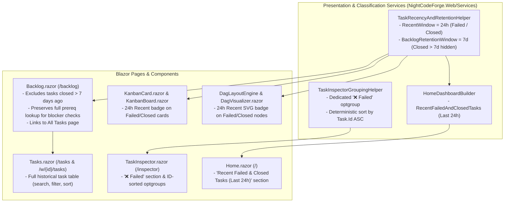

# 📋 Step 12.30: Tasks QoL — 24h Failed/Closed Highlights, 7-Day Backlog Cutoff, All-Tasks List Page & Inspector Ordering

> **Feature & Developer Ergonomics Specification (Priority Tier 2)**  
> *Parent Plan:* [Features & Integrations Roadmap](README.md)  
> *Target Framework:* .NET 10 (C# 13) | *Status:* Planned  
> *Target Projects:* [`src/NightCodeForge.Web`](../../src/NightCodeForge.Web), [`tests/NightCodeForge.Web.Tests`](../../tests/NightCodeForge.Web.Tests)  
> *Related Steps:* [Step 11.17: Portal Task Scoping & Pipeline State Hygiene](../archive/phase-11/STEP_11_17_PORTAL_TASK_SCOPING_AND_EXECUTION_STATE_HYGIENE.md), [Step 12.24: Home Page Pending Code Reviews](../archive/phase-12/STEP_12_24_HOME_PAGE_PENDING_CODE_REVIEWS.md)  
> *Aligns With:* [AGENTS.md](../../AGENTS.md), [docs/PLAN.md](../PLAN.md)

> This document is a **specification**: it states required behaviors and constraints, not implementations. Implementation choices (signatures, code structure) are left to the implementer, within the constraints of the documents.

---

## 1. Problem Statement & Motivation

As a workspace accumulates dozens or hundreds of tasks over weeks of autonomous execution, four day-to-day quality-of-life friction points emerge:

1. **Recent Failed or Closed Tasks (Last 24 Hours) Lack Immediate Visibility:**
   - When tasks finish or fail overnight, operators checking the Home dashboard (`/`), Kanban board, or Visual DAG (`/backlog`) cannot immediately distinguish tasks that failed or closed in the **last 24 hours** from older historical tasks.
2. **Old Closed Tasks (> 7 Days) Clutter the Kanban Board and Visual DAG:**
   - Tasks closed more than **7 days ago** remain indefinitely in the Kanban **Closed & Archived** column and as nodes in the **Visual DAG**, crowding out active dependency chains and slowing visual scanning, while there is no dedicated tabular **All Tasks** page to browse the full historical task archive.
3. **Task Inspector Dropdown Is Not Ordered by Task ID and Lacks a Failed Tasks Section:**
   - In [`TaskInspectorGroupingHelper.cs`](../../src/NightCodeForge.Web/Services/TaskInspectorGroupingHelper.cs), tasks within each `<optgroup>` are sorted by `Priority` then `UpdatedAt` rather than by `#ID`, making it hard to locate a specific task number.
   - Furthermore, `TaskOverallStatus.Failed` tasks have no dedicated `<optgroup>` in the Task Inspector dropdown and are mixed into `⏳ In Flight (Waiting for Slot)` or `📋 Backlog / Open`.

---

## 2. Architecture & Component Overview

---

## 3. Detailed Requirements & Specifications

### 3.1 Recent Failed & Closed Tasks (Last 24 Hours)

Define a 24-hour recency window (`RecentTerminalTaskWindow = TimeSpan.FromHours(24)`):
- A task qualifies as a **Recent Failed or Closed Task** when:
  - `task.Status is TaskOverallStatus.Failed or TaskOverallStatus.Closed`, and
  - `task.UpdatedAt >= utcNow - TimeSpan.FromHours(24)`.

1. **Small Badge in Kanban Cards ([`KanbanCard.razor`](../../src/NightCodeForge.Web/Components/Backlog/KanbanCard.razor) & [`KanbanBoard.razor`](../../src/NightCodeForge.Web/Components/Backlog/KanbanBoard.razor)):**
   - When a task is a recent `Failed` or `Closed` task (`<= 24h`), render a compact badge on the card (e.g., `⚡ <24h` / relative age pill such as `🆕 2h ago` with `id="badge-recent-@Task.Id"`) alongside its status badge (`❌ Failed` or `✅ Closed`).
   - In the Kanban **Closed & Archived** column, sort recent failed/closed tasks (`<= 24h`, with `Failed` first) to the top of the column so overnight failures and completions are immediately visible without scrolling.
2. **Small Badge in Visual DAG ([`DagLayoutEngine.cs`](../../src/NightCodeForge.Web/Services/DagLayoutEngine.cs) & [`DagVisualizer.razor`](../../src/NightCodeForge.Web/Components/Backlog/DagVisualizer.razor)):**
   - Add `bool IsRecentTerminal` (and/or `string? RecentBadgeText`) to `DagLayoutNode`, populated when the task is `Failed` or `Closed` within the last 24 hours.
   - In `DagVisualizer.razor`, render a compact SVG badge pill on the node when `node.IsRecentTerminal` is `true` so recently failed or completed nodes stand out visually in the dependency graph.
3. **Dedicated Section on the Home Page ([`HomeDashboardBuilder.cs`](../../src/NightCodeForge.Web/Services/HomeDashboardBuilder.cs) & [`Home.razor`](../../src/NightCodeForge.Web/Components/Pages/Home.razor)):**
   - Add a record `HomeRecentTerminalTaskItem` (containing `TaskId`, `Title`, `Status`, `WorkspaceId`, `WorkspaceName`, `Priority`, `UpdatedAt`, `SquashCommitSha`, `InspectorUrl`, `TaskDetailUrl`) and expose `IReadOnlyList<HomeRecentTerminalTaskItem> RecentFailedAndClosedTasks` on `HomeDashboardSnapshot`.
   - Populate `RecentFailedAndClosedTasks` in `HomeDashboardBuilder.BuildSnapshotAsync` with all tasks across workspaces where `Status is TaskOverallStatus.Failed or TaskOverallStatus.Closed` and `UpdatedAt >= utcNow - TimeSpan.FromHours(24)`, ordered with `TaskOverallStatus.Failed` first (then `UpdatedAt DESC`, `Id ASC`).
   - In `Home.razor`, render a dedicated section (`id="home-recent-terminal-tasks-section"`, **Recent Failed & Closed Tasks (Last 24h)**) displaying:
     - Status badge (`❌ Failed` in crimson or `✅ Closed` in emerald), priority badge (`P1`–`P5`), `#TaskId: Title`, workspace badge, relative/formatted `UpdatedAt` timestamp, and quick links to **Inspector** (`/inspector/{id}`) and **Details** (`/tasks/{id}`).

---

### 3.2 7-Day Archival Cutoff in Kanban & DAG and "All Tasks" List Page

1. **Exclude Tasks Closed > 7 Days Ago from Kanban & DAG ([`Backlog.razor`](../../src/NightCodeForge.Web/Components/Pages/Backlog.razor)):**
   - Define a 7-day retention cutoff (`BacklogClosedRetentionWindow = TimeSpan.FromDays(7)`).
   - Tasks with `task.Status == TaskOverallStatus.Closed` (and terminal archived statuses `Rejected` / `Cancelled`) whose `UpdatedAt < utcNow - TimeSpan.FromDays(7)` must **not** be displayed in the Kanban board or Visual DAG in `Backlog.razor`.
   - **Unresolved `Failed` Tasks:** Tasks in `TaskOverallStatus.Failed` remain visible in the backlog until restarted, resolved, or rejected (or if treated as terminal, must remain visible at least while actionable).
   - **Prerequisite Blocker Integrity:** Filtering old closed tasks out of the visible Kanban/DAG task list must **never** cause dependent `Open` tasks to appear falsely `🔒 Blocked`. `KanbanCard` and `DagLayoutEngine` must evaluate prerequisite completion against the full workspace task set (or treat prerequisites outside the visible set that are `Closed` as satisfied).
   - Display a count of hidden archived tasks (> 7 days) in the `Backlog.razor` toolbar/stats bar with a direct link to the **All Tasks** list page (e.g., `"View All Tasks (N archived >7d)"`).

2. **Dedicated "All Tasks" List Page (`Tasks.razor` — `/tasks` & `/w/{WorkspaceId:int}/tasks`):**
   - Create a dedicated Razor page [`src/NightCodeForge.Web/Components/Pages/Tasks.razor`](../../src/NightCodeForge.Web/Components/Pages/Tasks.razor) accessible at `/tasks` and `/w/{WorkspaceId:int}/tasks`, and add a navigation link in [`NavMenu.razor`](../../src/NightCodeForge.Web/Components/Layout/NavMenu.razor) (under the `Workflow` section) and `Backlog.razor`.
   - Extract filtering and sorting logic into a testable presentation helper/service in `NightCodeForge.Web/Services` (per `AGENTS.md` UI/Presentation separation).
   - **Capabilities of the All Tasks Page:**
     - Displays **all** tasks (including tasks closed > 7 days ago), scoped to the active workspace by default with a toggle to view tasks across **All Workspaces**.
     - **Search & Filters:** Text search by `#ID`, title, or description; status filter (`All`, `Suggested`, `Open`, `In-Flight`, `Ready`, `Failed`, `Closed`, `Rejected`, `Cancelled`); priority filter (`All`, `P1`–`P5`); and recency filter (`All Time`, `Last 24 Hours`, `Last 7 Days`, `Older than 7 Days`).
     - **Deterministic Sorting:** Sortable columns by `#ID` (default `Id DESC` or `Id ASC`), `Priority`, `Status`, `UpdatedAt`, and `CreatedAt`.
     - **Row Info & Actions:** Shows `#ID`, `Priority` badge, `Title` (linking to `/tasks/{id}`), `Status` badge (with `24h` indicator when applicable), `Stage` / `Branch`, `UpdatedAt`, and quick buttons for **Details** (`/tasks/{id}`), **Inspector** (`/inspector/{id}` when `HasExecutionRun`), and **Review** (`/review/{id}` when `Ready`).

---

### 3.3 Task Inspector Dropdown: Sort by `#ID` & Dedicated `❌ Failed` Section

In [`TaskInspectorGroupingHelper.cs`](../../src/NightCodeForge.Web/Services/TaskInspectorGroupingHelper.cs) and [`TaskInspector.razor`](../../src/NightCodeForge.Web/Components/Pages/TaskInspector.razor):

1. **Dedicated Failed Tasks Section (`GroupFailed = "❌ Failed"`):**
   - Add `public const string GroupFailed = "❌ Failed";` to `TaskInspectorGroupingHelper`.
   - Route all tasks with `task.Status == TaskOverallStatus.Failed` into the `❌ Failed` group (instead of falling through into `⏳ In Flight (Waiting for Slot)` or `📋 Backlog / Open`).
   - Emit non-empty groups in the following order:
     1. `🚀 Running` (`GroupRunning`)
     2. `💬 Waiting for Human` (`GroupWaitingForHuman`)
     3. `❌ Failed` (`GroupFailed`)
     4. `⏳ In Flight (Waiting for Slot)` (`GroupWaitingForSlot`)
     5. `📋 Backlog / Open` (`GroupOpen`)
     6. `✅ Closed` (`GroupClosed`)
2. **Deterministic Sorting by Task `#ID`:**
   - Inside `AddGroupIfNotEmpty` in `TaskInspectorGroupingHelper`, sort tasks by `t.Id` ascending (`.OrderBy(t => t.Id).ToList()`) instead of by priority and timestamp.
   - In `TaskInspector.razor` (`LoadAvailableTasksAsync`), order `_availableTasks` by `t.Id` ascending so any fallback or initial selection is deterministic.

---

## 4. Verification & Test Strategy

1. **`TaskInspectorGroupingHelperTests` & `TaskInspectorPageTests` (`NightCodeForge.Web.Tests`):**
   - Verify `TaskOverallStatus.Failed` tasks are placed in the dedicated `❌ Failed` optgroup (`TaskInspectorGroupingHelper.GroupFailed`) and never in `⏳ In Flight (Waiting for Slot)` or `📋 Backlog / Open`.
   - Verify tasks within every optgroup (`Running`, `Waiting for Human`, `Failed`, `In Flight`, `Backlog / Open`, `Closed`) are ordered strictly by `Task.Id` ascending (`#1`, `#2`, `#5`, `#10`).
2. **24h Recent Highlights & 7-Day Cutoff Tests (`NightCodeForge.Web.Tests`):**
   - Verify `KanbanCard` and `DagVisualizer` / `DagLayoutEngine` render the 24h recent badge for `Failed` and `Closed` tasks with `UpdatedAt >= utcNow - 24h`, and omit it for tasks older than 24h or in other statuses.
   - Verify `Backlog.razor` hides `Closed` tasks with `UpdatedAt < utcNow - 7d` from both Kanban and DAG views while keeping `Closed` tasks within 7 days visible.
   - Verify an `Open` task depending on a task closed > 7 days ago is still classified as `🟢 Ready for Inference` (not `🔒 Blocked`) in both `KanbanCard` and `DagLayoutEngine`.
3. **Home Page Recent Failed & Closed Section Tests (`HomeDashboardTests.cs`):**
   - Verify `HomeDashboardBuilder.BuildSnapshotAsync` populates `RecentFailedAndClosedTasks` only with `Failed` and `Closed` tasks updated within the last 24 hours (`Failed` ordered first, then `UpdatedAt DESC`).
   - Verify `Home.razor` renders `#home-recent-terminal-tasks-section` with links to `/inspector/{id}` and `/tasks/{id}`.
4. **All Tasks List Page Tests (`TasksPageTests.cs` in `NightCodeForge.Web.Tests`):**
   - Verify `/tasks` and `/w/{WorkspaceId}/tasks` display all tasks including tasks closed > 7 days ago.
   - Verify filtering by search query, status, priority, and recency window, as well as sorting by `#ID`, `Priority`, `Status`, and `UpdatedAt`.

---

## 5. Definition of Done (DoD) Checklist

- [ ] Add `TaskInspectorGroupingHelper.GroupFailed` (`"❌ Failed"`) for `TaskOverallStatus.Failed` tasks and sort tasks within all `TaskInspectorGroupingHelper` optgroups by `Task.Id` ascending.
- [ ] Add 24-hour recency detection for `Failed` and `Closed` tasks and render a compact recent badge in `KanbanCard.razor` and `DagVisualizer.razor` / `DagLayoutEngine.cs`.
- [ ] Add `RecentFailedAndClosedTasks` (last 24 hours) to `HomeDashboardSnapshot` / `HomeDashboardBuilder` and render the dedicated **Recent Failed & Closed Tasks (Last 24h)** section in `Home.razor`.
- [ ] Exclude tasks closed more than 7 days ago from Kanban and DAG in `Backlog.razor` while preserving accurate prerequisite satisfaction checks for dependent `Open` tasks.
- [ ] Create the **All Tasks** list page (`Tasks.razor` at `/tasks` and `/w/{WorkspaceId:int}/tasks`) with search, status/priority/recency filters, and column sorting, and link it in `NavMenu.razor` and `Backlog.razor`.
- [ ] Update and add unit/bUnit tests in `NightCodeForge.Web.Tests` and verify all non-E2E tests pass via `dotnet test --filter "Category!=Acceptance&Category!=E2E"`.

